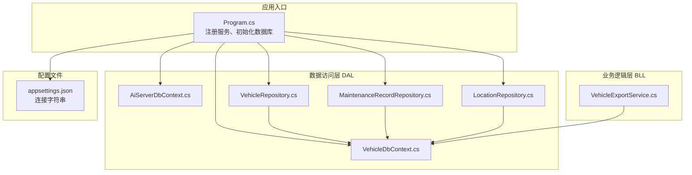
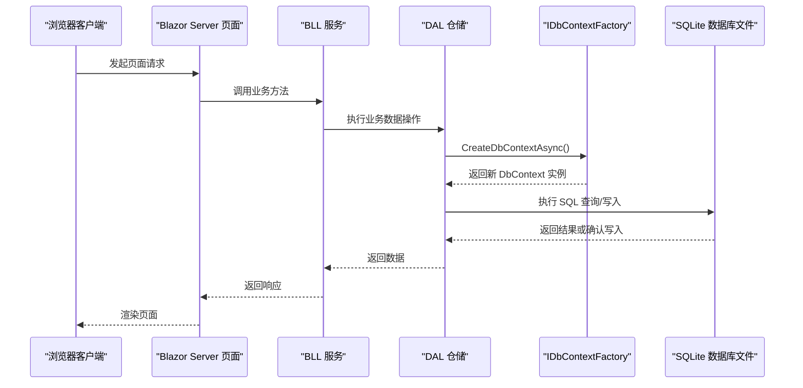
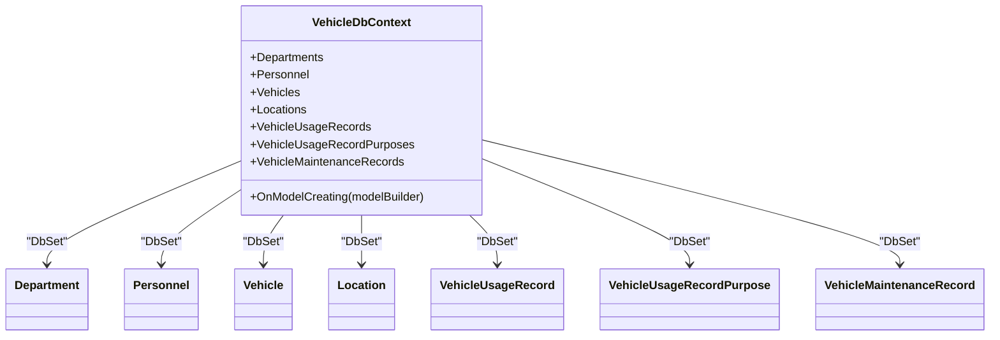
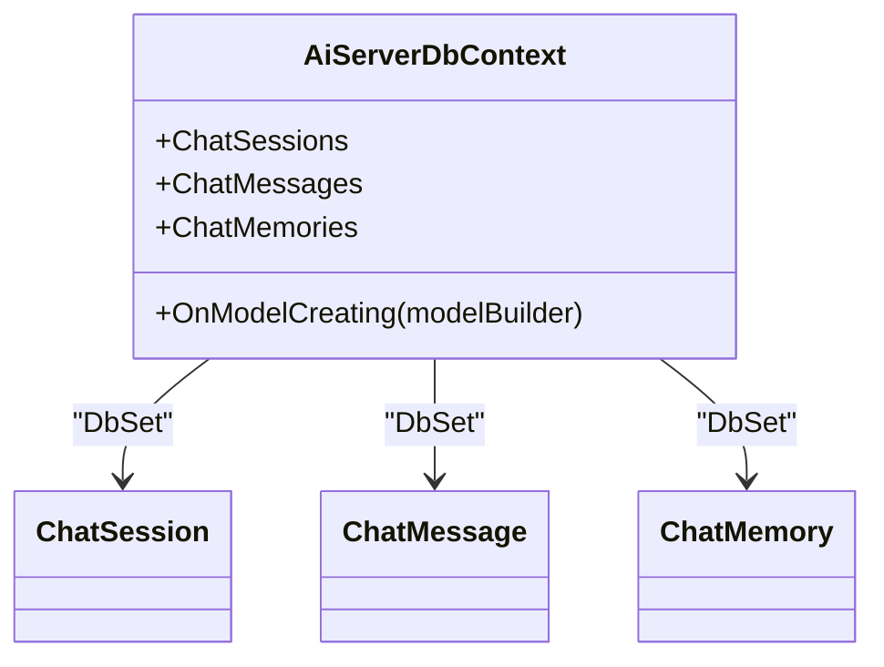
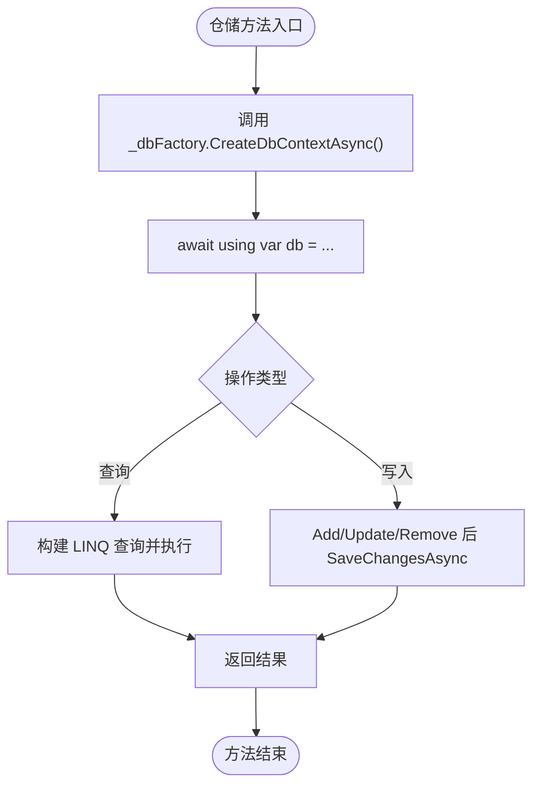
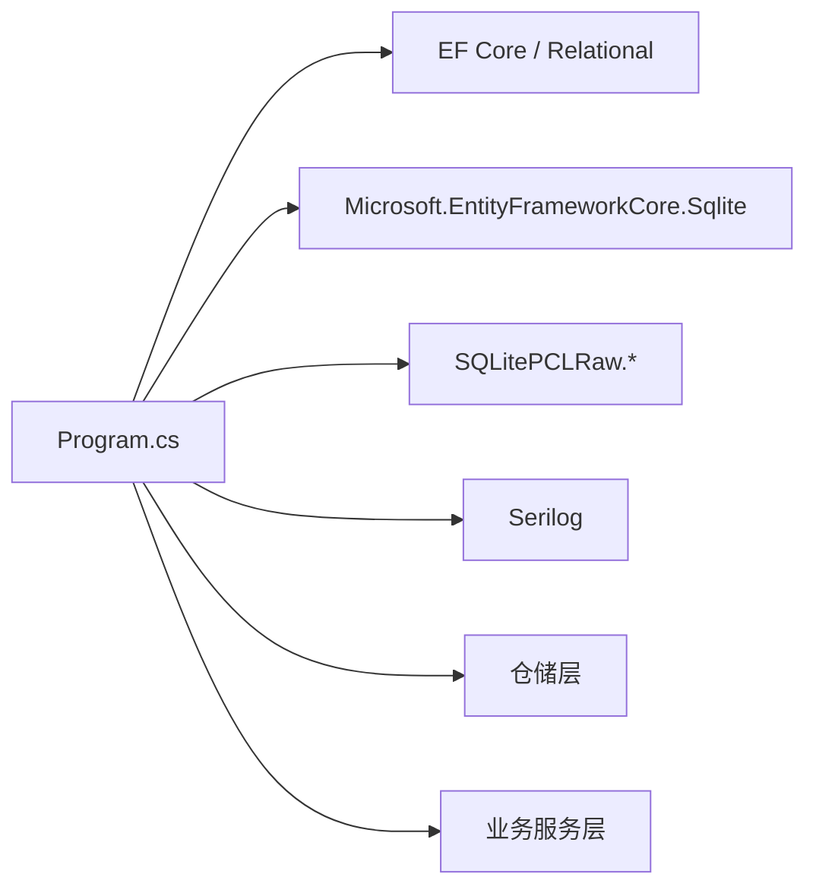

# 数据库连接与操作错误

<cite>
**本文引用的文件**   
- [Program.cs](file://Program.cs)
- [VehicleDbContext.cs](file://DAL/VehicleDbContext.cs)
- [AiServerDbContext.cs](file://aiServer/DAL/AiServerDbContext.cs)
- [appsettings.json](file://appsettings.json)
- [VehicleRepository.cs](file://DAL/Repository/VehicleRepository.cs)
- [MaintenanceRecordRepository.cs](file://DAL/Repository/MaintenanceRecordRepository.cs)
- [LocationRepository.cs](file://DAL/Repository/LocationRepository.cs)
- [VehicleExportService.cs](file://BLL/Export/VehicleExportService.cs)
</cite>

## 目录
1. [引言](#引言)
2. [项目结构](#项目结构)
3. [核心组件](#核心组件)
4. [架构总览](#架构总览)
5. [详细组件分析](#详细组件分析)
6. [依赖关系分析](#依赖关系分析)
7. [性能考虑](#性能考虑)
8. [故障诊断指南](#故障诊断指南)
9. [结论](#结论)
10. [附录：修复与备份流程](#附录修复与备份流程)

## 引言
本指南聚焦 vehicleManagement 系统在 SQLite 环境下的数据库连接与操作错误，覆盖连接失败、并发冲突、文件损坏等常见问题。文档重点说明 DbContextFactory 的使用与配置，解释 Blazor Server 环境下并发访问的解决方案，并提供错误日志分析方法、权限与磁盘空间检查、数据库修复工具使用以及数据备份恢复流程。同时给出性能优化建议与索引优化策略，帮助读者快速定位并解决问题。

## 项目结构
本项目采用分层架构：
- DAL（数据访问层）：定义 DbContext、实体模型与仓储实现，负责数据库访问。
- BLL（业务逻辑层）：封装业务规则与服务方法，调用仓储完成具体业务。
- Pages/Components：Blazor Server 页面与组件，承载用户交互。
- aiServer：AI 服务模块，拥有独立的 DbContext 与仓储，使用独立数据库文件。

**图表来源**
- [Program.cs:52-58](file://Program.cs#L52-L58)
- [VehicleDbContext.cs:6-19](file://DAL/VehicleDbContext.cs#L6-L19)
- [AiServerDbContext.cs:9-18](file://aiServer/DAL/AiServerDbContext.cs#L9-L18)
- [VehicleRepository.cs:10-17](file://DAL/Repository/VehicleRepository.cs#L10-L17)
- [MaintenanceRecordRepository.cs:10-17](file://DAL/Repository/MaintenanceRecordRepository.cs#L10-L17)
- [LocationRepository.cs:12-19](file://DAL/Repository/LocationRepository.cs#L12-L19)
- [VehicleExportService.cs:16-23](file://BLL/Export/VehicleExportService.cs#L16-L23)
- [appsettings.json:3-6](file://appsettings.json#L3-L6)

**章节来源**
- [Program.cs:41-125](file://Program.cs#L41-L125)
- [appsettings.json:1-8](file://appsettings.json#L1-L8)

## 核心组件
- VehicleDbContext：车辆管理主数据库上下文，声明实体集与模型配置，包含多个索引与外键约束。
- AiServerDbContext：AI 服务模块的独立数据库上下文，用于会话、消息与记忆存储。
- Repository 层：通过 IDbContextFactory<VehicleDbContext> 获取 DbContext，避免在 Blazor Server 下共享实例导致的并发问题。
- Program.cs：注册 DbContextFactory、创建 data 目录、确保数据库表存在并初始化种子数据。
- appsettings.json：定义 DefaultConnection 与 AiServerConnection 两个 SQLite 连接字符串。

关键要点：
- 所有仓储均通过工厂模式创建 DbContext，生命周期短且线程安全。
- 启动时确保 data 目录存在，并使用 EnsureCreatedAsync 保证表结构存在。
- AI 模块与主模块使用不同数据库文件，降低相互影响。

**章节来源**
- [VehicleDbContext.cs:6-105](file://DAL/VehicleDbContext.cs#L6-L105)
- [AiServerDbContext.cs:9-56](file://aiServer/DAL/AiServerDbContext.cs#L9-L56)
- [VehicleRepository.cs:10-63](file://DAL/Repository/VehicleRepository.cs#L10-L63)
- [MaintenanceRecordRepository.cs:10-59](file://DAL/Repository/MaintenanceRecordRepository.cs#L10-L59)
- [LocationRepository.cs:12-42](file://DAL/Repository/LocationRepository.cs#L12-L42)
- [Program.cs:52-125](file://Program.cs#L52-L125)
- [appsettings.json:3-6](file://appsettings.json#L3-L6)

## 架构总览
下图展示从请求到数据库访问的关键路径，突出 DbContextFactory 的作用与 Blazor Server 并发隔离。

**图表来源**
- [Program.cs:52-58](file://Program.cs#L52-L58)
- [VehicleRepository.cs:19-36](file://DAL/Repository/VehicleRepository.cs#L19-L36)
- [MaintenanceRecordRepository.cs:19-39](file://DAL/Repository/MaintenanceRecordRepository.cs#L19-L39)
- [VehicleExportService.cs:25-39](file://BLL/Export/VehicleExportService.cs#L25-L39)

## 详细组件分析

### VehicleDbContext 模型与索引
- 实体集合：部门、人员、车辆、地点、使用记录、用途明细、维修记录。
- 索引策略：
  - Personnel.DepartmentId 索引提升按部门筛选效率。
  - Vehicle.LicensePlate、Vehicle.QrCodeToken 唯一索引保障数据唯一性。
  - Vehicle.DepartmentId 索引提升按部门查询效率。
  - Location.Category 索引提升按类别筛选效率。
  - VehicleUsageRecord.VehicleId、DepartmentId、CreatedAt 索引提升常用查询与排序效率。
  - VehicleMaintenanceRecord.VehicleId 索引提升按车辆查询效率。
  - VehicleUsageRecordPurpose.UsageRecordId、(UsageRecordId, SequenceOrder) 复合索引提升用途明细查询与顺序控制。
- 外键删除行为：多数为 Restrict，防止误删；用途明细为 Cascade，删除使用记录时级联删除用途明细。

**图表来源**
- [VehicleDbContext.cs:6-105](file://DAL/VehicleDbContext.cs#L6-L105)

**章节来源**
- [VehicleDbContext.cs:21-105](file://DAL/VehicleDbContext.cs#L21-L105)

### AiServerDbContext 模型与索引
- 实体集合：会话、消息、记忆。
- 索引策略：
  - ChatMessage.SessionId、CreatedAt 索引提升按会话与时间查询效率。
  - ChatMemory.Key、Category 索引提升按键与分类检索效率。
- 默认值：CreatedAt、UpdatedAt 使用 CURRENT_TIMESTAMP。
- 外键删除行为：消息对会话为 Cascade；记忆对会话为 SetNull。

**图表来源**
- [AiServerDbContext.cs:9-56](file://aiServer/DAL/AiServerDbContext.cs#L9-L56)

**章节来源**
- [AiServerDbContext.cs:20-56](file://aiServer/DAL/AiServerDbContext.cs#L20-L56)

### 仓储层与 DbContextFactory 使用
- 所有仓储通过构造函数注入 IDbContextFactory<VehicleDbContext>，并在每个方法中调用 CreateDbContextAsync() 获取新的 DbContext 实例，确保线程安全与并发隔离。
- 典型用法：
  - 查询：CreateDbContextAsync -> IQueryable -> ToListAsync/FirstOrDefaultAsync。
  - 写入：CreateDbContextAsync -> Add/Update/Remove -> SaveChangesAsync。
- 优点：避免在 Blazor Server 下共享 DbContext 实例导致的并发异常与状态污染。

**图表来源**
- [VehicleRepository.cs:19-36](file://DAL/Repository/VehicleRepository.cs#L19-L36)
- [MaintenanceRecordRepository.cs:19-39](file://DAL/Repository/MaintenanceRecordRepository.cs#L19-L39)
- [LocationRepository.cs:21-37](file://DAL/Repository/LocationRepository.cs#L21-L37)

**章节来源**
- [VehicleRepository.cs:10-63](file://DAL/Repository/VehicleRepository.cs#L10-L63)
- [MaintenanceRecordRepository.cs:10-59](file://DAL/Repository/MaintenanceRecordRepository.cs#L10-L59)
- [LocationRepository.cs:12-42](file://DAL/Repository/LocationRepository.cs#L12-L42)

### 导出服务的数据访问
- VehicleExportService 同样通过 IDbContextFactory<VehicleDbContext> 获取 DbContext，进行复杂关联查询以生成导出文件。
- 注意 Include 链较长，需关注 N+1 与性能影响。

**章节来源**
- [VehicleExportService.cs:16-39](file://BLL/Export/VehicleExportService.cs#L16-L39)

## 依赖关系分析
- Program.cs 注册服务：
  - AddDbContextFactory<VehicleDbContext> 与 AddDbContextFactory<AiServerDbContext>，分别绑定 DefaultConnection 与 AiServerConnection。
  - 仓储与服务按作用域注册，确保每次请求获得新的实例。
- 运行时依赖：
  - EF Core Relational、Sqlite、SQLitePCLRaw 提供底层驱动与原生库支持。
  - Serilog 输出日志到控制台与滚动文件。

**图表来源**
- [Program.cs:52-58](file://Program.cs#L52-L58)
- [Program.cs:28-37](file://Program.cs#L28-L37)

**章节来源**
- [Program.cs:28-37](file://Program.cs#L28-L37)
- [Program.cs:52-58](file://Program.cs#L52-L58)

## 性能考虑
- 索引优化：
  - 已为常见查询字段建立索引，如 Vehicle.LicensePlate、Vehicle.DepartmentId、VehicleUsageRecord.VehicleId、CreatedAt 等。
  - 复合索引 (UsageRecordId, SequenceOrder) 提升用途明细的顺序查询。
- 查询优化：
  - 仓储层使用 LINQ 与 Include 进行关联加载，需注意避免过度 Include 导致大对象图传输。
  - 分页与过滤建议在 BLL 层结合前端参数进行，减少不必要数据传输。
- 事务与批量写入：
  - 当前仓储方法多为单条保存，若出现批量写入场景，可考虑在 BLL 层组织事务以减少往返开销。
- 连接与上下文：
  - 使用 DbContextFactory 避免长生命周期上下文带来的内存增长与并发问题。
  - 在高频读取场景，可考虑只读副本或缓存热点数据（需谨慎一致性）。

[本节为通用性能指导，不直接分析具体文件]

## 故障诊断指南

### 常见问题分类
- 连接字符串配置错误
- 权限不足
- 磁盘空间不足
- 并发访问冲突
- 数据库文件损坏

### 连接字符串配置错误
症状：
- 启动时报无法解析连接字符串或找不到数据库文件。
- 日志中出现连接字符串为空或路径无效的错误。

排查步骤：
- 检查 appsettings.json 中的 ConnectionStrings.DefaultConnection 与 ConnectionStrings.AiServerConnection 是否正确指向 data 目录下的 .db 文件。
- 确认 Program.cs 中通过 builder.Configuration.GetConnectionString(...) 正确读取连接字符串。
- 确认运行环境中是否存在 appsettings.Development.json 或其他覆盖配置，避免覆盖默认连接字符串。

参考位置：
- [appsettings.json:3-6](file://appsettings.json#L3-L6)
- [Program.cs:52-58](file://Program.cs#L52-L58)

### 权限不足
症状：
- 无法创建 data 目录或无法写入 .db 文件。
- 日志中出现“拒绝访问”或“权限不足”相关错误。

排查步骤：
- 确认程序对 data 目录具有读写权限。
- 确认 Program.cs 启动时会创建 data 目录，检查该目录是否被其他进程占用或锁定。
- 在容器或部署环境中，确认挂载卷的权限设置。

参考位置：
- [Program.cs:106-108](file://Program.cs#L106-L108)

### 磁盘空间不足
症状：
- 写入失败或数据库扩展失败。
- 日志中出现磁盘空间不足或 I/O 错误。

排查步骤：
- 检查服务器磁盘剩余空间。
- 清理旧日志文件（Serilog 默认保留最近 7 天），避免日志占满磁盘。
- 监控数据库文件大小增长趋势，必要时归档历史数据。

参考位置：
- [Program.cs:34-37](file://Program.cs#L34-L37)

### 并发访问冲突（Blazor Server）
症状：
- 多线程并发访问数据库时出现“数据库已锁定”或“并发冲突”异常。
- 在高并发场景下出现随机失败。

原因与解决：
- 使用 IDbContextFactory<VehicleDbContext> 为每次请求创建新的 DbContext 实例，避免共享实例导致的并发问题。
- 仓储层在每个方法中调用 CreateDbContextAsync() 并 await using 释放上下文，确保线程安全。
- 避免长时间持有 DbContext 或在后台任务中共享同一实例。

参考位置：
- [Program.cs:52-58](file://Program.cs#L52-L58)
- [VehicleRepository.cs:19-36](file://DAL/Repository/VehicleRepository.cs#L19-L36)
- [MaintenanceRecordRepository.cs:19-39](file://DAL/Repository/MaintenanceRecordRepository.cs#L19-L39)

### 数据库文件损坏
症状：
- 启动时报数据库文件损坏或无法打开。
- 查询或写入时出现 SQLite 内部错误。

处理步骤：
- 停止应用程序，避免多进程同时访问。
- 使用 SQLite 提供的修复工具尝试修复数据库文件。
- 若修复失败，从备份恢复数据。
- 检查是否有异常关闭或外部进程锁定了数据库文件。

参考位置：
- [Program.cs:110-125](file://Program.cs#L110-L125)

### 错误日志分析方法
- 查看 Serilog 输出的控制台与滚动日志文件（logs/log-.log）。
- 重点关注启动阶段与数据库访问阶段的异常堆栈。
- 在开发环境启用详细错误页面，便于定位问题。

参考位置：
- [Program.cs:28-37](file://Program.cs#L28-L37)
- [Program.cs:127-130](file://Program.cs#L127-L130)

## 结论
vehicleManagement 系统通过 DbContextFactory 有效解决了 Blazor Server 环境下的数据库并发问题。仓储层统一通过工厂创建 DbContext，确保线程安全与资源释放。配合合理的索引设计与连接字符串配置，系统具备较好的可扩展性与稳定性。针对连接失败、权限不足、磁盘空间不足与数据库损坏等问题，可通过日志分析与标准修复流程快速定位与恢复。在生产环境中，建议持续监控磁盘空间与数据库文件大小，定期备份并制定灾难恢复预案。

[本节为总结性内容，不直接分析具体文件]

## 附录：修复与备份流程

### 数据库修复工具使用方法
- 停止应用程序，确保无进程占用数据库文件。
- 使用 SQLite 官方工具或命令行工具执行修复命令（例如 sqlite3 的 .recover 或第三方工具）。
- 将修复后的数据库文件替换原文件，重启应用验证。

### 数据备份恢复流程
- 备份：
  - 停止应用或使用只读模式复制 .db 文件。
  - 将备份文件保存到安全位置（本地磁盘、云存储等）。
- 恢复：
  - 停止应用。
  - 将备份文件恢复到 data 目录下对应路径。
  - 启动应用，验证数据完整性与功能正常。

### 性能调优建议
- 评估查询热点，补充必要索引（尤其是频繁过滤与排序字段）。
- 优化 Include 链，避免不必要的关联加载。
- 对批量写入场景引入事务与批处理，减少数据库往返。
- 监控日志与数据库文件大小，及时清理与归档。

[本节为通用指导，不直接分析具体文件]