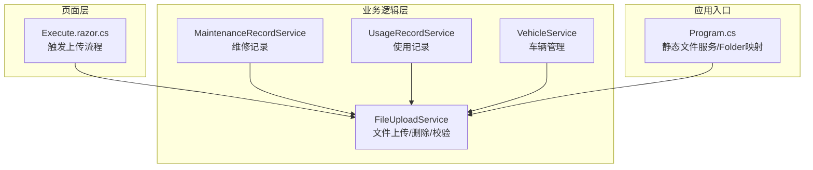
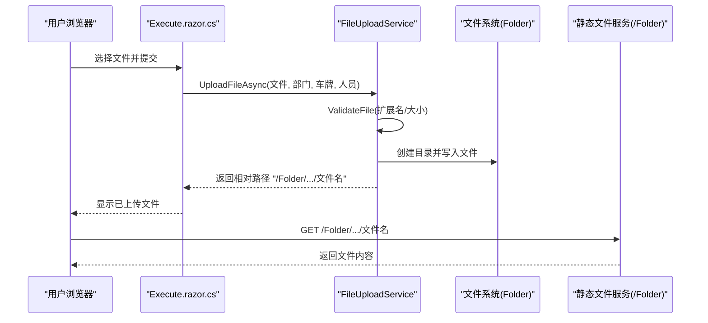
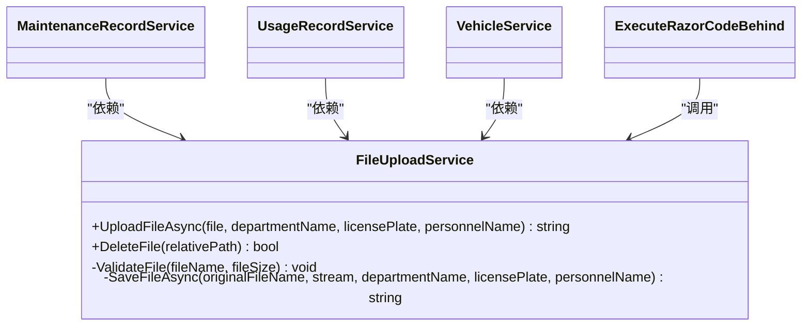

# 文件上传与存储错误

<cite>
**本文引用的文件**   
- [FileUploadService.cs](file://BLL/Common/FileUploadService.cs)
- [Program.cs](file://Program.cs)
- [appsettings.json](file://appsettings.json)
- [Execute.razor.cs](file://Pages/Execute.razor.cs)
- [MaintenanceRecordService.cs](file://BLL/Maintenance/MaintenanceRecordService.cs)
- [UsageRecordService.cs](file://BLL/UsageRecord/UsageRecordService.cs)
- [VehicleService.cs](file://BLL/Vehicle/VehicleService.cs)
</cite>

## 目录
1. [简介](#简介)
2. [项目结构](#项目结构)
3. [核心组件](#核心组件)
4. [架构总览](#架构总览)
5. [详细组件分析](#详细组件分析)
6. [依赖关系分析](#依赖关系分析)
7. [性能与容量规划](#性能与容量规划)
8. [故障排查指南](#故障排查指南)
9. [结论](#结论)
10. [附录：配置与路径约定](#附录配置与路径约定)

## 简介
本指南聚焦 vehicleManagement 系统的文件上传与存储能力，围绕 FileUploadService 的实现细节、Folder 目录的静态文件服务配置与访问权限，给出常见错误的诊断方法与解决步骤。重点覆盖以下问题：
- 文件类型限制与大小限制
- 路径权限与磁盘空间不足
- 大文件上传超时
- 不支持的文件格式
- 路径不存在或相对路径处理异常
同时提供优化建议与清理策略，帮助在生产环境中稳定运行。

## 项目结构
与文件上传和存储直接相关的代码主要位于业务逻辑层（BLL）与程序入口（Program.cs），并在页面侧通过 Execute.razor.cs 调用上传服务。

**图表来源**
- [FileUploadService.cs:12-110](file://BLL/Common/FileUploadService.cs#L12-L110)
- [Program.cs:94-140](file://Program.cs#L94-L140)
- [Execute.razor.cs:120-244](file://Pages/Execute.razor.cs#L120-L244)
- [MaintenanceRecordService.cs:18-22](file://BLL/Maintenance/MaintenanceRecordService.cs#L18-L22)
- [UsageRecordService.cs:23-32](file://BLL/UsageRecord/UsageRecordService.cs#L23-L32)
- [VehicleService.cs:23-30](file://BLL/Vehicle/VehicleService.cs#L23-L30)

**章节来源**
- [FileUploadService.cs:12-110](file://BLL/Common/FileUploadService.cs#L12-L110)
- [Program.cs:94-140](file://Program.cs#L94-L140)
- [Execute.razor.cs:120-244](file://Pages/Execute.razor.cs#L120-L244)

## 核心组件
- FileUploadService：负责文件校验、保存、删除以及返回可访问的相对路径。
- Program.cs：注册静态文件服务，将 Folder 目录映射为 /Folder 访问路径。
- Execute.razor.cs：在借车、维修等场景中调用 FileUploadService 完成附件上传。
- MaintenanceRecordService、UsageRecordService、VehicleService：作为业务服务，依赖 FileUploadService 进行附件关联。

关键行为摘要：
- 允许的图片扩展名：jpg、jpeg、png、gif、webp
- 允许的视频扩展名：mp4、avi、mov、wmv
- 图片最大尺寸：10MB；视频最大尺寸：100MB
- 存储根目录：应用内容根目录下的 Folder
- 最终路径结构：/Folder/{部门}/{车牌}/{人员}/{日期}/{文件名}
- 删除时自动去除返回路径中的 /Folder/ 前缀，避免重复拼接

**章节来源**
- [FileUploadService.cs:15-18](file://BLL/Common/FileUploadService.cs#L15-L18)
- [FileUploadService.cs:21-27](file://BLL/Common/FileUploadService.cs#L21-L27)
- [FileUploadService.cs:29-46](file://BLL/Common/FileUploadService.cs#L29-L46)
- [FileUploadService.cs:48-67](file://BLL/Common/FileUploadService.cs#L48-L67)
- [FileUploadService.cs:69-84](file://BLL/Common/FileUploadService.cs#L69-L84)
- [FileUploadService.cs:92-110](file://BLL/Common/FileUploadService.cs#L92-L110)
- [Program.cs:132-140](file://Program.cs#L132-L140)

## 架构总览
下图展示从页面到文件落盘再到静态资源访问的整体流程。

**图表来源**
- [Execute.razor.cs:120-244](file://Pages/Execute.razor.cs#L120-L244)
- [FileUploadService.cs:29-46](file://BLL/Common/FileUploadService.cs#L29-L46)
- [FileUploadService.cs:92-110](file://BLL/Common/FileUploadService.cs#L92-L110)
- [Program.cs:132-140](file://Program.cs#L132-L140)

## 详细组件分析

### FileUploadService 实现要点与风险点
- 构造阶段确保 Folder 根目录存在，避免首次写入失败。
- 支持两种输入源：IFormFile（服务端模型绑定）与 IBrowserFile（Blazor 客户端）。
- 校验逻辑：
  - 空文件检查
  - 扩展名白名单校验
  - 文件大小上限校验（图片 10MB，视频 100MB）
- 保存逻辑：
  - 按“部门/车牌/人员/日期”组织目录
  - 生成唯一文件名（GUID_原文件名）
  - 返回以 /Folder 开头的相对路径，便于静态文件服务访问
- 删除逻辑：
  - 自动去除返回路径中的 /Folder/ 前缀
  - 拼接物理路径后执行删除

**图表来源**
- [FileUploadService.cs:29-46](file://BLL/Common/FileUploadService.cs#L29-L46)
- [FileUploadService.cs:69-84](file://BLL/Common/FileUploadService.cs#L69-L84)
- [FileUploadService.cs:92-110](file://BLL/Common/FileUploadService.cs#L92-L110)

**章节来源**
- [FileUploadService.cs:21-27](file://BLL/Common/FileUploadService.cs#L21-L27)
- [FileUploadService.cs:29-46](file://BLL/Common/FileUploadService.cs#L29-L46)
- [FileUploadService.cs:48-67](file://BLL/Common/FileUploadService.cs#L48-L67)
- [FileUploadService.cs:69-84](file://BLL/Common/FileUploadService.cs#L69-L84)
- [FileUploadService.cs:92-110](file://BLL/Common/FileUploadService.cs#L92-L110)

### Program.cs 静态文件服务与 Folder 访问
- 启用静态文件中间件
- 将应用内容根目录下的 Folder 映射为 /Folder 访问路径
- 启动时确保 Folder 目录存在

注意：
- 该配置会暴露整个 Folder 树给外部访问，需结合部署环境的安全策略（如反向代理鉴权、IP 白名单）控制访问。
- 若需要更细粒度的访问控制，可在反向代理层对 /Folder 路径增加鉴权或限流。

**章节来源**
- [Program.cs:132-140](file://Program.cs#L132-L140)

### 页面与业务服务中的上传调用
- Execute.razor.cs 在借车、维修等场景收集文件并调用 FileUploadService 上传，随后将返回的路径保存到业务数据中。
- MaintenanceRecordService、UsageRecordService、VehicleService 均注入并使用 FileUploadService，用于附件关联。

**章节来源**
- [Execute.razor.cs:120-244](file://Pages/Execute.razor.cs#L120-L244)
- [MaintenanceRecordService.cs:18-22](file://BLL/Maintenance/MaintenanceRecordService.cs#L18-L22)
- [UsageRecordService.cs:23-32](file://BLL/UsageRecord/UsageRecordService.cs#L23-L32)
- [VehicleService.cs:23-30](file://BLL/Vehicle/VehicleService.cs#L23-L30)

## 依赖关系分析
- FileUploadService 被多个业务服务引用，属于通用基础设施。
- Program.cs 负责静态文件服务挂载，使上传后的文件可通过 HTTP 访问。
- 页面层通过 Execute.razor.cs 发起上传请求，是用户交互入口。

**图表来源**
- [FileUploadService.cs:12-110](file://BLL/Common/FileUploadService.cs#L12-L110)
- [MaintenanceRecordService.cs:18-22](file://BLL/Maintenance/MaintenanceRecordService.cs#L18-L22)
- [UsageRecordService.cs:23-32](file://BLL/UsageRecord/UsageRecordService.cs#L23-L32)
- [VehicleService.cs:23-30](file://BLL/Vehicle/VehicleService.cs#L23-L30)
- [Execute.razor.cs:120-244](file://Pages/Execute.razor.cs#L120-L244)

**章节来源**
- [FileUploadService.cs:12-110](file://BLL/Common/FileUploadService.cs#L12-L110)
- [MaintenanceRecordService.cs:18-22](file://BLL/Maintenance/MaintenanceRecordService.cs#L18-L22)
- [UsageRecordService.cs:23-32](file://BLL/UsageRecord/UsageRecordService.cs#L23-L32)
- [VehicleService.cs:23-30](file://BLL/Vehicle/VehicleService.cs#L23-L30)
- [Execute.razor.cs:120-244](file://Pages/Execute.razor.cs#L120-L244)

## 性能与容量规划
- 单文件体积上限：图片 10MB，视频 100MB。建议在反向代理或网关层设置请求体大小限制，避免大请求进入应用层造成内存压力。
- 并发写入：多用户同时上传可能产生大量小文件或目录，建议：
  - 使用 SSD 或高性能磁盘
  - 合理划分目录层级（当前已按部门/车牌/人员/日期组织）
  - 定期归档历史数据至冷存储
- 静态文件访问：Folder 目录通过静态文件服务暴露，建议：
  - 在反向代理层开启缓存与压缩
  - 对热点文件做 CDN 加速
  - 限制 /Folder 的访问频率与带宽

[本节为通用指导，不直接分析具体文件]

## 故障排查指南

### 1. 大文件上传超时
现象：
- 上传大视频（接近 100MB）时出现超时或中断。

排查步骤：
- 确认前端是否按视频类型传递了正确的 size 参数，以便后端读取流时使用合适的缓冲上限。
- 检查反向代理（如 Nginx、IIS、Kestrel）的请求体大小与超时时间设置。
- 观察服务器磁盘 I/O 与 CPU 占用，确认是否存在瓶颈。
- 在日志中查看是否有“文件不能为空”“不支持的文件格式”“超过大小限制”等异常信息。

解决方法：
- 调整反向代理与应用的请求体大小限制，使其大于等于预期最大文件大小。
- 增大上传超时时间。
- 对超大文件采用分片上传或对象存储服务（如云存储），减轻本地磁盘压力。

**章节来源**
- [FileUploadService.cs:38-46](file://BLL/Common/FileUploadService.cs#L38-L46)
- [FileUploadService.cs:69-84](file://BLL/Common/FileUploadService.cs#L69-L84)

### 2. 文件格式不支持
现象：
- 上传 .pdf、.docx 等非允许格式时报错。

原因：
- 仅允许图片（jpg/jpeg/png/gif/webp）与视频（mp4/avi/mov/wmv）。

解决方法：
- 在前端限制可选文件类型，减少无效提交。
- 如需新增格式，需在 FileUploadService 中扩展白名单，并评估安全与存储成本。

**章节来源**
- [FileUploadService.cs:15-16](file://BLL/Common/FileUploadService.cs#L15-L16)
- [FileUploadService.cs:69-84](file://BLL/Common/FileUploadService.cs#L69-L84)

### 3. 文件大小超限
现象：
- 图片超过 10MB 或视频超过 100MB 时报错。

解决方法：
- 前端在提交前检测文件大小并提示用户。
- 后端保持现有校验逻辑，必要时根据业务需求调整 MaxImageSize 与 MaxVideoSize。

**章节来源**
- [FileUploadService.cs:17-18](file://BLL/Common/FileUploadService.cs#L17-L18)
- [FileUploadService.cs:69-84](file://BLL/Common/FileUploadService.cs#L69-L84)

### 4. 路径不存在或写入失败
现象：
- 首次运行或部署后无法写入文件，报错“路径不存在”或权限不足。

原因：
- Folder 目录未创建或应用进程无写权限。
- 子目录（部门/车牌/人员/日期）创建失败。

解决方法：
- 确认 Program.cs 在启动时创建了 Folder 目录。
- 确认应用运行账户对 Folder 及其子目录具有读写权限。
- 检查磁盘空间是否充足。

**章节来源**
- [Program.cs:135-140](file://Program.cs#L135-L140)
- [FileUploadService.cs:21-27](file://BLL/Common/FileUploadService.cs#L21-L27)
- [FileUploadService.cs:92-100](file://BLL/Common/FileUploadService.cs#L92-L100)

### 5. 存储空间不足
现象：
- 写入文件时报磁盘空间不足错误。

排查步骤：
- 检查服务器磁盘使用率。
- 清理长期未访问的历史附件。
- 考虑将冷数据迁移至对象存储或归档存储。

解决方法：
- 建立定期清理任务，删除过期或无用附件。
- 对热点数据保留副本，冷数据走归档。

**章节来源**
- [FileUploadService.cs:92-110](file://BLL/Common/FileUploadService.cs#L92-L110)

### 6. 删除文件失败
现象：
- 调用删除接口后文件仍存在。

原因：
- 传入的 relativePath 不是 FileUploadService 返回的标准路径，导致拼接错误。
- 目标文件已被其他进程删除。

解决方法：
- 使用 FileUploadService 返回的路径进行删除。
- 检查 DeleteFile 的逻辑是否正确去除 /Folder/ 前缀。

**章节来源**
- [FileUploadService.cs:48-67](file://BLL/Common/FileUploadService.cs#L48-L67)

### 7. 静态文件无法访问
现象：
- 浏览器访问 /Folder/.../文件名 返回 404。

排查步骤：
- 确认 Program.cs 中已启用静态文件服务并映射 /Folder。
- 确认文件确实存在于 Folder 目录下。
- 检查反向代理是否拦截或重写了 /Folder 路径。

解决方法：
- 确保 UseStaticFiles 与 UseStaticFiles(new StaticFileOptions(...)) 顺序正确。
- 在反向代理层放行 /Folder 请求。

**章节来源**
- [Program.cs:132-140](file://Program.cs#L132-L140)

## 结论
FileUploadService 提供了统一的文件上传、校验与存储能力，配合 Program.cs 的静态文件服务，实现了从页面到磁盘再到 HTTP 访问的完整链路。生产环境中应重点关注：
- 文件类型与大小限制的前后端一致性
- Folder 目录的权限与磁盘空间
- 反向代理的请求体大小与超时配置
- 静态文件访问的安全与性能优化
同时建议建立定期清理与归档策略，保障系统长期稳定运行。

[本节为总结性内容，不直接分析具体文件]

## 附录：配置与路径约定
- 数据库连接字符串定义于 appsettings.json，与文件存储无关，但需注意 data 目录的权限与空间。
- Folder 目录为应用内容根目录下的文件夹，通过 /Folder 路径对外提供静态访问。
- 上传文件的相对路径统一以 /Folder 开头，便于前端直接访问。

**章节来源**
- [appsettings.json:1-8](file://appsettings.json#L1-L8)
- [Program.cs:132-140](file://Program.cs#L132-L140)
- [FileUploadService.cs:92-110](file://BLL/Common/FileUploadService.cs#L92-L110)