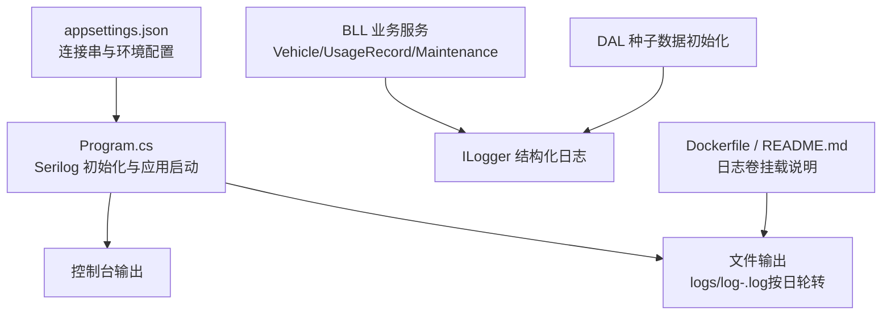
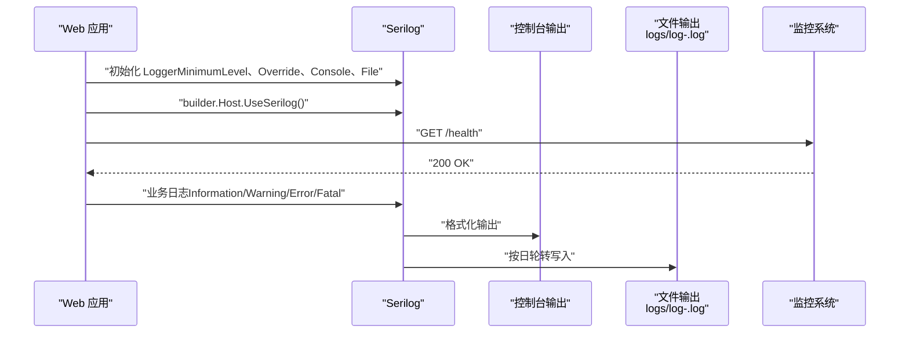
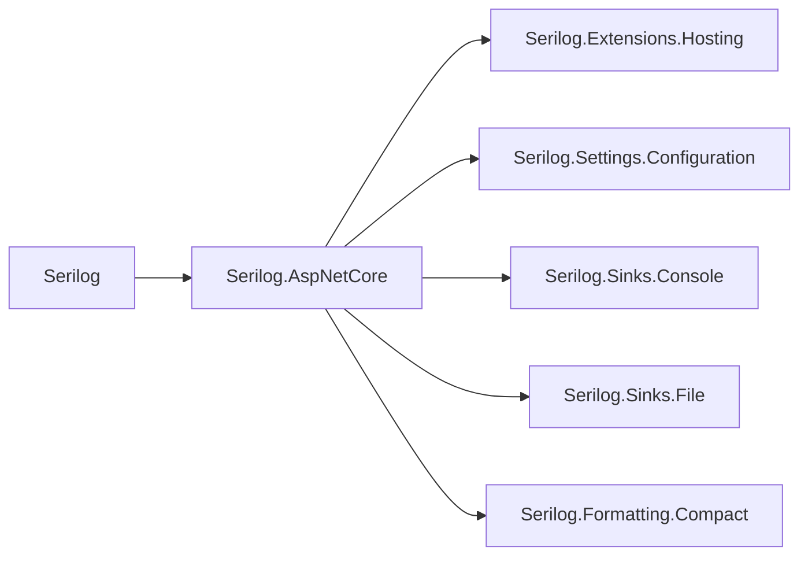

# 日志分析与监控告警

<cite>
**本文引用的文件**   
- [Program.cs](file://Program.cs)
- [appsettings.json](file://appsettings.json)
- [appsettings.Development.json](file://appsettings.Development.json)
- [vehicleManagement.csproj](file://vehicleManagement.csproj)
- [Dockerfile](file://Dockerfile)
- [README.md](file://README.md)
- [VehicleService.cs](file://BLL/Vehicle/VehicleService.cs)
- [UsageRecordService.cs](file://BLL/UsageRecord/UsageRecordService.cs)
- [MaintenanceRecordService.cs](file://BLL/Maintenance/MaintenanceRecordService.cs)
- [SeedDataInitializer.cs](file://DAL/SeedDataInitializer.cs)
</cite>

## 目录
1. [引言](#引言)
2. [项目结构](#项目结构)
3. [核心组件](#核心组件)
4. [架构总览](#架构总览)
5. [详细组件分析](#详细组件分析)
6. [依赖关系分析](#依赖关系分析)
7. [性能与容量规划](#性能与容量规划)
8. [故障排查指南](#故障排查指南)
9. [结论](#结论)
10. [附录：指标与告警建议](#附录指标与告警建议)

## 引言
本指南面向 vehicleManagement 系统的运维、开发与平台团队，聚焦以下目标：
- 说明 Serilog 的配置选项、日志级别策略，以及控制台输出与文件轮转行为。
- 给出错误模式识别、性能瓶颈定位、用户行为追踪的日志分析方法。
- 提供可落地的监控指标定义与告警规则建议。
- 总结生产环境的日志收集策略与性能调优要点。

当前系统已在启动阶段初始化 Serilog，并启用控制台与按日轮转的文件输出；业务层通过依赖注入使用 ILogger 记录关键操作；应用暴露了健康检查端点，便于外部监控系统探测存活状态。

## 项目结构
从日志与监控视角，本项目的关键位置如下：
- 应用入口 Program.cs：集中配置 Serilog、注册服务、构建并运行 Web 应用。
- 配置文件 appsettings.json：数据库连接串等基础配置。
- 业务服务 BLL/*：在删除、更新、查询等关键路径中记录结构化日志。
- 数据初始化 DAL/SeedDataInitializer.cs：在开发环境执行种子数据时记录初始化过程。
- Docker 与部署文档：说明日志目录挂载与运行时参数。

图表来源
- [Program.cs:28-43](file://Program.cs#L28-L43)
- [appsettings.json:1-8](file://appsettings.json#L1-L8)
- [README.md:321-336](file://README.md#L321-L336)

章节来源
- [Program.cs:28-158](file://Program.cs#L28-L158)
- [appsettings.json:1-8](file://appsettings.json#L1-L8)
- [README.md:321-336](file://README.md#L321-L336)

## 核心组件
本节梳理与日志和监控直接相关的核心实现。

- Serilog 全局 Logger 初始化
  - 默认最低级别为 Information。
  - 对 Microsoft 与 Microsoft.EntityFrameworkCore 命名空间进行覆盖，抑制框架与 EF Core SQL 日志至 Warning。
  - 控制台输出模板包含时间戳、级别、消息与异常信息。
  - 文件输出采用 logs/log-.log 前缀，按日轮转，保留最近 7 个文件。
  - 通过 builder.Host.UseSerilog() 将 Serilog 集成到 ASP.NET Core 宿主。

- 应用生命周期中的日志
  - 启动失败时记录 Fatal 级别日志。
  - 启动完成后关闭并刷新日志。

- 业务层日志
  - VehicleService、UsageRecordService、MaintenanceRecordService 在删除、清理附件、成功操作等场景记录结构化日志。
  - SeedDataInitializer 在开发环境记录种子数据初始化过程。

- 健康检查
  - 暴露 /health 端点，返回简单文本，用于存活探测。

章节来源
- [Program.cs:28-43](file://Program.cs#L28-L43)
- [Program.cs:145-157](file://Program.cs#L145-L157)
- [VehicleService.cs:169-201](file://BLL/Vehicle/VehicleService.cs#L169-L201)
- [UsageRecordService.cs:122-153](file://BLL/UsageRecord/UsageRecordService.cs#L122-L153)
- [MaintenanceRecordService.cs:73-99](file://BLL/Maintenance/MaintenanceRecordService.cs#L73-L99)
- [SeedDataInitializer.cs:20-86](file://DAL/SeedDataInitializer.cs#L20-L86)

## 架构总览
下图展示日志与监控相关的数据流：应用启动时创建 Serilog Logger，随后业务代码通过依赖注入写入日志；控制台与文件 Sink 负责输出；外部监控系统可通过 /health 探测存活，并结合日志采集器抓取文件日志进行分析与告警。

图表来源
- [Program.cs:28-43](file://Program.cs#L28-L43)
- [Program.cs:145-157](file://Program.cs#L145-L157)

## 详细组件分析

### Serilog 配置与日志级别
- 默认级别
  - MinimumLevel.Information：捕获 Information 及以上级别日志。
- 命名空间覆盖
  - Microsoft 与 Microsoft.EntityFrameworkCore 被覆盖为 Warning，减少框架噪声。
- 控制台输出
  - 输出模板包含时间、级别、消息与异常，便于快速定位问题。
- 文件轮转
  - 路径 logs/log-.log，rollingInterval=Day，retainedFileCountLimit=7。
- 宿主集成
  - UseSerilog() 将 Serilog 接入 ASP.NET Core 日志管道。

建议
- 生产环境可将 MinimumLevel 调整为 Warning，仅在需要调试时临时提升。
- 如需结构化 JSON 日志以便 ELK/Loki 解析，可在文件 Sink 上启用紧凑格式或自定义格式化器。
- 若需区分不同模块的日志级别，可按命名空间继续细化 Override。

章节来源
- [Program.cs:28-43](file://Program.cs#L28-L43)

### 控制台与文件输出
- 控制台
  - 适合开发环境与容器标准输出采集。
- 文件
  - 按日轮转，保留最近 7 天日志，避免磁盘膨胀。
  - 生产环境建议将 logs 目录挂载到持久卷，便于日志采集器统一抓取。

章节来源
- [Program.cs:33-36](file://Program.cs#L33-L36)
- [README.md:321-336](file://README.md#L321-L336)

### 业务日志埋点现状
- VehicleService
  - 删除车辆时清理图片附件，记录成功与失败日志。
- UsageRecordService
  - 删除使用记录时清理图片与视频附件，记录成功与失败日志。
- MaintenanceRecordService
  - 删除维修记录时清理附件，记录成功与失败日志。
- SeedDataInitializer
  - 记录全量/增量种子数据的插入情况。

建议
- 在新增、更新、审批、导出、二维码生成等关键路径补充结构化日志，包含用户标识、车辆标识、部门标识、操作结果与耗时。
- 对异常分支统一记录 Error 级别日志，附带上下文参数与堆栈。

章节来源
- [VehicleService.cs:169-201](file://BLL/Vehicle/VehicleService.cs#L169-L201)
- [UsageRecordService.cs:122-153](file://BLL/UsageRecord/UsageRecordService.cs#L122-L153)
- [MaintenanceRecordService.cs:73-99](file://BLL/Maintenance/MaintenanceRecordService.cs#L73-L99)
- [SeedDataInitializer.cs:20-86](file://DAL/SeedDataInitializer.cs#L20-L86)

### 健康检查与存活探测
- 暴露 GET /health，返回简单文本，可用于 Kubernetes LivenessProbe 或负载均衡健康检查。
- 建议后续扩展为包含数据库连通性、磁盘空间、队列积压等维度的健康检查。

章节来源
- [Program.cs:145-146](file://Program.cs#L145-L146)

## 依赖关系分析
Serilog 及其相关包在项目依赖中存在，包括核心库、ASP.NET Core 集成、控制台与文件 Sink 等。这为当前日志能力提供了基础支撑。

图表来源
- [vehicleManagement.csproj](file://vehicleManagement.csproj)

章节来源
- [vehicleManagement.csproj](file://vehicleManagement.csproj)

## 性能与容量规划
- 日志级别
  - 生产环境建议使用 Warning 作为默认级别，降低 I/O 压力；仅在排障时临时提升到 Information。
- 文件轮转
  - 已启用按日轮转与保留 7 天，建议结合磁盘配额与日志采集频率评估存储成本。
- 数据库日志
  - EF Core SQL 日志默认被抑制至 Warning，避免高频 SQL 语句造成日志风暴。
- 健康检查
  - /health 应轻量且快速返回，避免引入额外开销。

[本节为通用指导，不直接分析具体文件]

## 故障排查指南

### 错误模式识别
- 启动失败
  - 观察 Fatal 级别日志，确认启动阶段抛出的异常与原因。
- 删除附件失败
  - 关注 Error 级别日志，常见原因为文件被占用或路径不可访问。
- 数据一致性
  - 删除车辆前校验是否存在使用记录，若存在则拒绝删除并返回提示。

章节来源
- [Program.cs:150-157](file://Program.cs#L150-L157)
- [VehicleService.cs:169-201](file://BLL/Vehicle/VehicleService.cs#L169-L201)
- [UsageRecordService.cs:122-153](file://BLL/UsageRecord/UsageRecordService.cs#L122-L153)
- [MaintenanceRecordService.cs:73-99](file://BLL/Maintenance/MaintenanceRecordService.cs#L73-L99)

### 性能瓶颈定位
- 慢查询
  - 若开启 EF Core 日志，关注慢 SQL 与 N+1 查询；当前默认抑制 EF Core SQL 日志，建议在测试环境按需开启。
- 分页与排序
  - 列表接口使用 Skip/Take 分页，注意大数据集下的 CountAsync 开销。
- 文件 I/O
  - 删除附件涉及文件系统操作，若频繁失败会影响用户体验与事务一致性。

章节来源
- [VehicleService.cs:67-108](file://BLL/Vehicle/VehicleService.cs#L67-L108)
- [UsageRecordService.cs:43-91](file://BLL/UsageRecord/UsageRecordService.cs#L43-L91)
- [MaintenanceRecordService.cs:30-58](file://BLL/Maintenance/MaintenanceRecordService.cs#L30-L58)

### 用户行为追踪
- 建议在以下操作增加结构化日志：
  - 登录/鉴权、借用/归还车辆、导出报表、批量导入、AI 对话调用。
- 关键字段建议：
  - UserId、DepartmentId、VehicleId、Action、Result、DurationMs、TraceId。

[本节为方法论建议，不直接分析具体文件]

## 结论
vehicleManagement 已具备基础的 Serilog 日志能力，涵盖控制台与按日轮转的文件输出，并在业务关键路径中记录了删除与清理附件等操作。配合 /health 健康检查，可满足基本的存活探测需求。为进一步完善可观测性，建议：
- 在生产环境调整默认日志级别，控制 I/O 开销。
- 补充关键业务流程的结构化日志，便于错误模式识别与用户行为追踪。
- 建立统一的监控指标与告警规则，结合日志采集系统进行自动化告警。
- 将日志目录纳入持久卷管理，确保日志可采集与长期留存。

[本节为总结性内容，不直接分析具体文件]

## 附录：指标与告警建议

### 监控指标定义
- 可用性
  - HTTP 健康检查成功率（/health）。
- 业务量
  - 每日新增使用记录数、维修记录数、车辆变更次数。
- 性能
  - 页面加载 P95/P99 耗时、数据库查询耗时、文件 I/O 失败率。
- 资源
  - 磁盘使用率（logs 目录）、内存与 CPU 使用率。

### 告警规则建议
- 健康检查连续失败超过阈值（如 3 次）触发高优先级告警。
- 错误日志速率突增（如每分钟 Error 数量超过阈值）触发告警。
- 文件删除失败率超过阈值（如 5%）触发告警。
- 磁盘使用率超过阈值（如 80%）触发扩容或清理告警。

[本节为通用建议，不直接分析具体文件]