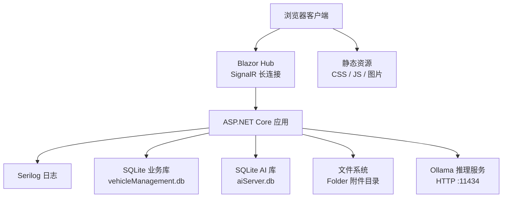
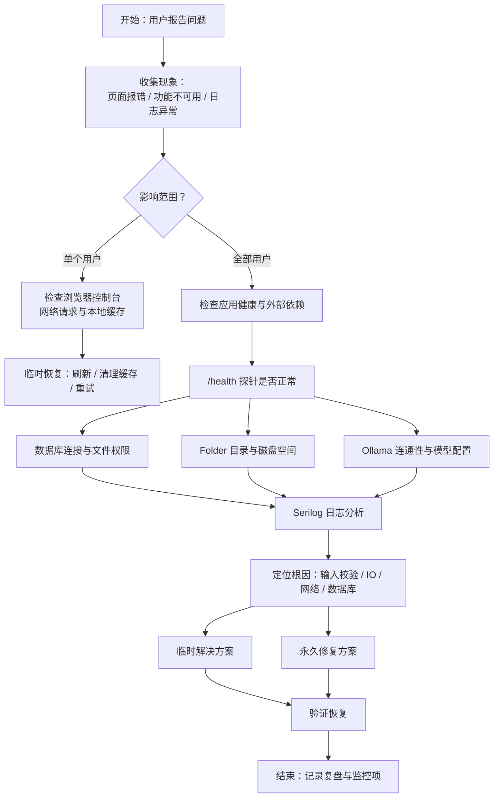
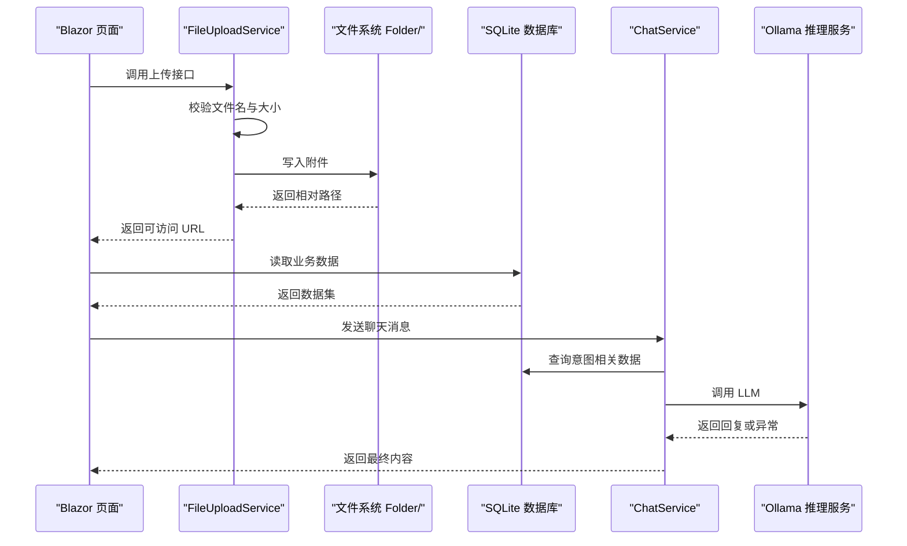

# 错误诊断与解决

<cite>
**本文引用的文件**   
- [Program.cs](file://Program.cs)
- [appsettings.json](file://appsettings.json)
- [aisettings.json](file://aisettings.json)
- [aisettings.example.json](file://aisettings.example.json)
- [VehicleDbContext.cs](file://DAL/VehicleDbContext.cs)
- [FileUploadService.cs](file://BLL/Common/FileUploadService.cs)
- [ChatService.cs](file://aiServer/BLL/ChatService.cs)
- [Error.cshtml](file://Pages/Error.cshtml)
- [site.css](file://wwwroot/css/site.css)
- [Execute.razor.cs](file://Pages/Execute.razor.cs)
- [README.md](file://README.md)
</cite>

## 目录
1. [引言](#引言)
2. [项目结构与错误边界](#项目结构与错误边界)
3. [常见错误类型与根因定位](#常见错误类型与根因定位)
4. [错误日志分析指南](#错误日志分析指南)
5. [典型故障案例与处理流程](#典型故障案例与处理流程)
6. [系统化排查流程](#系统化排查流程)
7. [依赖关系与错误传播图](#依赖关系与错误传播图)
8. [性能与并发注意事项](#性能与并发注意事项)
9. [预防性措施与监控告警](#预防性措施与监控告警)
10. [结论](#结论)

## 引言
本指南面向 vehicleManagement 系统的运维人员、开发人员和一线支持人员，目标是把“现象 → 根因 → 临时恢复 → 永久修复”的排错路径标准化。系统使用 Blazor Server、EF Core + SQLite、Serilog 日志、Semantic Kernel + Ollama AI 推理，并包含文件上传、二维码执行、维修记录等高频业务入口。文档覆盖数据库连接失败、文件上传错误、AI 服务连接问题、Blazor Hub 连接断开等核心场景，并提供可操作的检查清单和可视化流程图。

## 项目结构与错误边界
vehicleManagement 是一个 Blazor Server 应用，启动阶段完成日志初始化、配置加载、数据库创建、静态资源与路由注册；运行时通过 `/health` 暴露健康探针，异常在开发环境走开发者异常页，生产环境统一跳转到 `/Error`。AI 子系统与业务库分离，分别维护 `vehicleManagement.db` 与 `aiServer.db`，并通过 Semantic Kernel 调用本地 Ollama 模型。

**图表来源**
- [Program.cs:28-37](file://Program.cs#L28-L37)
- [Program.cs:41-102](file://Program.cs#L41-L102)
- [Program.cs:104-148](file://Program.cs#L104-L148)
- [appsettings.json:3-6](file://appsettings.json#L3-L6)

**章节来源**
- [Program.cs:28-37](file://Program.cs#L28-L37)
- [Program.cs:41-102](file://Program.cs#L41-L102)
- [Program.cs:104-148](file://Program.cs#L104-L148)
- [appsettings.json:3-6](file://appsettings.json#L3-L6)

## 常见错误类型与根因定位

### 数据库连接失败
- **典型现象**
  - 应用启动时报数据库相关异常。
  - 页面加载数据失败，或出现 EF Core 相关错误。
  - 容器内无法访问挂载卷中的 `data` 目录。
- **可能根因**
  - `DefaultConnection` 或 `AiServerConnection` 指向的 SQLite 文件不存在或无写权限。
  - `data/` 目录未创建或 Docker 卷未正确挂载。
  - SQLite 文件损坏导致 `EnsureCreatedAsync` 或后续查询失败。
  - 多进程同时写入同一 SQLite 文件造成锁竞争。
- **快速定位**
  - 检查 `appsettings.json` 中连接字符串是否指向预期路径。
  - 确认程序运行账户对 `data/` 有读写权限。
  - 查看 Serilog 日志中 SQLite/EF Core 异常堆栈。
  - 若部署在容器中，确认 `-v /data/vm/db:/app/data` 已挂载。
- **临时恢复**
  - 备份损坏的 `.db` 文件后重建数据库。
  - 在开发环境重新运行以触发建库与种子数据初始化。
- **永久修复**
  - 确保部署脚本自动创建 `data/` 目录并设置合适权限。
  - 使用 `IDbContextFactory` 避免 Blazor Server 并发共享 DbContext（当前已采用）。
  - 对关键数据增加定期备份策略。

**章节来源**
- [Program.cs:52-58](file://Program.cs#L52-L58)
- [Program.cs:106-125](file://Program.cs#L106-L125)
- [appsettings.json:3-6](file://appsettings.json#L3-L6)
- [README.md:321-336](file://README.md#L321-L336)

### 文件上传错误
- **典型现象**
  - 上传按钮点击后提示“文件不能为空”“不支持的文件格式”“文件大小不能超过限制”。
  - 保存成功但前端无法预览附件。
  - 删除附件后仍显示旧文件。
- **可能根因**
  - 传入文件对象为空或长度为 0。
  - 文件扩展名不在允许列表。
  - 图片超过 10MB、视频超过 100MB。
  - 目标目录权限不足或磁盘空间不足。
  - 返回路径前缀 `/Folder/` 与后端拼接逻辑不一致。
- **快速定位**
  - 查看 `FileUploadService` 抛出的 `ArgumentException` 消息。
  - 检查 `Folder/` 目录是否存在且可写。
  - 核对上传页面的异常捕获输出。
- **临时恢复**
  - 更换为允许格式的小文件重试。
  - 手动创建 `Folder/` 目录并赋予写权限。
- **永久修复**
  - 在前端增加文件格式与大小校验。
  - 在服务端增加更明确的错误码与用户友好提示。
  - 对附件路径解析做规范化处理，避免 `/Folder/` 重复拼接。

**章节来源**
- [FileUploadService.cs:29-46](file://BLL/Common/FileUploadService.cs#L29-L46)
- [FileUploadService.cs:69-84](file://BLL/Common/FileUploadService.cs#L69-L84)
- [FileUploadService.cs:92-110](file://BLL/Common/FileUploadService.cs#L92-L110)
- [Execute.razor.cs:125-126](file://Pages/Execute.razor.cs#L125-L126)
- [Execute.razor.cs:166-167](file://Pages/Execute.razor.cs#L166-L167)

### AI 服务连接问题
- **典型现象**
  - AI 聊天回复直接返回“AI 服务暂时不可用：...”或空响应。
  - 首次对话正常，后续请求频繁超时。
  - 容器内无法解析 Ollama 地址。
- **可能根因**
  - Ollama 服务未启动或端口不通。
  - `aisettings.json` 或环境变量中的 `OllamaEndpoint` 配置错误。
  - `OllamaModel` 与实际拉取的模型 tag 不一致。
  - 网络防火墙阻止到 Ollama 的 HTTP 请求。
  - Semantic Kernel 调用 LLM 时发生异常被兜底捕获。
- **快速定位**
  - 先验证 Ollama 接口是否可用。
  - 检查 `aisettings.json` 与注入的环境变量。
  - 查看 ChatService 中 LLM 调用的异常信息。
- **临时恢复**
  - 重启 Ollama 服务。
  - 修正 `OllamaEndpoint` 或 `OllamaModel`。
  - 在容器中使用宿主机 IP 或 `host.docker.internal`。
- **永久修复**
  - 将 Ollama 作为独立服务管理，增加健康检查。
  - 对 AI 调用增加重试与降级策略。
  - 在日志中区分网络超时、模型不存在、空响应等错误类型。

**章节来源**
- [Program.cs:97-102](file://Program.cs#L97-L102)
- [aisettings.json:1-6](file://aisettings.json#L1-L6)
- [aisettings.example.json:1-6](file://aisettings.example.json#L1-L6)
- [ChatService.cs:188-199](file://aiServer/BLL/ChatService.cs#L188-L199)
- [README.md:106-118](file://README.md#L106-L118)
- [README.md:157-183](file://README.md#L157-L183)

### 并发访问冲突
- **典型现象**
  - 高并发下出现 SQLite 数据库锁定或写入失败。
  - Blazor Server 多个会话同时访问数据库时偶发异常。
- **可能根因**
  - SQLite 本身不适合高并发写操作。
  - 多个请求共享同一个 DbContext 实例。
- **快速定位**
  - 观察日志中 SQLite 锁相关异常。
  - 检查是否使用了 `AddDbContextFactory`。
- **临时恢复**
  - 降低并发写入频率。
  - 重启应用释放 SQLite 句柄。
- **永久修复**
  - 继续使用 `IDbContextFactory` 为每次请求创建独立上下文。
  - 对写操作加限流或队列化。
  - 评估迁移到更适合并发写的数据库。

**章节来源**
- [Program.cs:52-58](file://Program.cs#L52-L58)
- [Program.cs:110-125](file://Program.cs#L110-L125)

## 错误日志分析指南

### Serilog 日志解读
- 默认最低级别为 `Information`，框架日志与 EF Core SQL 日志被抑制到 `Warning`。
- 控制台输出模板包含时间戳、级别、消息和异常。
- 文件日志按天滚动，保留最近 7 份。
- 启动失败会记录 `Fatal` 级别日志。

**建议排查步骤**
1. 优先查看 `logs/log-YYYY-MM-DD.log`。
2. 搜索 `Exception` 关键字定位异常堆栈。
3. 关注启动阶段的 `应用程序启动失败` 日志。
4. 结合 `DetailedErrors` 与开发模式增强诊断。

**章节来源**
- [Program.cs:28-37](file://Program.cs#L28-L37)
- [Program.cs:150-157](file://Program.cs#L150-L157)
- [appsettings.Development.json:1-3](file://appsettings.Development.json#L1-L3)

### 异常堆栈跟踪
- 文件上传错误通常表现为 `ArgumentException`，消息包含具体原因。
- AI 调用异常会被 ChatService 捕获并转为友好文本，但仍应记录原始异常以便排查。
- 数据库异常通常伴随 EF Core 或 SQLite 底层错误信息。

**建议排查步骤**
1. 从日志中提取完整异常类型与消息。
2. 根据异常类型判断是输入校验、IO、网络还是数据库问题。
3. 对 AI 异常补充结构化日志，区分连接失败、超时、空响应。

**章节来源**
- [FileUploadService.cs:29-46](file://BLL/Common/FileUploadService.cs#L29-L46)
- [FileUploadService.cs:69-84](file://BLL/Common/FileUploadService.cs#L69-L84)
- [ChatService.cs:188-199](file://aiServer/BLL/ChatService.cs#L188-L199)

### 错误模式识别
- “文件不能为空”：前端未选择文件或上传对象为空。
- “不支持的文件格式”：扩展名不在允许列表。
- “文件大小不能超过限制”：超出图片 10MB 或视频 100MB。
- “AI 服务暂时不可用”：Ollama 不可达或推理失败。
- “应用程序启动失败”：启动阶段抛出未捕获异常。

**章节来源**
- [FileUploadService.cs:29-46](file://BLL/Common/FileUploadService.cs#L29-L46)
- [FileUploadService.cs:69-84](file://BLL/Common/FileUploadService.cs#L69-L84)
- [ChatService.cs:188-199](file://aiServer/BLL/ChatService.cs#L188-L199)
- [Program.cs:150-157](file://Program.cs#L150-L157)

## 典型故障案例与处理流程

### 案例一：SQLite 数据库损坏修复
- **现象**
  - 启动时报 SQLite 相关异常。
  - 页面无法加载数据。
- **根因**
  - `vehicleManagement.db` 或 `aiServer.db` 损坏。
  - 非正常关闭导致文件状态不一致。
- **处理流程**
  1. 停止应用。
  2. 备份 `data/vehicleManagement.db` 与 `data/aiServer.db`。
  3. 删除损坏文件或使用 SQLite 工具尝试修复。
  4. 重新启动应用，触发 `EnsureCreatedAsync` 重建结构。
  5. 在开发环境重新初始化种子数据。
- **预防措施**
  - 定期备份 `data/` 目录。
  - 避免多进程同时写入同一 SQLite 文件。
  - 对关键表增加数据校验与审计日志。

**章节来源**
- [Program.cs:106-125](file://Program.cs#L106-L125)
- [appsettings.json:3-6](file://appsettings.json#L3-L6)

### 案例二：Ollama 服务连接超时
- **现象**
  - AI 聊天返回“AI 服务暂时不可用”。
  - 首次请求成功，后续请求频繁超时。
- **根因**
  - Ollama 服务未启动或端口不通。
  - `OllamaEndpoint` 配置错误。
  - 容器内 `localhost` 指向容器自身而非宿主机。
- **处理流程**
  1. 使用 curl 测试 Ollama 接口。
  2. 检查 `aisettings.json` 与 `AiServer__OllamaEndpoint` 环境变量。
  3. 修正模型 tag，确保与 `ollama list` 一致。
  4. 容器部署时使用宿主机 IP 或 `host.docker.internal`。
  5. 重启应用使配置热重载生效。
- **预防措施**
  - 为 Ollama 增加健康检查。
  - 在应用侧增加连接探测与重试。
  - 将模型名称与版本纳入配置变更管控。

**章节来源**
- [Program.cs:97-102](file://Program.cs#L97-L102)
- [aisettings.json:1-6](file://aisettings.json#L1-L6)
- [aisettings.example.json:1-6](file://aisettings.example.json#L1-L6)
- [ChatService.cs:188-199](file://aiServer/BLL/ChatService.cs#L188-L199)
- [README.md:106-118](file://README.md#L106-L118)
- [README.md:157-183](file://README.md#L157-L183)

### 案例三：Blazor Hub 连接断开
- **现象**
  - 页面底部出现 Blazor 错误提示条。
  - 用户长时间不操作后页面刷新或断连。
  - 移动端网络切换后连接不稳定。
- **根因**
  - SignalR 长连接被代理、防火墙或 NAT 中断。
  - 服务器内存压力或会话超时。
  - 客户端网络波动导致重连失败。
- **处理流程**
  1. 检查 `/health` 是否返回正常。
  2. 查看浏览器控制台与 Network 面板中 SignalR 连接状态。
  3. 检查反向代理是否支持 WebSocket。
  4. 调整 Blazor Server 会话超时与心跳参数。
  5. 在客户端增加重连提示与用户引导。
- **预防措施**
  - 在负载均衡器启用 WebSocket 支持。
  - 配置连接超时与重试策略。
  - 监控 SignalR 连接数与断连率。

**章节来源**
- [site.css:3-20](file://wwwroot/css/site.css#L3-L20)
- [Program.cs:142-148](file://Program.cs#L142-L148)
- [Error.cshtml:1-13](file://Pages/Error.cshtml#L1-L13)

## 系统化排查流程

[此图为概念流程，不直接映射具体源码]

## 依赖关系与错误传播图

**图表来源**
- [FileUploadService.cs:29-46](file://BLL/Common/FileUploadService.cs#L29-L46)
- [FileUploadService.cs:92-110](file://BLL/Common/FileUploadService.cs#L92-L110)
- [ChatService.cs:94-139](file://aiServer/BLL/ChatService.cs#L94-L139)
- [ChatService.cs:188-199](file://aiServer/BLL/ChatService.cs#L188-L199)

## 性能与并发注意事项
- SQLite 适合低并发读、有限并发写场景，应避免在高并发环境下直接写入。
- 使用 `IDbContextFactory` 可为每个请求创建独立 DbContext，减少共享状态风险。
- 文件上传应限制大小与类型，避免大文件阻塞 I/O。
- AI 调用属于外部 HTTP 依赖，应设置合理超时与重试策略，避免拖慢主流程。
- 日志滚动保留 7 份，需监控磁盘占用，避免日志撑满磁盘。

**章节来源**
- [Program.cs:52-58](file://Program.cs#L52-L58)
- [Program.cs:28-37](file://Program.cs#L28-L37)
- [FileUploadService.cs:15-18](file://BLL/Common/FileUploadService.cs#L15-L18)

## 预防性措施与监控告警
- **数据库**
  - 每日备份 `data/` 目录。
  - 监控 SQLite 文件大小与增长趋势。
  - 对关键表增加唯一约束与索引，减少脏数据。
- **文件存储**
  - 监控 `Folder/` 目录权限与磁盘剩余空间。
  - 对上传失败增加告警，统计失败率与失败原因分布。
- **AI 服务**
  - 监控 Ollama 接口可用性、响应时间与错误率。
  - 对模型名称与端点变更进行配置审计。
- **应用健康**
  - 持续探测 `/health`。
  - 监控 Blazor Hub 连接数与断连率。
  - 对启动失败、未处理异常、Serilog 写入失败设置告警。

[本节为通用指导，不直接分析具体文件]

## 结论
vehicleManagement 的错误诊断应以“日志优先、依赖分层、临时恢复与永久修复并重”为原则。数据库问题聚焦连接字符串、目录权限与 SQLite 并发特性；文件上传问题聚焦校验规则与文件系统权限；AI 问题聚焦 Ollama 连通性与模型配置；Blazor Hub 问题聚焦网络代理与连接稳定性。通过系统化排查流程、可视化依赖图与预防性监控，可以显著缩短平均修复时间并提升系统可用性。