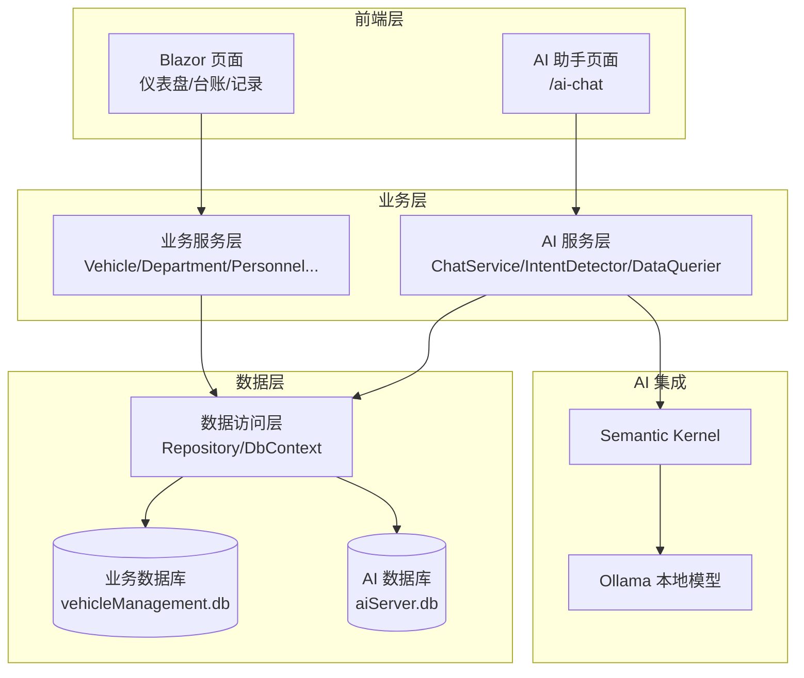

# 快速开始

<cite>
**本文引用的文件**   
- [README.md](file://README.md)
- [aisettings.example.json](file://aisettings.example.json)
- [appsettings.json](file://appsettings.json)
- [Dockerfile](file://Dockerfile)
- [Program.cs](file://Program.cs)
- [vehicleManagement.csproj](file://vehicleManagement.csproj)
- [ChatService.cs](file://aiServer/BLL/ChatService.cs)
- [AiChat.razor](file://aiServer/Pages/AiChat.razor)
- [SeedDataInitializer.cs](file://DAL/SeedDataInitializer.cs)
</cite>

## 目录
1. [简介](#简介)
2. [环境准备](#环境准备)
3. [完整安装步骤](#完整安装步骤)
4. [Ollama 配置详解](#ollama-配置详解)
5. [启动与访问](#启动与访问)
6. [验证安装的测试用例](#验证安装的测试用例)
7. [常见问题排查](#常见问题排查)
8. [Docker 部署指南](#docker-部署指南)
9. [高级配置选项](#高级配置选项)
10. [架构总览](#架构总览)
11. [结论](#结论)

## 简介
本指南面向首次接触 vehicleManagement 系统的用户，目标是在 **15 分钟内** 完成本地运行，并支持有经验的开发者进行高级配置。系统基于 .NET 10 Blazor Server，使用 SQLite 存储业务数据与 AI 会话数据，通过 Semantic Kernel 连接本地 Ollama 模型，实现自然语言查询车辆、部门、人员、使用记录等能力。

## 环境准备
在开始之前，请确保本机满足以下要求：

| 项目 | 要求 | 说明 |
| --- | --- | --- |
| .NET SDK | .NET 10（net10.0） | 项目目标框架为 `net10.0`，需安装对应 SDK |
| Ollama | 已安装并可本地运行 | 用于加载本地小模型，默认监听 `http://localhost:11434` |
| SQLite | 由 EF Core 自动提供 | 无需单独安装，EF Core 依赖会处理运行时组件 |
| 端口 | 5000（应用）、11434（Ollama） | 避免与其他服务冲突 |
| 磁盘空间 | 至少预留模型与数据库文件空间 | Ollama 模型与 SQLite 文件会占用磁盘 |

**章节来源**
- [vehicleManagement.csproj:4](file://vehicleManagement.csproj#L4)
- [README.md:141-153](file://README.md#L141-L153)

## 完整安装步骤
按照以下步骤操作，可在本地成功运行系统：

1. **克隆仓库**  
   将 vehicleManagement 代码克隆到本地目录。

2. **安装 Ollama 并拉取模型**  
   ```bash
   ollama pull gemma3:4b
   ollama serve
   ```
   默认监听地址为 `http://localhost:11434`。

3. **配置 AI 服务**  
   复制示例配置文件并重命名为 `aisettings.json`：
   ```bash
   cp aisettings.example.json aisettings.json
   ```
   打开 `aisettings.json`，将 `OllamaModel` 修改为你实际拉取的模型标签（例如 `gemma3:4b`）。

4. **初始化数据库**  
   首次运行会自动创建 SQLite 数据库并写入种子数据（仅开发环境）。

5. **启动应用**  
   ```bash
   dotnet restore
   dotnet run
   ```
   启动后访问 `http://localhost:5000`。

**章节来源**
- [README.md:87-100](file://README.md#L87-L100)
- [Program.cs:106-125](file://Program.cs#L106-L125)
- [SeedDataInitializer.cs:18-87](file://DAL/SeedDataInitializer.cs#L18-L87)

## Ollama 配置详解
Ollama 的配置采用三级取值机制，优先级从高到低如下：

| 优先级 | 来源 | 说明 |
| --- | --- | --- |
| 1 | 环境变量 `AiServer__OllamaEndpoint` / `AiServer__OllamaModel` | 容器或外部注入时覆盖其他配置 |
| 2 | `aisettings.json` | 可选文件，支持热重载，修改后无需重启 |
| 3 | 代码兜底值 | 未配置时使用 `http://localhost:11434` 和默认模型名 |

### 模型拉取与服务启动
- 拉取模型：`ollama pull gemma3:4b`
- 启动服务：`ollama serve`
- 验证连通性：
  ```bash
  curl http://localhost:11434/api/chat -d '{
    "model": "gemma3:4b",
    "messages": [{"role": "user", "content": "你好"}]
  }'
  ```

### 端口配置
- Ollama 默认监听 `11434` 端口。
- 如果端口被占用，请在 Ollama 启动前释放该端口或修改 Ollama 配置。
- 应用默认监听 `5000` 端口，可通过 ASP.NET Core 配置调整。

**章节来源**
- [README.md:163-183](file://README.md#L163-L183)
- [aisettings.example.json:1-7](file://aisettings.example.json#L1-L7)
- [Program.cs:97-102](file://Program.cs#L97-L102)

## 启动与访问
启动成功后，浏览器访问 `http://localhost:5000`，你将看到仪表盘页面。主要功能入口包括：

| 路由 | 页面 | 说明 |
| --- | --- | --- |
| `/` | 仪表盘 | 车辆总览、部门分布、用车趋势 |
| `/vehicles` | 车辆台账 | 增删改查、状态管理、二维码生成 |
| `/departments` | 部门 | 主数据维护 |
| `/personnel` | 人员 | 在职/离职状态管理 |
| `/locations` | 地点 | 出发地/目的地分类 |
| `/usage-records` | 使用记录 | 出车时间、里程、用途记录 |
| `/borrow/{VehicleId}` | 出车申请 | 车辆上下文下的申请表单 |
| `/maintenance/{VehicleId}` | 维修登记 | 单次维修录入 |
| `/maintenance-records` | 维修记录 | 历史维修查询 |
| `/execute/{Token}` | 扫码执行 | 司机扫码定位单据并执行 |
| `/ai-chat` | AI 助手 | 多会话、记忆面板、移动端适配 |
| `/health` | 健康检查 | 容器健康探针 |

**章节来源**
- [README.md:122-139](file://README.md#L122-L139)

## 验证安装的测试用例
完成安装后，请按以下步骤验证系统是否正常运行：

### 1. 访问仪表盘
- 打开浏览器访问 `http://localhost:5000`
- 确认能看到车辆总览、部门分布图表和近 6 个月用车趋势

### 2. 打开 AI 助手
- 导航到 `/ai-chat` 页面
- 点击「开始新对话」创建新会话
- 选择内置引导问题之一，如「目前有哪些车辆在用？」

### 3. 执行基本查询
- 尝试以下查询语句：
  - 「帮我查一下各部门的车辆分布」
  - 「最近一周有哪些使用记录？」
  - 「如何添加新的使用记录？」
- 确认 AI 能返回结构化数据并给出中文回答

### 4. 验证 Ollama 连通性
- 在终端执行：
  ```bash
  curl http://localhost:11434/api/chat -d '{
    "model": "gemma3:4b",
    "messages": [{"role": "user", "content": "你好"}]
  }'
  ```
- 应收到包含回复内容的 JSON 响应

**章节来源**
- [README.md:102-118](file://README.md#L102-L118)
- [AiChat.razor:257-263](file://aiServer/Pages/AiChat.razor#L257-L263)

## 常见问题排查

### Ollama 连接问题
**现象**：AI 助手显示「AI 服务暂时不可用」

**排查步骤**：
1. 检查 Ollama 服务是否运行：`curl http://localhost:11434`
2. 确认模型标签一致：`ollama list` 输出应与 `aisettings.json` 中的 `OllamaModel` 完全匹配
3. 检查环境变量是否覆盖配置：容器环境中 `AiServer__OllamaEndpoint` 可能覆盖文件配置
4. 验证网络连通性：Linux 容器中 `localhost` 指向容器自身，需使用宿主机 IP 或 `host.docker.internal`

**解决方案**：
- 重新启动 Ollama 服务
- 修正 `aisettings.json` 中的模型标签
- 在 Docker 中设置正确的环境变量

### 数据库初始化失败
**现象**：启动时报错无法创建数据库文件或表结构错误

**排查步骤**：
1. 检查 `data` 目录是否存在且可写
2. 确认连接字符串配置正确：`appsettings.json` 中的 `DefaultConnection` 和 `AiServerConnection`
3. 查看日志文件：`logs/log-.log` 获取详细错误信息
4. 确认权限：确保应用进程对 `data` 目录有读写权限

**解决方案**：
- 手动创建 `data` 目录并赋予适当权限
- 修正连接字符串路径
- 清理损坏的数据库文件后重新启动

### 端口冲突
**现象**：应用启动失败，提示端口已被占用

**排查步骤**：
1. 检查 5000 端口是否被其他应用占用
2. 检查 11434 端口是否被其他 Ollama 实例占用
3. 查看进程列表找到占用端口的进程

**解决方案**：
- 停止占用端口的进程
- 修改应用监听端口或 Ollama 端口
- 使用不同的端口组合重新部署

### 模型响应异常
**现象**：AI 返回空响应或乱码

**排查步骤**：
1. 验证模型是否正确加载：`ollama list`
2. 检查模型文件大小和完整性
3. 确认内存充足，4B 模型需要足够 RAM
4. 查看 Ollama 日志获取推理错误详情

**解决方案**：
- 重新拉取模型文件
- 增加系统内存分配
- 更换更小的模型版本

**章节来源**
- [README.md:106-118](file://README.md#L106-L118)
- [Program.cs:145-146](file://Program.cs#L145-L146)
- [ChatService.cs:188-199](file://aiServer/BLL/ChatService.cs#L188-L199)

## Docker 部署指南

### 快速部署命令
```bash
docker build -t vehicle-management .
docker run -d -p 5000:80 \
  -e AiServer__OllamaEndpoint=http://192.168.1.10:11434 \
  -e AiServer__OllamaModel=gemma3:4b \
  -v /data/vm/db:/app/data \
  -v /data/vm/logs:/app/logs \
  -v /data/vm/attachments:/app/Folder \
  vehicle-management
```

### 参数说明
| 参数 | 说明 | 必需 |
| --- | --- | --- |
| `-p 5000:80` | 映射容器 80 端口到宿主机 5000 端口 | 是 |
| `-e AiServer__OllamaEndpoint` | 指定 Ollama 服务地址 | 是 |
| `-e AiServer__OllamaModel` | 指定要使用的模型标签 | 是 |
| `-v /data/vm/db:/app/data` | 持久化数据库文件 | 推荐 |
| `-v /data/vm/logs:/app/logs` | 持久化日志文件 | 推荐 |
| `-v /data/vm/attachments:/app/Folder` | 持久化上传附件 | 推荐 |

### 构建参数
| 参数 | 默认值 | 说明 |
| --- | --- | --- |
| `OLLAMA_ENDPOINT` | `http://localhost:11434` | Ollama 服务地址 |
| `OLLAMA_MODEL` | `gemma4:e2b` | 模型标签 |

### 健康检查
容器内置健康检查，每 30 秒检查一次 `/health` 端点。

**章节来源**
- [Dockerfile:31-41](file://Dockerfile#L31-L41)
- [README.md:323-336](file://README.md#L323-L336)

## 高级配置选项

### 自定义 Ollama 端点
除了默认的 `http://localhost:11434`，你可以配置内网或其他机器上的 Ollama 服务：

1. 编辑 `aisettings.json`：
   ```json
   {
     "AiServer": {
       "OllamaEndpoint": "http://your-ollama-server:11434",
       "OllamaModel": "your-model-tag"
     }
   }
   ```

2. 或使用环境变量（容器部署推荐）：
   ```bash
   export AiServer__OllamaEndpoint=http://your-ollama-server:11434
   export AiServer__OllamaModel=your-model-tag
   ```

### 自定义数据库路径
修改 `appsettings.json` 中的连接字符串：
```json
{
  "ConnectionStrings": {
    "DefaultConnection": "Data Source=/custom/path/vehicleManagement.db",
    "AiServerConnection": "Data Source=/custom/path/aiServer.db"
  }
}
```

### 日志级别配置
在 `Program.cs` 中调整 Serilog 配置以获取更多或更少日志信息。

### 内存优化
对于资源受限的环境，可以考虑：
- 使用更小的模型（如 1B-2B 参数规模）
- 限制 AI 会话历史长度
- 调整 SQLite 缓存大小

**章节来源**
- [README.md:338-341](file://README.md#L338-L341)
- [appsettings.json:1-8](file://appsettings.json#L1-L8)
- [Program.cs:28-37](file://Program.cs#L28-L37)

## 架构总览
vehicleManagement 系统采用分层架构，核心组件关系如下：



**图表来源**
- [Program.cs:48-102](file://Program.cs#L48-L102)
- [README.md:55-83](file://README.md#L55-L83)

## 结论
通过以上步骤，你应该已经成功在本地运行了 vehicleManagement 系统。该系统提供了完整的车辆管理功能和智能 AI 助手，支持自然语言查询和数据可视化。

**关键要点回顾**：
- 确保 .NET 10 SDK 和 Ollama 已正确安装
- 配置 `aisettings.json` 指向正确的 Ollama 模型
- 首次运行会自动初始化数据库和种子数据
- 通过 `/ai-chat` 体验智能问答功能
- 使用 Docker 进行生产环境部署

如果遇到任何问题，请参考常见问题排查部分，或查看系统日志获取详细信息。