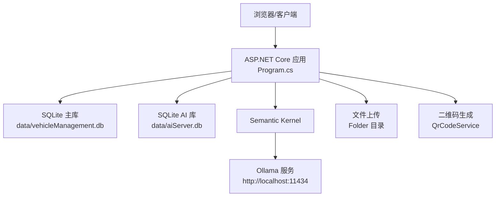
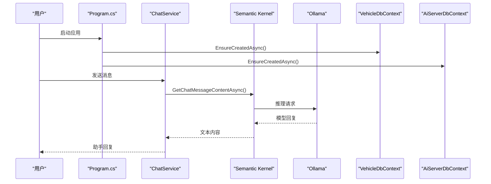
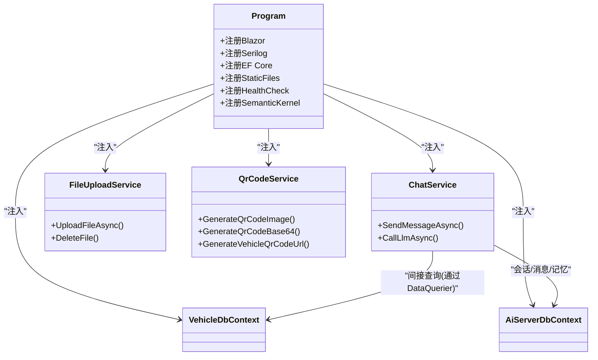

# 常见问题与解决方案

<cite>
**本文引用的文件**   
- [Program.cs](file://Program.cs)
- [appsettings.json](file://appsettings.json)
- [aiSettings.example.json](file://aiSettings.example.json)
- [aisettings.json](file://aisettings.json)
- [VehicleDbContext.cs](file://DAL/VehicleDbContext.cs)
- [AiServerDbContext.cs](file://aiServer/DAL/AiServerDbContext.cs)
- [ChatService.cs](file://aiServer/BLL/ChatService.cs)
- [FileUploadService.cs](file://BLL/Common/FileUploadService.cs)
- [QrCodeService.cs](file://BLL/Common/QrCodeService.cs)
- [SeedDataInitializer.cs](file://DAL/SeedDataInitializer.cs)
- [README.md](file://README.md)
</cite>

## 目录
1. [简介](#简介)
2. [项目结构](#项目结构)
3. [核心组件](#核心组件)
4. [架构总览](#架构总览)
5. [详细问题与解决方案](#详细问题与解决方案)
6. [依赖关系分析](#依赖关系分析)
7. [性能与稳定性建议](#性能与稳定性建议)
8. [故障排查指南](#故障排查指南)
9. [结论](#结论)
10. [附录：诊断脚本](#附录诊断脚本)

## 简介
本文件面向 vehicleManagement 系统的运维与开发人员，聚焦以下五类常见问题：Ollama 连接失败、数据库初始化错误、AI 服务不可用、文件上传失败、二维码生成异常。每个问题均包含症状描述、根因分析、解决步骤、预防措施与参考日志定位方式，并附带可执行的快速诊断命令，帮助你在生产与开发环境中快速定位和恢复服务。

## 项目结构
vehicleManagement 是一个基于 ASP.NET Core + Blazor Server 的车辆管理系统，同时内嵌 AI 对话能力（Semantic Kernel + Ollama）。关键路径如下：
- 应用启动与依赖注入在 Program.cs 中完成，包括 Serilog 日志、Blazor、EF Core DbContextFactory、静态文件、健康检查等。
- 主业务数据库上下文 VehicleDbContext 与 AI 模块数据库上下文 AiServerDbContext 分别管理车辆数据与聊天会话/记忆数据。
- AI 对话通过 ChatService 调用 Semantic Kernel，最终访问 Ollama。
- 文件上传由 FileUploadService 负责，默认保存到应用根目录下的 Folder 子目录。
- 二维码生成由 QrCodeService 提供，依赖 QRCoder 库。

图表来源
- [Program.cs:41-148](file://Program.cs#L41-L148)
- [appsettings.json:3-6](file://appsettings.json#L3-L6)
- [aiSettings.example.json:1-6](file://aiSettings.example.json#L1-L6)

章节来源
- [Program.cs:28-148](file://Program.cs#L28-L148)
- [appsettings.json:1-8](file://appsettings.json#L1-L8)

## 核心组件
- 应用启动与配置加载：Program.cs 负责注册 Blazor、Serilog、EF Core、静态文件、健康检查，以及 Ollama/Semantic Kernel 的接入点。
- 数据库上下文：
  - VehicleDbContext：定义车辆相关实体与关系映射。
  - AiServerDbContext：定义聊天会话、消息、记忆等实体与关系映射。
- AI 对话：ChatService 封装意图识别、取数、历史构建与 LLM 调用。
- 文件上传：FileUploadService 校验格式与大小、创建按日期分层的目录结构、保存文件并返回相对 URL。
- 二维码：QrCodeService 生成 PNG 图片字节或 Base64，并支持生成车辆执行页链接。

章节来源
- [Program.cs:52-102](file://Program.cs#L52-L102)
- [VehicleDbContext.cs:6-106](file://DAL/VehicleDbContext.cs#L6-L106)
- [AiServerDbContext.cs:9-56](file://aiServer/DAL/AiServerDbContext.cs#L9-L56)
- [ChatService.cs:18-42](file://aiServer/BLL/ChatService.cs#L18-L42)
- [FileUploadService.cs:12-110](file://BLL/Common/FileUploadService.cs#L12-L110)
- [QrCodeService.cs:6-39](file://BLL/Common/QrCodeService.cs#L6-L39)

## 架构总览
下图展示从请求到 AI 回复的关键调用链，以及数据库与文件存储的交互位置。

图表来源
- [Program.cs:109-125](file://Program.cs#L109-L125)
- [ChatService.cs:94-139](file://aiServer/BLL/ChatService.cs#L94-L139)
- [ChatService.cs:188-199](file://aiServer/BLL/ChatService.cs#L188-L199)

## 详细问题与解决方案

### 一、Ollama 连接失败
症状
- AI 对话返回“AI 服务暂时不可用”或空响应。
- 页面能打开但无法获取 AI 回复。
- 容器或进程启动后，/health 正常，但 /ai-chat 报错。

根因分析
- Ollama 服务未运行或端口不通。
- aisettings.json 中的 OllamaEndpoint/OllamaModel 与实际部署不一致。
- 容器环境里 localhost 指向容器自身而非宿主机。
- 模型名称 tag 与 ollama list 输出不一致。
- Semantic Kernel 初始化时使用的 Endpoint 或模型名无效。

解决步骤
1. 确认 Ollama 服务状态
   - 本地直接访问：curl http://localhost:11434/api/chat
   - 若使用远程 Ollama，替换为实际 IP 或域名。
2. 核对配置
   - 检查 aisettings.json 或环境变量是否覆盖 AiServer:OllamaEndpoint 与 AiServer:OllamaModel。
   - 确保模型 tag 与 ollama list 完全一致。
3. 容器网络
   - Linux 容器中 localhost 指容器自身，应使用宿主机 IP 或 host.docker.internal。
4. 验证应用侧配置读取
   - Program.cs 会从 Configuration 读取 AiServer:OllamaEndpoint 与 AiServer:OllamaModel，并在启动时注册 Semantic Kernel。
5. 观察日志
   - 查看 logs/log-.log 中是否有启动失败或连接异常。
   - 关注 ChatService.CallLlmAsync 捕获的异常信息。

预防措施
- 将 aisettings.json 纳入版本控制外的部署配置，避免硬编码。
- 在 CI/CD 中加入 Ollama 连通性检查。
- 对模型名称进行白名单校验，防止拼写错误。

参考日志
- 应用启动失败：Program.cs 全局 try/catch 会记录致命错误。
- AI 调用异常：ChatService.CallLlmAsync 捕获异常并返回友好提示。

章节来源
- [Program.cs:97-102](file://Program.cs#L97-L102)
- [Program.cs:149-153](file://Program.cs#L149-L153)
- [ChatService.cs:188-199](file://aiServer/BLL/ChatService.cs#L188-L199)
- [README.md:107-118](file://README.md#L107-L118)

### 二、数据库初始化错误
症状
- 启动时报 SQLite 文件权限错误或无法写入 data/ 目录。
- 表不存在或种子数据未插入。
- 连接字符串指向的路径不存在或无写权限。

根因分析
- data/ 目录不存在或无写权限。
- appsettings.json 中 DefaultConnection/AiServerConnection 路径不正确。
- EF Core 迁移未执行（当前使用 EnsureCreatedAsync，非迁移模式）。
- SeedDataInitializer 仅在 Development 环境且数据库为空时执行全量重建。

解决步骤
1. 检查 data/ 目录
   - 确保应用进程对 data/ 有读写权限。
   - Program.cs 会在启动时创建 data/ 目录。
2. 检查连接字符串
   - appsettings.json 中 DefaultConnection 与 AiServerConnection 必须指向有效的 SQLite 文件路径。
3. 确认初始化逻辑
   - Program.cs 启动时会调用 EnsureCreatedAsync 创建表；Development 环境下还会执行 SeedDataInitializer.InitializeAsync。
4. 清理损坏数据库（谨慎）
   - 若数据库损坏，可删除对应 .db 文件后重启应用，让 EnsureCreatedAsync 重建。
5. 观察日志
   - 查看 logs/log-.log 中是否有 EF Core 或种子数据相关错误。

预防措施
- 在部署脚本中预创建 data/ 目录并设置最小权限。
- 使用只读挂载时禁用写入操作，或改用外部持久卷。
- 将连接字符串集中管理，避免硬编码。

参考日志
- 启动阶段 EnsureCreatedAsync 与 SeedDataInitializer 的执行结果会记录在日志中。

章节来源
- [Program.cs:106-125](file://Program.cs#L106-L125)
- [appsettings.json:3-6](file://appsettings.json#L3-L6)
- [SeedDataInitializer.cs:20-35](file://DAL/SeedDataInitializer.cs#L20-L35)

### 三、AI 服务不可用
症状
- 对话接口返回“AI 服务暂时不可用”。
- 语义理解、意图识别正常，但 LLM 回复失败。
- 内存不足导致 Ollama 或进程崩溃。

根因分析
- Semantic Kernel 未正确注入 IChatCompletionService。
- Ollama 端点或模型名配置错误。
- 模型加载失败或显存/内存不足。
- ChatService.CallLlmAsync 捕获异常后返回友好提示，但未重试或降级。

解决步骤
1. 检查 Semantic Kernel 注册
   - Program.cs 中通过 AddOllamaChatCompletion 注册 Kernel，并单例注入。
2. 检查 ChatService 构造
   - ChatService 通过 kernel.GetRequiredService<IChatCompletionService>() 获取推理服务。
3. 验证 Ollama 连通性与模型可用性
   - 使用 curl 测试 /api/chat，确认模型名称与 tag。
4. 调整资源
   - 增加宿主内存或选择更小的模型。
5. 观察日志
   - 查看 ChatService.CallLlmAsync 捕获的异常信息。

预防措施
- 在启动时做一次轻量级健康检查（例如调用一次短消息），失败则告警。
- 对模型名称进行白名单校验与预热加载。
- 为 Ollama 配置合理的超时与重试策略。

参考日志
- ChatService.CallLlmAsync 捕获异常并返回“AI 服务暂时不可用：{ex.Message}”。

章节来源
- [Program.cs:97-102](file://Program.cs#L97-L102)
- [ChatService.cs:29-42](file://aiServer/BLL/ChatService.cs#L29-L42)
- [ChatService.cs:188-199](file://aiServer/BLL/ChatService.cs#L188-L199)

### 四、文件上传失败
症状
- 上传按钮点击后无响应或报错。
- 提示“不支持的文件格式”或“文件大小不能超过...”。
- 上传成功但无法通过 /Folder 访问。

根因分析
- 文件格式不在允许列表（图片/视频扩展名）。
- 文件大小超过限制（图片 10MB，视频 100MB）。
- Folder 目录无写权限或路径不存在。
- 前端传递的 IBrowserFile/IFormFile 为空或长度为零。

解决步骤
1. 检查文件格式与大小
   - FileUploadService.ValidateFile 会校验扩展名与大小限制。
2. 检查 Folder 目录权限
   - Program.cs 会在启动时创建 Folder 目录并提供静态文件访问。
   - 确保应用进程对 Folder 有写权限。
3. 检查前端传参
   - 确保部门、车牌、人员名称不为空，便于组织目录结构。
4. 访问上传文件
   - 使用 /Folder/{relativePath} 访问已上传文件。

预防措施
- 在前端也做格式与大小校验，减少后端异常。
- 定期清理过期附件，避免磁盘占满。
- 对上传路径做安全校验，防止路径穿越。

参考日志
- FileUploadService 抛出 ArgumentException 时，上层 UI 会显示错误信息。

章节来源
- [FileUploadService.cs:29-46](file://BLL/Common/FileUploadService.cs#L29-L46)
- [FileUploadService.cs:69-84](file://BLL/Common/FileUploadService.cs#L69-L84)
- [FileUploadService.cs:92-110](file://BLL/Common/FileUploadService.cs#L92-L110)
- [Program.cs:134-140](file://Program.cs#L134-L140)

### 五、二维码生成异常
症状
- 生成二维码时报错或图片为空。
- 二维码内容无效或 Token 为空。
- 生成的二维码无法扫描或链接错误。

根因分析
- QrCodeService.GenerateQrCodeImage 要求 content 非空。
- GenerateVehicleQrCodeUrl 要求 qrCodeToken 非空。
- QRCoder 依赖库版本冲突或缺少运行时依赖。
- 字体缺失通常不影响 PNG 生成，但若后续渲染到特定控件可能受影响。

解决步骤
1. 检查输入参数
   - 确保传入 content 与 qrCodeToken 非空。
2. 检查依赖库
   - 确认项目中引用了 QRCoder 且版本兼容。
3. 生成与预览
   - 使用 GenerateQrCodeBase64 生成 Base64 图片，或在页面中预览。
4. 生成车辆执行页链接
   - 使用 GenerateVehicleQrCodeUrl 生成 /execute/{token} 链接。

预防措施
- 在业务层生成 Token 后立即校验非空。
- 对二维码内容进行长度与字符集校验。
- 在 CI 中引入依赖版本锁定，避免升级破坏。

参考日志
- QrCodeService 对空参数抛出 ArgumentException。

章节来源
- [QrCodeService.cs:8-18](file://BLL/Common/QrCodeService.cs#L8-L18)
- [QrCodeService.cs:27-39](file://BLL/Common/QrCodeService.cs#L27-L39)

## 依赖关系分析
- Program.cs 是入口，负责：
  - 注册 Blazor、Serilog、EF Core、静态文件、健康检查。
  - 注入 VehicleDbContext 与 AiServerDbContext。
  - 注入业务服务与仓储。
  - 注入 Semantic Kernel 并连接 Ollama。
- ChatService 依赖：
  - ChatSessionRepository、ChatMessageRepository、MemoryService、DataQuerier、Kernel。
- FileUploadService 依赖：
  - IWebHostEnvironment，用于确定 Folder 根目录。
- QrCodeService 依赖：
  - QRCoder 库。

图表来源
- [Program.cs:52-102](file://Program.cs#L52-L102)
- [ChatService.cs:18-42](file://aiServer/BLL/ChatService.cs#L18-L42)
- [FileUploadService.cs:12-27](file://BLL/Common/FileUploadService.cs#L12-L27)
- [QrCodeService.cs:6-39](file://BLL/Common/QrCodeService.cs#L6-L39)

## 性能与稳定性建议
- 使用 IDbContextFactory 避免 Blazor Server 并发冲突，已在 Program.cs 中采用。
- 将 Kernel 注册为单例，减少重复构建开销。
- 对 AI 调用添加超时与重试，提升鲁棒性。
- 对文件上传增加异步流式处理与磁盘配额监控。
- 对二维码生成进行缓存，避免重复计算。

## 故障排查指南
- 健康检查
  - 访问 /health，预期返回“健康”。
- 日志定位
  - 查看 logs/log-.log，重点关注启动失败、AI 调用异常、文件 IO 异常。
- 数据库检查
  - 确认 data/ 目录存在且有写权限。
  - 确认 appsettings.json 中连接字符串路径有效。
- AI 服务检查
  - 使用 curl 测试 Ollama /api/chat。
  - 核对 aisettings.json 中的 Endpoint 与 Model。
- 文件上传检查
  - 确认 Folder 目录存在且有写权限。
  - 检查文件格式与大小是否符合限制。
- 二维码检查
  - 确认 QRCoder 依赖可用。
  - 检查输入参数是否为空。

章节来源
- [Program.cs:145-148](file://Program.cs#L145-L148)
- [Program.cs:28-37](file://Program.cs#L28-L37)
- [appsettings.json:3-6](file://appsettings.json#L3-L6)
- [aiSettings.example.json:1-6](file://aiSettings.example.json#L1-L6)
- [FileUploadService.cs:69-84](file://BLL/Common/FileUploadService.cs#L69-L84)
- [QrCodeService.cs:8-18](file://BLL/Common/QrCodeService.cs#L8-L18)

## 结论
通过对 Ollama 连接、数据库初始化、AI 服务、文件上传与二维码生成五大问题的系统化梳理，结合代码级根因分析与可执行的诊断步骤，可以在开发与生产环境中快速定位并解决问题。建议在部署流程中加入自动化健康检查与依赖校验，进一步提升系统稳定性。

## 附录：诊断脚本
以下为常用命令行工具，用于快速诊断网络、数据库与 AI 服务状态。请根据实际部署环境调整参数。

- 网络连通性测试（Ollama）
  - 本地：curl http://localhost:11434/api/chat -d '{"model":"gemma4","messages":[{"role":"user","content":"你好"}]}'
  - 远程：替换 localhost 为 Ollama 服务器 IP 或域名。
  - 参考：README.md 中提供的示例。

- 应用健康检查
  - curl http://localhost:<端口>/health
  - 预期返回“健康”。

- 数据库连接测试（SQLite）
  - 检查 data/ 目录是否存在且有写权限。
  - 检查 appsettings.json 中 DefaultConnection 与 AiServerConnection 路径。
  - 可使用 sqlite3 工具打开 .db 文件验证表结构。

- AI 服务健康检查
  - 先确认 Ollama 连通，再检查 aisettings.json 中的 Endpoint 与 Model。
  - 若容器部署，注意 localhost 指向容器自身，需使用宿主机 IP 或 host.docker.internal。

- 文件上传路径检查
  - 确认 Folder 目录存在且有写权限。
  - 检查上传文件的扩展名是否在允许列表，大小是否超限。

- 二维码依赖检查
  - 确认项目中引用了 QRCoder 且版本兼容。
  - 在单元测试中调用 QrCodeService.GenerateQrCodeImage 验证依赖可用。

章节来源
- [README.md:107-118](file://README.md#L107-L118)
- [appsettings.json:3-6](file://appsettings.json#L3-L6)
- [aiSettings.example.json:1-6](file://aiSettings.example.json#L1-L6)
- [Program.cs:134-140](file://Program.cs#L134-L140)