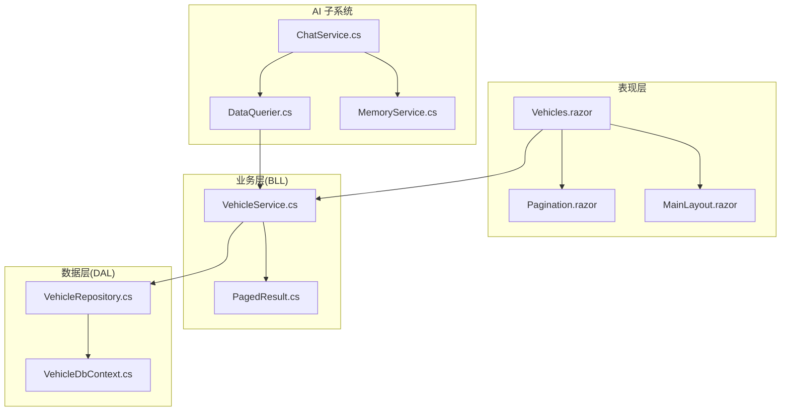
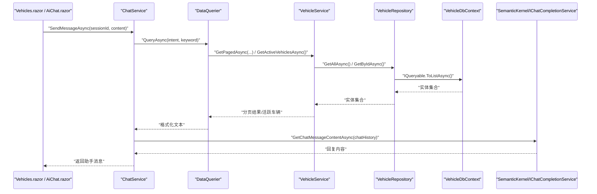
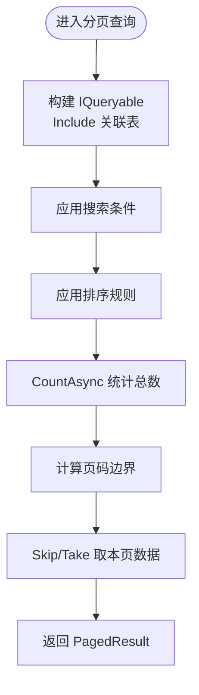
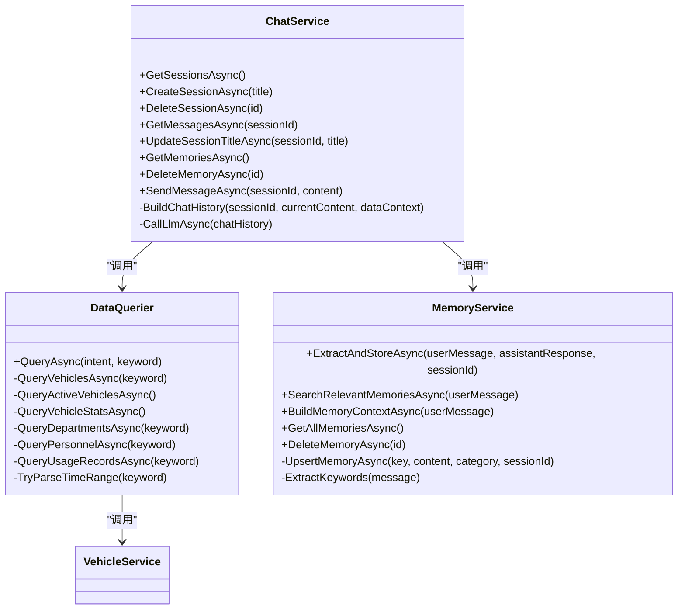
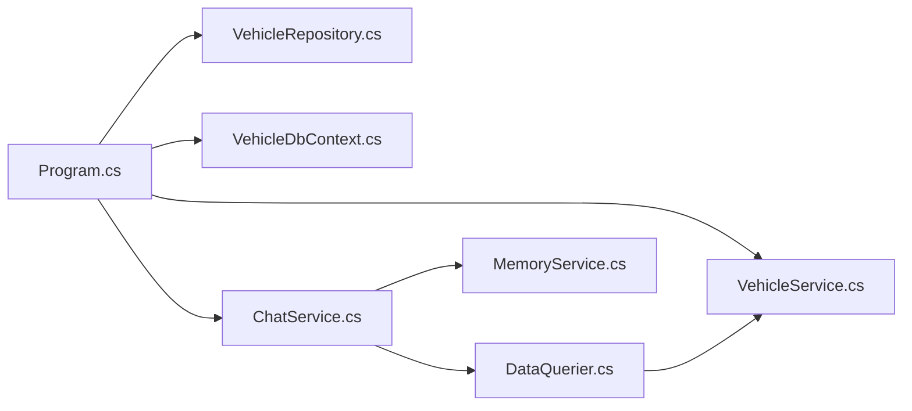

# 性能优化指南

<cite>
**本文引用的文件**   
- [Program.cs](file://Program.cs)
- [VehicleDbContext.cs](file://DAL/VehicleDbContext.cs)
- [appsettings.json](file://appsettings.json)
- [VehicleService.cs](file://BLL/Vehicle/VehicleService.cs)
- [VehicleRepository.cs](file://DAL/Repository/VehicleRepository.cs)
- [PagedResult.cs](file://BLL/Common/PagedResult.cs)
- [ChatService.cs](file://aiServer/BLL/ChatService.cs)
- [DataQuerier.cs](file://aiServer/BLL/DataQuerier.cs)
- [MemoryService.cs](file://aiServer/BLL/MemoryService.cs)
- [Vehicles.razor](file://Pages/Vehicles.razor)
- [Pagination.razor](file://Components/Common/Pagination.razor)
- [MainLayout.razor](file://Components/Layouts/MainLayout.razor)
</cite>

## 目录
1. [引言](#引言)
2. [项目结构](#项目结构)
3. [核心组件](#核心组件)
4. [架构总览](#架构总览)
5. [详细组件分析](#详细组件分析)
6. [依赖关系分析](#依赖关系分析)
7. [性能考虑与优化策略](#性能考虑与优化策略)
8. [故障排查指南](#故障排查指南)
9. [结论](#结论)
10. [附录：基准测试与监控指标](#附录基准测试与监控指标)

## 引言
本指南面向 vehicleManagement 系统的性能优化，覆盖数据库查询优化、内存使用优化、并发处理优化、AI 服务性能优化以及前端 Blazor 性能优化。文档基于仓库现有代码进行分析，给出可落地的优化建议、关键路径说明和可视化图示，帮助开发者在不改变业务语义的前提下提升系统吞吐、降低延迟与资源占用。

## 项目结构
vehicleManagement 采用分层架构：
- 表现层：Blazor 页面与组件（如 Vehicles.razor、Pagination.razor、MainLayout.razor）
- 业务逻辑层（BLL）：领域服务（如 VehicleService）与通用工具（如 PagedResult）
- 数据访问层（DAL）：仓储（Repository）、实体模型与 EF Core DbContext
- AI 子系统：Semantic Kernel + Ollama 对话、意图识别、数据查询、记忆管理
- 启动与配置：Program.cs 注册服务、EF Core、静态文件、健康检查等

**图表来源**
- [Program.cs:48-102](file://Program.cs#L48-L102)
- [VehicleService.cs:67-109](file://BLL/Vehicle/VehicleService.cs#L67-L109)
- [VehicleRepository.cs:19-46](file://DAL/Repository/VehicleRepository.cs#L19-L46)
- [VehicleDbContext.cs:21-104](file://DAL/VehicleDbContext.cs#L21-L104)
- [ChatService.cs:94-139](file://aiServer/BLL/ChatService.cs#L94-L139)
- [DataQuerier.cs:48-67](file://aiServer/BLL/DataQuerier.cs#L48-L67)
- [MemoryService.cs:45-113](file://aiServer/BLL/MemoryService.cs#L45-L113)

**章节来源**
- [Program.cs:48-102](file://Program.cs#L48-L102)
- [VehicleService.cs:67-109](file://BLL/Vehicle/VehicleService.cs#L67-L109)
- [VehicleRepository.cs:19-46](file://DAL/Repository/VehicleRepository.cs#L19-L46)
- [VehicleDbContext.cs:21-104](file://DAL/VehicleDbContext.cs#L21-L104)
- [ChatService.cs:94-139](file://aiServer/BLL/ChatService.cs#L94-L139)
- [DataQuerier.cs:48-67](file://aiServer/BLL/DataQuerier.cs#L48-L67)
- [MemoryService.cs:45-113](file://aiServer/BLL/MemoryService.cs#L45-L113)

## 核心组件
- 车辆服务：负责分页查询、状态切换、删除校验与附件清理、二维码 Token 管理等。
- 车辆仓储：封装 EF Core 的增删改查，统一通过 IDbContextFactory 创建上下文。
- 分页结果：通用分页数据结构，包含 Items、TotalCount、CurrentPage、PageSize 与 TotalPages。
- AI 对话服务：整合 Semantic Kernel、Ollama、意图识别、数据查询与记忆管理。
- 数据查询器：根据用户意图调用 BLL 服务并格式化结果为文本供 LLM 消费。
- 记忆服务：从对话中提取关键词、偏好与通用记忆，支持模糊搜索与上下文构建。
- Blazor 页面：车辆列表页实现搜索、排序、分页、导出与 JS 互操作下载。

**章节来源**
- [VehicleService.cs:18-239](file://BLL/Vehicle/VehicleService.cs#L18-L239)
- [VehicleRepository.cs:10-63](file://DAL/Repository/VehicleRepository.cs#L10-L63)
- [PagedResult.cs:9-35](file://BLL/Common/PagedResult.cs#L9-L35)
- [ChatService.cs:18-199](file://aiServer/BLL/ChatService.cs#L18-L199)
- [DataQuerier.cs:21-331](file://aiServer/BLL/DataQuerier.cs#L21-L331)
- [MemoryService.cs:15-221](file://aiServer/BLL/MemoryService.cs#L15-L221)
- [Vehicles.razor:186-409](file://Pages/Vehicles.razor#L186-L409)

## 架构总览
下图展示一次“发送消息”的关键调用链：前端触发 → ChatService → DataQuerier → BLL 服务 → DAL 仓储 → EF Core → 数据库；同时包含记忆提取与 LLM 调用。

**图表来源**
- [ChatService.cs:94-139](file://aiServer/BLL/ChatService.cs#L94-L139)
- [DataQuerier.cs:48-93](file://aiServer/BLL/DataQuerier.cs#L48-L93)
- [VehicleService.cs:67-109](file://BLL/Vehicle/VehicleService.cs#L67-L109)
- [VehicleRepository.cs:19-23](file://DAL/Repository/VehicleRepository.cs#L19-L23)
- [VehicleDbContext.cs:13-19](file://DAL/VehicleDbContext.cs#L13-L19)

## 详细组件分析

### 数据库查询优化（EF Core、索引、N+1、分页、批量）
- EF Core 查询优化
  - 使用 IDbContextFactory 避免 Blazor Server 并发冲突，确保每个请求拥有独立 DbContext 实例。
  - 在分页查询中使用 Include 按需加载关联实体，减少额外查询。
  - 将 IQueryable 过滤与排序下推到数据库，避免客户端筛选。
- 索引策略
  - 对高频外键与查询字段建立索引：部门ID、车牌号、二维码Token、位置分类、使用时间等。
  - 复合索引用于联合查询场景（如 UsageRecordPurpose 的 UsageRecordId + SequenceOrder）。
- N+1 查询问题
  - 在列表查询中通过 Include 预加载 Department，避免逐条加载关联对象。
  - 在 AI 数据查询中限制返回数量（MaxQueryResults），避免大结果集导致多次关联加载。
- 分页查询优化
  - 使用 Skip/Take 进行服务端分页，结合 CountAsync 获取总数。
  - 前端 Pagination 组件仅渲染当前页码范围，减少 DOM 节点数量。
- 批量操作优化
  - 仓储层目前为单条 SaveChanges，建议在新增/更新场景合并批次提交，减少事务开销。
  - 对于大量删除或更新，建议使用 EF Core 批量扩展或存储过程。

**图表来源**
- [VehicleService.cs:67-109](file://BLL/Vehicle/VehicleService.cs#L67-L109)
- [PagedResult.cs:9-35](file://BLL/Common/PagedResult.cs#L9-L35)

**章节来源**
- [VehicleDbContext.cs:21-104](file://DAL/VehicleDbContext.cs#L21-L104)
- [VehicleService.cs:67-109](file://BLL/Vehicle/VehicleService.cs#L67-L109)
- [VehicleRepository.cs:19-46](file://DAL/Repository/VehicleRepository.cs#L19-L46)
- [PagedResult.cs:9-35](file://BLL/Common/PagedResult.cs#L9-L35)

### 内存使用优化（对象池化、缓存、大对象、GC 调优）
- 对象池化
  - 对频繁创建的对象（如 StringBuilder、正则表达式）复用实例，减少分配压力。
  - MemoryService 已使用 Compiled 正则，建议进一步缓存常用关键词集合。
- 缓存策略
  - 对不常变化的字典数据（如部门列表、车辆品牌词库）加入内存缓存（IMemoryCache）。
  - 对 AI 查询结果进行短时缓存，避免重复 LLM 调用。
- 大对象处理
  - 避免一次性加载全量数据到内存，优先分页与流式处理。
  - 图片与导出文件通过临时流与 Base64 传递时注意大小限制，必要时分块传输。
- GC 调优
  - 在高并发场景启用服务器 GC 模式，调整 Gen2 阈值与回收频率。
  - 避免在热路径中频繁装箱/拆箱与字符串拼接。

[本节为通用指导，不直接分析具体文件]

### 并发处理优化（异步编程、线程安全、锁机制、并发请求）
- 异步编程最佳实践
  - 所有 I/O 操作使用 async/await，避免阻塞线程。
  - 在 ChatService 中异步提取记忆，避免阻塞主流程。
- 线程安全设计
  - 使用 Scoped 服务生命周期，确保每个请求隔离。
  - 共享只读数据（如常量、配置）避免写入竞争。
- 锁机制使用
  - 对全局计数器或写多读少的数据结构使用 ReaderWriterLockSlim。
  - 避免在热路径中使用细粒度锁，尽量无锁设计。
- 并发请求处理
  - 使用 IDbContextFactory 避免 DbContext 跨请求共享。
  - 对高并发热点接口增加限流与熔断保护。

**章节来源**
- [Program.cs:52-58](file://Program.cs#L52-L58)
- [ChatService.cs:132-136](file://aiServer/BLL/ChatService.cs#L132-L136)

### AI 服务性能优化（语义内核、模型加载、记忆管理、结果缓存）
- 语义内核配置
  - 使用 Singleton 注册 Kernel，避免重复初始化。
  - 合理设置 Ollama 端点与模型名称，支持外部配置热重载。
- 模型加载优化
  - 预热模型连接，避免首次请求冷启动延迟。
  - 对长上下文进行截断与摘要，减少 token 消耗。
- 对话记忆管理
  - 限制最近消息数量（MaxRecentMessages），控制上下文长度。
  - 记忆提取异步执行，失败不影响主流程。
- 查询结果缓存
  - 对高频查询（如部门列表、车辆统计）添加内存缓存。
  - 对 LLM 响应进行去重与 TTL 缓存。

**图表来源**
- [ChatService.cs:18-199](file://aiServer/BLL/ChatService.cs#L18-L199)
- [DataQuerier.cs:21-331](file://aiServer/BLL/DataQuerier.cs#L21-L331)
- [MemoryService.cs:15-221](file://aiServer/BLL/MemoryService.cs#L15-L221)
- [VehicleService.cs:67-109](file://BLL/Vehicle/VehicleService.cs#L67-L109)

**章节来源**
- [Program.cs:97-102](file://Program.cs#L97-L102)
- [ChatService.cs:94-139](file://aiServer/BLL/ChatService.cs#L94-L139)
- [DataQuerier.cs:48-93](file://aiServer/BLL/DataQuerier.cs#L48-L93)
- [MemoryService.cs:45-113](file://aiServer/BLL/MemoryService.cs#L45-L113)

### 前端性能优化（Blazor 组件、JS 互操作、静态资源、响应式布局）
- Blazor 组件渲染优化
  - 使用 @key 稳定列表项，减少重绘。
  - 对大型表格使用虚拟滚动或分页加载。
  - 避免在 OnInitializedAsync 中执行重型计算。
- JavaScript 互操作优化
  - 缓存 JS 函数引用，减少 InvokeVoidAsync 开销。
  - 对 Base64 图片与文件下载进行压缩与分块。
- 静态资源缓存
  - 利用浏览器缓存与 CDN 缓存 CSS/JS/字体。
  - 对动态资源添加版本号或哈希。
- 响应式布局优化
  - 使用 CSS Grid/Flexbox 适配不同屏幕尺寸。
  - 移动端隐藏非必要元素，减少渲染负担。

**章节来源**
- [Vehicles.razor:186-409](file://Pages/Vehicles.razor#L186-L409)
- [Pagination.razor:1-42](file://Components/Common/Pagination.razor#L1-L42)
- [MainLayout.razor:1-40](file://Components/Layouts/MainLayout.razor#L1-L40)

## 依赖关系分析
- Program.cs 注册了所有服务，包括 EF Core、仓储、BLL、AI 服务与静态文件。
- VehicleService 依赖 VehicleRepository 与 DepartmentRepository，并通过 IDbContextFactory 获取 DbContext。
- ChatService 依赖 DataQuerier 与 MemoryService，后者再调用 BLL 服务。
- DataQuerier 调用多个 BLL 服务以获取结构化数据并格式化为文本。

**图表来源**
- [Program.cs:48-102](file://Program.cs#L48-L102)
- [VehicleService.cs:18-38](file://BLL/Vehicle/VehicleService.cs#L18-L38)
- [ChatService.cs:18-42](file://aiServer/BLL/ChatService.cs#L18-L42)
- [DataQuerier.cs:21-43](file://aiServer/BLL/DataQuerier.cs#L21-L43)

**章节来源**
- [Program.cs:48-102](file://Program.cs#L48-L102)
- [VehicleService.cs:18-38](file://BLL/Vehicle/VehicleService.cs#L18-L38)
- [ChatService.cs:18-42](file://aiServer/BLL/ChatService.cs#L18-L42)
- [DataQuerier.cs:21-43](file://aiServer/BLL/DataQuerier.cs#L21-L43)

## 性能考虑与优化策略
- 数据库层
  - 为高频查询字段添加索引，避免全表扫描。
  - 使用 Include 预加载关联表，减少 N+1 查询。
  - 分页查询使用 Skip/Take，避免一次性加载大数据集。
- 内存层
  - 对静态字典与配置使用 IMemoryCache。
  - 对大对象使用流式处理，避免内存峰值过高。
- 并发层
  - 使用 IDbContextFactory 确保 DbContext 隔离。
  - 对热点接口增加限流与熔断。
- AI 层
  - 预热模型连接，减少冷启动延迟。
  - 限制上下文长度，避免 token 溢出。
  - 对查询结果与 LLM 响应进行缓存。
- 前端层
  - 使用分页与虚拟滚动减少 DOM 节点。
  - 缓存 JS 函数与静态资源，减少网络开销。
  - 优化响应式布局，提升移动端体验。

[本节为通用指导，不直接分析具体文件]

## 故障排查指南
- 数据库连接失败
  - 检查 appsettings.json 中的连接字符串是否正确。
  - 确认 data 目录存在且可写。
- EF Core 查询缓慢
  - 检查是否缺少索引，特别是外键与查询字段。
  - 避免在 LINQ 中使用无法下推的方法。
- AI 服务不可用
  - 检查 Ollama 端点与模型名称配置。
  - 查看日志中是否有异常堆栈。
- 前端下载失败
  - 检查 JS 函数是否存在且正确调用。
  - 验证 Base64 数据是否有效。

**章节来源**
- [appsettings.json:1-8](file://appsettings.json#L1-L8)
- [Program.cs:106-125](file://Program.cs#L106-L125)
- [ChatService.cs:188-199](file://aiServer/BLL/ChatService.cs#L188-L199)
- [Vehicles.razor:336-358](file://Pages/Vehicles.razor#L336-L358)

## 结论
通过对 vehicleManagement 系统的分层分析与优化建议，可在不改变业务语义的前提下显著提升性能。重点在于数据库索引与查询优化、内存缓存与大对象处理、并发隔离与限流、AI 服务预热与缓存、前端分页与静态资源优化。建议结合基准测试与监控指标持续迭代优化。

[本节为总结性内容，不直接分析具体文件]

## 附录：基准测试与监控指标
- 基准测试方法
  - 使用 k6 或 JMeter 模拟并发请求，测量平均响应时间与吞吐量。
  - 对 EF Core 查询使用 SQL Profiler 或 EF Core Logging 分析慢查询。
  - 对 AI 服务记录 LLM 调用耗时与 token 消耗。
- 监控指标定义
  - 应用层：CPU 使用率、内存占用、GC 次数、请求数、错误率。
  - 数据库层：连接池使用率、慢查询数、索引命中率。
  - AI 层：模型调用成功率、平均响应时间、token 用量。
  - 前端层：首屏加载时间、交互延迟、JS 错误率。

[本节为通用指导，不直接分析具体文件]