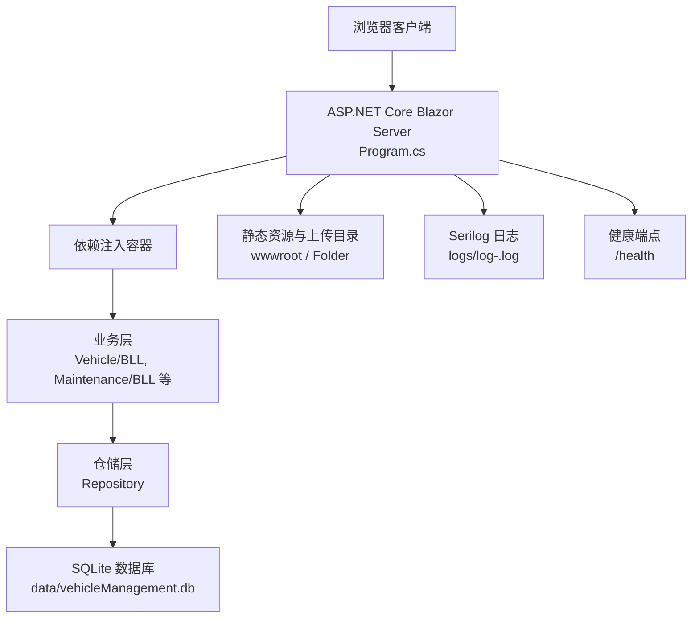
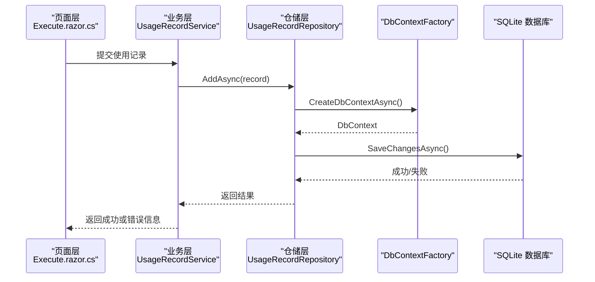
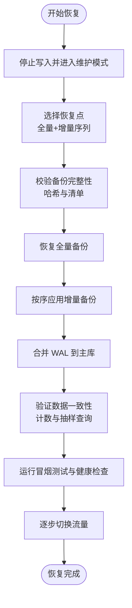
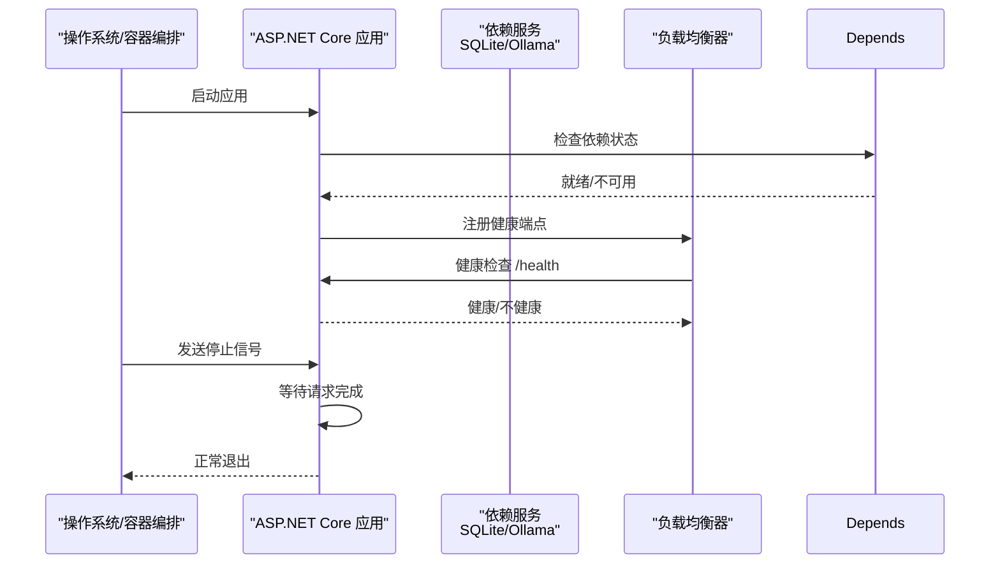
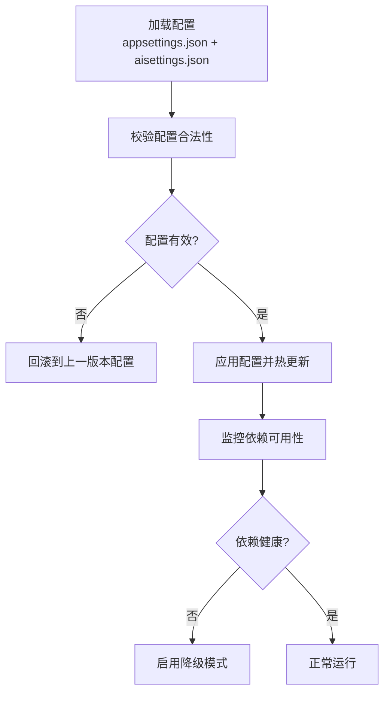
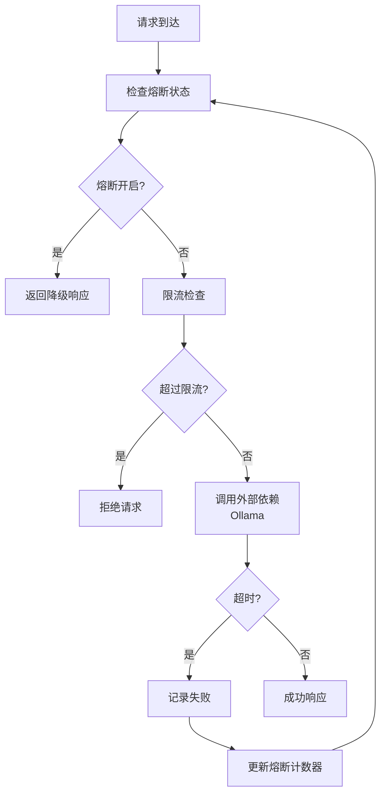
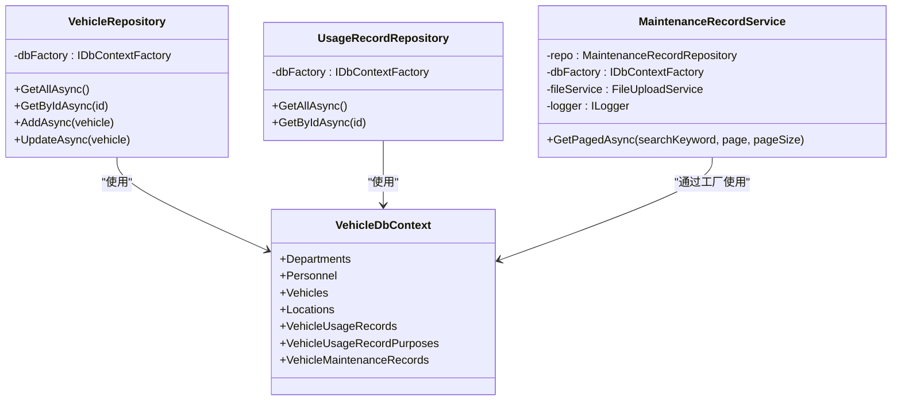

# 恢复预案与灾难恢复

<cite>
**本文引用的文件**   
- [Program.cs](file://Program.cs)
- [appsettings.json](file://appsettings.json)
- [Dockerfile](file://Dockerfile)
- [launchSettings.json](file://Properties/launchSettings.json)
- [VehicleDbContext.cs](file://DAL/VehicleDbContext.cs)
- [VehicleRepository.cs](file://DAL/Repository/VehicleRepository.cs)
- [UsageRecordRepository.cs](file://DAL/Repository/UsageRecordRepository.cs)
- [MaintenanceRecordService.cs](file://BLL/Maintenance/MaintenanceRecordService.cs)
- [Execute.razor.cs](file://Pages/Execute.razor.cs)
</cite>

## 目录
1. [引言](#引言)
2. [项目结构与恢复相关边界](#项目结构与恢复相关边界)
3. [核心恢复能力总览](#核心恢复能力总览)
4. [架构与数据流概览](#架构与数据流概览)
5. [数据备份与恢复策略](#数据备份与恢复策略)
6. [服务重启与优雅关闭策略](#服务重启与优雅关闭策略)
7. [配置回滚与热更新机制](#配置回滚与热更新机制)
8. [灾难恢复目标与多副本容灾](#灾难恢复目标与多副本容灾)
9. [故障隔离：熔断、降级、限流与超时](#故障隔离熔断降级限流与超时)
10. [自动化恢复演练脚本与流程](#自动化恢复演练脚本与流程)
11. [依赖关系分析](#依赖关系分析)
12. [性能与容量规划建议](#性能与容量规划建议)
13. [故障排查指南](#故障排查指南)
14. [结论](#结论)

## 引言
本文件为 vehicleManagement 系统的恢复预案与灾难恢复文档。系统基于 ASP.NET Core Blazor Server，使用 SQLite 作为主数据库，并通过 Docker 容器化部署；同时包含一个独立的 AI 子模块，也使用 SQLite 存储对话记忆。当前代码库未内置自动备份、熔断器、限流或异地容灾实现，因此本文在“现状”基础上给出可落地的恢复方案、RTO/RPO 目标、演练脚本和自动化流程建议，确保系统在极端情况下能够快速恢复正常运行。

## 项目结构与恢复相关边界
vehicleManagement 是一个单进程 Web 应用，主要恢复相关边界如下：
- 应用入口与依赖注入：Program.cs 负责日志、配置、服务注册、数据库初始化与健康端点。
- 配置文件：appsettings.json 定义连接字符串；AI 配置通过外部 JSON 文件并支持热重载。
- 数据库上下文：VehicleDbContext.cs 定义业务数据库模型与关系约束。
- 仓储层：各 Repository 通过 IDbContextFactory 创建 DbContext，避免 Blazor Server 并发冲突。
- 业务层：例如 MaintenanceRecordService 等 BLL 组件封装业务逻辑。
- 页面层：Execute.razor.cs 处理借车、维修等表单提交与文件上传。
- 容器化：Dockerfile 暴露健康检查、持久卷挂载与运行参数。

**图表来源**
- [Program.cs:28-148](file://Program.cs#L28-L148)
- [appsettings.json:1-8](file://appsettings.json#L1-L8)
- [VehicleDbContext.cs:6-108](file://DAL/VehicleDbContext.cs#L6-L108)
- [Dockerfile:29-43](file://Dockerfile#L29-L43)

**章节来源**
- [Program.cs:28-148](file://Program.cs#L28-L148)
- [appsettings.json:1-8](file://appsettings.json#L1-L8)
- [Dockerfile:29-43](file://Dockerfile#L29-L43)

## 核心恢复能力总览
- 数据备份恢复
  - 现状：SQLite 文件位于 data/ 目录，Docker 中通过 VOLUME 持久化。
  - 建议：实施定时全量备份 + 增量 WAL 快照；对备份文件进行加密；提供一键恢复流程与验证步骤。
- 服务重启策略
  - 现状：无显式优雅关闭钩子；启动时创建 data/Folder 目录并执行 EnsureCreatedAsync。
  - 建议：增加 OnApplicationStopping 钩子，等待请求完成；启动前检查依赖（SQLite 文件、Ollama）；按顺序初始化数据库与缓存。
- 配置回滚
  - 现状：aisettings.json 支持 reloadOnChange=true；appsettings.json 提供连接字符串。
  - 建议：引入配置版本管理、环境变量覆盖、配置校验与热更新回滚。
- 灾难恢复
  - 现状：单实例、本地 SQLite。
  - 建议：多副本部署、异地容灾、一致性保证、RTO/RPO 目标设定。
- 故障隔离
  - 现状：无熔断器、限流、全局超时控制。
  - 建议：对外部依赖（如 Ollama）加熔断与降级；对写操作加限流与超时保护。

**章节来源**
- [Program.cs:45-58](file://Program.cs#L45-L58)
- [Program.cs:106-125](file://Program.cs#L106-L125)
- [Dockerfile:37-41](file://Dockerfile#L37-L41)

## 架构与数据流概览
下图展示一次典型的数据写入流程（以车辆使用记录为例），体现仓储层通过工厂创建 DbContext 的调用链。

**图表来源**
- [UsageRecordRepository.cs:14-39](file://DAL/Repository/UsageRecordRepository.cs#L14-L39)
- [Execute.razor.cs:121-190](file://Pages/Execute.razor.cs#L121-L190)

**章节来源**
- [UsageRecordRepository.cs:14-39](file://DAL/Repository/UsageRecordRepository.cs#L14-L39)
- [Execute.razor.cs:121-190](file://Pages/Execute.razor.cs#L121-L190)

## 数据备份与恢复策略

### 现状分析
- 数据库位置
  - 主业务数据库：data/vehicleManagement.db
  - AI 数据库：data/aiServer.db
- 持久化
  - Dockerfile 将 /app/data 声明为 VOLUME，便于宿主机挂载与备份。
- 备份方式
  - 当前未实现自动备份；需结合操作系统任务调度（cron/systemd-timer）或 CI/CD 流水线执行备份。

### 自动备份策略
- 全量备份
  - 每日凌晨执行一次完整拷贝，保留最近 N 天（例如 7 天）。
  - 文件名格式：vehicleManagement_YYYYMMDD_HHMMSS.db
- 增量备份
  - SQLite 启用 WAL 模式后，可通过复制 .db-wal 与 .db-shm 实现增量快照。
  - 每 15 分钟执行一次增量快照，保留最近 M 个增量（例如 48 个）。
- 备份文件加密
  - 使用 OpenSSL 或 GPG 对备份文件进行对称加密（AES-256-GCM）。
  - 密钥由运维平台保管，禁止入库。
- 备份元数据
  - 生成备份清单 JSON，包含文件大小、哈希值、时间戳、类型（全量/增量）、所属环境。

### 数据恢复流程
1. 停止写入
   - 将服务切换到维护模式，拒绝新的写请求。
2. 选择恢复点
   - 根据 RPO 目标选择最近的全量备份与增量序列。
3. 校验备份完整性
   - 校验哈希值与清单一致性。
4. 恢复数据库
   - 先恢复全量备份，再按顺序应用增量。
   - 若使用 WAL，合并 WAL 到主库。
5. 验证数据一致性
   - 执行关键表计数与抽样查询。
   - 运行健康检查与冒烟测试用例。
6. 切换流量
   - 逐步放量，观察错误率与延迟指标。

**图表来源**
- [Dockerfile:37-41](file://Dockerfile#L37-L41)
- [Program.cs:106-125](file://Program.cs#L106-L125)

**章节来源**
- [Dockerfile:37-41](file://Dockerfile#L37-L41)
- [Program.cs:106-125](file://Program.cs#L106-L125)

## 服务重启与优雅关闭策略

### 现状分析
- 启动阶段
  - Program.cs 创建 data 与 Folder 目录，EnsureCreatedAsync 创建表结构。
  - 开发环境执行种子数据初始化。
- 健康检查
  - Dockerfile 定义 HEALTHCHECK 调用 /health。
- 优雅关闭
  - 未实现 OnApplicationStopping 钩子；可能中断正在处理的请求。

### 建议实现
- 优雅关闭
  - 在宿主生命周期中监听 OnApplicationStopping，等待所有活跃请求完成后再退出。
  - 记录关闭原因与持续时间，便于审计。
- 服务依赖检查
  - 启动前检查 SQLite 文件是否可读、Ollama 是否可达。
  - 若依赖不可用，进入降级模式（禁用 AI 功能）。
- 启动顺序控制
  - 先初始化基础设施（日志、配置、数据库），再加载业务缓存。
- 故障转移
  - 多副本部署时，由负载均衡器剔除不健康实例，滚动重启。

**图表来源**
- [Program.cs:106-148](file://Program.cs#L106-L148)
- [Dockerfile:40-43](file://Dockerfile#L40-L43)

**章节来源**
- [Program.cs:106-148](file://Program.cs#L106-L148)
- [Dockerfile:40-43](file://Dockerfile#L40-L43)

## 配置回滚与热更新机制

### 现状分析
- AI 配置
  - aisettings.json 通过 AddJsonFile(..., optional:true, reloadOnChange:true) 加载，支持热更新。
- 连接字符串
  - appsettings.json 定义 DefaultConnection 与 AiServerConnection。
- 环境变量
  - Dockerfile 设置 ASPNETCORE_URLS 与 AiServer__OllamaEndpoint/AiServer__OllamaModel。

### 建议实现
- 配置文件版本管理
  - 将 appsettings.json 与 aisettings.json 纳入版本控制系统，每次变更附带审批与变更记录。
- 环境变量管理
  - 敏感配置（如数据库密码、API Key）通过环境变量注入，不在代码仓库中明文保存。
- 配置热更新
  - 保持 reloadOnChange=true，但增加配置校验与回滚机制。
- 配置验证机制
  - 启动时校验必填字段、端口范围、连接字符串格式。
  - 运行时定期校验外部依赖可用性，异常时触发降级。

**图表来源**
- [Program.cs:45-58](file://Program.cs#L45-L58)
- [appsettings.json:1-8](file://appsettings.json#L1-L8)
- [Dockerfile:29-35](file://Dockerfile#L29-L35)

**章节来源**
- [Program.cs:45-58](file://Program.cs#L45-L58)
- [appsettings.json:1-8](file://appsettings.json#L1-L8)
- [Dockerfile:29-35](file://Dockerfile#L29-L35)

## 灾难恢复目标与多副本容灾

### RTO/RPO 目标建议
- RPO（恢复点目标）
  - 建议 ≤ 15 分钟（通过增量备份与 WAL 合并实现）。
- RTO（恢复时间目标）
  - 建议 ≤ 10 分钟（自动化恢复脚本 + 预构建镜像）。

### 多副本部署
- 至少两个副本运行在不同节点或可用区。
- 使用共享持久卷或对象存储同步备份文件。
- 负载均衡器根据健康检查结果分发流量。

### 异地容灾
- 在主站点与灾备站点分别部署相同镜像。
- 定时将备份文件复制到异地对象存储。
- 灾备站点定期演练恢复流程，确保可快速接管。

### 数据一致性保证
- 单库场景：SQLite 事务保证单写一致性。
- 多副本场景：采用读写分离与最终一致性模型，或通过外部数据库（如 PostgreSQL）替代 SQLite。

[本节为概念性内容，不直接分析具体文件]

## 故障隔离：熔断、降级、限流与超时

### 现状分析
- 无内置熔断器、限流器或全局超时控制。
- 外部依赖（如 Ollama）调用失败时，可能影响整体响应。

### 建议实现
- 熔断器模式
  - 对 Ollama 调用设置熔断阈值（连续失败次数、半开探测间隔）。
  - 熔断期间返回降级响应（如提示“AI 功能暂时不可用”）。
- 降级策略
  - 禁用 AI 聊天功能，保留核心业务（车辆管理、报表）。
- 限流保护
  - 对写接口（借车、维修记录）设置 QPS 限制，防止突发流量压垮 SQLite。
- 超时控制
  - 对所有外部 HTTP 调用设置合理超时（例如 5 秒），避免线程阻塞。

**图表来源**
- [Program.cs:97-102](file://Program.cs#L97-L102)

**章节来源**
- [Program.cs:97-102](file://Program.cs#L97-L102)

## 自动化恢复演练脚本与流程

### 演练目标
- 验证备份完整性与恢复流程。
- 验证服务重启与优雅关闭。
- 验证配置热更新与回滚。
- 验证熔断、降级、限流行为。

### 演练步骤
1. 准备环境
   - 启动主站点与灾备站点。
   - 确认备份目录与对象存储已就绪。
2. 执行备份
   - 触发全量备份与增量快照。
   - 校验备份清单与哈希。
3. 模拟故障
   - 删除主站点数据文件或停止 Ollama 服务。
4. 执行恢复
   - 运行自动化恢复脚本，选择恢复点并恢复数据。
   - 启动服务并执行健康检查。
5. 验证功能
   - 访问 /health 与核心页面。
   - 执行冒烟测试用例（借车、维修记录）。
6. 回滚配置
   - 修改 aisettings.json 为无效值，验证回滚机制。
7. 演练报告
   - 输出 RTO/RPO 实际值与问题清单。

### 自动化恢复脚本要点
- 备份阶段
  - 使用 tar/gzip 打包 data 目录，并计算 SHA256。
  - 上传至对象存储，附带元数据。
- 恢复阶段
  - 下载指定版本的备份，校验哈希。
  - 解压到 /app/data，合并 WAL。
  - 启动服务并轮询 /health 直到健康。
- 告警与通知
  - 失败时发送邮件/钉钉/企业微信通知。
  - 记录恢复日志到集中式日志平台。

[本节为流程性内容，不直接分析具体文件]

## 依赖关系分析

**图表来源**
- [VehicleDbContext.cs:6-108](file://DAL/VehicleDbContext.cs#L6-L108)
- [VehicleRepository.cs:10-41](file://DAL/Repository/VehicleRepository.cs#L10-L41)
- [UsageRecordRepository.cs:12-39](file://DAL/Repository/UsageRecordRepository.cs#L12-L39)
- [MaintenanceRecordService.cs:14-35](file://BLL/Maintenance/MaintenanceRecordService.cs#L14-L35)

**章节来源**
- [VehicleDbContext.cs:6-108](file://DAL/VehicleDbContext.cs#L6-L108)
- [VehicleRepository.cs:10-41](file://DAL/Repository/VehicleRepository.cs#L10-L41)
- [UsageRecordRepository.cs:12-39](file://DAL/Repository/UsageRecordRepository.cs#L12-L39)
- [MaintenanceRecordService.cs:14-35](file://BLL/Maintenance/MaintenanceRecordService.cs#L14-L35)

## 性能与容量规划建议
- SQLite 容量
  - 评估日均写入量与增长趋势，预留磁盘空间。
  - 定期清理历史日志与临时文件。
- 连接池与并发
  - Blazor Server 使用 IDbContextFactory 避免并发冲突，注意连接数上限。
- I/O 优化
  - 将 data 与 logs 目录挂载到高性能磁盘。
  - 调整 SQLite PRAGMA（如 journal_mode=WAL、cache_size）。
- 监控与告警
  - 监控磁盘使用率、数据库文件大小、错误日志数量。
  - 设置阈值告警，提前扩容或清理。

[本节为通用指导，不直接分析具体文件]

## 故障排查指南

### 常见问题
- 启动失败
  - 检查 Program.cs 中的异常捕获与日志输出。
  - 确认 data 目录存在且可写。
- 数据库无法访问
  - 检查 appsettings.json 连接字符串。
  - 确认 Docker 卷挂载正确。
- AI 功能不可用
  - 检查 aisettings.json 与 Ollama 服务可达性。
  - 查看日志中是否有连接超时或认证失败。

### 排查步骤
1. 查看应用日志
   - Serilog 输出到 logs/log-.log。
2. 检查健康端点
   - curl http://localhost/health
3. 验证数据库
   - 使用 sqlite3 打开 .db 文件，执行简单查询。
4. 验证配置
   - 对比 appsettings.json 与 aisettings.json 的值。
5. 复现与定位
   - 在本地开发环境复现问题，逐步缩小范围。

**章节来源**
- [Program.cs:28-37](file://Program.cs#L28-L37)
- [Program.cs:150-157](file://Program.cs#L150-L157)
- [appsettings.json:1-8](file://appsettings.json#L1-L8)

## 结论
vehicleManagement 当前具备基础的健康检查与持久化能力，但未实现自动备份、优雅关闭、熔断限流与异地容灾。本文提出的恢复预案与灾难恢复方案，围绕现有代码结构给出可落地的改进建议，包括备份策略、服务重启流程、配置回滚机制、RTO/RPO 目标与演练脚本。通过逐步实施这些措施，系统可在极端情况下快速恢复正常运行，保障业务连续性。