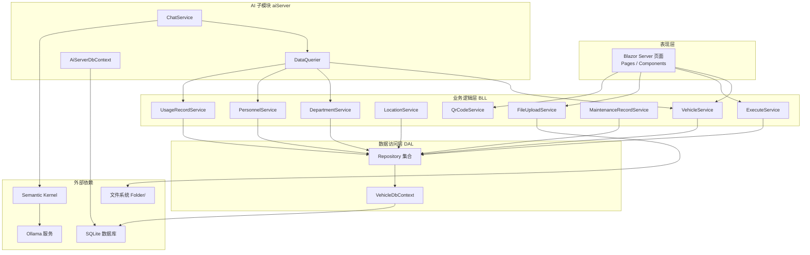
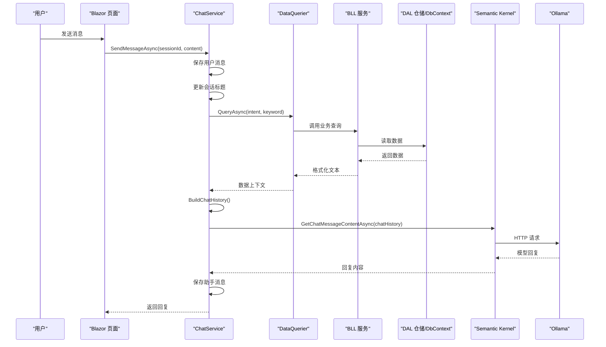
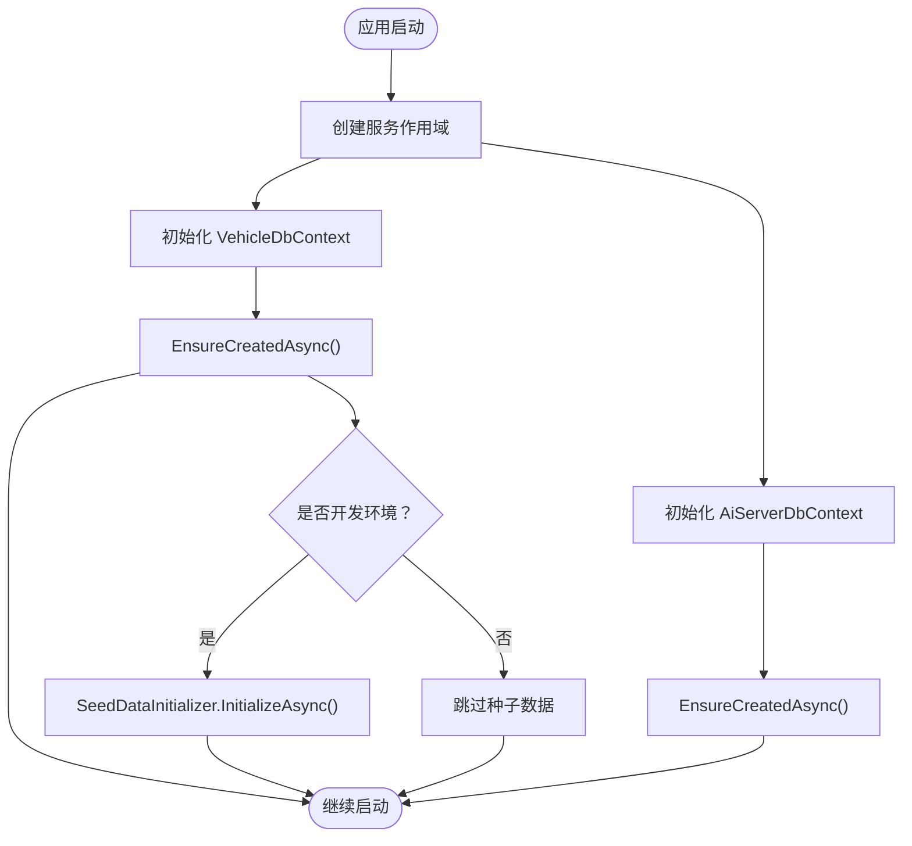
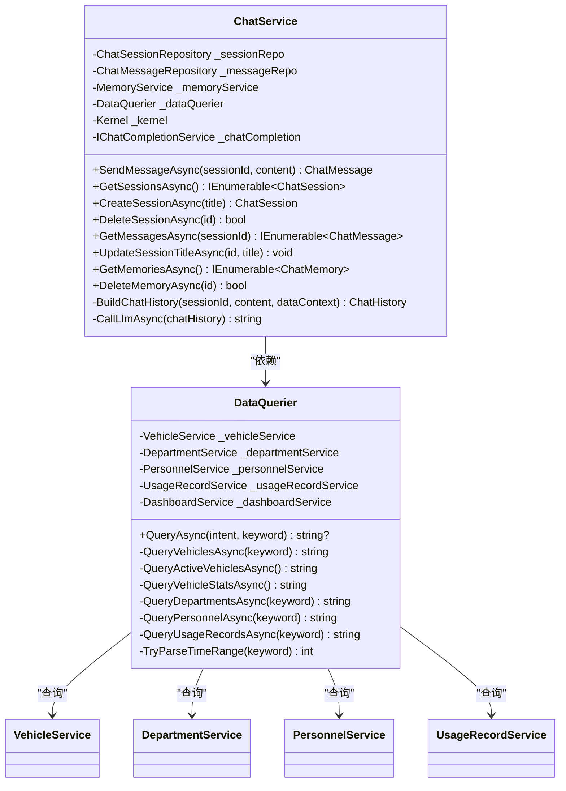
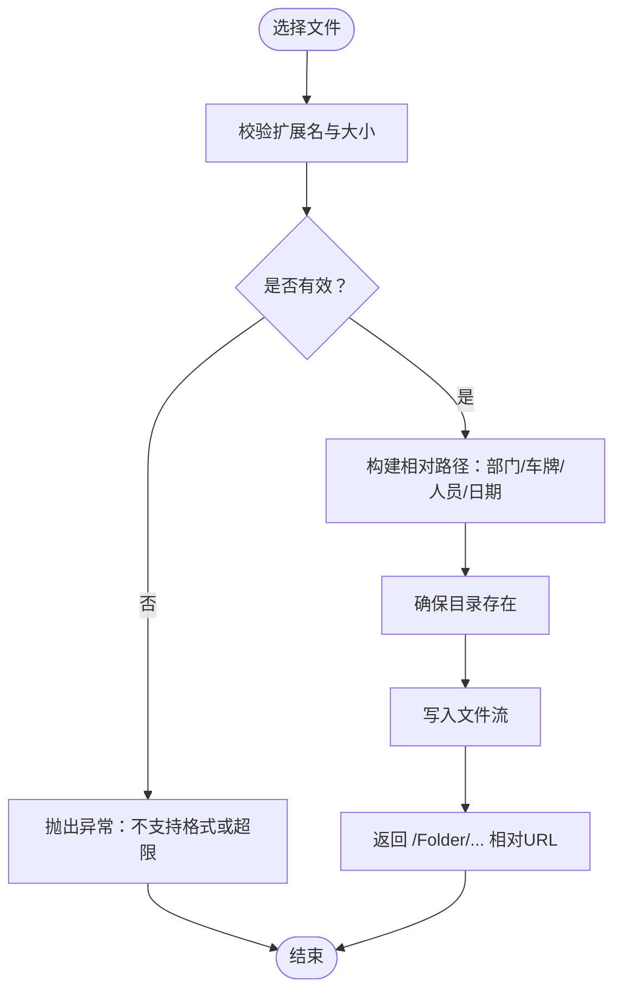
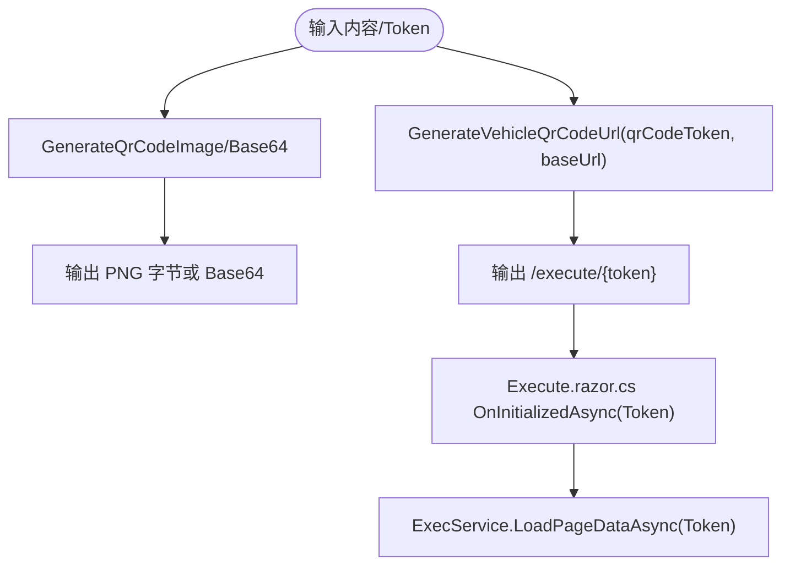
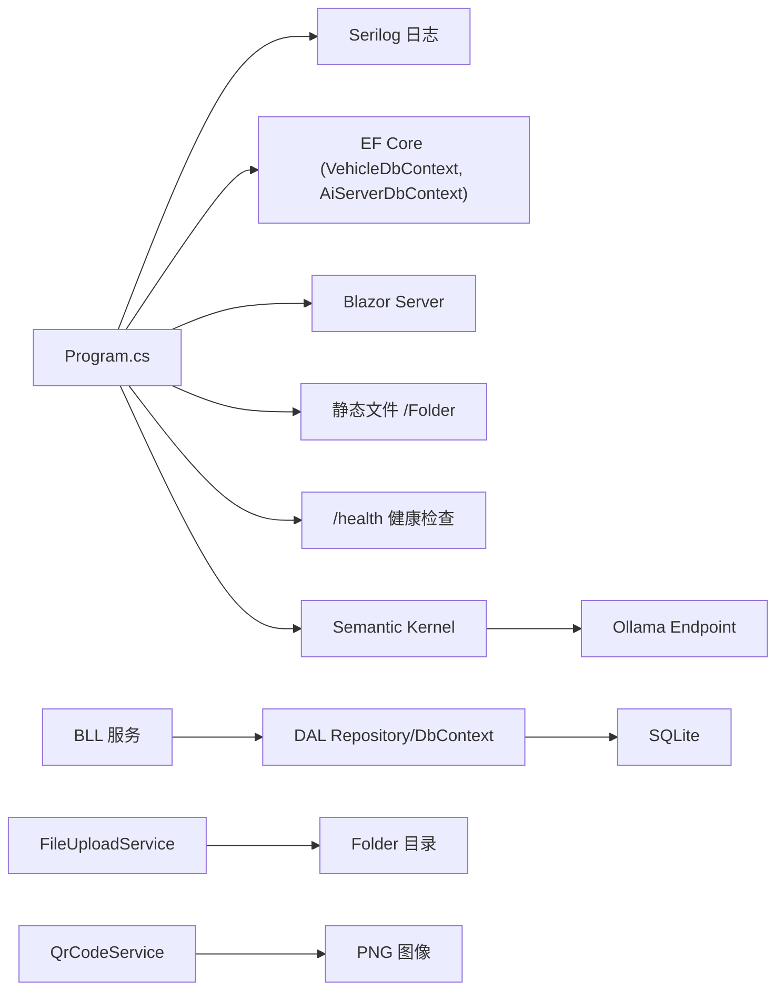

# 故障排除

<cite>
**本文引用的文件**   
- [Program.cs](file://Program.cs)
- [appsettings.json](file://appsettings.json)
- [aisettings.example.json](file://aisettings.example.json)
- [ChatService.cs](file://aiServer/BLL/ChatService.cs)
- [DataQuerier.cs](file://aiServer/BLL/DataQuerier.cs)
- [AiServerDbContext.cs](file://aiServer/DAL/AiServerDbContext.cs)
- [VehicleDbContext.cs](file://DAL/VehicleDbContext.cs)
- [FileUploadService.cs](file://BLL/Common/FileUploadService.cs)
- [QrCodeService.cs](file://BLL/Common/QrCodeService.cs)
- [Execute.razor.cs](file://Pages/Execute.razor.cs)
</cite>

## 目录
1. [简介](#简介)
2. [项目结构](#项目结构)
3. [核心组件](#核心组件)
4. [架构总览](#架构总览)
5. [详细组件分析](#详细组件分析)
6. [依赖关系分析](#依赖关系分析)
7. [性能考虑](#性能考虑)
8. [故障排除指南](#故障排除指南)
9. [系统监控与可观测性](#系统监控与可观测性)
10. [恢复预案](#恢复预案)
11. [社区支持与贡献](#社区支持与贡献)
12. [结论](#结论)

## 简介
本故障排除文档面向 vehicleManagement 系统的运维、开发与使用人员，聚焦以下目标：
- 快速定位并解决常见问题：Ollama 连接失败、数据库初始化错误、AI 服务不可用、文件上传失败、二维码生成异常。
- 提供诊断工具与技巧：日志分析、性能监控、内存分析、网络调试。
- 解释错误处理机制：异常捕获、降级策略、熔断保护、重试机制。
- 给出性能优化建议：数据库查询优化、内存使用优化、并发处理优化、缓存策略。
- 说明系统监控：健康检查、指标收集、告警配置、日志聚合。
- 制定恢复预案：数据备份恢复、服务重启、配置回滚、灾难恢复。
- 提供社区支持渠道、问题反馈流程与贡献指南。

## 项目结构
vehicleManagement 采用分层架构：
- 表现层（Blazor Server）：页面与交互逻辑位于 Pages 与 Components。
- 业务逻辑层（BLL）：车辆、部门、人员、位置、使用记录、仪表盘、执行、维修、导出等。
- 数据访问层（DAL）：实体模型、仓储实现、EF Core DbContext。
- AI 子模块（aiServer）：对话、意图识别、数据查询、记忆管理，独立 SQLite 数据库上下文。
- 通用能力：文件上传、二维码生成、分页结果等。

图表来源
- [Program.cs:48-102](file://Program.cs#L48-L102)
- [VehicleDbContext.cs:6-19](file://DAL/VehicleDbContext.cs#L6-L19)
- [AiServerDbContext.cs:9-18](file://aiServer/DAL/AiServerDbContext.cs#L9-L18)
- [FileUploadService.cs:12-27](file://BLL/Common/FileUploadService.cs#L12-L27)
- [QrCodeService.cs:6-39](file://BLL/Common/QrCodeService.cs#L6-L39)
- [ChatService.cs:18-42](file://aiServer/BLL/ChatService.cs#L18-L42)
- [DataQuerier.cs:21-43](file://aiServer/BLL/DataQuerier.cs#L21-L43)

章节来源
- [Program.cs:48-102](file://Program.cs#L48-L102)
- [VehicleDbContext.cs:6-19](file://DAL/VehicleDbContext.cs#L6-L19)
- [AiServerDbContext.cs:9-18](file://aiServer/DAL/AiServerDbContext.cs#L9-L18)
- [FileUploadService.cs:12-27](file://BLL/Common/FileUploadService.cs#L12-L27)
- [QrCodeService.cs:6-39](file://BLL/Common/QrCodeService.cs#L6-L39)
- [ChatService.cs:18-42](file://aiServer/BLL/ChatService.cs#L18-L42)
- [DataQuerier.cs:21-43](file://aiServer/BLL/DataQuerier.cs#L21-L43)

## 核心组件
- 应用启动与依赖注入：Program.cs 负责注册 EF Core、Serilog、Blazor、静态文件、健康检查端点、Seed 数据初始化、AI Kernel 与 Ollama 连接。
- 数据库上下文：VehicleDbContext 与 AiServerDbContext 分别管理主业务与 AI 会话/消息/记忆数据。
- AI 对话链路：ChatService 集成 Semantic Kernel 调用 Ollama，结合 DataQuerier 查询业务数据，构建聊天历史并返回回复。
- 文件上传：FileUploadService 校验格式与大小、按部门/车牌/人员/日期组织存储，并暴露删除接口。
- 二维码生成：QrCodeService 生成图片字节或 Base64，以及车辆执行页 URL 与 Token。
- 执行页：Execute.razor.cs 承载借车登记、维修、使用记录的表单与上传逻辑。

章节来源
- [Program.cs:28-102](file://Program.cs#L28-L102)
- [VehicleDbContext.cs:6-108](file://DAL/VehicleDbContext.cs#L6-L108)
- [AiServerDbContext.cs:9-59](file://aiServer/DAL/AiServerDbContext.cs#L9-L59)
- [ChatService.cs:18-200](file://aiServer/BLL/ChatService.cs#L18-L200)
- [DataQuerier.cs:21-333](file://aiServer/BLL/DataQuerier.cs#L21-L333)
- [FileUploadService.cs:12-113](file://BLL/Common/FileUploadService.cs#L12-L113)
- [QrCodeService.cs:6-42](file://BLL/Common/QrCodeService.cs#L6-L42)
- [Execute.razor.cs:20-253](file://Pages/Execute.razor.cs#L20-L253)

## 架构总览
下图展示从用户请求到 AI 回复的端到端流程，包括数据库查询、语义上下文构建与 Ollama 调用。

图表来源
- [ChatService.cs:94-139](file://aiServer/BLL/ChatService.cs#L94-L139)
- [DataQuerier.cs:48-67](file://aiServer/BLL/DataQuerier.cs#L48-L67)
- [Program.cs:97-102](file://Program.cs#L97-L102)

## 详细组件分析

### 数据库初始化与上下文
- VehicleDbContext 定义主业务实体与索引、外键约束；AiServerDbContext 定义 AI 会话、消息、记忆实体与索引。
- Program.cs 在启动时通过 EnsureCreatedAsync 创建表，并在开发环境执行种子数据初始化。

图表来源
- [Program.cs:109-125](file://Program.cs#L109-L125)
- [VehicleDbContext.cs:21-105](file://DAL/VehicleDbContext.cs#L21-L105)
- [AiServerDbContext.cs:20-55](file://aiServer/DAL/AiServerDbContext.cs#L20-L55)

章节来源
- [Program.cs:109-125](file://Program.cs#L109-L125)
- [VehicleDbContext.cs:21-105](file://DAL/VehicleDbContext.cs#L21-L105)
- [AiServerDbContext.cs:20-55](file://aiServer/DAL/AiServerDbContext.cs#L20-L55)

### AI 对话与 Ollama 集成
- ChatService 负责会话管理、消息持久化、意图识别、数据上下文构建、LLM 调用与记忆提取。
- DataQuerier 根据意图分发查询，将业务数据转换为 LLM 可读文本。
- Program.cs 通过 Semantic Kernel 注册 Ollama 连接，Endpoint 与 Model 可从 aisettings.json 热重载。

图表来源
- [ChatService.cs:18-42](file://aiServer/BLL/ChatService.cs#L18-L42)
- [ChatService.cs:94-139](file://aiServer/BLL/ChatService.cs#L94-L139)
- [ChatService.cs:161-199](file://aiServer/BLL/ChatService.cs#L161-L199)
- [DataQuerier.cs:21-43](file://aiServer/BLL/DataQuerier.cs#L21-L43)
- [DataQuerier.cs:48-67](file://aiServer/BLL/DataQuerier.cs#L48-L67)
- [DataQuerier.cs:69-333](file://aiServer/BLL/DataQuerier.cs#L69-L333)

章节来源
- [ChatService.cs:18-200](file://aiServer/BLL/ChatService.cs#L18-L200)
- [DataQuerier.cs:21-333](file://aiServer/BLL/DataQuerier.cs#L21-L333)
- [Program.cs:97-102](file://Program.cs#L97-L102)
- [aisettings.example.json:1-7](file://aisettings.example.json#L1-L7)

### 文件上传与存储
- FileUploadService 支持服务端 IFormFile 与客户端 IBrowserFile 两种上传路径。
- 校验规则：仅允许指定图片/视频扩展名；图片最大 10MB，视频最大 100MB。
- 存储路径：按“部门/车牌/人员/日期”组织，文件名使用 GUID 前缀避免冲突。
- 删除逻辑：自动去除 /Folder/ 前缀后拼接物理路径进行删除。

图表来源
- [FileUploadService.cs:29-46](file://BLL/Common/FileUploadService.cs#L29-L46)
- [FileUploadService.cs:69-84](file://BLL/Common/FileUploadService.cs#L69-L84)
- [FileUploadService.cs:92-110](file://BLL/Common/FileUploadService.cs#L92-L110)

章节来源
- [FileUploadService.cs:12-113](file://BLL/Common/FileUploadService.cs#L12-L113)
- [Execute.razor.cs:115-129](file://Pages/Execute.razor.cs#L115-L129)
- [Execute.razor.cs:159-170](file://Pages/Execute.razor.cs#L159-L170)
- [Execute.razor.cs:211-225](file://Pages/Execute.razor.cs#L211-L225)

### 二维码生成与执行页链接
- QrCodeService 提供图片字节、Base64 字符串生成方法，以及基于 Token 的执行页 URL 构造。
- Execute.razor.cs 通过路由参数 Token 加载页面数据，完成借车、维修、使用记录的提交。

图表来源
- [QrCodeService.cs:8-39](file://BLL/Common/QrCodeService.cs#L8-L39)
- [Execute.razor.cs:78-94](file://Pages/Execute.razor.cs#L78-L94)

章节来源
- [QrCodeService.cs:6-42](file://BLL/Common/QrCodeService.cs#L6-L42)
- [Execute.razor.cs:78-94](file://Pages/Execute.razor.cs#L78-L94)

## 依赖关系分析
- Program.cs 集中注册所有服务，包含 Blazor、EF Core、Serilog、静态文件、健康检查、AI Kernel 与 Ollama。
- AI 子模块通过 Semantic Kernel 与 Ollama 通信；业务数据由 BLL 服务经 DAL 仓储访问 VehicleDbContext。
- 文件上传依赖 IWebHostEnvironment 与文件系统；二维码生成依赖 QRCoder 库。

图表来源
- [Program.cs:28-102](file://Program.cs#L28-L102)
- [Program.cs:132-146](file://Program.cs#L132-L146)
- [VehicleDbContext.cs:6-19](file://DAL/VehicleDbContext.cs#L6-L19)
- [AiServerDbContext.cs:9-18](file://aiServer/DAL/AiServerDbContext.cs#L9-L18)
- [FileUploadService.cs:12-27](file://BLL/Common/FileUploadService.cs#L12-L27)
- [QrCodeService.cs:6-42](file://BLL/Common/QrCodeService.cs#L6-L42)

章节来源
- [Program.cs:28-102](file://Program.cs#L28-L102)
- [Program.cs:132-146](file://Program.cs#L132-L146)
- [VehicleDbContext.cs:6-19](file://DAL/VehicleDbContext.cs#L6-L19)
- [AiServerDbContext.cs:9-18](file://aiServer/DAL/AiServerDbContext.cs#L9-L18)
- [FileUploadService.cs:12-27](file://BLL/Common/FileUploadService.cs#L12-L27)
- [QrCodeService.cs:6-42](file://BLL/Common/QrCodeService.cs#L6-L42)

## 性能考虑
- 数据库查询优化
  - 使用分页与限制返回条数（如 MaxQueryResults=20），避免全表扫描与大对象传输。
  - 利用已有索引（车牌、QR Token、部门ID、时间字段）提升查询效率。
  - 对频繁统计类查询（仪表盘、趋势）考虑结果缓存，降低重复计算。
- 内存使用优化
  - 文件上传使用流式写入，避免一次性加载大文件到内存。
  - 控制上传数量与大小上限，防止内存峰值过高。
  - AI 聊天历史仅保留最近 N 条消息，减少上下文体积。
- 并发处理优化
  - 使用 IDbContextFactory 避免 Blazor Server 并发下的 DbContext 共享冲突。
  - 非关键路径操作（如记忆提取）异步后台执行，不阻塞主流程。
- 缓存策略
  - 对只读或低频变更数据（部门列表、地点列表）考虑前端或后端缓存。
  - 对 AI 查询结果与统计数据设置短期缓存，减轻数据库压力。

[本节为通用指导，不直接分析具体文件]

## 故障排除指南

### 常见问题与解决方案

#### Ollama 连接失败
症状
- AI 回复返回“AI 服务暂时不可用”，或出现网络超时/连接拒绝错误。
- 健康检查正常但 AI 功能不可用。

排查步骤
- 检查 aisettings.json 中的 OllamaEndpoint 与 OllamaModel 是否正确。
- 确认 Ollama 服务已启动并可被本机或容器访问。
- 验证 Program.cs 中 Kernel.AddOllamaChatCompletion 使用的 Endpoint 与 Model 是否与配置一致。
- 使用 curl 或浏览器访问 http://localhost:11434 确认 Ollama API 可达。
- 查看 Serilog 日志，关注启动阶段与 AI 调用阶段的异常信息。

修复建议
- 修正 aisettings.json 配置并重启应用（支持热重载）。
- 若部署于容器，确保网络端口映射与防火墙放行。
- 增加重试与熔断策略（见“错误处理机制”部分）。

章节来源
- [aisettings.example.json:1-7](file://aisettings.example.json#L1-L7)
- [Program.cs:97-102](file://Program.cs#L97-L102)
- [ChatService.cs:188-199](file://aiServer/BLL/ChatService.cs#L188-L199)

#### 数据库初始化错误
症状
- 应用启动时报错，提示无法创建表或访问 SQLite 文件。
- 开发环境未插入种子数据。

排查步骤
- 检查 appsettings.json 中 DefaultConnection 与 AiServerConnection 的路径是否存在且可写。
- 确认 Program.cs 中 EnsureCreatedAsync 是否成功执行。
- 查看 logs/log-.log 中 EF Core 相关异常。
- 确认 data/ 目录存在且有写入权限。

修复建议
- 赋予运行账户对 data/ 目录的读写权限。
- 清理损坏的 .db 文件后重新启动应用以重建表。
- 在开发环境确认 SeedDataInitializer 是否被执行。

章节来源
- [appsettings.json:1-8](file://appsettings.json#L1-L8)
- [Program.cs:106-125](file://Program.cs#L106-L125)
- [VehicleDbContext.cs:21-105](file://DAL/VehicleDbContext.cs#L21-L105)
- [AiServerDbContext.cs:20-55](file://aiServer/DAL/AiServerDbContext.cs#L20-L55)

#### AI 服务不可用
症状
- 发送消息后返回空响应或错误提示。
- 意图识别或数据查询失败。

排查步骤
- 检查 ChatService.CallLlmAsync 的异常捕获与返回信息。
- 确认 DataQuerier.QueryAsync 是否抛出数据库异常并被包装为友好消息。
- 查看日志中是否有“查询数据库时发生错误”或“AI 服务暂时不可用”。
- 验证 BLL 服务与 DAL 仓储是否正常注册与可用。

修复建议
- 对数据库查询增加重试与降级策略，返回缓存或默认结果。
- 对 Ollama 调用增加熔断与退避重试，避免雪崩。
- 增加 AI 可用性探针与健康检查端点。

章节来源
- [ChatService.cs:94-139](file://aiServer/BLL/ChatService.cs#L94-L139)
- [ChatService.cs:188-199](file://aiServer/BLL/ChatService.cs#L188-L199)
- [DataQuerier.cs:48-67](file://aiServer/BLL/DataQuerier.cs#L48-L67)

#### 文件上传失败
症状
- 上传时报“文件不能为空”、“不支持的文件格式”或“文件大小不能超过...”。
- 保存后无法访问 /Folder/... 路径。

排查步骤
- 检查 FileUploadService.ValidateFile 的扩展名与大小限制。
- 确认服务器磁盘空间与 Folder/ 目录权限。
- 查看 Execute.razor.cs 中上传回调的错误信息。
- 验证静态文件中间件是否启用 /Folder 映射。

修复建议
- 调整允许的扩展名与大小限制以适应业务需求。
- 确保 UseStaticFiles 正确配置 /Folder 静态文件访问。
- 增加上传失败重试与断点续传（针对大视频）。

章节来源
- [FileUploadService.cs:29-46](file://BLL/Common/FileUploadService.cs#L29-L46)
- [FileUploadService.cs:69-84](file://BLL/Common/FileUploadService.cs#L69-L84)
- [FileUploadService.cs:92-110](file://BLL/Common/FileUploadService.cs#L92-L110)
- [Program.cs:132-140](file://Program.cs#L132-L140)
- [Execute.razor.cs:115-129](file://Pages/Execute.razor.cs#L115-L129)
- [Execute.razor.cs:159-170](file://Pages/Execute.razor.cs#L159-L170)
- [Execute.razor.cs:211-225](file://Pages/Execute.razor.cs#L211-L225)

#### 二维码生成异常
症状
- 生成二维码图片或 Base64 失败。
- 生成的执行页 URL 不正确。

排查步骤
- 检查 QrCodeService.GenerateQrCodeImage 的参数是否为空。
- 确认 QRCoder 库引用与依赖版本。
- 验证 GenerateVehicleQrCodeUrl 的 baseUrl 与 qrCodeToken 参数。
- 检查 Execute.razor.cs 中 Token 参数是否正确传递。

修复建议
- 增加参数校验与异常捕获，返回明确错误信息。
- 对 baseUrl 做规范化处理，避免多余斜杠或缺失。
- 在 UI 层显示友好的错误提示与重试按钮。

章节来源
- [QrCodeService.cs:8-39](file://BLL/Common/QrCodeService.cs#L8-L39)
- [Execute.razor.cs:78-94](file://Pages/Execute.razor.cs#L78-L94)

### 诊断工具与技巧
- 日志分析
  - 使用 Serilog 控制台与滚动文件输出，关注 MinimumLevel 与框架日志抑制策略。
  - 在 AI 调用与文件上传处增加结构化日志，便于追踪。
- 性能监控
  - 使用 ASP.NET Core 内置性能计数器与第三方 APM（如 Application Insights）。
  - 对数据库慢查询进行采样与分析。
- 内存分析
  - 使用 dotnet-dump 与 dotnet-trace 抓取堆转储与 CPU 热点。
  - 关注大对象（图片、视频）与聊天历史上下文。
- 网络调试
  - 使用 fiddler、Wireshark 或 curl 验证 Ollama 连通性与响应。
  - 检查代理、DNS、防火墙与容器网络配置。

[本节为通用指导，不直接分析具体文件]

### 错误处理机制
- 异常捕获
  - ChatService.CallLlmAsync 捕获异常并返回友好提示。
  - DataQuerier.QueryAsync 捕获数据库异常并返回错误文本。
  - Execute.razor.cs 在各上传与保存操作中 try/catch 并展示错误。
- 降级策略
  - AI 不可用时返回本地提示或缓存结果，保证基本功能可用。
  - 文件上传失败时保留表单状态，允许重试。
- 熔断保护
  - 对 Ollama 调用增加熔断器，连续失败时快速失败，避免资源耗尽。
- 重试机制
  - 对短暂网络错误实施指数退避重试，限制最大重试次数。
  - 对数据库写入失败进行有限次重试，避免死循环。

章节来源
- [ChatService.cs:188-199](file://aiServer/BLL/ChatService.cs#L188-L199)
- [DataQuerier.cs:48-67](file://aiServer/BLL/DataQuerier.cs#L48-L67)
- [Execute.razor.cs:115-129](file://Pages/Execute.razor.cs#L115-L129)
- [Execute.razor.cs:159-170](file://Pages/Execute.razor.cs#L159-L170)
- [Execute.razor.cs:211-225](file://Pages/Execute.razor.cs#L211-L225)

## 系统监控与可观测性
- 健康检查
  - 已提供 /health 端点，用于基础存活探测。
  - 建议扩展为多指标健康检查（数据库、AI、文件存储）。
- 指标收集
  - 采集请求延迟、错误率、吞吐量、数据库连接池、内存与 GC 指标。
  - 对 AI 调用成功率、延迟与 Ollama 可用性进行专项监控。
- 告警配置
  - 对错误率阈值、响应时间、磁盘空间、AI 不可用等设置告警。
  - 使用邮件、短信、IM 通道通知运维团队。
- 日志聚合
  - 将 Serilog 文件输出接入 ELK、Splunk 或云日志平台。
  - 统一日志格式与关键字段（TraceId、UserId、Action、Result）。

章节来源
- [Program.cs:28-37](file://Program.cs#L28-L37)
- [Program.cs:145-146](file://Program.cs#L145-L146)

## 恢复预案
- 数据备份恢复
  - 定期备份 data/vehicleManagement.db 与 data/aiServer.db。
  - 使用 SQLite 原生工具或脚本自动化备份与校验。
- 服务重启
  - 优雅停止进程，等待请求处理完成后再重启。
  - 使用 systemd 或容器编排平台实现自动重启。
- 配置回滚
  - aisettings.json 修改后立即生效（热重载），必要时回滚至上一版本。
  - 版本化管理配置文件，便于审计与回滚。
- 灾难恢复
  - 建立异地备份与多副本策略。
  - 演练恢复流程，确保 RTO/RPO 满足业务要求。

[本节为通用指导，不直接分析具体文件]

## 社区支持与贡献
- 社区支持渠道
  - GitHub Issues：提交问题与反馈。
  - Discussions：讨论方案与最佳实践。
  - 文档仓库：贡献文档改进与翻译。
- 问题反馈流程
  - 复现步骤、环境信息、日志片段、期望行为与实际行为。
  - 标注优先级与影响范围。
- 贡献指南
  - Fork 仓库，创建特性分支，遵循代码规范与测试要求。
  - 提交 PR 并附变更说明与测试用例。

[本节为通用指导，不直接分析具体文件]

## 结论
通过系统化故障排除、完善的错误处理机制、性能优化与监控体系，vehicleManagement 可在复杂环境下保持稳定运行。建议持续完善健康检查、指标与告警，强化备份与恢复演练，提升整体可观测性与韧性。

[本节为总结性内容，不直接分析具体文件]