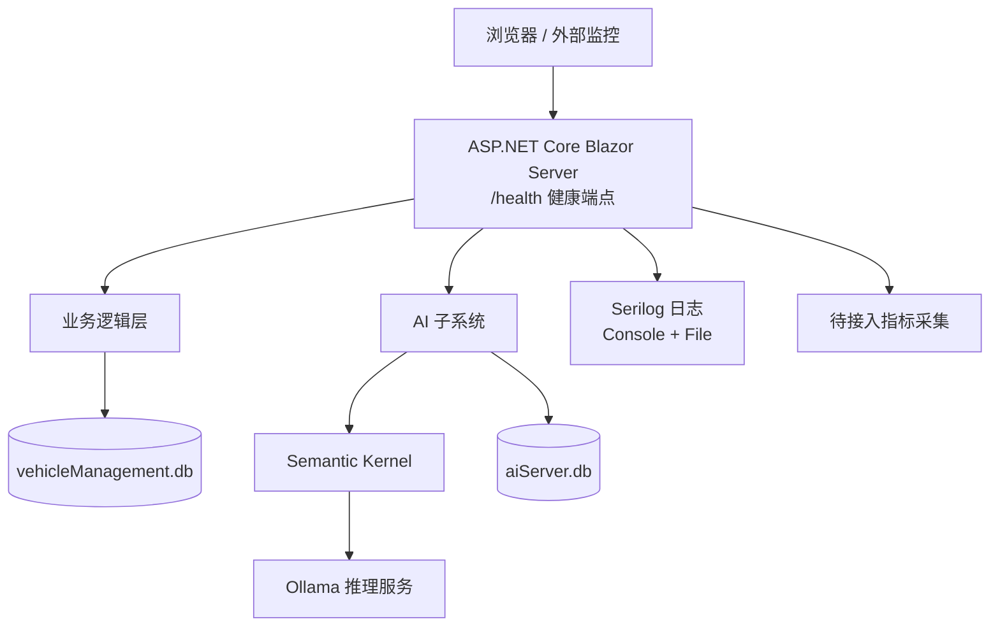
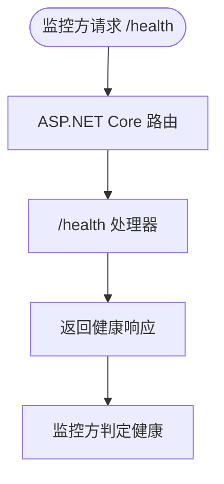
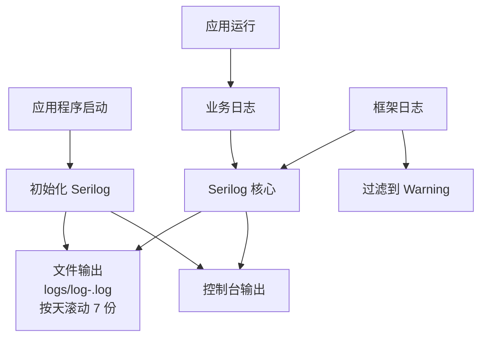
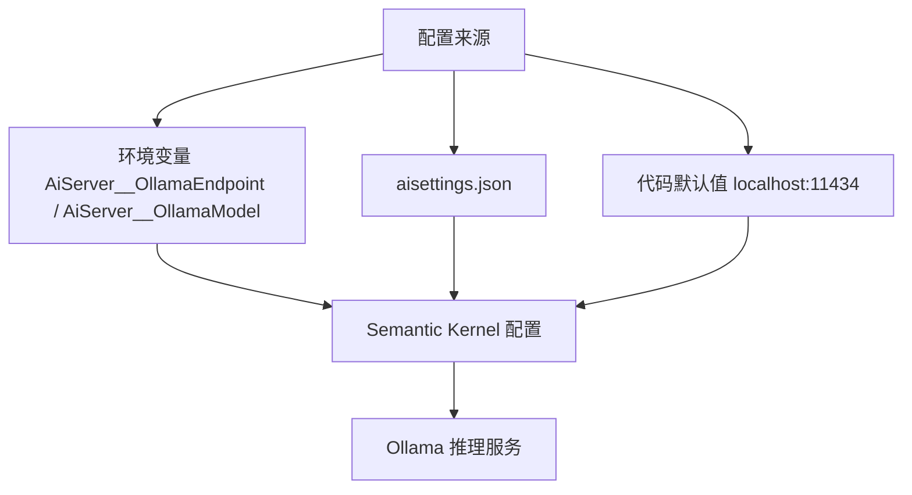
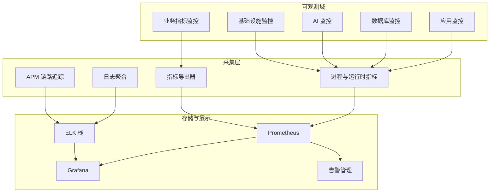
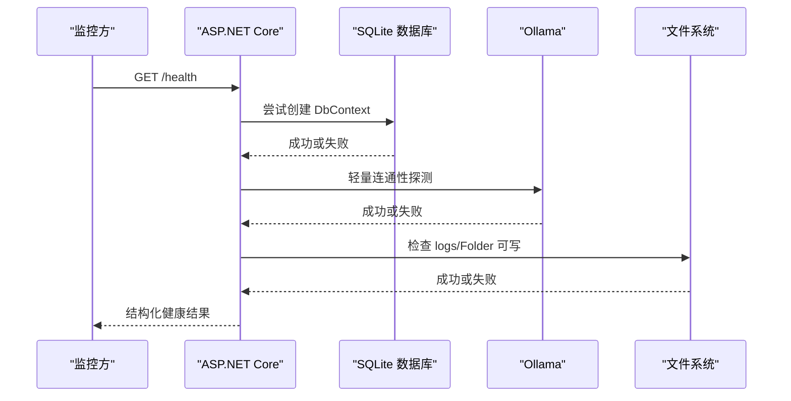
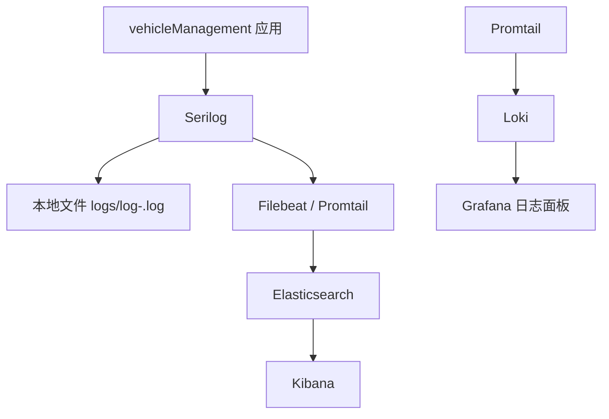
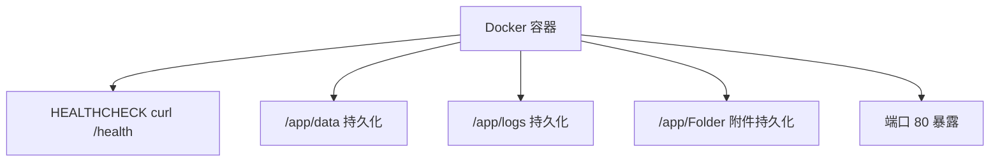
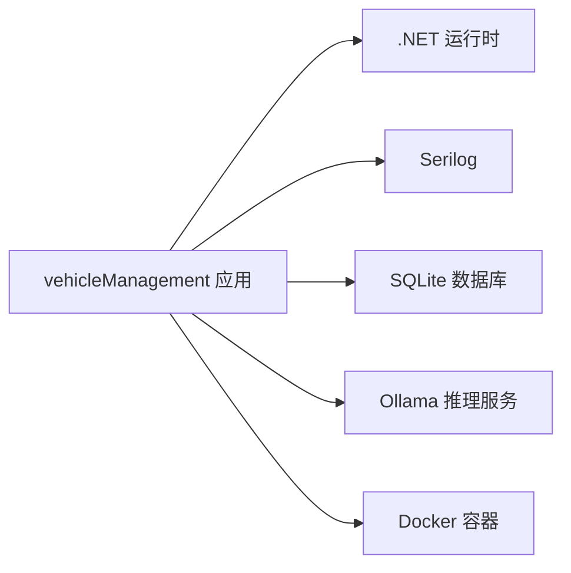

# 系统监控与告警

<cite>
**本文引用的文件**   
- [Program.cs](file://Program.cs)
- [appsettings.json](file://appsettings.json)
- [Dockerfile](file://Dockerfile)
- [README.md](file://README.md)
- [aisettings.example.json](file://aisettings.example.json)
- [vehicleManagement.csproj](file://vehicleManagement.csproj)
</cite>

## 目录
1. [引言](#引言)
2. [项目结构](#项目结构)
3. [核心组件](#核心组件)
4. [架构总览](#架构总览)
5. [详细组件分析](#详细组件分析)
6. [依赖关系分析](#依赖关系分析)
7. [性能考虑](#性能考虑)
8. [故障排查指南](#故障排查指南)
9. [结论](#结论)
10. [附录：监控系统搭建指南](#附录监控系统搭建指南)

## 引言
本文件面向 vehicleManagement 系统的运维与平台团队，目标是把当前已有的基础可观测能力扩展为完整的“监控 + 告警 + 日志聚合 + 容器化监控”体系。当前仓库已经具备：
- 应用健康探针 `/health`
- Docker `HEALTHCHECK`
- Serilog 控制台与按天滚动日志
- SQLite 业务库与 AI 库双数据源
- Ollama 本地大模型推理端点

本文在此基础上给出健康检查机制、指标收集、告警配置、日志聚合、容器化监控以及 Prometheus + Grafana、ELK、APM 的落地方案。

## 项目结构
从监控视角看，本项目主要涉及以下层次：
- Web 应用层：Blazor Server 服务入口、路由与健康端点
- 业务层：车辆、部门、人员、地点、使用记录、维修记录等
- AI 子系统：意图识别、数据查询、记忆、语义内核与 Ollama 调用
- 数据层：SQLite 业务库与 AI 库
- 运行层：Docker 镜像、环境变量、卷挂载、健康检查

**图表来源**
- [Program.cs:41-148](file://Program.cs#L41-L148)
- [Dockerfile:29-43](file://Dockerfile#L29-L43)
- [README.md:55-83](file://README.md#L55-L83)

**章节来源**
- [Program.cs:41-148](file://Program.cs#L41-L148)
- [Dockerfile:1-44](file://Dockerfile#L1-L44)
- [README.md:55-139](file://README.md#L55-L139)

## 核心组件
本节聚焦与监控和告警直接相关的现有实现。

### 健康检查机制
- 应用健康端点：程序启动后注册 `/health`，返回简单成功响应，供容器或负载均衡器探测。
- 容器健康检查：Dockerfile 中通过 `curl -f http://localhost/health` 执行健康检查，失败则标记不健康。
- 数据库连接检查：当前未暴露显式数据库健康检查；但应用启动时会创建 DbContext 并执行建库操作，若连接失败会在启动阶段抛出异常。
- AI 服务可用性检测：当前没有独立的 Ollama 连通性检查；AI 不可用时由上层业务兜底返回错误文案。

**图表来源**
- [Program.cs:144-146](file://Program.cs#L144-L146)
- [Dockerfile:40-41](file://Dockerfile#L40-L41)

**章节来源**
- [Program.cs:144-146](file://Program.cs#L144-L146)
- [Dockerfile:40-41](file://Dockerfile#L40-L41)

### 日志系统
- 日志框架：Serilog。
- 输出目标：控制台 + 文件。
- 文件策略：按天滚动，保留最近 7 份。
- 日志级别：默认 Information；抑制 Microsoft 框架与 EF Core SQL 日志到 Warning。
- 启动失败兜底：全局 try/catch 捕获启动异常并写入致命日志。

**图表来源**
- [Program.cs:28-37](file://Program.cs#L28-L37)
- [Program.cs:150-157](file://Program.cs#L150-L157)

**章节来源**
- [Program.cs:28-37](file://Program.cs#L28-L37)
- [Program.cs:150-157](file://Program.cs#L150-L157)
- [README.md:149-153](file://README.md#L149-L153)

### 配置与环境
- 连接字符串：默认 SQLite 路径分别用于业务库与 AI 库。
- AI 配置：支持 `aisettings.json` 可选加载与热重载；同时支持环境变量覆盖；代码有默认回退值。
- 容器部署：暴露端口 80；挂载 data、logs、Folder；通过环境变量注入 Ollama 端点与模型。

**图表来源**
- [Program.cs:46-46](file://Program.cs#L46-L46)
- [Program.cs:98-102](file://Program.cs#L98-L102)
- [Dockerfile:31-38](file://Dockerfile#L31-L38)
- [appsettings.json:3-6](file://appsettings.json#L3-L6)

**章节来源**
- [appsettings.json:3-6](file://appsettings.json#L3-L6)
- [Program.cs:46-46](file://Program.cs#L46-L46)
- [Program.cs:98-102](file://Program.cs#L98-L102)
- [Dockerfile:31-38](file://Dockerfile#L31-L38)
- [aisettings.example.json:1-6](file://aisettings.example.json#L1-L6)

## 架构总览
从监控与告警角度，建议将系统划分为如下可观测域：
- 应用进程：存活、启动耗时、请求延迟、错误率
- 数据库：SQLite 文件状态、连接建立、慢查询（SQLite 场景有限）
- AI 子系统：Ollama 连通性、推理延迟、错误率、上下文长度
- 基础设施：CPU、内存、磁盘、网络、容器状态
- 业务指标：车辆台账数量、使用记录量、AI 问答成功率

**图表来源**
- [Program.cs:41-148](file://Program.cs#L41-L148)
- [Dockerfile:29-43](file://Dockerfile#L29-L43)
- [README.md:55-83](file://README.md#L55-L83)

## 详细组件分析

### 健康检查机制设计
当前 `/health` 仅返回成功文本，适合容器级存活探测。建议扩展为结构化健康检查，包含：
- 应用健康：HTTP 服务可用
- 数据库健康：SQLite 文件可读、DbContext 可创建
- AI 健康：Ollama 端点可达、模型名称有效
- 外部依赖健康：文件上传目录可写、二维码生成正常

**图表来源**
- [Program.cs:144-146](file://Program.cs#L144-L146)
- [Dockerfile:40-41](file://Dockerfile#L40-L41)
- [appsettings.json:3-6](file://appsettings.json#L3-L6)

**章节来源**
- [Program.cs:144-146](file://Program.cs#L144-L146)
- [Dockerfile:40-41](file://Dockerfile#L40-L41)
- [appsettings.json:3-6](file://appsettings.json#L3-L6)

### 指标收集方案
当前仓库未集成指标采集库。建议分四类指标：

| 指标类别 | 示例指标 | 采集方式 | 说明 |
| --- | --- | --- | --- |
| 应用性能指标 | 请求数、请求延迟、错误率、并发连接数 | ASP.NET Core 内置指标 + 自定义计数器 | 反映 Web 服务稳定性 |
| 业务指标 | 车辆总数、在用车辆数、近 7 天使用记录数、AI 问答成功率 | 定时任务 + 自定义指标 | 反映业务活跃度 |
| 基础设施指标 | CPU、内存、磁盘、网络、容器状态 | 容器运行时或节点监控 | 反映资源压力 |
| 自定义指标 | Ollama 连通性、SQLite 文件大小、日志滚动次数 | 自定义采集器 | 反映关键依赖状态 |

推荐技术选型：
- 指标采集：Prometheus + .NET 指标库
- 可视化：Grafana
- 链路追踪：OpenTelemetry + APM 工具
- 日志聚合：ELK 或 Loki + Promtail

**章节来源**
- [Program.cs:41-148](file://Program.cs#L41-L148)
- [README.md:141-153](file://README.md#L141-L153)

### 告警配置建议
由于当前未实现告警规则，以下为建议方案：

| 告警类型 | 触发条件 | 通知渠道 | 升级策略 |
| --- | --- | --- | --- |
| 应用不可用 | `/health` 连续失败 | 邮件、企业微信、钉钉 | 首次通知 → 15 分钟重复 → 1 小时升级 |
| 数据库异常 | SQLite 文件不可读或 DbContext 创建失败 | 邮件、短信 | 首次通知 → 5 分钟重复 → 立即升级 |
| AI 服务不可用 | Ollama 连通性失败超过阈值 | 企业微信、钉钉 | 首次通知 → 10 分钟重复 → 值班电话 |
| 资源不足 | CPU > 90% 或内存 > 85% | 邮件、企业微信 | 首次通知 → 每小时重复 |
| 日志异常 | 日志文件无法滚动或磁盘空间不足 | 邮件、短信 | 首次通知 → 立即升级 |

**章节来源**
- [Program.cs:144-146](file://Program.cs#L144-L146)
- [Dockerfile:40-41](file://Dockerfile#L40-L41)

### 日志聚合方案
当前日志已写入文件并按天滚动。建议升级为集中式日志：

**图表来源**
- [Program.cs:28-37](file://Program.cs#L28-L37)
- [Dockerfile:37-38](file://Dockerfile#L37-L38)

**章节来源**
- [Program.cs:28-37](file://Program.cs#L28-L37)
- [Dockerfile:37-38](file://Dockerfile#L37-L38)

### 容器化监控
当前 Dockerfile 已定义健康检查与端口暴露。建议补充：
- 容器资源限制：CPU、内存上限
- 容器健康检查：结合 `/health` 与依赖检查
- 日志持久化：logs 目录挂载
- 指标暴露：未来接入指标端点

**图表来源**
- [Dockerfile:29-43](file://Dockerfile#L29-L43)

**章节来源**
- [Dockerfile:29-43](file://Dockerfile#L29-L43)

## 依赖关系分析
从监控角度看，主要依赖包括：
- ASP.NET Core 运行时
- Serilog 日志框架
- SQLite 数据库
- Ollama 推理服务
- Docker 容器运行时

**图表来源**
- [Program.cs:41-148](file://Program.cs#L41-L148)
- [Dockerfile:1-44](file://Dockerfile#L1-L44)

**章节来源**
- [Program.cs:41-148](file://Program.cs#L41-L148)
- [Dockerfile:1-44](file://Dockerfile#L1-L44)

## 性能考虑
- 健康检查频率不宜过高，避免对 SQLite 与 Ollama 造成额外压力。
- 日志滚动保留 7 份，需监控磁盘空间增长。
- AI 推理为同步调用，长回答会阻塞请求，应监控请求延迟与超时。
- 指标采集应避免高频采样，建议默认 15 秒间隔。

## 故障排查指南
常见故障与定位步骤：

| 故障现象 | 可能原因 | 排查步骤 |
| --- | --- | --- |
| `/health` 返回失败 | 应用未启动或端口被占用 | 检查进程状态、端口监听、容器日志 |
| SQLite 连接失败 | 数据文件损坏或权限不足 | 检查 data 目录权限、文件存在性 |
| AI 问答失败 | Ollama 不可达或模型 tag 不匹配 | 检查环境变量、aisettings.json、Ollama 服务 |
| 日志文件未滚动 | 磁盘空间不足或权限问题 | 检查 logs 目录权限与磁盘空间 |
| 容器频繁重启 | 健康检查失败 | 查看容器日志、/health 响应、依赖状态 |

**章节来源**
- [Program.cs:150-157](file://Program.cs#L150-L157)
- [README.md:106-118](file://README.md#L106-L118)
- [README.md:291-306](file://README.md#L291-L306)

## 结论
vehicleManagement 当前已具备基础的健康探针与日志能力，但尚未实现完整的指标采集、告警规则与集中式日志聚合。建议优先完成以下工作：
1. 扩展 `/health` 为结构化健康检查
2. 接入指标采集与 Prometheus + Grafana
3. 配置告警规则与通知渠道
4. 迁移日志到 ELK 或 Loki
5. 完善容器化监控与资源限制

这些改进将显著提升系统的可观测性、可维护性与故障恢复能力。

## 附录：监控系统搭建指南

### Prometheus + Grafana 配置
- 在 .NET 应用中引入指标库，暴露 `/metrics` 端点
- 配置 Prometheus 抓取该端点
- 在 Grafana 中导入 .NET 仪表盘模板
- 创建业务指标面板：车辆统计、AI 问答成功率、请求延迟分布

**章节来源**
- [Program.cs:41-148](file://Program.cs#L41-L148)
- [README.md:141-153](file://README.md#L141-L153)

### ELK 栈部署
- 安装 Elasticsearch、Logstash/Filebeat、Kibana
- 配置 Filebeat 采集 `/app/logs` 下的日志文件
- 在 Kibana 中创建索引模式与日志看板
- 设置日志保留策略：例如保留 30 天

**章节来源**
- [Program.cs:28-37](file://Program.cs#L28-L37)
- [Dockerfile:37-38](file://Dockerfile#L37-L38)

### APM 工具集成
- 引入 OpenTelemetry SDK
- 配置分布式追踪，记录 HTTP 请求、数据库访问、AI 调用链路
- 将追踪数据发送到 APM 后端（如 Jaeger、Zipkin 或商业 APM）
- 在 APM 界面中分析慢请求与异常链路

**章节来源**
- [Program.cs:41-148](file://Program.cs#L41-L148)
- [README.md:55-83](file://README.md#L55-L83)