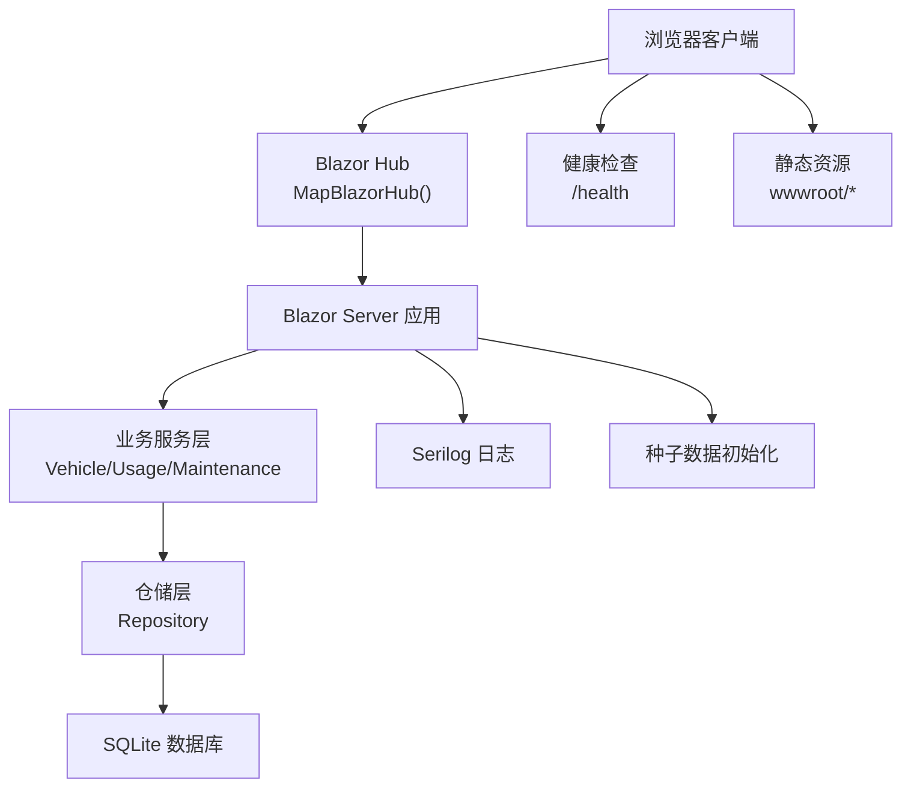
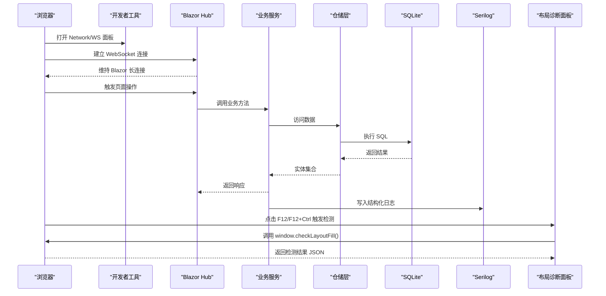
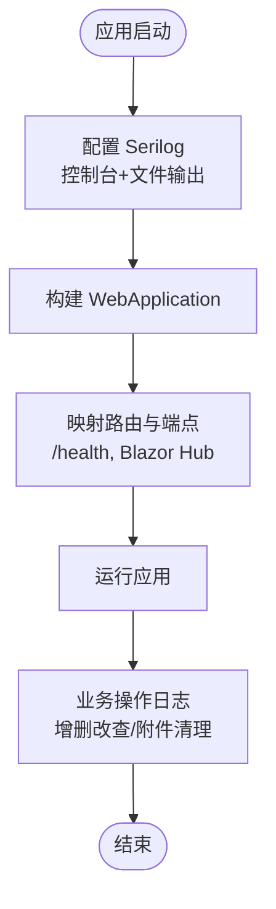
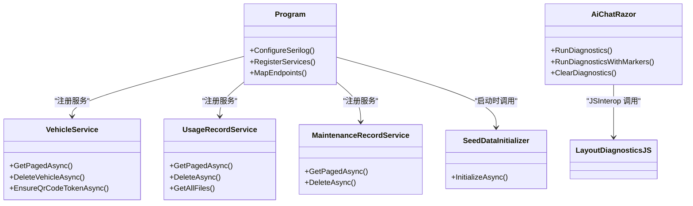
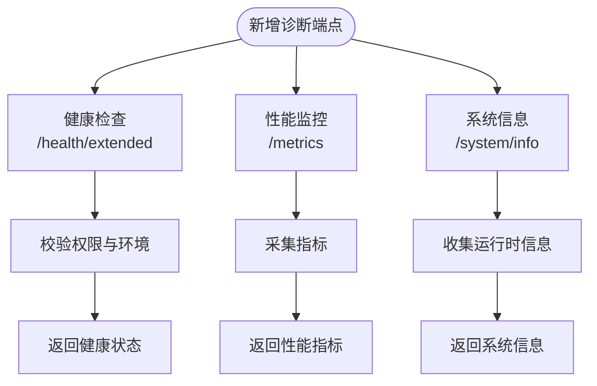

# 诊断工具与技巧

<cite>
**本文引用的文件**   
- [Program.cs](file://Program.cs)
- [appsettings.json](file://appsettings.json)
- [appsettings.Development.json](file://appsettings.Development.json)
- [README.md](file://README.md)
- [VehicleService.cs](file://BLL/Vehicle/VehicleService.cs)
- [UsageRecordService.cs](file://BLL/UsageRecord/UsageRecordService.cs)
- [MaintenanceRecordService.cs](file://BLL/Maintenance/MaintenanceRecordService.cs)
- [SeedDataInitializer.cs](file://DAL/SeedDataInitializer.cs)
- [AiChat.razor](file://aiServer/Pages/AiChat.razor)
- [layout-diagnostics.js](file://wwwroot/js/layout-diagnostics.js)
- [ai-chat.css](file://wwwroot/css/ai-chat.css)
</cite>

## 目录
1. [引言](#引言)
2. [项目结构](#项目结构)
3. [核心组件](#核心组件)
4. [架构总览](#架构总览)
5. [详细组件分析](#详细组件分析)
6. [依赖关系分析](#依赖关系分析)
7. [性能与内存诊断建议](#性能与内存诊断建议)
8. [故障排查指南](#故障排查指南)
9. [结论](#结论)
10. [附录：自定义诊断端点实现指南](#附录自定义诊断端点实现指南)

## 引言
本文件面向 vehicleManagement 系统的运维、开发与测试人员，聚焦“如何诊断系统问题”。内容覆盖：
- 日志分析：Serilog 配置、结构化日志查询、关键业务日志埋点位置。
- 网络调试：Blazor Server 的 HTTP/WebSocket 链路、API 调用链跟踪思路。
- 内存与性能：在 Blazor Server 场景下的 GC 行为观察、对象生命周期监控方法。
- Visual Studio 调试：本地与远程调试、断点设置技巧。
- 前端调试：浏览器开发者工具、组件状态检查、网络请求分析。
- 自定义诊断端点：健康检查、性能监控、系统信息接口的设计与落地方式。

## 项目结构
vehicleManagement 采用 .NET 10 + Blazor Server 架构，后端使用 EF Core + SQLite，AI 子模块通过 Semantic Kernel 接入 Ollama。诊断相关的关键入口集中在应用启动与页面层：
- 应用启动与中间件注册：Program.cs
- 数据库连接与运行环境配置：appsettings.json、appsettings.Development.json
- 业务服务中的结构化日志埋点：VehicleService.cs、UsageRecordService.cs、MaintenanceRecordService.cs
- 种子数据初始化日志：SeedDataInitializer.cs
- 前端布局诊断面板与 JS 检测脚本：AiChat.razor、layout-diagnostics.js、ai-chat.css

图表来源
- [Program.cs:41-148](file://Program.cs#L41-L148)
- [appsettings.json:1-8](file://appsettings.json#L1-L8)

章节来源
- [Program.cs:41-148](file://Program.cs#L41-L148)
- [appsettings.json:1-8](file://appsettings.json#L1-L8)

## 核心组件
本节梳理与诊断直接相关的核心能力：
- 日志子系统（Serilog）：控制台输出、按日滚动文件输出、框架日志抑制、全局异常捕获。
- 健康检查端点：/health 返回简单状态。
- 业务服务日志：车辆、使用记录、维修记录的增删改操作均包含结构化日志。
- 种子数据初始化日志：开发环境首次启动会写入关键步骤日志。
- 前端布局诊断：AiChat 页面提供布局填充检测面板，JS 脚本负责像素级空白检测与可视化标记。

章节来源
- [Program.cs:28-37](file://Program.cs#L28-L37)
- [Program.cs:144-146](file://Program.cs#L144-L146)
- [VehicleService.cs:183-200](file://BLL/Vehicle/VehicleService.cs#L183-L200)
- [UsageRecordService.cs:131-153](file://BLL/UsageRecord/UsageRecordService.cs#L131-L153)
- [MaintenanceRecordService.cs:79-99](file://BLL/Maintenance/MaintenanceRecordService.cs#L79-L99)
- [SeedDataInitializer.cs:22-31](file://DAL/SeedDataInitializer.cs#L22-L31)
- [AiChat.razor:446-497](file://aiServer/Pages/AiChat.razor#L446-L497)
- [layout-diagnostics.js:1-35](file://wwwroot/js/layout-diagnostics.js#L1-L35)

## 架构总览
下图展示诊断相关的数据流与控制流：从浏览器到 Blazor Hub，再到业务服务与数据库；同时显示日志与前端诊断面板的交互路径。

图表来源
- [Program.cs:144-146](file://Program.cs#L144-L146)
- [AiChat.razor:446-497](file://aiServer/Pages/AiChat.razor#L446-L497)
- [layout-diagnostics.js:1-35](file://wwwroot/js/layout-diagnostics.js#L1-L35)

## 详细组件分析

### 日志分析工具（Serilog 配置、结构化日志查询、性能指标收集）
- 配置要点
  - 默认最低级别为 Information，并抑制 Microsoft 与 EF Core SQL 日志，减少噪音。
  - 输出目标包括控制台与按日滚动的日志文件，保留最近 7 天。
  - 应用启动失败时记录 Fatal 日志，并在 finally 中关闭并刷新日志。
- 结构化日志埋点
  - 删除车辆/使用记录/维修记录时，记录清理附件数量与成功/失败原因。
  - 种子数据初始化阶段记录跳过/重建/插入数量等关键步骤。
- 性能指标收集建议
  - 当前未集成专用性能计数器或指标采集器；可在关键 I/O 处增加耗时日志（例如数据库访问、文件上传/删除）。
  - 结合浏览器 Network 面板与服务器日志进行端到端耗时定位。

图表来源
- [Program.cs:28-37](file://Program.cs#L28-L37)
- [Program.cs:144-148](file://Program.cs#L144-L148)
- [VehicleService.cs:183-200](file://BLL/Vehicle/VehicleService.cs#L183-L200)
- [UsageRecordService.cs:131-153](file://BLL/UsageRecord/UsageRecordService.cs#L131-L153)
- [MaintenanceRecordService.cs:79-99](file://BLL/Maintenance/MaintenanceRecordService.cs#L79-L99)
- [SeedDataInitializer.cs:22-31](file://DAL/SeedDataInitializer.cs#L22-L31)

章节来源
- [Program.cs:28-37](file://Program.cs#L28-L37)
- [Program.cs:144-148](file://Program.cs#L144-L148)
- [VehicleService.cs:183-200](file://BLL/Vehicle/VehicleService.cs#L183-L200)
- [UsageRecordService.cs:131-153](file://BLL/UsageRecord/UsageRecordService.cs#L131-L153)
- [MaintenanceRecordService.cs:79-99](file://BLL/Maintenance/MaintenanceRecordService.cs#L79-L99)
- [SeedDataInitializer.cs:22-31](file://DAL/SeedDataInitializer.cs#L22-L31)

### 网络调试工具（HTTP 请求追踪、WebSocket 连接监控、API 调用链跟踪）
- HTTP 请求追踪
  - 使用浏览器开发者工具的 Network 面板查看 /health 与健康检查响应。
  - 关注静态资源加载、文件上传/下载（Folder 目录）的请求状态与耗时。
- WebSocket 连接监控
  - Blazor Server 通过 /_blazor 建立 WebSocket 长连接；在 Network 面板筛选 WS 协议，观察连接建立、消息收发与重连情况。
- API 调用链跟踪
  - 将浏览器请求时间与服务器日志时间对齐，结合业务服务中的结构化日志，定位慢查询或外部依赖（如 Ollama）延迟。

章节来源
- [Program.cs:144-146](file://Program.cs#L144-L146)
- [README.md:1-19](file://README.md#L1-L19)

### 内存分析工具（内存泄漏检测、GC 行为分析、对象生命周期监控）
- 现状说明
  - 代码库未内置专用内存分析或 GC 监控组件。
- 实践建议
  - 在开发环境启用详细错误页，便于观察异常导致的内存增长。
  - 使用 Visual Studio 的性能分析器（CPU 使用率、内存快照）与 .NET Profiler 进行 GC 行为分析。
  - 针对长时间运行的 Blazor Server 会话，关注组件状态与 JS 对象引用是否被意外保持。

章节来源
- [Program.cs:127-130](file://Program.cs#L127-L130)

### Visual Studio 调试器：Blazor Server 调试、远程调试、断点设置技巧
- 本地调试
  - 直接在 Visual Studio 中启动项目，对 Program.cs、业务服务、仓储层设置断点。
  - 利用“条件断点”与“命中次数”过滤高频调用。
- 远程调试
  - 部署后通过 VS 附加进程进行远程调试；注意端口与防火墙配置。
- 断点技巧
  - 在服务层关键方法（如删除、分页查询）设置断点，配合日志快速验证分支逻辑。
  - 在 Blazor 组件事件回调处设置断点，观察前端交互与服务端处理时序。

[本节为通用调试指导，不直接分析具体文件]

### 前端调试技巧：浏览器开发者工具、组件状态检查、网络请求分析
- 开发者工具
  - Network 面板：筛选 XHR/Fetch 与 WS，查看请求头、响应体与耗时。
  - Console 面板：查看 JS 错误与自定义诊断输出。
- 组件状态检查
  - AiChat 页面的布局诊断面板可触发 window.checkLayoutFill()，返回 JSON 并可视化标记空白区域。
  - 支持 draw/clear 模式，便于定位侧边栏与主区域的像素级空白。
- 网络请求分析
  - 结合服务端日志与前端请求，确认 Blazor Hub 连接稳定性与 API 调用成功率。

章节来源
- [AiChat.razor:446-497](file://aiServer/Pages/AiChat.razor#L446-L497)
- [layout-diagnostics.js:1-35](file://wwwroot/js/layout-diagnostics.js#L1-L35)
- [ai-chat.css:470-496](file://wwwroot/css/ai-chat.css#L470-L496)

## 依赖关系分析
- 应用启动依赖
  - Serilog 用于日志输出；UseSerilog 注入到宿主。
  - DbContextFactory 避免 Blazor Server 并发冲突。
  - AI 服务通过 Configuration 读取 Ollama 端点与模型名称。
- 业务服务依赖
  - VehicleService、UsageRecordService、MaintenanceRecordService 均依赖仓储层与 IDbContextFactory。
  - 文件上传/删除由 FileUploadService 统一处理，删除流程伴随结构化日志。
- 前端依赖
  - AiChat.razor 通过 JSInterop 调用 layout-diagnostics.js 提供的检测函数。

图表来源
- [Program.cs:41-102](file://Program.cs#L41-L102)
- [VehicleService.cs:67-109](file://BLL/Vehicle/VehicleService.cs#L67-L109)
- [UsageRecordService.cs:43-92](file://BLL/UsageRecord/UsageRecordService.cs#L43-L92)
- [MaintenanceRecordService.cs:30-59](file://BLL/Maintenance/MaintenanceRecordService.cs#L30-L59)
- [SeedDataInitializer.cs:20-87](file://DAL/SeedDataInitializer.cs#L20-L87)
- [AiChat.razor:446-497](file://aiServer/Pages/AiChat.razor#L446-L497)
- [layout-diagnostics.js:1-35](file://wwwroot/js/layout-diagnostics.js#L1-L35)

章节来源
- [Program.cs:41-102](file://Program.cs#L41-L102)
- [VehicleService.cs:67-109](file://BLL/Vehicle/VehicleService.cs#L67-L109)
- [UsageRecordService.cs:43-92](file://BLL/UsageRecord/UsageRecordService.cs#L43-L92)
- [MaintenanceRecordService.cs:30-59](file://BLL/Maintenance/MaintenanceRecordService.cs#L30-L59)
- [SeedDataInitializer.cs:20-87](file://DAL/SeedDataInitializer.cs#L20-L87)
- [AiChat.razor:446-497](file://aiServer/Pages/AiChat.razor#L446-L497)
- [layout-diagnostics.js:1-35](file://wwwroot/js/layout-diagnostics.js#L1-L35)

## 性能与内存诊断建议
- 性能瓶颈定位
  - 优先检查数据库查询复杂度与 N+1 问题；分页查询已使用 Skip/Take，但需注意 Include 带来的关联加载开销。
  - 文件上传/删除涉及磁盘 I/O，建议在删除流程中记录耗时与异常。
- 内存优化
  - 避免在 Blazor Server 组件中持有大量 DOM 引用或 JS 对象引用。
  - 合理使用 IDisposable 与 using 语句释放上下文与资源。
- 指标采集扩展
  - 可引入 Metrics 库（如 Prometheus.NET）采集请求数、延迟、错误率等指标。
  - 在关键业务方法中记录耗时与异常，结合日志系统进行聚合分析。

[本节为通用指导，不直接分析具体文件]

## 故障排查指南
- 启动失败
  - 检查 Program.cs 中的全局异常捕获与 Fatal 日志，确认配置文件与数据库连接字符串是否正确。
- 健康检查异常
  - 访问 /health 返回非预期结果时，检查中间件顺序与静态文件提供配置。
- 删除记录失败
  - 若删除车辆/使用记录/维修记录时报错，查看对应服务的日志，确认附件文件是否被占用或路径无效。
- 前端布局问题
  - 使用 AiChat 页面的布局诊断面板，触发 checkLayoutFill()，根据返回的 gaps 列表定位空白区域。

章节来源
- [Program.cs:150-157](file://Program.cs#L150-L157)
- [Program.cs:144-146](file://Program.cs#L144-L146)
- [VehicleService.cs:183-200](file://BLL/Vehicle/VehicleService.cs#L183-L200)
- [UsageRecordService.cs:131-153](file://BLL/UsageRecord/UsageRecordService.cs#L131-L153)
- [MaintenanceRecordService.cs:79-99](file://BLL/Maintenance/MaintenanceRecordService.cs#L79-L99)
- [AiChat.razor:446-497](file://aiServer/Pages/AiChat.razor#L446-L497)

## 结论
vehicleManagement 系统已具备基础的诊断能力：
- 日志方面：Serilog 提供控制台与文件输出，业务服务与种子数据初始化包含结构化日志。
- 网络方面：Blazor Hub 与 /health 端点可用于基础连通性检查。
- 前端方面：AiChat 页面提供布局诊断面板，辅助定位 UI 空白问题。
- 内存与性能：需借助 Visual Studio 与浏览器开发者工具进行补充分析。
建议后续扩展健康检查、性能监控与系统信息端点，形成更完善的可观测性体系。

[本节为总结性内容，不直接分析具体文件]

## 附录：自定义诊断端点实现指南
以下为实现三类诊断端点的参考方案，可直接在 Program.cs 中扩展：

- 健康检查 API
  - 目的：返回服务基本状态与依赖项健康情况。
  - 建议实现：
    - 返回服务版本、运行时长、数据库连接状态。
    - 可扩展为 /health/ready 与 /health/live 两个端点。
  - 参考位置：Program.cs 中已有 /health 简单返回，可在此扩展。

- 性能监控端点
  - 目的：暴露关键性能指标（请求数、延迟、错误率、GC 统计）。
  - 建议实现：
    - 使用 System.Diagnostics.Metrics 或第三方库采集指标。
    - 提供 /metrics 端点返回 JSON 或 Prometheus 格式。
  - 参考位置：Program.cs 中服务注册与中间件配置区域。

- 系统信息接口
  - 目的：返回运行时环境信息（操作系统、.NET 版本、CPU/内存使用情况）。
  - 建议实现：
    - 读取 Environment 与 Process 信息，封装为响应对象。
    - 提供 /system/info 端点，仅在开发或受控环境下开放。
  - 参考位置：Program.cs 中端点映射区域。

[本节为概念性指导，不直接分析具体文件]