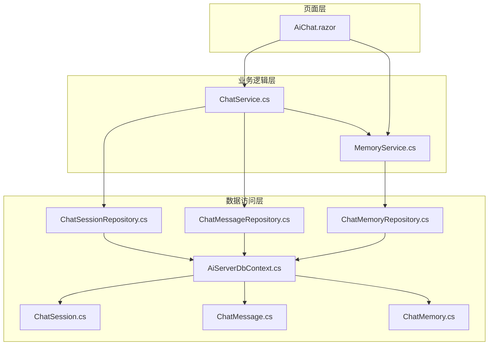
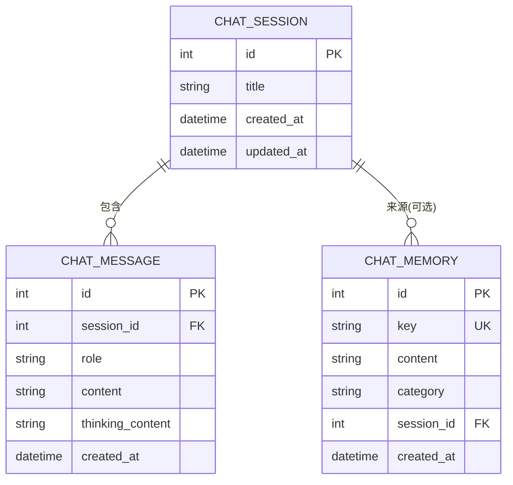
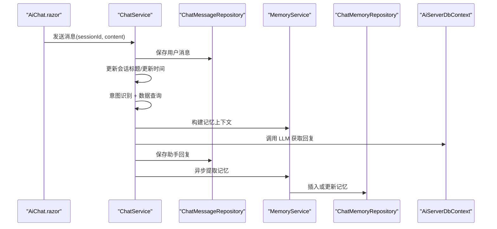
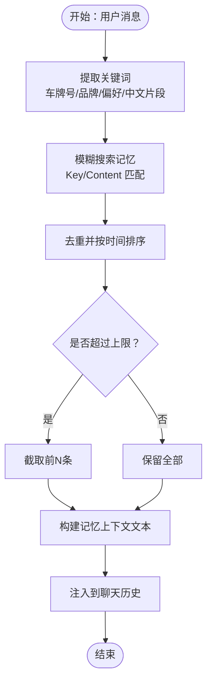
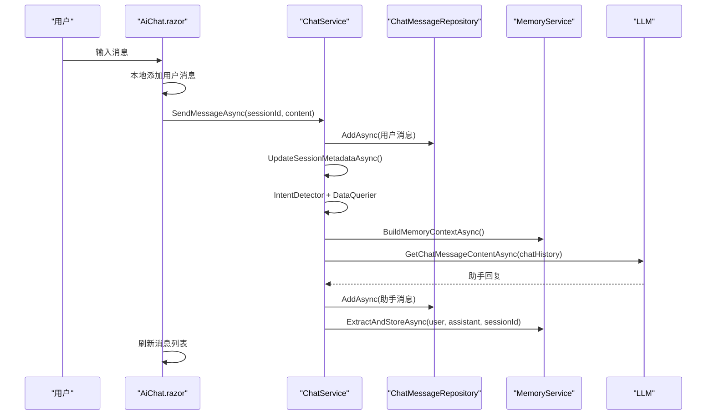
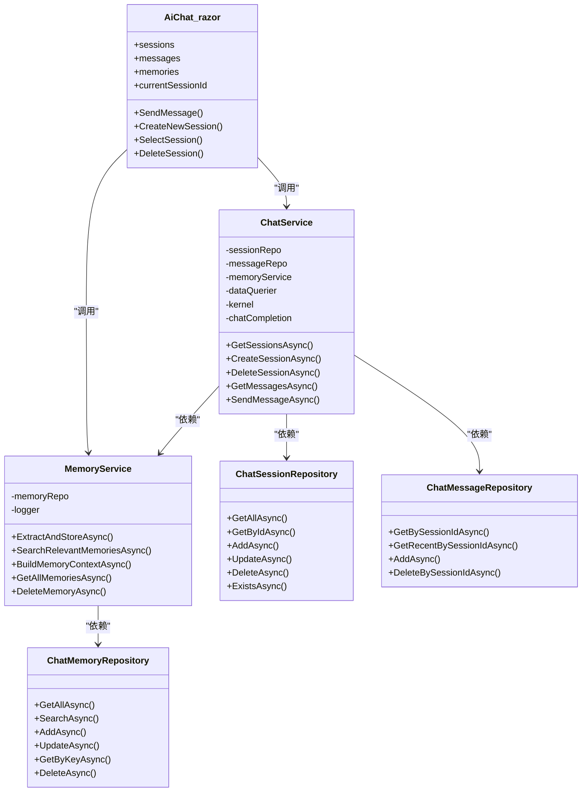
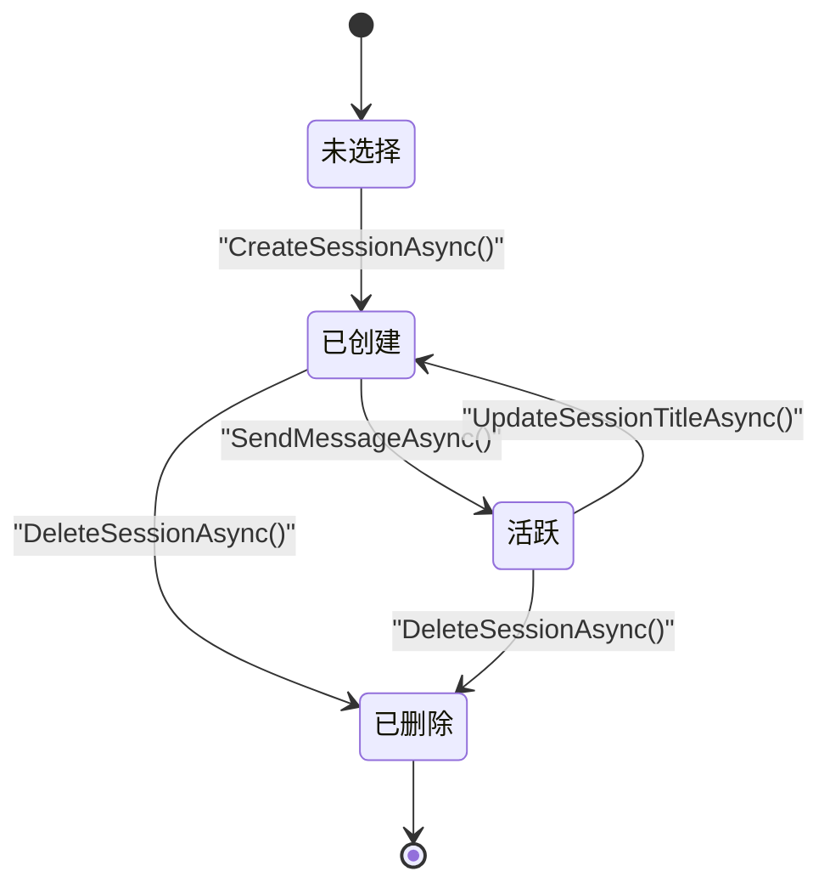
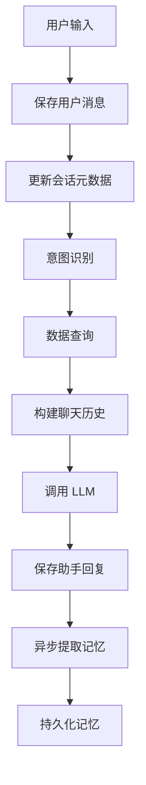

# AI 数据模型

<cite>
**本文引用的文件**   
- [ChatSession.cs](file://aiServer/DAL/Model/ChatSession.cs)
- [ChatMessage.cs](file://aiServer/DAL/Model/ChatMessage.cs)
- [ChatMemory.cs](file://aiServer/DAL/Model/ChatMemory.cs)
- [AiServerDbContext.cs](file://aiServer/DAL/AiServerDbContext.cs)
- [ChatSessionRepository.cs](file://aiServer/DAL/Repository/ChatSessionRepository.cs)
- [ChatMessageRepository.cs](file://aiServer/DAL/Repository/ChatMessageRepository.cs)
- [ChatMemoryRepository.cs](file://aiServer/DAL/Repository/ChatMemoryRepository.cs)
- [ChatService.cs](file://aiServer/BLL/ChatService.cs)
- [MemoryService.cs](file://aiServer/BLL/MemoryService.cs)
- [AiChat.razor](file://aiServer/Pages/AiChat.razor)
</cite>

## 目录
1. [引言](#引言)
2. [项目结构](#项目结构)
3. [核心实体与数据模型](#核心实体与数据模型)
4. [架构总览](#架构总览)
5. [详细组件分析](#详细组件分析)
6. [依赖关系分析](#依赖关系分析)
7. [性能与扩展性考虑](#性能与扩展性考虑)
8. [故障排查指南](#故障排查指南)
9. [结论](#结论)
10. [附录：会话状态转换图与数据流转图](#附录会话状态转换图与数据流转图)

## 引言
本文件聚焦于 AI 子系统的数据模型，围绕 ChatSession（会话）、ChatMessage（消息）、ChatMemory（记忆）三个核心实体展开，说明其设计目标、字段含义、关联关系与持久化策略。同时梳理会话管理机制、消息存储结构、记忆系统的设计与检索方式，并给出从用户输入到响应生成的完整数据流，以及与会话状态和数据隔离相关的实现要点。

## 项目结构
AI 子系统采用分层结构：
- DAL（数据访问层）：定义实体模型、数据库上下文和仓储实现。
- BLL（业务逻辑层）：封装对话流程、意图识别、数据查询、记忆提取等能力。
- Pages（页面层）：Blazor 页面负责 UI 交互，调用服务完成会话管理、消息发送与记忆展示。

**图表来源**
- [AiChat.razor:1-555](file://aiServer/Pages/AiChat.razor#L1-L555)
- [ChatService.cs:1-202](file://aiServer/BLL/ChatService.cs#L1-L202)
- [MemoryService.cs:1-224](file://aiServer/BLL/MemoryService.cs#L1-L224)
- [AiServerDbContext.cs:1-59](file://aiServer/DAL/AiServerDbContext.cs#L1-L59)
- [ChatSessionRepository.cs:1-71](file://aiServer/DAL/Repository/ChatSessionRepository.cs#L1-L71)
- [ChatMessageRepository.cs:1-60](file://aiServer/DAL/Repository/ChatMessageRepository.cs#L1-L60)
- [ChatMemoryRepository.cs:1-78](file://aiServer/DAL/Repository/ChatMemoryRepository.cs#L1-L78)
- [ChatSession.cs:1-39](file://aiServer/DAL/Model/ChatSession.cs#L1-L39)
- [ChatMessage.cs:1-51](file://aiServer/DAL/Model/ChatMessage.cs#L1-L51)
- [ChatMemory.cs:1-52](file://aiServer/DAL/Model/ChatMemory.cs#L1-L52)

**章节来源**
- [AiChat.razor:1-555](file://aiServer/Pages/AiChat.razor#L1-L555)
- [ChatService.cs:1-202](file://aiServer/BLL/ChatService.cs#L1-L202)
- [MemoryService.cs:1-224](file://aiServer/BLL/MemoryService.cs#L1-L224)
- [AiServerDbContext.cs:1-59](file://aiServer/DAL/AiServerDbContext.cs#L1-L59)

## 核心实体与数据模型
本节对三个核心实体进行结构化说明，包括主键、关键字段、约束与导航属性。

### ChatSession（会话）
- 主键：自增整数 Id。
- 标题 Title：会话显示名称，可自动根据首条消息生成。
- 时间戳：CreatedAt 创建时间，UpdatedAt 最后活跃时间。
- 导航属性：Messages 集合，表示该会话下的所有消息。
- 用途：作为对话的容器，承载生命周期与元信息。

**章节来源**
- [ChatSession.cs:1-39](file://aiServer/DAL/Model/ChatSession.cs#L1-L39)
- [AiServerDbContext.cs:24-29](file://aiServer/DAL/AiServerDbContext.cs#L24-L29)

### ChatMessage（消息）
- 主键：自增整数 Id。
- 外键：SessionId，指向所属会话。
- 角色 Role：user / assistant / system，用于区分消息来源。
- 内容 Content：消息正文。
- 思考过程 ThinkingContent：仅 assistant 角色使用，便于前端折叠展示。
- 时间戳：CreatedAt。
- 导航属性：Session，反向关联所属会话。
- 索引：按 SessionId 与 CreatedAt 建立索引，优化查询性能。

**章节来源**
- [ChatMessage.cs:1-51](file://aiServer/DAL/Model/ChatMessage.cs#L1-L51)
- [AiServerDbContext.cs:31-42](file://aiServer/DAL/AiServerDbContext.cs#L31-L42)

### ChatMemory（记忆）
- 主键：自增整数 Id。
- 键 Key：记忆的唯一标识，用于去重与更新。
- 内容 Content：记忆文本。
- 分类 Category：vehicle / personnel / department / location / preference / general。
- 来源会话 SessionId：可选，记录记忆来源会话。
- 时间戳：CreatedAt。
- 导航属性：Session，可选关联来源会话。
- 索引：Key 与 Category 建立索引，支持快速检索与筛选。

**章节来源**
- [ChatMemory.cs:1-52](file://aiServer/DAL/Model/ChatMemory.cs#L1-L52)
- [AiServerDbContext.cs:44-55](file://aiServer/DAL/AiServerDbContext.cs#L44-L55)

### 实体关系图

**图表来源**
- [ChatSession.cs:1-39](file://aiServer/DAL/Model/ChatSession.cs#L1-L39)
- [ChatMessage.cs:1-51](file://aiServer/DAL/Model/ChatMessage.cs#L1-L51)
- [ChatMemory.cs:1-52](file://aiServer/DAL/Model/ChatMemory.cs#L1-L52)
- [AiServerDbContext.cs:20-55](file://aiServer/DAL/AiServerDbContext.cs#L20-L55)

## 架构总览
AI 子系统的对话流程由页面层触发，经业务层编排，最终落盘到独立数据库上下文。

**图表来源**
- [ChatService.cs:94-139](file://aiServer/BLL/ChatService.cs#L94-L139)
- [MemoryService.cs:45-113](file://aiServer/BLL/MemoryService.cs#L45-L113)
- [AiChat.razor:376-419](file://aiServer/Pages/AiChat.razor#L376-L419)

## 详细组件分析

### 会话管理机制
- 创建会话：页面调用服务创建会话，设置默认标题与时间戳；服务通过仓储写入数据库。
- 生命周期管理：会话列表按更新时间倒序展示；选择会话时加载对应消息历史；删除会话时检查存在性后移除。
- 状态跟踪：通过 UpdatedAt 反映最近活跃时间；首次消息到达时自动将标题设置为内容片段。

关键实现要点：
- 会话创建与更新在业务层统一处理，确保时间戳与标题一致性。
- 会话删除前进行存在性校验，避免无效操作。
- 页面侧维护当前会话 ID 与标题，并在切换会话时刷新消息列表。

**章节来源**
- [ChatService.cs:46-78](file://aiServer/BLL/ChatService.cs#L46-L78)
- [ChatSessionRepository.cs:21-68](file://aiServer/DAL/Repository/ChatSessionRepository.cs#L21-L68)
- [AiChat.razor:329-373](file://aiServer/Pages/AiChat.razor#L329-L373)

### 消息存储结构与上下文保持
- 消息格式：每条消息包含角色、内容与时间戳；assistant 消息可附带思考过程。
- 上下文保持：构建聊天历史时注入系统提示词、数据查询结果与相关记忆；仅加载最近若干条消息以控制上下文长度。
- 历史记录持久化：用户消息与助手回复均持久化至数据库；按会话维度组织，支持按时间排序读取。

关键实现要点：
- 最近消息数量限制为固定阈值，避免上下文过大影响性能。
- 系统提示词与数据注入通过服务层组合，保证 LLM 输入的结构化与可控性。
- 消息仓储提供按会话查询与最近 N 条查询接口。

**章节来源**
- [ChatMessage.cs:1-51](file://aiServer/DAL/Model/ChatMessage.cs#L1-L51)
- [ChatService.cs:158-183](file://aiServer/BLL/ChatService.cs#L158-L183)
- [ChatMessageRepository.cs:21-39](file://aiServer/DAL/Repository/ChatMessageRepository.cs#L21-L39)
- [AiChat.razor:151-177](file://aiServer/Pages/AiChat.razor#L151-L177)

### 记忆系统设计
记忆系统承担跨会话的关键信息抽取与检索职责，分为短期与长期两类：
- 短期记忆：在当前对话中通过“最近消息”维持上下文，由服务层在构建聊天历史时动态组装。
- 长期记忆：通过 ChatMemory 实体持久化，按 Key 去重更新，支持按关键词模糊搜索与分类过滤。

设计与实现要点：
- 关键词提取规则：车牌号正则、品牌词表、偏好关键词、中文分词片段。
- 存储策略：相同 Key 的记忆执行 Upsert（更新内容），不同 Key 则新增。
- 检索机制：基于 Key 与 Content 的模糊匹配，返回最近若干条记忆，限制数量以避免上下文膨胀。
- 上下文注入：将相关记忆以系统消息形式注入 LLM 输入，增强回答个性化。

**图表来源**
- [MemoryService.cs:118-153](file://aiServer/BLL/MemoryService.cs#L118-L153)
- [ChatMemoryRepository.cs:29-40](file://aiServer/DAL/Repository/ChatMemoryRepository.cs#L29-L40)

**章节来源**
- [MemoryService.cs:45-113](file://aiServer/BLL/MemoryService.cs#L45-L113)
- [MemoryService.cs:118-153](file://aiServer/BLL/MemoryService.cs#L118-L153)
- [MemoryService.cs:174-194](file://aiServer/BLL/MemoryService.cs#L174-L194)
- [ChatMemoryRepository.cs:29-40](file://aiServer/DAL/Repository/ChatMemoryRepository.cs#L29-L40)

### 完整数据生命周期：从用户输入到响应生成
1. 用户在页面输入消息，本地立即显示用户消息气泡。
2. 调用业务服务保存用户消息，并自动更新会话标题与更新时间。
3. 进行意图识别与数据查询，得到业务数据上下文。
4. 构建聊天历史：系统提示词 + 数据注入 + 记忆上下文 + 最近消息。
5. 调用 LLM 获取助手回复，保存助手消息。
6. 异步提取记忆并持久化，不影响主流程。

**图表来源**
- [AiChat.razor:376-419](file://aiServer/Pages/AiChat.razor#L376-L419)
- [ChatService.cs:94-139](file://aiServer/BLL/ChatService.cs#L94-L139)
- [MemoryService.cs:45-113](file://aiServer/BLL/MemoryService.cs#L45-L113)

**章节来源**
- [AiChat.razor:376-419](file://aiServer/Pages/AiChat.razor#L376-L419)
- [ChatService.cs:94-139](file://aiServer/BLL/ChatService.cs#L94-L139)

### 与业务数据的关联方式和数据隔离策略
- 关联方式：AI 子系统通过意图识别与数据查询服务获取业务数据（如车辆、人员、部门、位置等），并将查询结果以系统提示词形式注入 LLM 输入，不直接修改业务数据。
- 数据隔离：AI 子系统拥有独立的数据库上下文 AiServerDbContext，与业务数据库分离；会话、消息、记忆存储在独立表中，避免与业务实体耦合。
- 权限与范围：记忆可通过 Category 进行分类，便于后续扩展权限控制与数据治理；来源会话可选关联，便于审计与溯源。

**章节来源**
- [ChatService.cs:109-114](file://aiServer/BLL/ChatService.cs#L109-L114)
- [AiServerDbContext.cs:16-18](file://aiServer/DAL/AiServerDbContext.cs#L16-L18)
- [ChatMemory.cs:30-33](file://aiServer/DAL/Model/ChatMemory.cs#L30-L33)

## 依赖关系分析
- 页面层依赖业务服务：AiChat.razor 注入 ChatService 与 MemoryService，负责 UI 状态管理与用户交互。
- 业务层依赖仓储与外部服务：ChatService 依赖会话与消息仓储、记忆服务、数据查询服务与 LLM 服务；MemoryService 依赖记忆仓储。
- 数据访问层依赖 EF Core：仓储通过 IDbContextFactory 创建上下文，执行 CRUD 与查询。

**图表来源**
- [AiChat.razor:1-555](file://aiServer/Pages/AiChat.razor#L1-L555)
- [ChatService.cs:1-202](file://aiServer/BLL/ChatService.cs#L1-L202)
- [MemoryService.cs:1-224](file://aiServer/BLL/MemoryService.cs#L1-L224)
- [ChatSessionRepository.cs:1-71](file://aiServer/DAL/Repository/ChatSessionRepository.cs#L1-L71)
- [ChatMessageRepository.cs:1-60](file://aiServer/DAL/Repository/ChatMessageRepository.cs#L1-L60)
- [ChatMemoryRepository.cs:1-78](file://aiServer/DAL/Repository/ChatMemoryRepository.cs#L1-L78)

**章节来源**
- [AiChat.razor:1-555](file://aiServer/Pages/AiChat.razor#L1-L555)
- [ChatService.cs:1-202](file://aiServer/BLL/ChatService.cs#L1-L202)
- [MemoryService.cs:1-224](file://aiServer/BLL/MemoryService.cs#L1-L224)

## 性能与扩展性考虑
- 上下文长度控制：最近消息数量限制为固定阈值，避免 LLM 输入过长导致延迟与成本上升。
- 记忆检索限制：每次最多返回若干条记忆，防止上下文膨胀。
- 索引优化：消息按 SessionId 与 CreatedAt 建索引；记忆按 Key 与 Category 建索引，提升查询效率。
- 异步非关键路径：记忆提取在后台任务中执行，避免阻塞主对话流程。
- 可扩展点：
  - 意图识别与数据查询可替换为更复杂的语义解析器。
  - 记忆分类可增加更多领域标签，支持细粒度检索与权限控制。
  - 可引入向量检索替代模糊匹配，提高相关性。

[本节为通用指导，不涉及具体文件分析]

## 故障排查指南
- 会话不存在：删除会话前先检查是否存在，避免无效删除。
- 消息为空：LLM 返回空内容时，服务层提供兜底文案，前端需友好展示错误。
- 记忆提取失败：记忆提取为非关键路径，异常被捕获并记录日志，不影响对话流程。
- 数据库连接问题：仓储通过工厂模式创建上下文，建议检查连接字符串与迁移状态。

**章节来源**
- [ChatService.cs:60-65](file://aiServer/BLL/ChatService.cs#L60-L65)
- [ChatService.cs:190-198](file://aiServer/BLL/ChatService.cs#L190-L198)
- [MemoryService.cs:109-112](file://aiServer/BLL/MemoryService.cs#L109-L112)

## 结论
AI 子系统通过清晰的三层架构与独立数据模型，实现了会话管理、消息持久化与记忆系统的解耦设计。ChatSession、ChatMessage、ChatMemory 三者分别承担容器、历史与跨会话知识的作用，配合仓储与业务服务形成完整的对话生命周期。数据隔离与索引优化保障了系统的可维护性与性能表现，同时为后续扩展提供了良好基础。

[本节为总结性内容，不涉及具体文件分析]

## 附录：会话状态转换图与数据流转图

### 会话状态转换图

**图表来源**
- [ChatService.cs:49-65](file://aiServer/BLL/ChatService.cs#L49-L65)
- [ChatService.cs:70-78](file://aiServer/BLL/ChatService.cs#L70-L78)

### 数据流转图

**图表来源**
- [ChatService.cs:94-139](file://aiServer/BLL/ChatService.cs#L94-L139)
- [MemoryService.cs:45-113](file://aiServer/BLL/MemoryService.cs#L45-L113)