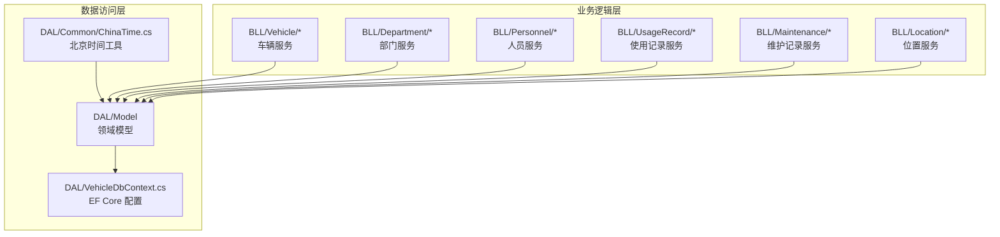
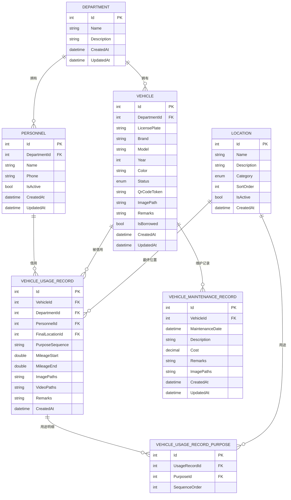
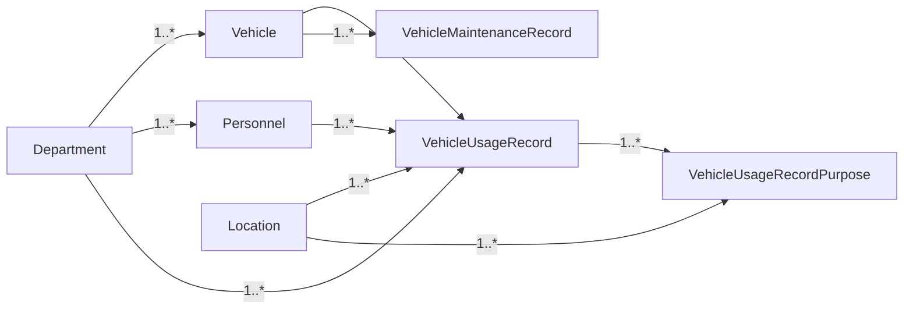

# 业务数据模型

<cite>
**本文引用的文件**   
- [Vehicle.cs](file://DAL/Model/Vehicle.cs)
- [Department.cs](file://DAL/Model/Department.cs)
- [Personnel.cs](file://DAL/Model/Personnel.cs)
- [VehicleUsageRecord.cs](file://DAL/Model/VehicleUsageRecord.cs)
- [VehicleMaintenanceRecord.cs](file://DAL/Model/VehicleMaintenanceRecord.cs)
- [Location.cs](file://DAL/Model/Location.cs)
- [VehicleEnums.cs](file://DAL/Model/VehicleEnums.cs)
- [VehicleUsageRecordPurpose.cs](file://DAL/Model/VehicleUsageRecordPurpose.cs)
- [VehicleDbContext.cs](file://DAL/VehicleDbContext.cs)
- [ChinaTime.cs](file://DAL/Common/ChinaTime.cs)
</cite>

## 目录
1. [引言](#引言)
2. [项目结构](#项目结构)
3. [核心实体与字段定义](#核心实体与字段定义)
4. [架构总览](#架构总览)
5. [详细组件分析](#详细组件分析)
6. [依赖关系分析](#依赖关系分析)
7. [性能与索引策略](#性能与索引策略)
8. [数据完整性与业务规则](#数据完整性与业务规则)
9. [时间字段设计](#时间字段设计)
10. [验证属性与自定义校验](#验证属性与自定义校验)
11. [示例数据](#示例数据)
12. [故障排查指南](#故障排查指南)
13. [结论](#结论)

## 引言
本文件聚焦 vehicleManagement 系统的核心业务数据模型，围绕车辆、部门、人员、使用记录、维护记录、位置等实体，系统性地说明字段定义、数据类型、验证约束、主键与外键设计、索引策略、实体间关联关系（一对多、多对多）、数据完整性约束与业务规则实现方式，并给出 ER 图与示例数据。同时解释 CreatedAt、UpdatedAt 的时间处理机制，以及验证属性的使用与扩展建议。

## 项目结构
本项目采用分层架构：
- DAL（数据访问层）：包含领域模型、数据库上下文、仓储接口与实现（仓储在 Repository 子目录中）。
- BLL（业务逻辑层）：封装各业务域的服务类。
- Pages（Blazor 页面）：面向用户的界面。
- Components、wwwroot 等：前端资源与组件。

与数据模型直接相关的代码集中在 DAL/Model 与 DAL/VehicleDbContext.cs。

图表来源
- [VehicleDbContext.cs:1-20](file://DAL/VehicleDbContext.cs#L1-L20)
- [Vehicle.cs:1-50](file://DAL/Model/Vehicle.cs#L1-L50)
- [ChinaTime.cs:1-18](file://DAL/Common/ChinaTime.cs#L1-L18)

章节来源
- [VehicleDbContext.cs:1-20](file://DAL/VehicleDbContext.cs#L1-L20)
- [Vehicle.cs:1-50](file://DAL/Model/Vehicle.cs#L1-L50)
- [ChinaTime.cs:1-18](file://DAL/Common/ChinaTime.cs#L1-L18)

## 核心实体与字段定义
本节按实体逐一说明字段、类型、默认值、验证与约束。

- 部门 Department
  - Id：整型主键
  - Name：必填，最大长度 100
  - Description：可选描述
  - CreatedAt：创建时间，默认当前北京时间
  - UpdatedAt：更新时间，可空

- 人员 Personnel
  - Id：整型主键
  - DepartmentId：必填，外键指向部门
  - Name：必填，最大长度 50
  - Phone：可选，最大长度 20
  - IsActive：是否启用，默认启用
  - CreatedAt：创建时间，默认当前本地时间
  - UpdatedAt：更新时间，可空
  - 导航属性：Department

- 车辆 Vehicle
  - Id：整型主键
  - DepartmentId：必填，外键指向部门
  - LicensePlate：必填，最大长度 50
  - Brand：品牌，最大长度 50
  - Model：型号，最大长度 50
  - Year：年份，可空
  - Color：颜色，最大长度 20
  - Status：车辆状态枚举，默认活跃
  - QrCodeToken：二维码令牌，最大长度 64
  - ImagePath：图片路径
  - Remarks：备注
  - IsBorrowed：是否借出
  - CreatedAt：创建时间，默认当前北京时间
  - UpdatedAt：更新时间，可空
  - 导航属性：Department

- 位置 Location
  - Id：整型主键
  - Name：必填，最大长度 100
  - Description：可选描述
  - Category：位置类别枚举，默认“地点”
  - SortOrder：排序号，默认 0
  - IsActive：是否启用，默认启用
  - CreatedAt：创建时间，默认当前本地时间

- 使用记录 VehicleUsageRecord
  - Id：整型主键
  - VehicleId：必填，外键指向车辆
  - DepartmentId：必填，外键指向部门
  - PersonnelId：必填，外键指向人员
  - FinalLocationId：必填，外键指向位置
  - PurposeSequence：用途序列字符串
  - MileageStart：起始里程，可空
  - MileageEnd：结束里程，可空
  - ImagePaths：附件路径（分号分隔）
  - VideoPaths：视频路径（分号分隔）
  - Remarks：备注
  - CreatedAt：创建时间，默认当前北京时间
  - 导航属性：Vehicle、Department、Personnel、FinalLocation
  - 子项集合：UsageRecordPurposes（用途明细）

- 用途明细 VehicleUsageRecordPurpose
  - Id：整型主键
  - UsageRecordId：必填，外键指向使用记录
  - PurposeId：必填，外键指向位置（作为用途）
  - SequenceOrder：顺序号，必填
  - 导航属性：UsageRecord、Purpose

- 维护记录 VehicleMaintenanceRecord
  - Id：整型主键
  - VehicleId：必填，外键指向车辆
  - MaintenanceDate：维护日期，默认当前北京时间
  - Description：描述，最大长度 500
  - Cost：费用，十进制
  - Remarks：备注
  - ImagePaths：附件路径（分号分隔）
  - CreatedAt：创建时间，默认当前北京时间
  - UpdatedAt：更新时间，可空
  - 导航属性：Vehicle

- 枚举 VehicleEnums
  - VehicleStatus：车辆状态（活跃、维护、退役）
  - LocationCategory：位置类别（地点、用途）

章节来源
- [Department.cs:1-23](file://DAL/Model/Department.cs#L1-L23)
- [Personnel.cs:1-32](file://DAL/Model/Personnel.cs#L1-L32)
- [Vehicle.cs:1-50](file://DAL/Model/Vehicle.cs#L1-L50)
- [Location.cs:1-27](file://DAL/Model/Location.cs#L1-L27)
- [VehicleUsageRecord.cs:1-56](file://DAL/Model/VehicleUsageRecord.cs#L1-L56)
- [VehicleUsageRecordPurpose.cs:1-27](file://DAL/Model/VehicleUsageRecordPurpose.cs#L1-L27)
- [VehicleMaintenanceRecord.cs:1-37](file://DAL/Model/VehicleMaintenanceRecord.cs#L1-L37)
- [VehicleEnums.cs:1-16](file://DAL/Model/VehicleEnums.cs#L1-L16)

## 架构总览
下图展示实体间的关系与关键约束，包括一对多与一对多的组合（通过中间表实现的多对多语义）。

图表来源
- [VehicleDbContext.cs:21-104](file://DAL/VehicleDbContext.cs#L21-L104)
- [Vehicle.cs:1-50](file://DAL/Model/Vehicle.cs#L1-L50)
- [Department.cs:1-23](file://DAL/Model/Department.cs#L1-L23)
- [Personnel.cs:1-32](file://DAL/Model/Personnel.cs#L1-L32)
- [Location.cs:1-27](file://DAL/Model/Location.cs#L1-L27)
- [VehicleUsageRecord.cs:1-56](file://DAL/Model/VehicleUsageRecord.cs#L1-L56)
- [VehicleUsageRecordPurpose.cs:1-27](file://DAL/Model/VehicleUsageRecordPurpose.cs#L1-L27)
- [VehicleMaintenanceRecord.cs:1-37](file://DAL/Model/VehicleMaintenanceRecord.cs#L1-L37)

## 详细组件分析

### 部门 Department
- 主键：Id（自增整型）
- 唯一性：无显式唯一约束
- 索引：未定义额外索引
- 关联：一对多拥有 Personnel 与 Vehicle
- 时间字段：CreatedAt 默认北京时间；UpdatedAt 可空

章节来源
- [Department.cs:1-23](file://DAL/Model/Department.cs#L1-L23)
- [VehicleDbContext.cs:25-28](file://DAL/VehicleDbContext.cs#L25-L28)

### 人员 Personnel
- 主键：Id（自增整型）
- 外键：DepartmentId → Department.Id
- 索引：DepartmentId 建立普通索引
- 关联：属于一个部门；被多个使用记录引用
- 时间字段：CreatedAt 默认当前本地时间；UpdatedAt 可空

章节来源
- [Personnel.cs:1-32](file://DAL/Model/Personnel.cs#L1-L32)
- [VehicleDbContext.cs:30-34](file://DAL/VehicleDbContext.cs#L30-L34)

### 车辆 Vehicle
- 主键：Id（自增整型）
- 外键：DepartmentId → Department.Id
- 唯一性：LicensePlate、QrCodeToken 均唯一
- 索引：LicensePlate 唯一索引、QrCodeToken 唯一索引、DepartmentId 普通索引
- 关联：属于一个部门；被多个使用记录与维护记录引用
- 时间字段：CreatedAt 默认北京时间；UpdatedAt 可空
- 业务字段：Status 使用枚举；IsBorrowed 表示借出状态

章节来源
- [Vehicle.cs:1-50](file://DAL/Model/Vehicle.cs#L1-L50)
- [VehicleDbContext.cs:36-42](file://DAL/VehicleDbContext.cs#L36-L42)
- [VehicleEnums.cs:1-16](file://DAL/Model/VehicleEnums.cs#L1-L16)

### 位置 Location
- 主键：Id（自增整型）
- 索引：Category 普通索引
- 角色：既可作为“物理位置”，也可作为“用途”（由 Category 区分）
- 时间字段：CreatedAt 默认当前本地时间

章节来源
- [Location.cs:1-27](file://DAL/Model/Location.cs#L1-L27)
- [VehicleDbContext.cs:44-48](file://DAL/VehicleDbContext.cs#L44-L48)
- [VehicleEnums.cs:10-14](file://DAL/Model/VehicleEnums.cs#L10-L14)

### 使用记录 VehicleUsageRecord
- 主键：Id（自增整型）
- 外键：VehicleId、DepartmentId、PersonnelId、FinalLocationId
- 索引：VehicleId、DepartmentId、CreatedAt 普通索引
- 关联：
  - 属于一辆车、一个部门、一名人员、一个最终位置
  - 一对多拥有用途明细 VehicleUsageRecordPurpose
- 时间字段：CreatedAt 默认北京时间
- 业务字段：PurposeSequence 为用途顺序的字符串；MileageStart/End 用于里程统计

章节来源
- [VehicleUsageRecord.cs:1-56](file://DAL/Model/VehicleUsageRecord.cs#L1-L56)
- [VehicleDbContext.cs:50-76](file://DAL/VehicleDbContext.cs#L50-L76)

### 用途明细 VehicleUsageRecordPurpose
- 主键：Id（自增整型）
- 外键：UsageRecordId → VehicleUsageRecord.Id；PurposeId → Location.Id
- 索引：UsageRecordId 普通索引；(UsageRecordId, SequenceOrder) 复合索引
- 关联：一条使用记录对应多条用途明细；每条明细对应一个位置（作为用途）
- 删除行为：当使用记录删除时级联删除用途明细

章节来源
- [VehicleUsageRecordPurpose.cs:1-27](file://DAL/Model/VehicleUsageRecordPurpose.cs#L1-L27)
- [VehicleDbContext.cs:89-104](file://DAL/VehicleDbContext.cs#L89-L104)

### 维护记录 VehicleMaintenanceRecord
- 主键：Id（自增整型）
- 外键：VehicleId → Vehicle.Id
- 索引：VehicleId 普通索引
- 关联：属于一辆车
- 时间字段：MaintenanceDate 默认北京时间；CreatedAt 默认北京时间；UpdatedAt 可空

章节来源
- [VehicleMaintenanceRecord.cs:1-37](file://DAL/Model/VehicleMaintenanceRecord.cs#L1-L37)
- [VehicleDbContext.cs:78-87](file://DAL/VehicleDbContext.cs#L78-L87)

## 依赖关系分析
- 实体耦合度
  - VehicleUsageRecord 与 Vehicle、Department、Personnel、Location 存在强外键依赖，删除这些基础实体时使用 Restrict 保护数据一致性。
  - VehicleUsageRecordPurpose 与 VehicleUsageRecord 是强依赖，采用级联删除以保证明细与主记录一致。
- 间接依赖
  - VehicleUsageRecordPurpose.PurposeId 引用 Location，但 Location 同时承担“物理位置”和“用途”双重角色，需通过 Category 或业务规则区分。
- 循环依赖
  - 模型层面不存在循环引用；所有外键方向清晰。

图表来源
- [VehicleDbContext.cs:50-104](file://DAL/VehicleDbContext.cs#L50-L104)

章节来源
- [VehicleDbContext.cs:50-104](file://DAL/VehicleDbContext.cs#L50-L104)

## 性能与索引策略
- 唯一索引
  - Vehicle.LicensePlate：保证车牌唯一
  - Vehicle.QrCodeToken：保证二维码令牌唯一
- 普通索引
  - Personnel.DepartmentId：加速按部门查询人员
  - Vehicle.DepartmentId：加速按部门查询车辆
  - Location.Category：加速按类别筛选位置
  - VehicleUsageRecord.VehicleId、DepartmentId、CreatedAt：加速按车辆、部门、时间范围查询
  - VehicleMaintenanceRecord.VehicleId：加速按车辆查询维护记录
  - VehicleUsageRecordPurpose.UsageRecordId：加速按使用记录查询用途明细
  - VehicleUsageRecordPurpose.(UsageRecordId, SequenceOrder)：复合索引保障同一使用记录内用途顺序的唯一性与高效排序

章节来源
- [VehicleDbContext.cs:30-42](file://DAL/VehicleDbContext.cs#L30-L42)
- [VehicleDbContext.cs:50-56](file://DAL/VehicleDbContext.cs#L50-L56)
- [VehicleDbContext.cs:78-82](file://DAL/VehicleDbContext.cs#L78-L82)
- [VehicleDbContext.cs:89-94](file://DAL/VehicleDbContext.cs#L89-L94)

## 数据完整性与业务规则
- 外键约束与删除行为
  - VehicleUsageRecord 对 Vehicle、Department、Personnel、FinalLocation 的外键均采用 Restrict，防止误删基础数据。
  - VehicleMaintenanceRecord 对 Vehicle 的外键采用 Restrict。
  - VehicleUsageRecordPurpose 对 UsageRecord 采用 Cascade，确保删除使用记录时自动清理明细。
- 必填与长度限制
  - 关键字段如 Name、LicensePlate、PurposeSequence 等均通过 Required 与 MaxLength 进行前端与后端双重校验。
- 业务规则建议
  - 里程校验：MileageEnd ≥ MileageStart（可在服务层或自定义验证器中实现）。
  - 用途顺序：SequenceOrder 在同一使用记录内应唯一且连续（可通过复合索引与业务校验共同保障）。
  - 状态一致性：Vehicle.Status 与 IsBorrowed 应保持一致（例如处于维护状态不应借出），建议在服务层统一维护。

章节来源
- [VehicleDbContext.cs:57-87](file://DAL/VehicleDbContext.cs#L57-L87)
- [VehicleUsageRecord.cs:1-56](file://DAL/Model/VehicleUsageRecord.cs#L1-L56)
- [VehicleMaintenanceRecord.cs:1-37](file://DAL/Model/VehicleMaintenanceRecord.cs#L1-L37)
- [VehicleUsageRecordPurpose.cs:1-27](file://DAL/Model/VehicleUsageRecordPurpose.cs#L1-L27)

## 时间字段设计
- CreatedAt
  - Vehicle、VehicleUsageRecord、VehicleMaintenanceRecord 默认使用 ChinaTime.Now（UTC+8），确保跨容器/服务器环境下的北京时间一致性。
  - Department、Personnel、Location 默认使用 DateTime.Now，需注意部署环境的时区设置。
- UpdatedAt
  - 可空字段，通常在更新实体时由应用层或服务层填充。
- 建议
  - 统一时间源：建议将 Department、Personnel、Location 的 CreatedAt 也改为 ChinaTime.Now，以消除时区差异。
  - 统一更新策略：在 DbContext.SaveChanges 前统一设置 UpdatedAt，或在 EF Core 中使用 Value Generation Strategies。

章节来源
- [ChinaTime.cs:1-18](file://DAL/Common/ChinaTime.cs#L1-L18)
- [Vehicle.cs:42-44](file://DAL/Model/Vehicle.cs#L42-L44)
- [VehicleUsageRecord.cs:39-39](file://DAL/Model/VehicleUsageRecord.cs#L39-L39)
- [VehicleMaintenanceRecord.cs:29-31](file://DAL/Model/VehicleMaintenanceRecord.cs#L29-L31)
- [Department.cs:18-20](file://DAL/Model/Department.cs#L18-L20)
- [Personnel.cs:24-26](file://DAL/Model/Personnel.cs#L24-L26)
- [Location.cs:24-24](file://DAL/Model/Location.cs#L24-L24)

## 验证属性与自定义校验
- 内置验证属性
  - Required：标记必填字段
  - MaxLength：限制字符串长度
  - ForeignKey：声明外键关系
- 自定义校验建议
  - 在服务层或 DTO 层添加自定义验证器，实现跨字段的业务规则校验，例如：
    - 里程区间合法性
    - 用途顺序唯一性与连续性
    - 车辆状态与借出标志的一致性
  - 可使用 DataAnnotations 扩展或 FluentValidation 等框架增强校验能力。

章节来源
- [Vehicle.cs:10-48](file://DAL/Model/Vehicle.cs#L10-L48)
- [Personnel.cs:9-29](file://DAL/Model/Personnel.cs#L9-L29)
- [VehicleUsageRecord.cs:11-53](file://DAL/Model/VehicleUsageRecord.cs#L11-L53)
- [VehicleMaintenanceRecord.cs:10-34](file://DAL/Model/VehicleMaintenanceRecord.cs#L10-L34)

## 示例数据
以下为概念性示例数据，便于理解字段含义与关系（不展示具体代码内容）：

- 部门
  - 名称：行政部
  - 描述：公司行政管理
- 人员
  - 姓名：张三
  - 所属部门：行政部
  - 电话：13800000000
  - 状态：启用
- 车辆
  - 车牌：京A·12345
  - 品牌：丰田
  - 型号：卡罗拉
  - 年份：2020
  - 颜色：白色
  - 状态：活跃
  - 二维码令牌：QR_TOKEN_001
  - 是否借出：否
- 位置
  - 名称：总部停车场
  - 类别：地点
  - 排序：1
  - 状态：启用
- 使用记录
  - 车辆：京A·12345
  - 部门：行政部
  - 人员：张三
  - 最终位置：总部停车场
  - 用途序列：会议→客户拜访
  - 起始里程：10000
  - 结束里程：10050
- 用途明细
  - 使用记录：上述记录
  - 用途：客户拜访
  - 顺序：2
- 维护记录
  - 车辆：京A·12345
  - 维护日期：2024-06-01
  - 描述：常规保养
  - 费用：800

[本节为概念性示例，无需源码引用]

## 故障排查指南
- 外键冲突
  - 现象：尝试删除车辆、部门、人员或位置时报错。
  - 原因：相关实体被其他记录引用，删除行为为 Restrict。
  - 处理：先删除或解除关联的使用记录、维护记录或用途明细。
- 唯一性冲突
  - 现象：插入重复的车牌或二维码令牌失败。
  - 原因：LicensePlate、QrCodeToken 具有唯一索引。
  - 处理：检查输入数据，避免重复。
- 时间不一致
  - 现象：CreatedAt 显示为 UTC 而非北京时间。
  - 原因：部分实体使用 DateTime.Now 而非 ChinaTime.Now。
  - 处理：统一改用 ChinaTime.Now，或调整服务器时区。
- 用途顺序异常
  - 现象：同一使用记录的用途顺序重复或不连续。
  - 原因：缺少业务层校验。
  - 处理：在服务层增加 SequenceOrder 唯一性与连续性校验。

章节来源
- [VehicleDbContext.cs:57-87](file://DAL/VehicleDbContext.cs#L57-L87)
- [VehicleDbContext.cs:36-42](file://DAL/VehicleDbContext.cs#L36-L42)
- [ChinaTime.cs:1-18](file://DAL/Common/ChinaTime.cs#L1-L18)

## 结论
vehicleManagement 的数据模型以清晰的实体划分与严格的外键约束为基础，结合合理的索引策略，支撑了车辆、部门、人员、使用记录、维护记录与位置的完整业务闭环。通过 ChinaTime 工具统一时间基准，提升了跨环境部署的一致性。建议在后续迭代中进一步统一时间字段来源、完善服务层自定义校验，并在必要时引入更丰富的审计字段与软删除机制，以提升系统的可维护性与可扩展性。