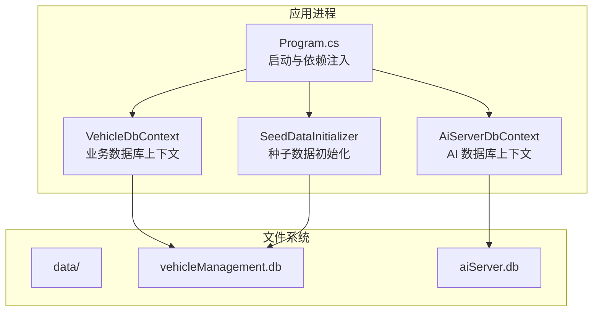
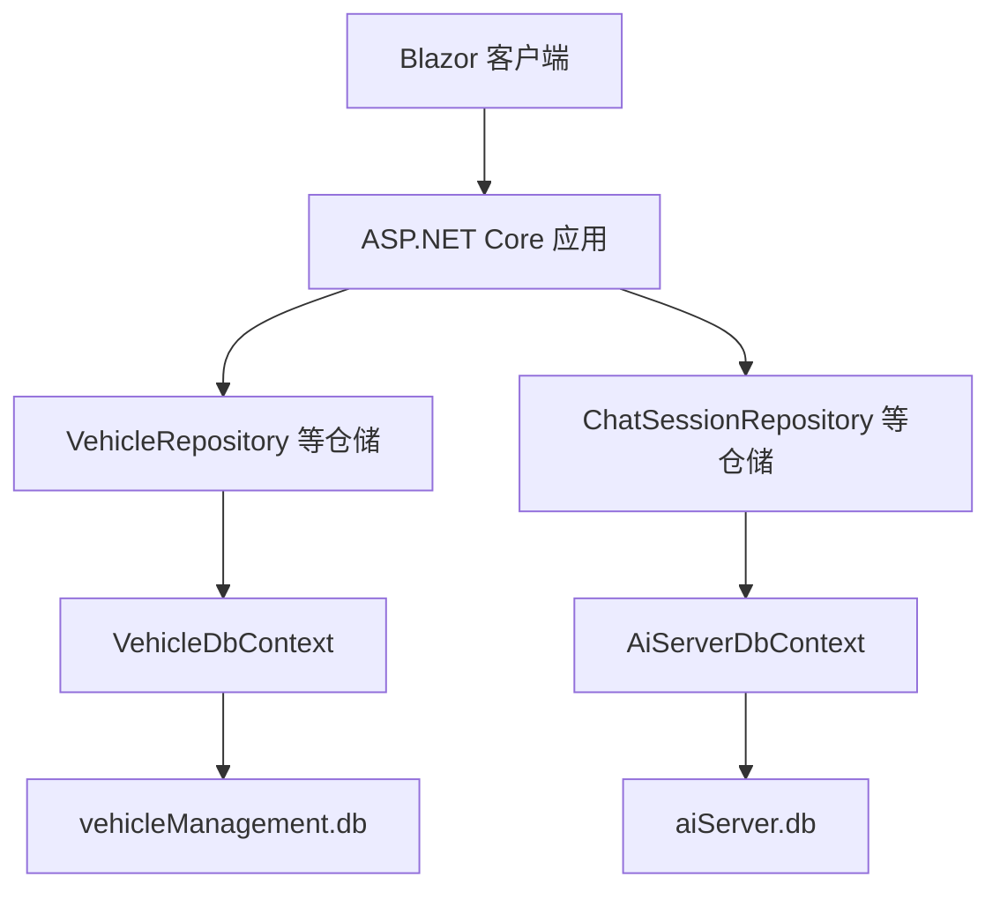
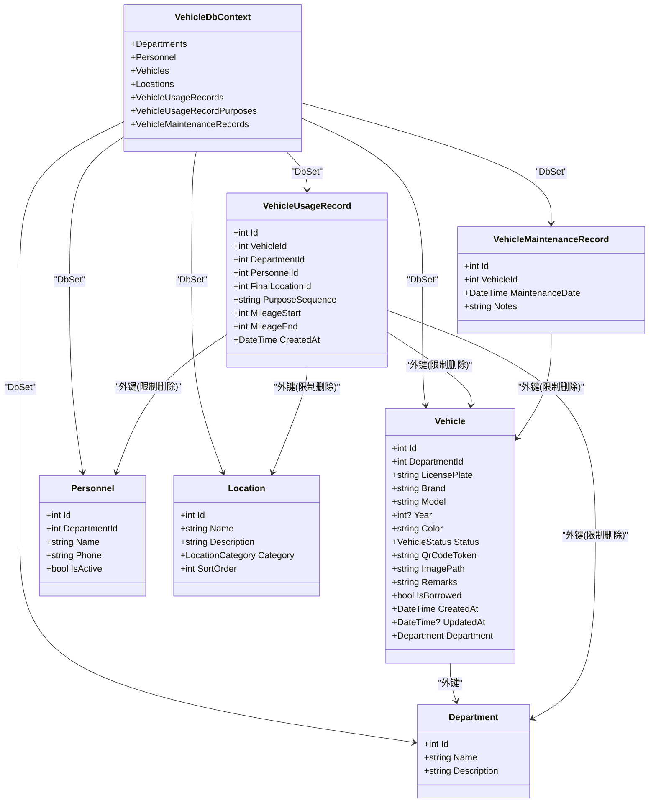
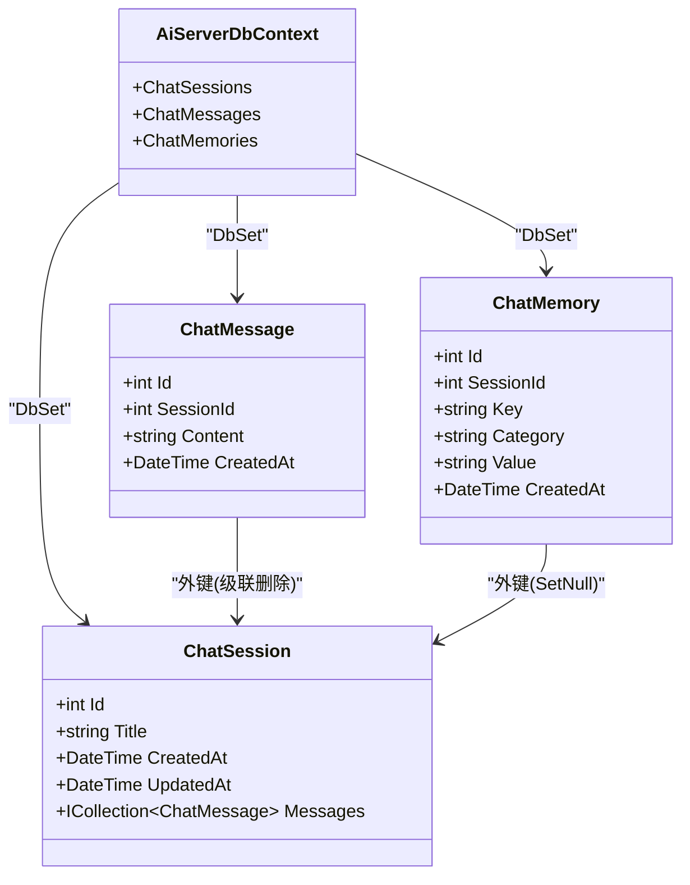
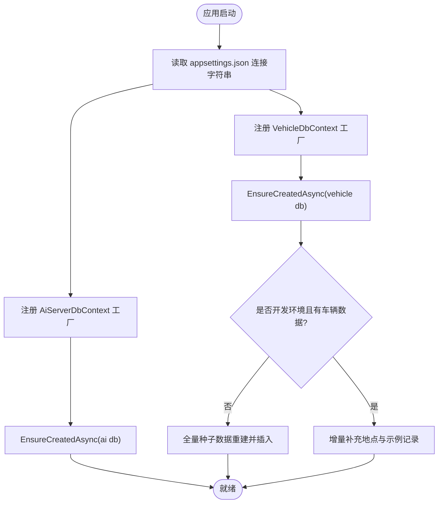
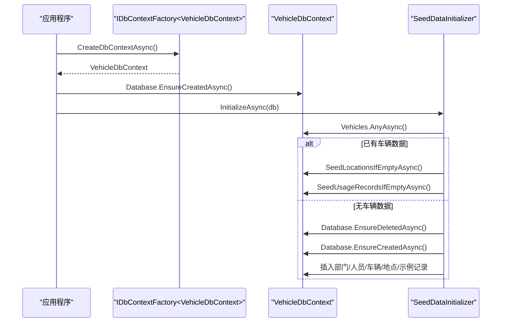
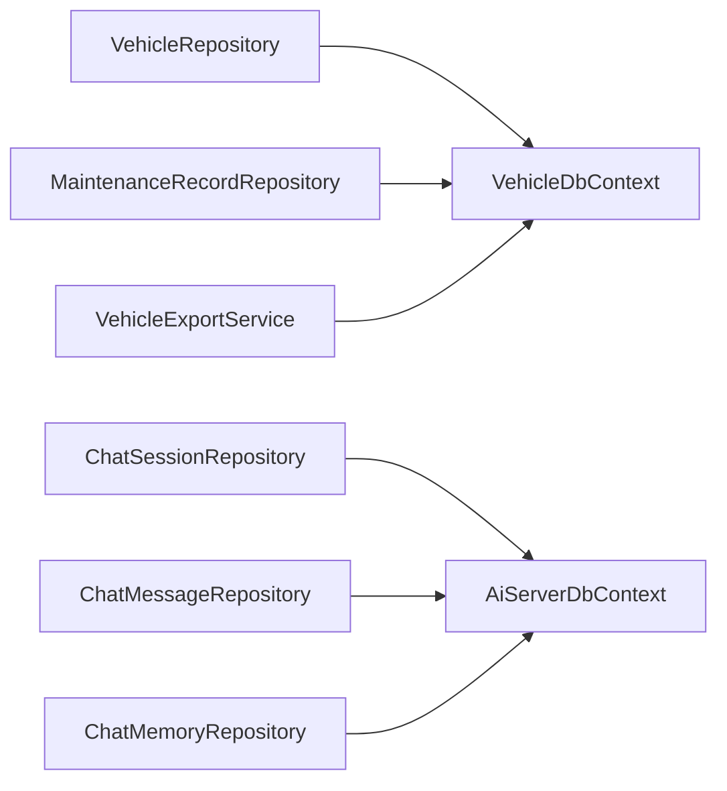

# 数据库设计

<cite>
**本文引用的文件**   
- [Program.cs](file://Program.cs)
- [appsettings.json](file://appsettings.json)
- [DAL\VehicleDbContext.cs](file://DAL/VehicleDbContext.cs)
- [aiServer\DAL\AiServerDbContext.cs](file://aiServer/DAL/AiServerDbContext.cs)
- [DAL\SeedDataInitializer.cs](file://DAL/SeedDataInitializer.cs)
- [DAL\Model\Vehicle.cs](file://DAL/Model/Vehicle.cs)
- [aiServer\DAL\Model\ChatSession.cs](file://aiServer/DAL/Model/ChatSession.cs)
- [DAL\Repository\MaintenanceRecordRepository.cs](file://DAL/Repository/MaintenanceRecordRepository.cs)
- [BLL\Export\VehicleExportService.cs](file://BLL/Export/VehicleExportService.cs)
</cite>

## 目录
1. [引言](#引言)
2. [项目结构](#项目结构)
3. [核心组件](#核心组件)
4. [架构总览](#架构总览)
5. [详细组件分析](#详细组件分析)
6. [依赖关系分析](#依赖关系分析)
7. [性能与优化](#性能与优化)
8. [事务、并发与一致性](#事务并发与一致性)
9. [备份与恢复策略](#备份与恢复策略)
10. [迁移与版本管理](#迁移与版本管理)
11. [故障排查指南](#故障排查指南)
12. [结论](#结论)

## 引言
本文件为 vehicleManagement 系统的数据库设计文档，重点说明双数据库架构：业务数据库 vehicleManagement.db 与 AI 数据库 aiServer.db 的职责划分、DbContext 配置、初始化与种子数据策略、索引与查询优化、连接与并发模型、事务与一致性、备份恢复方案，以及迁移与版本管理机制。文档面向开发者与运维人员，兼顾可读性与可实施性。

## 项目结构
系统采用分层架构：
- DAL（数据访问层）：定义实体模型、DbContext、仓储实现、种子数据初始化。
- BLL（业务逻辑层）：封装业务流程，调用仓储完成复杂操作。
- Pages / Components（前端 Blazor）：用户界面与交互。
- aiServer（AI 服务子模块）：独立的对话会话、消息与记忆存储，使用独立 DbContext 与数据库文件。

**图表来源**
- [Program.cs:52-58](file://Program.cs#L52-L58)
- [Program.cs:106-125](file://Program.cs#L106-L125)
- [appsettings.json:3-6](file://appsettings.json#L3-L6)

**章节来源**
- [Program.cs:52-58](file://Program.cs#L52-L58)
- [Program.cs:106-125](file://Program.cs#L106-L125)
- [appsettings.json:3-6](file://appsettings.json#L3-L6)

## 核心组件
- 业务数据库上下文 VehicleDbContext：承载部门、人员、车辆、地点、用车记录、维修记录等实体映射与关系配置。
- AI 数据库上下文 AiServerDbContext：承载聊天会话、消息、记忆等实体映射与关系配置。
- 种子数据初始化器 SeedDataInitializer：在开发环境执行幂等的全量或增量种子数据填充。
- 连接字符串配置：通过 appsettings.json 提供 DefaultConnection 与 AiServerConnection。
- 启动初始化：Program.cs 在应用启动时确保两个数据库已创建，并在开发环境执行种子数据初始化。

**章节来源**
- [DAL\VehicleDbContext.cs:6-108](file://DAL/VehicleDbContext.cs#L6-L108)
- [aiServer\DAL\AiServerDbContext.cs:9-57](file://aiServer/DAL/AiServerDbContext.cs#L9-L57)
- [DAL\SeedDataInitializer.cs:15-130](file://DAL/SeedDataInitializer.cs#L15-L130)
- [appsettings.json:3-6](file://appsettings.json#L3-L6)
- [Program.cs:106-125](file://Program.cs#L106-L125)

## 架构总览
双数据库分离的核心原因：
- 职责清晰：业务数据与 AI 对话数据解耦，避免相互影响；清理对话历史不影响业务数据，反之亦然。
- 生命周期差异：AI 对话数据增长快、可定期清理；业务数据需要长期保留且变更频率较低。
- 安全与隔离：不同数据库文件便于权限控制与备份策略差异化。
- 扩展性：AI 能力可独立演进，不牵动业务库结构。

**图表来源**
- [Program.cs:52-58](file://Program.cs#L52-L58)
- [DAL\VehicleDbContext.cs:13-19](file://DAL/VehicleDbContext.cs#L13-L19)
- [aiServer\DAL\AiServerDbContext.cs:16-18](file://aiServer/DAL/AiServerDbContext.cs#L16-L18)

## 详细组件分析

### 业务数据库上下文 VehicleDbContext
- 实体集合：部门、人员、车辆、地点、用车记录、用途明细、维修记录。
- 索引设计：
  - 人员表按 DepartmentId 建索引，加速按部门筛选。
  - 车辆表对 LicensePlate、QrCodeToken 建立唯一索引，保证车牌与二维码令牌唯一性；DepartmentId 建索引以支持按部门查询。
  - 地点表对 Category 建索引，加速按类别检索。
  - 用车记录表对 VehicleId、DepartmentId、CreatedAt 建索引，支撑按车、部门、时间范围查询。
  - 维修记录表对 VehicleId 建索引，支撑按车辆查询维护历史。
  - 用途明细表对 UsageRecordId 及复合键 (UsageRecordId, SequenceOrder) 建索引，保障用途顺序与关联查询效率。
- 关系与删除行为：
  - 用车记录与车辆、部门、人员、最终地点之间为 HasOne/WithMany 关系，删除行为设置为 Restrict，防止误删主数据。
  - 用途明细与用车记录为级联删除，与目的项为限制删除。
  - 维修记录与车辆为限制删除。

**图表来源**
- [DAL\VehicleDbContext.cs:13-19](file://DAL/VehicleDbContext.cs#L13-L19)
- [DAL\VehicleDbContext.cs:21-104](file://DAL/VehicleDbContext.cs#L21-L104)
- [DAL\Model\Vehicle.cs:8-48](file://DAL/Model/Vehicle.cs#L8-L48)

**章节来源**
- [DAL\VehicleDbContext.cs:21-104](file://DAL/VehicleDbContext.cs#L21-L104)
- [DAL\Model\Vehicle.cs:8-48](file://DAL/Model/Vehicle.cs#L8-L48)

### AI 数据库上下文 AiServerDbContext
- 实体集合：聊天会话、聊天消息、聊天记忆。
- 索引设计：
  - 消息表对 SessionId、CreatedAt 建索引，支撑按会话与时间查询。
  - 记忆表对 Key、Category 建索引，支撑按键与分类检索。
- 默认值与关系：
  - 会话与消息的 CreatedAt/UpdatedAt 使用数据库默认值 CURRENT_TIMESTAMP。
  - 消息与会话为级联删除；记忆与会话为 SetNull 删除行为，避免会话删除导致记忆丢失。

**图表来源**
- [aiServer\DAL\AiServerDbContext.cs:16-55](file://aiServer/DAL/AiServerDbContext.cs#L16-L55)
- [aiServer\DAL\Model\ChatSession.cs:11-37](file://aiServer/DAL/Model/ChatSession.cs#L11-L37)

**章节来源**
- [aiServer\DAL\AiServerDbContext.cs:20-55](file://aiServer/DAL/AiServerDbContext.cs#L20-L55)
- [aiServer\DAL\Model\ChatSession.cs:11-37](file://aiServer/DAL/Model/ChatSession.cs#L11-L37)

### 连接字符串与 DbContext 配置
- 连接字符串：
  - DefaultConnection：指向 data/vehicleManagement.db。
  - AiServerConnection：指向 data/aiServer.db。
- 依赖注入：
  - 使用 AddDbContextFactory<T>() 注册 VehicleDbContext 与 AiServerDbContext，避免 Blazor Server 并发冲突。
  - 仓储与服务通过构造函数注入 IDbContextFactory<T>，按需创建 DbContext 实例。

**图表来源**
- [appsettings.json:3-6](file://appsettings.json#L3-L6)
- [Program.cs:52-58](file://Program.cs#L52-L58)
- [Program.cs:106-125](file://Program.cs#L106-L125)
- [DAL\SeedDataInitializer.cs:20-87](file://DAL/SeedDataInitializer.cs#L20-L87)

**章节来源**
- [appsettings.json:3-6](file://appsettings.json#L3-L6)
- [Program.cs:52-58](file://Program.cs#L52-L58)
- [Program.cs:106-125](file://Program.cs#L106-L125)

### 数据库初始化与种子数据
- 启动阶段：
  - 确保 data/ 目录存在。
  - 分别对业务库与 AI 库执行 EnsureCreatedAsync()。
  - 开发环境下执行 SeedDataInitializer.InitializeAsync()。
- 种子数据策略：
  - 幂等检查：若已有车辆记录则跳过全量初始化，仅执行增量补充（地点与示例使用记录）。
  - 全量初始化：清空并重建数据库，插入标准化部门、人员、车辆、地点与示例使用记录。
  - 增量补充：当地点或使用记录为空时插入标准数据。

**图表来源**
- [Program.cs:106-125](file://Program.cs#L106-L125)
- [DAL\SeedDataInitializer.cs:20-87](file://DAL/SeedDataInitializer.cs#L20-L87)

**章节来源**
- [Program.cs:106-125](file://Program.cs#L106-L125)
- [DAL\SeedDataInitializer.cs:20-130](file://DAL/SeedDataInitializer.cs#L20-L130)

## 依赖关系分析
- 仓储与服务通过 IDbContextFactory<T> 获取 DbContext 实例，避免全局单例导致的并发问题。
- 业务仓储（如 VehicleRepository、MaintenanceRecordRepository）与导出服务（VehicleExportService）均使用 VehicleDbContext。
- AI 仓储（ChatSessionRepository、ChatMessageRepository、ChatMemoryRepository）使用 AiServerDbContext。

**图表来源**
- [DAL\Repository\MaintenanceRecordRepository.cs:10-16](file://DAL/Repository/MaintenanceRecordRepository.cs#L10-L16)
- [BLL\Export\VehicleExportService.cs:18-22](file://BLL/Export/VehicleExportService.cs#L18-L22)

**章节来源**
- [DAL\Repository\MaintenanceRecordRepository.cs:10-16](file://DAL/Repository/MaintenanceRecordRepository.cs#L10-L16)
- [BLL\Export\VehicleExportService.cs:18-22](file://BLL/Export/VehicleExportService.cs#L18-L22)

## 性能与优化
- 索引设计要点：
  - 高频查询字段建普通索引：人员.DepartmentId、车辆.DepartmentId、用车记录.VehicleId/DepartmentId/CreatedAt、维修记录.VehicleId、地点.Category。
  - 唯一约束与唯一索引：车辆.LicensePlate、车辆.QrCodeToken，保证数据唯一性与快速查找。
  - 复合索引：用途明细.(UsageRecordId, SequenceOrder)，保障用途顺序与关联查询效率。
- 查询优化建议：
  - 避免 N+1 查询：在导出与列表场景中显式 Include 相关导航属性（例如 VehicleExportService 中对部门、人员、地点、用途明细的 Include）。
  - 分页与过滤：结合仓储层返回 IQueryable 或分页结果，减少数据传输量。
  - 时间范围查询：利用 CreatedAt 索引进行范围扫描。
- 连接池与并发：
  - SQLite 不支持传统连接池；当前使用 IDbContextFactory<T> 按需创建 DbContext，降低并发锁竞争。
  - 在高并发写入场景下，建议将写操作串行化（例如通过队列或分布式锁），避免 SQLite 的 WAL 争用。
- 存储与 I/O：
  - 将 data/ 目录挂载到持久卷（Dockerfile 中已声明），确保数据库文件持久化。
  - 日志轮转与级别控制已在 Program.cs 中配置，避免日志影响数据库 I/O。

**章节来源**
- [DAL\VehicleDbContext.cs:31-93](file://DAL/VehicleDbContext.cs#L31-L93)
- [BLL\Export\VehicleExportService.cs:25-39](file://BLL/Export/VehicleExportService.cs#L25-L39)
- [Program.cs:28-37](file://Program.cs#L28-L37)
- [Dockerfile:37-38](file://Dockerfile#L37-L38)

## 事务、并发与一致性
- 事务管理：
  - 当前仓储方法多为单表增删改查，未显式开启事务；如需跨表一致性（例如用车记录与用途明细批量写入），应在仓储或服务层使用 Database.BeginTransactionAsync() 包裹多个 SaveChangesAsync()。
- 并发控制：
  - SQLite 的并发写入受限；通过 IDbContextFactory<T> 避免共享 DbContext 实例，但仍需关注高并发写入时的锁等待。
  - 建议在关键写路径增加重试机制与超时控制，提升鲁棒性。
- 数据一致性：
  - 关系删除行为：
    - 用车记录与主数据（车辆、部门、人员、地点）为 Restrict，防止误删。
    - 用途明细与用车记录为 Cascade，删除用车记录时自动清理用途明细。
    - 记忆与会话为 SetNull，会话删除后记忆仍可保留但不再关联。
  - 唯一性约束：车牌与二维码令牌唯一，避免重复登记。

**章节来源**
- [DAL\VehicleDbContext.cs:57-104](file://DAL/VehicleDbContext.cs#L57-L104)
- [aiServer\DAL\AiServerDbContext.cs:38-55](file://aiServer/DAL/AiServerDbContext.cs#L38-L55)

## 备份与恢复策略
- 物理备份：
  - 直接复制 data/vehicleManagement.db 与 data/aiServer.db 文件进行冷备。
  - Docker 部署时通过 -v 挂载 /app/data，确保宿主机持有持久化副本。
- 在线备份注意事项：
  - SQLite 不支持多写者同时写入；建议在低峰期或停止写入后进行备份。
  - 可使用 PRAGMA wal_checkpoint(FULL) 进行 WAL 检查点后再拷贝，确保一致性。
- 恢复流程：
  - 停止应用写入，替换数据库文件，重启应用。
  - 验证 EnsureCreatedAsync() 不会破坏已有数据（SQLite 模式下 EnsureCreated 仅在表不存在时创建）。

**章节来源**
- [Program.cs:106-125](file://Program.cs#L106-L125)
- [Dockerfile:37-38](file://Dockerfile#L37-L38)

## 迁移与版本管理
- 现状：
  - 当前使用 EnsureCreatedAsync() 进行数据库初始化，未启用 EF Core Migrations。
  - 种子数据通过 SeedDataInitializer 在开发环境执行，生产环境未自动运行。
- 建议方案：
  - 引入 EF Core Migrations：
    - 生成初始迁移：dotnet ef migrations add InitialCreate
    - 应用迁移：dotnet ef database update
    - 版本回滚：dotnet ef database update <PreviousMigrationName>
  - 将种子数据纳入迁移脚本：
    - 在迁移中插入标准部门、人员、车辆等基础数据。
    - 或在应用启动时根据版本号判断是否执行增量种子逻辑。
  - 生产环境自动化：
    - CI/CD 管道中执行迁移命令，确保数据库结构与代码一致。
    - 对关键迁移添加预检与回滚预案。

[本节为概念性指导，不直接分析具体源码文件]

## 故障排查指南
- 启动失败：
  - 检查 Program.cs 中的异常捕获与日志输出，确认是否因数据库文件或目录权限问题导致 EnsureCreatedAsync() 失败。
- 数据未初始化：
  - 确认是否为开发环境；种子数据仅在 IsDevelopment() 时执行。
  - 检查 SeedDataInitializer 的幂等逻辑：若已有车辆数据，将跳过全量初始化。
- 并发写入错误：
  - SQLite 并发写入可能触发锁争用；考虑串行化写操作或引入重试机制。
- 查询性能问题：
  - 检查是否缺少必要索引；参考 VehicleDbContext 中的索引配置。
  - 避免 N+1 查询，必要时使用 Include 显式加载导航属性。

**章节来源**
- [Program.cs:149-157](file://Program.cs#L149-L157)
- [DAL\SeedDataInitializer.cs:20-87](file://DAL/SeedDataInitializer.cs#L20-L87)
- [DAL\VehicleDbContext.cs:31-93](file://DAL/VehicleDbContext.cs#L31-L93)

## 结论
vehicleManagement 系统采用双数据库架构，将业务数据与 AI 对话数据解耦，提升了可维护性与扩展性。通过合理的索引设计与 DbContext 工厂模式，系统在 SQLite 环境下具备较好的查询性能与并发处理能力。未来建议引入 EF Core Migrations 完善版本管理与回滚机制，并结合备份策略保障数据安全。