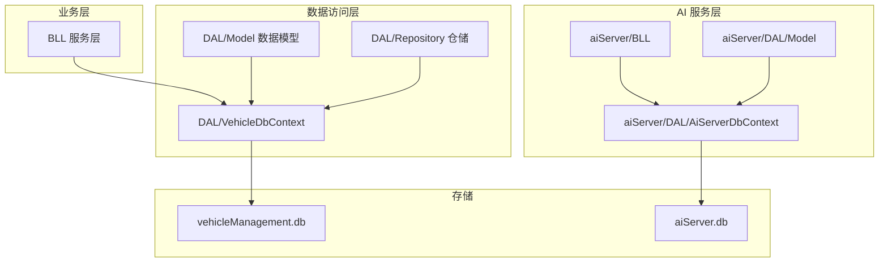
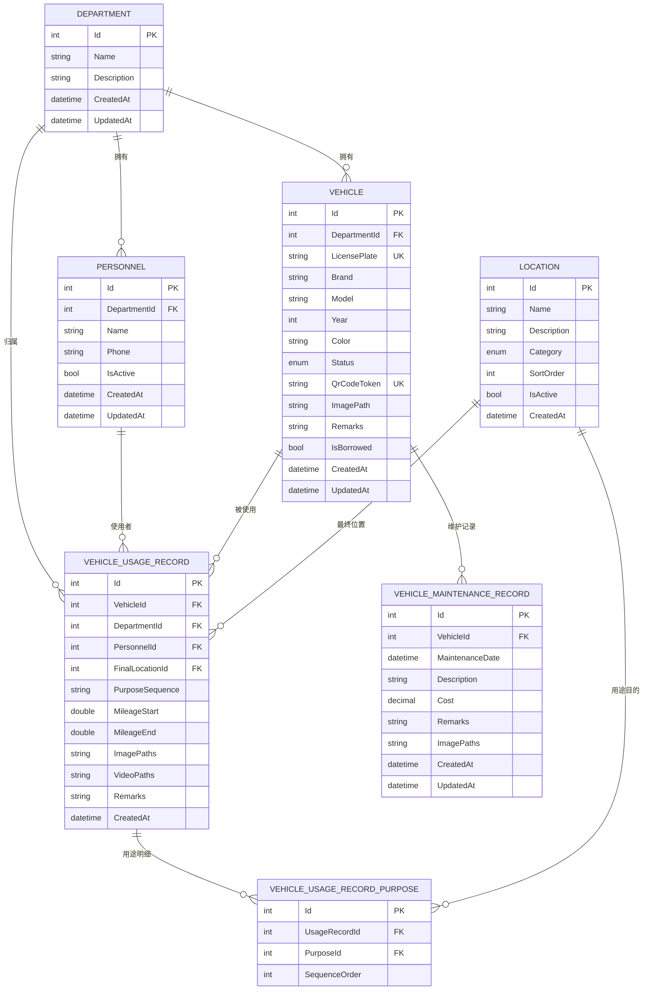
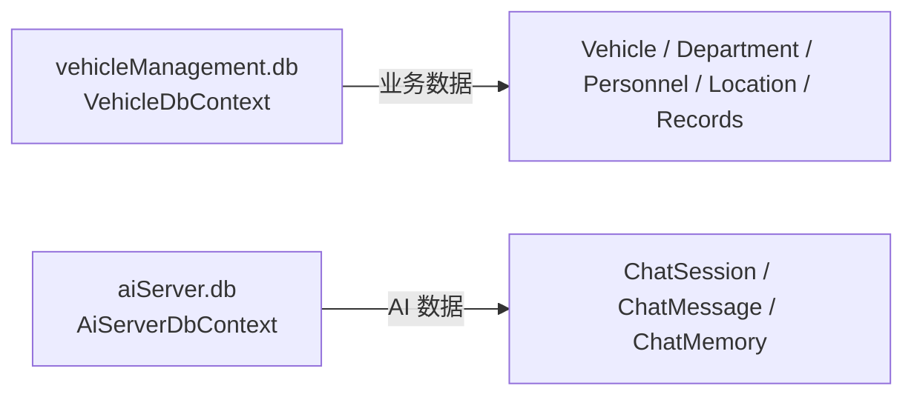

# 数据模型设计

<cite>
**本文引用的文件**   
- [Vehicle.cs](file://DAL/Model/Vehicle.cs)
- [Department.cs](file://DAL/Model/Department.cs)
- [Personnel.cs](file://DAL/Model/Personnel.cs)
- [VehicleUsageRecord.cs](file://DAL/Model/VehicleUsageRecord.cs)
- [VehicleMaintenanceRecord.cs](file://DAL/Model/VehicleMaintenanceRecord.cs)
- [Location.cs](file://DAL/Model/Location.cs)
- [VehicleEnums.cs](file://DAL/Model/VehicleEnums.cs)
- [VehicleUsageRecordPurpose.cs](file://DAL/Model/VehicleUsageRecordPurpose.cs)
- [VehicleDbContext.cs](file://DAL/VehicleDbContext.cs)
- [ChatMessage.cs](file://aiServer/DAL/Model/ChatMessage.cs)
- [ChatSession.cs](file://aiServer/DAL/Model/ChatSession.cs)
- [ChatMemory.cs](file://aiServer/DAL/Model/ChatMemory.cs)
- [AiServerDbContext.cs](file://aiServer/DAL/AiServerDbContext.cs)
- [appsettings.json](file://appsettings.json)
</cite>

## 目录
1. [引言](#引言)
2. [项目结构](#项目结构)
3. [核心数据实体与字段定义](#核心数据实体与字段定义)
4. [数据库关系图（ER 图）](#数据库关系图er-图)
5. [主键、外键与约束策略](#主键外键与约束策略)
6. [索引策略与查询优化](#索引策略与查询优化)
7. [枚举类型与业务分类](#枚举类型与业务分类)
8. [双库分离设计：业务库与 AI 库](#双库分离设计业务库与-ai-库)
9. [数据访问模式：EF Core 配置与仓储模式](#数据访问模式ef-core-配置与仓储模式)
10. [种子数据初始化](#种子数据初始化)
11. [数据生命周期管理](#数据生命周期管理)
12. [数据迁移、版本管理与备份恢复](#数据迁移版本管理与备份恢复)
13. [数据验证规则与业务规则实现](#数据验证规则与业务规则实现)
14. [性能考虑与最佳实践](#性能考虑与最佳实践)
15. [故障排查指南](#故障排查指南)
16. [结论](#结论)

## 引言
本文件为 vehicleManagement 系统的数据模型文档，覆盖车辆管理业务域的核心实体、关系、约束、索引、枚举、双库分离架构、数据访问模式、生命周期管理、迁移与备份策略，以及数据验证与业务规则的实现方式。目标读者包括后端开发者、数据工程师、运维人员以及对系统数据模型感兴趣的产品与技术相关人员。

## 项目结构
本项目采用分层架构，数据模型位于 DAL/Model，数据库上下文位于 DAL，AI 子模块的模型与上下文位于 aiServer/DAL。业务库使用 SQLite 文件 vehicleManagement.db，AI 库使用 aiServer.db，二者通过连接字符串在 appsettings.json 中配置。

图表来源
- [VehicleDbContext.cs:1-20](file://DAL/VehicleDbContext.cs#L1-L20)
- [AiServerDbContext.cs:1-18](file://aiServer/DAL/AiServerDbContext.cs#L1-L18)
- [appsettings.json:1-8](file://appsettings.json#L1-L8)

章节来源
- [VehicleDbContext.cs:1-20](file://DAL/VehicleDbContext.cs#L1-L20)
- [AiServerDbContext.cs:1-18](file://aiServer/DAL/AiServerDbContext.cs#L1-L18)
- [appsettings.json:1-8](file://appsettings.json#L1-L8)

## 核心数据实体与字段定义
本节按实体维度说明字段、数据类型、默认值、必填与长度约束等关键信息。

- 部门 Department
  - 主键：Id（整型自增）
  - 名称 Name（必填，最大长度 100）
  - 描述 Description（可选）
  - 创建时间 CreatedAt（默认当前中国时区时间）
  - 更新时间 UpdatedAt（可选）

- 人员 Personnel
  - 主键：Id（整型自增）
  - 所属部门 DepartmentId（必填，外键到 Department）
  - 姓名 Name（必填，最大长度 50）
  - 电话 Phone（可选，最大长度 20）
  - 是否启用 IsActive（默认启用）
  - 创建时间 CreatedAt（默认当前时间）
  - 更新时间 UpdatedAt（可选）

- 车辆 Vehicle
  - 主键：Id（整型自增）
  - 所属部门 DepartmentId（必填，外键到 Department）
  - 车牌号 LicensePlate（必填，最大长度 50，唯一）
  - 品牌 Brand（可选，最大长度 50）
  - 型号 Model（可选，最大长度 50）
  - 年份 Year（可选）
  - 颜色 Color（可选，最大长度 20）
  - 状态 Status（枚举，默认 Active）
  - 二维码令牌 QrCodeToken（可选，最大长度 64，唯一）
  - 图片路径 ImagePath（可选）
  - 备注 Remarks（可选）
  - 是否借出 IsBorrowed（布尔）
  - 创建时间 CreatedAt（默认当前中国时区时间）
  - 更新时间 UpdatedAt（可选）

- 位置 Location
  - 主键：Id（整型自增）
  - 名称 Name（必填，最大长度 100）
  - 描述 Description（可选）
  - 类别 Category（枚举，默认 Location）
  - 排序 SortOrder（默认 0）
  - 是否启用 IsActive（默认启用）
  - 创建时间 CreatedAt（默认当前时间）

- 用车记录 VehicleUsageRecord
  - 主键：Id（整型自增）
  - 车辆 VehicleId（必填，外键到 Vehicle）
  - 部门 DepartmentId（必填，外键到 Department）
  - 人员 PersonnelId（必填，外键到 Personnel）
  - 最终位置 FinalLocationId（必填，外键到 Location）
  - 用途序列 PurposeSequence（文本，用于前端或业务展示）
  - 起始里程 MileageStart（可选）
  - 结束里程 MileageEnd（可选）
  - 图片路径 ImagePaths（可选，多路径分隔）
  - 视频路径 VideoPaths（可选，多路径分隔）
  - 备注 Remarks（可选）
  - 创建时间 CreatedAt（默认当前中国时区时间）
  - 关联明细 UsageRecordPurposes（一对多到 VehicleUsageRecordPurpose）

- 用车用途明细 VehicleUsageRecordPurpose
  - 主键：Id（整型自增）
  - 用车记录 UsageRecordId（必填，外键到 VehicleUsageRecord）
  - 用途目的 PurposeId（必填，外键到 Location）
  - 顺序 SequenceOrder（必填，整数）
  - 导航属性 UsageRecord、Purpose

- 维保记录 VehicleMaintenanceRecord
  - 主键：Id（整型自增）
  - 车辆 VehicleId（必填，外键到 Vehicle）
  - 维护日期 MaintenanceDate（默认当前中国时区时间）
  - 描述 Description（可选，最大长度 500）
  - 费用 Cost（小数）
  - 备注 Remarks（可选）
  - 附件路径 ImagePaths（可选，分号分隔）
  - 创建时间 CreatedAt（默认当前中国时区时间）
  - 更新时间 UpdatedAt（可选）

章节来源
- [Department.cs:1-23](file://DAL/Model/Department.cs#L1-L23)
- [Personnel.cs:1-32](file://DAL/Model/Personnel.cs#L1-L32)
- [Vehicle.cs:1-50](file://DAL/Model/Vehicle.cs#L1-L50)
- [Location.cs:1-27](file://DAL/Model/Location.cs#L1-L27)
- [VehicleUsageRecord.cs:1-56](file://DAL/Model/VehicleUsageRecord.cs#L1-L56)
- [VehicleUsageRecordPurpose.cs:1-27](file://DAL/Model/VehicleUsageRecordPurpose.cs#L1-L27)
- [VehicleMaintenanceRecord.cs:1-37](file://DAL/Model/VehicleMaintenanceRecord.cs#L1-L37)

## 数据库关系图（ER 图）
以下 ER 图展示业务库中的核心实体及其关系。

图表来源
- [VehicleDbContext.cs:21-104](file://DAL/VehicleDbContext.cs#L21-L104)
- [Vehicle.cs:1-50](file://DAL/Model/Vehicle.cs#L1-L50)
- [Department.cs:1-23](file://DAL/Model/Department.cs#L1-L23)
- [Personnel.cs:1-32](file://DAL/Model/Personnel.cs#L1-L32)
- [Location.cs:1-27](file://DAL/Model/Location.cs#L1-L27)
- [VehicleUsageRecord.cs:1-56](file://DAL/Model/VehicleUsageRecord.cs#L1-L56)
- [VehicleUsageRecordPurpose.cs:1-27](file://DAL/Model/VehicleUsageRecordPurpose.cs#L1-L27)
- [VehicleMaintenanceRecord.cs:1-37](file://DAL/Model/VehicleMaintenanceRecord.cs#L1-L37)

## 主键、外键与约束策略
- 主键
  - 所有实体均使用整型 Id 作为主键，由 EF Core 自动映射为自增列。
- 外键
  - Personnel.DepartmentId → Department.Id
  - Vehicle.DepartmentId → Department.Id
  - VehicleUsageRecord.VehicleId → Vehicle.Id
  - VehicleUsageRecord.DepartmentId → Department.Id
  - VehicleUsageRecord.PersonnelId → Personnel.Id
  - VehicleUsageRecord.FinalLocationId → Location.Id
  - VehicleUsageRecordPurpose.UsageRecordId → VehicleUsageRecord.Id
  - VehicleUsageRecordPurpose.PurposeId → Location.Id
  - VehicleMaintenanceRecord.VehicleId → Vehicle.Id
- 删除行为
  - VehicleUsageRecord 对 Vehicle、Department、Personnel、FinalLocation 均采用 Restrict，防止误删导致引用不一致。
  - VehicleMaintenanceRecord 对 Vehicle 采用 Restrict。
  - VehicleUsageRecordPurpose 对 UsageRecord 采用 Cascade，删除用车记录时级联删除用途明细；对 Purpose 采用 Restrict。
- 唯一性约束
  - Vehicle.LicensePlate 唯一
  - Vehicle.QrCodeToken 唯一
- 必填与长度
  - 关键字段如 Name、LicensePlate、PurposeSequence 等通过 Required 与 MaxLength 进行校验。

章节来源
- [VehicleDbContext.cs:21-104](file://DAL/VehicleDbContext.cs#L21-L104)
- [Vehicle.cs:1-50](file://DAL/Model/Vehicle.cs#L1-L50)
- [Personnel.cs:1-32](file://DAL/Model/Personnel.cs#L1-L32)
- [VehicleUsageRecord.cs:1-56](file://DAL/Model/VehicleUsageRecord.cs#L1-L56)
- [VehicleUsageRecordPurpose.cs:1-27](file://DAL/Model/VehicleUsageRecordPurpose.cs#L1-L27)
- [VehicleMaintenanceRecord.cs:1-37](file://DAL/Model/VehicleMaintenanceRecord.cs#L1-L37)

## 索引策略与查询优化
- Personnel.DepartmentId 索引：加速按部门查询人员列表。
- Vehicle.LicensePlate 唯一索引：保证车牌唯一并提升按车牌检索性能。
- Vehicle.QrCodeToken 唯一索引：支持扫码快速定位车辆。
- Vehicle.DepartmentId 索引：加速按部门筛选车辆。
- Location.Category 索引：加速按类别筛选位置或用途。
- VehicleUsageRecord.VehicleId、DepartmentId、CreatedAt 索引：提升按车辆、部门、时间范围查询效率。
- VehicleMaintenanceRecord.VehicleId 索引：提升按车辆查询维保历史。
- VehicleUsageRecordPurpose.UsageRecordId 及复合索引（UsageRecordId, SequenceOrder）：确保用途明细有序且高效查询。

章节来源
- [VehicleDbContext.cs:31-104](file://DAL/VehicleDbContext.cs#L31-L104)

## 枚举类型与业务分类
- 车辆状态 VehicleStatus
  - Active：在用
  - Maintenance：维修中
  - Retired：已退役
- 位置类别 LocationCategory
  - Location：物理位置
  - Purpose：用途分类（用于用途目的）

章节来源
- [VehicleEnums.cs:1-16](file://DAL/Model/VehicleEnums.cs#L1-L16)

## 双库分离设计：业务库与 AI 库
- 业务库 vehicleManagement.db
  - 承载车辆、部门、人员、位置、用车记录、用途明细、维保记录等业务数据。
  - 由 VehicleDbContext 管理，连接字符串 DefaultConnection。
- AI 库 aiServer.db
  - 承载 AI 聊天会话、消息、语义记忆等数据。
  - 由 AiServerDbContext 管理，连接字符串 AiServerConnection。
- 连接字符串配置
  - DefaultConnection：Data Source=data/vehicleManagement.db
  - AiServerConnection：Data Source=data/aiServer.db

图表来源
- [appsettings.json:1-8](file://appsettings.json#L1-L8)
- [VehicleDbContext.cs:1-20](file://DAL/VehicleDbContext.cs#L1-L20)
- [AiServerDbContext.cs:1-18](file://aiServer/DAL/AiServerDbContext.cs#L1-L18)

章节来源
- [appsettings.json:1-8](file://appsettings.json#L1-L8)
- [VehicleDbContext.cs:1-20](file://DAL/VehicleDbContext.cs#L1-L20)
- [AiServerDbContext.cs:1-18](file://aiServer/DAL/AiServerDbContext.cs#L1-L18)

## 数据访问模式：EF Core 配置与仓储模式
- EF Core 配置
  - VehicleDbContext 声明 DbSet 对应各实体表，并在 OnModelCreating 中配置索引、关系与删除行为。
  - AiServerDbContext 声明 ChatSession、ChatMessage、ChatMemory 的 DbSet，并配置时间戳默认值、索引与关系。
- 仓储模式
  - 仓储类位于 DAL/Repository，分别封装对各实体的增删改查逻辑，向上暴露统一接口供 BLL 调用。
  - 典型仓储包括：DepartmentRepository、PersonnelRepository、VehicleRepository、LocationRepository、UsageRecordRepository、MaintenanceRecordRepository。
- 建议
  - 仓储内部应处理事务边界、分页、过滤条件构建与异常转换。
  - 对于复杂查询，优先使用 LINQ 投影减少数据传输量。

章节来源
- [VehicleDbContext.cs:1-108](file://DAL/VehicleDbContext.cs#L1-L108)
- [AiServerDbContext.cs:1-59](file://aiServer/DAL/AiServerDbContext.cs#L1-L59)

## 种子数据初始化
- 项目包含 SeedDataInitializer，用于在应用启动时初始化基础数据（如默认部门、位置、用途分类等）。
- 建议在首次部署或测试环境执行种子数据，生产环境谨慎使用，避免覆盖已有数据。
- 若需增量更新种子数据，应在初始化逻辑中加入幂等判断与版本控制。

章节来源
- [SeedDataInitializer.cs](file://DAL/SeedDataInitializer.cs)

## 数据生命周期管理
- 创建
  - 新增部门、人员、车辆、位置后，通过仓储写入数据库。
  - 用车记录创建时需同时写入用途明细，确保用途顺序正确。
- 更新
  - 车辆状态变更（Active/Maintenance/Retired）影响借出与调度策略。
  - 人员状态 IsActive 控制是否参与借用流程。
  - 位置类别 Category 区分物理位置与用途目的，避免混淆。
- 删除
  - 受外键约束保护，删除前需检查是否存在引用。
  - 用车记录的用途明细随记录级联删除。
- 归档
  - 建议对历史用车记录、维保记录进行归档策略（例如按年分区或冷数据迁移），以减少主库压力。
  - 归档后可保留必要索引以支持审计与报表查询。

章节来源
- [Vehicle.cs:1-50](file://DAL/Model/Vehicle.cs#L1-L50)
- [Personnel.cs:1-32](file://DAL/Model/Personnel.cs#L1-L32)
- [VehicleUsageRecord.cs:1-56](file://DAL/Model/VehicleUsageRecord.cs#L1-L56)
- [VehicleUsageRecordPurpose.cs:1-27](file://DAL/Model/VehicleUsageRecordPurpose.cs#L1-L27)
- [VehicleMaintenanceRecord.cs:1-37](file://DAL/Model/VehicleMaintenanceRecord.cs#L1-L37)

## 数据迁移、版本管理与备份恢复
- 迁移与版本管理
  - 建议使用 EF Core Migrations 管理数据库 schema 变更，每个变更生成独立迁移脚本。
  - 在 CI/CD 流水线中自动应用迁移，确保开发与生产环境一致。
  - 对破坏性变更（如字段重命名、类型变更）需编写回滚脚本并进行充分测试。
- 备份与恢复
  - SQLite 文件级备份：定期复制 vehicleManagement.db 与 aiServer.db。
  - 建议在低峰期进行快照备份，并保留多个历史版本以便回滚。
  - 恢复流程：停止应用 → 替换数据库文件 → 校验完整性 → 重启应用。
- 数据一致性
  - 跨实体更新建议使用事务包裹，确保数据原子性。
  - 对高频写入场景（如用车记录）可考虑读写分离或缓存热点数据。

[本节为通用指导，不直接分析具体文件]

## 数据验证规则与业务规则实现
- 数据验证
  - 使用 DataAnnotations（Required、MaxLength）在模型层进行基础校验。
  - 建议在仓储或服务层增加业务规则校验，如：
    - 用车记录起始里程不得大于结束里程。
    - 车辆处于 Maintenance 或 Retired 状态时不允许借出。
    - 用途明细的顺序 SequenceOrder 必须连续且不重复。
- 业务规则
  - 车辆状态变更需联动 IsBorrowed 标志位。
  - 人员停用（IsActive=false）不应允许新建用车记录。
  - 位置类别为 Purpose 的记录仅用于用途目的，不可作为最终位置。
- 错误处理
  - 仓储层捕获数据库异常并转换为领域异常，便于上层统一处理。
  - 对外 API 返回标准化错误码与消息。

章节来源
- [Vehicle.cs:1-50](file://DAL/Model/Vehicle.cs#L1-L50)
- [VehicleUsageRecord.cs:1-56](file://DAL/Model/VehicleUsageRecord.cs#L1-L56)
- [VehicleUsageRecordPurpose.cs:1-27](file://DAL/Model/VehicleUsageRecordPurpose.cs#L1-L27)
- [VehicleEnums.cs:1-16](file://DAL/Model/VehicleEnums.cs#L1-L16)

## 性能考虑与最佳实践
- 索引优化
  - 针对高频查询字段建立合适索引，避免过度索引影响写入性能。
  - 复合索引适用于多条件组合查询（如按部门+时间范围）。
- 查询优化
  - 使用 Select 投影只取必要字段，减少网络传输与内存占用。
  - 分页查询避免 OFFSET 过大，必要时使用时间戳游标分页。
- 批量操作
  - 大批量插入时使用 AddRange 与 SaveChanges 分批提交。
- 连接池与并发
  - SQLite 并发写入受限，建议限制写并发或使用 WAL 模式。
- 缓存
  - 对静态字典数据（如位置类别、部门列表）使用内存缓存。

[本节为通用指导，不直接分析具体文件]

## 故障排查指南
- 常见错误
  - 外键约束冲突：删除父实体前检查子实体引用。
  - 唯一约束冲突：车牌号或二维码令牌重复。
  - 空引用异常：导航属性未加载或为空。
- 诊断步骤
  - 检查 EF Core 日志输出 SQL 语句与参数。
  - 确认连接字符串指向正确的数据库文件。
  - 核对枚举值与数据库存储值是否一致。
- 修复建议
  - 清理无效数据或修正业务逻辑以避免非法状态。
  - 对历史数据进行清洗与补全。

章节来源
- [VehicleDbContext.cs:21-104](file://DAL/VehicleDbContext.cs#L21-L104)
- [appsettings.json:1-8](file://appsettings.json#L1-L8)

## 结论
本数据模型围绕车辆管理核心业务展开，通过清晰的实体定义、严格的外键与唯一约束、合理的索引策略，以及双库分离架构，保障了数据的完整性、一致性与可扩展性。结合仓储模式与 EF Core 配置，系统在数据访问层面具备良好的可维护性与性能基础。后续建议完善迁移与备份流程，强化业务规则校验与监控告警，进一步提升系统的稳定性与可观测性。