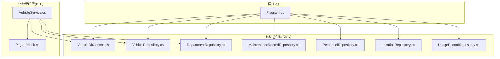
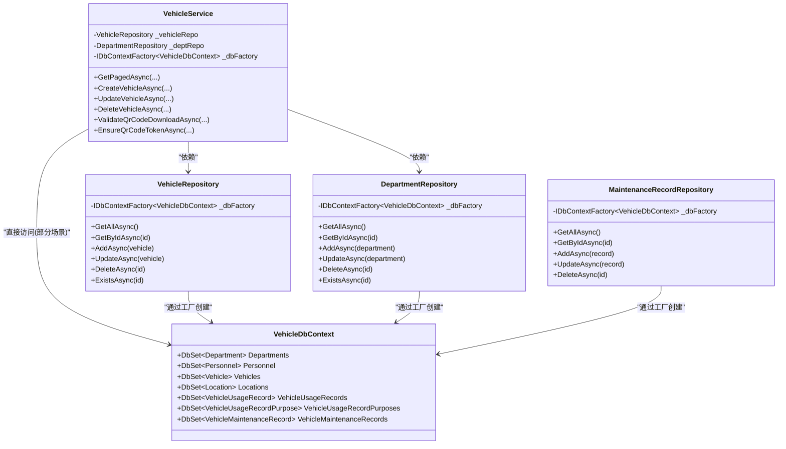
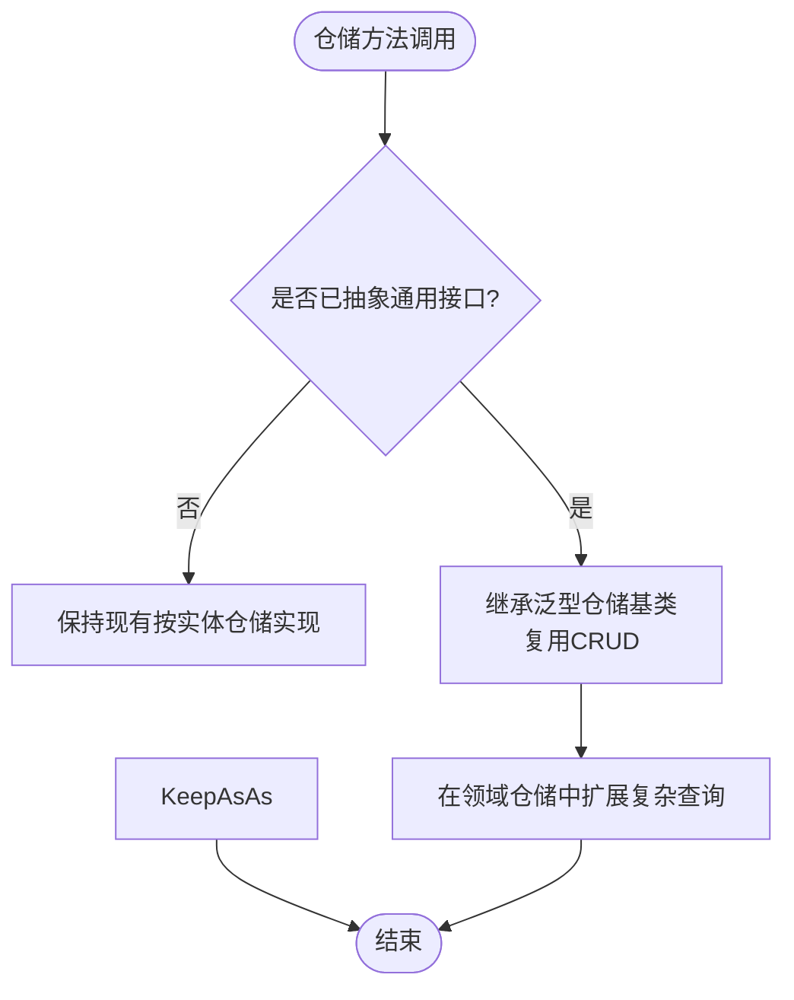
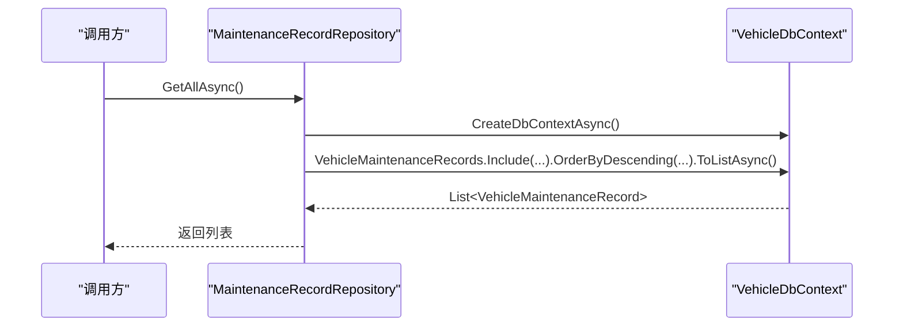
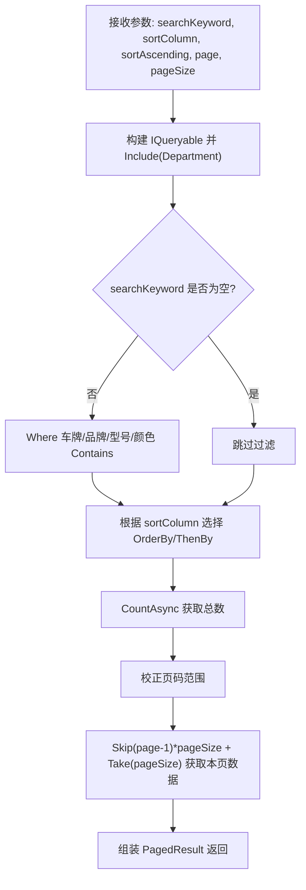
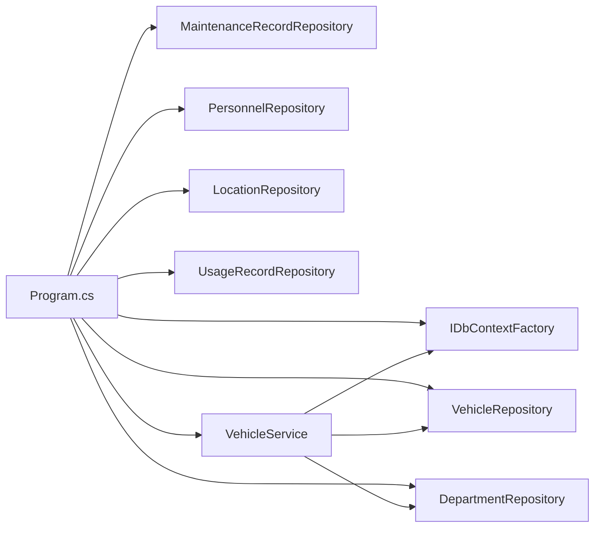
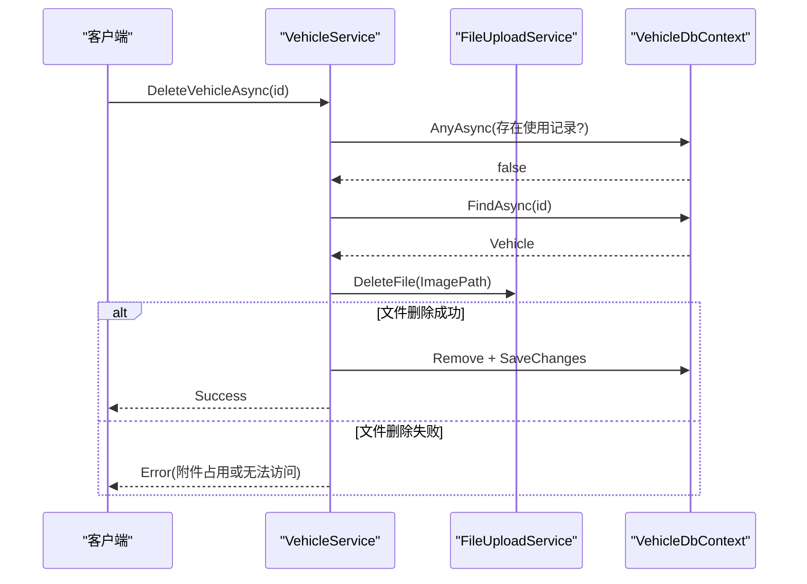

# 数据访问模式

<cite>
**本文引用的文件**   
- [Program.cs](file://Program.cs)
- [VehicleDbContext.cs](file://DAL/VehicleDbContext.cs)
- [VehicleRepository.cs](file://DAL/Repository/VehicleRepository.cs)
- [DepartmentRepository.cs](file://DAL/Repository/DepartmentRepository.cs)
- [MaintenanceRecordRepository.cs](file://DAL/Repository/MaintenanceRecordRepository.cs)
- [PersonnelRepository.cs](file://DAL/Repository/PersonnelRepository.cs)
- [LocationRepository.cs](file://DAL/Repository/LocationRepository.cs)
- [UsageRecordRepository.cs](file://DAL/Repository/UsageRecordRepository.cs)
- [VehicleService.cs](file://BLL/Vehicle/VehicleService.cs)
- [PagedResult.cs](file://BLL/Common/PagedResult.cs)
- [Vehicle.cs](file://DAL/Model/Vehicle.cs)
</cite>

## 目录
1. [简介](#简介)
2. [项目结构](#项目结构)
3. [核心组件](#核心组件)
4. [架构总览](#架构总览)
5. [详细组件分析](#详细组件分析)
6. [依赖关系分析](#依赖关系分析)
7. [性能与优化](#性能与优化)
8. [缓存策略](#缓存策略)
9. [监控与日志](#监控与日志)
10. [单元测试与 Mock](#单元测试与-mock)
11. [一致性与并发冲突处理](#一致性与并发冲突处理)
12. [结论](#结论)

## 简介
本文件面向数据访问层的设计与实现，围绕仓储模式、EF Core 最佳实践、查询优化、缓存、监控日志、测试与一致性保障展开。代码库采用 Blazor Server + EF Core + SQLite 的架构，仓储层通过 IDbContextFactory 获取 DbContext，业务层通过服务类组合仓储与上下文工厂完成复杂业务逻辑。

## 项目结构
- DAL：数据访问层，包含实体模型、DbContext 配置与各领域仓储实现。
- BLL：业务逻辑层，封装跨仓储的业务流程、分页、校验与错误处理。
- Program.cs：应用启动、依赖注入、数据库初始化与日志配置。

**图表来源**
- [Program.cs:52-73](file://Program.cs#L52-L73)
- [VehicleDbContext.cs:6-19](file://DAL/VehicleDbContext.cs#L6-L19)
- [VehicleRepository.cs:10-17](file://DAL/Repository/VehicleRepository.cs#L10-L17)
- [DepartmentRepository.cs:13-20](file://DAL/Repository/DepartmentRepository.cs#L13-L20)
- [MaintenanceRecordRepository.cs:10-17](file://DAL/Repository/MaintenanceRecordRepository.cs#L10-L17)
- [PersonnelRepository.cs:13-20](file://DAL/Repository/PersonnelRepository.cs#L13-L20)
- [LocationRepository.cs:12-19](file://DAL/Repository/LocationRepository.cs#L12-L19)
- [UsageRecordRepository.cs:12-19](file://DAL/Repository/UsageRecordRepository.cs#L12-L19)
- [VehicleService.cs:18-38](file://BLL/Vehicle/VehicleService.cs#L18-L38)
- [PagedResult.cs:9-35](file://BLL/Common/PagedResult.cs#L9-L35)

**章节来源**
- [Program.cs:28-125](file://Program.cs#L28-L125)
- [VehicleDbContext.cs:21-105](file://DAL/VehicleDbContext.cs#L21-L105)

## 核心组件
- VehicleDbContext：定义 DbSet、实体关系与索引，使用 OnModelCreating 配置约束与删除行为。
- 仓储实现（以 VehicleRepository、DepartmentRepository、MaintenanceRecordRepository 为代表）：统一提供异步 CRUD、Exists 等基础能力，并通过 IDbContextFactory 创建 DbContext。
- VehicleService：业务编排，组合仓储与上下文工厂，实现分页、搜索、排序、业务校验与附件清理等。
- PagedResult：通用分页结果封装，供上层 UI 展示。

**章节来源**
- [VehicleDbContext.cs:6-105](file://DAL/VehicleDbContext.cs#L6-L105)
- [VehicleRepository.cs:10-64](file://DAL/Repository/VehicleRepository.cs#L10-L64)
- [DepartmentRepository.cs:13-67](file://DAL/Repository/DepartmentRepository.cs#L13-L67)
- [MaintenanceRecordRepository.cs:10-60](file://DAL/Repository/MaintenanceRecordRepository.cs#L10-L60)
- [VehicleService.cs:18-238](file://BLL/Vehicle/VehicleService.cs#L18-L238)
- [PagedResult.cs:9-35](file://BLL/Common/PagedResult.cs#L9-L35)

## 架构总览
仓储模式在本项目中体现为“按领域划分仓储”，每个仓储负责一个实体的数据访问；业务服务通过依赖注入组合仓储与上下文工厂，形成清晰的层次边界。

**图表来源**
- [VehicleDbContext.cs:6-19](file://DAL/VehicleDbContext.cs#L6-L19)
- [VehicleRepository.cs:10-64](file://DAL/Repository/VehicleRepository.cs#L10-L64)
- [DepartmentRepository.cs:13-67](file://DAL/Repository/DepartmentRepository.cs#L13-L67)
- [MaintenanceRecordRepository.cs:10-60](file://DAL/Repository/MaintenanceRecordRepository.cs#L10-L60)
- [VehicleService.cs:18-238](file://BLL/Vehicle/VehicleService.cs#L18-L238)

## 详细组件分析

### 仓储模式与接口设计
- 当前仓储未抽象公共接口，而是按实体分别实现。优点是简单直观，缺点是重复代码较多。
- 建议引入 IGenericRepository<T> 与 IRepository<T> 抽象，将 GetAllAsync、GetByIdAsync、AddAsync、UpdateAsync、DeleteAsync、ExistsAsync 等通用操作下沉到泛型基类或默认实现中，各领域仓储仅扩展复杂查询。

**章节来源**
- [VehicleRepository.cs:10-64](file://DAL/Repository/VehicleRepository.cs#L10-L64)
- [DepartmentRepository.cs:13-67](file://DAL/Repository/DepartmentRepository.cs#L13-L67)
- [MaintenanceRecordRepository.cs:10-60](file://DAL/Repository/MaintenanceRecordRepository.cs#L10-L60)

### 通用 CRUD 与复杂查询封装
- 通用 CRUD：各仓储均提供异步 Get/Add/Update/Delete/Exists，符合 EF Core 异步最佳实践。
- 复杂查询：例如 MaintenanceRecordRepository.GetAllAsync 使用 Include 预加载关联实体并按维护日期倒序返回；UsageRecordRepository 对多关联进行预加载。
- 建议将常用复杂查询封装为仓储方法，避免在业务层散落 LINQ 片段。

**图表来源**
- [MaintenanceRecordRepository.cs:19-26](file://DAL/Repository/MaintenanceRecordRepository.cs#L19-L26)

**章节来源**
- [MaintenanceRecordRepository.cs:19-26](file://DAL/Repository/MaintenanceRecordRepository.cs#L19-L26)
- [UsageRecordRepository.cs:21-31](file://DAL/Repository/UsageRecordRepository.cs#L21-L31)

### EF Core 最佳实践
- 异步操作：仓储与服务广泛使用 async/await 与 Asynchronous EF API（如 FindAsync、AnyAsync、ToListAsync）。
- 批量操作：当前未见显式批量插入/更新；如需提升写入吞吐，可考虑 EF Core 批量扩展或分批次 SaveChanges。
- 事务管理：当前仓储方法各自独立 SaveChanges，未显式开启事务；对于跨仓储写操作，建议在 Service 层使用 Database.BeginTransactionAsync 包裹多个仓储调用。
- 错误处理：Service 层对删除流程进行异常捕获与日志记录；仓储层未统一异常包装，可在仓储或中间件层统一转换为领域异常并记录。

**章节来源**
- [VehicleService.cs:171-201](file://BLL/Vehicle/VehicleService.cs#L171-L201)
- [VehicleRepository.cs:19-63](file://DAL/Repository/VehicleRepository.cs#L19-L63)

### 查询优化策略
- LINQ 查询优化：
  - 使用 Where/OrderBy/Skip/Take 构建服务端分页与排序。
  - 按需 Include 预加载关联，避免 N+1。
- N+1 问题避免：
  - 在列表查询中使用 Include 预加载必要导航属性（如 VehicleService.GetPagedAsync 包含 Department）。
  - 对复杂聚合查询，优先在服务端一次性拉取数据后在内存中计算，或使用投影 DTO 减少字段传输。
- 分页查询实现：
  - VehicleService.GetPagedAsync 基于 IQueryable 的 CountAsync + Skip/Take 实现分页，返回 PagedResult。
  - 注意先计算总数再分页，确保页码边界正确。

**图表来源**
- [VehicleService.cs:67-109](file://BLL/Vehicle/VehicleService.cs#L67-L109)
- [PagedResult.cs:9-35](file://BLL/Common/PagedResult.cs#L9-L35)

**章节来源**
- [VehicleService.cs:67-109](file://BLL/Vehicle/VehicleService.cs#L67-L109)
- [PagedResult.cs:9-35](file://BLL/Common/PagedResult.cs#L9-L35)

## 依赖关系分析
- Program.cs 注册 IDbContextFactory<VehicleDbContext> 与各仓储、服务为 Scoped。
- 仓储通过构造函数注入 IDbContextFactory，避免在 Blazor Server 下共享 DbContext 导致的并发问题。
- VehicleService 同时依赖仓储与上下文工厂，用于需要直接构造复杂查询的场景。

**图表来源**
- [Program.cs:52-73](file://Program.cs#L52-L73)
- [VehicleService.cs:18-38](file://BLL/Vehicle/VehicleService.cs#L18-L38)

**章节来源**
- [Program.cs:52-73](file://Program.cs#L52-L73)

## 性能与优化
- 连接与上下文生命周期：
  - 使用 IDbContextFactory 为每次请求创建独立 DbContext，避免长生命周期上下文带来的状态污染与并发冲突。
- 查询性能：
  - 合理使用索引：VehicleDbContext 中对 LicensePlate、QrCodeToken、DepartmentId、CreatedAt 等字段建立索引，有助于过滤与排序。
  - 控制 Include 深度：仅在必要时预加载导航属性，避免过度抓取。
- 分页与排序：
  - 在服务端使用 IQueryable 的分页与排序，减少数据传输量。
- 写入性能：
  - 当前 SaveChanges 粒度较细，适合小事务；若存在批量写入场景，建议合并 SaveChanges 或引入批量扩展。

**章节来源**
- [VehicleDbContext.cs:21-105](file://DAL/VehicleDbContext.cs#L21-L105)
- [VehicleService.cs:67-109](file://BLL/Vehicle/VehicleService.cs#L67-L109)

## 缓存策略
- 内存缓存：
  - 适用于读多写少且允许短暂不一致的数据，如部门下拉列表、地点枚举等。可通过 IMemoryCache 在服务或仓储层缓存查询结果，设置过期策略。
- 分布式缓存：
  - 当部署多实例时，可使用 IDistributedCache（如 Redis）缓存热点数据，保证跨实例一致性。
- 缓存失效：
  - 在写操作成功后主动清除相关缓存键，或在变更事件触发时失效。

[本节为概念性指导，不直接分析具体文件]

## 监控与日志
- Serilog 全局日志：
  - Program.cs 中配置 Serilog，输出控制台与滚动文件，抑制框架与 EF Core SQL 日志，降低噪音。
- 业务日志：
  - VehicleService 在删除车辆时记录成功与失败日志，便于审计与排障。
- 建议增强：
  - 在仓储层增加关键操作的审计日志（如新增/更新/删除），并记录受影响主键与耗时。
  - 对慢查询进行采样统计，结合 Application Insights 或自定义指标上报。

**章节来源**
- [Program.cs:28-37](file://Program.cs#L28-L37)
- [VehicleService.cs:183-201](file://BLL/Vehicle/VehicleService.cs#L183-L201)

## 单元测试与 Mock
- 仓储测试：
  - 使用 InMemoryDatabase 或 Testcontainers 模拟 SQLite，验证仓储方法的增删改查与条件查询。
  - 对 Include 预加载与排序分页进行断言。
- 服务测试：
  - Mock 仓储与上下文工厂，验证业务编排逻辑（如删除前的业务校验、附件清理、二维码 Token 生成）。
- Mock 建议：
  - 对 IDbContextFactory 返回的 DbContext 进行可控配置，以便在不同用例中切换真实或内存数据库。
  - 对 ILogger 注入测试用收集器，断言日志级别与消息内容。

[本节为概念性指导，不直接分析具体文件]

## 一致性与并发冲突处理
- 乐观并发：
  - 可为实体添加时间戳或版本号字段，并在 Update 前检查版本，防止覆盖更新。
- 事务边界：
  - 跨仓储写操作应在 Service 层使用 Database.BeginTransactionAsync 包裹，确保原子性。
- 唯一约束与删除保护：
  - VehicleDbContext 对 LicensePlate、QrCodeToken 设置唯一索引；删除车辆前检查是否存在使用记录，避免破坏引用完整性。
- 外部资源一致性：
  - 删除车辆前先删除图片附件，若失败则回滚数据库删除，保证文件系统与数据库的一致性。

**图表来源**
- [VehicleService.cs:171-201](file://BLL/Vehicle/VehicleService.cs#L171-L201)

**章节来源**
- [VehicleDbContext.cs:36-42](file://DAL/VehicleDbContext.cs#L36-L42)
- [VehicleService.cs:171-201](file://BLL/Vehicle/VehicleService.cs#L171-L201)

## 结论
本项目数据访问层采用仓储模式与 EF Core 异步 API，结合 IDbContextFactory 解决 Blazor Server 并发问题；业务层通过服务编排复杂查询与校验。建议在仓储层引入泛型接口与基类以减少重复代码，完善事务边界与异常包装，增强监控与审计日志，并根据读写特征引入合适的缓存策略，以提升整体性能与可维护性。