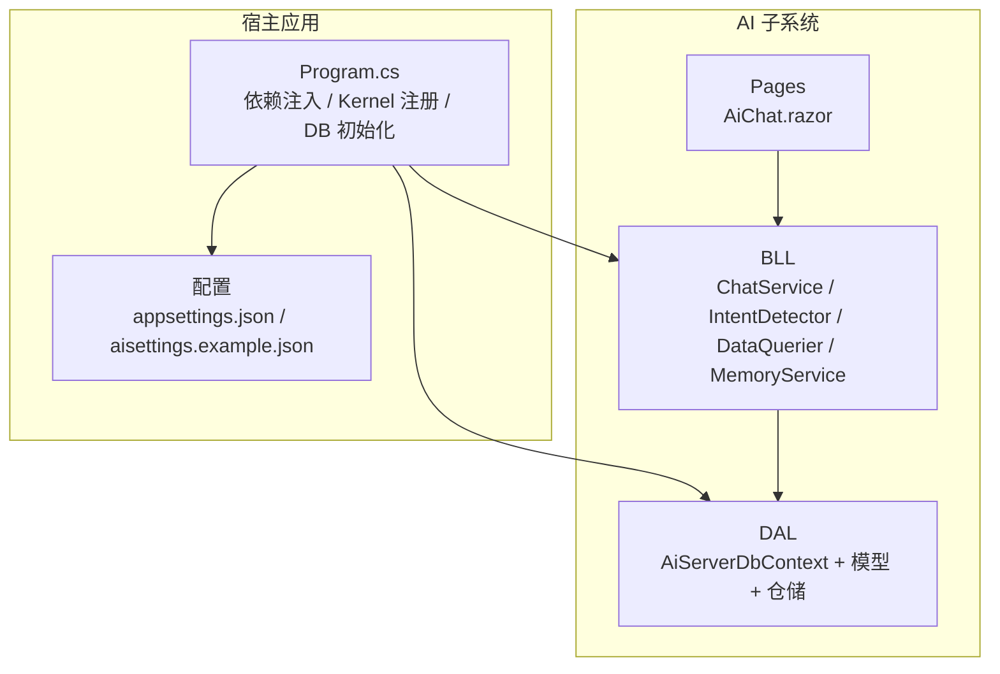
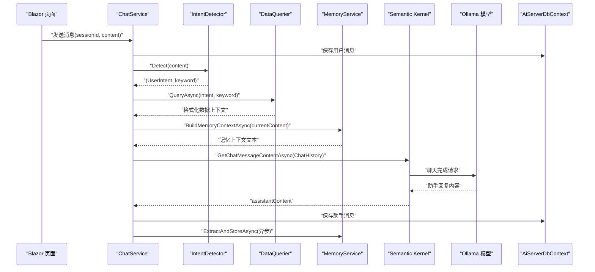
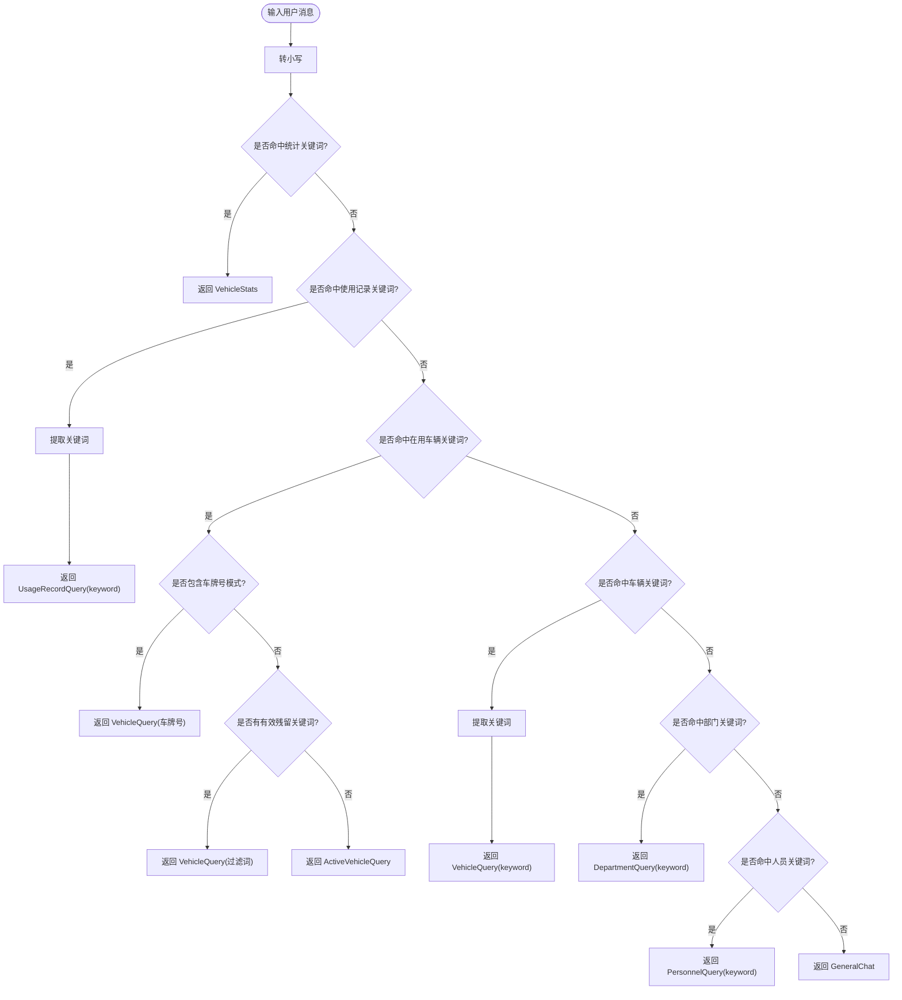
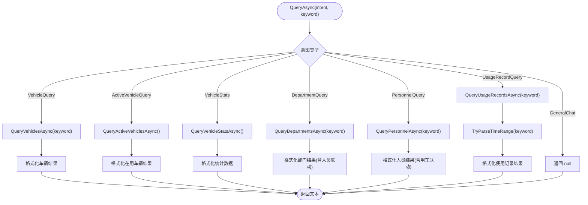
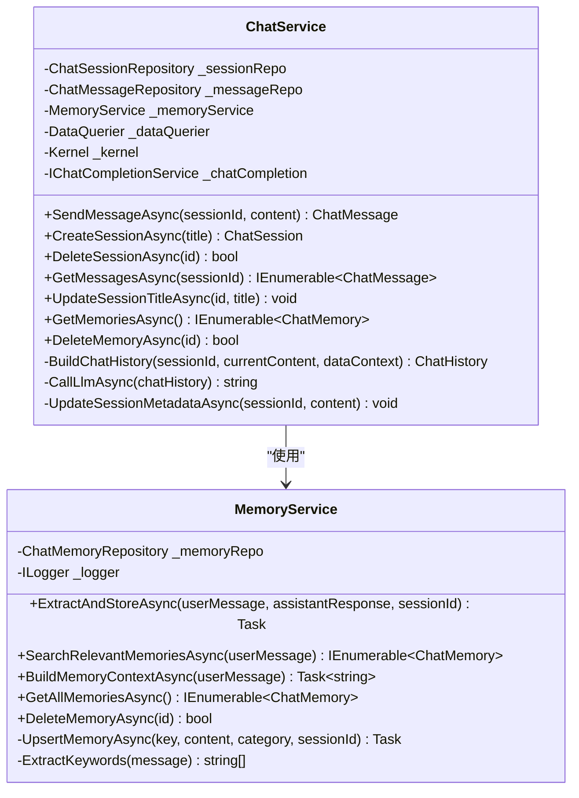
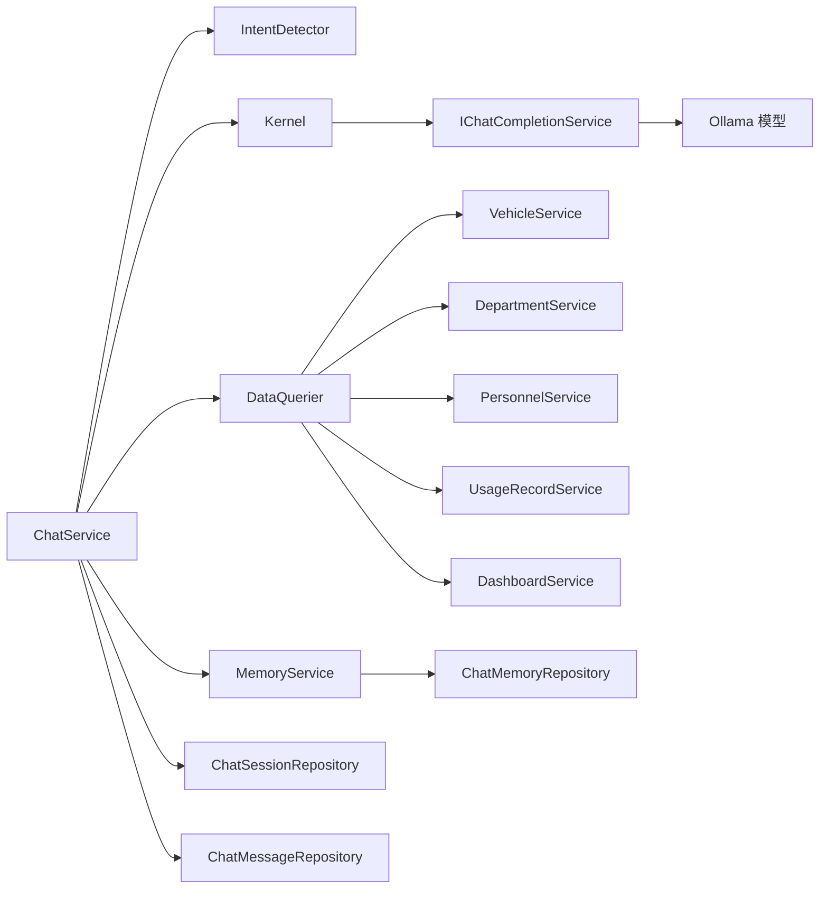

# AI 子系统架构

<cite>
**本文引用的文件**   
- [Program.cs](file://Program.cs)
- [appsettings.json](file://appsettings.json)
- [aisettings.example.json](file://aisettings.example.json)
- [ChatService.cs](file://aiServer/BLL/ChatService.cs)
- [IntentDetector.cs](file://aiServer/BLL/IntentDetector.cs)
- [DataQuerier.cs](file://aiServer/BLL/DataQuerier.cs)
- [MemoryService.cs](file://aiServer/BLL/MemoryService.cs)
- [UserIntent.cs](file://aiServer/BLL/Enums/UserIntent.cs)
- [SystemPrompts.cs](file://aiServer/BLL/Prompts/SystemPrompts.cs)
- [AiServerDbContext.cs](file://aiServer/DAL/AiServerDbContext.cs)
- [ChatSession.cs](file://aiServer/DAL/Model/ChatSession.cs)
- [ChatMessage.cs](file://aiServer/DAL/Model/ChatMessage.cs)
- [ChatMemory.cs](file://aiServer/DAL/Model/ChatMemory.cs)
- [ChatSessionRepository.cs](file://aiServer/DAL/Repository/ChatSessionRepository.cs)
- [ChatMessageRepository.cs](file://aiServer/DAL/Repository/ChatMessageRepository.cs)
- [ChatMemoryRepository.cs](file://aiServer/DAL/Repository/ChatMemoryRepository.cs)
</cite>

## 目录
1. [引言](#引言)
2. [项目结构](#项目结构)
3. [核心组件](#核心组件)
4. [架构总览](#架构总览)
5. [详细组件分析](#详细组件分析)
6. [依赖关系分析](#依赖关系分析)
7. [性能与扩展指南](#性能与扩展指南)
8. [故障排查](#故障排查)
9. [结论](#结论)

## 引言
本文件为 vehicleManagement 系统的 AI 子系统提供独立、深入的架构文档。AI 子系统基于 Semantic Kernel 集成 Ollama 模型，实现自然语言意图识别、业务数据查询、对话会话管理、语义记忆持久化以及提示词工程。同时，AI 子系统拥有独立的 SQLite 数据库上下文，用于持久化会话、消息与记忆，确保与主业务数据库解耦。

## 项目结构
AI 子系统位于 aiServer 目录下，采用分层组织：
- BLL（业务逻辑层）：对话编排、意图识别、数据查询、记忆服务、提示词定义
- DAL（数据访问层）：EF Core 上下文、实体模型、仓储实现
- Pages（前端页面）：Blazor 聊天页面（不在本文重点）
- 配置与启动：Program.cs 负责依赖注入、Semantic Kernel 注册、数据库初始化；appsettings.json 与 aisettings.example.json 提供连接字符串与 Ollama 配置



图表来源
- [Program.cs:45-102](file://Program.cs#L45-L102)
- [appsettings.json:1-8](file://appsettings.json#L1-L8)
- [aisettings.example.json:1-7](file://aisettings.example.json#L1-L7)

章节来源
- [Program.cs:45-102](file://Program.cs#L45-L102)
- [appsettings.json:1-8](file://appsettings.json#L1-L8)
- [aisettings.example.json:1-7](file://aisettings.example.json#L1-L7)

## 核心组件
- ChatService：对话编排中枢，负责会话控制、历史构建、调用 LLM、保存消息、异步提取记忆
- IntentDetector：基于关键词与自然语言规则进行意图识别，输出 UserIntent 与可选关键词
- DataQuerier：根据意图路由到具体业务服务，执行查询并格式化为 LLM 可读文本
- MemoryService：从对话中提取关键信息并持久化，支持模糊搜索与上下文构建
- SystemPrompts：系统提示词与数据注入模板，约束 LLM 严格基于真实数据回答
- AiServerDbContext：AI 子系统独立 EF Core 上下文，定义会话、消息、记忆的实体关系与索引
- Repository 层：会话、消息、记忆的增删改查与分页、最近消息等能力

章节来源
- [ChatService.cs:14-42](file://aiServer/BLL/ChatService.cs#L14-L42)
- [IntentDetector.cs:9-17](file://aiServer/BLL/IntentDetector.cs#L9-L17)
- [DataQuerier.cs:18-43](file://aiServer/BLL/DataQuerier.cs#L18-L43)
- [MemoryService.cs:12-40](file://aiServer/BLL/MemoryService.cs#L12-L40)
- [SystemPrompts.cs:6-36](file://aiServer/BLL/Prompts/SystemPrompts.cs#L6-L36)
- [AiServerDbContext.cs:9-56](file://aiServer/DAL/AiServerDbContext.cs#L9-L56)

## 架构总览
AI 子系统的端到端流程如下：用户通过 Blazor 页面发送消息，ChatService 将消息持久化后执行意图识别，随后由 DataQuerier 查询业务数据，结合 SystemPrompts 与 MemoryService 构建上下文，最终通过 Semantic Kernel 的 IChatCompletionService 调用 Ollama 模型生成回复，并将结果持久化。



图表来源
- [ChatService.cs:94-139](file://aiServer/BLL/ChatService.cs#L94-L139)
- [IntentDetector.cs:17-110](file://aiServer/BLL/IntentDetector.cs#L17-L110)
- [DataQuerier.cs:48-67](file://aiServer/BLL/DataQuerier.cs#L48-L67)
- [MemoryService.cs:144-153](file://aiServer/BLL/MemoryService.cs#L144-L153)
- [Program.cs:97-102](file://Program.cs#L97-L102)

## 详细组件分析

### 意图识别机制（IntentDetector）
- 设计要点
  - 使用中文关键词匹配与正则表达式识别车牌号模式，避免误判
  - 优先级策略：统计类意图优先于具体查询，在用车辆查询优先于普通车辆查询
  - 噪声过滤：去除停用词与无意义片段，提高关键词质量
- 意图路由表
  - VehicleStats：统计/汇总/分布/趋势/排行
  - UsageRecordQuery：使用记录/出车/用车/行程
  - ActiveVehicleQuery：在用车辆/当前可用/有哪些车/所有车辆
  - VehicleQuery：车辆/车牌/品牌/型号/状态/维修/退役/公里/颜色
  - DepartmentQuery：部门/单位/科室
  - PersonnelQuery：人员/员工/司机/姓名/电话/手机
  - GeneralChat：闲聊/帮助/功能/版本
- 关键词提取
  - 去除触发词与停用词，裁剪标点与空白，返回有效搜索词或 null



图表来源
- [IntentDetector.cs:17-110](file://aiServer/BLL/IntentDetector.cs#L17-L110)
- [UserIntent.cs:6-22](file://aiServer/BLL/Enums/UserIntent.cs#L6-L22)

章节来源
- [IntentDetector.cs:17-150](file://aiServer/BLL/IntentDetector.cs#L17-L150)
- [UserIntent.cs:6-22](file://aiServer/BLL/Enums/UserIntent.cs#L6-L22)

### 数据查询器（DataQuerier）
- 设计要点
  - 按意图分发到具体业务服务：VehicleService、DepartmentService、PersonnelService、UsageRecordService、DashboardService
  - 结果统一格式化为 LLM 可读文本，限制最大返回条数（MaxQueryResults=20）
  - 时间范围解析：支持“今天/昨天/一周/一个月/季度/年”等中文表达映射为天数
  - 交叉查询：部门查询可联动人员；人员查询可联动使用记录
- 安全机制
  - 白名单式意图路由：仅允许已定义的 UserIntent 分支，其他返回 null
  - 异常捕获：数据库查询异常时返回错误文本，不中断对话流程



图表来源
- [DataQuerier.cs:48-67](file://aiServer/BLL/DataQuerier.cs#L48-L67)
- [DataQuerier.cs:69-330](file://aiServer/BLL/DataQuerier.cs#L69-L330)

章节来源
- [DataQuerier.cs:48-330](file://aiServer/BLL/DataQuerier.cs#L48-L330)

### 对话管理与记忆（ChatService 与 MemoryService）
- ChatService
  - 会话管理：创建、删除、更新标题、获取会话列表
  - 消息历史：保存用户与助手消息，加载最近 N 条消息构建 ChatHistory
  - 上下文构建：注入系统提示词、数据上下文、记忆上下文
  - LLM 调用：通过 IChatCompletionService 调用 Ollama，异常时返回友好提示
  - 记忆提取：异步调用 MemoryService.ExtractAndStoreAsync，不影响主流程
- MemoryService
  - 记忆提取：车牌号、品牌、偏好/习惯、通用短消息
  - 记忆搜索：关键词提取（车牌、品牌、中文词），去重与限制数量
  - 记忆上下文：构建可用于提示词的文本片段



图表来源
- [ChatService.cs:14-42](file://aiServer/BLL/ChatService.cs#L14-L42)
- [ChatService.cs:94-199](file://aiServer/BLL/ChatService.cs#L94-L199)
- [MemoryService.cs:12-40](file://aiServer/BLL/MemoryService.cs#L12-L40)
- [MemoryService.cs:45-221](file://aiServer/BLL/MemoryService.cs#L45-L221)

章节来源
- [ChatService.cs:44-199](file://aiServer/BLL/ChatService.cs#L44-L199)
- [MemoryService.cs:45-221](file://aiServer/BLL/MemoryService.cs#L45-L221)

### 提示词工程（SystemPrompts）
- Main 系统提示词
  - 明确角色与职责：车辆管理系统 AI 助手
  - 数据源约束：严格基于系统提供的数据上下文，禁止编造
  - 行为规则：不使用不确定词汇，直接陈述事实；中文回复；简洁清晰
  - 特殊场景：在问“哪些车/所有车辆/车辆列表”时默认理解为全量列表；在问“哪个部门用车最多”时直接使用部门车辆归属统计
- BuildDataInjectionPrompt
  - 将 DataQuerier 返回的真实数据上下文包装为 system message，强化 LLM 的数据驱动回答

章节来源
- [SystemPrompts.cs:6-36](file://aiServer/BLL/Prompts/SystemPrompts.cs#L6-L36)

### AI 子系统数据库设计（AiServerDbContext）
- 实体关系
  - ChatSession：会话标题、创建时间、更新时间，导航属性 Messages
  - ChatMessage：角色（user/assistant/system）、内容、思考过程、时间，外键 SessionId 关联 ChatSession（级联删除）
  - ChatMemory：记忆键 Key、内容 Content、分类 Category、来源会话 SessionId（可为空，删除会话时置空）
- 索引与默认值
  - ChatMessage：SessionId、CreatedAt 索引；CreatedAt 默认 CURRENT_TIMESTAMP
  - ChatMemory：Key、Category 索引；CreatedAt 默认 CURRENT_TIMESTAMP
- 连接字符串
  - AiServerConnection：指向 data/aiServer.db

```mermaid
erDiagram
CHAT_SESSION {
int Id PK
string Title
datetime CreatedAt
datetime UpdatedAt
}
CHAT_MESSAGE {
int Id PK
int SessionId FK
string Role
string Content
string ThinkingContent
datetime CreatedAt
}
CHAT_MEMORY {
int Id PK
string Key
string Content
string Category
int? SessionId FK
datetime CreatedAt
}
CHAT_SESSION ||--o{ CHAT_MESSAGE : "Messages"
CHAT_SESSION ||--o{ CHAT_MEMORY : "来源会话(可选)"
```

图表来源
- [AiServerDbContext.cs:20-55](file://aiServer/DAL/AiServerDbContext.cs#L20-L55)
- [ChatSession.cs:11-36](file://aiServer/DAL/Model/ChatSession.cs#L11-L36)
- [ChatMessage.cs:10-48](file://aiServer/DAL/Model/ChatMessage.cs#L10-L48)
- [ChatMemory.cs:10-49](file://aiServer/DAL/Model/ChatMemory.cs#L10-L49)

章节来源
- [AiServerDbContext.cs:9-56](file://aiServer/DAL/AiServerDbContext.cs#L9-L56)
- [ChatSession.cs:11-36](file://aiServer/DAL/Model/ChatSession.cs#L11-L36)
- [ChatMessage.cs:10-48](file://aiServer/DAL/Model/ChatMessage.cs#L10-L48)
- [ChatMemory.cs:10-49](file://aiServer/DAL/Model/ChatMemory.cs#L10-L49)

## 依赖关系分析
- 组件耦合
  - ChatService 强依赖 IntentDetector、DataQuerier、MemoryService、Kernel/IChatCompletionService
  - DataQuerier 依赖各业务服务（Vehicle/Department/Personnel/UsageRecord/Dashboard）
  - MemoryService 依赖 ChatMemoryRepository
  - 仓储层均依赖 IDbContextFactory<AiServerDbContext>
- 外部依赖
  - Semantic Kernel：AddOllamaChatCompletion 注册 Ollama 聊天完成服务
  - EF Core：AiServerDbContext 使用 SQLite 提供程序



图表来源
- [Program.cs:97-102](file://Program.cs#L97-L102)
- [ChatService.cs:14-42](file://aiServer/BLL/ChatService.cs#L14-L42)
- [DataQuerier.cs:23-43](file://aiServer/BLL/DataQuerier.cs#L23-L43)
- [MemoryService.cs:12-40](file://aiServer/BLL/MemoryService.cs#L12-L40)

章节来源
- [Program.cs:97-102](file://Program.cs#L97-L102)
- [ChatService.cs:14-42](file://aiServer/BLL/ChatService.cs#L14-L42)
- [DataQuerier.cs:23-43](file://aiServer/BLL/DataQuerier.cs#L23-L43)
- [MemoryService.cs:12-40](file://aiServer/BLL/MemoryService.cs#L12-L40)

## 性能与扩展指南

### 性能特性与优化建议
- 最近消息限制
  - ChatService 仅加载最近 MaxRecentMessages=20 条消息构建上下文，降低 LLM 输入长度与延迟
  - DataQuerier 限制 MaxQueryResults=20，减少数据注入体积
- 异步记忆提取
  - MemoryService.ExtractAndStoreAsync 在后台任务中执行，避免阻塞主对话路径
- 索引优化
  - ChatMessage.SessionId、CreatedAt 与 ChatMemory.Key、Category 建立索引，提升检索效率
- 连接与上下文
  - 使用 IDbContextFactory 避免 Blazor Server 并发冲突，按需创建 DbContext
- 建议
  - 对高频查询增加缓存（如部门/人员列表）
  - 对 LLM 调用增加超时与重试策略
  - 对记忆检索引入更高效的全文检索或向量检索（视规模增长而定）

章节来源
- [ChatService.cs:27-27](file://aiServer/BLL/ChatService.cs#L27-L27)
- [DataQuerier.cs:29-29](file://aiServer/BLL/DataQuerier.cs#L29-L29)
- [ChatService.cs:132-136](file://aiServer/BLL/ChatService.cs#L132-L136)
- [AiServerDbContext.cs:31-49](file://aiServer/DAL/AiServerDbContext.cs#L31-L49)
- [Program.cs:52-58](file://Program.cs#L52-L58)

### Ollama 模型连接配置
- 配置项
  - AiServer:OllamaEndpoint：Ollama 服务地址，默认 http://localhost:11434
  - AiServer:OllamaModel：模型名称，默认 gemma4:e2b
- 注册方式
  - Program.cs 中通过 Kernel.CreateBuilder().AddOllamaChatCompletion(model, endpoint) 注册
- 建议
  - 将 aisettings.json 挂载到容器以支持热重载
  - 在生产环境设置合理的超时与重试策略

章节来源
- [aisettings.example.json:1-7](file://aisettings.example.json#L1-L7)
- [Program.cs:97-102](file://Program.cs#L97-L102)

### 意图识别扩展指南
- 新增意图
  - 在 UserIntent 枚举中添加新意图
  - 在 IntentDetector.Detect 中增加关键词匹配与优先级处理
  - 在 DataQuerier.QueryAsync 中增加对应分支与查询逻辑
- 关键词优化
  - 调整停用词与噪声字符集合，提升关键词提取准确率
  - 增加领域术语库（品牌、车型、部门名等）

章节来源
- [UserIntent.cs:6-22](file://aiServer/BLL/Enums/UserIntent.cs#L6-L22)
- [IntentDetector.cs:17-150](file://aiServer/BLL/IntentDetector.cs#L17-L150)
- [DataQuerier.cs:48-67](file://aiServer/BLL/DataQuerier.cs#L48-L67)

### 数据查询器扩展指南
- 新增查询类型
  - 在 DataQuerier.QueryAsync 中增加意图分支
  - 实现对应的私有查询方法，复用业务服务
- 时间范围解析
  - 在 TryParseTimeRange 中补充新的时间表达映射
- 安全机制
  - 保持白名单式意图路由，避免未授权查询

章节来源
- [DataQuerier.cs:48-67](file://aiServer/BLL/DataQuerier.cs#L48-L67)
- [DataQuerier.cs:272-330](file://aiServer/BLL/DataQuerier.cs#L272-L330)

### 记忆服务扩展指南
- 记忆类别
  - 在 MemoryService 中扩展 PreferenceKeywords 与领域词库
- 检索策略
  - 在 SearchRelevantMemoriesAsync 中增加更多关键词提取规则
  - 考虑引入相似度匹配或向量检索以提升相关性

章节来源
- [MemoryService.cs:20-34](file://aiServer/BLL/MemoryService.cs#L20-L34)
- [MemoryService.cs:118-153](file://aiServer/BLL/MemoryService.cs#L118-L153)

### 提示词工程扩展指南
- 系统提示词
  - 在 SystemPrompts.Main 中补充领域规则与边界条件
- 数据注入
  - 在 BuildDataInjectionPrompt 中调整注入格式与强调语气

章节来源
- [SystemPrompts.cs:6-36](file://aiServer/BLL/Prompts/SystemPrompts.cs#L6-L36)

## 故障排查
- LLM 不可用
  - 现象：返回“AI 服务暂时不可用：...”
  - 排查：检查 OllamaEndpoint 与 OllamaModel 配置；确认 Ollama 服务运行状态
  - 参考：[ChatService.cs:188-199](file://aiServer/BLL/ChatService.cs#L188-L199)
- 数据库连接失败
  - 现象：启动阶段无法创建数据库或查询失败
  - 排查：检查 appsettings.json 中的 AiServerConnection；确认 data/aiServer.db 存在且可写
  - 参考：[appsettings.json:3-6](file://appsettings.json#L3-L6)、[Program.cs:56-58](file://Program.cs#L56-L58)
- 意图识别不准确
  - 现象：用户输入被误判为闲聊或错误意图
  - 排查：检查 IntentDetector 关键词与优先级；调整停用词与噪声字符
  - 参考：[IntentDetector.cs:17-150](file://aiServer/BLL/IntentDetector.cs#L17-L150)
- 记忆提取失败
  - 现象：日志中出现“记忆提取失败，但不影响对话流程”
  - 排查：检查 ChatMemoryRepository 操作；确认数据库写入权限
  - 参考：[MemoryService.cs:109-112](file://aiServer/BLL/MemoryService.cs#L109-L112)

章节来源
- [ChatService.cs:188-199](file://aiServer/BLL/ChatService.cs#L188-L199)
- [appsettings.json:3-6](file://appsettings.json#L3-L6)
- [Program.cs:56-58](file://Program.cs#L56-L58)
- [IntentDetector.cs:17-150](file://aiServer/BLL/IntentDetector.cs#L17-L150)
- [MemoryService.cs:109-112](file://aiServer/BLL/MemoryService.cs#L109-L112)

## 结论
AI 子系统通过 Semantic Kernel 与 Ollama 的集成，实现了面向车辆管理业务的自然语言交互。其核心在于意图识别、数据查询、对话编排与记忆持久化的协同工作。独立数据库上下文确保了 AI 数据的隔离与可扩展性。建议在后续迭代中持续优化意图识别准确率、记忆检索效果与 LLM 调用性能，以满足更大规模与更高频的使用场景。