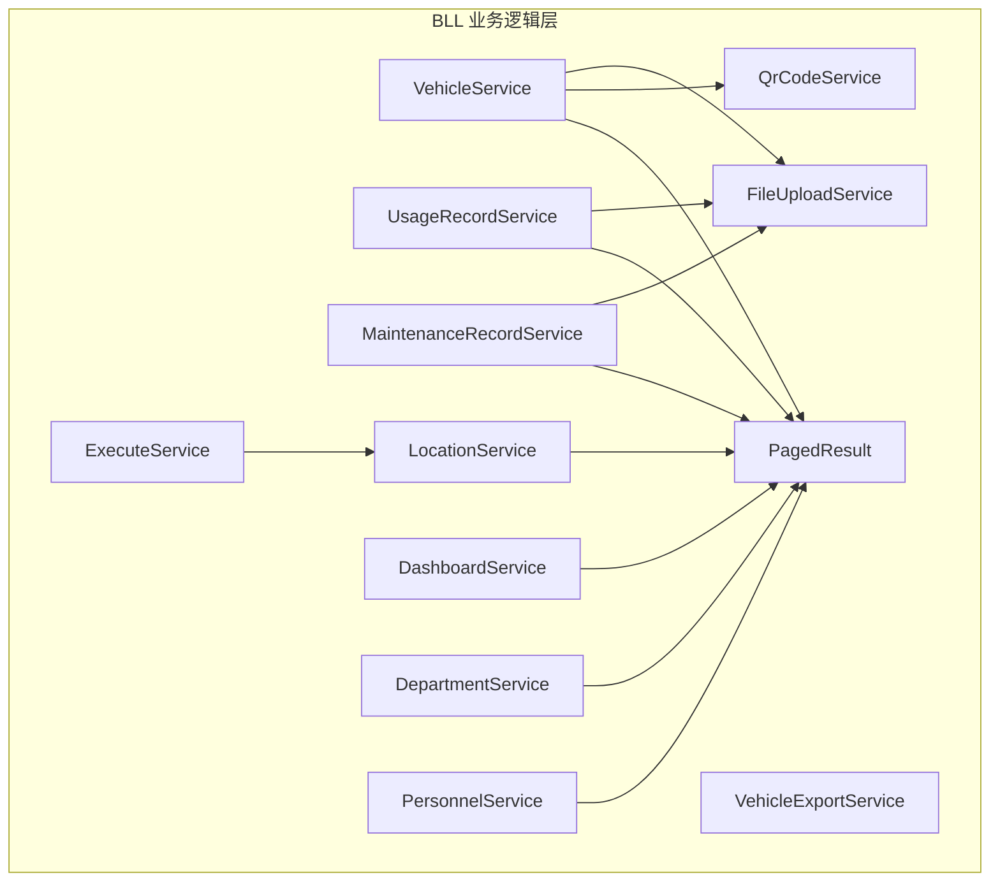
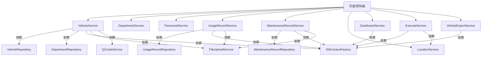
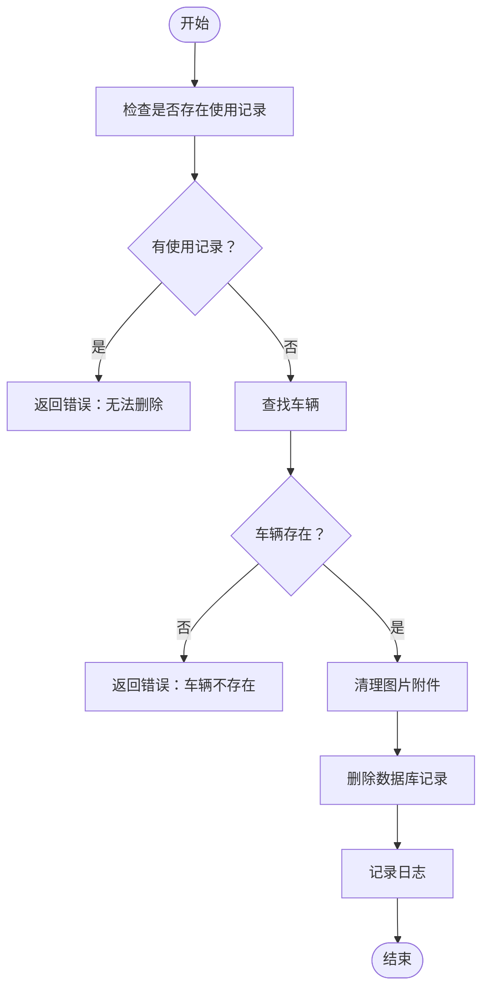
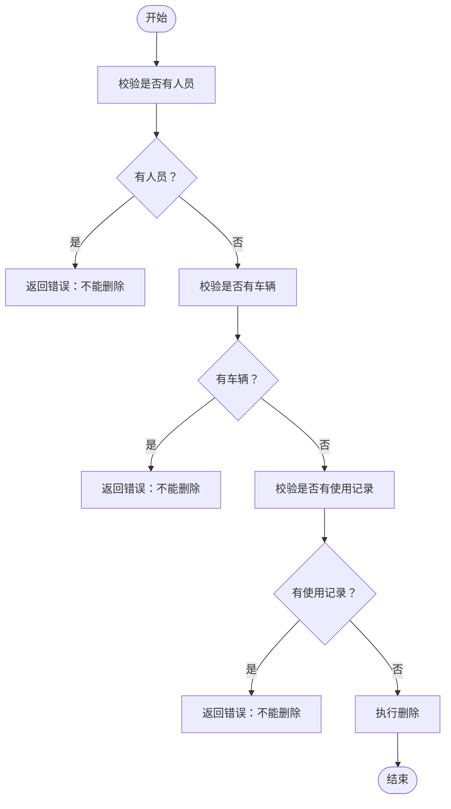
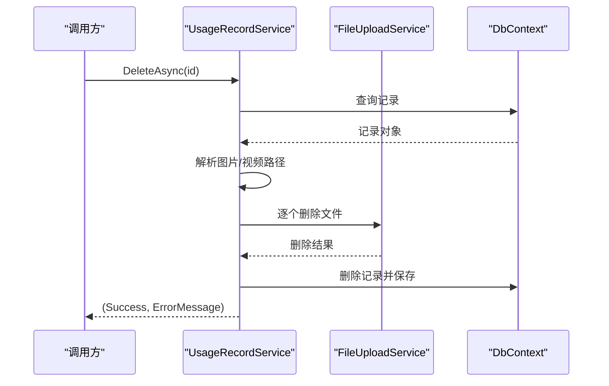
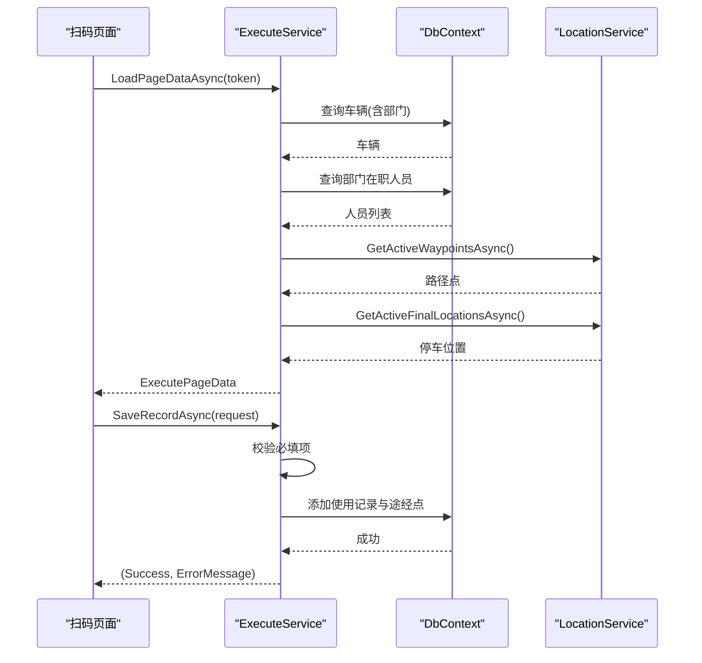
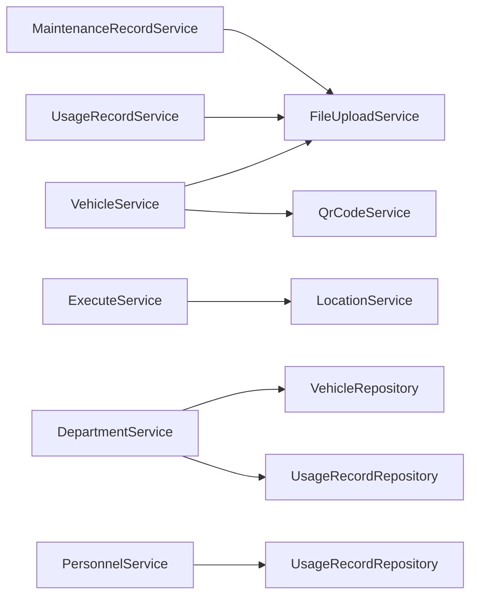

# 业务逻辑层（BLL）设计

<cite>
**本文引用的文件**   
- [VehicleService.cs](file://BLL/Vehicle/VehicleService.cs)
- [DepartmentService.cs](file://BLL/Department/DepartmentService.cs)
- [PersonnelService.cs](file://BLL/Personnel/PersonnelService.cs)
- [UsageRecordService.cs](file://BLL/UsageRecord/UsageRecordService.cs)
- [MaintenanceRecordService.cs](file://BLL/Maintenance/MaintenanceRecordService.cs)
- [LocationService.cs](file://BLL/Location/LocationService.cs)
- [DashboardService.cs](file://BLL/Dashboard/DashboardService.cs)
- [ExecuteService.cs](file://BLL/Execute/ExecuteService.cs)
- [VehicleExportService.cs](file://BLL/Export/VehicleExportService.cs)
- [FileUploadService.cs](file://BLL/Common/FileUploadService.cs)
- [QrCodeService.cs](file://BLL/Common/QrCodeService.cs)
- [PagedResult.cs](file://BLL/Common/PagedResult.cs)
</cite>

## 目录
1. [引言](#引言)
2. [项目结构](#项目结构)
3. [核心组件](#核心组件)
4. [架构总览](#架构总览)
5. [详细组件分析](#详细组件分析)
6. [依赖关系分析](#依赖关系分析)
7. [性能考虑](#性能考虑)
8. [故障排查指南](#故障排查指南)
9. [结论](#结论)
10. [附录](#附录)

## 引言
本设计文档聚焦 vehicleManagement 系统的业务逻辑层（BLL），围绕服务层的职责划分、业务规则封装、依赖注入与生命周期、异常处理模式、通用服务实现、服务间协作、事务策略与性能优化进行系统化说明。目标读者包括后端开发者、架构师以及需要理解系统业务流程的产品与测试人员。

## 项目结构
BLL 采用按领域功能划分的目录组织方式，每个业务域对应一个 Service 类，公共能力集中在 Common 子目录中：
- Vehicle：车辆主数据与二维码相关能力
- Department：部门维度管理
- Personnel：人员维度管理
- UsageRecord：用车记录与附件清理
- Maintenance：维修记录
- Location：地点与路径点
- Dashboard：仪表盘统计
- Execute：扫码执行页的数据加载与使用记录保存
- Export：Excel 导出
- Common：文件上传、二维码生成、分页结果等通用能力

图表来源
- [VehicleService.cs:18-38](file://BLL/Vehicle/VehicleService.cs#L18-L38)
- [DepartmentService.cs:16-36](file://BLL/Department/DepartmentService.cs#L16-L36)
- [PersonnelService.cs:17-34](file://BLL/Personnel/PersonnelService.cs#L17-L34)
- [UsageRecordService.cs:19-38](file://BLL/UsageRecord/UsageRecordService.cs#L19-L38)
- [MaintenanceRecordService.cs:14-28](file://BLL/Maintenance/MaintenanceRecordService.cs#L14-L28)
- [LocationService.cs:17-26](file://BLL/Location/LocationService.cs#L17-L26)
- [DashboardService.cs:16-23](file://BLL/Dashboard/DashboardService.cs#L16-L23)
- [ExecuteService.cs:16-25](file://BLL/Execute/ExecuteService.cs#L16-L25)
- [VehicleExportService.cs:16-23](file://BLL/Export/VehicleExportService.cs#L16-L23)
- [FileUploadService.cs:12-27](file://BLL/Common/FileUploadService.cs#L12-L27)
- [QrCodeService.cs:6-19](file://BLL/Common/QrCodeService.cs#L6-L19)
- [PagedResult.cs:9-35](file://BLL/Common/PagedResult.cs#L9-L35)

章节来源
- [VehicleService.cs:1-241](file://BLL/Vehicle/VehicleService.cs#L1-L241)
- [DepartmentService.cs:1-147](file://BLL/Department/DepartmentService.cs#L1-L147)
- [PersonnelService.cs:1-142](file://BLL/Personnel/PersonnelService.cs#L1-L142)
- [UsageRecordService.cs:1-179](file://BLL/UsageRecord/UsageRecordService.cs#L1-L179)
- [MaintenanceRecordService.cs:1-103](file://BLL/Maintenance/MaintenanceRecordService.cs#L1-L103)
- [LocationService.cs:1-154](file://BLL/Location/LocationService.cs#L1-L154)
- [DashboardService.cs:1-247](file://BLL/Dashboard/DashboardService.cs#L1-L247)
- [ExecuteService.cs:1-151](file://BLL/Execute/ExecuteService.cs#L1-L151)
- [VehicleExportService.cs:1-163](file://BLL/Export/VehicleExportService.cs#L1-L163)
- [FileUploadService.cs:1-113](file://BLL/Common/FileUploadService.cs#L1-L113)
- [QrCodeService.cs:1-42](file://BLL/Common/QrCodeService.cs#L1-L42)
- [PagedResult.cs:1-37](file://BLL/Common/PagedResult.cs#L1-L37)

## 核心组件
本节概述各服务的职责边界与关键能力，并给出典型调用入口与返回类型。

- VehicleService
  - 职责：车辆主数据查询、状态切换、分页检索、二维码 Token 管理与下载校验、删除时附件清理。
  - 关键方法：GetPagedAsync、ToggleBorrowedAsync、DeleteVehicleAsync、ValidateQrCodeDownloadAsync、EnsureQrCodeTokenAsync。
  - 协作：依赖 FileUploadService、QrCodeService、Repository 与 DbContextFactory。

- DepartmentService
  - 职责：部门 CRUD、分页检索、删除前关联校验（人员、车辆、使用记录）。
  - 关键方法：GetPagedAsync、CreateAsync、UpdateAsync、DeleteAsync。

- PersonnelService
  - 职责：人员 CRUD、分页检索、删除前关联校验（使用记录）。
  - 关键方法：GetPagedAsync、CreateAsync、UpdateAsync、DeleteAsync。

- UsageRecordService
  - 职责：用车记录分页、最近 N 天记录、删除时附件清理、附件路径工具方法。
  - 关键方法：GetPagedAsync、GetRecentAsync、DeleteAsync、GetAllFiles、IsImageFile。

- MaintenanceRecordService
  - 职责：维修记录分页、CRUD、删除时附件清理。
  - 关键方法：GetPagedAsync、CreateAsync、UpdateAsync、DeleteAsync。

- LocationService
  - 职责：地点分类分页、CRUD、删除前引用校验、获取启用路径点与停车位置。
  - 关键方法：GetPagedByCategoryAsync、CreateAsync、UpdateAsync、DeleteAsync、GetActiveWaypointsAsync、GetActiveFinalLocationsAsync。

- DashboardService
  - 职责：仪表盘统计卡片、部门车辆分布、月度趋势、部门/人员排行、最近记录分页。
  - 关键方法：GetVehicleStatsAsync、GetDeptVehicleStatsAsync、GetMonthlyTrendAsync、GetDeptRankAsync、GetPersonRankAsync、GetRecentRecordsAsync。

- ExecuteService
  - 职责：扫码执行页数据加载、使用记录保存（含途经点顺序持久化）。
  - 关键方法：LoadPageDataAsync、SaveRecordAsync。

- VehicleExportService
  - 职责：将单辆车的使用记录与维修记录导出为 Excel。
  - 关键方法：ExportAsync。

- 通用服务
  - FileUploadService：文件上传、格式与大小校验、物理路径生成与删除。
  - QrCodeService：二维码图片生成、Base64 输出、URL 构建、Token 生成。
  - PagedResult<T>：统一分页结果封装。

章节来源
- [VehicleService.cs:18-238](file://BLL/Vehicle/VehicleService.cs#L18-L238)
- [DepartmentService.cs:16-144](file://BLL/Department/DepartmentService.cs#L16-L144)
- [PersonnelService.cs:17-139](file://BLL/Personnel/PersonnelService.cs#L17-L139)
- [UsageRecordService.cs:19-176](file://BLL/UsageRecord/UsageRecordService.cs#L19-L176)
- [MaintenanceRecordService.cs:14-100](file://BLL/Maintenance/MaintenanceRecordService.cs#L14-L100)
- [LocationService.cs:17-151](file://BLL/Location/LocationService.cs#L17-L151)
- [DashboardService.cs:16-211](file://BLL/Dashboard/DashboardService.cs#L16-L211)
- [ExecuteService.cs:16-149](file://BLL/Execute/ExecuteService.cs#L16-L149)
- [VehicleExportService.cs:16-160](file://BLL/Export/VehicleExportService.cs#L16-L160)
- [FileUploadService.cs:12-110](file://BLL/Common/FileUploadService.cs#L12-L110)
- [QrCodeService.cs:6-39](file://BLL/Common/QrCodeService.cs#L6-L39)
- [PagedResult.cs:9-35](file://BLL/Common/PagedResult.cs#L9-L35)

## 架构总览
BLL 通过构造函数注入 Repository、DbContextFactory、通用服务与日志，形成“服务 → 仓储/上下文工厂 → 数据库”的单向依赖。跨实体业务由服务编排，避免在仓储中承载复杂规则。

图表来源
- [VehicleService.cs:20-38](file://BLL/Vehicle/VehicleService.cs#L20-L38)
- [UsageRecordService.cs:21-38](file://BLL/UsageRecord/UsageRecordService.cs#L21-L38)
- [MaintenanceRecordService.cs:16-28](file://BLL/Maintenance/MaintenanceRecordService.cs#L16-L28)
- [ExecuteService.cs:18-25](file://BLL/Execute/ExecuteService.cs#L18-L25)
- [DashboardService.cs:18-23](file://BLL/Dashboard/DashboardService.cs#L18-L23)
- [VehicleExportService.cs:18-23](file://BLL/Export/VehicleExportService.cs#L18-L23)

## 详细组件分析

### 车辆服务（VehicleService）
- 职责边界
  - 车辆基础数据的增删改查与分页检索。
  - 借用状态切换。
  - 二维码下载前的业务校验（绑定部门、部门下存在在职人员）。
  - 确保车辆拥有二维码 Token，必要时生成新 Token。
  - 删除车辆时先清理图片附件，再删除数据库记录。
- 关键流程
  - 删除车辆：检查使用记录 → 清理附件 → 删除数据库记录。
  - 二维码下载校验：校验部门绑定与人员存在性。
  - Token 管理：若为空则生成并更新。

图表来源
- [VehicleService.cs:171-202](file://BLL/Vehicle/VehicleService.cs#L171-L202)

章节来源
- [VehicleService.cs:40-238](file://BLL/Vehicle/VehicleService.cs#L40-L238)

### 部门服务（DepartmentService）
- 职责边界
  - 部门分页检索与排序。
  - 部门创建、更新、删除。
  - 删除前校验：是否有人、有车、有使用记录。
- 关键流程
  - 删除部门：依次校验人员、车辆、使用记录，全部通过才执行删除。

图表来源
- [DepartmentService.cs:118-144](file://BLL/Department/DepartmentService.cs#L118-L144)

章节来源
- [DepartmentService.cs:38-144](file://BLL/Department/DepartmentService.cs#L38-L144)

### 人员服务（PersonnelService）
- 职责边界
  - 人员分页检索与排序。
  - 人员创建、更新、删除。
  - 删除前校验：是否仍有使用记录。
- 关键流程
  - 删除人员：若有使用记录则拒绝删除。

章节来源
- [PersonnelService.cs:36-139](file://BLL/Personnel/PersonnelService.cs#L36-L139)

### 使用记录服务（UsageRecordService）
- 职责边界
  - 使用记录分页检索与排序，支持多字段搜索。
  - 最近 N 天记录查询。
  - 删除记录时清理所有附件（图片与视频）。
  - 提供附件路径解析与图片判断工具方法。
- 关键流程
  - 删除记录：解析附件路径 → 逐个删除文件 → 失败则阻止数据库删除。

图表来源
- [UsageRecordService.cs:125-154](file://BLL/UsageRecord/UsageRecordService.cs#L125-L154)

章节来源
- [UsageRecordService.cs:40-176](file://BLL/UsageRecord/UsageRecordService.cs#L40-L176)

### 维修记录服务（MaintenanceRecordService）
- 职责边界
  - 维修记录分页检索与排序。
  - 维修记录创建、更新、删除。
  - 删除时清理图片附件。
- 关键流程
  - 删除记录：清理图片附件 → 删除数据库记录。

章节来源
- [MaintenanceRecordService.cs:30-100](file://BLL/Maintenance/MaintenanceRecordService.cs#L30-L100)

### 地点服务（LocationService）
- 职责边界
  - 按分类分页检索地点，支持搜索与排序。
  - 地点创建、更新、删除。
  - 删除前校验：是否被使用记录作为最终停车位置或途经路径点引用。
  - 获取启用的路径点与停车位置列表。
- 关键流程
  - 删除地点：校验最终位置引用 → 校验途经点引用 → 执行删除。

章节来源
- [LocationService.cs:28-151](file://BLL/Location/LocationService.cs#L28-L151)

### 仪表盘服务（DashboardService）
- 职责边界
  - 车辆状态统计、部门车辆分布、近 6 个月趋势、部门/人员排行、最近记录分页。
- 关键流程
  - 统计类接口优先使用 CountAsync 与 GroupBy 减少内存压力。
  - 时间范围过滤通过 ApplyPeriodFilter 统一处理。

章节来源
- [DashboardService.cs:25-211](file://BLL/Dashboard/DashboardService.cs#L25-L211)

### 执行服务（ExecuteService）
- 职责边界
  - 根据二维码 Token 加载页面数据（车辆、部门人员、路径点、停车位置、预填里程）。
  - 保存使用记录，包含途经点顺序持久化。
- 关键流程
  - 保存记录：参数校验 → 构造记录与关联表 → 保存数据库。

图表来源
- [ExecuteService.cs:30-125](file://BLL/Execute/ExecuteService.cs#L30-L125)

章节来源
- [ExecuteService.cs:27-149](file://BLL/Execute/ExecuteService.cs#L27-L149)

### 导出服务（VehicleExportService）
- 职责边界
  - 将指定车辆的详细信息、使用记录、维修记录导出为 Excel。
- 关键流程
  - 查询车辆与关联数据 → 构建工作簿与工作表 → 写入标题行与数据行 → 返回字节数组。

章节来源
- [VehicleExportService.cs:25-160](file://BLL/Export/VehicleExportService.cs#L25-L160)

### 通用服务

#### 文件上传服务（FileUploadService）
- 职责边界
  - 支持 IFormFile 与 IBrowserFile 两种上传场景。
  - 校验文件格式与大小（图片最大 10MB，视频最大 100MB）。
  - 按“部门/车牌/人员/日期”组织存储目录，生成唯一文件名。
  - 删除文件时自动去除路径前缀，避免重复拼接。
- 关键流程
  - 上传：校验 → 计算目录 → 写入文件 → 返回相对路径。
  - 删除：规范化路径 → 定位物理文件 → 删除。

章节来源
- [FileUploadService.cs:29-110](file://BLL/Common/FileUploadService.cs#L29-L110)

#### 二维码服务（QrCodeService）
- 职责边界
  - 生成二维码图片字节与 Base64 字符串。
  - 生成车辆二维码访问 URL。
  - 生成新的随机 Token。
- 关键流程
  - 生成图片：内容校验 → 生成 QRCode → 转换为 PNG 字节。
  - 生成 URL：拼接基础地址与执行路由。

章节来源
- [QrCodeService.cs:8-39](file://BLL/Common/QrCodeService.cs#L8-L39)

#### 分页结果（PagedResult<T>）
- 职责边界
  - 统一封装 Items、TotalCount、CurrentPage、PageSize 与 TotalPages 计算。
- 使用方式
  - 各服务分页查询后填充该模型返回给上层。

章节来源
- [PagedResult.cs:9-35](file://BLL/Common/PagedResult.cs#L9-L35)

## 依赖关系分析
- 服务耦合度
  - VehicleService 同时依赖多个仓储与通用服务，承担较多编排职责；建议后续抽象出“借阅流程服务”以进一步解耦。
  - ExecuteService 依赖 LocationService，体现“扫码执行”与“地点配置”的弱耦合协作。
  - DashboardService 直接操作 DbContextFactory，适合只读聚合统计。
- 外部依赖
  - 文件上传依赖 ASP.NET Core 的文件流与环境变量。
  - 二维码生成依赖第三方库 QRCoder。
  - Excel 导出依赖 OpenXML SDK。
- 潜在循环依赖
  - 当前 BLL 内部未见循环依赖；服务之间通过显式依赖注入建立关系。

图表来源
- [VehicleService.cs:20-38](file://BLL/Vehicle/VehicleService.cs#L20-L38)
- [UsageRecordService.cs:21-38](file://BLL/UsageRecord/UsageRecordService.cs#L21-L38)
- [MaintenanceRecordService.cs:16-28](file://BLL/Maintenance/MaintenanceRecordService.cs#L16-L28)
- [ExecuteService.cs:18-25](file://BLL/Execute/ExecuteService.cs#L18-L25)
- [DepartmentService.cs:18-36](file://BLL/Department/DepartmentService.cs#L18-L36)
- [PersonnelService.cs:19-34](file://BLL/Personnel/PersonnelService.cs#L19-L34)

章节来源
- [VehicleService.cs:20-38](file://BLL/Vehicle/VehicleService.cs#L20-L38)
- [DepartmentService.cs:18-36](file://BLL/Department/DepartmentService.cs#L18-L36)
- [PersonnelService.cs:19-34](file://BLL/Personnel/PersonnelService.cs#L19-L34)
- [UsageRecordService.cs:21-38](file://BLL/UsageRecord/UsageRecordService.cs#L21-L38)
- [MaintenanceRecordService.cs:16-28](file://BLL/Maintenance/MaintenanceRecordService.cs#L16-L28)
- [ExecuteService.cs:18-25](file://BLL/Execute/ExecuteService.cs#L18-L25)

## 性能考虑
- 分页与计数
  - 多数服务使用 CountAsync + Skip/Take 实现分页，避免全表加载到内存。
  - 建议在高频查询列上建立索引（如 LicensePlate、CreatedAt、DepartmentId、PersonnelId、VehicleId）。
- 聚合统计
  - DashboardService 使用 CountAsync 与 GroupBy 减少内存占用，提升吞吐。
- 懒加载与 Include
  - 分页查询按需 Include 关联实体，避免不必要的 JOIN 开销。
- 文件 IO
  - 删除附件前先尝试删除，失败即回滚数据库删除，保证一致性但可能增加耗时；可考虑异步清理任务与重试机制。
- 导出
  - 导出服务一次性加载大量数据，建议在大数据量场景下分批读取与流式写入。

[本节为通用性能建议，不直接分析具体代码文件]

## 故障排查指南
- 删除失败
  - 车辆删除失败：检查是否存在使用记录、图片附件是否被占用或路径无效。
  - 部门删除失败：检查是否仍有人、车或使用记录引用。
  - 人员删除失败：检查是否仍有使用记录引用。
  - 地点删除失败：检查是否被使用记录作为最终位置或途经点引用。
- 附件问题
  - 上传失败：检查文件格式与大小限制（图片 ≤10MB，视频 ≤100MB）。
  - 删除失败：检查文件权限、路径是否正确、是否被其他进程占用。
- 二维码问题
  - 无法下载二维码：检查车辆是否绑定部门、部门下是否有在职人员。
  - Token 缺失：检查 EnsureQrCodeTokenAsync 是否已执行。
- 日志定位
  - 关注删除附件失败的日志信息，结合错误消息定位具体原因。

章节来源
- [VehicleService.cs:171-202](file://BLL/Vehicle/VehicleService.cs#L171-L202)
- [DepartmentService.cs:118-144](file://BLL/Department/DepartmentService.cs#L118-L144)
- [PersonnelService.cs:128-139](file://BLL/Personnel/PersonnelService.cs#L128-L139)
- [LocationService.cs:112-131](file://BLL/Location/LocationService.cs#L112-L131)
- [FileUploadService.cs:69-84](file://BLL/Common/FileUploadService.cs#L69-L84)
- [UsageRecordService.cs:125-154](file://BLL/UsageRecord/UsageRecordService.cs#L125-L154)
- [MaintenanceRecordService.cs:73-100](file://BLL/Maintenance/MaintenanceRecordService.cs#L73-L100)

## 结论
BLL 层以清晰的服务边界与统一的通用能力为基础，实现了车辆、部门、人员、使用记录、维修、地点、仪表盘、扫码执行与导出等核心业务。服务通过依赖注入组合仓储与上下文工厂，配合通用服务完成文件与二维码等横切能力。整体架构具备良好的可读性与扩展性，但在复杂业务流程（如借阅流程）方面仍可进一步抽象与服务拆分，以提升内聚与降低耦合。

[本节为总结性内容，不直接分析具体代码文件]

## 附录

### 业务规则与权限验证要点
- 车辆状态管理
  - 借用状态通过 ToggleBorrowedAsync 切换，需在上层结合权限控制（例如仅授权用户可修改）。
- 借用流程控制
  - ExecuteService.SaveRecordAsync 对必填字段进行校验（人员、路径点、目的地），并在保存时维护途经点顺序。
- 权限验证逻辑
  - 当前 BLL 未内置身份认证与授权逻辑，建议在控制器或中间件层集成身份鉴权，并对敏感操作（删除、修改）进行二次校验。

章节来源
- [VehicleService.cs:54-62](file://BLL/Vehicle/VehicleService.cs#L54-L62)
- [ExecuteService.cs:75-125](file://BLL/Execute/ExecuteService.cs#L75-L125)

### 依赖注入配置与生命周期建议
- 服务注册策略
  - 建议将所有 Service 以 Transient 或 Scoped 生命周期注册，确保每次请求或作用域内获得独立实例。
  - FileUploadService 依赖 IWebHostEnvironment，应随应用启动注册一次。
- 生命周期管理
  - IDbContextFactory 用于按需创建 DbContext，避免长连接导致的资源占用。
- 接口抽象设计
  - 当前服务直接依赖具体仓储类，建议引入 IRepository<T> 与 IService 接口，便于单元测试与替换实现。

[本节为通用配置建议，不直接分析具体代码文件]

### 事务管理策略
- 当前实现多为单 DbContext 操作，未显式开启事务。
- 建议对涉及多表写入的操作（如 ExecuteService.SaveRecordAsync）使用显式事务，确保数据一致性。
- 对于删除附件与数据库删除的组合操作，建议采用“先写日志、再重试”的补偿机制，避免阻塞主流程。

[本节为通用事务建议，不直接分析具体代码文件]