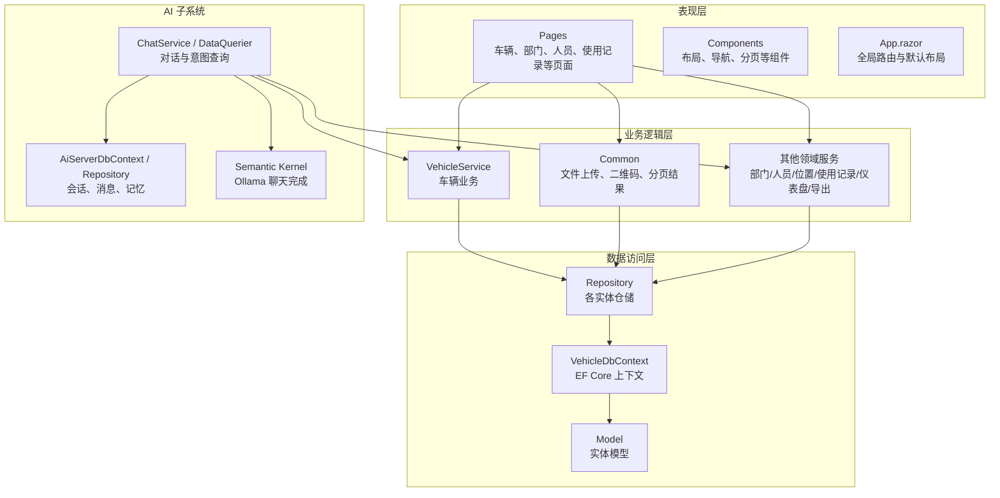
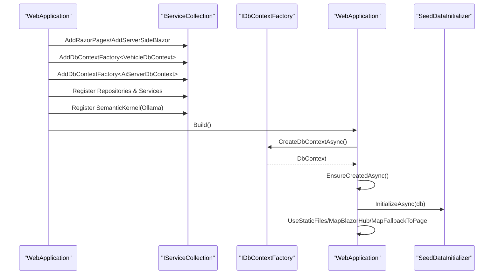
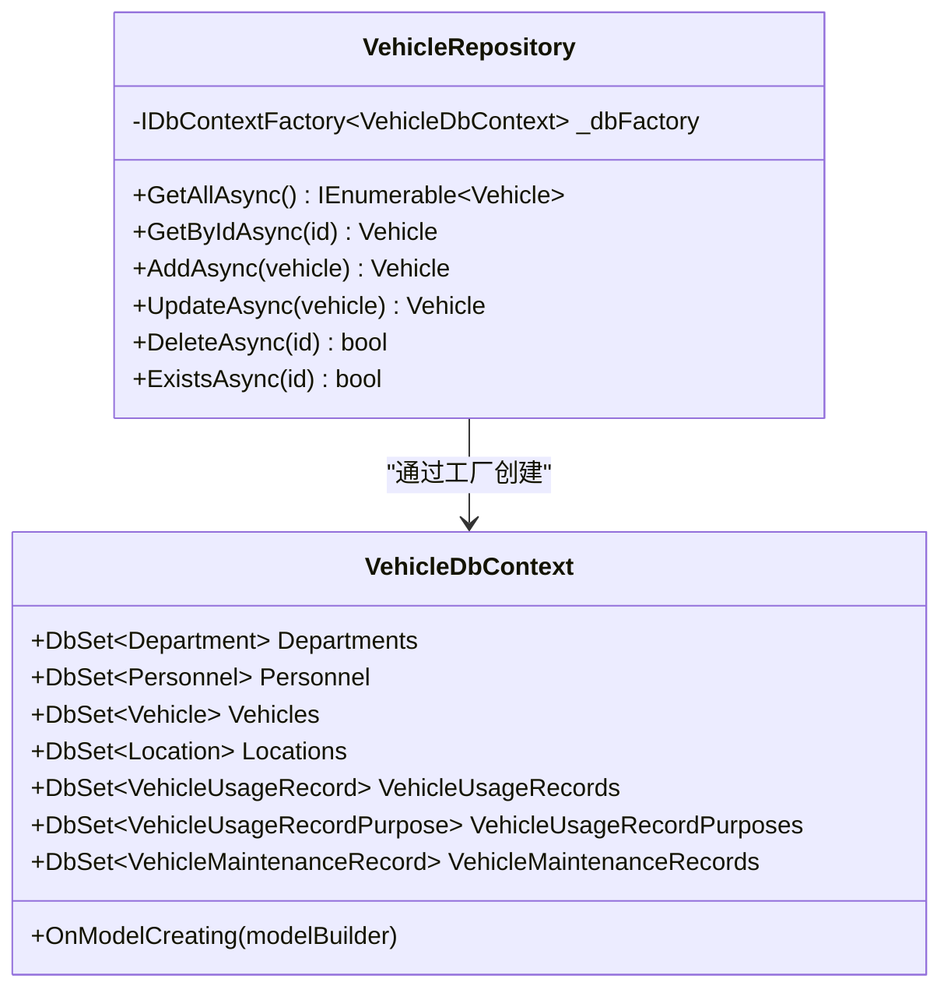
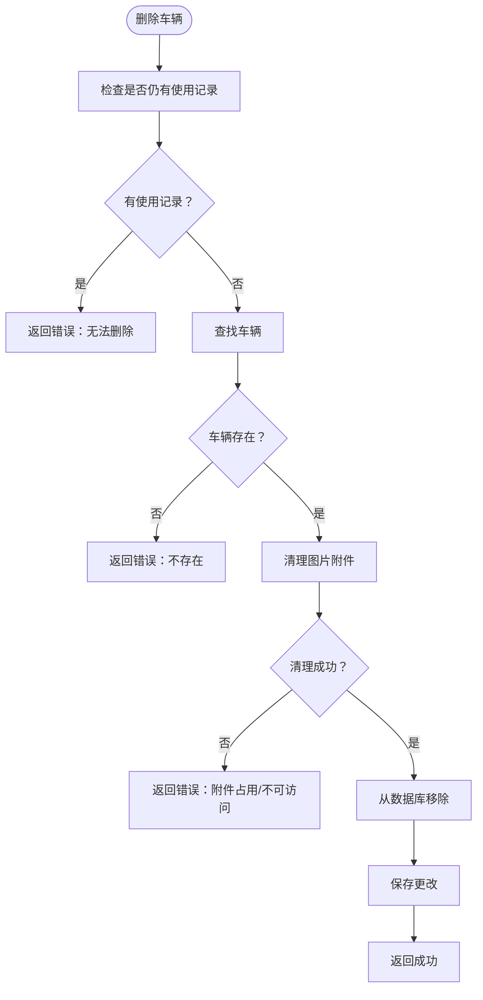
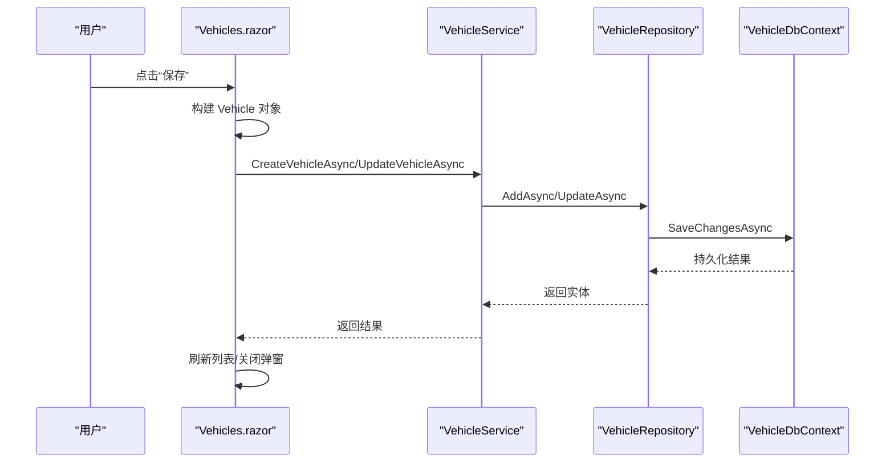
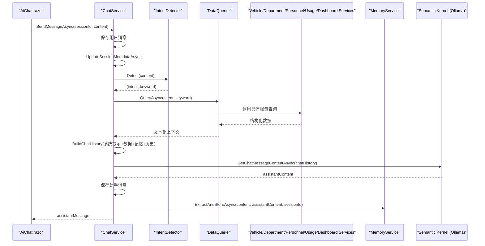
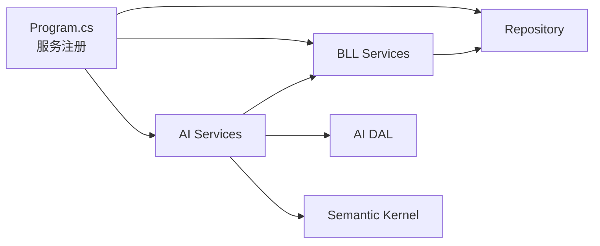
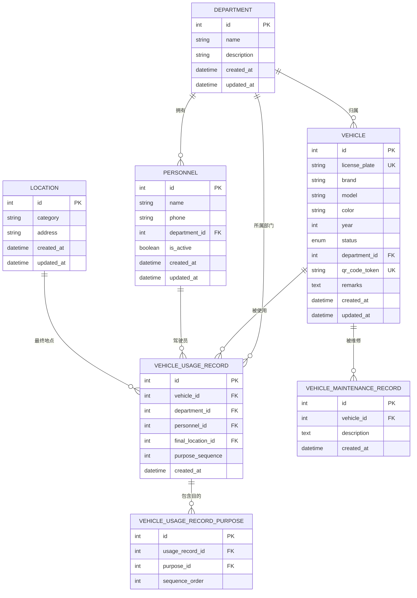

# 分层架构设计

<cite>
**本文引用的文件**   
- [Program.cs](file://Program.cs)
- [VehicleDbContext.cs](file://DAL/VehicleDbContext.cs)
- [VehicleRepository.cs](file://DAL/Repository/VehicleRepository.cs)
- [VehicleService.cs](file://BLL/Vehicle/VehicleService.cs)
- [FileUploadService.cs](file://BLL/Common/FileUploadService.cs)
- [ChatService.cs](file://aiServer/BLL/ChatService.cs)
- [DataQuerier.cs](file://aiServer/BLL/DataQuerier.cs)
- [App.razor](file://App.razor)
- [Vehicles.razor](file://Pages/Vehicles.razor)
- [AiChat.razor](file://aiServer/Pages/AiChat.razor)
</cite>

## 目录
1. [引言](#引言)
2. [项目结构](#项目结构)
3. [核心组件](#核心组件)
4. [架构总览](#架构总览)
5. [详细组件分析](#详细组件分析)
6. [依赖关系分析](#依赖关系分析)
7. [性能与并发特性](#性能与并发特性)
8. [故障排查指南](#故障排查指南)
9. [结论](#结论)
10. [附录：关键数据模型与关系](#附录关键数据模型与关系)

## 引言
本文件为 vehicleManagement 系统的分层架构设计文档，重点覆盖以下方面：
- DAL（数据访问层）：实体模型、仓储模式、DbContextFactory 的使用原因与并发解决方案。
- BLL（业务逻辑层）：业务规则封装、事务管理、服务间协作、异常处理策略。
- 表现层（Pages + Components）：Blazor 组件化设计、页面路由、状态管理、用户交互处理。
- AI 子系统：语义内核集成、意图识别流程、记忆管理机制。
- 层间通信：依赖注入配置、服务注册策略、接口抽象设计。
- 横切关注点：日志记录、错误处理、配置管理。

## 项目结构
系统采用典型的三层架构（DAL / BLL / Pages），并在同一解决方案中内嵌独立的 AI 子系统（aiServer）。整体组织方式如下：
- DAL：定义 EF Core 上下文、实体模型与仓储实现。
- BLL：封装业务规则、跨仓储协作、通用能力（如文件上传、分页结果）。
- Pages：基于 Blazor Server 的页面与组件，负责 UI 渲染与用户交互。
- aiServer：独立子模块，提供对话、意图识别、记忆管理与数据库查询桥接。

**图表来源**
- [Program.cs:41-102](file://Program.cs#L41-L102)
- [App.razor:1-12](file://App.razor#L1-L12)
- [VehicleDbContext.cs:6-19](file://DAL/VehicleDbContext.cs#L6-L19)
- [VehicleRepository.cs:10-17](file://DAL/Repository/VehicleRepository.cs#L10-L17)
- [VehicleService.cs:18-38](file://BLL/Vehicle/VehicleService.cs#L18-L38)
- [ChatService.cs:18-42](file://aiServer/BLL/ChatService.cs#L18-L42)
- [DataQuerier.cs:21-43](file://aiServer/BLL/DataQuerier.cs#L21-L43)

**章节来源**
- [Program.cs:41-102](file://Program.cs#L41-L102)
- [App.razor:1-12](file://App.razor#L1-L12)

## 核心组件
- VehicleDbContext：集中声明 DbSet、索引与关联关系，作为 DAL 的数据入口。
- Repository 层：以仓储模式封装增删改查，统一通过 IDbContextFactory 创建 DbContext，避免生命周期问题。
- VehicleService：聚合多个仓储调用，实现分页、搜索、排序、删除校验、二维码生成等业务规则。
- FileUploadService：统一的文件上传与删除工具，支持图片与视频，按部门/车牌/人员/日期组织存储路径。
- ChatService：AI 对话编排器，协调会话、消息、记忆、意图识别、数据查询与 LLM 调用。
- DataQuerier：将自然语言意图映射到具体 BLL 服务查询，并格式化结果为 LLM 可读文本。
- Vehicles.razor / AiChat.razor：典型页面示例，展示 Blazor 状态管理、事件处理与服务调用。

**章节来源**
- [VehicleDbContext.cs:6-108](file://DAL/VehicleDbContext.cs#L6-L108)
- [VehicleRepository.cs:10-63](file://DAL/Repository/VehicleRepository.cs#L10-L63)
- [VehicleService.cs:18-238](file://BLL/Vehicle/VehicleService.cs#L18-L238)
- [FileUploadService.cs:12-110](file://BLL/Common/FileUploadService.cs#L12-L110)
- [ChatService.cs:18-199](file://aiServer/BLL/ChatService.cs#L18-L199)
- [DataQuerier.cs:21-331](file://aiServer/BLL/DataQuerier.cs#L21-L331)
- [Vehicles.razor:1-410](file://Pages/Vehicles.razor#L1-L410)
- [AiChat.razor:1-555](file://aiServer/Pages/AiChat.razor#L1-L555)

## 架构总览
系统启动时通过 Program.cs 完成以下关键工作：
- 初始化 Serilog 日志。
- 加载外部 AI 配置文件（aisettings.json）。
- 注册 Razor Pages、Blazor Server、HttpContextAccessor。
- 注册两个 SQLite 数据库上下文工厂：VehicleDbContext 与 AiServerDbContext。
- 注册仓储、BLL 服务、AI 服务与通用服务。
- 注册 Semantic Kernel（连接 Ollama）。
- 应用启动时确保数据库表存在，开发环境初始化种子数据。
- 配置静态文件、健康检查、Blazor Hub、回退路由。

**图表来源**
- [Program.cs:28-102](file://Program.cs#L28-L102)
- [Program.cs:104-148](file://Program.cs#L104-L148)

**章节来源**
- [Program.cs:28-158](file://Program.cs#L28-L158)

## 详细组件分析

### DAL：实体模型与仓储模式
- 实体模型：在 DAL.Model 下定义 Department、Personnel、Vehicle、Location、VehicleUsageRecord、VehicleUsageRecordPurpose、VehicleMaintenanceRecord 等实体。
- 上下文配置：VehicleDbContext 中集中配置索引、外键与级联行为，保证数据一致性与查询性能。
- 仓储模式：每个实体对应一个 Repository，统一通过 IDbContextFactory 获取 DbContext，避免 Blazor Server 并发下的 DbContext 共享问题。

**图表来源**
- [VehicleDbContext.cs:6-108](file://DAL/VehicleDbContext.cs#L6-L108)
- [VehicleRepository.cs:10-63](file://DAL/Repository/VehicleRepository.cs#L10-L63)

**章节来源**
- [VehicleDbContext.cs:6-108](file://DAL/VehicleDbContext.cs#L6-L108)
- [VehicleRepository.cs:10-63](file://DAL/Repository/VehicleRepository.cs#L10-L63)

### BLL：业务规则与服务协作
- VehicleService 聚合 VehicleRepository 与 DepartmentRepository，并通过 IDbContextFactory 直接访问 DbContext 执行复杂查询（如分页、排序、条件过滤）。
- 业务规则示例：
  - 删除车辆前校验是否存在使用记录，防止脏数据。
  - 删除前清理附件，失败则阻止数据库删除。
  - 下载二维码前校验部门绑定与在职人员存在性。
  - 自动生成或确保二维码 Token。
- 通用服务：
  - FileUploadService：统一文件上传/删除，限制类型与大小，按业务维度组织目录。
  - QrCodeService：生成二维码 Token 与 URL。
  - PagedResult：分页结果封装。

**图表来源**
- [VehicleService.cs:171-202](file://BLL/Vehicle/VehicleService.cs#L171-L202)

**章节来源**
- [VehicleService.cs:40-238](file://BLL/Vehicle/VehicleService.cs#L40-L238)
- [FileUploadService.cs:29-110](file://BLL/Common/FileUploadService.cs#L29-L110)

### 表现层：Blazor 组件化设计与页面路由
- App.razor：定义全局 Router，默认布局 MainLayout，未匹配路由显示 NotFound。
- Vehicles.razor：典型 CRUD 页面，包含搜索、排序、分页、新增/编辑弹窗、删除确认、二维码下载、Excel 导出。
- 状态管理：页面内部维护表单状态、分页状态、UI 提示状态；通过 @inject 注入服务进行数据操作。
- 用户交互：按钮点击、键盘事件、JS 互操作（下载文件、滚动控制）。

**图表来源**
- [Vehicles.razor:284-331](file://Pages/Vehicles.razor#L284-L331)
- [VehicleService.cs:154-166](file://BLL/Vehicle/VehicleService.cs#L154-L166)
- [VehicleRepository.cs:31-46](file://DAL/Repository/VehicleRepository.cs#L31-L46)

**章节来源**
- [App.razor:1-12](file://App.razor#L1-L12)
- [Vehicles.razor:1-410](file://Pages/Vehicles.razor#L1-L410)

### AI 子系统：语义内核集成、意图识别与记忆管理
- ChatService：对话编排器，负责会话管理、消息持久化、意图识别、数据查询、LLM 调用与记忆提取。
- DataQuerier：根据意图分发查询至 BLL 服务，并将结果格式化为 LLM 可读文本。
- MemoryService：异步提取并存储记忆，用于增强后续对话上下文。
- Semantic Kernel：通过 Ollama 接入本地 LLM，提供 IChatCompletionService。

**图表来源**
- [ChatService.cs:94-139](file://aiServer/BLL/ChatService.cs#L94-L139)
- [ChatService.cs:161-199](file://aiServer/BLL/ChatService.cs#L161-L199)
- [DataQuerier.cs:48-67](file://aiServer/BLL/DataQuerier.cs#L48-L67)
- [AiChat.razor:376-419](file://aiServer/Pages/AiChat.razor#L376-L419)

**章节来源**
- [ChatService.cs:18-199](file://aiServer/BLL/ChatService.cs#L18-L199)
- [DataQuerier.cs:21-331](file://aiServer/BLL/DataQuerier.cs#L21-L331)
- [AiChat.razor:1-555](file://aiServer/Pages/AiChat.razor#L1-L555)

## 依赖关系分析
- Program.cs 中集中注册所有服务，采用 Scoped 生命周期为主，Singleton 用于无状态服务（如 QrCodeService、Kernel）。
- DAL 通过 IDbContextFactory 解耦 DbContext 生命周期，避免 Blazor Server 并发冲突。
- BLL 依赖仓储与通用服务，不直接感知 EF Core 细节。
- AI 子系统通过 DataQuerier 复用 BLL 服务，保持领域边界清晰。

**图表来源**
- [Program.cs:52-102](file://Program.cs#L52-L102)
- [ChatService.cs:29-42](file://aiServer/BLL/ChatService.cs#L29-L42)
- [DataQuerier.cs:31-43](file://aiServer/BLL/DataQuerier.cs#L31-L43)

**章节来源**
- [Program.cs:52-102](file://Program.cs#L52-L102)

## 性能与并发特性
- DbContextFactory：每个请求/操作通过工厂创建独立 DbContext，避免 Blazor Server 多连接并发导致的线程安全问题。
- 分页与投影：BLL 层使用 IQueryable 延迟执行，减少数据传输量；分页参数在前端传递，后端计算总数与切片。
- 索引优化：VehicleDbContext 中对常用字段建立索引（如车牌号、二维码 Token、部门 ID、车辆 ID、创建时间等）。
- 文件上传限流：限制图片与视频大小，避免大文件阻塞 IO。
- 异步优先：所有 I/O 操作使用 async/await，提升吞吐。

[本节为通用指导，不直接分析具体文件]

## 故障排查指南
- 启动失败：Program.cs 捕获异常并记录致命日志，检查 aisettings.json 与连接字符串。
- 数据库未初始化：EnsureCreatedAsync 会在启动时创建表；开发环境会运行 SeedDataInitializer。
- 文件上传失败：FileUploadService 抛出 ArgumentException（空文件、不支持格式、超大小），前端需捕获并提示。
- 删除车辆失败：VehicleService 返回业务错误信息（存在使用记录、附件占用），页面展示 errorMessage。
- AI 服务不可用：ChatService.CallLlmAsync 捕获异常并返回友好提示，前端可重试或降级。

**章节来源**
- [Program.cs:149-158](file://Program.cs#L149-L158)
- [FileUploadService.cs:69-84](file://BLL/Common/FileUploadService.cs#L69-L84)
- [VehicleService.cs:171-202](file://BLL/Vehicle/VehicleService.cs#L171-L202)
- [ChatService.cs:188-199](file://aiServer/BLL/ChatService.cs#L188-L199)

## 结论
vehicleManagement 系统采用清晰的三层架构，结合仓储模式与 DbContextFactory 解决并发与生命周期问题；BLL 层封装业务规则与服务协作；表现层基于 Blazor 组件化与路由；AI 子系统通过语义内核与意图识别扩展系统智能能力。依赖注入集中配置，横切关注点（日志、错误、配置）贯穿各层，整体具备良好的可维护性与可扩展性。

[本节为总结性内容，不直接分析具体文件]

## 附录：关键数据模型与关系
- Department：部门主数据。
- Personnel：人员，关联部门。
- Vehicle：车辆，关联部门，唯一索引于车牌号与二维码 Token。
- Location：地点，按分类索引。
- VehicleUsageRecord：使用记录，关联车辆、部门、人员、最终地点。
- VehicleUsageRecordPurpose：使用目的明细，关联使用记录与目的。
- VehicleMaintenanceRecord：维修记录，关联车辆。

**图表来源**
- [VehicleDbContext.cs:21-104](file://DAL/VehicleDbContext.cs#L21-L104)