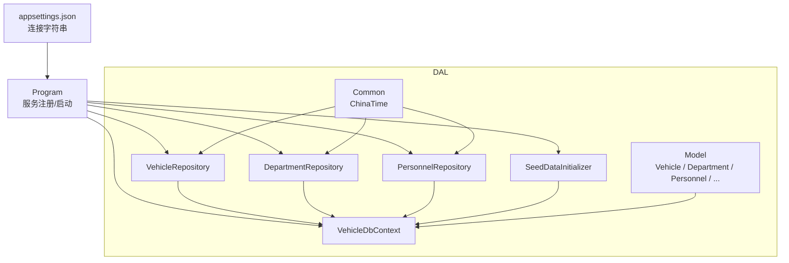
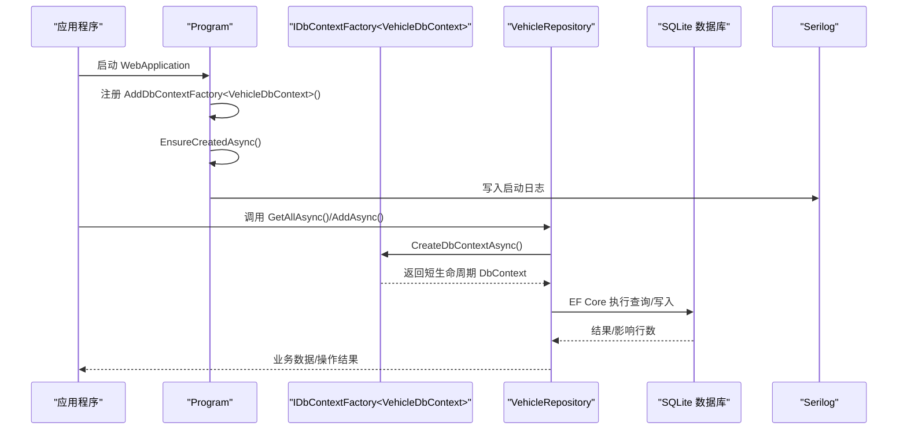
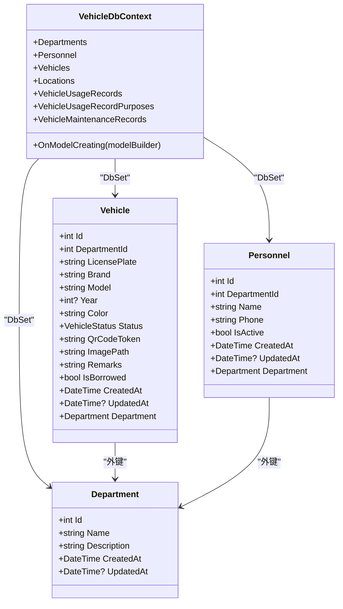
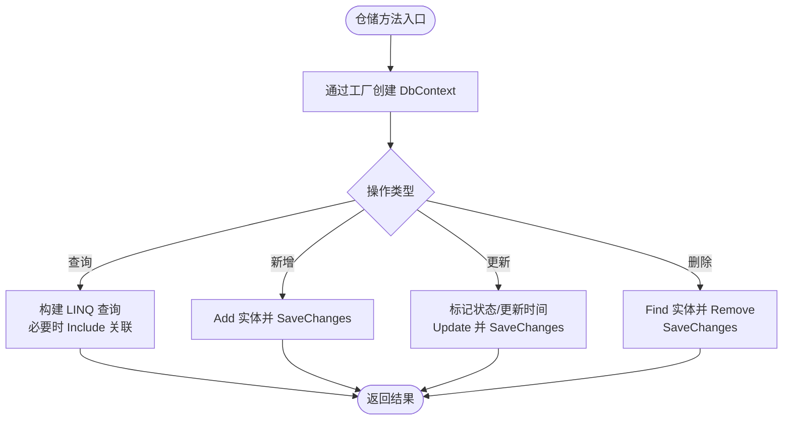
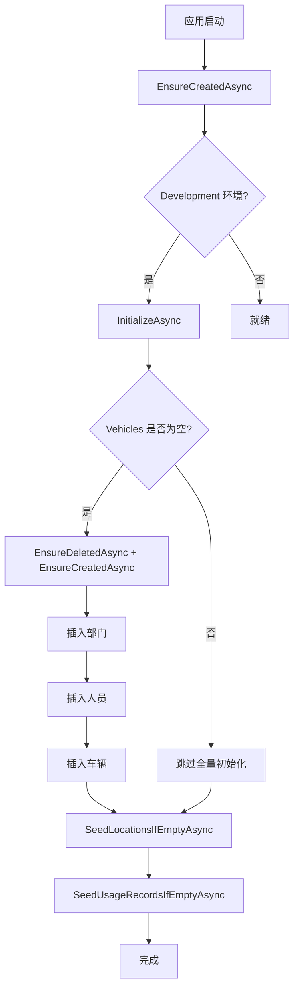
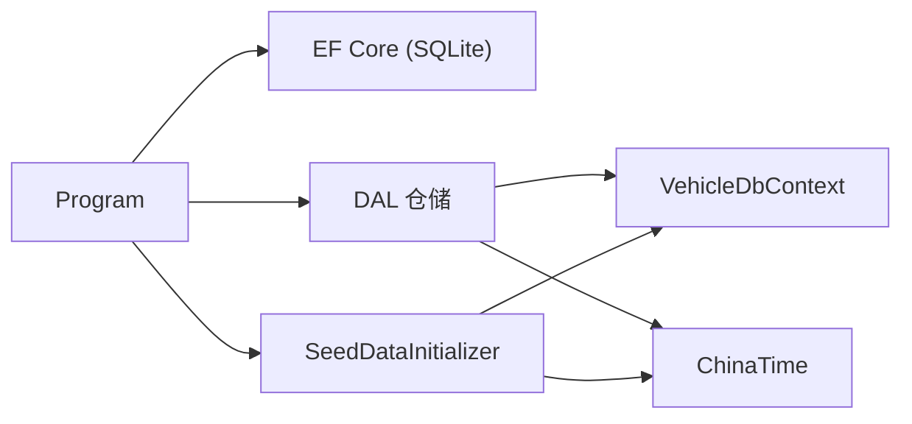

# 数据访问层（DAL）设计

<cite>
**本文引用的文件**   
- [VehicleDbContext.cs](file://DAL/VehicleDbContext.cs)
- [SeedDataInitializer.cs](file://DAL/SeedDataInitializer.cs)
- [VehicleRepository.cs](file://DAL/Repository/VehicleRepository.cs)
- [DepartmentRepository.cs](file://DAL/Repository/DepartmentRepository.cs)
- [PersonnelRepository.cs](file://DAL/Repository/PersonnelRepository.cs)
- [Vehicle.cs](file://DAL/Model/Vehicle.cs)
- [Department.cs](file://DAL/Model/Department.cs)
- [Personnel.cs](file://DAL/Model/Personnel.cs)
- [VehicleEnums.cs](file://DAL/Model/VehicleEnums.cs)
- [ChinaTime.cs](file://DAL/Common/ChinaTime.cs)
- [Program.cs](file://Program.cs)
- [appsettings.json](file://appsettings.json)
</cite>

## 目录
1. [引言](#引言)
2. [项目结构](#项目结构)
3. [核心组件](#核心组件)
4. [架构总览](#架构总览)
5. [详细组件分析](#详细组件分析)
6. [依赖关系分析](#依赖关系分析)
7. [性能与并发优化](#性能与并发优化)
8. [错误处理与可观测性](#错误处理与可观测性)
9. [扩展指南：新增实体与仓储](#扩展指南新增实体与仓储)
10. [故障排查](#故障排查)
11. [结论](#结论)

## 引言
本文件面向 vehicleManagement 系统的数据访问层，系统性说明 Entity Framework Core 的配置、DbContextFactory 的设计原因与并发解决方案、连接字符串管理、仓储模式实现、实体模型定义、数据库初始化机制、上下文生命周期管理、性能优化策略与错误处理模式。文档同时提供扩展新实体和仓储类的实践路径，帮助读者快速理解并安全扩展 DAL。

## 项目结构
DAL 采用“模型 + 上下文 + 仓储 + 种子数据”的分层组织方式：
- Model：领域实体与枚举
- VehicleDbContext：EF Core 上下文与模型配置
- Repository：按聚合根或业务域划分的仓储类
- SeedDataInitializer：开发环境种子数据初始化
- Common：通用工具（如北京时间）

图表来源
- [Program.cs:52-65](file://Program.cs#L52-L65)
- [VehicleDbContext.cs:6-19](file://DAL/VehicleDbContext.cs#L6-L19)
- [VehicleRepository.cs:10-17](file://DAL/Repository/VehicleRepository.cs#L10-L17)
- [DepartmentRepository.cs:13-20](file://DAL/Repository/DepartmentRepository.cs#L13-L20)
- [PersonnelRepository.cs:13-20](file://DAL/Repository/PersonnelRepository.cs#L13-L20)
- [SeedDataInitializer.cs:15-21](file://DAL/SeedDataInitializer.cs#L15-L21)
- [appsettings.json:3-6](file://appsettings.json#L3-L6)

章节来源
- [Program.cs:52-65](file://Program.cs#L52-L65)
- [appsettings.json:3-6](file://appsettings.json#L3-L6)

## 核心组件
- DbContext 工厂与上下文：通过 IDbContextFactory<VehicleDbContext> 在 Blazor Server 等并发场景下避免共享 DbContext 的线程安全问题；VehicleDbContext 负责实体集与关系映射。
- 仓储层：VehicleRepository、DepartmentRepository、PersonnelRepository 等封装 CRUD 与常用查询，统一使用工厂创建短生命周期 DbContext。
- 实体模型：Vehicle、Department、Personnel 等使用 DataAnnotations 进行验证与关系声明，并在 DbContext 中补充索引与删除行为。
- 种子数据：SeedDataInitializer 在 Development 环境下执行幂等初始化，必要时重建数据库并插入标准部门、人员、车辆、地点与使用记录。
- 启动与配置：Program 注册服务、注入连接字符串、确保数据库存在并触发种子数据。

章节来源
- [VehicleDbContext.cs:6-108](file://DAL/VehicleDbContext.cs#L6-L108)
- [VehicleRepository.cs:10-64](file://DAL/Repository/VehicleRepository.cs#L10-L64)
- [DepartmentRepository.cs:13-67](file://DAL/Repository/DepartmentRepository.cs#L13-L67)
- [PersonnelRepository.cs:13-75](file://DAL/Repository/PersonnelRepository.cs#L13-L75)
- [SeedDataInitializer.cs:15-129](file://DAL/SeedDataInitializer.cs#L15-L129)
- [Program.cs:52-125](file://Program.cs#L52-L125)

## 架构总览
下图展示从应用启动到数据访问的关键流程：服务注册、DbContextFactory 注入、仓储调用、EF Core 执行 SQL、日志输出。

图表来源
- [Program.cs:52-58](file://Program.cs#L52-L58)
- [Program.cs:109-125](file://Program.cs#L109-L125)
- [VehicleRepository.cs:19-36](file://DAL/Repository/VehicleRepository.cs#L19-L36)

## 详细组件分析

### DbContext 与模型配置
- 实体集：Departments、Personnel、Vehicles、Locations、VehicleUsageRecords、VehicleUsageRecordPurposes、VehicleMaintenanceRecords。
- 关键映射与约束：
  - Vehicle.LicensePlate、QrCodeToken 唯一索引；DepartmentId 普通索引。
  - VehicleUsageRecord 对 Vehicle、Department、Personnel、FinalLocation 设置外键与 DeleteBehavior.Restrict，防止级联删除导致数据不一致。
  - VehicleMaintenanceRecord 对 Vehicle 设置外键与 Restrict。
  - VehicleUsageRecordPurpose 对 UsageRecordId 建立复合索引，并与 UsageRecord 设置 Cascade 删除。
- 索引与关系：为高频查询字段添加索引，提升检索性能；对外键删除行为进行显式控制，保证数据完整性。

图表来源
- [VehicleDbContext.cs:13-19](file://DAL/VehicleDbContext.cs#L13-L19)
- [VehicleDbContext.cs:21-104](file://DAL/VehicleDbContext.cs#L21-L104)
- [Vehicle.cs:8-48](file://DAL/Model/Vehicle.cs#L8-L48)
- [Department.cs:7-21](file://DAL/Model/Department.cs#L7-L21)
- [Personnel.cs:7-30](file://DAL/Model/Personnel.cs#L7-L30)

章节来源
- [VehicleDbContext.cs:21-104](file://DAL/VehicleDbContext.cs#L21-L104)
- [Vehicle.cs:8-48](file://DAL/Model/Vehicle.cs#L8-L48)
- [Department.cs:7-21](file://DAL/Model/Department.cs#L7-L21)
- [Personnel.cs:7-30](file://DAL/Model/Personnel.cs#L7-L30)

### 仓储模式与 CRUD 封装
- 设计要点：
  - 所有仓储通过构造函数注入 IDbContextFactory<T>，每个方法内部创建短生命周期 DbContext，避免跨请求共享导致的并发问题。
  - 使用 await using 确保 DbContext 及时释放。
  - 更新操作统一设置 UpdatedAt 时间戳，便于审计。
  - 删除前进行空值检查，返回布尔值表示是否成功删除。
  - 查询方法按需 Include 关联实体，减少 N+1 查询风险。
- 示例：VehicleRepository 提供 GetAllAsync、GetByIdAsync、AddAsync、UpdateAsync、DeleteAsync、ExistsAsync。

图表来源
- [VehicleRepository.cs:19-63](file://DAL/Repository/VehicleRepository.cs#L19-L63)
- [DepartmentRepository.cs:22-66](file://DAL/Repository/DepartmentRepository.cs#L22-L66)
- [PersonnelRepository.cs:22-74](file://DAL/Repository/PersonnelRepository.cs#L22-L74)

章节来源
- [VehicleRepository.cs:10-64](file://DAL/Repository/VehicleRepository.cs#L10-L64)
- [DepartmentRepository.cs:13-67](file://DAL/Repository/DepartmentRepository.cs#L13-L67)
- [PersonnelRepository.cs:13-75](file://DAL/Repository/PersonnelRepository.cs#L13-L75)

### 实体模型与验证规则
- Vehicle：
  - 必填字段：DepartmentId、LicensePlate。
  - 长度限制：Brand、Model、Color、QrCodeToken、ImagePath、Remarks。
  - 默认状态：Status = Active。
  - 时间戳：CreatedAt 默认当前北京时间，UpdatedAt 可选。
  - 关系：Department 导航属性。
- Department：
  - 必填字段：Name。
  - 长度限制：Name。
  - 时间戳：CreatedAt、UpdatedAt。
- Personnel：
  - 必填字段：DepartmentId、Name。
  - 长度限制：Name、Phone。
  - 默认：IsActive = true。
  - 时间戳：CreatedAt、UpdatedAt。
  - 关系：Department 导航属性。
- 枚举：
  - VehicleStatus：Active、Maintenance、Retired。
  - LocationCategory：Location、Purpose。

章节来源
- [Vehicle.cs:8-48](file://DAL/Model/Vehicle.cs#L8-L48)
- [Department.cs:7-21](file://DAL/Model/Department.cs#L7-L21)
- [Personnel.cs:7-30](file://DAL/Model/Personnel.cs#L7-L30)
- [VehicleEnums.cs:3-14](file://DAL/Model/VehicleEnums.cs#L3-L14)

### 数据库初始化与种子数据
- 启动阶段：
  - Program 在应用启动时调用 EnsureCreatedAsync 确保表结构存在。
  - Development 环境下调用 SeedDataInitializer.InitializeAsync 进行种子数据初始化。
- 种子逻辑：
  - 幂等检查：若 Vehicles 已有数据则跳过全量初始化，仅增量补充地点与使用记录。
  - 全量初始化：EnsureDeletedAsync + EnsureCreatedAsync 重建数据库，依次插入部门、人员、车辆、地点、使用记录。
  - 增量补充：当 Locations 或 VehicleUsageRecords 为空时插入标准数据。
- 使用场景：
  - EnsureCreatedAsync：用于首次部署或本地开发环境快速建库。
  - SeedDataInitializer：用于开发/演示环境的标准化数据准备。

图表来源
- [Program.cs:109-125](file://Program.cs#L109-L125)
- [SeedDataInitializer.cs:20-87](file://DAL/SeedDataInitializer.cs#L20-L87)
- [SeedDataInitializer.cs:92-129](file://DAL/SeedDataInitializer.cs#L92-L129)

章节来源
- [Program.cs:109-125](file://Program.cs#L109-L125)
- [SeedDataInitializer.cs:20-129](file://DAL/SeedDataInitializer.cs#L20-L129)

### 连接字符串管理与 DbContextFactory
- 连接字符串：
  - DefaultConnection：vehicleManagement.db
  - AiServerConnection：aiServer.db
- 服务注册：
  - AddDbContextFactory<VehicleDbContext>(options => options.UseSqlite(connectionString))
  - AddDbContextFactory<AiServerDbContext>(...)
- 设计原因：
  - Blazor Server 多用户并发场景下，共享 DbContext 会导致线程安全问题；工厂模式为每次请求创建独立 DbContext，避免并发冲突。
  - 仓储层通过工厂获取短生命周期上下文，确保事务边界清晰、资源及时释放。

章节来源
- [appsettings.json:3-6](file://appsettings.json#L3-L6)
- [Program.cs:52-58](file://Program.cs#L52-L58)

## 依赖关系分析
- Program 依赖：
  - Serilog 日志
  - EF Core SQLite
  - DAL 仓储与服务
  - AI 服务相关服务
- DAL 内部依赖：
  - 仓储依赖 VehicleDbContext 与 ChinaTime
  - SeedDataInitializer 依赖 VehicleDbContext 与 ChinaTime
  - 实体依赖 DataAnnotations 与枚举

图表来源
- [Program.cs:28-37](file://Program.cs#L28-L37)
- [Program.cs:52-65](file://Program.cs#L52-L65)
- [VehicleRepository.cs:10-17](file://DAL/Repository/VehicleRepository.cs#L10-L17)
- [SeedDataInitializer.cs:15-21](file://DAL/SeedDataInitializer.cs#L15-L21)

章节来源
- [Program.cs:28-37](file://Program.cs#L28-L37)
- [Program.cs:52-65](file://Program.cs#L52-L65)

## 性能与并发优化
- 并发安全：
  - 使用 IDbContextFactory 为每次操作创建独立 DbContext，避免 Blazor Server 并发写锁与状态污染。
- 查询优化：
  - 针对高频查询字段添加索引（如 LicensePlate、QrCodeToken、DepartmentId、CreatedAt）。
  - 按需 Include 关联实体，避免 N+1 查询。
- 事务与一致性：
  - 仓储方法内单 SaveChanges 保证原子性；复杂业务可在上层 Service 层组合多个仓储调用并包裹事务。
- 时间一致性：
  - 使用 ChinaTime.Now 统一北京时间，避免容器时区差异导致的时间偏差。

章节来源
- [VehicleDbContext.cs:36-42](file://DAL/VehicleDbContext.cs#L36-L42)
- [VehicleRepository.cs:19-63](file://DAL/Repository/VehicleRepository.cs#L19-L63)
- [PersonnelRepository.cs:22-31](file://DAL/Repository/PersonnelRepository.cs#L22-L31)
- [ChinaTime.cs:10-15](file://DAL/Common/ChinaTime.cs#L10-L15)

## 错误处理与可观测性
- 日志：
  - Serilog 全局配置，控制台与滚动文件输出，抑制框架与 EF Core SQL 日志噪音。
  - 种子数据初始化过程记录警告与信息日志，便于追踪初始化状态。
- 异常：
  - Program 启动阶段 try/catch 捕获异常并记录致命日志。
  - 仓储层删除前判空，返回布尔值供上层判断。
- 建议：
  - 在 Service 层统一捕获仓储抛出的异常，转换为业务异常或友好提示。
  - 对批量操作增加重试与回滚策略，保障数据一致性。

章节来源
- [Program.cs:28-37](file://Program.cs#L28-L37)
- [Program.cs:149-157](file://Program.cs#L149-L157)
- [SeedDataInitializer.cs:20-87](file://DAL/SeedDataInitializer.cs#L20-L87)
- [VehicleRepository.cs:48-57](file://DAL/Repository/VehicleRepository.cs#L48-L57)

## 扩展指南：新增实体与仓储
以下以新增“车辆保险（VehicleInsurance）”为例，说明如何扩展 DAL：

步骤概览
- 定义实体模型：包含主键、外键、验证注解与时间戳。
- 在 VehicleDbContext 中添加 DbSet 与关系配置（索引、外键、删除行为）。
- 创建仓储类：继承现有仓储风格，注入 IDbContextFactory<VehicleDbContext>，实现 CRUD 与常用查询。
- 在服务注册中注册仓储。
- 如需种子数据，扩展 SeedDataInitializer。

参考路径
- 实体定义参考：[Vehicle.cs:8-48](file://DAL/Model/Vehicle.cs#L8-L48)、[Department.cs:7-21](file://DAL/Model/Department.cs#L7-L21)、[Personnel.cs:7-30](file://DAL/Model/Personnel.cs#L7-L30)
- 上下文配置参考：[VehicleDbContext.cs:21-104](file://DAL/VehicleDbContext.cs#L21-L104)
- 仓储实现参考：[VehicleRepository.cs:10-64](file://DAL/Repository/VehicleRepository.cs#L10-L64)、[DepartmentRepository.cs:13-67](file://DAL/Repository/DepartmentRepository.cs#L13-L67)、[PersonnelRepository.cs:13-75](file://DAL/Repository/PersonnelRepository.cs#L13-L75)
- 服务注册参考：[Program.cs:60-65](file://Program.cs#L60-L65)
- 种子数据参考：[SeedDataInitializer.cs:20-129](file://DAL/SeedDataInitializer.cs#L20-L129)

具体实践要点
- 实体命名与属性：遵循现有命名规范，使用 Required、MaxLength 等注解进行校验。
- 关系映射：在 OnModelCreating 中配置 HasOne/WithMany、HasForeignKey、OnDelete 行为，并为高频查询字段添加索引。
- 仓储方法：保持异步、await using、统一时间戳更新、删除前判空。
- 服务注册：在 Program 中使用 AddScoped 注册仓储，确保生命周期与请求一致。
- 种子数据：仅在 Development 环境执行，保证幂等性与可重复运行。

## 故障排查
常见问题与建议
- 并发写锁或线程安全问题：
  - 现象：Blazor Server 并发请求时报错或数据损坏。
  - 排查：确认仓储是否通过 IDbContextFactory 创建 DbContext，避免共享实例。
  - 参考：[VehicleRepository.cs:19-36](file://DAL/Repository/VehicleRepository.cs#L19-L36)
- 数据库未创建或表缺失：
  - 现象：启动时报 EF Core 找不到表。
  - 排查：确认 Program 中 EnsureCreatedAsync 已执行；检查连接字符串是否正确。
  - 参考：[Program.cs:109-125](file://Program.cs#L109-L125)、[appsettings.json:3-6](file://appsettings.json#L3-L6)
- 时间显示异常：
  - 现象：数据库时间与本地时间不一致。
  - 排查：确认使用 ChinaTime.Now 而非 DateTime.Now。
  - 参考：[ChinaTime.cs:10-15](file://DAL/Common/ChinaTime.cs#L10-L15)
- 种子数据未生效：
  - 现象：开发环境无标准数据。
  - 排查：确认 IsDevelopment 条件与 SeedDataInitializer.InitializeAsync 调用。
  - 参考：[Program.cs:116-118](file://Program.cs#L116-L118)、[SeedDataInitializer.cs:20-87](file://DAL/SeedDataInitializer.cs#L20-L87)

章节来源
- [VehicleRepository.cs:19-36](file://DAL/Repository/VehicleRepository.cs#L19-L36)
- [Program.cs:109-125](file://Program.cs#L109-L125)
- [appsettings.json:3-6](file://appsettings.json#L3-L6)
- [ChinaTime.cs:10-15](file://DAL/Common/ChinaTime.cs#L10-L15)
- [SeedDataInitializer.cs:20-87](file://DAL/SeedDataInitializer.cs#L20-L87)

## 结论
vehicleManagement 的 DAL 通过 DbContextFactory 解决并发问题，结合清晰的仓储模式与实体映射，提供了稳定、可扩展的数据访问能力。索引与关系配置保障了查询性能与数据一致性；种子数据机制简化了开发与演示环境的数据准备。建议在 Service 层统一处理事务与异常，并结合日志与监控提升可观测性。按照本文扩展指南，可安全地新增实体与仓储，保持代码风格与架构一致性。