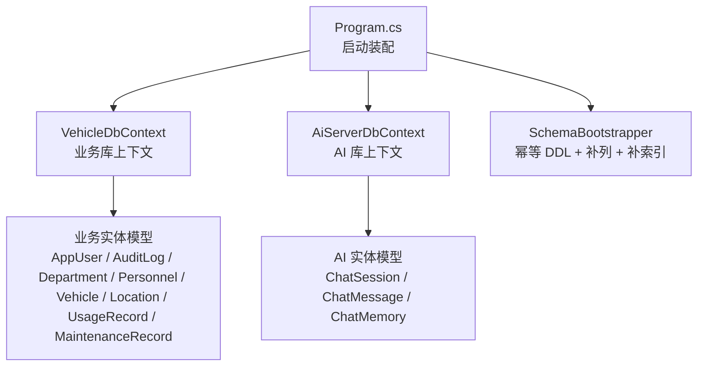
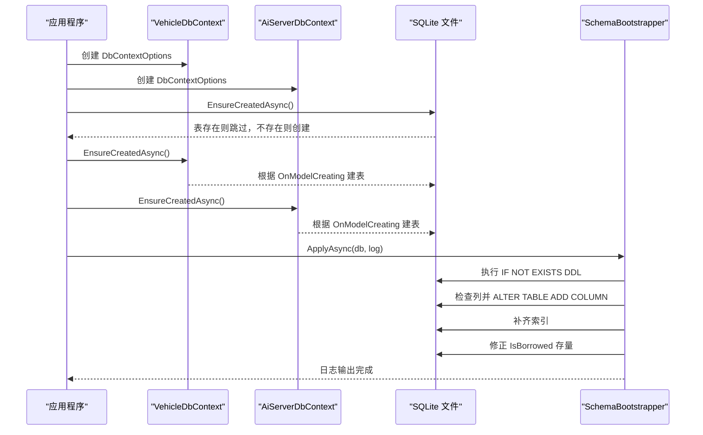
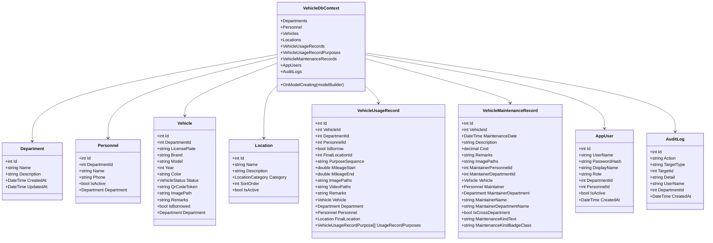
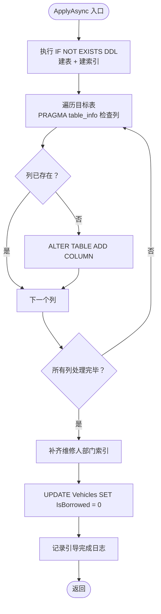
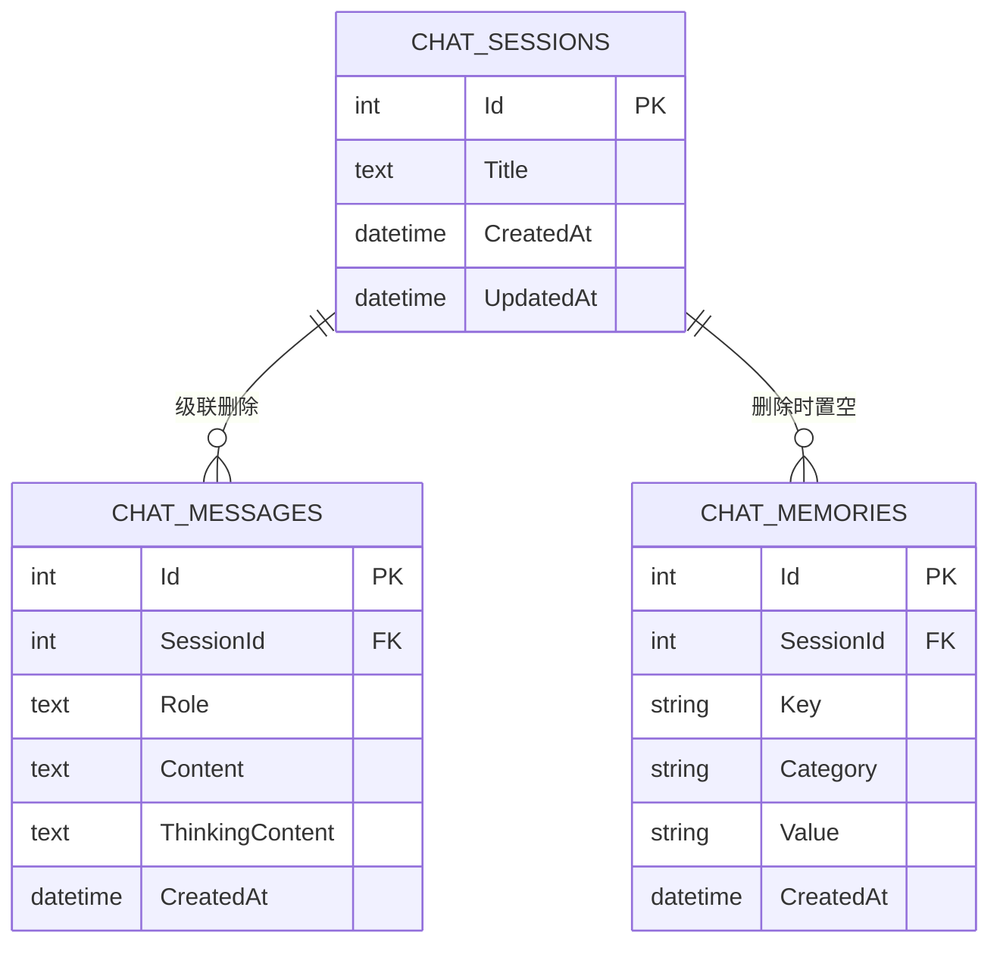
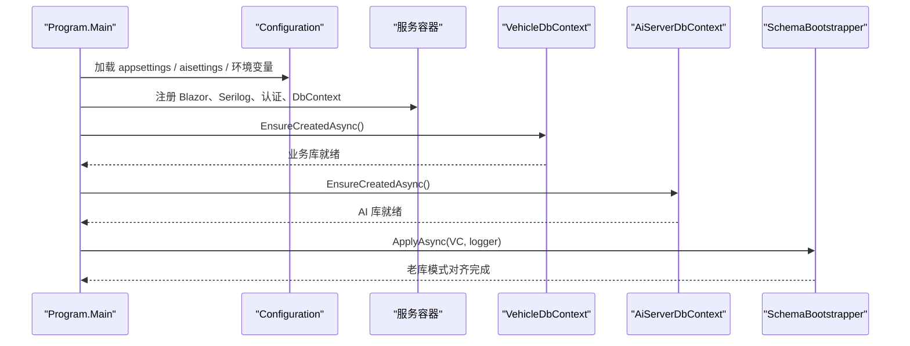
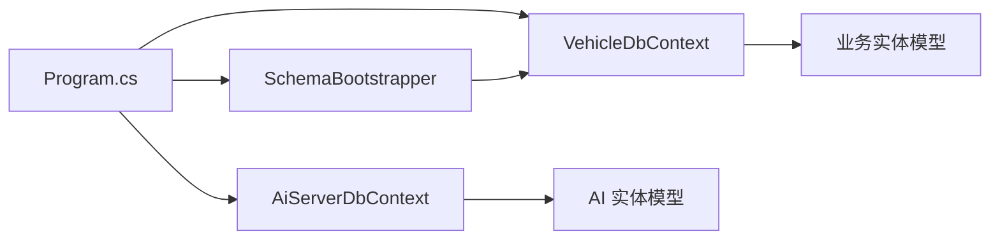

# 数据库模式管理

<cite>
**本文引用的文件**   
- [README.md](file://README.md)
- [Program.cs](file://Program.cs)
- [DAL/SchemaBootstrapper.cs](file://DAL/SchemaBootstrapper.cs)
- [DAL/VehicleDbContext.cs](file://DAL/VehicleDbContext.cs)
- [aiServer/DAL/AiServerDbContext.cs](file://aiServer/DAL/AiServerDbContext.cs)
- [DAL/Model/AppUser.cs](file://DAL/Model/AppUser.cs)
- [DAL/Model/AuditLog.cs](file://DAL/Model/AuditLog.cs)
- [DAL/Model/Department.cs](file://DAL/Model/Department.cs)
- [DAL/Model/Personnel.cs](file://DAL/Model/Personnel.cs)
- [DAL/Model/Vehicle.cs](file://DAL/Model/Vehicle.cs)
- [DAL/Model/Location.cs](file://DAL/Model/Location.cs)
- [DAL/Model/VehicleUsageRecord.cs](file://DAL/Model/VehicleUsageRecord.cs)
- [DAL/Model/VehicleMaintenanceRecord.cs](file://DAL/Model/VehicleMaintenanceRecord.cs)
</cite>

## 目录
1. [引言](#引言)
2. [项目结构](#项目结构)
3. [核心组件](#核心组件)
4. [架构总览](#架构总览)
5. [详细组件分析](#详细组件分析)
6. [依赖关系分析](#依赖关系分析)
7. [性能与索引特性](#性能与索引特性)
8. [故障排查指南](#故障排查指南)
9. [结论](#结论)

## 引言
本仓库是一个基于 .NET 10、Blazor Server、EF Core 与 SQLite 的车辆管理系统，并内嵌一个独立的 AI 子系统。数据库模式管理由两部分组成：
- **业务库**：通过 EF Core 模型定义主表结构，并通过 `SchemaBootstrapper` 对老库进行幂等的建表、补列、补索引和存量数据口径纠正。
- **AI 库**：独立 `AiServerDbContext`，用于会话、消息与记忆，时间字段统一使用中国时区默认值。

启动流程中，两个 DbContext 都会执行 `EnsureCreatedAsync()`；随后业务库再调用 `SchemaBootstrapper.ApplyAsync`，保证新库和老库都能演进到一致模式。

## 项目结构
与数据库模式直接相关的代码集中在以下位置：
- `DAL/`：业务实体、`VehicleDbContext`、`SchemaBootstrapper`、种子初始化。
- `aiServer/DAL/`：AI 子系统的 `AiServerDbContext` 及对应实体。
- `Program.cs`：配置两个数据库连接、注册服务、执行建库与引导逻辑。
- `README.md`：说明双库隔离、启动行为与部署注意事项。

**图表来源**
- [Program.cs:110-125](file://Program.cs#L110-L125)
- [DAL/VehicleDbContext.cs:6-24](file://DAL/VehicleDbContext.cs#L6-L24)
- [aiServer/DAL/AiServerDbContext.cs:9-18](file://aiServer/DAL/AiServerDbContext.cs#L9-L18)
- [DAL/SchemaBootstrapper.cs:9-10](file://DAL/SchemaBootstrapper.cs#L9-L10)

**章节来源**
- [README.md:302-306](file://README.md#L302-L306)
- [DAL/VehicleDbContext.cs:6-24](file://DAL/VehicleDbContext.cs#L6-L24)
- [aiServer/DAL/AiServerDbContext.cs:9-18](file://aiServer/DAL/AiServerDbContext.cs#L9-L18)

## 核心组件
| 组件 | 职责 | 关键设计点 |
|---|---|---|
| `VehicleDbContext` | 业务库的 EF Core 上下文 | 声明所有 DbSet；在 `OnModelCreating` 中集中定义索引、外键与删除行为；账号与审计表同时支持模型映射与 DDL 引导。 |
| `SchemaBootstrapper` | 老库兼容与增量演进 | 用 `IF NOT EXISTS` 建表、按 PRAGMA 检测列是否存在后 `ALTER TABLE ADD COLUMN`、追加缺失索引、把历史遗留列 `IsBorrowed` 归零。 |
| `AiServerDbContext` | AI 子系统上下文 | 会话、消息、记忆三张表；时间列使用 `datetime('now','+8 hours')` 作为 SQLite 默认值。 |
| 业务实体模型 | 描述表结构与约束 | 使用 `[Key]`、`[Required]`、`[MaxLength]`、`[ForeignKey]`、`[NotMapped]` 表达主键、必填、长度、关联与计算属性。 |
| `Program.cs` | 应用入口 | 注册两个 DbContext、读取 Ollama 配置、执行 `EnsureCreatedAsync`、调用 `SchemaBootstrapper.ApplyAsync`。 |

**章节来源**
- [DAL/VehicleDbContext.cs:25-149](file://DAL/VehicleDbContext.cs#L25-L149)
- [DAL/SchemaBootstrapper.cs:12-109](file://DAL/SchemaBootstrapper.cs#L12-L109)
- [aiServer/DAL/AiServerDbContext.cs:23-58](file://aiServer/DAL/AiServerDbContext.cs#L23-L58)
- [DAL/Model/AppUser.cs:7-39](file://DAL/Model/AppUser.cs#L7-L39)
- [DAL/Model/AuditLog.cs:6-28](file://DAL/Model/AuditLog.cs#L6-L28)

## 架构总览
数据库模式的生命周期如下：

**图表来源**
- [Program.cs:110-125](file://Program.cs#L110-L125)
- [DAL/VehicleDbContext.cs:25-149](file://DAL/VehicleDbContext.cs#L25-L149)
- [aiServer/DAL/AiServerDbContext.cs:23-58](file://aiServer/DAL/AiServerDbContext.cs#L23-L58)
- [DAL/SchemaBootstrapper.cs:71-109](file://DAL/SchemaBootstrapper.cs#L71-L109)

## 详细组件分析

### 业务库上下文与实体模型
`VehicleDbContext` 是业务层数据访问的核心契约。它暴露 7 个业务 DbSet，以及账号与审计 DbSet；并在 `OnModelCreating` 中集中维护：
- 唯一索引：车牌、二维码令牌、用户名、人员绑定。
- 查询优化复合索引：部门+启用、状态+车牌、分类+启用+排序、使用记录多组过滤组合。
- 外键与删除行为：多数引用设为 `Restrict`，防止误删主数据；用途明细与使用记录之间为级联删除。
- 账号与审计：注释明确说明这两张表既可由模型映射，也可由 `SchemaBootstrapper` 的 DDL 建立。

**图表来源**
- [DAL/VehicleDbContext.cs:13-23](file://DAL/VehicleDbContext.cs#L13-L23)
- [DAL/Model/Department.cs:7-22](file://DAL/Model/Department.cs#L7-L22)
- [DAL/Model/Personnel.cs:8-32](file://DAL/Model/Personnel.cs#L8-L32)
- [DAL/Model/Vehicle.cs:8-53](file://DAL/Model/Vehicle.cs#L8-L53)
- [DAL/Model/Location.cs:7-27](file://DAL/Model/Location.cs#L7-L27)
- [DAL/Model/VehicleUsageRecord.cs:9-62](file://DAL/Model/VehicleUsageRecord.cs#L9-L62)
- [DAL/Model/VehicleMaintenanceRecord.cs:8-77](file://DAL/Model/VehicleMaintenanceRecord.cs#L8-L77)
- [DAL/Model/AppUser.cs:8-40](file://DAL/Model/AppUser.cs#L8-L40)
- [DAL/Model/AuditLog.cs:7-29](file://DAL/Model/AuditLog.cs#L7-L29)

**章节来源**
- [DAL/VehicleDbContext.cs:25-149](file://DAL/VehicleDbContext.cs#L25-L149)
- [DAL/Model/Vehicle.cs:41-45](file://DAL/Model/Vehicle.cs#L41-L45)
- [DAL/Model/VehicleUsageRecord.cs:23-24](file://DAL/Model/VehicleUsageRecord.cs#L23-L24)
- [DAL/Model/VehicleMaintenanceRecord.cs:34-76](file://DAL/Model/VehicleMaintenanceRecord.cs#L34-L76)

### 老库引导器 `SchemaBootstrapper`
`SchemaBootstrapper` 承担“向后兼容”的职责：
- 用一段大段 DDL 批量创建 `AppUsers`、`AuditLogs`、`VehicleMaintenanceRecords` 及常用业务索引。
- 通过 `PRAGMA table_info` 判断列是否存在，不存在则拼接 `ALTER TABLE ... ADD COLUMN`。
- 最后补齐维修记录维护人部门的索引，并把历史遗留列 `IsBorrowed` 存量归零。

**图表来源**
- [DAL/SchemaBootstrapper.cs:71-109](file://DAL/SchemaBootstrapper.cs#L71-L109)
- [DAL/SchemaBootstrapper.cs:112-148](file://DAL/SchemaBootstrapper.cs#L112-L148)

**章节来源**
- [DAL/SchemaBootstrapper.cs:12-109](file://DAL/SchemaBootstrapper.cs#L12-L109)
- [DAL/SchemaBootstrapper.cs:112-148](file://DAL/SchemaBootstrapper.cs#L112-L148)

### AI 库上下文与时间策略
AI 子系统使用独立数据库，避免对话、记忆与业务数据互相污染。其上下文特点：
- 只暴露 `ChatSessions`、`ChatMessages`、`ChatMemories`。
- 时间列默认值使用 `datetime('now','+8 hours')`，解决 SQLite 默认 UTC 的问题。
- 会话与消息级联删除；记忆在会话删除时置空，保留历史记忆但不再归属会话。

**图表来源**
- [aiServer/DAL/AiServerDbContext.cs:16-18](file://aiServer/DAL/AiServerDbContext.cs#L16-L18)
- [aiServer/DAL/AiServerDbContext.cs:23-58](file://aiServer/DAL/AiServerDbContext.cs#L23-L58)

**章节来源**
- [aiServer/DAL/AiServerDbContext.cs:20-58](file://aiServer/DAL/AiServerDbContext.cs#L20-L58)

### 启动与数据库初始化流程
`Program.cs` 负责：
- 加载 AI 配置（可选 JSON + 环境变量）。
- 注册 Serilog、Blazor、认证、DI。
- 注册两个 DbContext。
- 调用 `EnsureCreatedAsync` 确保两库存在。
- 调用 `SchemaBootstrapper.ApplyAsync` 做老库兼容。

**图表来源**
- [README.md:97-100](file://README.md#L97-L100)
- [README.md:173-183](file://README.md#L173-L183)
- [README.md:302-306](file://README.md#L302-L306)

**章节来源**
- [README.md:97-100](file://README.md#L97-L100)
- [README.md:173-183](file://README.md#L173-L183)
- [README.md:302-306](file://README.md#L302-L306)

## 依赖关系分析
数据库模式相关依赖可概括为三层：
- **配置层**：`Program.cs` 决定连接字符串、是否启用 AI 端点、是否加载 `aisettings.json`。
- **模型层**：`VehicleDbContext` 与 `AiServerDbContext` 分别描述业务库与 AI 库的结构。
- **演进层**：`SchemaBootstrapper` 在 EF 建表之后补充老库缺失结构。

**图表来源**
- [Program.cs:110-125](file://Program.cs#L110-L125)
- [DAL/VehicleDbContext.cs:6-24](file://DAL/VehicleDbContext.cs#L6-L24)
- [aiServer/DAL/AiServerDbContext.cs:9-18](file://aiServer/DAL/AiServerDbContext.cs#L9-L18)
- [DAL/SchemaBootstrapper.cs:71-109](file://DAL/SchemaBootstrapper.cs#L71-L109)

**章节来源**
- [DAL/VehicleDbContext.cs:25-149](file://DAL/VehicleDbContext.cs#L25-L149)
- [aiServer/DAL/AiServerDbContext.cs:23-58](file://aiServer/DAL/AiServerDbContext.cs#L23-L58)
- [DAL/SchemaBootstrapper.cs:71-109](file://DAL/SchemaBootstrapper.cs#L71-L109)

## 性能与索引特性
当前模式通过 EF 模型索引与 `SchemaBootstrapper` 索引共同覆盖主要查询路径：

| 表 | 关键索引或约束 | 对应查询场景 |
|---|---|---|
| `AppUsers` | 用户名唯一、人员绑定部分唯一、部门索引 | 登录、一人一账号、按部门权限 |
| `AuditLogs` | 创建时间降序、动作索引 | 审计列表与筛选 |
| `Personnel` | 部门索引、部门+启用复合索引 | 人员列表固定按部门+启用过滤 |
| `Vehicle` | 车牌唯一、二维码令牌唯一、部门索引、状态+车牌复合索引 | 车辆台账、扫码、按状态车牌排序 |
| `Location` | 分类索引、分类+启用+排序复合索引 | 地点下拉按分类与排序展示 |
| `VehicleUsageRecord` | 车辆、部门、人员、终点、部门+时间、车辆+时间复合索引 | 使用记录列表、分页、按对象删除校验 |
| `VehicleMaintenanceRecord` | 车辆、维修日期、维修人部门索引 | 维修记录列表、跨部门判定 |
| `VehicleUsageRecordPurpose` | 使用记录索引、使用记录+顺序复合索引 | 多段用途有序展示 |
| `ChatMessages` | 会话索引、创建时间索引 | 会话消息列表 |
| `ChatMemories` | key 索引、category 索引 | 记忆检索与面板展示 |

需要注意：
- `Vehicle.IsBorrowed` 是历史遗留列，业务逻辑应读 `VehicleUsageRecord.IsBorrow`，启动时会被 `SchemaBootstrapper` 归零。
- 审计日志是只追加表，不更新、不删除，适合事后审计但不适合高频写入后的随机访问。
- AI 库与业务库物理分离，清对话不会动业务数据，反向亦然。

**章节来源**
- [DAL/VehicleDbContext.cs:34-149](file://DAL/VehicleDbContext.cs#L34-L149)
- [DAL/SchemaBootstrapper.cs:60-69](file://DAL/SchemaBootstrapper.cs#L60-L69)
- [DAL/SchemaBootstrapper.cs:97-109](file://DAL/SchemaBootstrapper.cs#L97-L109)
- [DAL/Model/Vehicle.cs:41-45](file://DAL/Model/Vehicle.cs#L41-L45)
- [DAL/Model/VehicleUsageRecord.cs:23-24](file://DAL/Model/VehicleUsageRecord.cs#L23-L24)
- [aiServer/DAL/AiServerDbContext.cs:34-58](file://aiServer/DAL/AiServerDbContext.cs#L34-L58)

## 故障排查指南
| 现象 | 可能原因 | 排查建议 |
|---|---|---|
| 首次运行报表不存在 | 未执行 `EnsureCreatedAsync` 或连接字符串错误 | 检查 `Program.cs` 中两个 DbContext 的注册与 `data/vehicleManagement.db`、`data/aiServer.db` 路径 |
| 老库登录后报错 | 缺少 `AppUsers`、`AuditLogs` 或新增列 | 确认 `SchemaBootstrapper.ApplyAsync` 已执行；查看日志中“schema 引导完成” |
| 人员编辑后部门信息异常 | 使用了带导航属性的 Update 导致陈旧快照覆盖 | 重点检查人员仓储与服务中的读改写路径，避免整片标记导航属性 Modified |
| 二维码下载失败 | 二维码令牌生成或保存顺序错误 | 验证 `EnsureQrCodeTokenAsync` 先赋值 token 再保存，再返回 token |
| AI 问答无结果 | Ollama 不可达或模型 tag 不一致 | 先用 curl 测试 `/api/chat`，再核对 `aisettings.json` 与 `AiServer__OllamaModel` |
| 清理对话误删业务数据 | 混淆了两个数据库 | 确认操作的是 `AiServerDbContext`，不是 `VehicleDbContext` |

**章节来源**
- [README.md:107-118](file://README.md#L107-L118)
- [README.md:302-306](file://README.md#L302-L306)
- [DAL/SchemaBootstrapper.cs:104-109](file://DAL/SchemaBootstrapper.cs#L104-L109)

## 结论
该项目的数据库模式管理采用“EF Core 模型 + 幂等 DDL 引导”的双轨方案：
- 新环境靠 EF Core 模型自动建库建表；
- 老环境靠 `SchemaBootstrapper` 安全补表、补列、补索引并纠正历史口径；
- 业务库与 AI 库物理隔离，时间字段统一走中国时区；
- 索引设计围绕页面固定查询路径，兼顾主键唯一性与常见过滤条件。

未来若引入迁移工具，应优先保持 `SchemaBootstrapper` 的幂等语义，并继续区分业务库与 AI 库的演进边界，避免对话数据与业务数据耦合。