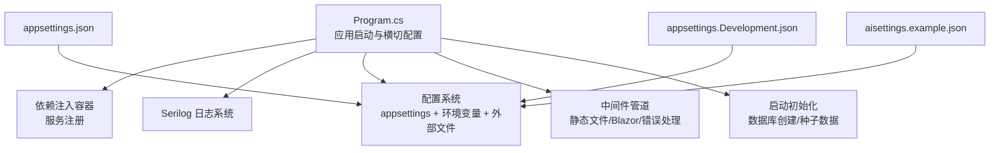
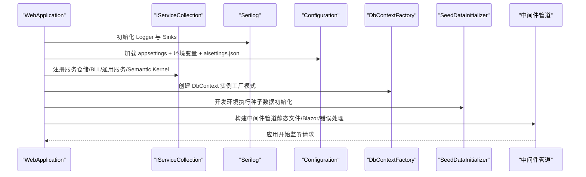
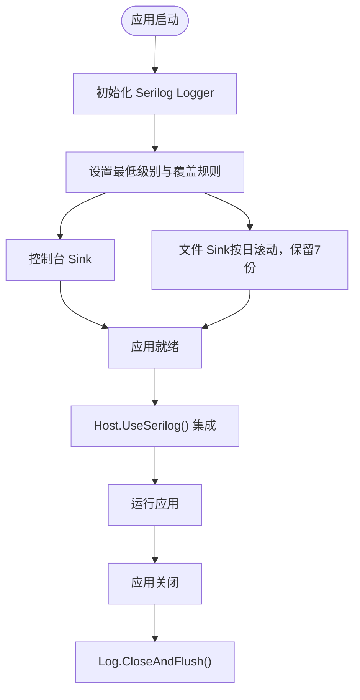
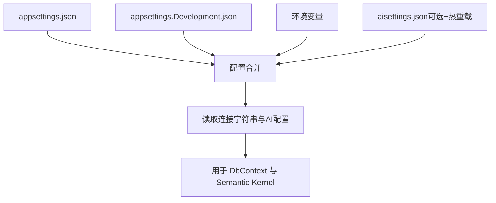
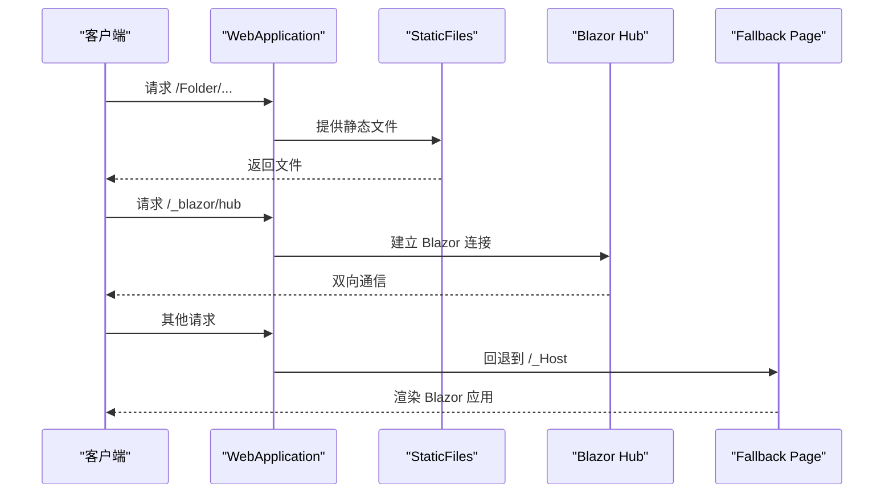
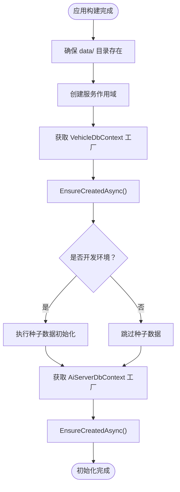
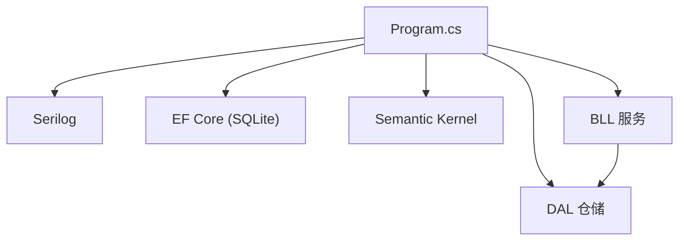

# 横切关注点设计

<cite>
**本文引用的文件**   
- [Program.cs](file://Program.cs)
- [appsettings.json](file://appsettings.json)
- [appsettings.Development.json](file://appsettings.Development.json)
- [aisettings.example.json](file://aisettings.example.json)
- [SeedDataInitializer.cs](file://DAL/SeedDataInitializer.cs)
- [_Host.cshtml](file://Pages/_Host.cshtml)
</cite>

## 目录
1. [引言](#引言)
2. [项目结构](#项目结构)
3. [核心组件](#核心组件)
4. [架构总览](#架构总览)
5. [详细组件分析](#详细组件分析)
6. [依赖关系分析](#依赖关系分析)
7. [性能考虑](#性能考虑)
8. [故障排查指南](#故障排查指南)
9. [结论](#结论)
10. [附录：扩展与自定义配置指南](#附录：扩展与自定义配置指南)

## 引言
本设计文档聚焦 vehicleManagement 系统的横切关注点，包括依赖注入容器配置、日志记录系统、配置管理、中间件管道、健康检查端点、启动时初始化逻辑与环境特定配置。目标是帮助开发者快速理解并扩展这些横切能力，确保系统在可观测性、可配置性与可维护性方面具备一致的设计模式。

## 项目结构
本项目采用分层架构（BLL/DAL/Pages）与 Blazor Server 前端，横切关注点集中在应用启动阶段（Program.cs）与基础配置文件（appsettings*.json、aisettings.example.json）。关键横切点如下：
- 依赖注入与服务注册：在 Program.cs 中集中完成
- 日志：Serilog 全局 Logger 与 Host 集成
- 配置：appsettings.json + 环境覆盖 + 外部 aisettings.json
- 中间件：静态文件、Blazor Hub、错误处理、路由与回退
- 健康检查：简单 GET /health 端点
- 启动初始化：数据库创建与种子数据

图表来源
- [Program.cs:28-102](file://Program.cs#L28-L102)
- [Program.cs:104-148](file://Program.cs#L104-L148)
- [appsettings.json:1-8](file://appsettings.json#L1-L8)
- [appsettings.Development.json:1-4](file://appsettings.Development.json#L1-L4)
- [aisettings.example.json:1-7](file://aisettings.example.json#L1-L7)

章节来源
- [Program.cs:28-148](file://Program.cs#L28-L148)
- [appsettings.json:1-8](file://appsettings.json#L1-L8)
- [appsettings.Development.json:1-4](file://appsettings.Development.json#L1-L4)
- [aisettings.example.json:1-7](file://aisettings.example.json#L1-L7)

## 核心组件
本节概述横切关注点的核心组件及其职责：
- 依赖注入容器：负责服务生命周期管理与解析
- Serilog 日志：结构化输出、级别控制、文件滚动
- 配置系统：JSON 配置、环境变量覆盖、外部文件热重载
- 中间件管道：请求处理顺序、静态资源、错误处理
- 健康检查：简单的存活探针
- 启动初始化：数据库就绪与种子数据填充

章节来源
- [Program.cs:28-102](file://Program.cs#L28-L102)
- [Program.cs:104-148](file://Program.cs#L104-L148)

## 架构总览
下图展示横切关注点在应用启动与运行时的交互关系：

图表来源
- [Program.cs:28-102](file://Program.cs#L28-L102)
- [Program.cs:104-148](file://Program.cs#L104-L148)
- [SeedDataInitializer.cs:25-128](file://DAL/SeedDataInitializer.cs#L25-L128)

## 详细组件分析

### 依赖注入容器配置
- 服务注册策略
  - 仓储层（DAL.Repository）：按功能域注册为 Scoped，便于每个请求内共享上下文
  - 业务逻辑层（BLL）：按领域服务注册为 Scoped，避免跨请求状态污染
  - 通用服务：FileUploadService 为 Scoped；QrCodeService 为 Singleton（无状态工具类）
  - AI 相关服务：MemoryService、DataQuerier、ChatService 均为 Scoped
  - Semantic Kernel：KernelBuilder.Build() 结果作为 Singleton 注册，复用 LLM 客户端连接
- 生命周期管理
  - Scoped：适合 HTTP 请求级对象（仓储、服务），保证线程安全与内存效率
  - Singleton：适合无状态或昂贵初始化的对象（如 QrCodeService、Semantic Kernel）
- 配置绑定机制
  - 通过 builder.Configuration 读取连接字符串与 AI 配置项

```mermaid
classDiagram
class VehicleRepository
class DepartmentRepository
class PersonnelRepository
class LocationRepository
class UsageRecordRepository
class MaintenanceRecordRepository
class ChatSessionRepository
class ChatMessageRepository
class ChatMemoryRepository
class VehicleService
class DepartmentService
class PersonnelService
class LocationService
class UsageRecordService
class DashboardService
class ExecuteService
class MaintenanceRecordService
class VehicleExportService
class MemoryService
class DataQuerier
class ChatService
class FileUploadService
class QrCodeService
class Kernel
VehicleRepository <.. VehicleService : "依赖"
DepartmentRepository <.. DepartmentService : "依赖"
PersonnelRepository <.. PersonnelService : "依赖"
LocationRepository <.. LocationService : "依赖"
UsageRecordRepository <.. UsageRecordService : "依赖"
MaintenanceRecordRepository <.. MaintenanceRecordService : "依赖"
ChatSessionRepository <.. ChatService : "依赖"
ChatMessageRepository <.. ChatService : "依赖"
ChatMemoryRepository <.. MemoryService : "依赖"
Kernel <.. ChatService : "LLM 调用"
QrCodeService <.. VehicleExportService : "生成二维码"
```

  - 使用 IDbContextFactory<T> 避免 Blazor Server 并发冲突，按需创建 DbContext 实例

图表来源
- [Program.cs:52-102](file://Program.cs#L52-L102)

章节来源
- [Program.cs:52-102](file://Program.cs#L52-L102)

### 日志记录系统（Serilog）
- 配置要点
  - 默认最低级别：Information
  - 框架日志抑制：Microsoft 与 Microsoft.EntityFrameworkCore 降级至 Warning
  - 控制台输出：带时间戳、级别、消息与异常信息
  - 文件输出：logs/log-.log，按日滚动，保留最近 7 个文件
- 结构化日志
  - 种子数据初始化中使用结构化字段（如部门/人员/车辆计数）
- 生命周期
  - 应用启动前创建全局 Logger
  - 应用结束时关闭并刷新日志缓冲

图表来源
- [Program.cs:28-37](file://Program.cs#L28-L37)
- [Program.cs:43-43](file://Program.cs#L43-L43)
- [Program.cs:150-157](file://Program.cs#L150-L157)
- [SeedDataInitializer.cs:25-128](file://DAL/SeedDataInitializer.cs#L25-L128)

章节来源
- [Program.cs:28-37](file://Program.cs#L28-L37)
- [Program.cs:43-43](file://Program.cs#L43-L43)
- [Program.cs:150-157](file://Program.cs#L150-L157)
- [SeedDataInitializer.cs:25-128](file://DAL/SeedDataInitializer.cs#L25-L128)

### 配置管理
- appsettings.json
  - AllowedHosts：允许所有主机头
  - ConnectionStrings：DefaultConnection 与 AiServerConnection 分别指向 SQLite 数据库文件
- 环境特定配置
  - appsettings.Development.json：启用 DetailedErrors，便于开发调试
- 外部配置文件
  - aisettings.example.json：示例 AI 服务端点与模型名称
  - Program.cs 中通过 AddJsonFile("aisettings.json", optional: true, reloadOnChange: true) 加载，支持 Docker 挂载后热重载
- 环境变量覆盖
  - .NET Configuration 支持环境变量覆盖 JSON 配置键名（例如 AiServer__OllamaEndpoint）

图表来源
- [appsettings.json:1-8](file://appsettings.json#L1-L8)
- [appsettings.Development.json:1-4](file://appsettings.Development.json#L1-L4)
- [aisettings.example.json:1-7](file://aisettings.example.json#L1-L7)
- [Program.cs:45-46](file://Program.cs#L45-L46)
- [Program.cs:97-102](file://Program.cs#L97-L102)

章节来源
- [appsettings.json:1-8](file://appsettings.json#L1-L8)
- [appsettings.Development.json:1-4](file://appsettings.Development.json#L1-L4)
- [aisettings.example.json:1-7](file://aisettings.example.json#L1-L7)
- [Program.cs:45-46](file://Program.cs#L45-L46)
- [Program.cs:97-102](file://Program.cs#L97-L102)

### 中间件管道
- 错误处理
  - 开发环境：UseDeveloperExceptionPage
  - 生产环境：UseExceptionHandler("/Error")
- 静态文件服务
  - 默认 wwwroot 静态文件
  - Folder 目录映射到 /Folder 路径，用于上传附件访问
- Blazor 与路由
  - MapBlazorHub：Blazor Server 通信端点
  - MapFallbackToPage("/_Host")：回退到 Blazor 宿主页面
- 健康检查
  - GET /health：返回“健康”文本，可用于存活探针

图表来源
- [Program.cs:127-146](file://Program.cs#L127-L146)
- [_Host.cshtml:1-35](file://Pages/_Host.cshtml#L1-L35)

章节来源
- [Program.cs:127-146](file://Program.cs#L127-L146)
- [_Host.cshtml:1-35](file://Pages/_Host.cshtml#L1-L35)

### 健康检查端点
- 端点：GET /health
- 响应：纯文本“健康”
- 用途：容器编排与健康探针（如 Kubernetes liveness/readiness）

章节来源
- [Program.cs:145-145](file://Program.cs#L145-L145)

### 启动时初始化逻辑
- 目录准备
  - 确保 data/ 目录存在，供 SQLite 数据库文件存储
  - 确保 Folder/ 目录存在，用于上传附件
- 数据库初始化
  - 通过 IDbContextFactory<VehicleDbContext> 与 IDbContextFactory<AiServerDbContext> 创建 DbContext
  - Database.EnsureCreatedAsync() 确保表结构存在
- 种子数据
  - 开发环境：调用 SeedDataInitializer.InitializeAsync(db) 插入标准数据
  - 种子过程包含结构化日志输出，便于追踪初始化进度

图表来源
- [Program.cs:106-125](file://Program.cs#L106-L125)
- [SeedDataInitializer.cs:25-128](file://DAL/SeedDataInitializer.cs#L25-L128)

章节来源
- [Program.cs:106-125](file://Program.cs#L106-L125)
- [SeedDataInitializer.cs:25-128](file://DAL/SeedDataInitializer.cs#L25-L128)

## 依赖关系分析
- 组件耦合
  - Program.cs 集中承载横切关注点，耦合于 BLL、DAL、AI 服务与基础设施（Serilog、EF Core）
  - 仓储与服务之间通过依赖注入解耦，便于测试与替换实现
- 直接依赖
  - Serilog：日志输出与控制
  - EF Core：数据库访问（SQLite）
  - Semantic Kernel：AI 聊天与意图识别
- 潜在循环依赖
  - 当前注册以单向依赖为主（仓储→服务→UI），未见明显循环引用
- 外部依赖
  - Ollama（AI 后端）：通过配置项动态接入
  - SQLite：本地文件数据库

图表来源
- [Program.cs:28-102](file://Program.cs#L28-L102)

章节来源
- [Program.cs:28-102](file://Program.cs#L28-L102)

## 性能考虑
- 日志性能
  - 文件滚动按日切割，限制保留数量，避免磁盘增长过快
  - 控制台输出模板简洁，减少序列化开销
- 数据库访问
  - 使用 IDbContextFactory 避免 Blazor Server 并发问题，提升稳定性
- 静态文件
  - 将上传附件映射到独立目录，减少主站点静态资源竞争
- 配置加载
  - aisettings.json 支持热重载，避免重启应用即可调整 AI 配置

[本节为通用指导，不直接分析具体文件]

## 故障排查指南
- 启动失败
  - 检查 Program.cs 中的 try/catch 块与 Log.Fatal 输出，确认异常堆栈
  - 确认 data/ 目录权限与磁盘空间
- 日志缺失
  - 检查 logs/ 目录是否存在，确认文件滚动策略与保留数量
  - 检查 Serilog 的 MinimumLevel 与覆盖规则是否正确
- 配置未生效
  - 确认 appsettings.json 与 appsettings.Development.json 内容
  - 检查 aisettings.json 是否存在且格式正确
  - 验证环境变量命名是否符合 .NET Configuration 约定
- 静态文件无法访问
  - 确认 Folder/ 目录存在且有读取权限
  - 检查 URL 路径是否为 /Folder/...

章节来源
- [Program.cs:150-157](file://Program.cs#L150-L157)
- [Program.cs:106-140](file://Program.cs#L106-L140)
- [appsettings.json:1-8](file://appsettings.json#L1-L8)
- [appsettings.Development.json:1-4](file://appsettings.Development.json#L1-L4)
- [aisettings.example.json:1-7](file://aisettings.example.json#L1-L7)

## 结论
vehicleManagement 的横切关注点围绕 Program.cs 展开，形成清晰的启动流水线：日志初始化 → 配置加载 → 服务注册 → 中间件构建 → 数据库初始化 → 应用运行。该设计具备良好的可扩展性与可观测性，便于在生产环境中进行监控与维护。通过合理的生命周期管理与配置机制，系统能够在不同环境下稳定运行，并为后续扩展（如新增服务、日志 sink、配置源）提供明确的路径。

[本节为总结性内容，不直接分析具体文件]

## 附录：扩展与自定义配置指南
- 扩展依赖注入
  - 新增服务：在 Program.cs 中按领域注册为 Scoped 或 Singleton
  - 第三方库：通过 builder.Services.AddSingleton/Scoped/Transient 注册
- 扩展日志系统
  - 新增 Sink：在 Serilog 配置中添加 WriteTo.Xxx(...)
  - 结构化字段：在业务代码中使用 Log.Information("...", {Key=Value})
- 扩展配置管理
  - 新增配置节：在 appsettings.json 添加新节点，并在代码中通过 Configuration["Section:Key"] 读取
  - 环境变量覆盖：遵循 Section__Key 命名规范
  - 外部配置：继续使用 AddJsonFile(..., optional: true, reloadOnChange: true) 加载
- 扩展中间件管道
  - 自定义中间件：在 app.UseXXX(...) 处注册，注意执行顺序
  - 静态文件：如需新增目录映射，参考 Folder 目录的配置方式
- 健康检查
  - 可引入 HealthChecks.NET 等库，提供更丰富的健康探针

[本节为通用指导，不直接分析具体文件]