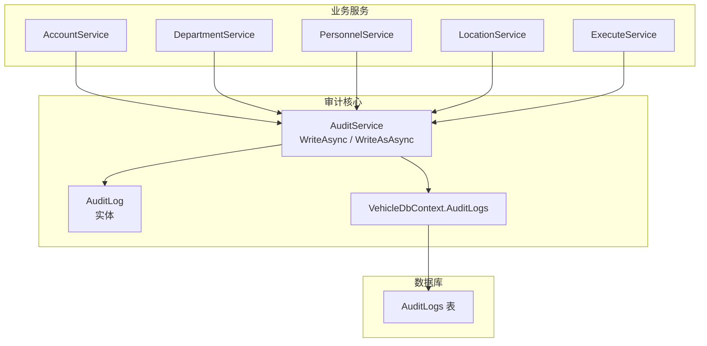
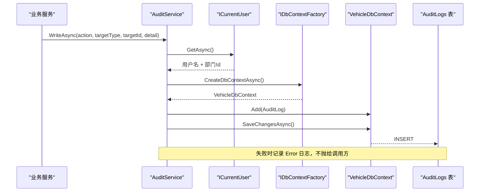
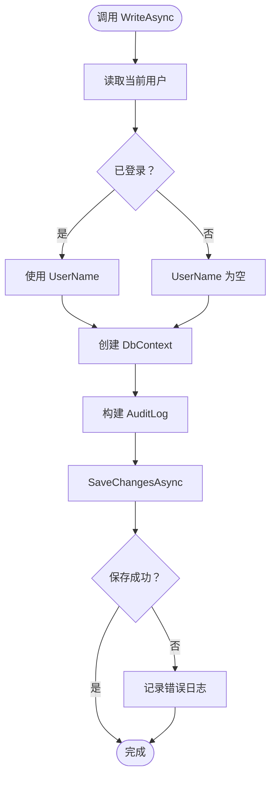
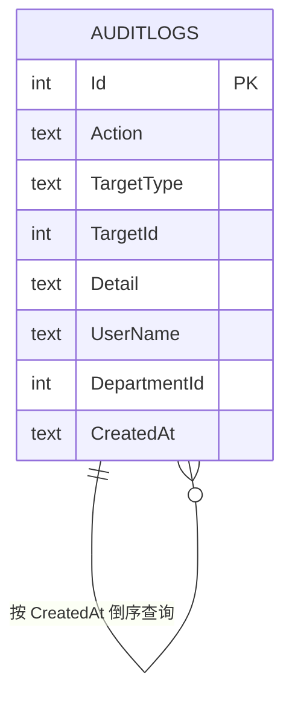
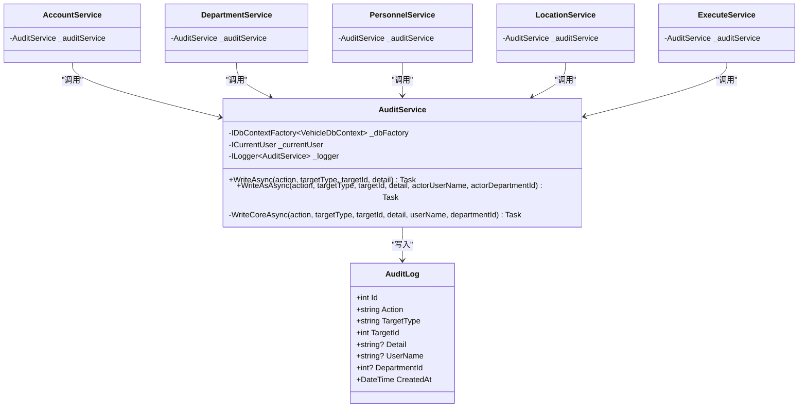

# 审计跟踪系统

<cite>
**本文引用的文件**   
- [BLL/Common/AuditService.cs](file://BLL/Common/AuditService.cs)
- [DAL/Model/AuditLog.cs](file://DAL/Model/AuditLog.cs)
- [DAL/SchemaBootstrapper.cs](file://DAL/SchemaBootstrapper.cs)
- [BLL/Auth/AccountService.cs](file://BLL/Auth/AccountService.cs)
- [BLL/Department/DepartmentService.cs](file://BLL/Department/DepartmentService.cs)
- [BLL/Execute/ExecuteService.cs](file://BLL/Execute/ExecuteService.cs)
- [BLL/Location/LocationService.cs](file://BLL/Location/LocationService.cs)
- [BLL/Personnel/PersonnelService.cs](file://BLL/Personnel/PersonnelService.cs)
</cite>

## 目录
1. [引言](#引言)
2. [项目结构中的审计位置](#项目结构中的审计位置)
3. [核心组件](#核心组件)
4. [架构总览](#架构总览)
5. [详细组件分析](#详细组件分析)
6. [依赖关系分析](#依赖关系分析)
7. [性能与可观测性](#性能与可观测性)
8. [故障排查指南](#故障排查指南)
9. [结论](#结论)

## 引言
本文件聚焦车辆管理系统中的「审计跟踪」能力：谁、在什么时间、对哪个目标对象执行了什么操作，以及这些操作如何被记录到只追加的审计日志表中。审计不是业务主流程，而是贯穿账号、部门、人员、地点、扫码执行等关键写操作的旁路记录机制；它通过统一服务写入，失败时不阻断业务，但会落错误日志，便于事后追溯。

## 项目结构中的审计位置
审计相关代码分布在三层：

| 层次 | 文件 | 职责 |
|---|---|---|
| 领域模型层 | `DAL/Model/AuditLog.cs` | 定义审计日志实体字段 |
| 基础设施层 | `DAL/SchemaBootstrapper.cs` | 幂等创建审计表及索引，并兼容老库新增列 |
| 业务逻辑层 | `BLL/Common/AuditService.cs` | 统一封装审计写入，注入当前用户身份 |
| 业务服务调用方 | `AccountService` / `DepartmentService` / `PersonnelService` / `LocationService` / `ExecuteService` | 在关键写操作后显式调用审计写入 |

**图表来源**
- [BLL/Common/AuditService.cs:12-65](file://BLL/Common/AuditService.cs#L12-L65)
- [DAL/Model/AuditLog.cs:6-29](file://DAL/Model/AuditLog.cs#L6-L29)
- [DAL/SchemaBootstrapper.cs:29-40](file://DAL/SchemaBootstrapper.cs#L29-L40)

**章节来源**
- [BLL/Common/AuditService.cs:1-68](file://BLL/Common/AuditService.cs#L1-L68)
- [DAL/Model/AuditLog.cs:1-31](file://DAL/Model/AuditLog.cs#L1-L31)
- [DAL/SchemaBootstrapper.cs:1-151](file://DAL/SchemaBootstrapper.cs#L1-L151)

## 核心组件
审计系统的核心由三个部分组成：

1. **审计实体 `AuditLog`**  
   - 关键字段包括动作名、目标类型、目标标识、补充说明、操作人用户名、操作人部门、创建时间。
   - 设计约束明确：审计日志只追加，不更新、不删除；补充说明禁止写入明文口令。

2. **审计服务 `AuditService`**  
   - 提供两个公开方法：`WriteAsync`（使用当前登录用户）和 `WriteAsAsync`（指定操作人）。
   - 内部通过 `IDbContextFactory<VehicleDbContext>` 获取上下文，避免 Blazor Circuit 共享上下文问题。
   - 写入失败捕获异常，记录结构化错误日志，但不向业务抛出。

3. **模式引导 `SchemaBootstrapper`**  
   - 使用 `CREATE TABLE IF NOT EXISTS` 幂等建审计表。
   - 为 `CreatedAt` 和 `Action` 建立索引，支持按时间倒序查询和按动作筛选。
   - 兼容老库中缺失的 `UserName`、`DepartmentId` 列。

**章节来源**
- [DAL/Model/AuditLog.cs:6-29](file://DAL/Model/AuditLog.cs#L6-L29)
- [BLL/Common/AuditService.cs:12-65](file://BLL/Common/AuditService.cs#L12-L65)
- [DAL/SchemaBootstrapper.cs:29-40](file://DAL/SchemaBootstrapper.cs#L29-L40)
- [DAL/SchemaBootstrapper.cs:86-87](file://DAL/SchemaBootstrapper.cs#L86-L87)

## 架构总览
审计写入的整体时序如下：

**图表来源**
- [BLL/Common/AuditService.cs:29-65](file://BLL/Common/AuditService.cs#L29-L65)

## 详细组件分析

### 审计实体：`AuditLog`
`AuditLog` 是审计数据的唯一持久化形态。其字段语义如下：

| 字段 | 含义 | 约束或约定 |
|---|---|---|
| `Id` | 自增主键 | SQLite `INTEGER PRIMARY KEY AUTOINCREMENT` |
| `Action` | 动作名 | 形如 `Auth.LoginSuccess`、`User.Create`、`UsageRecord.CrossDepartment` |
| `TargetType` | 目标对象类型 | 如 `AppUser`、`Department`、`Personnel`、`Location`、`VehicleUsageRecord` |
| `TargetId` | 目标对象主键 | 用于关联具体业务行 |
| `Detail` | 补充说明 | 允许为空，禁止写入明文口令 |
| `UserName` | 操作人登录名 | 来自当前主体，不接受前端传入 |
| `DepartmentId` | 操作人所属部门 | 可选，便于按部门审计 |
| `CreatedAt` | 审计时间 | 默认使用中国时间 |

该实体的注释明确表达设计意图：**只追加、绝不 UPDATE / DELETE**。这意味着审计数据适合做不可变事件流，不适合做可编辑的业务状态。

**章节来源**
- [DAL/Model/AuditLog.cs:6-29](file://DAL/Model/AuditLog.cs#L6-L29)

### 审计服务：`AuditService`
`AuditService` 是审计写入的统一入口。它把“写审计”从业务逻辑中解耦出来，使每个业务服务只需关心“是否应该记一条审计”，而不必重复处理用户身份、上下文生命周期和异常隔离。

#### 公开接口
- `WriteAsync`：以当前登录用户身份写入审计。
- `WriteAsAsync`：以指定用户名和部门写入，适用于尚未建立登录态的场景（例如登录页侧的审计需求）。

#### 内部实现要点
- 通过 `ICurrentUser.GetAsync()` 获取当前用户信息。
- 通过 `IDbContextFactory<VehicleDbContext>.CreateDbContextAsync()` 获取独立上下文。
- 构造 `AuditLog` 时直接使用 `ChinaTime.Now`，保证审计时间口径一致。
- 所有写入包裹在 `try/catch` 中，失败时记录结构化错误日志。

**图表来源**
- [BLL/Common/AuditService.cs:29-65](file://BLL/Common/AuditService.cs#L29-L65)

**章节来源**
- [BLL/Common/AuditService.cs:12-65](file://BLL/Common/AuditService.cs#L12-L65)

### 数据库模式：`SchemaBootstrapper`
`SchemaBootstrapper` 负责在主库启动阶段确保审计表存在，并兼容历史数据库。

关键点：
- 审计表包含 `Action`、`TargetType`、`TargetId`、`Detail`、`UserName`、`DepartmentId`、`CreatedAt`。
- 创建两个索引：`IX_AuditLogs_CreatedAt`（按时间倒序）、`IX_AuditLogs_Action`（按动作筛选）。
- 对老库进行列补齐：`UserName`、`DepartmentId`。
- 整个 DDL 使用 `IF NOT EXISTS`，可重复执行。

**图表来源**
- [DAL/SchemaBootstrapper.cs:29-40](file://DAL/SchemaBootstrapper.cs#L29-L40)

**章节来源**
- [DAL/SchemaBootstrapper.cs:29-40](file://DAL/SchemaBootstrapper.cs#L29-L40)
- [DAL/SchemaBootstrapper.cs:86-87](file://DAL/SchemaBootstrapper.cs#L86-L87)

### 业务调用方审计点

#### 账号管理：`AccountService`
账号管理涉及创建、重置密码、停用账号等操作，均写入审计：

| 场景 | 动作名 | 目标类型 | 审计内容 |
|---|---|---|---|
| 重新开通账号 | `User.Create` | `AppUser` | 用户名、绑定人员 |
| 新建账号 | `User.Create` | `AppUser` | 用户名、绑定人员 |
| 重置密码 | `User.ResetPassword` | `AppUser` | 用户名 |
| 停用账号 | `User.Delete` | `AppUser` | 用户名、停用方式 |

注意：停用账号是软禁用，同时把口令哈希替换为随机值，防止硬删后被种子数据重建弱口令。

**章节来源**
- [BLL/Auth/AccountService.cs:109-131](file://BLL/Auth/AccountService.cs#L109-L131)
- [BLL/Auth/AccountService.cs:158-158](file://BLL/Auth/AccountService.cs#L158-L158)
- [BLL/Auth/AccountService.cs:183-184](file://BLL/Auth/AccountService.cs#L183-L184)

#### 部门管理：`DepartmentService`
部门删除前会检查是否存在人员、车辆、使用记录引用；删除成功后记录审计。

| 场景 | 动作名 | 目标类型 | 审计内容 |
|---|---|---|---|
| 删除部门 | `Department.Delete` | `Department` | 部门名称 |

**章节来源**
- [BLL/Department/DepartmentService.cs:109-129](file://BLL/Department/DepartmentService.cs#L109-L129)

#### 人员管理：`PersonnelService`
人员创建、更新、删除都会写入审计；删除时会联动禁用该人员的所有账号。

| 场景 | 动作名 | 目标类型 | 审计内容 |
|---|---|---|---|
| 创建人员 | `Personnel.Create` | `Personnel` | 姓名、部门Id |
| 更新人员 | `Personnel.Update` | `Personnel` | 姓名、部门Id |
| 删除人员 | `Personnel.Delete` | `Personnel` | 姓名、联动禁用账号数 |

**章节来源**
- [BLL/Personnel/PersonnelService.cs:117-118](file://BLL/Personnel/PersonnelService.cs#L117-L118)
- [BLL/Personnel/PersonnelService.cs:141-142](file://BLL/Personnel/PersonnelService.cs#L141-L142)
- [BLL/Personnel/PersonnelService.cs:177-178](file://BLL/Personnel/PersonnelService.cs#L177-L178)

#### 地点管理：`LocationService`
地点删除前校验是否被使用记录作为最终停车位置或途经路径点引用；删除成功后记录审计。

| 场景 | 动作名 | 目标类型 | 审计内容 |
|---|---|---|---|
| 删除地点 | `Location.Delete` | `Location` | 分类、名称 |

**章节来源**
- [BLL/Location/LocationService.cs:136-137](file://BLL/Location/LocationService.cs#L136-L137)

#### 扫码执行：`ExecuteService`
扫码执行的核心价值之一是区分“使用”和“借车”。当归属部门与车辆所属部门不同时，视为跨部门借车，需要额外审计。

| 场景 | 动作名 | 目标类型 | 审计内容 |
|---|---|---|---|
| 跨部门借车 | `UsageRecord.CrossDepartment` | `Vehicle` | 借车部门、车辆所属部门 |
| 借车记录 | `UsageRecord.Borrow` | `VehicleUsageRecord` | 车辆Id、借车部门、使用人员Id |

这里的关键设计是：**是否借车不由前端传值决定，而是由服务端根据登录人部门和车辆部门计算**。这避免了前端伪造 `PersonnelId` 或 `IsBorrow` 绕过审计和业务规则。

**章节来源**
- [BLL/Execute/ExecuteService.cs:190-197](file://BLL/Execute/ExecuteService.cs#L190-L197)
- [BLL/Execute/ExecuteService.cs:114-116](file://BLL/Execute/ExecuteService.cs#L114-L116)

## 依赖关系分析
审计系统的依赖方向是单向的：业务服务依赖审计服务，审计服务依赖用户上下文、数据库上下文和日志记录器。

**图表来源**
- [BLL/Common/AuditService.cs:12-65](file://BLL/Common/AuditService.cs#L12-L65)
- [DAL/Model/AuditLog.cs:6-29](file://DAL/Model/AuditLog.cs#L6-L29)
- [BLL/Auth/AccountService.cs:20-35](file://BLL/Auth/AccountService.cs#L20-L35)
- [BLL/Department/DepartmentService.cs:18-30](file://BLL/Department/DepartmentService.cs#L18-L30)
- [BLL/Personnel/PersonnelService.cs:20-38](file://BLL/Personnel/PersonnelService.cs#L20-L38)
- [BLL/Location/LocationService.cs:19-29](file://BLL/Location/LocationService.cs#L19-L29)
- [BLL/Execute/ExecuteService.cs:21-38](file://BLL/Execute/ExecuteService.cs#L21-L38)

**章节来源**
- [BLL/Common/AuditService.cs:12-65](file://BLL/Common/AuditService.cs#L12-L65)
- [DAL/Model/AuditLog.cs:6-29](file://DAL/Model/AuditLog.cs#L6-L29)

## 性能与可观测性
### 性能特征
- 审计写入是异步追加操作，正常路径下只增加一次 `INSERT`。
- 使用 `IDbContextFactory` 创建独立上下文，避免与业务主流程共享 EF Core 变更追踪状态。
- 审计表有 `CreatedAt` 和 `Action` 索引，有利于按时间倒序查看和操作类型筛选。
- 审计失败不会回滚业务事务，因为审计写入发生在业务 `SaveChangesAsync` 之后，且自身有异常捕获。

### 可观测性
- 审计写入失败会通过 `ILogger.LogError` 记录结构化日志，包含 `Action`、`TargetType`、`TargetId`。
- 审计本身不输出业务敏感信息；`Detail` 字段明确禁止写入明文口令。
- 审计时间使用 `ChinaTime.Now`，避免服务器时区差异导致审计时间混乱。

**章节来源**
- [BLL/Common/AuditService.cs:42-65](file://BLL/Common/AuditService.cs#L42-L65)
- [DAL/SchemaBootstrapper.cs:39-40](file://DAL/SchemaBootstrapper.cs#L39-L40)
- [DAL/Model/AuditLog.cs:19-28](file://DAL/Model/AuditLog.cs#L19-L28)

## 故障排查指南

### 审计日志未写入
可能原因：
1. 业务服务没有调用 `AuditService.WriteAsync`。
2. 业务逻辑在审计调用之前提前返回。
3. 数据库连接或 `AuditLogs` 表不存在。

排查建议：
- 搜索业务服务中是否包含 `_auditService.WriteAsync`。
- 检查 `SchemaBootstrapper.ApplyAsync` 是否在应用启动时被调用。
- 直接查询 `AuditLogs` 表，确认是否有对应 `Action` 的记录。

**章节来源**
- [DAL/SchemaBootstrapper.cs:71-110](file://DAL/SchemaBootstrapper.cs#L71-L110)

### 审计日志写入失败
现象：
- 业务操作成功。
- 应用日志中出现写审计失败的错误。

原因：
- 数据库不可用。
- `AuditLogs` 表结构不一致。
- 并发写入冲突或磁盘空间不足。

处理建议：
- 优先恢复业务可用性，因为审计失败不阻断业务。
- 检查应用日志中 `写审计日志失败` 的错误信息。
- 验证 `AuditLogs` 表是否存在，以及 `UserName`、`DepartmentId` 列是否补齐。

**章节来源**
- [BLL/Common/AuditService.cs:42-65](file://BLL/Common/AuditService.cs#L42-L65)
- [DAL/SchemaBootstrapper.cs:86-87](file://DAL/SchemaBootstrapper.cs#L86-L87)

### 无法按部门审计
现象：
- 审计记录缺少部门信息。

原因：
- 调用方没有传入 `DepartmentId`。
- 当前用户未绑定部门。
- 使用 `WriteAsAsync` 时未传入 `actorDepartmentId`。

处理建议：
- 检查调用方是否正确传递部门信息。
- 对于非登录态场景，确认 `WriteAsAsync` 的参数完整。

**章节来源**
- [BLL/Common/AuditService.cs:37-40](file://BLL/Common/AuditService.cs#L37-L40)

### 审计时间不准确
现象：
- 审计时间与业务预期不一致。

原因：
- 服务器时区配置不正确。
- 使用了 `DateTime.Now` 而非 `ChinaTime.Now`。

处理建议：
- 确认审计写入统一使用 `ChinaTime.Now`。
- 检查服务器时区设置。

**章节来源**
- [DAL/Model/AuditLog.cs:28](file://DAL/Model/AuditLog.cs#L28)
- [BLL/Common/AuditService.cs:57](file://BLL/Common/AuditService.cs#L57)

## 结论
车辆管理系统的审计跟踪是一个轻量但关键的可靠性组件。它通过统一的 `AuditService` 把审计写入从业务逻辑中解耦，确保账号、部门、人员、地点、扫码执行等关键写操作都有迹可循。设计上坚持只追加、失败不阻断、时间统一、敏感信息不入审计的原则；扩展上则通过显式调用 `WriteAsync` 保证审计动作可见、可检索。

未来若需要更复杂的审计能力，可以考虑：
- 增加审计查询 API，供管理员导出或过滤。
- 对高频审计动作做批量写入优化。
- 将审计日志迁移到专用日志存储，避免业务库膨胀。
- 在审计记录中增加请求链路标识，便于跨服务追踪。

但在当前单库、SQLite、内网工具的定位下，现有实现已经提供了清晰、可维护、可回滚的审计基础。