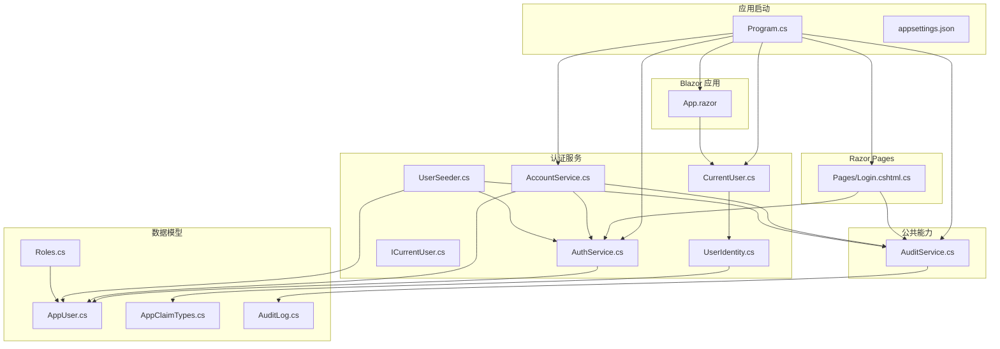
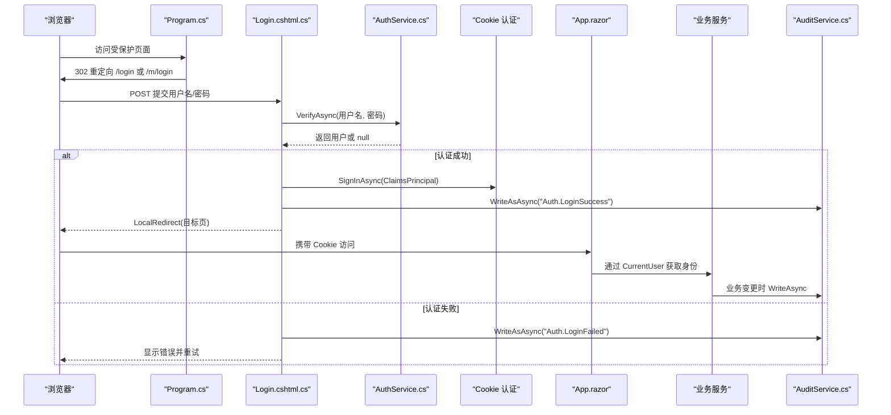
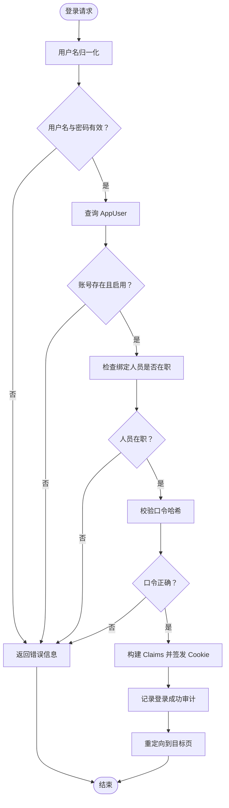
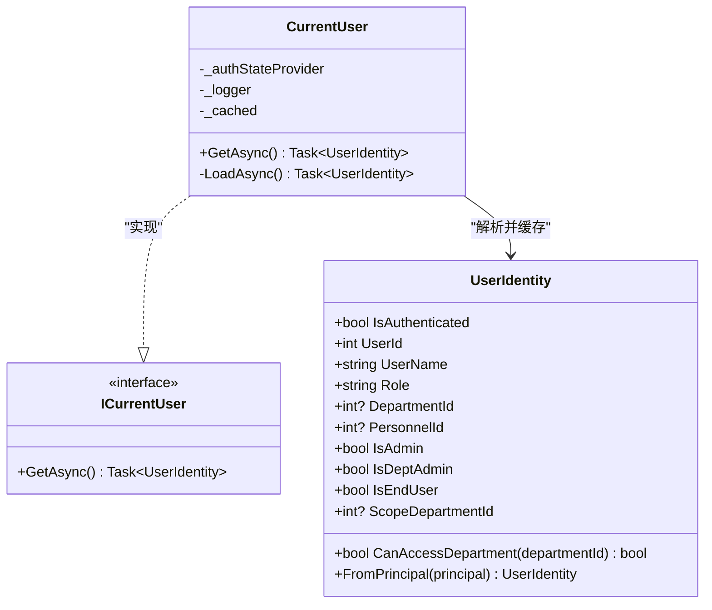
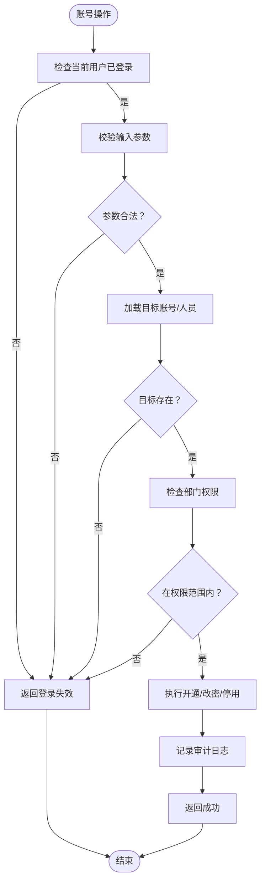
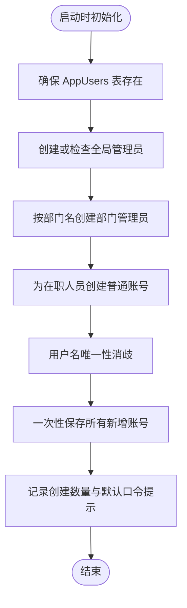
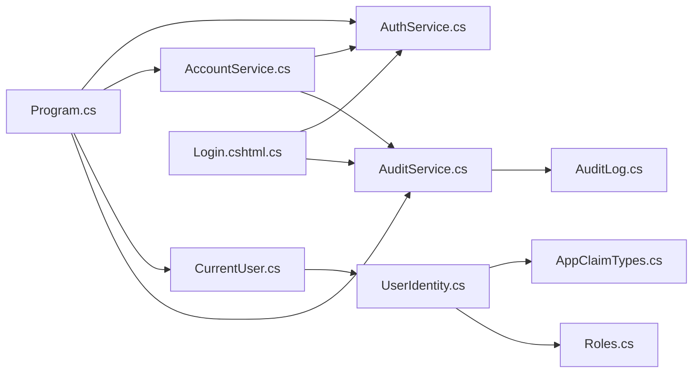

# 认证与授权系统

<cite>
**本文引用的文件**   
- [Program.cs](file://Program.cs)
- [appsettings.json](file://appsettings.json)
- [App.razor](file://App.razor)
- [Login.cshtml.cs](file://Pages/Login.cshtml.cs)
- [AuthService.cs](file://BLL/Auth/AuthService.cs)
- [AccountService.cs](file://BLL/Auth/AccountService.cs)
- [CurrentUser.cs](file://BLL/Auth/CurrentUser.cs)
- [ICurrentUser.cs](file://BLL/Auth/ICurrentUser.cs)
- [UserIdentity.cs](file://BLL/Auth/UserIdentity.cs)
- [UserSeeder.cs](file://BLL/Auth/UserSeeder.cs)
- [AppClaimTypes.cs](file://DAL/Common/AppClaimTypes.cs)
- [Roles.cs](file://DAL/Model/Roles.cs)
- [AppUser.cs](file://DAL/Model/AppUser.cs)
- [AuditLog.cs](file://DAL/Model/AuditLog.cs)
- [AuditService.cs](file://BLL/Common/AuditService.cs)
</cite>

## 目录
1. [引言](#引言)
2. [项目结构](#项目结构)
3. [核心组件](#核心组件)
4. [架构总览](#架构总览)
5. [关键流程详解](#关键流程详解)
6. [依赖关系分析](#依赖关系分析)
7. [性能与安全特性](#性能与安全特性)
8. [故障排查指南](#故障排查指南)
9. [结论](#结论)

## 引言
本仓库的认证与授权体系基于 ASP.NET Core Cookie 认证，结合 Blazor Server 的级联认证状态，实现“登录 → 签发 Claims → 路由与页面授权 → 业务层按部门隔离”的完整链路。系统采用自建用户表 `AppUser`，角色常量集中在 `Roles`，并通过 `UserIdentity` 把 Claims 解析为不可变身份快照，作为所有业务查询与写操作的数据可见范围依据。审计日志通过 `AuditService` 统一追加写入，不阻断主业务流程。

## 项目结构
认证与授权相关代码分布在以下层次：
- 应用启动与中间件：`Program.cs`、`appsettings.json`
- Razor Pages 登录入口：`Pages/Login.cshtml.cs`
- 业务逻辑层（BLL）：`BLL/Auth/*`、`BLL/Common/AuditService.cs`
- 数据模型与常量：`DAL/Model/*`、`DAL/Common/AppClaimTypes.cs`
- Blazor 根组件与未授权视图：`App.razor`

**图表来源**
- [Program.cs:94-117](file://Program.cs#L94-L117)
- [Program.cs:268-315](file://Program.cs#L268-L315)
- [Login.cshtml.cs:53-99](file://Pages/Login.cshtml.cs#L53-L99)
- [App.razor:4-16](file://App.razor#L4-L16)
- [AuthService.cs:31-58](file://BLL/Auth/AuthService.cs#L31-L58)
- [AccountService.cs:14-35](file://BLL/Auth/AccountService.cs#L14-L35)
- [CurrentUser.cs:8-36](file://BLL/Auth/CurrentUser.cs#L8-L36)
- [UserIdentity.cs:6-58](file://BLL/Auth/UserIdentity.cs#L6-L58)
- [UserSeeder.cs:50-118](file://BLL/Auth/UserSeeder.cs#L50-L118)
- [AuditService.cs:12-65](file://BLL/Common/AuditService.cs#L12-L65)
- [AppUser.cs:7-40](file://DAL/Model/AppUser.cs#L7-L40)
- [Roles.cs:5-19](file://DAL/Model/Roles.cs#L5-L19)
- [AppClaimTypes.cs:5-13](file://DAL/Common/AppClaimTypes.cs#L5-L13)
- [AuditLog.cs:6-29](file://DAL/Model/AuditLog.cs#L6-L29)

**章节来源**
- [Program.cs:94-117](file://Program.cs#L94-L117)
- [Program.cs:268-315](file://Program.cs#L268-L315)
- [appsettings.json:1-8](file://appsettings.json#L1-L8)

## 核心组件
- 认证配置与中间件：在应用启动时注册 Cookie 认证、DataProtection、授权管道、Blazor 级联认证状态，并挂载 `/login`、`/m/login`、`/denied`、`/auth/logout`、`/health` 等路径。
- 登录页模型：负责接收用户名、密码、记住我选项，调用 `AuthService.VerifyAsync` 校验后签发 Cookie，并记录审计。
- 账号校验服务：提供用户名归一化、口令哈希、账号有效性检查（启用状态、绑定人员是否在职）。
- 当前用户抽象：Blazor Server 中从 `AuthenticationStateProvider` 读取认证状态，缓存到 Circuit 结束；失败时 fail-closed。
- 身份快照：从 `ClaimsPrincipal` 解析出 `UserIdentity`，暴露角色、部门、人员归属以及数据可见范围判断方法。
- 账号管理服务：提供开通账号、重置密码、停用账号等操作，严格限制可管理对象为「本部门普通使用人员」。
- 种子账号初始化：幂等创建全局管理员、部门管理员和在职人员账号，默认口令策略与唯一用户名生成逻辑集中处理。
- 审计服务：统一追加写入审计日志，失败不阻断业务但记录错误日志。

**章节来源**
- [Program.cs:94-117](file://Program.cs#L94-L117)
- [Program.cs:268-315](file://Program.cs#L268-L315)
- [Login.cshtml.cs:53-99](file://Pages/Login.cshtml.cs#L53-L99)
- [AuthService.cs:25-58](file://BLL/Auth/AuthService.cs#L25-L58)
- [CurrentUser.cs:8-36](file://BLL/Auth/CurrentUser.cs#L8-L36)
- [UserIdentity.cs:6-58](file://BLL/Auth/UserIdentity.cs#L6-L58)
- [AccountService.cs:14-191](file://BLL/Auth/AccountService.cs#L14-L191)
- [UserSeeder.cs:50-118](file://BLL/Auth/UserSeeder.cs#L50-L118)
- [AuditService.cs:12-65](file://BLL/Common/AuditService.cs#L12-L65)

## 架构总览
认证与授权的整体流程如下：
- 应用启动阶段：注册 Cookie 认证、DataProtection、授权、Blazor 级联认证状态，注入认证与账号服务。
- 请求进入阶段：先静态文件与路由，再认证与授权；对未登录的整页 GET/HEAD 请求重定向到登录页。
- 登录阶段：Razor Page 调用 `AuthService` 校验用户，成功后签发 Cookie，附带角色、部门、人员 Claim。
- 页面访问阶段：Blazor 根组件使用 `AuthorizeRouteView` 与 `AuthorizeView` 控制路由与内容可见性。
- 业务访问阶段：BLL 通过 `ICurrentUser` 获取 `UserIdentity`，以 `ScopeDepartmentId` 与 `CanAccessDepartment` 做数据隔离。

**图表来源**
- [Program.cs:268-315](file://Program.cs#L268-L315)
- [Login.cshtml.cs:53-99](file://Pages/Login.cshtml.cs#L53-L99)
- [AuthService.cs:31-58](file://BLL/Auth/AuthService.cs#L31-L58)
- [App.razor:4-16](file://App.razor#L4-L16)
- [AuditService.cs:29-65](file://BLL/Common/AuditService.cs#L29-L65)

## 关键流程详解

### 登录与凭据校验
登录流程由 Razor Page 驱动，避免在 Blazor Circuit 中直接操作 `HttpContext`。校验逻辑包括：
- 用户名去空格与小写归一化。
- 查询 `AppUser`，要求账号存在且启用。
- 若绑定了车间人员，需验证该人员仍在职。
- 使用框架内置 `PasswordHasher` 校验口令。
- 成功后构造 Claims，包含标识、姓名、角色、部门、人员，并签发 Cookie。
- 成功与失败均写入审计日志。

**图表来源**
- [Login.cshtml.cs:53-99](file://Pages/Login.cshtml.cs#L53-L99)
- [AuthService.cs:31-58](file://BLL/Auth/AuthService.cs#L31-L58)
- [AuditService.cs:37-65](file://BLL/Common/AuditService.cs#L37-L65)

**章节来源**
- [Login.cshtml.cs:53-99](file://Pages/Login.cshtml.cs#L53-L99)
- [AuthService.cs:25-58](file://BLL/Auth/AuthService.cs#L25-L58)
- [AuditService.cs:37-65](file://BLL/Common/AuditService.cs#L37-L65)

### 当前用户身份解析与缓存
Blazor Server 中，`CurrentUser` 从 `AuthenticationStateProvider` 读取认证状态，并缓存到 Circuit 结束。解析过程：
- 若未认证或解析异常，返回匿名身份，fail-closed。
- 从 `ClaimsPrincipal` 提取用户标识、姓名、角色、部门、人员。
- 将结果封装为不可变的 `UserIdentity`，供 BLL 使用。

**图表来源**
- [CurrentUser.cs:8-36](file://BLL/Auth/CurrentUser.cs#L8-L36)
- [ICurrentUser.cs:5-10](file://BLL/Auth/ICurrentUser.cs#L5-L10)
- [UserIdentity.cs:6-58](file://BLL/Auth/UserIdentity.cs#L6-L58)

**章节来源**
- [CurrentUser.cs:8-36](file://BLL/Auth/CurrentUser.cs#L8-L36)
- [ICurrentUser.cs:5-10](file://BLL/Auth/ICurrentUser.cs#L5-L10)
- [UserIdentity.cs:6-58](file://BLL/Auth/UserIdentity.cs#L6-L58)

### 账号管理与权限边界
`AccountService` 提供账号开通、密码重置、账号停用功能，权限边界如下：
- 仅能管理「本部门普通使用人员」账号。
- 用户名必须满足正则规则，并与登录侧一致归一化。
- 初始密码长度有最低要求。
- 停用账号会软删除并随机化口令，防止硬删后被种子重建弱口令。
- 所有写操作均记录审计日志。

**图表来源**
- [AccountService.cs:64-186](file://BLL/Auth/AccountService.cs#L64-L186)
- [AuditService.cs:29-65](file://BLL/Common/AuditService.cs#L29-L65)

**章节来源**
- [AccountService.cs:64-186](file://BLL/Auth/AccountService.cs#L64-L186)
- [AuditService.cs:29-65](file://BLL/Common/AuditService.cs#L29-L65)

### 种子账号初始化
`UserSeeder` 在应用启动时幂等初始化账号：
- 全局管理员：不存在才创建，已存在则检查是否仍使用出厂口令并记录警告。
- 部门管理员：按部门名精确匹配，不硬编码 Id。
- 普通使用人员：遍历在职人员，按拼音映射生成用户名，冲突时加后缀消歧。
- 单次提交保证原子性，避免半成品数据。

**图表来源**
- [UserSeeder.cs:50-118](file://BLL/Auth/UserSeeder.cs#L50-L118)
- [UserSeeder.cs:121-176](file://BLL/Auth/UserSeeder.cs#L121-L176)

**章节来源**
- [UserSeeder.cs:50-118](file://BLL/Auth/UserSeeder.cs#L50-L118)
- [UserSeeder.cs:121-176](file://BLL/Auth/UserSeeder.cs#L121-L176)

## 依赖关系分析
认证与授权的核心依赖如下：
- `Program.cs` 负责注册 Cookie 认证、授权、Blazor 级联认证状态，并注入 `AuthService`、`AccountService`、`CurrentUser`、`AuditService`。
- `Login.cshtml.cs` 依赖 `AuthService` 与 `AuditService`。
- `CurrentUser` 依赖 `AuthenticationStateProvider` 与 `UserIdentity`。
- `AccountService` 依赖 `AuthService`、`AuditService` 与 `ICurrentUser`。
- `UserIdentity` 依赖 `AppClaimTypes` 与 `Roles`。
- `AuditService` 依赖 `ICurrentUser` 与 `AuditLog`。

**图表来源**
- [Program.cs:113-117](file://Program.cs#L113-L117)
- [Login.cshtml.cs:24-31](file://Pages/Login.cshtml.cs#L24-L31)
- [CurrentUser.cs:11-18](file://BLL/Auth/CurrentUser.cs#L11-L18)
- [AccountService.cs:20-35](file://BLL/Auth/AccountService.cs#L20-L35)
- [UserIdentity.cs:1-58](file://BLL/Auth/UserIdentity.cs#L1-L58)
- [AuditService.cs:15-27](file://BLL/Common/AuditService.cs#L15-L27)

**章节来源**
- [Program.cs:113-117](file://Program.cs#L113-L117)
- [Login.cshtml.cs:24-31](file://Pages/Login.cshtml.cs#L24-L31)
- [CurrentUser.cs:11-18](file://BLL/Auth/CurrentUser.cs#L11-L18)
- [AccountService.cs:20-35](file://BLL/Auth/AccountService.cs#L20-L35)
- [UserIdentity.cs:1-58](file://BLL/Auth/UserIdentity.cs#L1-L58)
- [AuditService.cs:15-27](file://BLL/Common/AuditService.cs#L15-L27)

## 性能与安全特性
- 性能
  - 数据库连接通过 `DbContextFactory` 创建，避免 Blazor Server 并发冲突。
  - 查询普遍使用 `AsNoTracking()`，减少跟踪开销。
  - `CurrentUser` 在同一 Circuit 内缓存身份快照，避免重复解析。
  - 审计写入失败不阻断业务，降低审计延迟对主流程的影响。
- 安全
  - Cookie 认证启用 DataProtection 密钥持久化，重启不换钥。
  - 登录失败不区分原因，避免账号枚举。
  - 用户名归一化与 SQLite 大小写敏感比较保持一致。
  - 绑定人员离职时账号自动失效。
  - 部门与人员归属只从 Claims 读取，不接受表单或 URL 参数。
  - 账号停用采用软删除与口令随机化，防止弱口令被种子重建。

[本节为通用指导，不直接分析具体文件]

## 故障排查指南
- 登录后无法访问页面
  - 检查 Cookie 名称、过期时间、滑动过期配置是否正确。
  - 确认 `/login`、`/m/login`、`/denied` 是否在免登录白名单中。
  - 查看 Blazor 根组件是否正确使用 `AuthorizeRouteView` 与 `AuthorizeView`。
- 登录成功但业务层无身份
  - 检查 `CurrentUser` 是否能从 `AuthenticationStateProvider` 读取状态。
  - 确认 `UserIdentity.FromPrincipal` 解析的 Claim 类型与值是否正确。
- 账号无法登录
  - 检查 `AuthService.VerifyAsync` 是否返回 null，可能因账号禁用或绑定人员离职。
  - 确认用户名是否经过归一化，口令哈希是否匹配。
- 审计日志缺失
  - 检查 `AuditService.WriteAsync` 或 `WriteAsAsync` 是否被调用。
  - 查看审计写入异常日志，确认数据库连接与表结构正常。

**章节来源**
- [Program.cs:94-117](file://Program.cs#L94-L117)
- [Program.cs:268-315](file://Program.cs#L268-L315)
- [App.razor:4-16](file://App.razor#L4-L16)
- [CurrentUser.cs:23-36](file://BLL/Auth/CurrentUser.cs#L23-L36)
- [UserIdentity.cs:40-58](file://BLL/Auth/UserIdentity.cs#L40-L58)
- [AuthService.cs:31-58](file://BLL/Auth/AuthService.cs#L31-L58)
- [AuditService.cs:42-65](file://BLL/Common/AuditService.cs#L42-L65)

## 结论
该系统的认证与授权设计围绕 Cookie 认证、Claims 身份、Blazor 级联状态与业务层部门隔离展开。通过 `UserIdentity` 统一身份快照、`AccountService` 严格权限边界、`AuditService` 统一审计写入，实现了可追溯、可扩展、可测试的认证授权体系。后续可在现有基础上进一步增强并发保护、分页收敛、时间统一与菜单入口治理，以提升数据正确性与用户体验。

[本节为总结性内容，不直接分析具体文件]