# 表现层设计

<cite>
**本文引用的文件**   
- [App.razor](file://App.razor)
- [Program.cs](file://Program.cs)
- [_Imports.razor](file://_Imports.razor)
- [Pages/_Host.cshtml](file://Pages/_Host.cshtml)
- [Components/Layouts/MainLayout.razor](file://Components/Layouts/MainLayout.razor)
- [Components/Layouts/MobileLayout.razor](file://Components/Layouts/MobileLayout.razor)
- [Components/Navigation/NavMenu.razor](file://Components/Navigation/NavMenu.razor)
- [Components/Common/Pagination.razor](file://Components/Common/Pagination.razor)
- [Pages/Vehicles.razor](file://Pages/Vehicles.razor)
- [Pages/Departments.razor](file://Pages/Departments.razor)
- [wwwroot/css/design-system.css](file://wwwroot/css/design-system.css)
- [wwwroot/css/site.css](file://wwwroot/css/site.css)
</cite>

## 目录
1. [引言](#引言)
2. [项目结构](#项目结构)
3. [核心组件](#核心组件)
4. [架构总览](#架构总览)
5. [详细组件分析](#详细组件分析)
6. [依赖关系分析](#依赖关系分析)
7. [性能与可维护性建议](#性能与可维护性建议)
8. [故障排查指南](#故障排查指南)
9. [结论](#结论)

## 引言
本文件面向 vehicleManagement 系统的表现层（Blazor Server）进行系统化文档化，重点覆盖：
- 页面组件与可复用组件的职责分离
- 布局组件设计与响应式适配
- 路由配置、参数传递与导航状态管理
- 用户交互处理：表单验证、异步操作、状态更新
- 组件通信模式：父子传参、事件冒泡、服务注入
- 样式系统：CSS 架构、主题定制、响应式设计原则
- 组件开发最佳实践与性能优化技巧

## 项目结构
表现层采用 Blazor Server 的 Razor 组件组织方式：
- Pages：页面级组件，负责业务页面的数据加载、用户交互与视图渲染
- Components：可复用组件与布局组件，如分页器、侧边栏菜单、主布局与移动端布局
- wwwroot：静态资源，包含全局样式、字体与脚本
- App.razor：应用根组件，定义路由与默认布局
- Program.cs：应用启动、服务注册与中间件配置
- _Host.cshtml：Blazor Server 宿主页，引入框架脚本与全局样式

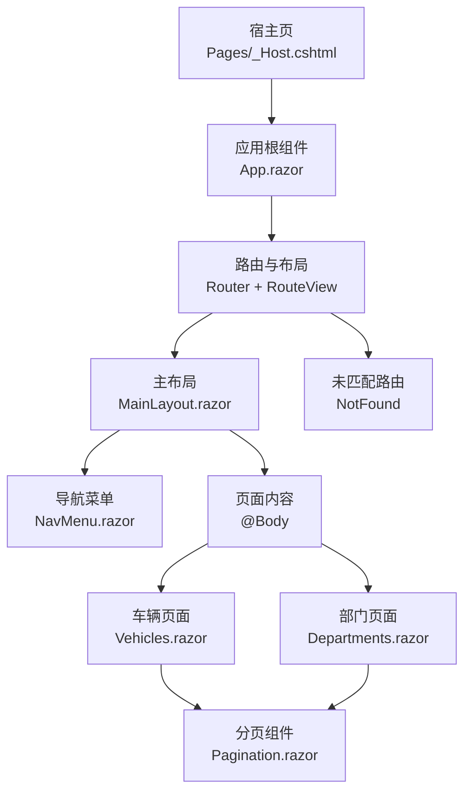

**图表来源**
- [App.razor:2-10](file://App.razor#L2-L10)
- [Pages/_Host.cshtml:25-27](file://Pages/_Host.cshtml#L25-L27)
- [Components/Layouts/MainLayout.razor:1-23](file://Components/Layouts/MainLayout.razor#L1-L23)
- [Components/Navigation/NavMenu.razor:1-51](file://Components/Navigation/NavMenu.razor#L1-L51)
- [Pages/Vehicles.razor:1-184](file://Pages/Vehicles.razor#L1-L184)
- [Pages/Departments.razor:1-125](file://Pages/Departments.razor#L1-L125)
- [Components/Common/Pagination.razor:1-18](file://Components/Common/Pagination.razor#L1-L18)

**章节来源**
- [App.razor:1-12](file://App.razor#L1-L12)
- [Pages/_Host.cshtml:1-27](file://Pages/_Host.cshtml#L1-L27)
- [Components/Layouts/MainLayout.razor:1-40](file://Components/Layouts/MainLayout.razor#L1-L40)
- [Components/Navigation/NavMenu.razor:1-56](file://Components/Navigation/NavMenu.razor#L1-L56)
- [Components/Common/Pagination.razor:1-42](file://Components/Common/Pagination.razor#L1-L42)

## 核心组件
- 应用根组件与路由
  - App.razor 使用 Router 与 RouteView 将页面渲染到默认布局 MainLayout，并处理未匹配路由。
- 宿主页
  - Pages/_Host.cshtml 初始化 Blazor Server，引入全局样式与脚本，提供错误 UI 与 Chart.js 工具函数。
- 布局组件
  - MainLayout.razor 提供桌面端布局：左侧导航、顶部栏与主体内容区，控制侧边栏展开/收起。
  - MobileLayout.razor 提供移动端简化布局，仅包裹 @Body。
- 导航菜单
  - NavMenu.razor 使用 NavLink 构建主菜单与 AI 服务入口，支持激活态高亮。
- 通用组件
  - Pagination.razor 提供分页 UI，通过 EventCallback<int> 向父组件回传页码变更。

**章节来源**
- [App.razor:2-10](file://App.razor#L2-L10)
- [Pages/_Host.cshtml:25-27](file://Pages/_Host.cshtml#L25-L27)
- [Components/Layouts/MainLayout.razor:1-40](file://Components/Layouts/MainLayout.razor#L1-L40)
- [Components/Layouts/MobileLayout.razor:1-8](file://Components/Layouts/MobileLayout.razor#L1-L8)
- [Components/Navigation/NavMenu.razor:1-56](file://Components/Navigation/NavMenu.razor#L1-L56)
- [Components/Common/Pagination.razor:1-42](file://Components/Common/Pagination.razor#L1-L42)

## 架构总览
Blazor Server 表现层以“页面组件 + 布局组件 + 通用组件”分层组织，结合服务注入访问业务逻辑层。

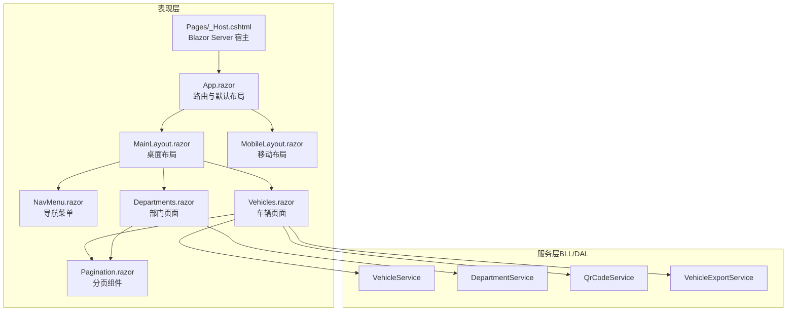

**图表来源**
- [App.razor:2-10](file://App.razor#L2-L10)
- [Pages/_Host.cshtml:25-27](file://Pages/_Host.cshtml#L25-L27)
- [Components/Layouts/MainLayout.razor:1-23](file://Components/Layouts/MainLayout.razor#L1-L23)
- [Components/Layouts/MobileLayout.razor:1-8](file://Components/Layouts/MobileLayout.razor#L1-L8)
- [Components/Navigation/NavMenu.razor:1-51](file://Components/Navigation/NavMenu.razor#L1-L51)
- [Components/Common/Pagination.razor:1-18](file://Components/Common/Pagination.razor#L1-L18)
- [Pages/Vehicles.razor:1-184](file://Pages/Vehicles.razor#L1-L184)
- [Pages/Departments.razor:1-125](file://Pages/Departments.razor#L1-L125)

## 详细组件分析

### 布局组件：MainLayout 与 MobileLayout
- MainLayout
  - 职责：承载侧边栏、顶部栏与主体内容；控制侧边栏展开/收起状态。
  - 交互：点击顶部按钮切换 sidebarOpen；点击遮罩关闭侧边栏。
  - 组合：内嵌 NavMenu 组件，并通过 @Body 渲染页面内容。
- MobileLayout
  - 职责：为移动端提供最小化布局，仅包裹 @Body。
  - 扩展点：可在其中加入移动端专属头部或底部导航。

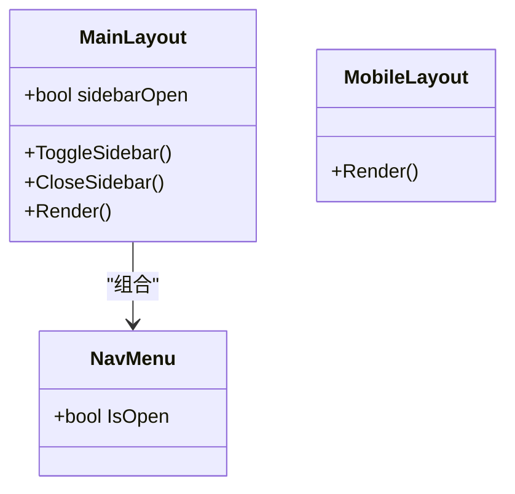

**图表来源**
- [Components/Layouts/MainLayout.razor:1-40](file://Components/Layouts/MainLayout.razor#L1-L40)
- [Components/Layouts/MobileLayout.razor:1-8](file://Components/Layouts/MobileLayout.razor#L1-L8)
- [Components/Navigation/NavMenu.razor:53-55](file://Components/Navigation/NavMenu.razor#L53-L55)

**章节来源**
- [Components/Layouts/MainLayout.razor:1-40](file://Components/Layouts/MainLayout.razor#L1-L40)
- [Components/Layouts/MobileLayout.razor:1-8](file://Components/Layouts/MobileLayout.razor#L1-L8)

### 导航菜单：NavMenu
- 使用 NavLink 实现页面跳转与激活态高亮。
- 通过 [Parameter] bool IsOpen 接收父组件状态，用于侧边栏显示控制。
- 菜单项包括主菜单与 AI 服务入口，便于功能分组。

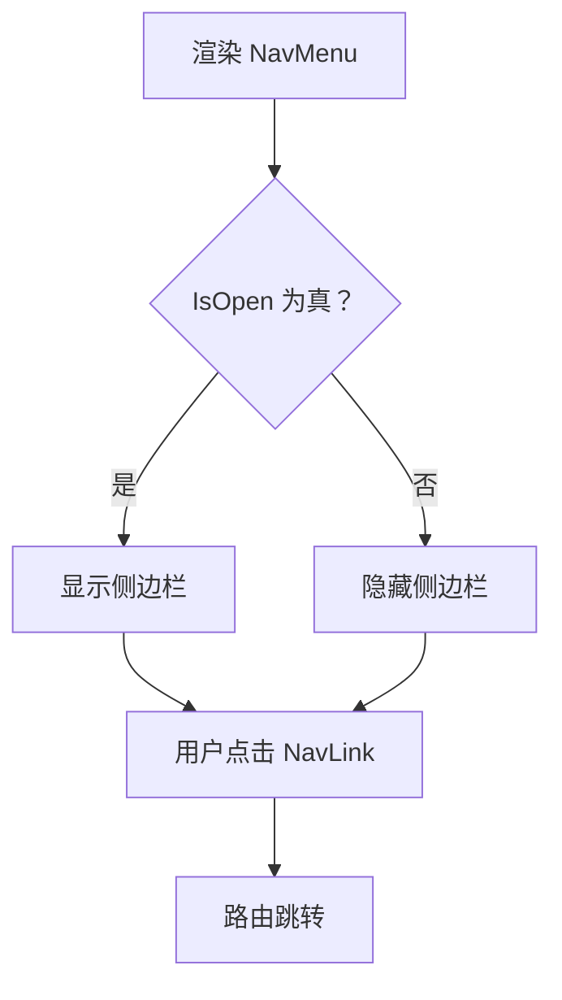

**图表来源**
- [Components/Navigation/NavMenu.razor:1-51](file://Components/Navigation/NavMenu.razor#L1-L51)
- [Components/Navigation/NavMenu.razor:53-55](file://Components/Navigation/NavMenu.razor#L53-L55)

**章节来源**
- [Components/Navigation/NavMenu.razor:1-56](file://Components/Navigation/NavMenu.razor#L1-L56)

### 分页组件：Pagination
- 参数：CurrentPage、TotalPages、TotalCount
- 事件：OnPageChanged 回调父组件页码变化
- 内部逻辑：计算当前页码范围，禁用无效页按钮

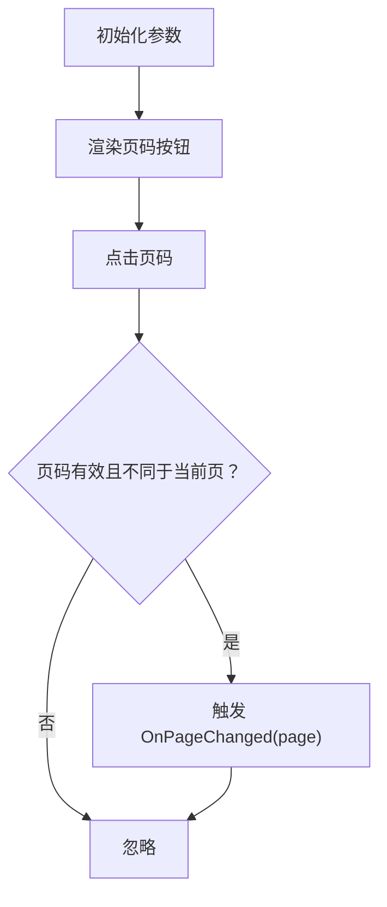

**图表来源**
- [Components/Common/Pagination.razor:1-42](file://Components/Common/Pagination.razor#L1-L42)

**章节来源**
- [Components/Common/Pagination.razor:1-42](file://Components/Common/Pagination.razor#L1-L42)

### 页面组件：Vehicles 与 Departments
- 共同模式
  - 使用 @page 定义路由
  - 使用 @inject 注入服务（如 VehicleService、DepartmentService、QrCodeService、ExportService、IJSRuntime、NavigationManager、IHttpContextAccessor）
  - 本地状态管理：列表、表单字段、弹窗状态、分页/搜索/排序状态
  - 生命周期：OnInitializedAsync 加载数据
  - 异步操作：保存、删除、导出等调用服务方法，捕获异常并展示错误弹窗
  - 子组件通信：使用 Pagination 组件，通过 EventCallback 更新当前页码并重新加载数据

- Vehicles 特有
  - 二维码下载：校验权限、生成 Token、构造 URL、调用 JS 下载 Base64 图片
  - Excel 导出：调用 ExportService 获取字节流，Base64 编码后通过 JS 下载
  - 搜索与排序：根据关键词、列名与升降序重新请求分页数据

- Departments 特有
  - 简单新增/编辑/删除流程，无复杂外部依赖

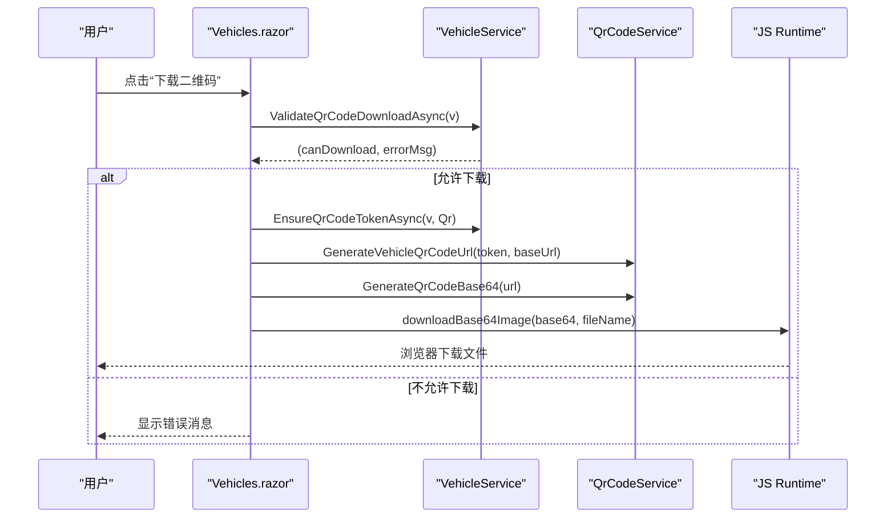

**图表来源**
- [Pages/Vehicles.razor:336-358](file://Pages/Vehicles.razor#L336-L358)

**章节来源**
- [Pages/Vehicles.razor:1-410](file://Pages/Vehicles.razor#L1-L410)
- [Pages/Departments.razor:1-280](file://Pages/Departments.razor#L1-L280)

### 路由设计与导航状态管理
- 路由定义
  - 页面组件通过 @page 指令声明路由，例如 /vehicles、/departments、/borrow/{VehicleId:int}、/maintenance/{VehicleId:int}、/execute/{Token}、/ai-chat 等
- 默认布局
  - App.razor 中 RouteView 指定 DefaultLayout 为 MainLayout，所有页面默认使用该布局
- 未匹配路由
  - NotFound 节点返回统一提示页面，仍使用 MainLayout
- 导航状态
  - NavMenu 使用 NavLink 自动添加 active 类，配合 CSS 高亮当前菜单项
  - NavigationManager 可用于编程式导航（在页面代码中按需使用）

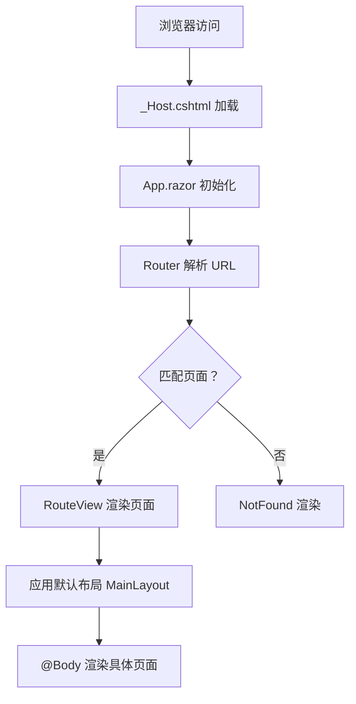

**图表来源**
- [App.razor:2-10](file://App.razor#L2-L10)
- [Pages/_Host.cshtml:25-27](file://Pages/_Host.cshtml#L25-L27)

**章节来源**
- [App.razor:2-10](file://App.razor#L2-L10)
- [Pages/_Host.cshtml:1-27](file://Pages/_Host.cshtml#L1-L27)

### 用户交互处理：表单验证、异步操作、状态更新
- 表单验证
  - 基础非空校验（如车牌号、部门选择），在保存前进行前端校验
  - 业务校验委托给服务层（如二维码下载权限、删除约束）
- 异步操作
  - 使用 async/await 调用服务方法，避免阻塞 UI
  - 对可能失败的操作（保存、删除、导出）使用 try/catch 捕获异常，并展示错误弹窗
- 状态更新机制
  - 修改本地状态变量后，Blazor 自动触发重渲染
  - 分页、搜索、排序状态变更后重新调用 LoadData 刷新列表

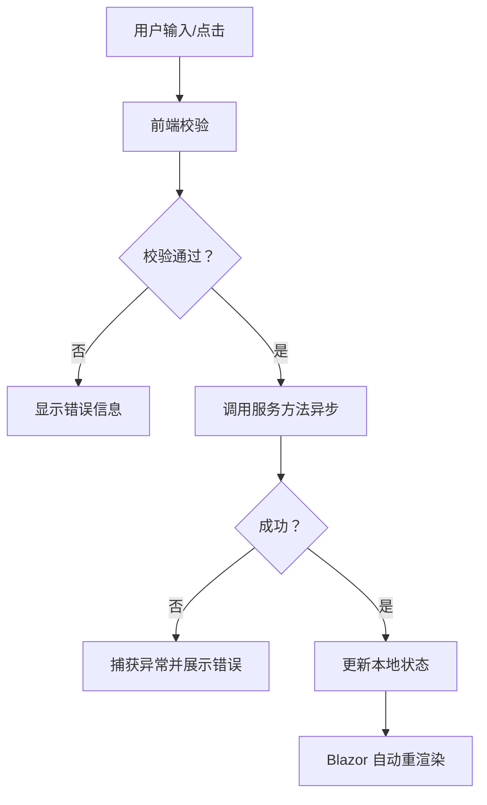

**章节来源**
- [Pages/Vehicles.razor:284-331](file://Pages/Vehicles.razor#L284-L331)
- [Pages/Departments.razor:219-241](file://Pages/Departments.razor#L219-L241)

### 组件通信模式
- 父子组件传参
  - Pagination 通过 [Parameter] 接收 CurrentPage、TotalPages、TotalCount
  - NavMenu 通过 [Parameter] bool IsOpen 接收侧边栏打开状态
- 事件冒泡
  - Pagination 通过 EventCallback<int> OnPageChanged 向父组件回传页码变更
- 服务注入
  - 页面组件通过 @inject 注入服务（如 VehicleService、DepartmentService、QrCodeService、VehicleExportService、IJSRuntime、NavigationManager、IHttpContextAccessor）
  - 服务在 Program.cs 中注册为 Scoped 或 Singleton

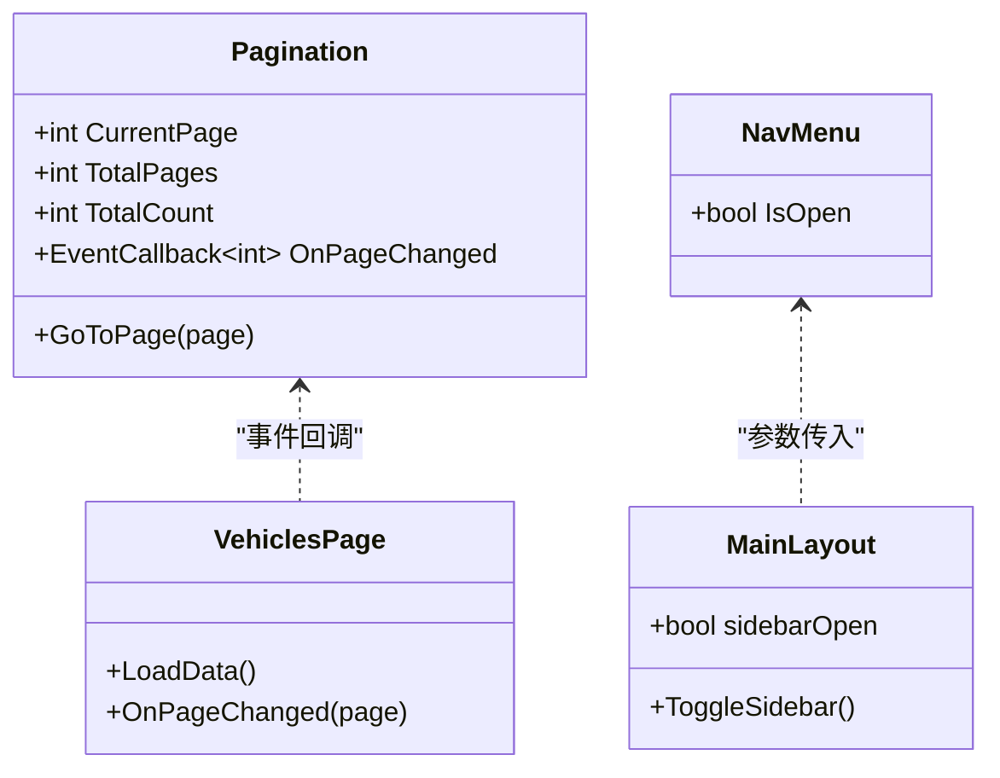

**图表来源**
- [Components/Common/Pagination.razor:20-42](file://Components/Common/Pagination.razor#L20-L42)
- [Components/Navigation/NavMenu.razor:53-55](file://Components/Navigation/NavMenu.razor#L53-L55)
- [Components/Layouts/MainLayout.razor:27-39](file://Components/Layouts/MainLayout.razor#L27-L39)
- [Pages/Vehicles.razor:186-247](file://Pages/Vehicles.razor#L186-L247)

**章节来源**
- [Components/Common/Pagination.razor:1-42](file://Components/Common/Pagination.razor#L1-L42)
- [Components/Navigation/NavMenu.razor:1-56](file://Components/Navigation/NavMenu.razor#L1-L56)
- [Components/Layouts/MainLayout.razor:1-40](file://Components/Layouts/MainLayout.razor#L1-L40)
- [Pages/Vehicles.razor:1-410](file://Pages/Vehicles.razor#L1-L410)

### 样式系统设计
- CSS 架构
  - design-system.css：定义设计令牌（颜色、阴影、圆角、过渡）、全局重置、布局与常用组件样式（卡片、按钮、表格、徽章、输入框等）
  - site.css：Blazor 特定样式（错误 UI、NavLink 激活态、InputFile 样式）
- 主题定制
  - 通过 CSS 变量集中管理主题色板（primary、gray、red、blue、orange、sky、purple、pink）
  - 可通过覆盖 :root 中的变量快速调整主题
- 响应式设计原则
  - 使用 Flexbox 布局与媒体查询（由设计令牌与通用类驱动）
  - 侧边栏宽度、顶部栏高度、内容最大宽度通过变量统一管理
  - 移动端可使用 MobileLayout 作为替代布局

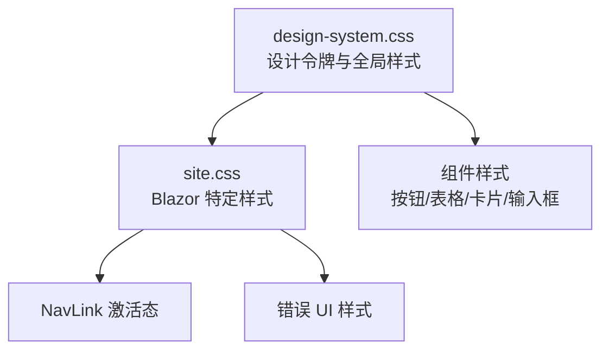

**图表来源**
- [wwwroot/css/design-system.css:38-176](file://wwwroot/css/design-system.css#L38-L176)
- [wwwroot/css/site.css:1-55](file://wwwroot/css/site.css#L1-L55)

**章节来源**
- [wwwroot/css/design-system.css:1-800](file://wwwroot/css/design-system.css#L1-L800)
- [wwwroot/css/site.css:1-55](file://wwwroot/css/site.css#L1-L55)

## 依赖关系分析
- 组件耦合
  - MainLayout 依赖 NavMenu 与页面内容（@Body）
  - 页面组件依赖 Pagination 组件与服务层
- 服务注入
  - 页面组件通过 @inject 注入服务，服务在 Program.cs 中注册
- 外部依赖
  - IJSRuntime 用于调用 JavaScript（如下载文件、Chart.js）
  - IHttpContextAccessor 用于获取当前请求上下文（如 Scheme/Host）

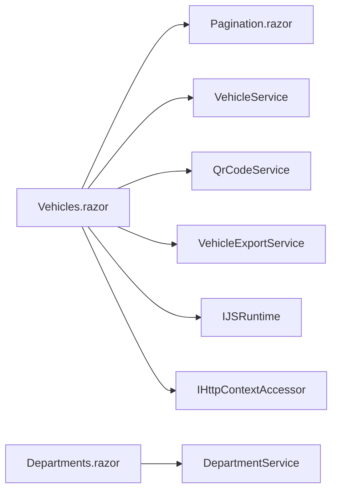

**图表来源**
- [Pages/Vehicles.razor:1-8](file://Pages/Vehicles.razor#L1-L8)
- [Pages/Departments.razor:1-4](file://Pages/Departments.razor#L1-L4)
- [Components/Common/Pagination.razor:1-18](file://Components/Common/Pagination.razor#L1-L18)

**章节来源**
- [Pages/Vehicles.razor:1-410](file://Pages/Vehicles.razor#L1-L410)
- [Pages/Departments.razor:1-280](file://Pages/Departments.razor#L1-L280)
- [Components/Common/Pagination.razor:1-42](file://Components/Common/Pagination.razor#L1-L42)

## 性能与可维护性建议
- 组件拆分
  - 将重复的表单与表格逻辑抽取为独立组件，减少页面组件复杂度
- 状态管理
  - 将跨组件共享的状态提升到更高层或使用集中式状态管理（如服务层缓存）
- 异步优化
  - 避免在频繁触发的输入事件中直接发起网络请求，考虑防抖/节流
- 渲染优化
  - 合理使用 @key 提升列表渲染性能
  - 对大数据量列表使用虚拟滚动或后端分页（已实现分页）
- 样式优化
  - 使用 CSS 变量统一管理主题，避免硬编码颜色值
  - 将通用样式提取为公共类，减少重复代码

[本节为通用指导，不直接分析具体文件]

## 故障排查指南
- 路由问题
  - 检查页面组件是否声明 @page 路由
  - 确认 App.razor 中 RouteView 的默认布局设置正确
- 导航高亮
  - 确保 NavMenu 使用 NavLink，并检查 CSS 中 .nav-item.active 样式生效
- 服务注入失败
  - 检查 Program.cs 中服务是否注册（Scoped/Singleton）
- 样式不生效
  - 确认 _Host.cshtml 引入了 design-system.css 与 site.css
  - 检查 CSS 变量是否正确定义与使用

**章节来源**
- [App.razor:2-10](file://App.razor#L2-L10)
- [Components/Navigation/NavMenu.razor:1-51](file://Components/Navigation/NavMenu.razor#L1-L51)
- [wwwroot/css/site.css:22-27](file://wwwroot/css/site.css#L22-L27)
- [Program.cs:48-102](file://Program.cs#L48-L102)

## 结论
vehicleManagement 的表现层采用清晰的 Blazor Server 组件化架构：页面组件专注业务交互与数据加载，布局组件提供统一的视觉与导航体验，通用组件提升复用性与一致性。通过服务注入、事件回调与参数传递，实现了松耦合的组件通信。样式系统基于设计令牌与 CSS 变量，便于主题定制与响应式适配。遵循本文的最佳实践与优化建议，可进一步提升系统的可维护性与性能表现。