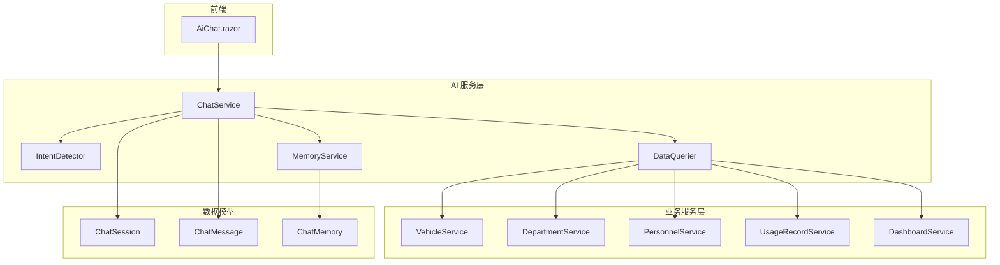
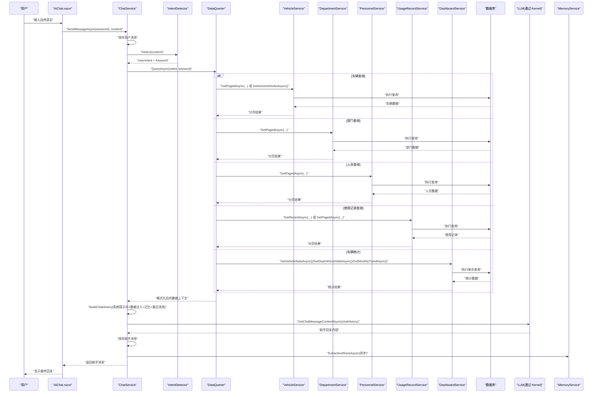
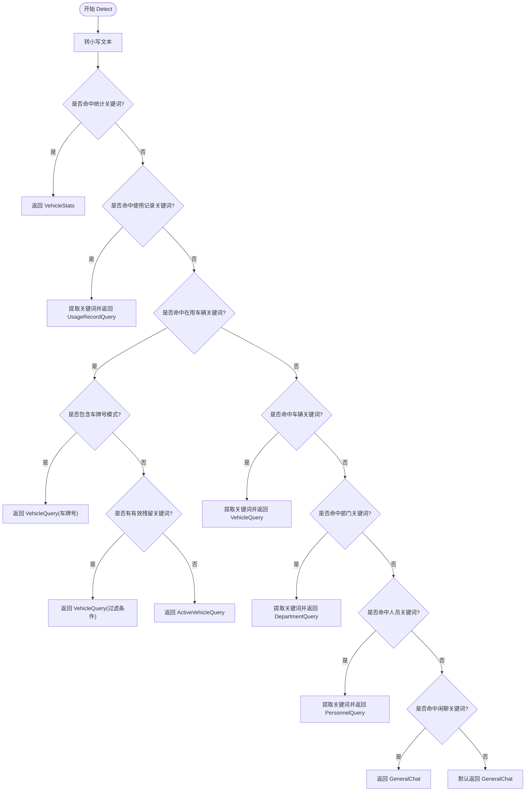
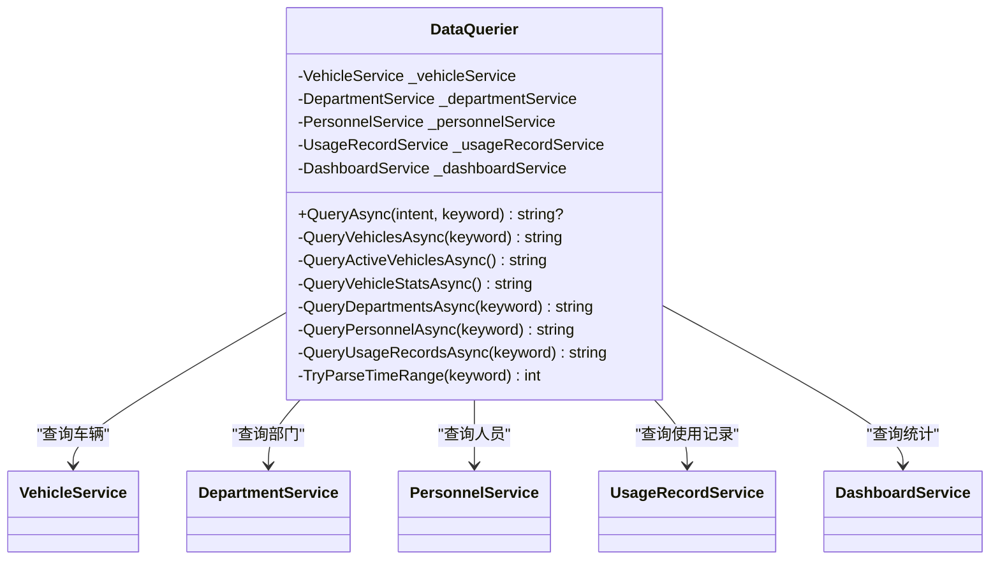
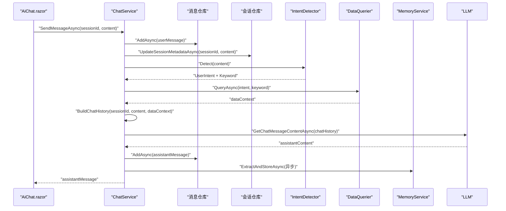
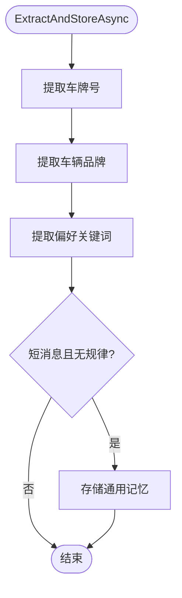
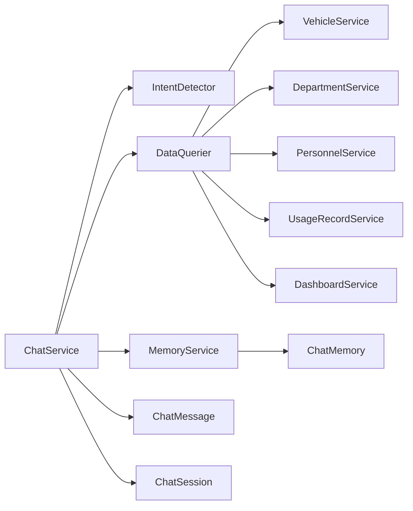

# AI 查询数据流

<cite>
**本文引用的文件**   
- [ChatService.cs](file://aiServer/BLL/ChatService.cs)
- [IntentDetector.cs](file://aiServer/BLL/IntentDetector.cs)
- [DataQuerier.cs](file://aiServer/BLL/DataQuerier.cs)
- [MemoryService.cs](file://aiServer/BLL/MemoryService.cs)
- [AiChat.razor](file://aiServer/Pages/AiChat.razor)
- [UserIntent.cs](file://aiServer/BLL/Enums/UserIntent.cs)
- [SystemPrompts.cs](file://aiServer/BLL/Prompts/SystemPrompts.cs)
- [VehicleService.cs](file://BLL/Vehicle/VehicleService.cs)
- [DepartmentService.cs](file://BLL/Department/DepartmentService.cs)
- [PersonnelService.cs](file://BLL/Personnel/PersonnelService.cs)
- [UsageRecordService.cs](file://BLL/UsageRecord/UsageRecordService.cs)
- [DashboardService.cs](file://BLL/Dashboard/DashboardService.cs)
- [ChatMessage.cs](file://aiServer/DAL/Model/ChatMessage.cs)
- [ChatSession.cs](file://aiServer/DAL/Model/ChatSession.cs)
- [ChatMemory.cs](file://aiServer/DAL/Model/ChatMemory.cs)
</cite>

## 目录
1. [引言](#引言)
2. [项目结构](#项目结构)
3. [核心组件](#核心组件)
4. [架构总览](#架构总览)
5. [详细组件分析](#详细组件分析)
6. [依赖关系分析](#依赖关系分析)
7. [性能与缓存策略](#性能与缓存策略)
8. [故障排查指南](#故障排查指南)
9. [结论](#结论)

## 引言
本文件面向 vehicleManagement 系统的 AI 查询能力，完整描述自然语言查询的处理链路：用户输入 → 意图识别器 → 数据查询器 → 业务服务 → 数据库 → 结果格式化 → LLM 回复 → 响应返回。重点说明 IntentDetector 如何解析用户意图并路由到相应查询处理器；DataQuerier 如何将自然语言转换为结构化查询（基于业务服务调用），以及会话管理与上下文维护机制（ChatService + MemoryService）。文档同时包含流程图、类图、时序图和数据转换示例，并给出性能优化与缓存建议。

## 项目结构
AI 查询相关代码主要位于 aiServer 层，采用“前端页面 + 对话服务 + 意图识别 + 数据查询 + 记忆管理”的分层组织方式：
- 前端页面 AiChat.razor 负责会话展示、消息发送与 UI 交互。
- ChatService 负责会话生命周期、消息持久化、构建聊天上下文、调用 LLM。
- IntentDetector 基于关键词匹配进行意图分类和关键词提取。
- DataQuerier 根据意图调用各业务服务完成数据查询，并将结果格式化为 LLM 可读文本。
- MemoryService 负责从对话中提取关键信息并构建历史记忆上下文。
- 业务服务 VehicleService / DepartmentService / PersonnelService / UsageRecordService / DashboardService 封装对数据库的访问逻辑。

图表来源
- [AiChat.razor:1-555](file://aiServer/Pages/AiChat.razor#L1-L555)
- [ChatService.cs:1-202](file://aiServer/BLL/ChatService.cs#L1-L202)
- [IntentDetector.cs:1-152](file://aiServer/BLL/IntentDetector.cs#L1-L152)
- [DataQuerier.cs:1-333](file://aiServer/BLL/DataQuerier.cs#L1-L333)
- [MemoryService.cs:1-224](file://aiServer/BLL/MemoryService.cs#L1-L224)
- [VehicleService.cs:1-241](file://BLL/Vehicle/VehicleService.cs#L1-L241)
- [DepartmentService.cs:1-147](file://BLL/Department/DepartmentService.cs#L1-L147)
- [PersonnelService.cs:1-142](file://BLL/Personnel/PersonnelService.cs#L1-L142)
- [UsageRecordService.cs:1-179](file://BLL/UsageRecord/UsageRecordService.cs#L1-L179)
- [DashboardService.cs:1-247](file://BLL/Dashboard/DashboardService.cs#L1-L247)
- [ChatSession.cs:1-39](file://aiServer/DAL/Model/ChatSession.cs#L1-L39)
- [ChatMessage.cs:1-51](file://aiServer/DAL/Model/ChatMessage.cs#L1-L51)
- [ChatMemory.cs:1-52](file://aiServer/DAL/Model/ChatMemory.cs#L1-L52)

章节来源
- [AiChat.razor:1-555](file://aiServer/Pages/AiChat.razor#L1-L555)
- [ChatService.cs:1-202](file://aiServer/BLL/ChatService.cs#L1-L202)

## 核心组件
- 意图识别器 IntentDetector：基于关键词匹配将用户输入映射为 UserIntent 枚举，并提取搜索关键词。
- 数据查询器 DataQuerier：根据意图分发到具体业务服务，统一格式化结果为 LLM 可读文本。
- 对话服务 ChatService：管理会话、消息、记忆，构建聊天上下文，调用 LLM，异步提取记忆。
- 记忆服务 MemoryService：从对话中抽取车牌、品牌、偏好等语义记忆，并构建记忆上下文。
- 业务服务：车辆、部门、人员、使用记录、仪表盘统计等服务，封装数据库访问与分页、排序、过滤逻辑。

章节来源
- [IntentDetector.cs:1-152](file://aiServer/BLL/IntentDetector.cs#L1-L152)
- [DataQuerier.cs:1-333](file://aiServer/BLL/DataQuerier.cs#L1-L333)
- [ChatService.cs:1-202](file://aiServer/BLL/ChatService.cs#L1-L202)
- [MemoryService.cs:1-224](file://aiServer/BLL/MemoryService.cs#L1-L224)
- [VehicleService.cs:1-241](file://BLL/Vehicle/VehicleService.cs#L1-L241)
- [DepartmentService.cs:1-147](file://BLL/Department/DepartmentService.cs#L1-L147)
- [PersonnelService.cs:1-142](file://BLL/Personnel/PersonnelService.cs#L1-L142)
- [UsageRecordService.cs:1-179](file://BLL/UsageRecord/UsageRecordService.cs#L1-L179)
- [DashboardService.cs:1-247](file://BLL/Dashboard/DashboardService.cs#L1-L247)

## 架构总览
下图展示一次完整的 AI 查询请求在系统中的流转路径，包括前端交互、意图识别、数据查询、LLM 调用与记忆存储。

图表来源
- [AiChat.razor:376-419](file://aiServer/Pages/AiChat.razor#L376-L419)
- [ChatService.cs:94-139](file://aiServer/BLL/ChatService.cs#L94-L139)
- [IntentDetector.cs:17-111](file://aiServer/BLL/IntentDetector.cs#L17-L111)
- [DataQuerier.cs:48-67](file://aiServer/BLL/DataQuerier.cs#L48-L67)
- [VehicleService.cs:67-109](file://BLL/Vehicle/VehicleService.cs#L67-L109)
- [DepartmentService.cs:41-76](file://BLL/Department/DepartmentService.cs#L41-L76)
- [PersonnelService.cs:39-74](file://BLL/Personnel/PersonnelService.cs#L39-L74)
- [UsageRecordService.cs:43-92](file://BLL/UsageRecord/UsageRecordService.cs#L43-L92)
- [DashboardService.cs:28-94](file://BLL/Dashboard/DashboardService.cs#L28-L94)

## 详细组件分析

### 意图识别器 IntentDetector
- 功能要点：
  - 基于关键词匹配判断用户意图，支持车辆统计、在用车辆、车辆查询、部门查询、人员查询、使用记录查询、通用问答等。
  - 自动提取搜索关键词，去除停用词与噪声字符，提高后续查询准确性。
  - 特殊处理车牌号正则匹配，避免误判为在用车辆查询。
- 复杂度与行为：
  - 时间复杂度近似 O(k·n)，k 为关键词数组长度，n 为输入文本长度；整体开销较小。
  - 优先级设计确保统计意图优先于具体查询，避免歧义。

图表来源
- [IntentDetector.cs:17-111](file://aiServer/BLL/IntentDetector.cs#L17-L111)

章节来源
- [IntentDetector.cs:1-152](file://aiServer/BLL/IntentDetector.cs#L1-L152)
- [UserIntent.cs:1-24](file://aiServer/BLL/Enums/UserIntent.cs#L1-L24)

### 数据查询器 DataQuerier
- 功能要点：
  - 根据 UserIntent 分发到对应业务服务方法，统一捕获异常并返回错误文本。
  - 将业务服务返回的数据对象格式化为 LLM 可读的文本上下文，限制最大结果数量以避免过长上下文。
  - 支持时间范围解析（如“最近一周”“三个月”）用于使用记录查询。
- 安全与白名单：
  - 当前实现不直接拼接 SQL，而是调用业务服务的受控 API，天然降低 SQL 注入风险。
  - 建议在业务服务层继续对关键字进行最小化校验与参数化查询，确保输入白名单与边界控制。

图表来源
- [DataQuerier.cs:21-333](file://aiServer/BLL/DataQuerier.cs#L21-L333)
- [VehicleService.cs:67-149](file://BLL/Vehicle/VehicleService.cs#L67-L149)
- [DepartmentService.cs:41-76](file://BLL/Department/DepartmentService.cs#L41-L76)
- [PersonnelService.cs:39-74](file://BLL/Personnel/PersonnelService.cs#L39-L74)
- [UsageRecordService.cs:43-120](file://BLL/UsageRecord/UsageRecordService.cs#L43-L120)
- [DashboardService.cs:28-94](file://BLL/Dashboard/DashboardService.cs#L28-L94)

章节来源
- [DataQuerier.cs:1-333](file://aiServer/BLL/DataQuerier.cs#L1-L333)

### 对话服务 ChatService
- 功能要点：
  - 会话管理：创建、删除、更新标题、获取会话列表与消息列表。
  - 核心对话流程：保存用户消息 → 意图识别 → 数据查询 → 构建聊天上下文（系统提示词 + 数据注入 + 记忆 + 最近消息）→ 调用 LLM → 保存助手消息 → 异步提取记忆。
  - 上下文构建：使用 SystemPrompts.Main 作为主导提示词，注入真实数据库查询结果，加载最近 MaxRecentMessages 条消息以维持对话连贯性。
  - LLM 调用：通过 Semantic Kernel 的 IChatCompletionService 获取回复，异常时返回友好错误信息。

图表来源
- [ChatService.cs:94-139](file://aiServer/BLL/ChatService.cs#L94-L139)
- [ChatService.cs:146-183](file://aiServer/BLL/ChatService.cs#L146-L183)
- [ChatService.cs:188-199](file://aiServer/BLL/ChatService.cs#L188-L199)
- [AiChat.razor:376-419](file://aiServer/Pages/AiChat.razor#L376-L419)

章节来源
- [ChatService.cs:1-202](file://aiServer/BLL/ChatService.cs#L1-L202)
- [SystemPrompts.cs:1-39](file://aiServer/BLL/Prompts/SystemPrompts.cs#L1-L39)

### 记忆服务 MemoryService
- 功能要点：
  - 从用户消息中抽取车牌号、车辆品牌、偏好习惯等语义记忆，按类别存储。
  - 提供模糊搜索与上下文构建，将相关记忆注入到聊天上下文中，增强个性化回答。
  - 非关键路径操作，失败不影响主对话流程。

图表来源
- [MemoryService.cs:45-113](file://aiServer/BLL/MemoryService.cs#L45-L113)

章节来源
- [MemoryService.cs:1-224](file://aiServer/BLL/MemoryService.cs#L1-L224)

### 数据转换示例
以下示例展示自然语言到结构化查询结果的转换过程（以“最近一周有哪些使用记录？”为例）：
- 用户输入：“最近一周有哪些使用记录？”
- 意图识别：UsageRecordQuery，关键词“最近一周”
- 时间范围解析：TryParseTimeRange 将“最近一周”映射为 7 天
- 数据查询：UsageRecordService.GetRecentAsync(days=7, page=1, pageSize=20)
- 结果格式化：DataQuerier 将分页结果转为人类可读文本，包含时间、车牌、驾驶员、部门、目的等信息
- 上下文注入：SystemPrompts.BuildDataInjectionPrompt 将查询结果注入 LLM 的系统消息
- LLM 回复：严格基于数据上下文生成中文回复，不编造不存在的信息

章节来源
- [DataQuerier.cs:230-330](file://aiServer/BLL/DataQuerier.cs#L230-L330)
- [UsageRecordService.cs:97-120](file://BLL/UsageRecord/UsageRecordService.cs#L97-L120)
- [SystemPrompts.cs:30-36](file://aiServer/BLL/Prompts/SystemPrompts.cs#L30-L36)

## 依赖关系分析
- 组件耦合：
  - ChatService 依赖 IntentDetector、DataQuerier、MemoryService 与消息/会话仓库。
  - DataQuerier 依赖各业务服务，但不直接访问数据库，保持职责清晰。
  - MemoryService 依赖记忆仓库与日志，独立于主对话流程。
- 外部依赖：
  - Semantic Kernel 的 IChatCompletionService 用于 LLM 调用。
  - EF Core 通过 IDbContextFactory 在各业务服务中创建 DbContext 访问数据库。
- 循环依赖：
  - 当前结构未发现循环依赖，分层清晰。

图表来源
- [ChatService.cs:1-202](file://aiServer/BLL/ChatService.cs#L1-L202)
- [DataQuerier.cs:1-333](file://aiServer/BLL/DataQuerier.cs#L1-L333)
- [MemoryService.cs:1-224](file://aiServer/BLL/MemoryService.cs#L1-L224)
- [ChatMessage.cs:1-51](file://aiServer/DAL/Model/ChatMessage.cs#L1-L51)
- [ChatSession.cs:1-39](file://aiServer/DAL/Model/ChatSession.cs#L1-L39)
- [ChatMemory.cs:1-52](file://aiServer/DAL/Model/ChatMemory.cs#L1-L52)

章节来源
- [ChatService.cs:1-202](file://aiServer/BLL/ChatService.cs#L1-L202)
- [DataQuerier.cs:1-333](file://aiServer/BLL/DataQuerier.cs#L1-L333)

## 性能与缓存策略
- 查询限制：
  - DataQuerier 设置 MaxQueryResults = 20，避免过长上下文影响 LLM 性能与成本。
- 分页与排序：
  - 各业务服务使用 Skip/Take 分页与 IQueryable 排序，减少内存占用与网络传输。
- 聚合优化：
  - DashboardService 使用 CountAsync 与 GroupBy 在数据库侧完成聚合，避免全表加载。
- 上下文裁剪：
  - ChatService 仅加载最近 MaxRecentMessages = 20 条消息，控制上下文大小。
- 异步记忆提取：
  - MemoryService.ExtractAndStoreAsync 在后台任务中执行，不阻塞主对话流程。
- 缓存建议：
  - 对高频统计查询（如车辆总数、部门分布、月度趋势）可引入应用级缓存（如 MemoryCache 或 Redis），设置合理过期时间。
  - 对常用记忆条目可按 Key 做短期缓存，减少重复检索开销。
  - 对 LLM 调用结果可进行去重与短时缓存，避免相同问题重复推理。

[本节为通用性能指导，不直接分析具体文件]

## 故障排查指南
- LLM 不可用：
  - ChatService.CallLlmAsync 捕获异常并返回友好错误信息，检查 Kernel 配置与 Ollama 服务状态。
- 数据查询异常：
  - DataQuerier.QueryAsync 捕获异常并返回错误文本，检查业务服务方法与数据库连接。
- 记忆提取失败：
  - MemoryService 记录警告日志，不影响主流程，检查记忆仓库与日志配置。
- 前端发送错误：
  - AiChat.razor.SendMessage 捕获异常并在本地添加助手错误消息，检查后端接口与网络状态。

章节来源
- [ChatService.cs:188-199](file://aiServer/BLL/ChatService.cs#L188-L199)
- [DataQuerier.cs:48-67](file://aiServer/BLL/DataQuerier.cs#L48-L67)
- [MemoryService.cs:109-113](file://aiServer/BLL/MemoryService.cs#L109-L113)
- [AiChat.razor:396-410](file://aiServer/Pages/AiChat.razor#L396-L410)

## 结论
vehicleManagement 的 AI 查询数据流通过清晰的层次划分与职责分离，实现了从自然语言到结构化查询再到 LLM 回复的完整闭环。IntentDetector 提供稳定的意图识别与关键词提取；DataQuerier 通过业务服务安全地访问数据库并格式化结果；ChatService 统一管理会话与上下文，结合 MemoryService 提升个性化体验。系统在性能方面已采取多项优化措施，并可进一步引入缓存以提升响应速度与降低成本。