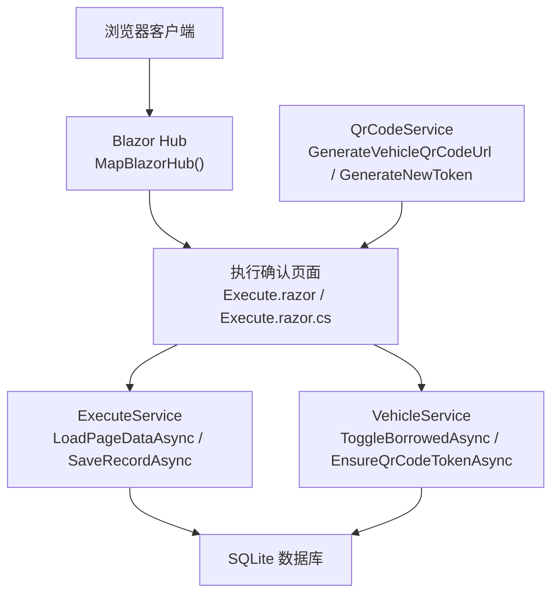
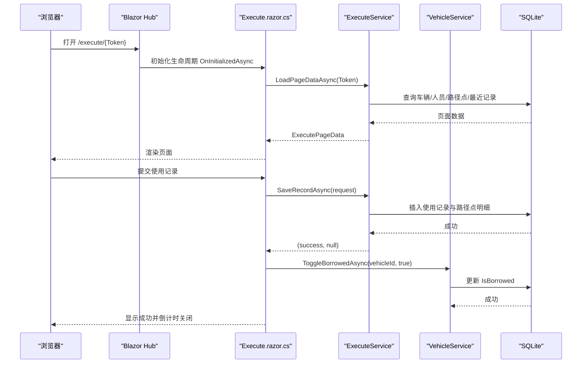
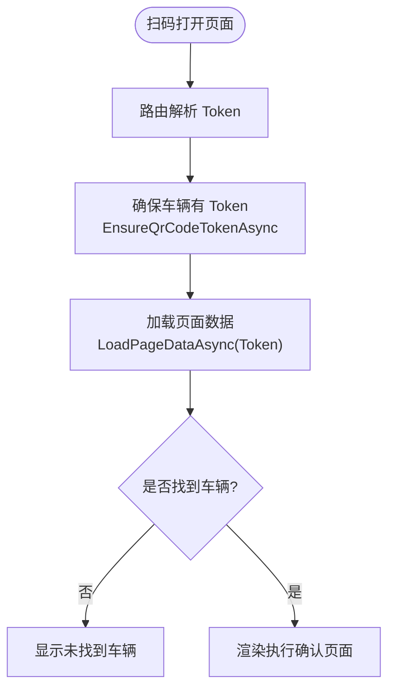
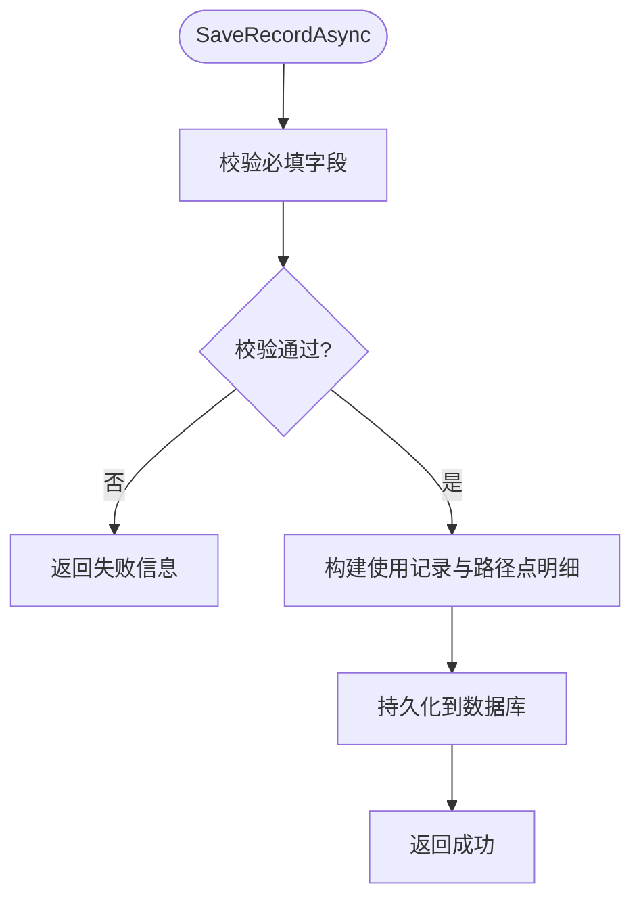
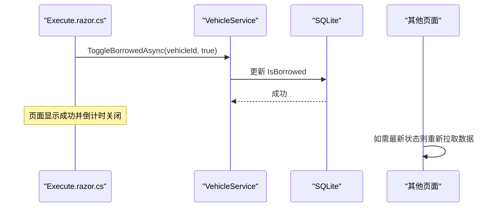
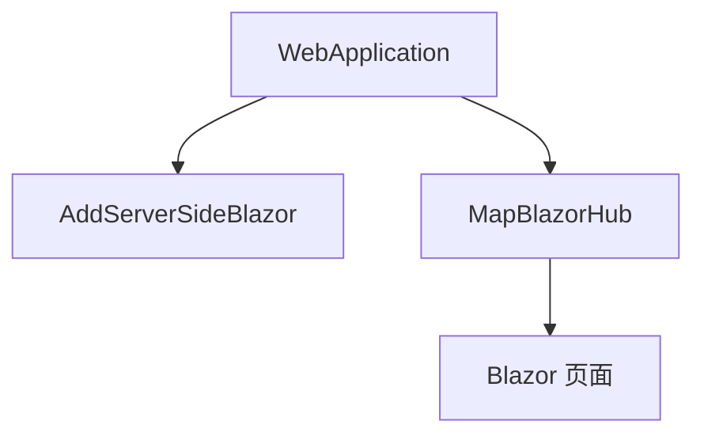
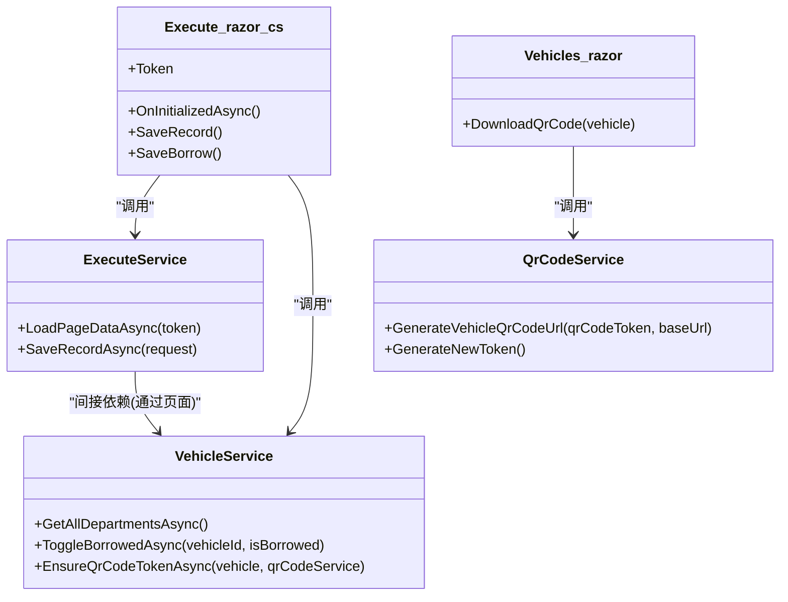

# 实时数据处理流

<cite>
**本文引用的文件**   
- [Program.cs](file://Program.cs)
- [Execute.razor.cs](file://Pages/Execute.razor.cs)
- [ExecuteService.cs](file://BLL/Execute/ExecuteService.cs)
- [VehicleService.cs](file://BLL/Vehicle/VehicleService.cs)
- [QrCodeService.cs](file://BLL/Common/QrCodeService.cs)
- [Vehicles.razor](file://Pages/Vehicles.razor)
- [Execute.razor](file://Pages/Execute.razor)
</cite>

## 目录
1. [引言](#引言)
2. [项目结构](#项目结构)
3. [核心组件](#核心组件)
4. [架构总览](#架构总览)
5. [详细组件分析](#详细组件分析)
6. [依赖关系分析](#依赖关系分析)
7. [性能与增量更新](#性能与增量更新)
8. [故障排查指南](#故障排查指南)
9. [结论](#结论)

## 引言
本文面向 vehicleManagement 系统的“执行确认页面”（扫码借车/登记使用）的实时数据处理流，重点说明以下目标：
- 扫码输入到 ExecuteService 的数据加载与保存流程。
- Blazor Server 下的连接与状态更新机制。
- Token 验证与二维码访问控制。
- 车辆借用状态与使用记录的变更如何影响 UI。
- 增量更新策略与避免全量刷新带来的性能问题。
- 断线重连、消息一致性与可观测性建议。

需要特别说明的是：当前代码库未实现基于 WebSocket 或 SignalR Hub 的自定义实时推送通道；系统通过 Blazor Server 的内置长连接进行服务端渲染与 UI 更新。因此，“实时”在当前实现中表现为：用户操作触发后端服务方法，Blazor Server 将变更后的状态回推至浏览器并刷新 UI。

## 项目结构
围绕执行确认页面的关键文件如下：
- 路由与页面逻辑：[Execute.razor](file://Pages/Execute.razor)、[Execute.razor.cs](file://Pages/Execute.razor.cs)
- 业务服务：[ExecuteService.cs](file://BLL/Execute/ExecuteService.cs)、[VehicleService.cs](file://BLL/Vehicle/VehicleService.cs)
- 二维码与 Token：[QrCodeService.cs](file://BLL/Common/QrCodeService.cs)
- 应用启动与 Blazor Hub：[Program.cs](file://Program.cs)
- 生成二维码入口：[Vehicles.razor](file://Pages/Vehicles.razor)

图表来源
- [Program.cs:142-146](file://Program.cs#L142-L146)
- [Execute.razor.cs:78-94](file://Pages/Execute.razor.cs#L78-L94)
- [ExecuteService.cs:30-70](file://BLL/Execute/ExecuteService.cs#L30-L70)
- [VehicleService.cs:54-62](file://BLL/Vehicle/VehicleService.cs#L54-L62)
- [QrCodeService.cs:27-39](file://BLL/Common/QrCodeService.cs#L27-L39)

章节来源
- [Program.cs:48-50](file://Program.cs#L48-L50)
- [Program.cs:142-146](file://Program.cs#L142-L146)
- [Execute.razor.cs:20-44](file://Pages/Execute.razor.cs#L20-L44)

## 核心组件
- 执行确认页面（Execute.razor / Execute.razor.cs）
  - 负责接收路由参数 Token，调用 ExecuteService.LoadPageDataAsync 加载车辆、人员、路径点等数据。
  - 处理文件上传、表单校验、保存使用记录、维修记录、借车登记等交互。
  - 保存成功后进入倒计时自动关闭流程。
- 执行服务（ExecuteService）
  - 根据 Token 查询车辆及关联部门、人员、路径点。
  - 预填起始里程为最近一次使用记录的结束里程。
  - 保存使用记录时写入主表与顺序化的途经路径点明细。
- 车辆服务（VehicleService）
  - 提供按 Token 获取车辆、切换借用状态、确保二维码 Token 存在等方法。
- 二维码服务（QrCodeService）
  - 生成二维码图片、Base64 与访问 URL（包含 Token）。
- 应用启动（Program.cs）
  - 注册 Blazor Server、DbContextFactory、仓储与服务。
  - 启用 MapBlazorHub 以支持 Blazor 实时通信。

章节来源
- [Execute.razor.cs:78-94](file://Pages/Execute.razor.cs#L78-L94)
- [ExecuteService.cs:30-70](file://BLL/Execute/ExecuteService.cs#L30-L70)
- [ExecuteService.cs:75-125](file://BLL/Execute/ExecuteService.cs#L75-L125)
- [VehicleService.cs:54-62](file://BLL/Vehicle/VehicleService.cs#L54-L62)
- [VehicleService.cs:130-136](file://BLL/Vehicle/VehicleService.cs#L130-L136)
- [QrCodeService.cs:27-39](file://BLL/Common/QrCodeService.cs#L27-L39)
- [Program.cs:48-50](file://Program.cs#L48-L50)
- [Program.cs:142-146](file://Program.cs#L142-L146)

## 架构总览
执行确认页面的实时数据流由“请求-响应 + Blazor Server 长连接”驱动：
- 扫码打开页面后，前端通过 Blazor Hub 建立与服务器的持久连接。
- 页面初始化时调用后端服务加载数据，服务器将结果注入页面状态并渲染 UI。
- 用户提交表单后，后端服务写入数据库，页面状态更新并触发 UI 刷新。
- 若涉及车辆借用状态变更，其他页面可通过重新拉取数据获得最新状态。

图表来源
- [Execute.razor.cs:78-94](file://Pages/Execute.razor.cs#L78-L94)
- [Execute.razor.cs:131-149](file://Pages/Execute.razor.cs#L131-L149)
- [Execute.razor.cs:227-251](file://Pages/Execute.razor.cs#L227-L251)
- [ExecuteService.cs:30-70](file://BLL/Execute/ExecuteService.cs#L30-L70)
- [ExecuteService.cs:75-125](file://BLL/Execute/ExecuteService.cs#L75-L125)
- [VehicleService.cs:54-62](file://BLL/Vehicle/VehicleService.cs#L54-L62)
- [Program.cs:142-146](file://Program.cs#L142-L146)

## 详细组件分析

### 扫码输入与 Token 验证流程
- 二维码 URL 由 QrCodeService.GenerateVehicleQrCodeUrl 生成，格式为 /execute/{qrCodeToken}。
- Vehicles.razor 在下载二维码前调用 VehicleService.EnsureQrCodeTokenAsync 确保车辆拥有 Token。
- Execute.razor.cs 在 OnInitializedAsync 中读取路由参数 Token，并调用 ExecuteService.LoadPageDataAsync 验证 Token 有效性并加载页面数据。
- 若 Token 无效或未找到车辆，页面显示“未找到车辆”。

图表来源
- [QrCodeService.cs:27-39](file://BLL/Common/QrCodeService.cs#L27-L39)
- [VehicleService.cs:230-238](file://BLL/Vehicle/VehicleService.cs#L230-L238)
- [Execute.razor.cs:78-94](file://Pages/Execute.razor.cs#L78-L94)
- [ExecuteService.cs:30-40](file://BLL/Execute/ExecuteService.cs#L30-L40)

章节来源
- [QrCodeService.cs:27-39](file://BLL/Common/QrCodeService.cs#L27-L39)
- [Vehicles.razor:336-357](file://Pages/Vehicles.razor#L336-L357)
- [VehicleService.cs:230-238](file://BLL/Vehicle/VehicleService.cs#L230-L238)
- [Execute.razor.cs:78-94](file://Pages/Execute.razor.cs#L78-L94)
- [ExecuteService.cs:30-40](file://BLL/Execute/ExecuteService.cs#L30-L40)

### 执行服务的数据加载与保存
- 数据加载：
  - 根据 Token 查询车辆及其部门。
  - 查询该部门在职人员列表。
  - 查询激活的路径点与最终停车位置。
  - 预填起始里程为最近一条使用记录的结束里程。
- 数据保存：
  - 校验必填项（人员、路径点、最终位置）。
  - 写入使用记录主表与顺序化的路径点明细。
  - 返回成功/失败结果给页面。

图表来源
- [ExecuteService.cs:75-125](file://BLL/Execute/ExecuteService.cs#L75-L125)

章节来源
- [ExecuteService.cs:30-70](file://BLL/Execute/ExecuteService.cs#L30-L70)
- [ExecuteService.cs:75-125](file://BLL/Execute/ExecuteService.cs#L75-L125)

### 车辆借用状态与 UI 刷新
- 借车登记成功后，页面调用 VehicleService.ToggleBorrowedAsync 将车辆的 IsBorrowed 设置为 true。
- 其他页面（如车辆列表）如需反映最新状态，应重新拉取数据或通过 Blazor Server 的连接机制刷新 UI。
- 当前实现中，Execute.razor.cs 在保存成功后进入倒计时并尝试关闭页面，不直接订阅全局状态变化。

图表来源
- [Execute.razor.cs:227-251](file://Pages/Execute.razor.cs#L227-L251)
- [VehicleService.cs:54-62](file://BLL/Vehicle/VehicleService.cs#L54-L62)

章节来源
- [Execute.razor.cs:227-251](file://Pages/Execute.razor.cs#L227-L251)
- [VehicleService.cs:54-62](file://BLL/Vehicle/VehicleService.cs#L54-L62)

### Blazor Server 连接管理与实时通信
- Program.cs 中注册了 AddServerSideBlazor 与 MapBlazorHub，启用 Blazor Server 的实时通信能力。
- 页面与服务端之间的状态同步由框架维护：当服务端状态变更后，UI 会自动刷新。
- 当前未实现自定义 Hub 或消息队列；实时性体现在“请求-响应后立即刷新 UI”。

图表来源
- [Program.cs:48-50](file://Program.cs#L48-L50)
- [Program.cs:142-146](file://Program.cs#L142-L146)

章节来源
- [Program.cs:48-50](file://Program.cs#L48-L50)
- [Program.cs:142-146](file://Program.cs#L142-L146)

## 依赖关系分析
- Execute.razor.cs 依赖：
  - ExecuteService：加载页面数据与保存使用记录。
  - VehicleService：获取部门列表、切换借用状态。
  - MaintenanceRecordService：创建维修记录。
  - LocationService：获取路径点与最终位置。
  - FileUploadService：上传附件。
  - IJSRuntime：调用 JS 关闭页面或下载图片。
- ExecuteService 依赖：
  - IDbContextFactory<VehicleDbContext>：数据库上下文工厂。
  - LocationService：获取激活的路径点与最终位置。
- VehicleService 依赖：
  - VehicleRepository、DepartmentRepository：数据访问。
  - FileUploadService：清理附件。
  - ILogger：日志记录。
- QrCodeService 被 Vehicles.razor 用于生成二维码与 URL。

图表来源
- [Execute.razor.cs:78-94](file://Pages/Execute.razor.cs#L78-L94)
- [Execute.razor.cs:131-149](file://Pages/Execute.razor.cs#L131-L149)
- [Execute.razor.cs:227-251](file://Pages/Execute.razor.cs#L227-L251)
- [ExecuteService.cs:30-70](file://BLL/Execute/ExecuteService.cs#L30-L70)
- [ExecuteService.cs:75-125](file://BLL/Execute/ExecuteService.cs#L75-L125)
- [VehicleService.cs:54-62](file://BLL/Vehicle/VehicleService.cs#L54-L62)
- [VehicleService.cs:230-238](file://BLL/Vehicle/VehicleService.cs#L230-L238)
- [QrCodeService.cs:27-39](file://BLL/Common/QrCodeService.cs#L27-L39)
- [Vehicles.razor:336-357](file://Pages/Vehicles.razor#L336-L357)

章节来源
- [Execute.razor.cs:78-94](file://Pages/Execute.razor.cs#L78-L94)
- [ExecuteService.cs:30-70](file://BLL/Execute/ExecuteService.cs#L30-L70)
- [VehicleService.cs:54-62](file://BLL/Vehicle/VehicleService.cs#L54-L62)
- [QrCodeService.cs:27-39](file://BLL/Common/QrCodeService.cs#L27-L39)
- [Vehicles.razor:336-357](file://Pages/Vehicles.razor#L336-L357)

## 性能与增量更新
- 当前实现采用“按需加载 + 局部刷新”的模式：
  - 页面初始化仅加载必要数据（车辆、人员、路径点、最近记录）。
  - 保存成功后仅更新本地状态并触发 UI 刷新，不进行全量数据拉取。
- 为避免全量刷新带来的性能问题，建议：
  - 在服务层提供增量接口（例如只返回变更的车辆 ID 或状态片段），由页面合并更新。
  - 对频繁变化的数据（如车辆借用状态）引入缓存与失效策略，减少重复查询。
  - 在 Blazor Server 中尽量复用已加载数据，仅在必要时重新查询数据库。
- 当前代码未实现消息队列或增量推送；如需扩展，可在服务层增加事件总线或轻量级内存缓存，并在页面侧监听变更事件。

[本节为通用性能建议，不直接分析具体文件]

## 故障排查指南
- Token 无效或车辆不存在：
  - 检查 Vehicles.razor 是否正确调用 EnsureQrCodeTokenAsync。
  - 检查 QrCodeService.GenerateVehicleQrCodeUrl 生成的 URL 是否包含正确的 Token。
  - 检查 ExecuteService.LoadPageDataAsync 是否能根据 Token 查到车辆。
- 保存使用记录失败：
  - 检查必填字段校验逻辑（人员、路径点、最终位置）。
  - 检查数据库事务与 EF Core 保存逻辑。
- 借用状态未更新：
  - 检查 VehicleService.ToggleBorrowedAsync 是否被调用且成功。
  - 检查其他页面是否需要重新拉取数据以反映最新状态。
- Blazor 连接异常：
  - 检查 Program.cs 是否正确注册 AddServerSideBlazor 与 MapBlazorHub。
  - 查看日志输出（Serilog）定位错误。

章节来源
- [Vehicles.razor:336-357](file://Pages/Vehicles.razor#L336-L357)
- [QrCodeService.cs:27-39](file://BLL/Common/QrCodeService.cs#L27-L39)
- [ExecuteService.cs:30-40](file://BLL/Execute/ExecuteService.cs#L30-L40)
- [ExecuteService.cs:75-125](file://BLL/Execute/ExecuteService.cs#L75-L125)
- [VehicleService.cs:54-62](file://BLL/Vehicle/VehicleService.cs#L54-L62)
- [Program.cs:48-50](file://Program.cs#L48-L50)
- [Program.cs:142-146](file://Program.cs#L142-L146)

## 结论
vehicleManagement 的执行确认页面通过 Blazor Server 的内置实时通信机制实现了扫码输入 → ExecuteService → 状态更新 → UI 刷新的完整流程。当前实现未使用自定义 WebSocket 或 SignalR Hub，而是依赖框架提供的长连接进行状态同步。Token 验证通过 QrCodeService 与 ExecuteService 协作完成，车辆借用状态通过 VehicleService 更新。为进一步提升实时性与性能，建议在服务层引入增量更新与缓存策略，并在页面侧进行局部状态合并，以减少全量数据刷新带来的开销。