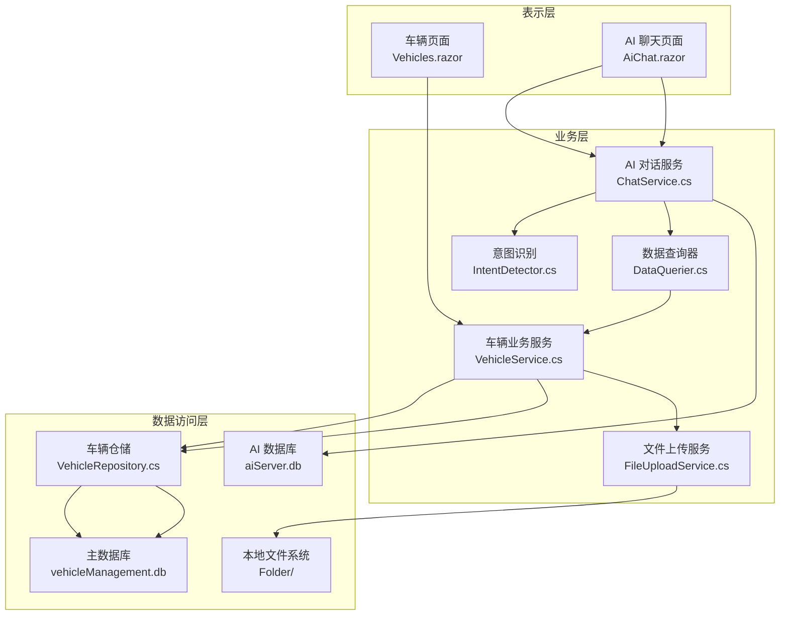
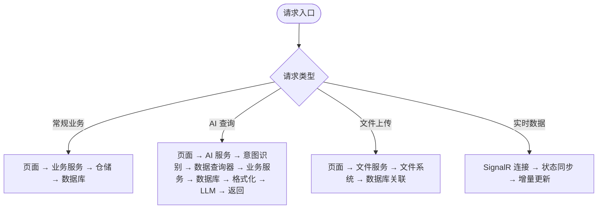
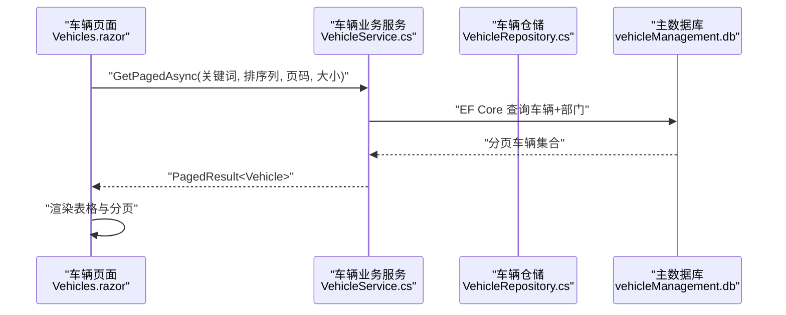
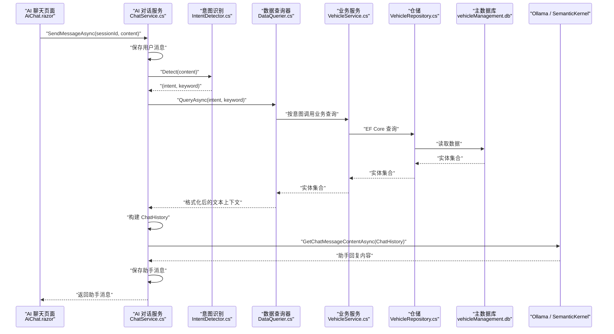
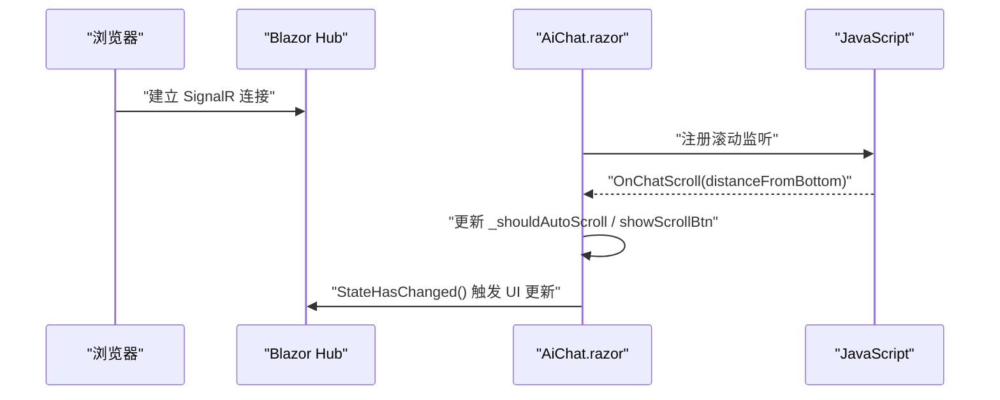
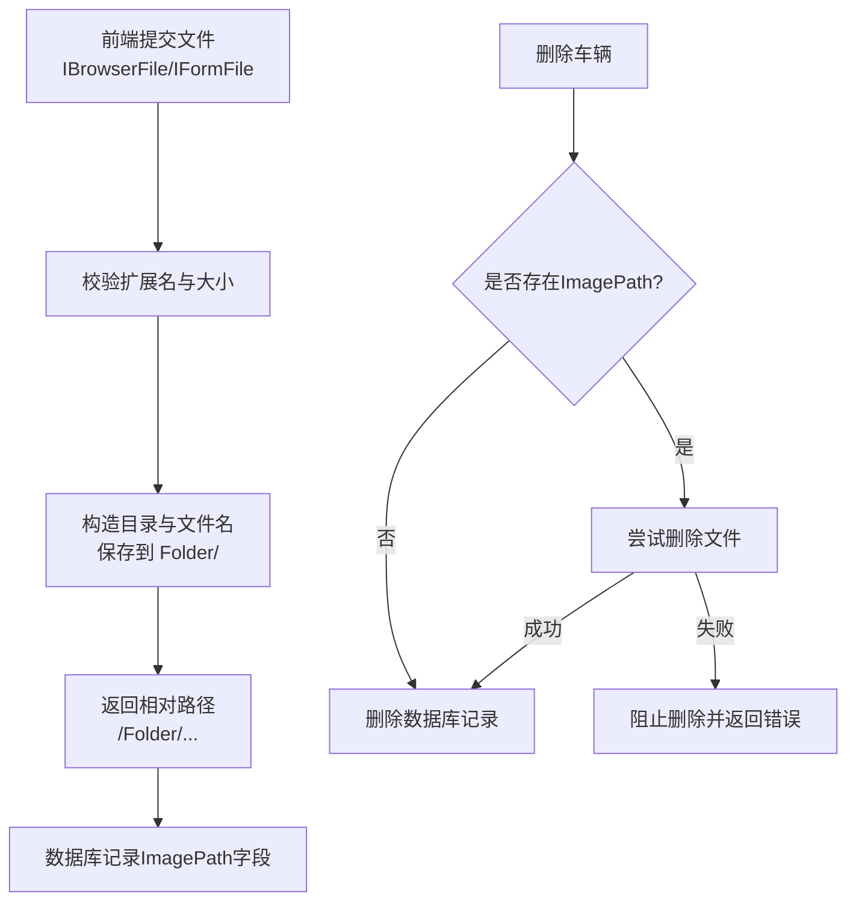
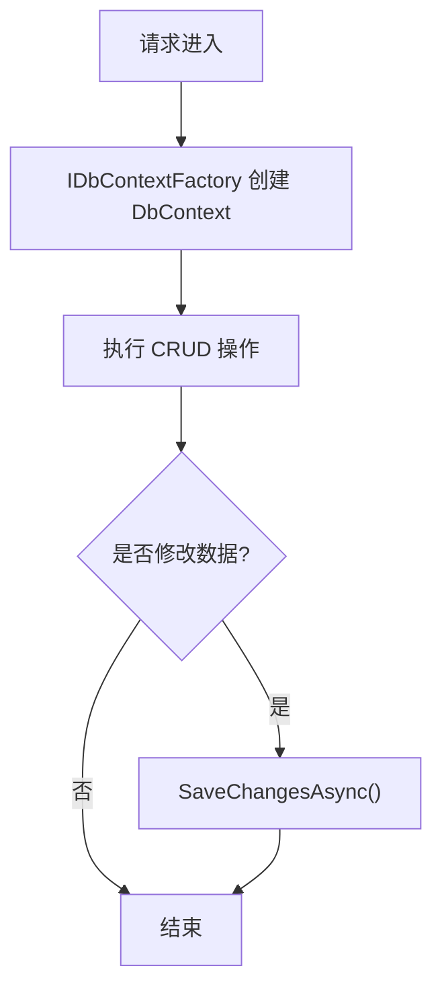
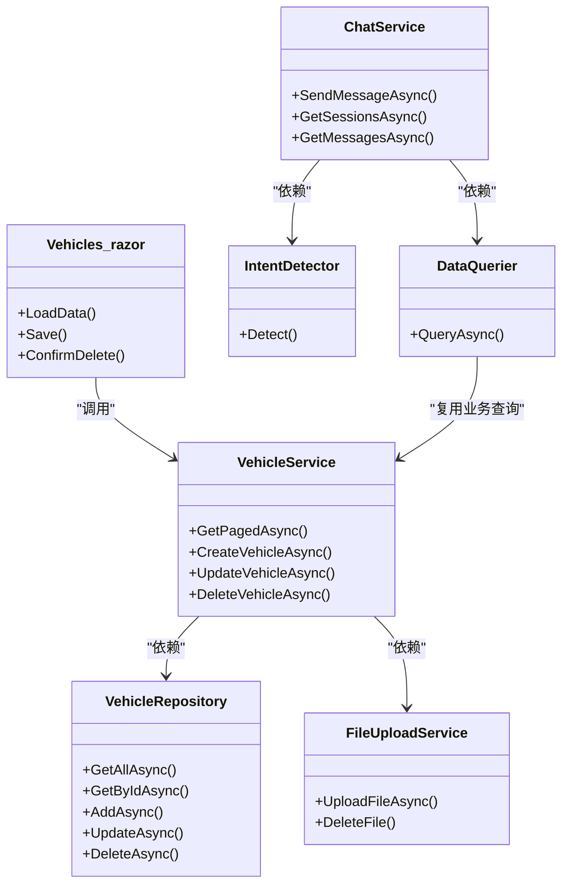

# 数据流设计

<cite>
**本文引用的文件**   
- [Program.cs](file://Program.cs)
- [appsettings.json](file://appsettings.json)
- [Vehicles.razor](file://Pages/Vehicles.razor)
- [VehicleService.cs](file://BLL/Vehicle/VehicleService.cs)
- [VehicleRepository.cs](file://DAL/Repository/VehicleRepository.cs)
- [Vehicle.cs](file://DAL/Model/Vehicle.cs)
- [FileUploadService.cs](file://BLL/Common/FileUploadService.cs)
- [AiChat.razor](file://aiServer/Pages/AiChat.razor)
- [ChatService.cs](file://aiServer/BLL/ChatService.cs)
- [IntentDetector.cs](file://aiServer/BLL/IntentDetector.cs)
- [DataQuerier.cs](file://aiServer/BLL/DataQuerier.cs)
</cite>

## 目录
1. [引言](#引言)
2. [项目结构与数据边界](#项目结构与数据边界)
3. [核心数据流总览](#核心数据流总览)
4. [常规业务请求数据流：Blazor 页面到数据库](#常规业务请求数据流blazor-页面到数据库)
5. [AI 查询数据流：自然语言到结果返回](#ai-查询数据流自然语言到结果返回)
6. [实时数据与 WebSocket 连接说明](#实时数据与-websocket-连接说明)
7. [文件上传数据流：前端到文件系统再到数据库关联](#文件上传数据流前端到文件系统再到数据库关联)
8. [缓存策略、事务与一致性保证](#缓存策略事务与一致性保证)
9. [依赖关系与架构视图](#依赖关系与架构视图)
10. [性能优化点与瓶颈分析](#性能优化点与瓶颈分析)
11. [故障排查指南](#故障排查指南)
12. [结论](#结论)

## 引言
本数据流设计文档面向 vehicleManagement 系统，重点描述四类关键数据路径：
- 常规业务请求：Blazor 页面 → 业务服务 → 仓储层 → 数据库。
- AI 查询请求：自然语言输入 → 意图识别 → 数据查询器 → 业务服务 → 数据库 → 结果格式化 → LLM 回复 → 响应返回。
- 实时数据：基于 Blazor Server 的 SignalR 连接管理、状态同步与增量更新机制。
- 文件上传：前端组件 → 文件服务 → 文件系统 → 数据库关联记录。

同时说明内存缓存、数据库事务、并发控制等一致性与性能相关设计，并给出数据流图与时序图，帮助读者从高层到代码层理解系统行为。

## 项目结构与数据边界
vehicleManagement 采用分层架构：
- 表示层：Blazor 页面，负责用户交互、表单校验、分页、排序、错误提示。
- 业务层：各领域 Service，封装业务规则、跨仓储协调、权限校验、附件清理等。
- 数据访问层：Repository + EF Core DbContext，负责持久化操作。
- AI 子系统：独立 ChatService、IntentDetector、DataQuerier，复用主系统业务服务进行数据查询，并通过 Semantic Kernel 调用 Ollama。
- 存储：SQLite 数据库（主系统与 AI 系统分别使用不同数据库文件），以及本地文件系统用于上传附件。

**图表来源**
- [Program.cs:48-102](file://Program.cs#L48-L102)
- [appsettings.json:3-6](file://appsettings.json#L3-L6)
- [Vehicles.razor:1-10](file://Pages/Vehicles.razor#L1-L10)
- [AiChat.razor:1-10](file://aiServer/Pages/AiChat.razor#L1-L10)

**章节来源**
- [Program.cs:48-102](file://Program.cs#L48-L102)
- [appsettings.json:3-6](file://appsettings.json#L3-L6)

## 核心数据流总览
系统存在两条主要数据流：
1. 常规业务数据流：用户通过 Blazor 页面发起增删改查，参数经业务服务校验和转换后进入仓储层，最终由 EF Core 写入 SQLite。
2. AI 查询数据流：用户在 AI 聊天页面输入自然语言，系统先识别意图，再调用数据查询器，后者复用业务服务查询主数据库，将结构化结果格式化为自然语言上下文，最后交给 LLM 生成回复。

此外，文件上传走“前端 → 文件服务 → 文件系统”的路径，并在删除等业务场景中触发文件清理；实时数据通过 Blazor Server 的 SignalR 通道维持长连接，实现页面状态增量更新。

[本图为概念性流程示意，不直接映射具体源码文件]

## 常规业务请求数据流：Blazor 页面到数据库
以车辆列表加载为例，典型流程如下：
- 页面初始化时调用业务服务的分页查询方法。
- 业务服务构建带部门信息的查询表达式，执行搜索过滤、排序、分页。
- 仓储层通过 IDbContextFactory 创建 DbContext，执行 EF Core 查询。
- 结果包装为分页对象返回给页面，页面渲染表格与分页控件。

**图表来源**
- [Vehicles.razor:215-227](file://Pages/Vehicles.razor#L215-L227)
- [VehicleService.cs:67-109](file://BLL/Vehicle/VehicleService.cs#L67-L109)
- [VehicleRepository.cs:19-23](file://DAL/Repository/VehicleRepository.cs#L19-L23)

### 参数传递与结果返回
- 页面传递搜索关键词、排序字段、排序方向、当前页码、每页大小。
- 业务服务根据排序字段动态切换 OrderBy/ThenBy，并计算总数与页码边界。
- 仓储层通过 IDbContextFactory 获取 DbContext，避免 Blazor Server 并发冲突。
- 结果以 PagedResult 形式返回，包含 Items、TotalCount、CurrentPage、PageSize。

**章节来源**
- [Vehicles.razor:215-227](file://Pages/Vehicles.razor#L215-L227)
- [VehicleService.cs:67-109](file://BLL/Vehicle/VehicleService.cs#L67-L109)
- [VehicleRepository.cs:19-23](file://DAL/Repository/VehicleRepository.cs#L19-L23)

### 异常处理
- 页面在保存或删除等操作中捕获异常并显示错误弹窗。
- 业务服务在删除车辆时检查是否存在使用记录，若存在则阻止删除并返回错误信息。
- 文件删除失败时记录日志并返回失败原因，防止不一致的数据与文件残留。

**章节来源**
- [Vehicles.razor:327-330](file://Pages/Vehicles.razor#L327-L330)
- [VehicleService.cs:171-201](file://BLL/Vehicle/VehicleService.cs#L171-L201)

## AI 查询数据流：自然语言到结果返回
AI 查询的核心链路是：
- 用户在 AiChat.razor 中输入消息。
- ChatService.SendMessageAsync 保存用户消息、自动更新会话标题。
- IntentDetector.Detect 解析意图与关键词。
- DataQuerier.QueryAsync 根据意图调用对应业务服务查询主数据库。
- ChatService 构建聊天历史（系统提示词、数据注入、记忆上下文、最近消息）。
- 调用 Semantic Kernel 的 IChatCompletionService 获取 LLM 回复。
- 保存助手消息，并异步提取记忆。

**图表来源**
- [AiChat.razor:376-419](file://aiServer/Pages/AiChat.razor#L376-L419)
- [ChatService.cs:94-139](file://aiServer/BLL/ChatService.cs#L94-L139)
- [IntentDetector.cs:17-111](file://aiServer/BLL/IntentDetector.cs#L17-L111)
- [DataQuerier.cs:48-67](file://aiServer/BLL/DataQuerier.cs#L48-L67)
- [VehicleService.cs:67-109](file://BLL/Vehicle/VehicleService.cs#L67-L109)
- [VehicleRepository.cs:19-23](file://DAL/Repository/VehicleRepository.cs#L19-L23)

### 意图识别与关键词提取
IntentDetector 通过关键词匹配判断用户意图，包括：
- 车辆统计、在用车辆查询、普通车辆查询、部门查询、人员查询、使用记录查询、通用闲聊。
- 对车牌号模式进行正则匹配，优先识别为车辆查询。
- 去除停用词与噪声字符，提取有效关键词供后续查询使用。

**章节来源**
- [IntentDetector.cs:17-111](file://aiServer/BLL/IntentDetector.cs#L17-L111)

### 数据查询与结果格式化
DataQuerier 根据意图分发到具体查询方法：
- 车辆查询：调用 VehicleService.GetPagedAsync 或 GetActiveVehiclesAsync，并将枚举状态转换为中文文本。
- 部门查询：可交叉查询部门下的人员。
- 人员查询：可交叉查询人员用车记录。
- 使用记录查询：支持时间范围关键词解析，如“最近一周”“上个月”。

**章节来源**
- [DataQuerier.cs:48-67](file://aiServer/BLL/DataQuerier.cs#L48-L67)
- [DataQuerier.cs:69-143](file://aiServer/BLL/DataQuerier.cs#L69-L143)
- [DataQuerier.cs:145-227](file://aiServer/BLL/DataQuerier.cs#L145-L227)
- [DataQuerier.cs:230-267](file://aiServer/BLL/DataQuerier.cs#L230-L267)
- [DataQuerier.cs:272-330](file://aiServer/BLL/DataQuerier.cs#L272-L330)

### LLM 调用与异常处理
ChatService 构建 ChatHistory 后调用 IChatCompletionService，若模型不可用则返回友好错误信息；同时异步提取记忆，不影响主流程。

**章节来源**
- [ChatService.cs:158-199](file://aiServer/BLL/ChatService.cs#L158-L199)

## 实时数据与 WebSocket 连接说明
vehicleManagement 使用 Blazor Server，其底层通过 SignalR 建立 WebSocket 连接，维持服务器端组件状态与客户端 UI 的双向通信。当前代码未显式定义自定义 WebSocket 处理器，但页面中的滚动监听、发送消息、状态刷新等行为均依赖 Blazor Server 的连接通道。

关键点：
- Program.cs 注册 ServerSideBlazor，启用 Blazor Hub。
- AiChat.razor 通过 JS 调用 DotNetObjectReference 回调 OnChatScroll，实现滚动位置同步。
- 页面状态变量（如 isSending、messages、sessions）在服务端维护，变更时触发 UI 重绘。

**图表来源**
- [Program.cs:48-49](file://Program.cs#L48-L49)
- [AiChat.razor:279-327](file://aiServer/Pages/AiChat.razor#L279-L327)

**章节来源**
- [Program.cs:48-49](file://Program.cs#L48-L49)
- [AiChat.razor:279-327](file://aiServer/Pages/AiChat.razor#L279-L327)

## 文件上传数据流：前端到文件系统再到数据库关联
文件上传由 FileUploadService 统一处理，支持 IFormFile 与 IBrowserFile：
- 校验文件扩展名与大小限制。
- 按部门、车牌、人员、日期组织目录结构。
- 生成唯一文件名并保存到 Folder 根目录下的相对路径。
- 返回可用于静态文件访问的 URL 路径。

删除车辆时，业务服务会尝试删除关联图片，若失败则阻止数据库删除，确保数据与文件一致性。

**图表来源**
- [FileUploadService.cs:29-46](file://BLL/Common/FileUploadService.cs#L29-L46)
- [FileUploadService.cs:69-110](file://BLL/Common/FileUploadService.cs#L69-L110)
- [VehicleService.cs:171-201](file://BLL/Vehicle/VehicleService.cs#L171-L201)
- [Vehicle.cs:36-36](file://DAL/Model/Vehicle.cs#L36-L36)

**章节来源**
- [FileUploadService.cs:29-46](file://BLL/Common/FileUploadService.cs#L29-L46)
- [FileUploadService.cs:69-110](file://BLL/Common/FileUploadService.cs#L69-L110)
- [VehicleService.cs:171-201](file://BLL/Vehicle/VehicleService.cs#L171-L201)
- [Vehicle.cs:36-36](file://DAL/Model/Vehicle.cs#L36-L36)

## 缓存策略、事务与一致性保证
- 内存缓存：当前代码未引入显式内存缓存（如 IMemoryCache），主要依赖 EF Core 的查询与分页。
- 数据库事务：仓储层每个方法内创建 DbContext 并调用 SaveChangesAsync，属于单操作事务；业务层在删除车辆时先清理文件再删除记录，保证文件与数据库的一致性。
- 并发控制：使用 IDbContextFactory 为每个请求创建独立 DbContext，避免 Blazor Server 并发场景下的共享 DbContext 冲突。
- 配置与启动：Program.cs 在应用启动时确保 data 目录与数据库表存在，开发环境初始化种子数据。

**图表来源**
- [VehicleRepository.cs:19-56](file://DAL/Repository/VehicleRepository.cs#L19-L56)
- [Program.cs:52-58](file://Program.cs#L52-L58)
- [Program.cs:109-125](file://Program.cs#L109-L125)

**章节来源**
- [VehicleRepository.cs:19-56](file://DAL/Repository/VehicleRepository.cs#L19-L56)
- [Program.cs:52-58](file://Program.cs#L52-L58)
- [Program.cs:109-125](file://Program.cs#L109-L125)

## 依赖关系与架构视图
从依赖角度看：
- Vehicles.razor 依赖 VehicleService。
- VehicleService 依赖 VehicleRepository、DepartmentRepository、FileUploadService、ILogger。
- ChatService 依赖 ChatSessionRepository、ChatMessageRepository、MemoryService、DataQuerier、Kernel。
- DataQuerier 依赖多个业务服务（VehicleService、DepartmentService、PersonnelService、UsageRecordService、DashboardService）。
- Program.cs 注册所有服务与 DbContextFactory，并挂载静态文件与 Blazor Hub。

**图表来源**
- [Vehicles.razor:1-10](file://Pages/Vehicles.razor#L1-L10)
- [VehicleService.cs:18-38](file://BLL/Vehicle/VehicleService.cs#L18-L38)
- [VehicleRepository.cs:10-17](file://DAL/Repository/VehicleRepository.cs#L10-L17)
- [FileUploadService.cs:12-27](file://BLL/Common/FileUploadService.cs#L12-L27)
- [ChatService.cs:18-42](file://aiServer/BLL/ChatService.cs#L18-L42)
- [IntentDetector.cs:12-17](file://aiServer/BLL/IntentDetector.cs#L12-L17)
- [DataQuerier.cs:21-43](file://aiServer/BLL/DataQuerier.cs#L21-L43)

**章节来源**
- [Program.cs:60-95](file://Program.cs#L60-L95)
- [VehicleService.cs:18-38](file://BLL/Vehicle/VehicleService.cs#L18-L38)
- [ChatService.cs:18-42](file://aiServer/BLL/ChatService.cs#L18-L42)

## 性能优化点与瓶颈分析
- 分页与排序：VehicleService.GetPagedAsync 在数据库侧完成过滤、排序与分页，减少数据传输量。
- 最大查询结果限制：DataQuerier 设置 MaxQueryResults=20，避免 LLM 上下文过大导致响应缓慢。
- 时间范围解析：DataQuerier.TryParseTimeRange 将自然语言时间转换为天数，减少后端复杂逻辑。
- 文件上传大小限制：FileUploadService 对图片与视频分别设置上限，防止大文件阻塞请求。
- Blazor Server 并发：使用 IDbContextFactory 避免 DbContext 共享导致的并发异常。
- 潜在瓶颈：
  - AI 查询链路较长，涉及意图识别、多次业务查询、LLM 调用，延迟较高。
  - 文件上传与删除涉及文件系统 IO，需关注磁盘性能与权限。
  - 大量分页查询可能产生较多 SQL 语句，建议结合索引优化。

[本节为通用性能讨论，不直接分析具体代码片段]

## 故障排查指南
- 页面保存失败：检查 Vehicles.razor 中的异常捕获与错误弹窗逻辑，确认业务服务返回的错误信息。
- 删除车辆失败：查看 VehicleService.DeleteVehicleAsync 的业务校验与文件删除逻辑，确认是否存在使用记录或文件占用。
- AI 回复为空或错误：检查 ChatService.CallLlmAsync 的异常处理，确认 Ollama 服务是否可用。
- 文件上传失败：检查 FileUploadService.ValidateFile 与 SaveFileAsync，确认扩展名、大小、目录权限。

**章节来源**
- [Vehicles.razor:327-330](file://Pages/Vehicles.razor#L327-L330)
- [VehicleService.cs:171-201](file://BLL/Vehicle/VehicleService.cs#L171-L201)
- [ChatService.cs:188-199](file://aiServer/BLL/ChatService.cs#L188-L199)
- [FileUploadService.cs:69-110](file://BLL/Common/FileUploadService.cs#L69-L110)

## 结论
vehicleManagement 的数据流设计遵循清晰的层次划分：表示层负责交互，业务层封装规则，仓储层专注持久化，AI 子系统复用业务服务进行智能查询。通过 IDbContextFactory 解决并发问题，通过文件服务统一管理附件，通过意图识别与数据格式化桥接自然语言与数据库查询。未来可在以下方面进一步优化：
- 引入内存缓存以减少重复查询。
- 增加分布式锁或乐观并发控制以增强一致性。
- 对 AI 查询链路增加超时与重试机制。
- 对文件上传增加断点续传与异步处理。