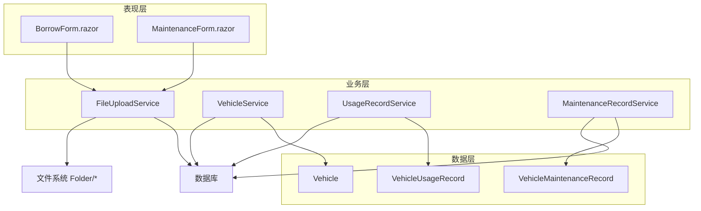
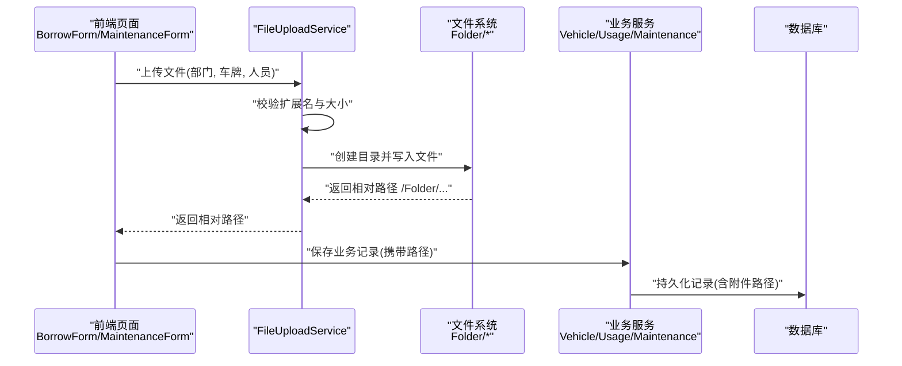
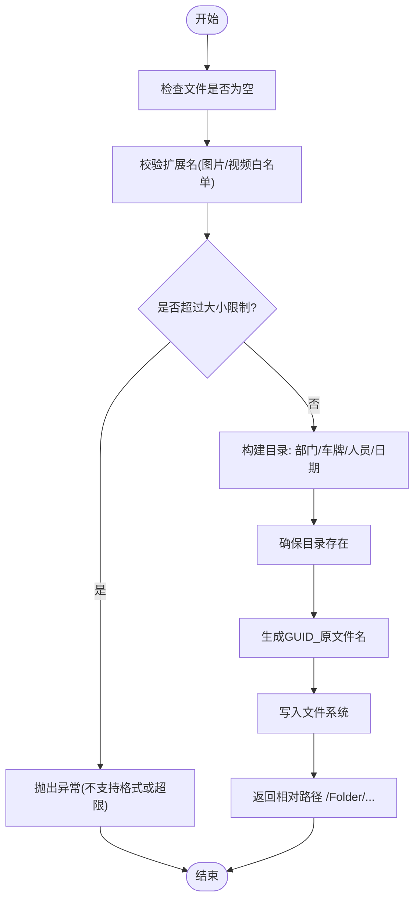
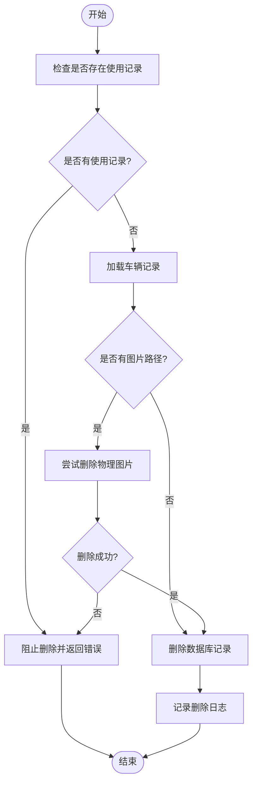
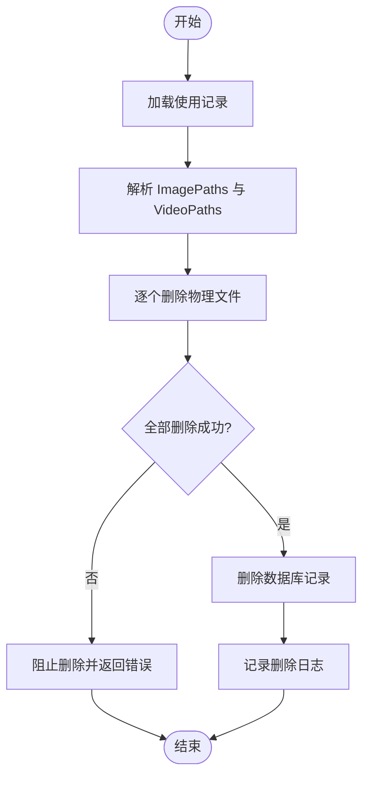
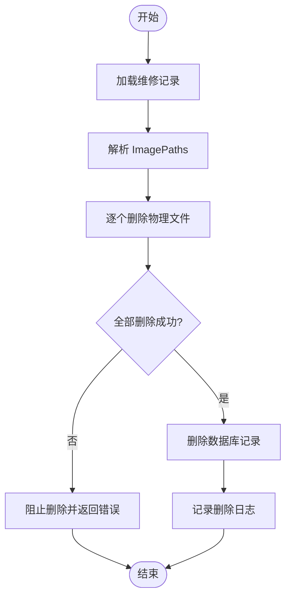
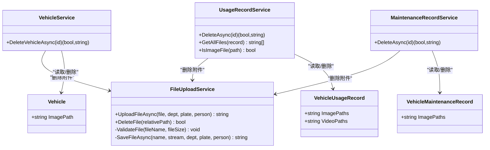

# 文件处理数据流

<cite>
**本文引用的文件**   
- [FileUploadService.cs](file://BLL/Common/FileUploadService.cs)
- [VehicleService.cs](file://BLL/Vehicle/VehicleService.cs)
- [UsageRecordService.cs](file://BLL/UsageRecord/UsageRecordService.cs)
- [MaintenanceRecordService.cs](file://BLL/Maintenance/MaintenanceRecordService.cs)
- [Vehicle.cs](file://DAL/Model/Vehicle.cs)
- [VehicleUsageRecord.cs](file://DAL/Model/VehicleUsageRecord.cs)
- [VehicleMaintenanceRecord.cs](file://DAL/Model/VehicleMaintenanceRecord.cs)
- [BorrowForm.razor](file://Pages/BorrowForm.razor)
- [MaintenanceForm.razor](file://Pages/MaintenanceForm.razor)
</cite>

## 目录
1. [引言](#引言)
2. [项目结构](#项目结构)
3. [核心组件](#核心组件)
4. [架构总览](#架构总览)
5. [详细组件分析](#详细组件分析)
6. [依赖关系分析](#依赖关系分析)
7. [性能与异步优化](#性能与异步优化)
8. [故障排查指南](#故障排查指南)
9. [结论](#结论)

## 引言
本文面向 vehicleManagement 系统，聚焦“文件处理数据流”，以车辆图片上传为例，完整描述从前端组件到后端服务、文件系统再到数据库关联记录的端到端流程。文档重点覆盖：
- 文件验证机制（类型白名单、大小限制）
- 存储路径管理（按部门、车牌、人员、日期组织）
- 安全校验流程（扩展名与大小双重校验）
- 删除时的级联清理机制（物理文件删除与数据库记录更新的一致性）
- 大文件处理与异步上传优化建议
- 错误恢复与可观测性（日志与用户提示）

## 项目结构
本项目的文件处理相关代码主要分布在以下层次：
- 表现层（Blazor 页面）：负责用户交互、文件选择与调用上传服务
- 业务层（BLL）：封装文件上传、业务实体操作、删除时附件清理等逻辑
- 数据访问层（DAL）：定义实体模型与数据库上下文

图表来源
- [BorrowForm.razor:211-228](file://Pages/BorrowForm.razor#L211-L228)
- [MaintenanceForm.razor:129-143](file://Pages/MaintenanceForm.razor#L129-L143)
- [FileUploadService.cs:29-46](file://BLL/Common/FileUploadService.cs#L29-L46)
- [VehicleService.cs:171-201](file://BLL/Vehicle/VehicleService.cs#L171-L201)
- [UsageRecordService.cs:125-154](file://BLL/UsageRecord/UsageRecordService.cs#L125-L154)
- [MaintenanceRecordService.cs:73-100](file://BLL/Maintenance/MaintenanceRecordService.cs#L73-L100)

章节来源
- [BorrowForm.razor:211-228](file://Pages/BorrowForm.razor#L211-L228)
- [MaintenanceForm.razor:129-143](file://Pages/MaintenanceForm.razor#L129-L143)
- [FileUploadService.cs:14-27](file://BLL/Common/FileUploadService.cs#L14-L27)

## 核心组件
- FileUploadService：统一文件上传、删除、校验与落盘逻辑，提供相对路径返回给上层用于持久化。
- VehicleService：车辆业务服务，包含删除车辆时先清理图片附件再删除数据库记录的级联逻辑。
- UsageRecordService：使用记录业务服务，删除记录时清理图片与视频附件。
- MaintenanceRecordService：维修记录业务服务，删除记录时清理图片附件。
- 数据模型：Vehicle、VehicleUsageRecord、VehicleMaintenanceRecord 中均包含附件路径字段，用于在数据库中引用文件系统路径。

章节来源
- [FileUploadService.cs:12-110](file://BLL/Common/FileUploadService.cs#L12-L110)
- [VehicleService.cs:171-201](file://BLL/Vehicle/VehicleService.cs#L171-L201)
- [UsageRecordService.cs:125-154](file://BLL/UsageRecord/UsageRecordService.cs#L125-L154)
- [MaintenanceRecordService.cs:73-100](file://BLL/Maintenance/MaintenanceRecordService.cs#L73-L100)
- [Vehicle.cs:36-36](file://DAL/Model/Vehicle.cs#L36-L36)
- [VehicleUsageRecord.cs:33-35](file://DAL/Model/VehicleUsageRecord.cs#L33-L35)
- [VehicleMaintenanceRecord.cs:26-27](file://DAL/Model/VehicleMaintenanceRecord.cs#L26-L27)

## 架构总览
下图展示“车辆图片上传”的端到端数据流：前端选择文件 → 调用 FileUploadService → 校验与落盘 → 返回相对路径 → 业务层写入数据库。

图表来源
- [BorrowForm.razor:211-228](file://Pages/BorrowForm.razor#L211-L228)
- [MaintenanceForm.razor:129-143](file://Pages/MaintenanceForm.razor#L129-L143)
- [FileUploadService.cs:29-46](file://BLL/Common/FileUploadService.cs#L29-L46)
- [FileUploadService.cs:92-110](file://BLL/Common/FileUploadService.cs#L92-L110)

## 详细组件分析

### 文件上传服务 FileUploadService
职责与行为：
- 支持 IFormFile 与 IBrowserFile 两种输入源
- 扩展名校验：图片与视频分别维护白名单
- 大小限制：图片最大 10MB，视频最大 100MB
- 存储路径：按“部门/车牌/人员/日期”组织，文件名使用 GUID 前缀避免冲突
- 返回相对路径：以 /Folder/ 开头，便于业务层持久化
- 删除接口：根据相对路径定位并删除物理文件

关键流程（保存）：

图表来源
- [FileUploadService.cs:29-46](file://BLL/Common/FileUploadService.cs#L29-L46)
- [FileUploadService.cs:69-84](file://BLL/Common/FileUploadService.cs#L69-L84)
- [FileUploadService.cs:92-110](file://BLL/Common/FileUploadService.cs#L92-L110)

章节来源
- [FileUploadService.cs:14-27](file://BLL/Common/FileUploadService.cs#L14-L27)
- [FileUploadService.cs:29-46](file://BLL/Common/FileUploadService.cs#L29-L46)
- [FileUploadService.cs:48-67](file://BLL/Common/FileUploadService.cs#L48-L67)
- [FileUploadService.cs:69-84](file://BLL/Common/FileUploadService.cs#L69-L84)
- [FileUploadService.cs:92-110](file://BLL/Common/FileUploadService.cs#L92-L110)

### 车辆服务 VehicleService（删除级联）
职责与行为：
- 删除车辆前，先尝试删除车辆图片附件；若失败则阻止数据库删除，保证一致性
- 日志记录删除过程，便于审计与排障

删除流程（车辆）：

图表来源
- [VehicleService.cs:171-201](file://BLL/Vehicle/VehicleService.cs#L171-L201)

章节来源
- [VehicleService.cs:171-201](file://BLL/Vehicle/VehicleService.cs#L171-L201)

### 使用记录服务 UsageRecordService（删除级联）
职责与行为：
- 删除使用记录前，解析并删除所有图片与视频附件；若失败则阻止数据库删除
- 提供获取全部附件路径与判断图片类型的工具方法

删除流程（使用记录）：

图表来源
- [UsageRecordService.cs:125-154](file://BLL/UsageRecord/UsageRecordService.cs#L125-L154)

章节来源
- [UsageRecordService.cs:125-154](file://BLL/UsageRecord/UsageRecordService.cs#L125-L154)
- [UsageRecordService.cs:159-176](file://BLL/UsageRecord/UsageRecordService.cs#L159-L176)

### 维修记录服务 MaintenanceRecordService（删除级联）
职责与行为：
- 删除维修记录前，解析并删除所有图片附件；若失败则阻止数据库删除

删除流程（维修记录）：

图表来源
- [MaintenanceRecordService.cs:73-100](file://BLL/Maintenance/MaintenanceRecordService.cs#L73-L100)

章节来源
- [MaintenanceRecordService.cs:73-100](file://BLL/Maintenance/MaintenanceRecordService.cs#L73-L100)

### 前端组件与数据绑定
- BorrowForm.razor：借车表单中，用户选择文件后调用 FileUploadService 上传，成功后将相对路径加入列表，最终随业务请求保存到数据库。
- MaintenanceForm.razor：维修表单中，同样通过 FileUploadService 上传图片，并将路径集合保存到维修记录。

章节来源
- [BorrowForm.razor:211-228](file://Pages/BorrowForm.razor#L211-L228)
- [MaintenanceForm.razor:129-143](file://Pages/MaintenanceForm.razor#L129-L143)

## 依赖关系分析
- FileUploadService 被多个业务服务与前端页面直接调用，承担统一的文件 I/O 与校验职责，降低耦合。
- 业务服务（Vehicle/Usage/Maintenance）各自负责对应实体的增删改查，并在删除时调用 FileUploadService 清理附件。
- 数据模型中的路径字段（ImagePath、ImagePaths、VideoPaths）作为文件系统与数据库之间的桥梁。

图表来源
- [FileUploadService.cs:12-110](file://BLL/Common/FileUploadService.cs#L12-L110)
- [VehicleService.cs:171-201](file://BLL/Vehicle/VehicleService.cs#L171-L201)
- [UsageRecordService.cs:125-154](file://BLL/UsageRecord/UsageRecordService.cs#L125-L154)
- [MaintenanceRecordService.cs:73-100](file://BLL/Maintenance/MaintenanceRecordService.cs#L73-L100)
- [Vehicle.cs:36-36](file://DAL/Model/Vehicle.cs#L36-L36)
- [VehicleUsageRecord.cs:33-35](file://DAL/Model/VehicleUsageRecord.cs#L33-L35)
- [VehicleMaintenanceRecord.cs:26-27](file://DAL/Model/VehicleMaintenanceRecord.cs#L26-L27)

章节来源
- [FileUploadService.cs:12-110](file://BLL/Common/FileUploadService.cs#L12-L110)
- [VehicleService.cs:171-201](file://BLL/Vehicle/VehicleService.cs#L171-L201)
- [UsageRecordService.cs:125-154](file://BLL/UsageRecord/UsageRecordService.cs#L125-L154)
- [MaintenanceRecordService.cs:73-100](file://BLL/Maintenance/MaintenanceRecordService.cs#L73-L100)
- [Vehicle.cs:36-36](file://DAL/Model/Vehicle.cs#L36-L36)
- [VehicleUsageRecord.cs:33-35](file://DAL/Model/VehicleUsageRecord.cs#L33-L35)
- [VehicleMaintenanceRecord.cs:26-27](file://DAL/Model/VehicleMaintenanceRecord.cs#L26-L27)

## 性能与异步优化
- 异步流式写入：FileUploadService 使用 OpenReadStream() 与 CopyToAsync 进行流式写入，避免一次性加载大文件到内存，提升吞吐与稳定性。
- 前端分片与并发控制：当前实现为逐文件顺序上传，适合中小规模场景。对于大文件或批量上传，可在前端增加进度条、重试与并发上限控制，减少阻塞。
- 存储路径分区：按“部门/车牌/人员/日期”组织，有利于分散单目录文件数量，提高文件系统遍历与备份效率。
- 建议优化点：
  - 对超大文件启用断点续传与分片上传
  - 引入对象存储（如云 OSS/S3）替代本地文件系统，提升可扩展性与容灾能力
  - 对图片进行服务端压缩与缩略图生成，减少带宽与存储占用
  - 增加上传速率限制与队列管理，防止瞬时高并发导致 IO 瓶颈

[本节为通用性能讨论，不直接分析具体文件]

## 故障排查指南
常见问题与定位要点：
- 上传失败（格式不支持或大小超限）
  - 现象：前端捕获异常并显示“上传失败：...”
  - 原因：扩展名不在白名单或超过限制（图片 10MB、视频 100MB）
  - 处理：检查文件扩展名与大小，必要时调整限制策略
  - 参考：[FileUploadService.cs:69-84](file://BLL/Common/FileUploadService.cs#L69-L84)

- 删除失败（附件被占用或无法访问）
  - 现象：删除车辆/使用记录/维修记录时返回错误，数据库未删除
  - 原因：物理文件被其他进程占用或权限不足
  - 处理：释放文件占用、检查权限，稍后重试
  - 参考：
    - [VehicleService.cs:183-195](file://BLL/Vehicle/VehicleService.cs#L183-L195)
    - [UsageRecordService.cs:131-148](file://BLL/UsageRecord/UsageRecordService.cs#L131-L148)
    - [MaintenanceRecordService.cs:79-94](file://BLL/Maintenance/MaintenanceRecordService.cs#L79-L94)

- 路径不一致或找不到文件
  - 现象：删除时报错或返回 false
  - 原因：相对路径拼接问题或历史路径格式差异
  - 处理：确认 SaveFileAsync 返回的路径格式与 DeleteFile 清理逻辑一致
  - 参考：[FileUploadService.cs:48-67](file://BLL/Common/FileUploadService.cs#L48-L67), [FileUploadService.cs:92-110](file://BLL/Common/FileUploadService.cs#L92-L110)

- 前端未正确保存路径
  - 现象：数据库无附件路径，但文件已存在
  - 原因：前端未将上传返回路径写入业务记录
  - 处理：检查 BorrowForm/MaintenanceForm 中 uploadedFiles 的收集与提交逻辑
  - 参考：
    - [BorrowForm.razor:211-228](file://Pages/BorrowForm.razor#L211-L228)
    - [MaintenanceForm.razor:129-143](file://Pages/MaintenanceForm.razor#L129-L143)

章节来源
- [FileUploadService.cs:69-84](file://BLL/Common/FileUploadService.cs#L69-L84)
- [VehicleService.cs:183-195](file://BLL/Vehicle/VehicleService.cs#L183-L195)
- [UsageRecordService.cs:131-148](file://BLL/UsageRecord/UsageRecordService.cs#L131-L148)
- [MaintenanceRecordService.cs:79-94](file://BLL/Maintenance/MaintenanceRecordService.cs#L79-L94)
- [FileUploadService.cs:48-67](file://BLL/Common/FileUploadService.cs#L48-L67)
- [FileUploadService.cs:92-110](file://BLL/Common/FileUploadService.cs#L92-L110)
- [BorrowForm.razor:211-228](file://Pages/BorrowForm.razor#L211-L228)
- [MaintenanceForm.razor:129-143](file://Pages/MaintenanceForm.razor#L129-L143)

## 结论
vehicleManagement 的文件处理数据流以 FileUploadService 为核心，统一了文件校验、落盘与删除逻辑，并通过业务服务在删除时执行级联清理，保障文件系统与数据库的一致性。前端组件负责文件选择与路径收集，最终将相对路径持久化到数据库。整体设计清晰、职责分离，具备良好的可维护性与扩展空间。针对大文件与高并发场景，建议引入分片上传、对象存储与缓存缩略图等优化措施，进一步提升系统性能与用户体验。