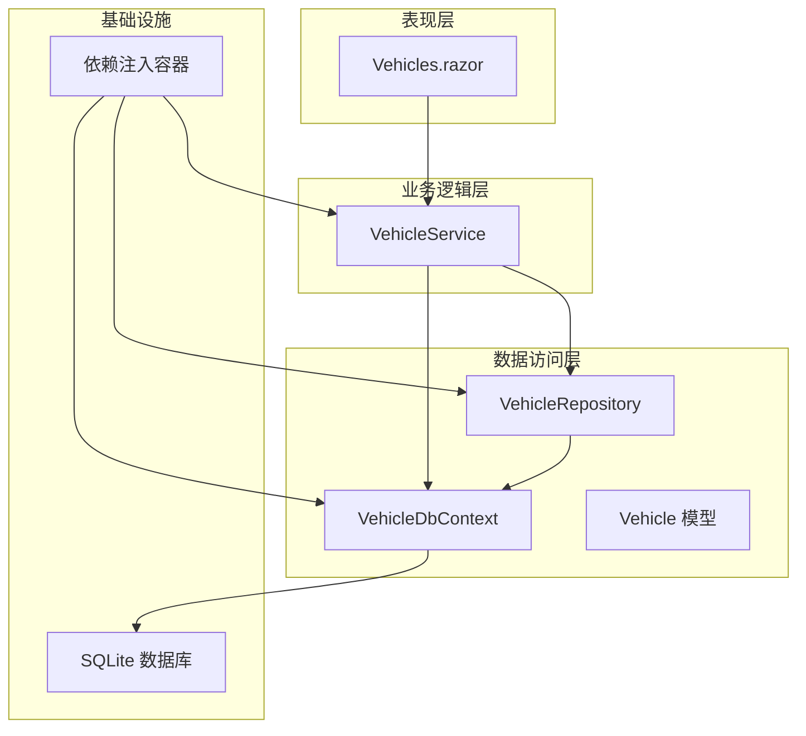
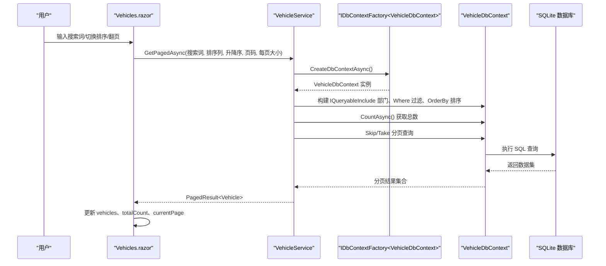
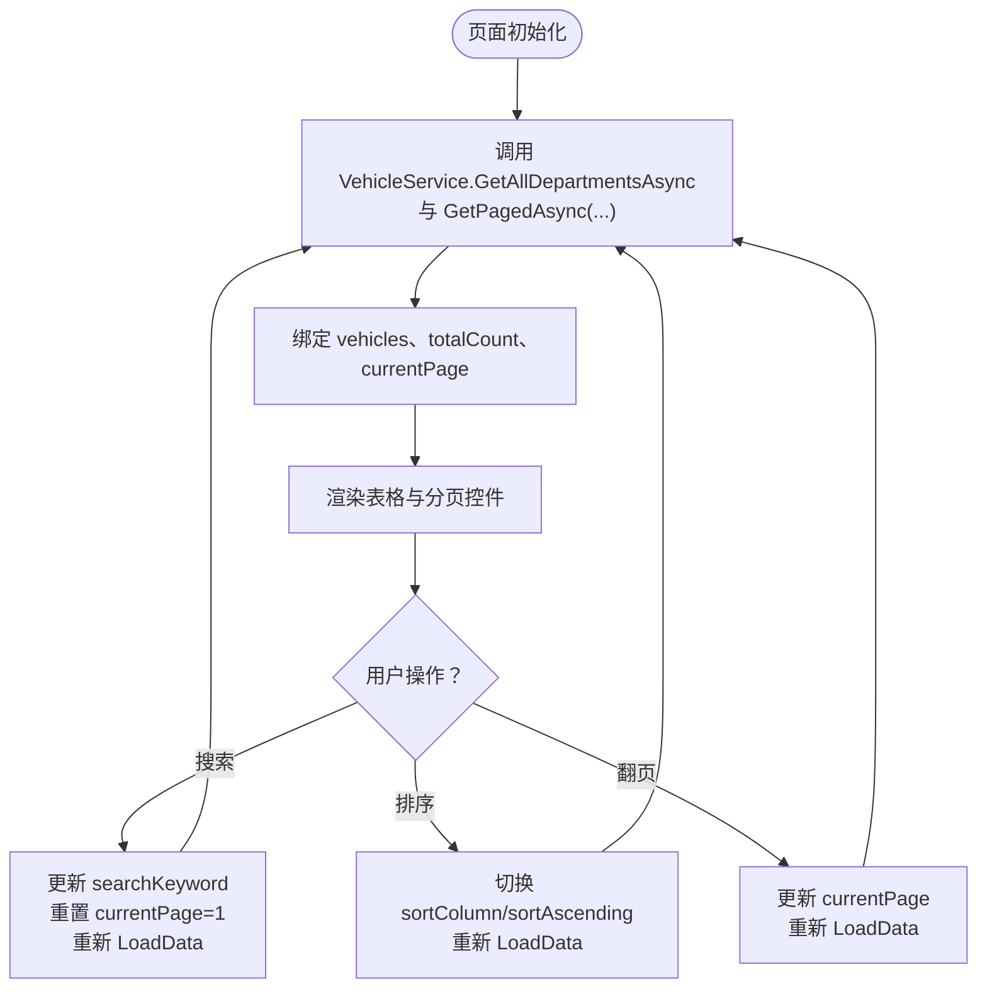
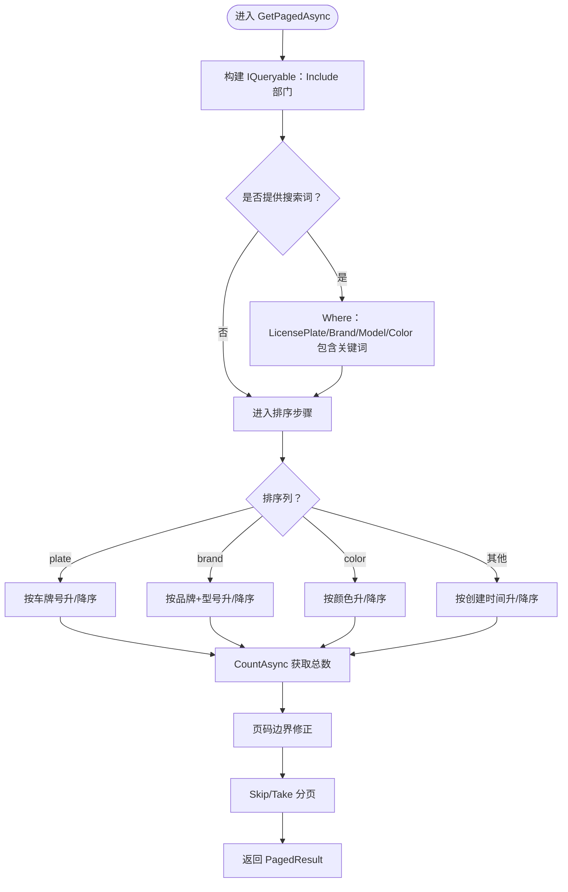
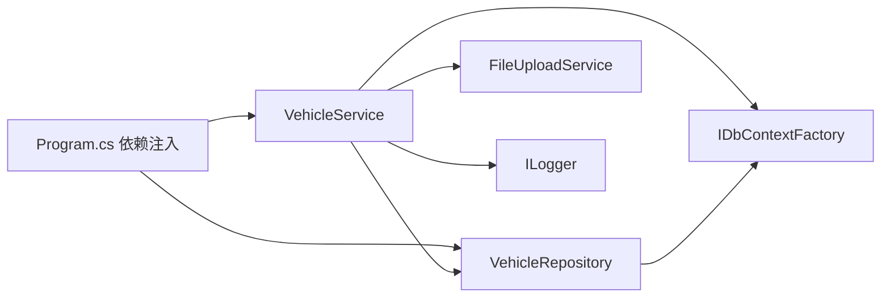
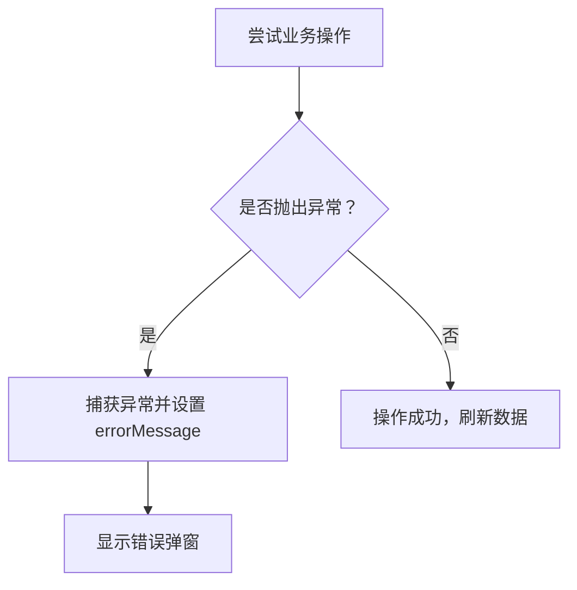

# 用户请求数据流

<cite>
**本文引用的文件**   
- [Program.cs](file://Program.cs)
- [Vehicles.razor](file://Pages/Vehicles.razor)
- [VehicleService.cs](file://BLL/Vehicle/VehicleService.cs)
- [VehicleRepository.cs](file://DAL/Repository/VehicleRepository.cs)
- [VehicleDbContext.cs](file://DAL/VehicleDbContext.cs)
- [Vehicle.cs](file://DAL/Model/Vehicle.cs)
- [PagedResult.cs](file://BLL/Common/PagedResult.cs)
</cite>

## 目录
1. [引言](#引言)
2. [项目结构](#项目结构)
3. [核心组件](#核心组件)
4. [架构总览](#架构总览)
5. [详细组件分析](#详细组件分析)
6. [依赖关系分析](#依赖关系分析)
7. [性能与并发考虑](#性能与并发考虑)
8. [故障排查指南](#故障排查指南)
9. [结论](#结论)

## 引言
本文面向 vehicleManagement 系统，聚焦“用户请求数据流”，以车辆管理为例，完整描述从 Blazor 页面到数据库的数据流向：用户操作 → Blazor 组件 → 业务服务层 → 仓储层 → 数据库。重点说明参数传递机制、结果返回格式、异常处理流程，并以 GetPagedAsync 方法为主线，展示分页参数、搜索条件、排序逻辑的数据流转。同时解释依赖注入在服务间的作用机制、DbContextFactory 的使用模式，以及事务管理与并发控制策略。

## 项目结构
本系统采用分层架构：
- 表现层（Blazor 页面）：负责用户交互、表单绑定、分页与排序 UI 状态管理。
- 业务逻辑层（BLL）：封装业务规则、查询组合、校验与跨实体协调。
- 数据访问层（DAL）：仓储实现与 EF Core 上下文配置，提供持久化能力。
- 基础设施：依赖注入容器、日志、静态资源、AI 子系统等。

图表来源
- [Program.cs:52-95](file://Program.cs#L52-L95)
- [Vehicles.razor:1-20](file://Pages/Vehicles.razor#L1-L20)
- [VehicleService.cs:18-38](file://BLL/Vehicle/VehicleService.cs#L18-L38)
- [VehicleRepository.cs:10-17](file://DAL/Repository/VehicleRepository.cs#L10-L17)
- [VehicleDbContext.cs:6-19](file://DAL/VehicleDbContext.cs#L6-L19)

章节来源
- [Program.cs:48-95](file://Program.cs#L48-L95)
- [Vehicles.razor:1-20](file://Pages/Vehicles.razor#L1-L20)

## 核心组件
- Vehicles.razor：车辆列表页，维护搜索关键词、排序列与方向、当前页码与每页大小；调用 VehicleService.GetPagedAsync 获取分页数据并渲染表格与分页控件。
- VehicleService：车辆业务服务，封装查询组合、业务校验、文件附件清理等；通过 IDbContextFactory 创建 DbContext 实例执行查询。
- VehicleRepository：车辆仓储，提供基础增删改查；同样通过 IDbContextFactory 获取 DbContext。
- VehicleDbContext：EF Core 上下文，定义实体集与关系映射、唯一索引与级联删除策略。
- Vehicle 模型：车辆实体，包含车牌号、品牌、型号、颜色、状态、二维码 Token、部门外键等字段。
- PagedResult：通用分页结果封装，承载 Items、TotalCount、CurrentPage、PageSize。

章节来源
- [Vehicles.razor:186-227](file://Pages/Vehicles.razor#L186-L227)
- [VehicleService.cs:67-109](file://BLL/Vehicle/VehicleService.cs#L67-L109)
- [VehicleRepository.cs:10-64](file://DAL/Repository/VehicleRepository.cs#L10-L64)
- [VehicleDbContext.cs:6-108](file://DAL/VehicleDbContext.cs#L6-L108)
- [Vehicle.cs:8-48](file://DAL/Model/Vehicle.cs#L8-L48)
- [PagedResult.cs](file://BLL/Common/PagedResult.cs)

## 架构总览
下图展示了从 Blazor 页面发起分页查询到数据库的完整时序，包括参数传递、查询构建、分页计算与结果返回。

图表来源
- [Vehicles.razor:215-227](file://Pages/Vehicles.razor#L215-L227)
- [VehicleService.cs:67-109](file://BLL/Vehicle/VehicleService.cs#L67-L109)
- [VehicleDbContext.cs:6-19](file://DAL/VehicleDbContext.cs#L6-L19)

## 详细组件分析

### 1) Blazor 页面：Vehicles.razor
- 职责
  - 维护 UI 状态：vehicles、searchKeyword、sortColumn、sortAscending、currentPage、pageSize、totalCount。
  - 事件处理：OnInitializedAsync 初始化加载；OnPageChanged 翻页；OnSearchInput 搜索；ToggleSort 排序切换。
  - 委托业务：调用 VehicleService.GetAllDepartmentsAsync 与 GetPagedAsync，将结果赋值给 UI 状态。
- 参数传递机制
  - 搜索：将 searchKeyword 直接传入服务层。
  - 排序：将 sortColumn 与 sortAscending 传入服务层，由服务层决定 OrderBy/OrderByDescending。
  - 分页：将 currentPage 与 pageSize 传入服务层，服务层进行边界修正与 Skip/Take。
- 结果返回格式
  - 接收 PagedResult<Vehicle>，解构 Items、TotalCount、CurrentPage 用于渲染表格与分页控件。
- 错误处理
  - 保存/删除等操作在页面层捕获异常并显示错误弹窗；GetPagedAsync 为只读查询，通常不抛出业务异常。

图表来源
- [Vehicles.razor:215-247](file://Pages/Vehicles.razor#L215-L247)

章节来源
- [Vehicles.razor:186-247](file://Pages/Vehicles.razor#L186-L247)

### 2) 业务服务层：VehicleService.GetPagedAsync
- 职责
  - 根据传入参数构建 LINQ 查询：Include 部门关联、Where 多字段模糊搜索、OrderBy 动态排序。
  - 计算总数并进行页码边界修正。
  - 使用 Skip/Take 实现分页。
  - 返回 PagedResult<Vehicle>。
- 参数传递机制
  - searchKeyword：空或空白时跳过过滤；非空则对 LicensePlate、Brand、Model、Color 进行 Contains 匹配。
  - sortColumn：plate/brand/color/默认 CreatedAt；sortAscending 决定升/降序。
  - page/pageSize：page 小于 1 修正为 1；超过最大页修正为最大页。
- 结果返回格式
  - PagedResult<Vehicle>：Items 为当前页数据，TotalCount 为总记录数，CurrentPage 与 PageSize 为分页元信息。
- 异常处理
  - 该方法是只读查询，未显式捕获异常；若底层 EF Core 抛出异常，会向上传播至调用方（页面层）。

图表来源
- [VehicleService.cs:67-109](file://BLL/Vehicle/VehicleService.cs#L67-L109)

章节来源
- [VehicleService.cs:67-109](file://BLL/Vehicle/VehicleService.cs#L67-L109)

### 3) 仓储层：VehicleRepository
- 职责
  - 提供基础的 GetAllAsync、GetByIdAsync、AddAsync、UpdateAsync、DeleteAsync、ExistsAsync。
  - 所有方法均通过 IDbContextFactory 创建 DbContext，确保每次操作拥有独立上下文生命周期。
- 依赖注入与 DbContextFactory
  - 构造函数注入 IDbContextFactory<VehicleDbContext>。
  - 每个异步方法内部 await using var db = await _dbFactory.CreateDbContextAsync(); 保证上下文及时释放。
- 事务与并发
  - 仓储方法内无显式事务；SaveChangesAsync 作为最小事务单元提交。
  - 并发控制依赖 EF Core 的乐观并发（如需要可在模型上添加行版本字段），当前仓库未启用。

章节来源
- [VehicleRepository.cs:10-64](file://DAL/Repository/VehicleRepository.cs#L10-L64)

### 4) 数据上下文与模型：VehicleDbContext 与 Vehicle
- VehicleDbContext
  - 定义 DbSet：Departments、Personnel、Vehicles、Locations、VehicleUsageRecords、VehicleUsageRecordPurposes、VehicleMaintenanceRecords。
  - 配置索引与关系：例如 Vehicle.LicensePlate 与 QrCodeToken 唯一索引；VehicleUsageRecord 与 Vehicle/Department/Personnel/FinalLocation 的外键关系及 DeleteBehavior.Restrict。
- Vehicle 模型
  - 关键字段：Id、DepartmentId、LicensePlate、Brand、Model、Year、Color、Status、QrCodeToken、ImagePath、Remarks、IsBorrowed、CreatedAt、UpdatedAt。
  - 导航属性：Department（一对多关系的另一端）。

章节来源
- [VehicleDbContext.cs:6-108](file://DAL/VehicleDbContext.cs#L6-L108)
- [Vehicle.cs:8-48](file://DAL/Model/Vehicle.cs#L8-L48)

## 依赖关系分析
- 依赖注入容器（Program.cs）
  - AddDbContextFactory<VehicleDbContext>：注册工厂，避免 Blazor Server 并发冲突。
  - AddScoped<VehicleRepository>、AddScoped<VehicleService>：作用域内单例，便于共享同一请求内的服务实例。
  - AddSingleton<QrCodeService>：全局单例，生成二维码 Token。
- 服务间依赖
  - VehicleService 依赖 VehicleRepository、DepartmentRepository、IDbContextFactory<VehicleDbContext>、FileUploadService、ILogger。
  - VehicleRepository 依赖 IDbContextFactory<VehicleDbContext>。
- 循环依赖
  - 未发现循环依赖；仓储与服务之间单向依赖。

图表来源
- [Program.cs:52-95](file://Program.cs#L52-L95)
- [VehicleService.cs:18-38](file://BLL/Vehicle/VehicleService.cs#L18-L38)
- [VehicleRepository.cs:10-17](file://DAL/Repository/VehicleRepository.cs#L10-L17)

章节来源
- [Program.cs:52-95](file://Program.cs#L52-L95)

## 性能与并发考虑
- 查询优化
  - Include 仅加载必要关联（Department），避免 N+1 问题。
  - Where 条件尽量下推到数据库，利用 Contains 与索引（LicensePlate、QrCodeToken、DepartmentId）。
  - CountAsync 先统计总数，再 Skip/Take 分页，减少数据传输量。
- 分页边界修正
  - 当 page 超出范围时自动修正，避免无效查询。
- 并发控制
  - 使用 IDbContextFactory 为每次请求创建独立 DbContext，避免 Blazor Server 并发场景下的上下文竞争。
  - 如需强一致性写操作，可在服务层开启显式事务（当前仓储方法未显式开启事务）。
- 连接池与 I/O
  - SQLite 适合轻量场景；在高并发写入时需评估锁竞争与性能瓶颈。

[本节为通用指导，不直接分析具体文件]

## 故障排查指南
- 常见问题定位
  - 搜索无结果：检查 searchKeyword 是否为空或空白；确认数据库字段是否包含目标字符串。
  - 排序异常：确认 sortColumn 取值是否在 plate/brand/color/默认；注意 brand 排序包含 Model 二级排序。
  - 分页错位：检查 page/pageSize 传参是否正确；确认 TotalCount 与 CurrentPage 是否被正确回写 UI。
- 异常处理流程
  - 页面层 Save/Export 等方法捕获异常并显示错误弹窗。
  - 服务层 DeleteVehicleAsync 返回 (Success, ErrorMessage) 元组，供页面层判断并提示。
  - 仓储层方法未捕获异常，异常会向上传播；建议在更高层统一处理。

图表来源
- [Vehicles.razor:284-331](file://Pages/Vehicles.razor#L284-L331)
- [VehicleService.cs:171-201](file://BLL/Vehicle/VehicleService.cs#L171-L201)

章节来源
- [Vehicles.razor:284-331](file://Pages/Vehicles.razor#L284-L331)
- [VehicleService.cs:171-201](file://BLL/Vehicle/VehicleService.cs#L171-L201)

## 结论
vehicleManagement 系统的用户请求数据流清晰分层：Blazor 页面负责交互与状态管理，业务服务层负责查询组合与业务规则，仓储层负责数据访问，EF Core 上下文负责 ORM 映射与关系配置。通过 IDbContextFactory 解决 Blazor Server 并发问题，结合 PagedResult 统一分页返回格式，使 GetPagedAsync 的调用链透明且可维护。建议后续在关键写路径引入显式事务与乐观并发控制，进一步提升一致性与健壮性。