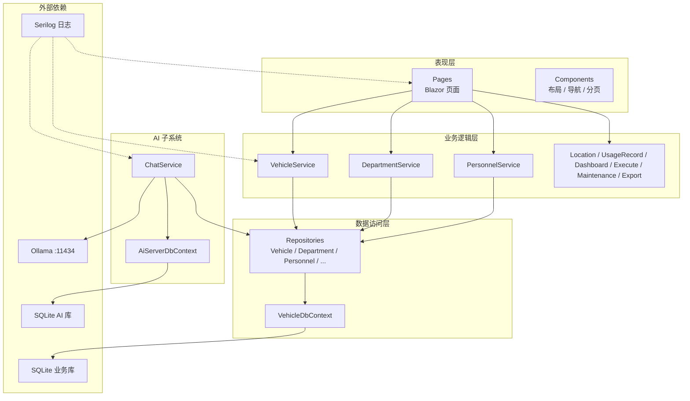
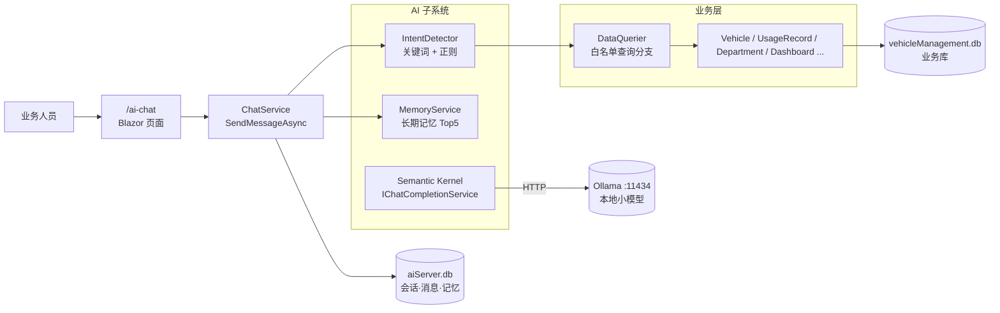
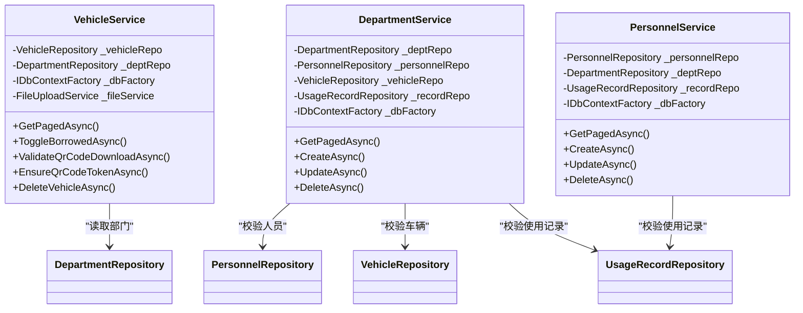
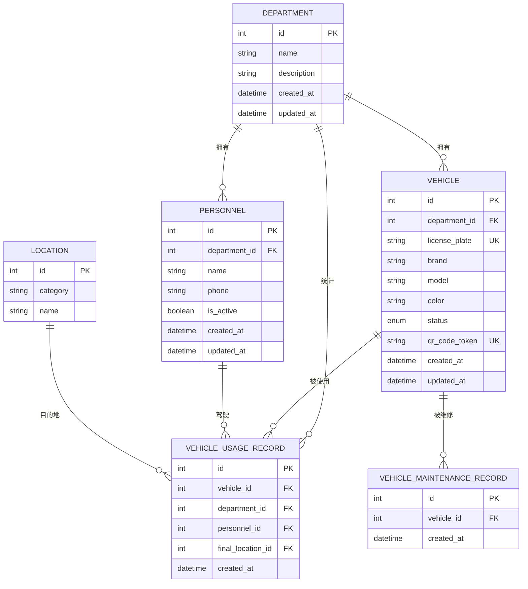
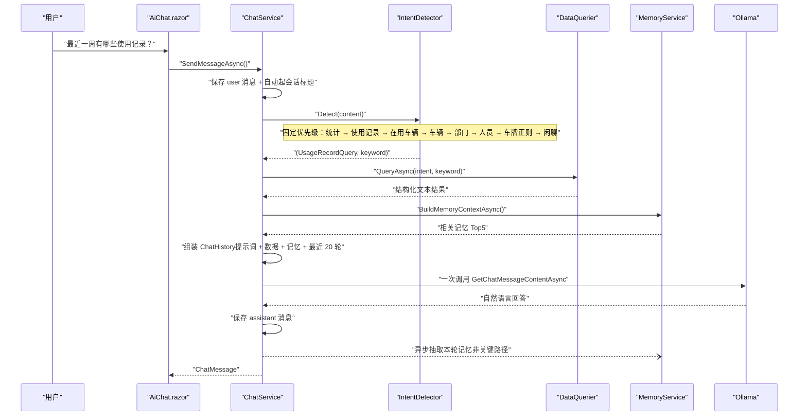
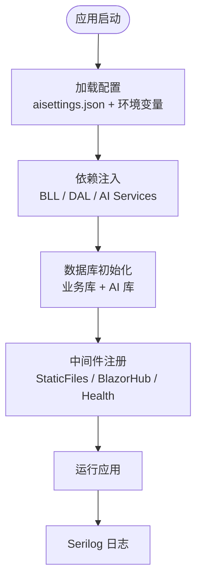
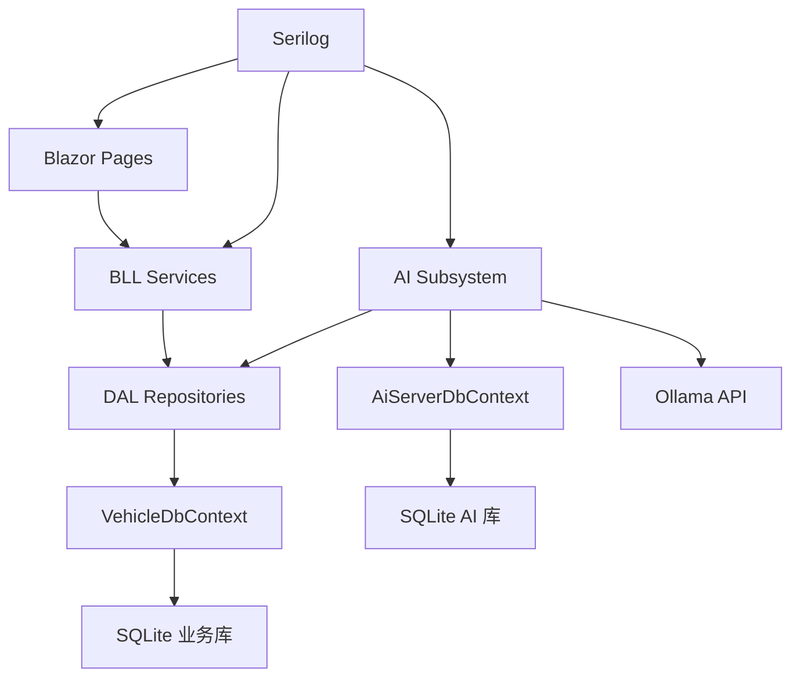

# 整体架构概览

<cite>
**本文引用的文件**   
- [README.md](file://README.md)
- [Program.cs](file://Program.cs)
- [appsettings.json](file://appsettings.json)
- [vehicleManagement.csproj](file://vehicleManagement.csproj)
- [BLL/Vehicle/VehicleService.cs](file://BLL/Vehicle/VehicleService.cs)
- [BLL/Department/DepartmentService.cs](file://BLL/Department/DepartmentService.cs)
- [BLL/Personnel/PersonnelService.cs](file://BLL/Personnel/PersonnelService.cs)
- [DAL/Repository/VehicleRepository.cs](file://DAL/Repository/VehicleRepository.cs)
- [DAL/Repository/DepartmentRepository.cs](file://DAL/Repository/DepartmentRepository.cs)
- [DAL/Repository/PersonnelRepository.cs](file://DAL/Repository/PersonnelRepository.cs)
- [DAL/VehicleDbContext.cs](file://DAL/VehicleDbContext.cs)
- [aiServer/BLL/ChatService.cs](file://aiServer/BLL/ChatService.cs)
- [aiServer/DAL/AiServerDbContext.cs](file://aiServer/DAL/AiServerDbContext.cs)
</cite>

## 目录
1. [引言](#引言)
2. [项目结构](#项目结构)
3. [核心组件](#核心组件)
4. [架构总览](#架构总览)
5. [详细组件分析](#详细组件分析)
6. [依赖关系分析](#依赖关系分析)
7. [性能与稳定性](#性能与稳定性)
8. [故障排查指南](#故障排查指南)
9. [结论](#结论)

## 引言
本文件为 vehicleManagement 系统的整体架构概览文档，面向业务人员、前端开发者、后端开发者与运维人员。系统采用四层架构：表现层（Blazor Pages + Components）、业务逻辑层（BLL Services）、数据访问层（DAL Repositories + DbContexts），以及独立命名的 AI 子系统 aiServer。AI 子系统通过规则意图识别与结构化结果注入的方式调用本地 Ollama 模型，不直接生成 SQL，从而降低误用风险并提升可解释性。

## 项目结构
仓库按职责划分目录：
- BLL：车辆、部门、人员、地点、使用记录、仪表盘、执行、维修、导出等业务流程服务。
- DAL：EF Core 实体、仓储实现、数据库上下文与种子数据初始化。
- Pages + Components：Blazor Server 页面与布局、导航、分页等 UI 组件。
- aiServer：AI 子系统的对话服务、意图识别、数据查询器、记忆管理、会话消息存储。
- wwwroot：静态资源，包括 CSS、字体与 Chart.js。
- Program.cs：应用启动装配、配置加载、依赖注入、数据库初始化、中间件注册。
- appsettings.json：连接字符串与基础配置。
- vehicleManagement.csproj：目标框架、NuGet 包与构建项。

**图表来源**
- [Program.cs:41-102](file://Program.cs#L41-L102)
- [Program.cs:109-125](file://Program.cs#L109-L125)
- [appsettings.json:3-6](file://appsettings.json#L3-L6)
- [vehicleManagement.csproj:4-29](file://vehicleManagement.csproj#L4-L29)

**章节来源**
- [README.md:122-139](file://README.md#L122-L139)
- [Program.cs:41-102](file://Program.cs#L41-L102)
- [appsettings.json:3-6](file://appsettings.json#L3-L6)
- [vehicleManagement.csproj:4-29](file://vehicleManagement.csproj#L4-L29)

## 核心组件
- VehicleService：负责车辆台账的分页查询、状态流转、二维码校验与 Token 管理、附件清理等业务逻辑。
- DepartmentService：负责部门主数据的增删改查与删除前关联校验（人员、车辆、使用记录）。
- PersonnelService：负责人员信息维护、部门归属、在职状态与删除前关联校验（使用记录）。
- ChatService：AI 子系统核心入口，封装会话管理、意图识别、数据查询、记忆管理与 LLM 调用。

这些服务在 Program.cs 中统一注册为 Scoped 服务，便于 Blazor Server 请求生命周期内复用。

**章节来源**
- [BLL/Vehicle/VehicleService.cs:18-38](file://BLL/Vehicle/VehicleService.cs#L18-L38)
- [BLL/Department/DepartmentService.cs:16-36](file://BLL/Department/DepartmentService.cs#L16-L36)
- [BLL/Personnel/PersonnelService.cs:17-34](file://BLL/Personnel/PersonnelService.cs#L17-L34)
- [aiServer/BLL/ChatService.cs:18-42](file://aiServer/BLL/ChatService.cs#L18-L42)
- [Program.cs:75-91](file://Program.cs#L75-L91)

## 架构总览
系统采用“规则路由 + 结果注入”的 AI 取数链路：用户自然语言输入进入 Blazor 页面，由 ChatService 进行意图识别，再调用 DataQuerier 走白名单查询分支，最终将结构化文本交给 Semantic Kernel 调用的 Ollama 模型组织成中文回答。业务数据始终留在本地 SQLite 中，推理不出环境。

**图表来源**
- [README.md:57-83](file://README.md#L57-L83)
- [aiServer/BLL/ChatService.cs:94-139](file://aiServer/BLL/ChatService.cs#L94-L139)
- [Program.cs:97-102](file://Program.cs#L97-L102)
- [appsettings.json:3-6](file://appsettings.json#L3-L6)

## 详细组件分析

### 业务逻辑层与服务职责
- VehicleService：提供分页查询、状态切换、二维码下载校验、Token 生成与更新、删除前的业务约束检查。
- DepartmentService：提供分页查询、创建、更新、删除；删除时校验是否仍有人员、车辆或使用记录引用。
- PersonnelService：提供分页查询、创建、更新、删除；删除时校验是否仍有使用记录引用。

这些服务通过 IDbContextFactory 获取 DbContext，避免在 Blazor Server 并发场景下共享上下文冲突。

**图表来源**
- [BLL/Vehicle/VehicleService.cs:18-38](file://BLL/Vehicle/VehicleService.cs#L18-L38)
- [BLL/Department/DepartmentService.cs:16-36](file://BLL/Department/DepartmentService.cs#L16-L36)
- [BLL/Personnel/PersonnelService.cs:17-34](file://BLL/Personnel/PersonnelService.cs#L17-L34)

**章节来源**
- [BLL/Vehicle/VehicleService.cs:67-109](file://BLL/Vehicle/VehicleService.cs#L67-L109)
- [BLL/Department/DepartmentService.cs:41-76](file://BLL/Department/DepartmentService.cs#L41-L76)
- [BLL/Personnel/PersonnelService.cs:39-74](file://BLL/Personnel/PersonnelService.cs#L39-L74)

### 数据访问层与实体关系
DAL 层通过 Repository 封装对 EF Core 实体的 CRUD 操作，VehicleDbContext 定义表结构与关系映射。关键实体包括 Department、Personnel、Vehicle、Location、VehicleUsageRecord、VehicleMaintenanceRecord 等。

**图表来源**
- [DAL/VehicleDbContext.cs:13-19](file://DAL/VehicleDbContext.cs#L13-L19)
- [DAL/VehicleDbContext.cs:21-104](file://DAL/VehicleDbContext.cs#L21-L104)

**章节来源**
- [DAL/VehicleDbContext.cs:13-19](file://DAL/VehicleDbContext.cs#L13-L19)
- [DAL/VehicleDbContext.cs:21-104](file://DAL/VehicleDbContext.cs#L21-L104)

### AI 子系统与一次问答流程
ChatService 是 AI 子系统的核心编排者，负责保存用户消息、自动更新会话标题、意图识别、数据查询、构建聊天历史、调用 LLM、保存助手回复，并异步提取记忆。

**图表来源**
- [aiServer/BLL/ChatService.cs:94-139](file://aiServer/BLL/ChatService.cs#L94-L139)
- [aiServer/BLL/ChatService.cs:161-183](file://aiServer/BLL/ChatService.cs#L161-L183)
- [aiServer/BLL/ChatService.cs:188-199](file://aiServer/BLL/ChatService.cs#L188-L199)
- [README.md:187-219](file://README.md#L187-L219)

**章节来源**
- [aiServer/BLL/ChatService.cs:94-139](file://aiServer/BLL/ChatService.cs#L94-L139)
- [aiServer/BLL/ChatService.cs:161-183](file://aiServer/BLL/ChatService.cs#L161-L183)
- [aiServer/BLL/ChatService.cs:188-199](file://aiServer/BLL/ChatService.cs#L188-L199)

### 技术栈选择与集成方式
- .NET 10.0 与 Blazor Server：作为运行时与 Web UI 框架，支持服务端渲染与实时交互。
- Entity Framework Core + SQLite：用于业务库与 AI 库的双库隔离，启动时 EnsureCreatedAsync 建库。
- Semantic Kernel + Ollama：Kernel 单例注入，ChatService 通过 IChatCompletionService 调用本地模型。
- Serilog：控制台与按天滚动文件日志，抑制框架与 EF Core SQL 噪声。

**图表来源**
- [Program.cs:28-37](file://Program.cs#L28-L37)
- [Program.cs:41-102](file://Program.cs#L41-L102)
- [Program.cs:109-125](file://Program.cs#L109-L125)
- [Program.cs:132-146](file://Program.cs#L132-L146)

**章节来源**
- [vehicleManagement.csproj:4-29](file://vehicleManagement.csproj#L4-L29)
- [Program.cs:28-37](file://Program.cs#L28-L37)
- [Program.cs:41-102](file://Program.cs#L41-L102)
- [Program.cs:109-125](file://Program.cs#L109-L125)
- [appsettings.json:3-6](file://appsettings.json#L3-L6)

## 依赖关系分析
- 表现层依赖 BLL 服务，不直接访问 DAL。
- BLL 服务依赖 DAL 仓储与 DbContextFactory，避免直接持有 DbContext。
- AI 子系统依赖业务仓储以复用现有查询能力，同时拥有独立的 AiServerDbContext 存储会话、消息与记忆。
- 外部依赖：
  - SQLite：业务库与 AI 库物理分离，分别位于 data/vehicleManagement.db 与 data/aiServer.db。
  - Ollama API：通过 Semantic Kernel Connector 以 HTTP 调用本地模型。
  - Serilog：贯穿应用启动、异常处理与业务日志输出。

**图表来源**
- [Program.cs:41-102](file://Program.cs#L41-L102)
- [Program.cs:109-125](file://Program.cs#L109-L125)
- [appsettings.json:3-6](file://appsettings.json#L3-L6)

**章节来源**
- [Program.cs:41-102](file://Program.cs#L41-L102)
- [Program.cs:109-125](file://Program.cs#L109-L125)
- [appsettings.json:3-6](file://appsettings.json#L3-L6)

## 性能与稳定性
- 并发安全：两个 DbContext 均通过 AddDbContextFactory 注册，避免 Blazor Server 单 Circuit 共享上下文冲突。
- 日志降噪：Serilog 抑制 Microsoft 与 EF Core SQL 日志，减少噪声。
- AI 调用容错：Ollama 不可达或返回空时返回友好错误，不影响页面可用性。
- 记忆写入非关键路径：异步抽取记忆失败不影响主流程。
- 数据隔离：业务库与 AI 库分离，清对话记录不会动业务数据。

**章节来源**
- [Program.cs:52-58](file://Program.cs#L52-L58)
- [Program.cs:28-37](file://Program.cs#L28-L37)
- [aiServer/BLL/ChatService.cs:188-199](file://aiServer/BLL/ChatService.cs#L188-L199)
- [README.md:291-306](file://README.md#L291-L306)

## 故障排查指南
- Ollama 不可达：先验证本地 Ollama 是否监听 11434，容器部署时使用宿主机 IP 或 host.docker.internal，而非 localhost。
- 配置覆盖：环境变量 AiServer__OllamaEndpoint / AiServer__OllamaModel 优先级高于 aisettings.json。
- 数据库未初始化：首次运行会自动 EnsureCreatedAsync，开发环境还会写入种子数据。
- 日志定位：查看 logs/log-.log，注意 Serilog 已抑制框架与 EF SQL 日志。
- 健康探针：/health 返回 “健康”，可用于容器 HEALTHCHECK。

**章节来源**
- [README.md:107-118](file://README.md#L107-L118)
- [Program.cs:97-102](file://Program.cs#L97-L102)
- [Program.cs:109-125](file://Program.cs#L109-L125)
- [Program.cs:145-146](file://Program.cs#L145-L146)

## 结论
vehicleManagement 系统通过清晰的分层架构与职责分离，实现了完整的公车管理台账与本地 AI 助手能力。BLL 服务封装业务规则，DAL 仓储统一数据访问，AI 子系统以规则意图识别与结构化结果注入的方式调用本地模型，既保证数据安全又提升可解释性。技术栈选择 .NET 10.0、Blazor Server、EF Core、Semantic Kernel 与 Ollama，配合 SQLite 双库隔离与 Serilog 日志，形成稳定、可观测、易扩展的整体方案。