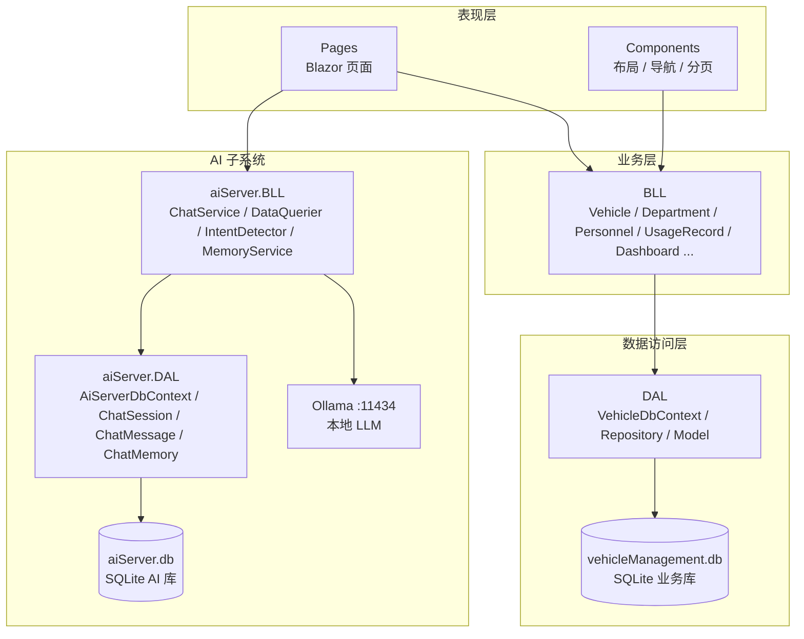
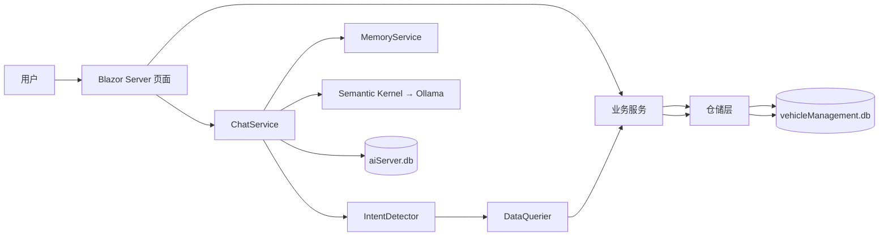
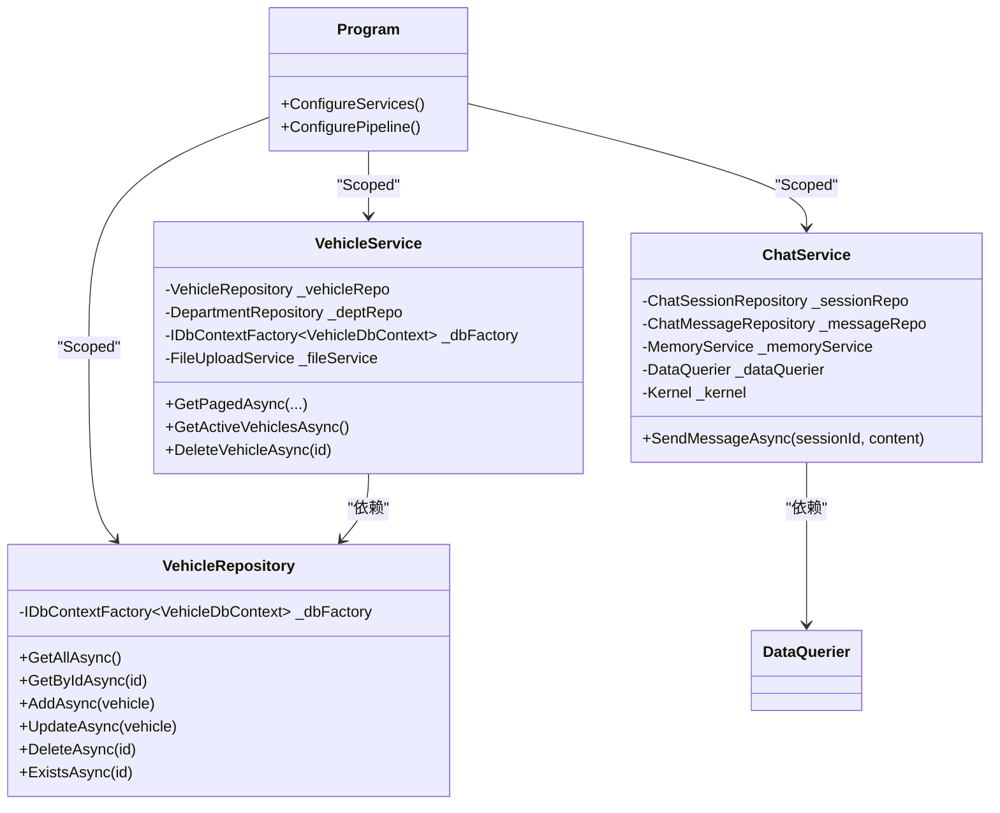
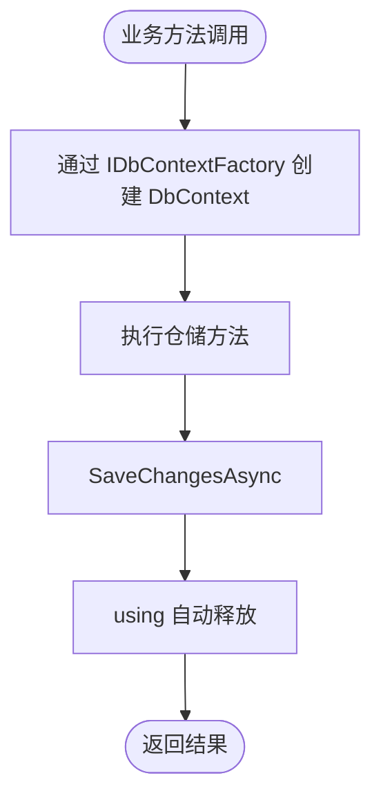
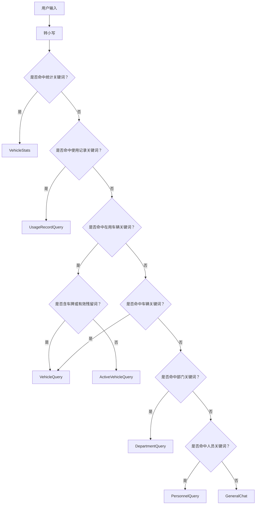
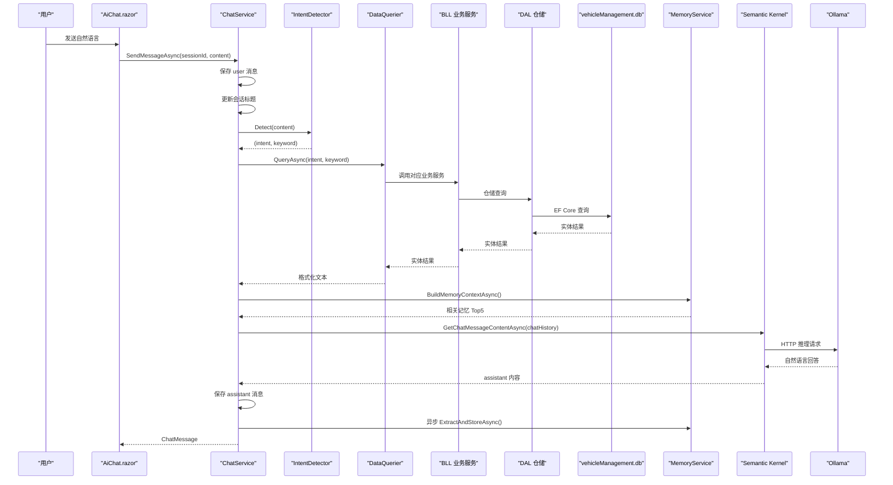
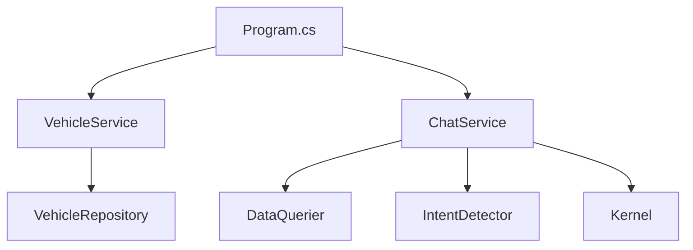
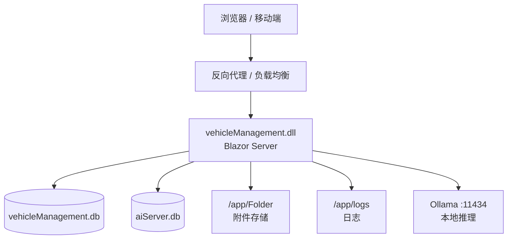

# 架构设计

<cite>
**本文引用的文件**   
- [Program.cs](file://Program.cs)
- [appsettings.json](file://appsettings.json)
- [Dockerfile](file://Dockerfile)
- [README.md](file://README.md)
- [Pages/_Host.cshtml](file://Pages/_Host.cshtml)
- [DAL/VehicleDbContext.cs](file://DAL/VehicleDbContext.cs)
- [aiServer/DAL/AiServerDbContext.cs](file://aiServer/DAL/AiServerDbContext.cs)
- [BLL/Vehicle/VehicleService.cs](file://BLL/Vehicle/VehicleService.cs)
- [DAL/Repository/VehicleRepository.cs](file://DAL/Repository/VehicleRepository.cs)
- [aiServer/BLL/ChatService.cs](file://aiServer/BLL/ChatService.cs)
- [aiServer/BLL/DataQuerier.cs](file://aiServer/BLL/DataQuerier.cs)
- [aiServer/BLL/IntentDetector.cs](file://aiServer/BLL/IntentDetector.cs)
</cite>

## 目录
1. [引言](#引言)
2. [项目结构](#项目结构)
3. [核心组件](#核心组件)
4. [架构总览](#架构总览)
5. [详细组件分析](#详细组件分析)
6. [依赖关系分析](#依赖关系分析)
7. [性能与可扩展性](#性能与可扩展性)
8. [横切关注点：安全、监控与灾难恢复](#横切关注点安全监控与灾难恢复)
9. [部署拓扑与边界](#部署拓扑与边界)
10. [故障排查指南](#故障排查指南)
11. [结论](#结论)

## 引言
vehicleManagement 是一个基于 .NET 10 的 Blazor Server 车辆管理系统，同时内嵌一个本地 AI 子系统。业务侧提供车辆、部门、人员、地点、使用记录、维修记录、扫码执行与 Excel 导出等完整功能；AI 侧通过规则意图识别把自然语言查询路由到白名单业务服务，再把结构化结果交给本地 Ollama 小模型组织成中文回答。系统采用 DAL → BLL → Pages + Components → aiServer 的分层架构，并使用 SQLite 双库隔离业务数据与对话记忆数据。

本架构文档面向开发者与运维人员，既给出高层架构图，也深入到关键类的职责、调用链、数据流、错误处理与部署形态，帮助读者理解“为什么这样设计”以及“如何扩展”。

## 项目结构
仓库按领域和层次划分：
- `DAL`：EF Core 实体、数据库上下文、仓储实现与种子数据初始化。
- `BLL`：按业务域划分的业务服务，封装分页、状态流转、附件上传、二维码生成、仪表盘统计等逻辑。
- `Pages` + `Components`：Blazor Server 页面与布局、导航、分页等 UI 组件。
- `aiServer`：独立命名空间下的 AI 子系统，包含意图识别、数据查询器、聊天服务、记忆服务、会话消息模型与仓储，以及 `/ai-chat` 页面。
- `wwwroot`：静态资源，包括 CSS、Chart.js 与字体，全部本地化，不依赖 CDN。
- 根目录：应用入口 `Program.cs`、配置文件 `appsettings.json`、AI 配置模板 `aisettings.example.json`、容器镜像构建脚本 `Dockerfile` 等。

**图表来源**
- [Program.cs:48-102](file://Program.cs#L48-L102)
- [DAL/VehicleDbContext.cs:13-19](file://DAL/VehicleDbContext.cs#L13-L19)
- [aiServer/DAL/AiServerDbContext.cs:16-18](file://aiServer/DAL/AiServerDbContext.cs#L16-L18)
- [aiServer/BLL/ChatService.cs:18-42](file://aiServer/BLL/ChatService.cs#L18-L42)

**章节来源**
- [README.md:122-139](file://README.md#L122-L139)
- [Program.cs:48-102](file://Program.cs#L48-L102)

## 核心组件
本节聚焦分层中的关键角色及其职责。

### 数据访问层（DAL）
- `VehicleDbContext`：定义业务库的 EF Core 实体集合、索引与关联关系，如车辆、部门、人员、地点、使用记录、维修记录等。
- `AiServerDbContext`：定义 AI 子系统的会话、消息、记忆实体集合及级联删除策略。
- 仓储类（如 `VehicleRepository`）：封装增删改查、存在性检查等基础操作，并通过 `IDbContextFactory<T>` 创建 DbContext，避免 Blazor Server 并发共享上下文问题。

**章节来源**
- [DAL/VehicleDbContext.cs:21-104](file://DAL/VehicleDbContext.cs#L21-L104)
- [aiServer/DAL/AiServerDbContext.cs:20-55](file://aiServer/DAL/AiServerDbContext.cs#L20-L55)
- [DAL/Repository/VehicleRepository.cs:19-63](file://DAL/Repository/VehicleRepository.cs#L19-L63)

### 业务逻辑层（BLL）
- `VehicleService`：封装车辆分页查询、在用车辆列表、借用状态切换、删除校验、二维码 Token 生成等业务规则。
- 其他业务服务（部门、人员、地点、使用记录、仪表盘、执行、维修、导出）在 `Program.cs` 中统一注册为 Scoped 服务，供页面与 AI 子系统复用。

**章节来源**
- [BLL/Vehicle/VehicleService.cs:67-149](file://BLL/Vehicle/VehicleService.cs#L67-L149)
- [Program.cs:75-86](file://Program.cs#L75-L86)

### 表现层（Pages + Components）
- `_Host.cshtml`：Blazor Server 宿主页，注入 `App.razor`，加载静态样式、Chart.js 与 Blazor 运行时。
- `Pages` 下各 `.razor` 页面负责台账、记录、申请、扫码执行等交互；`Components` 提供布局与通用 UI。

**章节来源**
- [Pages/_Host.cshtml:24-27](file://Pages/_Host.cshtml#L24-L27)
- [Pages/_Host.cshtml:172-173](file://Pages/_Host.cshtml#L172-L173)

### AI 子系统（aiServer）
- `ChatService`：对话编排中心，负责保存用户消息、自动更新会话标题、意图识别、数据查询、上下文组装、调用 LLM、保存助手回复、异步提取记忆。
- `DataQuerier`：根据 `UserIntent` 分发到具体业务服务，将结构化结果格式化为人类可读文本。
- `IntentDetector`：关键词 + 正则的规则意图识别器，固定优先级匹配统计、使用记录、在用车辆、车辆、部门、人员、闲聊等意图。
- `MemoryService`：基于规则的记忆抽取、写入与检索，用于增强对话上下文。

**章节来源**
- [aiServer/BLL/ChatService.cs:94-139](file://aiServer/BLL/ChatService.cs#L94-L139)
- [aiServer/BLL/DataQuerier.cs:48-67](file://aiServer/BLL/DataQuerier.cs#L48-L67)
- [aiServer/BLL/IntentDetector.cs:17-111](file://aiServer/BLL/IntentDetector.cs#L17-L111)

## 架构总览
系统整体遵循四层分层：DAL → BLL → Pages + Components → aiServer。用户请求进入 Blazor Server 页面后，普通业务走 BLL → DAL → SQLite 业务库；AI 查询则走 ChatService → IntentDetector → DataQuerier → BLL → DAL → SQLite 业务库，最终由 Semantic Kernel 调用 Ollama 返回自然语言答案。

**图表来源**
- [Program.cs:48-102](file://Program.cs#L48-L102)
- [aiServer/BLL/ChatService.cs:94-139](file://aiServer/BLL/ChatService.cs#L94-L139)
- [aiServer/BLL/IntentDetector.cs:17-111](file://aiServer/BLL/IntentDetector.cs#L17-L111)
- [aiServer/BLL/DataQuerier.cs:48-67](file://aiServer/BLL/DataQuerier.cs#L48-L67)

## 详细组件分析

### 依赖注入与生命周期
- 所有仓储、业务服务、AI 服务均通过 `AddScoped` 注册，确保每个请求或 Blazor Circuit 拥有独立实例。
- `Kernel`（Semantic Kernel）注册为单例，因为它是无状态的推理客户端包装器。
- 两个 DbContext 都通过 `AddDbContextFactory<T>` 注册，避免 Blazor Server 多 Circuit 共享同一个 DbContext 导致的并发异常。

**图表来源**
- [Program.cs:52-102](file://Program.cs#L52-L102)
- [DAL/Repository/VehicleRepository.cs:12-17](file://DAL/Repository/VehicleRepository.cs#L12-L17)
- [BLL/Vehicle/VehicleService.cs:26-38](file://BLL/Vehicle/VehicleService.cs#L26-L38)
- [aiServer/BLL/ChatService.cs:29-42](file://aiServer/BLL/ChatService.cs#L29-L42)

**章节来源**
- [Program.cs:52-102](file://Program.cs#L52-L102)

### 仓储模式与工厂模式
- 仓储模式：`VehicleRepository` 暴露 `GetAllAsync`、`GetByIdAsync`、`AddAsync`、`UpdateAsync`、`DeleteAsync`、`ExistsAsync`，对上层屏蔽 EF Core 细节。
- 工厂模式：通过 `IDbContextFactory<VehicleDbContext>` 在需要时创建 DbContext，避免长生命周期对象持有数据库连接，提升并发安全性。

**图表来源**
- [DAL/Repository/VehicleRepository.cs:19-56](file://DAL/Repository/VehicleRepository.cs#L19-L56)
- [BLL/Vehicle/VehicleService.cs:45-48](file://BLL/Vehicle/VehicleService.cs#L45-L48)

**章节来源**
- [DAL/Repository/VehicleRepository.cs:19-63](file://DAL/Repository/VehicleRepository.cs#L19-L63)
- [BLL/Vehicle/VehicleService.cs:45-48](file://BLL/Vehicle/VehicleService.cs#L45-L48)

### 策略模式：意图路由
`IntentDetector.Detect` 使用固定优先级的关键词与正则匹配，将输入映射到 `UserIntent` 枚举值，再由 `DataQuerier.QueryAsync` 以 switch 表达式分派到不同查询分支。这本质上是“规则策略”：每种意图对应一种查询策略。

**图表来源**
- [aiServer/BLL/IntentDetector.cs:17-111](file://aiServer/BLL/IntentDetector.cs#L17-L111)
- [aiServer/BLL/DataQuerier.cs:48-67](file://aiServer/BLL/DataQuerier.cs#L48-L67)

**章节来源**
- [aiServer/BLL/IntentDetector.cs:17-111](file://aiServer/BLL/IntentDetector.cs#L17-L111)
- [aiServer/BLL/DataQuerier.cs:48-67](file://aiServer/BLL/DataQuerier.cs#L48-L67)

### 一次 AI 问答的完整调用序列

**图表来源**
- [aiServer/BLL/ChatService.cs:94-139](file://aiServer/BLL/ChatService.cs#L94-L139)
- [aiServer/BLL/ChatService.cs:161-183](file://aiServer/BLL/ChatService.cs#L161-L183)
- [aiServer/BLL/ChatService.cs:188-199](file://aiServer/BLL/ChatService.cs#L188-L199)
- [aiServer/BLL/DataQuerier.cs:48-67](file://aiServer/BLL/DataQuerier.cs#L48-L67)

**章节来源**
- [aiServer/BLL/ChatService.cs:94-139](file://aiServer/BLL/ChatService.cs#L94-L139)
- [aiServer/BLL/DataQuerier.cs:48-67](file://aiServer/BLL/DataQuerier.cs#L48-L67)

### 数据流向：用户请求到数据库
普通业务流程：
- 用户操作 Blazor 页面。
- 页面调用 BLL 业务服务。
- 业务服务组合多个仓储或直接构造 LINQ。
- 仓储通过 `IDbContextFactory` 创建 DbContext 并执行 EF Core 查询。
- EF Core 访问 SQLite 业务库。

AI 查询流程：
- 用户向 `/ai-chat` 发送自然语言。
- `ChatService` 持久化用户消息并识别意图。
- `DataQuerier` 调用 BLL 业务服务获取结构化文本。
- `ChatService` 组装提示词、数据注入、历史记忆与最近消息。
- Semantic Kernel 调用 Ollama 返回自然语言回答。
- 回答持久化到 AI 库，记忆异步抽取。

**章节来源**
- [BLL/Vehicle/VehicleService.cs:67-149](file://BLL/Vehicle/VehicleService.cs#L67-L149)
- [DAL/Repository/VehicleRepository.cs:19-63](file://DAL/Repository/VehicleRepository.cs#L19-L63)
- [aiServer/BLL/ChatService.cs:94-139](file://aiServer/BLL/ChatService.cs#L94-L139)

## 依赖关系分析
- `Program.cs` 是装配中心：注册 Blazor Server、Serilog、两个 SQLite DbContext 工厂、仓储、业务服务、AI 服务、Semantic Kernel。
- `VehicleService` 依赖 `VehicleRepository`、`DepartmentRepository`、`IDbContextFactory<VehicleDbContext>`、`FileUploadService`、`ILogger`。
- `ChatService` 依赖 `ChatSessionRepository`、`ChatMessageRepository`、`MemoryService`、`DataQuerier`、`Kernel`。
- `DataQuerier` 依赖 BLL 业务服务，但不直接依赖 DAL，体现“AI 子系统复用现有业务服务”的设计。

**图表来源**
- [Program.cs:52-102](file://Program.cs#L52-L102)
- [BLL/Vehicle/VehicleService.cs:26-38](file://BLL/Vehicle/VehicleService.cs#L26-L38)
- [aiServer/BLL/ChatService.cs:29-42](file://aiServer/BLL/ChatService.cs#L29-L42)
- [aiServer/BLL/DataQuerier.cs:31-43](file://aiServer/BLL/DataQuerier.cs#L31-L43)

**章节来源**
- [Program.cs:52-102](file://Program.cs#L52-L102)
- [BLL/Vehicle/VehicleService.cs:26-38](file://BLL/Vehicle/VehicleService.cs#L26-L38)
- [aiServer/BLL/ChatService.cs:29-42](file://aiServer/BLL/ChatService.cs#L29-L42)
- [aiServer/BLL/DataQuerier.cs:31-43](file://aiServer/BLL/DataQuerier.cs#L31-L43)

## 性能与可扩展性

### 性能特性
- Blazor Server 保持服务端 SignalR 连接，适合内网工具场景，减少前端复杂度。
- SQLite 双库隔离降低业务与 AI 数据的相互影响，启动时各自 `EnsureCreatedAsync`。
- Serilog 抑制框架与 EF SQL 日志噪声，保留业务可观测性。
- 记忆抽取异步执行，避免阻塞主对话路径。

### 可扩展性考虑
- 新增业务查询：在 `DataQuerier` 增加意图分支，复用已有 BLL 服务。
- 新增意图规则：在 `IntentDetector` 追加关键词与正则，保持固定优先级。
- 新增记忆维度：在 `MemoryService` 扩展抽取规则与检索关键词。
- 更换模型：只改 `aisettings.json` 或环境变量，无需改代码。

**章节来源**
- [Program.cs:28-37](file://Program.cs#L28-L37)
- [Program.cs:109-125](file://Program.cs#L109-L125)
- [aiServer/BLL/ChatService.cs:131-136](file://aiServer/BLL/ChatService.cs#L131-L136)
- [Program.cs:97-102](file://Program.cs#L97-L102)

## 横切关注点：安全、监控与灾难恢复

### 安全性
- 当前系统按内网单工具设计，没有登录与权限模型，不适合公网暴露。
- AI 查询不生成 SQL，而是调用 BLL 白名单方法，注入面为零。
- 外部附件目录通过静态文件中间件暴露 `/Folder`，需配合反向代理限制访问范围。

**章节来源**
- [README.md:369-370](file://README.md#L369-L370)
- [Program.cs:132-140](file://Program.cs#L132-L140)

### 监控
- Serilog 控制台输出与按天滚动文件日志，默认保留 7 份。
- `/health` 健康探针供容器编排检测。
- Chart.js 与页面诊断脚本辅助前端可视化与布局诊断。

**章节来源**
- [Program.cs:28-37](file://Program.cs#L28-L37)
- [Program.cs:145-146](file://Program.cs#L145-L146)
- [Pages/_Host.cshtml:19-22](file://Pages/_Host.cshtml#L19-L22)

### 灾难恢复
- 业务库与 AI 库物理分离，清对话不影响业务数据。
- 文件上传失败会阻止数据库删除，保证数据一致性。
- Ollama 不可达时返回友好错误，页面不崩溃。
- 记忆抽取失败仅记录警告，不影响对话主流程。

**章节来源**
- [README.md:302-306](file://README.md#L302-L306)
- [BLL/Vehicle/VehicleService.cs:171-201](file://BLL/Vehicle/VehicleService.cs#L171-L201)
- [aiServer/BLL/ChatService.cs:188-199](file://aiServer/BLL/ChatService.cs#L188-L199)
- [aiServer/BLL/ChatService.cs:131-136](file://aiServer/BLL/ChatService.cs#L131-L136)

## 部署拓扑与边界

### 部署拓扑

**图表来源**
- [Dockerfile:37-43](file://Dockerfile#L37-L43)
- [Program.cs:106-140](file://Program.cs#L106-L140)
- [Program.cs:145-148](file://Program.cs#L145-L148)

### 系统边界
- 应用边界：ASP.NET Core Web 应用，暴露 Blazor Hub、静态文件、健康端点。
- 数据边界：SQLite 业务库与 AI 库分离，启动时自动建库。
- 外部依赖边界：Ollama 推理服务，通过环境变量或配置文件注入端点与模型 tag。
- 文件边界：`data`、`logs`、`Folder` 通过卷挂载持久化。

**章节来源**
- [Program.cs:106-148](file://Program.cs#L106-L148)
- [appsettings.json:3-6](file://appsettings.json#L3-L6)
- [Dockerfile:31-43](file://Dockerfile#L31-L43)

## 故障排查指南
- Ollama 不可达：检查 `/health` 是否返回正常，确认容器内网络能解析 Ollama 主机地址，核对 `AiServer__OllamaEndpoint` 与 `AiServer__OllamaModel`。
- 查询结果为空：查看 `DataQuerier` 各分支是否返回显式空文案，确认意图是否被正确识别。
- 页面报错：Blazor Server 在开发环境显示详细异常，生产环境跳转到 `/Error`。
- 日志过多：Serilog 已抑制框架与 EF SQL 日志，若仍噪声过大，检查自定义日志级别。

**章节来源**
- [Program.cs:127-130](file://Program.cs#L127-L130)
- [Program.cs:28-37](file://Program.cs#L28-L37)
- [aiServer/BLL/DataQuerier.cs:63-66](file://aiServer/BLL/DataQuerier.cs#L63-L66)
- [aiServer/BLL/ChatService.cs:188-199](file://aiServer/BLL/ChatService.cs#L188-L199)

## 结论
vehicleManagement 通过清晰的 DAL → BLL → Pages + Components → aiServer 分层，结合依赖注入、仓储模式、规则策略与工厂模式，实现了业务管理与本地 AI 取数的统一后端。SQLite 双库隔离保障了业务数据与对话记忆的独立性；规则意图识别与白名单查询避免了 Text-to-SQL 的风险；Blazor Server 简化了内网工具的前端复杂度。系统在稳定性、可观测性与可部署性方面做了充分权衡，适合在内网环境中作为公车管理台账与可解释 AI 助手运行。未来可在意图召回、流式输出、语义记忆与鉴权方面继续演进。