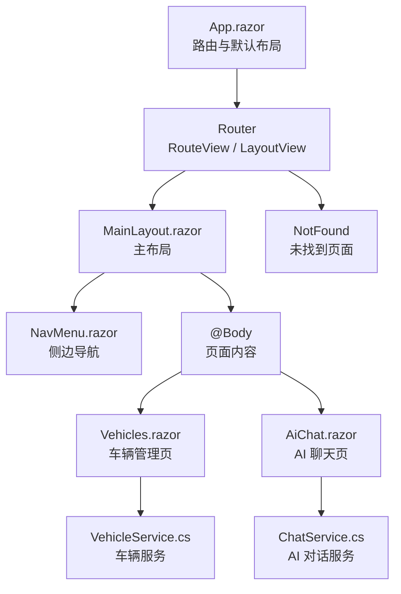
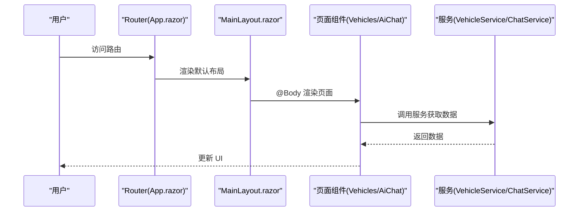
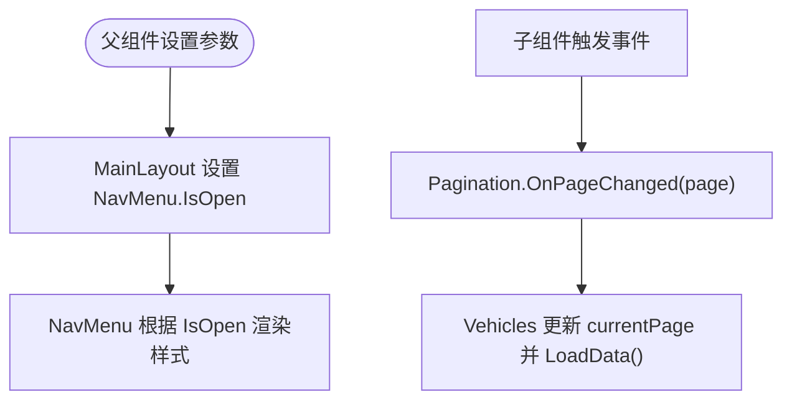
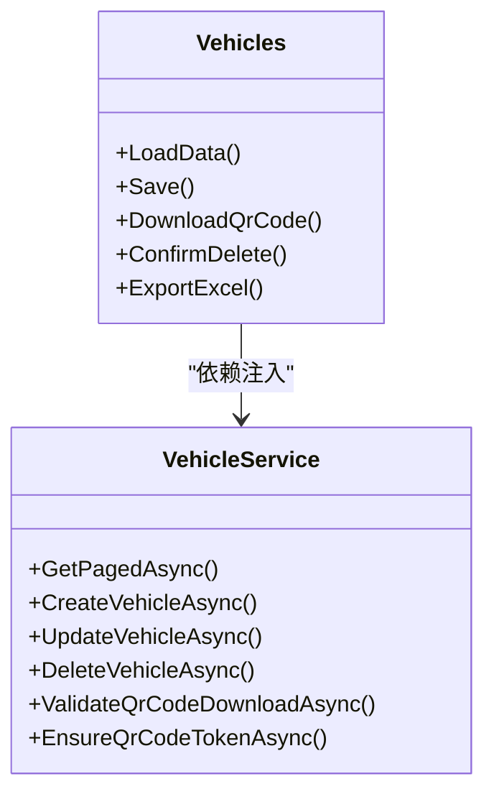
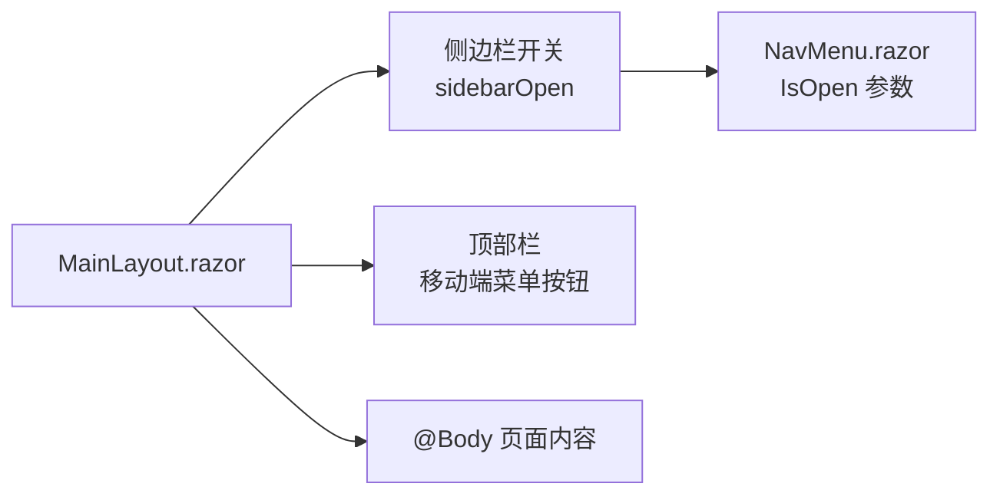
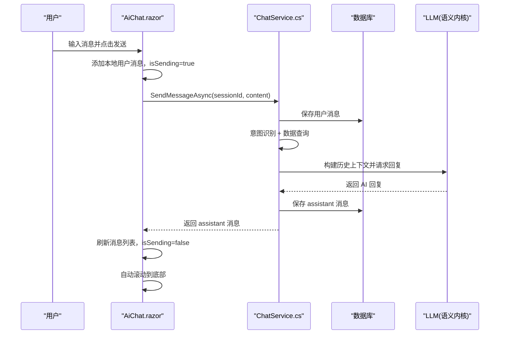
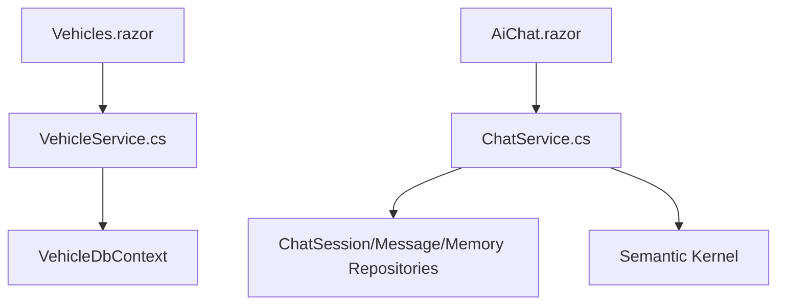

# 组件交互设计

<cite>
**本文引用的文件**   
- [App.razor](file://App.razor)
- [_Imports.razor](file:///_Imports.razor)
- [MainLayout.razor](file://Components/Layouts/MainLayout.razor)
- [MobileLayout.razor](file://Components/Layouts/MobileLayout.razor)
- [NavMenu.razor](file://Components/Navigation/NavMenu.razor)
- [Pagination.razor](file://Components/Common/Pagination.razor)
- [Vehicles.razor](file://Pages/Vehicles.razor)
- [VehicleService.cs](file://BLL/Vehicle/VehicleService.cs)
- [AiChat.razor](file://aiServer/Pages/AiChat.razor)
- [ChatService.cs](file://aiServer/BLL/ChatService.cs)
</cite>

## 目录
1. [引言](#引言)
2. [项目结构](#项目结构)
3. [核心组件](#核心组件)
4. [架构总览](#架构总览)
5. [详细组件分析](#详细组件分析)
6. [依赖关系与服务调用链](#依赖关系与服务调用链)
7. [性能与优化](#性能与优化)
8. [故障排查指南](#故障排查指南)
9. [结论](#结论)

## 引言
本文件面向 vehicleManagement 系统的 Blazor 前端，聚焦组件交互设计。文档覆盖以下主题：
- 父子组件参数传递、事件回调、CascadingParameters 的使用方式与最佳实践
- 跨组件状态管理：服务注入、全局状态存储、组件生命周期管理
- 布局组件设计：MainLayout 与 MobileLayout 的响应式适配、导航菜单动态加载
- AI 聊天组件交互：消息发送接收、会话管理、实时更新机制
- 组件依赖图与服务调用链
- 组件复用策略与扩展点设计
- 性能优化措施：懒加载、虚拟滚动、内存管理等

## 项目结构
vehicleManagement 采用分层组织：
- Components：可复用 UI 组件（布局、导航、通用控件）
- Pages：页面级组件，承载业务视图与交互
- BLL：领域服务层，封装业务逻辑
- DAL：数据访问层，封装仓储与模型
- aiServer：AI 对话子系统，包含 ChatService 与对话页面 AiChat

**图表来源**
- [App.razor:1-12](file://App.razor#L1-L12)
- [MainLayout.razor:1-40](file://Components/Layouts/MainLayout.razor#L1-L40)
- [NavMenu.razor:1-56](file://Components/Navigation/NavMenu.razor#L1-L56)
- [Vehicles.razor:1-410](file://Pages/Vehicles.razor#L1-L410)
- [AiChat.razor:1-555](file://aiServer/Pages/AiChat.razor#L1-L555)
- [VehicleService.cs:1-241](file://BLL/Vehicle/VehicleService.cs#L1-L241)
- [ChatService.cs:1-202](file://aiServer/BLL/ChatService.cs#L1-L202)

**章节来源**
- [App.razor:1-12](file://App.razor#L1-L12)
- [_Imports.razor:1-30](file:///_Imports.razor#L1-L30)

## 核心组件
- 布局组件
  - MainLayout：提供顶部栏、侧边栏开关、主体区域 @Body
  - MobileLayout：移动端简化布局，仅包裹 @Body
- 导航组件
  - NavMenu：侧边菜单，通过 IsOpen 参数控制显示，内部使用 NavLink 进行路由跳转
- 通用组件
  - Pagination：分页控件，通过参数 CurrentPage/TotalPages/TotalCount 与事件 OnPageChanged 与父组件通信
- 页面组件
  - Vehicles：车辆管理列表，集成搜索、排序、分页、新增/编辑、删除、二维码下载、Excel 导出
  - AiChat：AI 助手聊天界面，支持会话管理、记忆查看、消息发送、自动滚动、诊断面板

**章节来源**
- [MainLayout.razor:1-40](file://Components/Layouts/MainLayout.razor#L1-L40)
- [MobileLayout.razor:1-8](file://Components/Layouts/MobileLayout.razor#L1-L8)
- [NavMenu.razor:1-56](file://Components/Navigation/NavMenu.razor#L1-L56)
- [Pagination.razor:1-42](file://Components/Common/Pagination.razor#L1-L42)
- [Vehicles.razor:1-410](file://Pages/Vehicles.razor#L1-L410)
- [AiChat.razor:1-555](file://aiServer/Pages/AiChat.razor#L1-L555)

## 架构总览
Blazor 应用入口 App.razor 配置 Router，默认使用 MainLayout 作为所有页面的布局容器；NotFound 也使用 MainLayout。页面通过 NavLink 在 NavMenu 中导航，页面内再组合业务组件与服务。

**图表来源**
- [App.razor:1-12](file://App.razor#L1-L12)
- [MainLayout.razor:1-40](file://Components/Layouts/MainLayout.razor#L1-L40)
- [Vehicles.razor:1-410](file://Pages/Vehicles.razor#L1-L410)
- [AiChat.razor:1-555](file://aiServer/Pages/AiChat.razor#L1-L555)
- [VehicleService.cs:1-241](file://BLL/Vehicle/VehicleService.cs#L1-L241)
- [ChatService.cs:1-202](file://aiServer/BLL/ChatService.cs#L1-L202)

## 详细组件分析

### 父子组件参数传递与事件回调
- NavMenu 通过 [Parameter] IsOpen 接收来自父组件 MainLayout 的状态，用于控制侧边栏展开/收起
- Pagination 通过 [Parameter] 暴露 CurrentPage、TotalPages、TotalCount，并通过 EventCallback<int> OnPageChanged 将翻页动作回传给父组件 Vehicles
- Vehicles 监听 OnPageChanged，更新 currentPage 并重新加载数据

**图表来源**
- [MainLayout.razor:27-39](file://Components/Layouts/MainLayout.razor#L27-L39)
- [NavMenu.razor:53-55](file://Components/Navigation/NavMenu.razor#L53-L55)
- [Pagination.razor:20-41](file://Components/Common/Pagination.razor#L20-L41)
- [Vehicles.razor:186-247](file://Pages/Vehicles.razor#L186-L247)

**章节来源**
- [MainLayout.razor:27-39](file://Components/Layouts/MainLayout.razor#L27-L39)
- [NavMenu.razor:53-55](file://Components/Navigation/NavMenu.razor#L53-L55)
- [Pagination.razor:20-41](file://Components/Common/Pagination.razor#L20-L41)
- [Vehicles.razor:186-247](file://Pages/Vehicles.razor#L186-L247)

### CascadingParameters 的使用建议
当前代码未直接使用 CascadingParameters。建议在需要“全局主题”、“语言包”或“权限上下文”时引入：
- 在顶层布局（如 MainLayout）定义 [CascadingValue] 暴露主题或用户信息
- 子组件通过 [CascadingParameter] 读取，避免层层传参
- 注意变更通知：当 CascadingValue 变化时需触发 StateHasChanged 以刷新子组件

[本节为概念性说明，不直接分析具体文件]

### 跨组件状态管理与服务注入
- 服务注入：Vehicles 通过 @inject 注入 VehicleService、QrCodeService、ExportService、IJSRuntime、HttpContextAccessor、NavigationManager
- AiChat 通过 @inject 注入 ChatService 与 IJSRuntime
- 生命周期：
  - Vehicles：OnInitializedAsync 加载数据
  - AiChat：OnInitializedAsync 加载会话；OnAfterRenderAsync 初始化 JS 滚动监听与自动滚动；Dispose 释放 DotNetObjectReference

**图表来源**
- [Vehicles.razor:1-410](file://Pages/Vehicles.razor#L1-L410)
- [VehicleService.cs:1-241](file://BLL/Vehicle/VehicleService.cs#L1-L241)

**章节来源**
- [Vehicles.razor:1-410](file://Pages/Vehicles.razor#L1-L410)
- [AiChat.razor:235-555](file://aiServer/Pages/AiChat.razor#L235-L555)
- [VehicleService.cs:1-241](file://BLL/Vehicle/VehicleService.cs#L1-L241)
- [ChatService.cs:1-202](file://aiServer/BLL/ChatService.cs#L1-L202)

### 布局组件设计与响应式适配
- MainLayout：
  - 提供侧边栏开关状态 sidebarOpen，ToggleSidebar/CloseSidebar 控制
  - 顶部栏包含移动端菜单按钮与头像占位
  - @Body 渲染页面内容
- MobileLayout：
  - 极简布局，仅包裹 @Body，适合移动端快速展示
- NavMenu：
  - 通过 IsOpen 参数控制侧边栏显示
  - 使用 NavLink 实现路由导航，包含“主菜单”和“AI 服务”两个分组

**图表来源**
- [MainLayout.razor:1-40](file://Components/Layouts/MainLayout.razor#L1-L40)
- [MobileLayout.razor:1-8](file://Components/Layouts/MobileLayout.razor#L1-L8)
- [NavMenu.razor:1-56](file://Components/Navigation/NavMenu.razor#L1-L56)

**章节来源**
- [MainLayout.razor:1-40](file://Components/Layouts/MainLayout.razor#L1-L40)
- [MobileLayout.razor:1-8](file://Components/Layouts/MobileLayout.razor#L1-L8)
- [NavMenu.razor:1-56](file://Components/Navigation/NavMenu.razor#L1-L56)

### AI 聊天组件交互流程
AiChat 负责会话管理、消息发送与接收、记忆查看、滚动行为与诊断面板。其核心流程如下：

**图表来源**
- [AiChat.razor:375-419](file://aiServer/Pages/AiChat.razor#L375-L419)
- [ChatService.cs:94-139](file://aiServer/BLL/ChatService.cs#L94-L139)

#### 会话管理
- 创建新会话：CreateNewSession 调用 ChatService.CreateSessionAsync，插入到 sessions 列表并切换 currentSessionId
- 选择会话：SelectSession 加载对应 messages 并重置 UI 状态
- 删除会话：DeleteSession 调用 ChatService.DeleteSessionAsync，成功后从 sessions 移除，若当前会话被删则清空 currentSessionId/messages

#### 消息发送与实时更新
- 发送消息：SendMessage 先本地追加用户消息，再调用 ChatService.SendMessageAsync，随后拉取最新消息列表并刷新 UI
- 错误处理：捕获异常后以 assistant 角色追加错误消息
- 自动滚动：OnAfterRenderAsync 注册 JS 滚动监听，根据距离底部阈值控制 _shouldAutoScroll 与 showScrollBtn；提供 ScrollToBottomSmooth/Instant 两种滚动方式

#### 记忆管理
- ToggleMemories 按需加载 memories 列表
- DeleteMemory 调用 ChatService.DeleteMemoryAsync 并移除本地项

**章节来源**
- [AiChat.razor:235-555](file://aiServer/Pages/AiChat.razor#L235-L555)
- [ChatService.cs:1-202](file://aiServer/BLL/ChatService.cs#L1-L202)

## 依赖关系与服务调用链
- 页面到服务
  - Vehicles -> VehicleService：分页查询、部门列表、增删改查、二维码校验与生成、导出 Excel
  - AiChat -> ChatService：会话 CRUD、消息收发、记忆管理
- 服务到数据层
  - VehicleService 使用 IDbContextFactory<VehicleDbContext> 与 Repository 访问数据库
  - ChatService 使用 ChatSessionRepository、ChatMessageRepository、MemoryService、DataQuerier 与 Semantic Kernel

**图表来源**
- [Vehicles.razor:1-410](file://Pages/Vehicles.razor#L1-L410)
- [VehicleService.cs:1-241](file://BLL/Vehicle/VehicleService.cs#L1-L241)
- [AiChat.razor:1-555](file://aiServer/Pages/AiChat.razor#L1-L555)
- [ChatService.cs:1-202](file://aiServer/BLL/ChatService.cs#L1-L202)

**章节来源**
- [Vehicles.razor:1-410](file://Pages/Vehicles.razor#L1-L410)
- [VehicleService.cs:1-241](file://BLL/Vehicle/VehicleService.cs#L1-L241)
- [AiChat.razor:1-555](file://aiServer/Pages/AiChat.razor#L1-L555)
- [ChatService.cs:1-202](file://aiServer/BLL/ChatService.cs#L1-L202)

## 性能与优化
- 组件懒加载
  - 使用 NavLink 进行路由导航，仅在访问页面时加载对应组件
  - 对重型页面（如 AiChat）可按需拆分子组件，减少首屏体积
- 虚拟滚动
  - 对于长消息列表，建议使用虚拟滚动方案（例如基于 JS 的虚拟化库），仅渲染可视区消息节点，降低 DOM 压力
- 内存管理
  - AiChat 在 Dispose 中释放 DotNetObjectReference，避免 JS 互操作引用泄漏
  - 避免在循环中频繁调用 StateHasChanged，合并状态更新后再刷新
- 网络与渲染优化
  - 分页与搜索：Vehicles 通过 GetPagedAsync 在服务端完成过滤与排序，减少前端计算
  - 自动滚动：AiChat 使用即时滚动与平滑滚动分离，避免动画阻塞渲染
- 资源清理
  - 删除车辆时先清理图片附件，失败则阻止数据库删除，保证一致性
  - 导出 Excel 使用 Base64 传输并通过 JS 下载，避免服务端直连大文件

[本节为通用指导，不直接分析具体文件]

## 故障排查指南
- 侧边栏无法关闭
  - 检查 MainLayout.ToggleSidebar/CloseSidebar 是否被正确绑定到按钮点击事件
  - 确认 NavMenu.IsOpen 参数是否正确传入
- 分页无效
  - 检查 Pagination.OnPageChanged 是否被父组件订阅，且父组件是否正确更新 currentPage 并调用 LoadData
- AI 聊天无响应
  - 检查 ChatService.SendMessageAsync 是否成功持久化消息与调用 LLM
  - 查看 AiChat 的错误分支是否输出错误消息
- 滚动异常
  - 检查 OnAfterRenderAsync 中 JS 滚动监听是否注册成功，_dotNetRef 是否正确创建与释放
- 二维码下载失败
  - 检查 ValidateQrCodeDownloadAsync 的业务校验结果
  - 确保 EnsureQrCodeTokenAsync 已生成 Token，且 HttpContextAccessor 能获取正确的 Scheme/Host

**章节来源**
- [MainLayout.razor:27-39](file://Components/Layouts/MainLayout.razor#L27-L39)
- [NavMenu.razor:53-55](file://Components/Navigation/NavMenu.razor#L53-L55)
- [Pagination.razor:20-41](file://Components/Common/Pagination.razor#L20-L41)
- [AiChat.razor:277-311](file://aiServer/Pages/AiChat.razor#L277-L311)
- [AiChat.razor:375-419](file://aiServer/Pages/AiChat.razor#L375-L419)
- [Vehicles.razor:336-358](file://Pages/Vehicles.razor#L336-L358)

## 结论
vehicleManagement 的组件交互遵循清晰的职责划分：
- 布局与导航由 MainLayout 与 NavMenu 承担，提供一致的页面外壳与路由体验
- 页面组件通过服务注入解耦 UI 与业务逻辑，便于测试与维护
- AI 聊天组件实现了完整的会话与消息流程，结合 JS 互操作提升用户体验
- 通过参数传递与事件回调实现父子组件通信，必要时可扩展 CascadingParameters 以共享全局上下文
- 性能方面建议引入懒加载、虚拟滚动与严格的资源清理策略，进一步提升大规模数据场景下的稳定性与流畅度