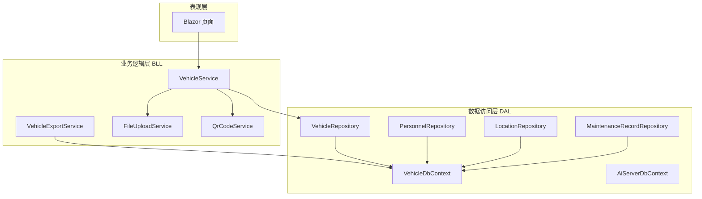
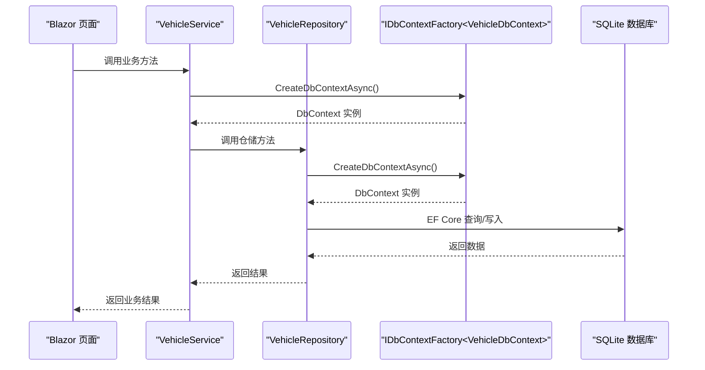
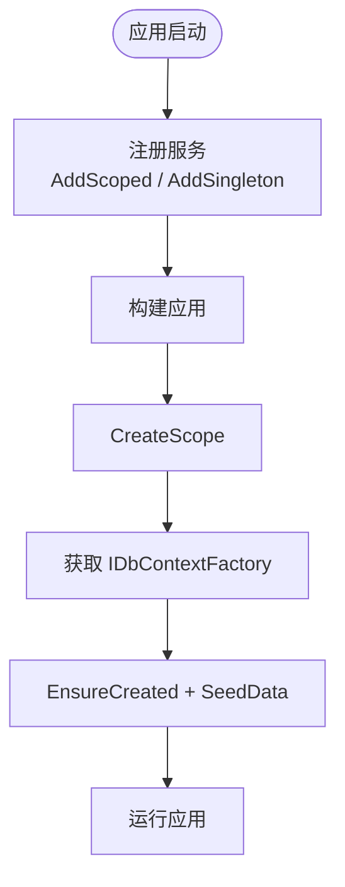
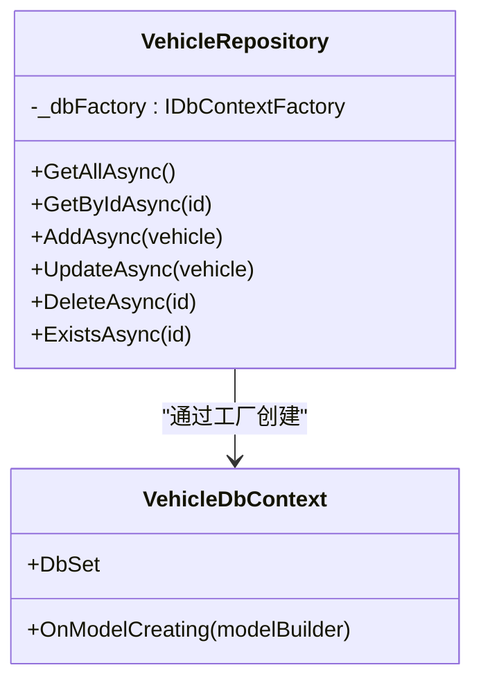
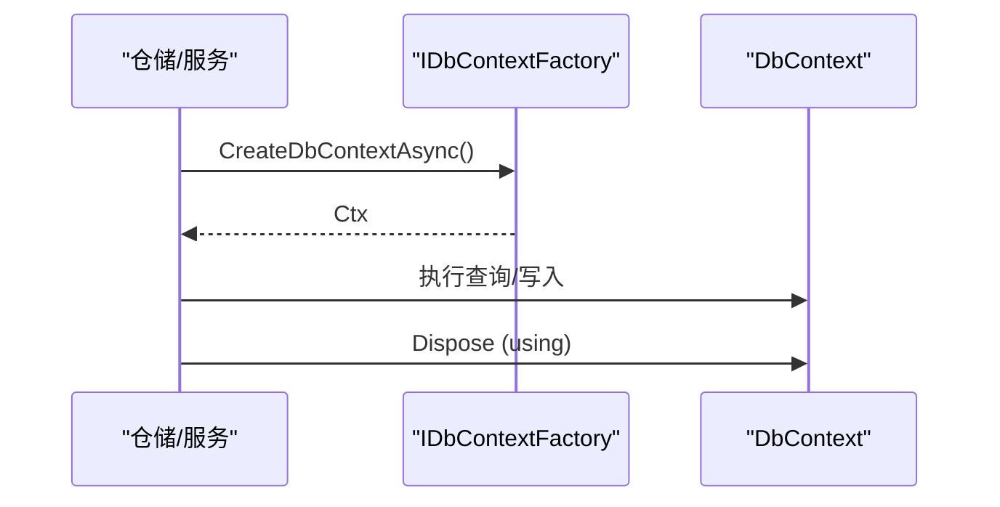
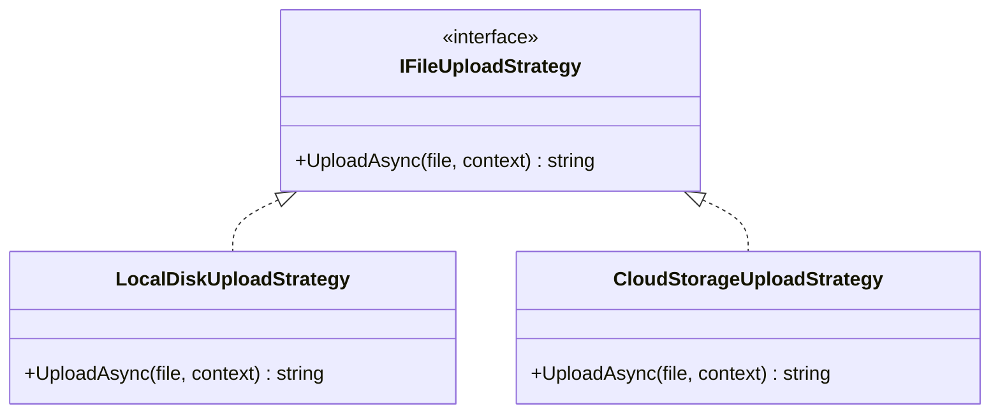
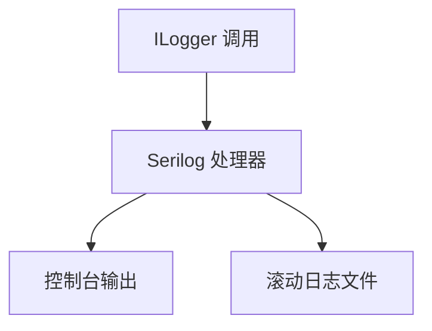
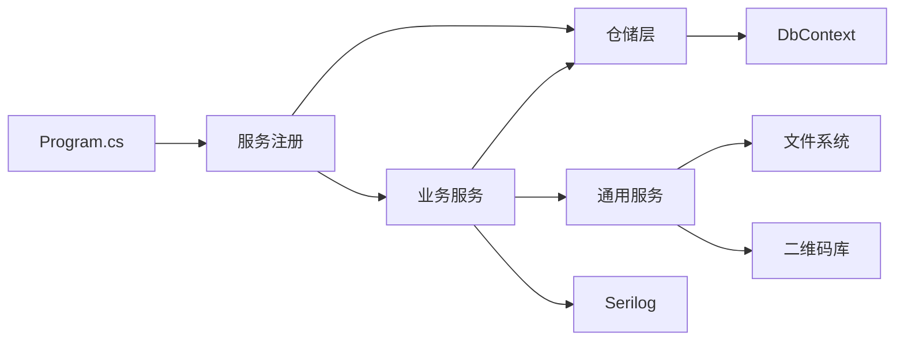

# 设计模式应用

<cite>
**本文引用的文件**   
- [Program.cs](file://Program.cs)
- [VehicleDbContext.cs](file://DAL/VehicleDbContext.cs)
- [AiServerDbContext.cs](file://aiServer/DAL/AiServerDbContext.cs)
- [VehicleRepository.cs](file://DAL/Repository/VehicleRepository.cs)
- [PersonnelRepository.cs](file://DAL/Repository/PersonnelRepository.cs)
- [LocationRepository.cs](file://DAL/Repository/LocationRepository.cs)
- [MaintenanceRecordRepository.cs](file://DAL/Repository/MaintenanceRecordRepository.cs)
- [ChatMemoryRepository.cs](file://aiServer/DAL/Repository/ChatMemoryRepository.cs)
- [VehicleService.cs](file://BLL/Vehicle/VehicleService.cs)
- [FileUploadService.cs](file://BLL/Common/FileUploadService.cs)
- [QrCodeService.cs](file://BLL/Common/QrCodeService.cs)
- [VehicleExportService.cs](file://BLL/Export/VehicleExportService.cs)
- [appsettings.json](file://appsettings.json)
</cite>

## 目录
1. [引言](#引言)
2. [项目结构](#项目结构)
3. [核心组件](#核心组件)
4. [架构总览](#架构总览)
5. [详细组件分析](#详细组件分析)
6. [依赖关系分析](#依赖关系分析)
7. [性能考虑](#性能考虑)
8. [故障排查指南](#故障排查指南)
9. [结论](#结论)

## 引言
本文件面向 vehicleManagement 系统，系统性梳理并解释在项目中实际使用的设计模式与工程实践，重点包括：
- 依赖注入（DI）与服务生命周期管理（Scoped vs Singleton）、构造函数注入、服务注册策略。
- 仓储模式：统一数据访问抽象、CRUD 封装、查询扩展性。
- 工厂模式：IDbContextFactory 解决 Blazor Server 并发问题、服务实例创建最佳实践。
- 策略模式：不同文件上传策略、二维码生成策略、数据导出策略的扩展点设计思路。
- 观察者模式：事件驱动的日志记录与异步通知机制的应用建议。

文档同时给出代码级图示、关键流程与时序图，帮助读者快速理解各模式在系统中的落地方式与收益。

## 项目结构
vehicleManagement 采用分层架构：
- 表现层：Blazor Server 页面与布局。
- 业务逻辑层（BLL）：按领域组织的服务类，如车辆、部门、人员、地点、使用记录、维护记录、导出等。
- 数据访问层（DAL）：EF Core DbContext、实体模型、仓储实现。
- 通用能力：文件上传、二维码生成、分页结果等。
- AI 子模块：独立的数据库上下文与仓储，用于聊天会话、消息与记忆存储。

**图表来源**
- [Program.cs:60-95](file://Program.cs#L60-L95)
- [VehicleService.cs:18-38](file://BLL/Vehicle/VehicleService.cs#L18-L38)
- [VehicleRepository.cs:10-17](file://DAL/Repository/VehicleRepository.cs#L10-L17)
- [VehicleDbContext.cs:6-19](file://DAL/VehicleDbContext.cs#L6-L19)
- [AiServerDbContext.cs:9-18](file://aiServer/DAL/AiServerDbContext.cs#L9-L18)

**章节来源**
- [Program.cs:41-102](file://Program.cs#L41-L102)
- [VehicleDbContext.cs:6-19](file://DAL/VehicleDbContext.cs#L6-L19)
- [AiServerDbContext.cs:9-18](file://aiServer/DAL/AiServerDbContext.cs#L9-L18)

## 核心组件
- 依赖注入容器：通过 Program.cs 集中注册所有服务，区分 Scoped 与 Singleton 生命周期。
- 数据库上下文工厂：使用 AddDbContextFactory<T>() 为 Blazor Server 提供线程安全的 DbContext 实例。
- 仓储层：每个实体对应一个 Repository，封装 CRUD 与常用查询。
- 业务服务：组合仓储、上下文工厂、通用服务（文件上传、二维码）完成领域逻辑。
- 通用服务：文件上传与二维码生成作为横切能力被多个服务复用。

**章节来源**
- [Program.cs:52-95](file://Program.cs#L52-L95)
- [VehicleRepository.cs:10-63](file://DAL/Repository/VehicleRepository.cs#L10-L63)
- [VehicleService.cs:18-38](file://BLL/Vehicle/VehicleService.cs#L18-L38)
- [FileUploadService.cs:12-27](file://BLL/Common/FileUploadService.cs#L12-L27)
- [QrCodeService.cs:6-39](file://BLL/Common/QrCodeService.cs#L6-L39)

## 架构总览
下图展示从页面到仓储与数据库的调用链，以及 IDbContextFactory 在其中的作用。

**图表来源**
- [Program.cs:52-58](file://Program.cs#L52-L58)
- [VehicleService.cs:67-109](file://BLL/Vehicle/VehicleService.cs#L67-L109)
- [VehicleRepository.cs:19-46](file://DAL/Repository/VehicleRepository.cs#L19-L46)

## 详细组件分析

### 依赖注入与服务生命周期
- 服务注册策略：
  - 仓储层与服务层均使用 AddScoped，确保每个请求/作用域内唯一实例，避免跨请求共享状态。
  - QrCodeService 使用 AddSingleton，因为它是无状态工具类，适合全局单例以提升性能。
- 构造函数注入：
  - 业务服务通过构造函数注入仓储、IDbContextFactory、通用服务与日志器，职责清晰、可测试性强。
- 启动时初始化：
  - 通过 CreateScope 获取 IDbContextFactory，创建 DbContext 执行 EnsureCreated 与种子数据初始化。

**图表来源**
- [Program.cs:60-95](file://Program.cs#L60-L95)
- [Program.cs:110-125](file://Program.cs#L110-L125)

**章节来源**
- [Program.cs:52-102](file://Program.cs#L52-L102)
- [Program.cs:110-125](file://Program.cs#L110-L125)

### 仓储模式
- 统一抽象：
  - 每个实体拥有独立仓储类，封装 Get、GetById、Add、Update、Delete、Exists 等基础操作。
- 查询扩展性：
  - 仓储内部使用 IDbContextFactory 按需创建 DbContext，并通过 IQueryable 进行过滤、排序、分页等扩展。
- 并发安全：
  - 仓储不持有 DbContext 字段，每次操作通过工厂创建新实例，避免 Blazor Server 并发冲突。

**图表来源**
- [VehicleRepository.cs:10-63](file://DAL/Repository/VehicleRepository.cs#L10-L63)
- [VehicleDbContext.cs:6-19](file://DAL/VehicleDbContext.cs#L6-L19)

**章节来源**
- [VehicleRepository.cs:10-63](file://DAL/Repository/VehicleRepository.cs#L10-L63)
- [PersonnelRepository.cs:13-41](file://DAL/Repository/PersonnelRepository.cs#L13-L41)
- [LocationRepository.cs:12-42](file://DAL/Repository/LocationRepository.cs#L12-L42)
- [MaintenanceRecordRepository.cs:10-37](file://DAL/Repository/MaintenanceRecordRepository.cs#L10-L37)

### 工厂模式（IDbContextFactory）
- 解决的问题：
  - Blazor Server 中 DbContext 非线程安全，直接注入会导致并发写冲突。
- 解决方案：
  - 使用 AddDbContextFactory<T>() 注册工厂，仓储和服务通过工厂在需要时创建 DbContext 实例，并在 using 块中释放。
- 最佳实践：
  - 不要在服务或仓储中缓存 DbContext；始终通过工厂创建并使用 using 语句确保及时释放。
  - 对长耗时任务（如导出）也应使用工厂创建 DbContext，避免长时间持有连接。

**图表来源**
- [Program.cs:52-58](file://Program.cs#L52-L58)
- [VehicleRepository.cs:19-46](file://DAL/Repository/VehicleRepository.cs#L19-L46)
- [VehicleService.cs:67-109](file://BLL/Vehicle/VehicleService.cs#L67-L109)

**章节来源**
- [Program.cs:52-58](file://Program.cs#L52-L58)
- [VehicleRepository.cs:19-46](file://DAL/Repository/VehicleRepository.cs#L19-L46)

### 策略模式（可扩展点设计）
当前代码未显式定义策略接口，但具备良好的扩展点，可按以下方式使用策略模式：
- 文件上传策略：
  - 当前 FileUploadService 内置图片/视频校验与保存逻辑。可抽象 IFileUploadStrategy，支持本地磁盘、云存储（如 Azure Blob、阿里云 OSS）等不同实现。
- 二维码生成策略：
  - QrCodeService 提供生成图片与 Base64 的能力。可抽象 IQrCodeStrategy，支持不同编码库或输出格式（SVG、PDF）。
- 数据导出策略：
  - VehicleExportService 基于 OpenXML 生成 Excel。可抽象 IExportStrategy，支持 CSV、PDF、Word 等多种格式。

**图表来源**
- [FileUploadService.cs:12-110](file://BLL/Common/FileUploadService.cs#L12-L110)
- [QrCodeService.cs:6-39](file://BLL/Common/QrCodeService.cs#L6-L39)
- [VehicleExportService.cs:16-39](file://BLL/Export/VehicleExportService.cs#L16-L39)

**章节来源**
- [FileUploadService.cs:12-110](file://BLL/Common/FileUploadService.cs#L12-L110)
- [QrCodeService.cs:6-39](file://BLL/Common/QrCodeService.cs#L6-L39)
- [VehicleExportService.cs:16-39](file://BLL/Export/VehicleExportService.cs#L16-L39)

### 观察者模式（事件驱动日志与通知）
- 日志记录：
  - 项目使用 Serilog 作为日志框架，在 Program.cs 中配置控制台与滚动文件输出，属于“订阅者”角色。
  - 业务服务通过 ILogger 记录信息，Serilog 自动接收并持久化。
- 异步通知：
  - 当前代码未使用自定义事件总线，但可通过 .NET Eventing 或第三方消息队列（如 RabbitMQ、Azure Service Bus）实现发布/订阅，用于异步处理导出完成通知、文件上传完成回调等。

**图表来源**
- [Program.cs:29-37](file://Program.cs#L29-L37)
- [VehicleService.cs:183-200](file://BLL/Vehicle/VehicleService.cs#L183-L200)

**章节来源**
- [Program.cs:29-37](file://Program.cs#L29-L37)
- [VehicleService.cs:183-200](file://BLL/Vehicle/VehicleService.cs#L183-L200)

## 依赖关系分析
- 耦合度：
  - 业务服务依赖仓储与通用服务，仓储依赖 DbContext 工厂，层次清晰、低耦合。
- 外部依赖：
  - EF Core（SQLite）、Serilog、OpenXML、QRCoder、Semantic Kernel（Ollama）。
- 配置：
  - 连接字符串位于 appsettings.json，程序启动时加载。

**图表来源**
- [Program.cs:41-102](file://Program.cs#L41-L102)
- [appsettings.json:1-7](file://appsettings.json#L1-L7)

**章节来源**
- [Program.cs:41-102](file://Program.cs#L41-L102)
- [appsettings.json:1-7](file://appsettings.json#L1-L7)

## 性能考虑
- 服务生命周期：
  - 将无状态工具类（如 QrCodeService）注册为 Singleton，减少对象创建开销。
  - 仓储与服务使用 Scoped，避免跨请求共享状态，保证线程安全。
- 数据库访问：
  - 使用 IDbContextFactory 按需创建 DbContext，避免长连接与并发冲突。
  - 合理使用 Include 与投影，避免 N+1 查询与过度加载。
- 文件上传：
  - 限制文件大小与类型，避免大文件阻塞 IO。
  - 使用流式复制（CopyToAsync），降低内存占用。
- 导出：
  - 大数据量导出建议使用流式写入与分批读取，避免一次性加载全部数据。

[本节为通用指导，无需具体文件引用]

## 故障排查指南
- Blazor Server 并发错误：
  - 检查是否直接使用 DbContext 而非 IDbContextFactory；确保所有数据访问都通过工厂创建 DbContext。
- 文件删除失败：
  - 检查路径清理逻辑与权限，确认相对路径去除前缀后拼接正确。
- 二维码下载校验失败：
  - 检查车辆是否绑定部门、部门是否有在职人员；必要时调整业务规则。
- 日志缺失：
  - 检查 Serilog 配置是否正确，确认日志级别与输出目标。

**章节来源**
- [VehicleService.cs:171-200](file://BLL/Vehicle/VehicleService.cs#L171-L200)
- [FileUploadService.cs:48-67](file://BLL/Common/FileUploadService.cs#L48-L67)
- [Program.cs:29-37](file://Program.cs#L29-L37)

## 结论
vehicleManagement 系统在依赖注入、仓储模式、工厂模式方面具备良好的工程实践，能够有效支撑 Blazor Server 的并发场景与领域业务的扩展需求。建议在后续迭代中引入策略模式以增强上传、二维码与导出的可扩展性，并通过观察者模式完善事件驱动的日志与通知机制，进一步提升系统的可维护性与可观测性。

[本节为总结性内容，无需具体文件引用]