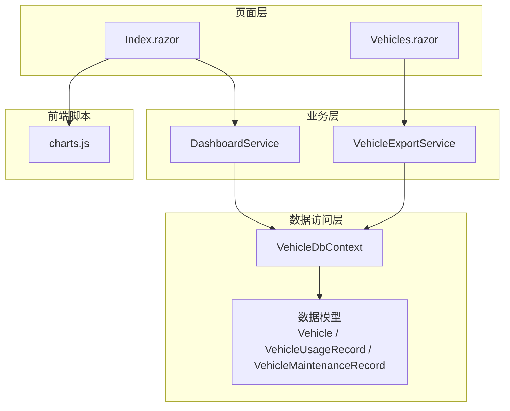
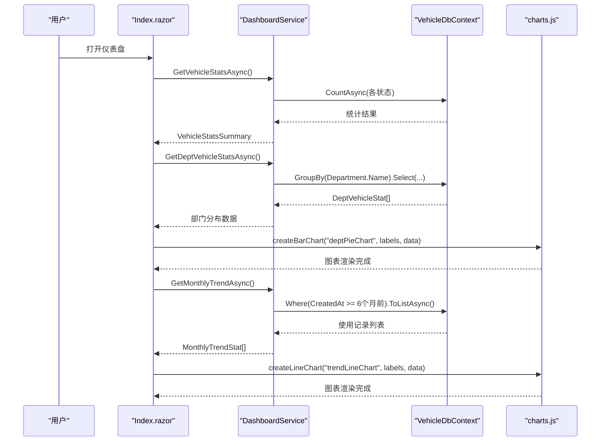
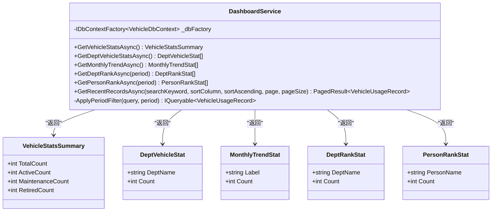
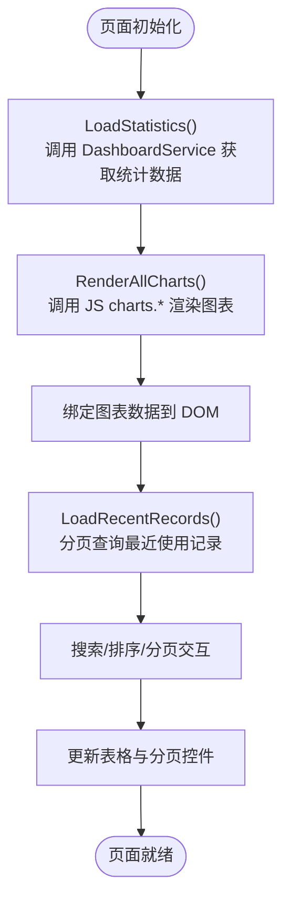
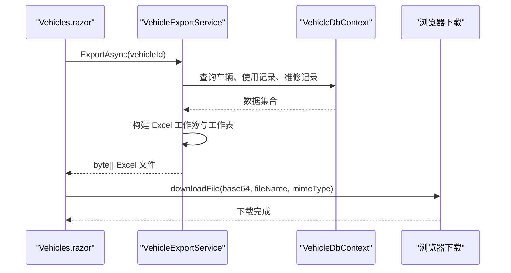
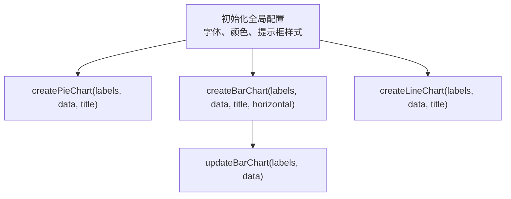
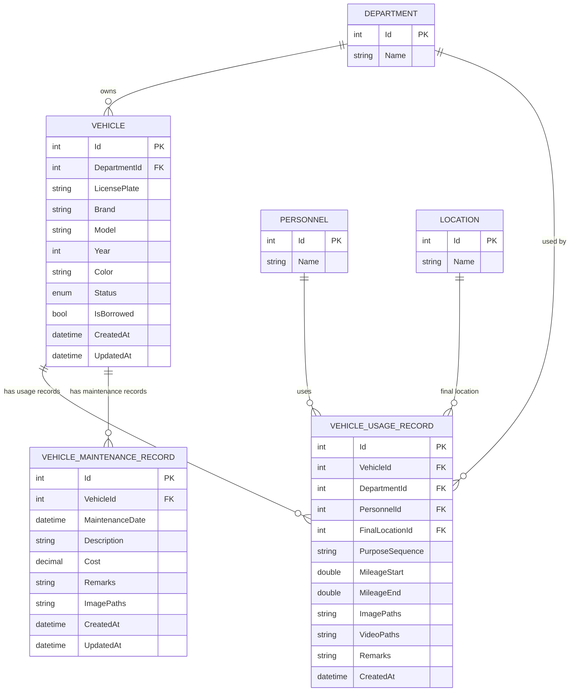

# 仪表盘与分析模块

<cite>
**本文引用的文件**   
- [DashboardService.cs](file://BLL/Dashboard/DashboardService.cs)
- [Index.razor](file://Pages/Index.razor)
- [VehicleExportService.cs](file://BLL/Export/VehicleExportService.cs)
- [charts.js](file://wwwroot/js/charts.js)
- [VehicleUsageRecord.cs](file://DAL/Model/VehicleUsageRecord.cs)
- [VehicleMaintenanceRecord.cs](file://DAL/Model/VehicleMaintenanceRecord.cs)
- [Vehicle.cs](file://DAL/Model/Vehicle.cs)
- [VehicleEnums.cs](file://DAL/Model/VehicleEnums.cs)
- [PagedResult.cs](file://BLL/Common/PagedResult.cs)
- [Vehicles.razor](file://Pages/Vehicles.razor)
- [Program.cs](file://Program.cs)
</cite>

## 目录
1. [简介](#简介)
2. [项目结构](#项目结构)
3. [核心组件](#核心组件)
4. [架构总览](#架构总览)
5. [详细组件分析](#详细组件分析)
6. [依赖关系分析](#依赖关系分析)
7. [性能与优化](#性能与优化)
8. [故障排查指南](#故障排查指南)
9. [结论](#结论)
10. [附录：扩展指南](#附录扩展指南)

## 简介
本模块为车辆管理系统的“仪表盘与分析”能力，提供关键指标的可视化展示与数据导出。核心功能包括：
- 车辆使用率统计、部门使用情况分析、维护成本统计等指标汇总
- 近6个月用车趋势、部门/人员排行、最近使用记录分页查询
- 基于 Chart.js 的图表渲染（柱状图、折线图）
- Excel 报表导出（OpenXML），支持车辆信息、使用记录与维护记录的模板化输出
- Blazor Server 页面交互、响应式布局、附件查看器

该文档从系统架构、数据处理流程、前端图表集成、导出服务、性能优化与可扩展性等方面进行全面说明。

## 项目结构
仪表盘与分析相关代码主要分布在以下位置：
- 业务层：DashboardService 负责统计数据聚合；VehicleExportService 负责 Excel 导出
- 页面层：Index.razor 作为仪表盘主页面，承载统计卡片、图表与最近使用记录
- 前端脚本：charts.js 封装 Chart.js 图表创建与更新逻辑
- 数据模型：Vehicle、VehicleUsageRecord、VehicleMaintenanceRecord 等实体定义
- 通用工具：PagedResult 分页结果封装
- 应用启动：Program.cs 注册服务与静态资源



**图示来源**
- [Index.razor:1-461](file://Pages/Index.razor#L1-L461)
- [DashboardService.cs:16-212](file://BLL/Dashboard/DashboardService.cs#L16-L212)
- [VehicleExportService.cs:16-160](file://BLL/Export/VehicleExportService.cs#L16-L160)
- [charts.js:60-508](file://wwwroot/js/charts.js#L60-L508)
- [Vehicle.cs:8-48](file://DAL/Model/Vehicle.cs#L8-L48)
- [VehicleUsageRecord.cs:9-54](file://DAL/Model/VehicleUsageRecord.cs#L9-L54)
- [VehicleMaintenanceRecord.cs:8-35](file://DAL/Model/VehicleMaintenanceRecord.cs#L8-L35)

**章节来源**
- [Index.razor:1-461](file://Pages/Index.razor#L1-L461)
- [Program.cs:48-86](file://Program.cs#L48-L86)

## 核心组件
- DashboardService：提供车辆状态统计、部门分布、月度趋势、部门/人员排行、最近使用记录分页查询
- Index.razor：仪表盘 UI，绑定统计数据并调用 JS 渲染图表
- VehicleExportService：按车辆维度导出 Excel，包含基本信息、使用记录、维修记录
- charts.js：Chart.js 封装，提供环形图、柱状图、折线图的创建与更新方法
- PagedResult：通用分页结果封装，用于最近使用记录的分页展示

**章节来源**
- [DashboardService.cs:16-212](file://BLL/Dashboard/DashboardService.cs#L16-L212)
- [Index.razor:259-461](file://Pages/Index.razor#L259-L461)
- [VehicleExportService.cs:16-160](file://BLL/Export/VehicleExportService.cs#L16-L160)
- [charts.js:60-508](file://wwwroot/js/charts.js#L60-L508)
- [PagedResult.cs:9-35](file://BLL/Common/PagedResult.cs#L9-L35)

## 架构总览
仪表盘与分析模块采用分层架构：
- 表现层：Blazor Server 页面（Index.razor、Vehicles.razor）
- 业务层：DashboardService、VehicleExportService
- 数据访问层：EF Core + SQLite（通过 IDbContextFactory）
- 前端脚本：Chart.js 图表库



**图示来源**
- [Index.razor:297-396](file://Pages/Index.razor#L297-L396)
- [DashboardService.cs:28-94](file://BLL/Dashboard/DashboardService.cs#L28-L94)
- [charts.js:164-330](file://wwwroot/js/charts.js#L164-L330)
- [charts.js:332-495](file://wwwroot/js/charts.js#L332-L495)

## 详细组件分析

### DashboardService 业务逻辑
DashboardService 承担仪表盘的数据聚合职责，核心方法如下：
- GetVehicleStatsAsync：统计车辆总数、在用、维修、退役数量
- GetDeptVehicleStatsAsync：按部门分组统计车辆数量
- GetMonthlyTrendAsync：获取近6个月的使用记录并按月聚合，补齐无数据的月份
- GetDeptRankAsync / GetPersonRankAsync：按时间段（本月/本季度/全部）统计部门/人员使用排行
- GetRecentRecordsAsync：分页查询最近使用记录，支持搜索关键字、排序、分页



**图示来源**
- [DashboardService.cs:16-245](file://BLL/Dashboard/DashboardService.cs#L16-L245)

**章节来源**
- [DashboardService.cs:28-212](file://BLL/Dashboard/DashboardService.cs#L28-L212)

### Index.razor 仪表盘组件架构
Index.razor 是仪表盘的主页面，负责：
- 加载统计数据并绑定到统计卡片
- 渲染三个图表：部门车辆分布（柱状图）、车辆状态分布（柱状图）、近6个月趋势（折线图）
- 展示部门/人员排行榜（带周期切换）
- 展示最近使用记录（支持搜索、排序、分页）
- 附件查看器（图片/视频预览）



**图示来源**
- [Index.razor:297-427](file://Pages/Index.razor#L297-L427)

**章节来源**
- [Index.razor:1-461](file://Pages/Index.razor#L1-L461)

### VehicleExportService 报表导出功能
VehicleExportService 提供按车辆维度的 Excel 导出，包含：
- 车辆基本信息（车牌号、部门、品牌型号、颜色、状态、借用状态、导出时间）
- 使用记录列表（序号、部门、是否借用、人员、使用路径、目的地、起始里程、结束里程、使用时间）
- 维修信息记录（序号、维修日期、维修项目、费用、备注）

导出过程使用 OpenXML SDK 直接操作内存流生成 .xlsx 文件，无需第三方服务器端 Excel 组件。



**图示来源**
- [VehicleExportService.cs:25-160](file://BLL/Export/VehicleExportService.cs#L25-L160)
- [Vehicles.razor:397-408](file://Pages/Vehicles.razor#L397-L408)

**章节来源**
- [VehicleExportService.cs:16-160](file://BLL/Export/VehicleExportService.cs#L16-L160)
- [Vehicles.razor:397-408](file://Pages/Vehicles.razor#L397-L408)

### Chart.js 图表库集成与使用
charts.js 封装了 Chart.js 的全局配置与常用图表类型：
- createPieChart：环形图，适用于分布统计
- createBarChart：柱状图，适用于部门车辆分布、状态分布
- createLineChart：折线图，适用于趋势分析
- updateBarChart：动态更新柱状图数据

所有图表均支持响应式、动画、提示框、网格线等样式配置，并使用 Cyan 主题色系。



**图示来源**
- [charts.js:6-57](file://wwwroot/js/charts.js#L6-L57)
- [charts.js:70-162](file://wwwroot/js/charts.js#L70-L162)
- [charts.js:164-330](file://wwwroot/js/charts.js#L164-L330)
- [charts.js:332-495](file://wwwroot/js/charts.js#L332-L495)
- [charts.js:497-508](file://wwwroot/js/charts.js#L497-L508)

**章节来源**
- [charts.js:6-508](file://wwwroot/js/charts.js#L6-L508)

### 统计图表数据来源与计算逻辑
- 车辆状态分布图：来源于 DashboardService.GetVehicleStatsAsync，统计 Active/Maintenance/Retired 数量
- 部门车辆分布图：来源于 DashboardService.GetDeptVehicleStatsAsync，按 Department.Name 分组计数
- 使用趋势图：来源于 DashboardService.GetMonthlyTrendAsync，按 CreatedAt 年月分组计数，并补齐空月份
- 部门/人员排行：来源于 DashboardService.GetDeptRankAsync / GetPersonRankAsync，按时间段过滤后分组计数

**章节来源**
- [DashboardService.cs:28-140](file://BLL/Dashboard/DashboardService.cs#L28-L140)

### 数据模型与关系
- Vehicle：车辆基本信息，关联 Department
- VehicleUsageRecord：使用记录，关联 Vehicle、Department、Personnel、FinalLocation，以及 UsageRecordPurposes
- VehicleMaintenanceRecord：维修记录，关联 Vehicle



**图示来源**
- [Vehicle.cs:8-48](file://DAL/Model/Vehicle.cs#L8-L48)
- [VehicleUsageRecord.cs:9-54](file://DAL/Model/VehicleUsageRecord.cs#L9-L54)
- [VehicleMaintenanceRecord.cs:8-35](file://DAL/Model/VehicleMaintenanceRecord.cs#L8-L35)

## 依赖关系分析
- Program.cs 中注册了 DashboardService 与 VehicleExportService 为 Scoped 服务
- Index.razor 通过 @inject 注入 DashboardService 与 IJSRuntime
- Vehicles.razor 通过 @inject 注入 VehicleExportService 与 IJSRuntime
- DashboardService 与 VehicleExportService 均通过 IDbContextFactory<VehicleDbContext> 获取数据库上下文

```mermaid
graph LR
Program["Program.cs"] --> |AddScoped| DashboardSvc["DashboardService"]
Program --> |AddScoped| ExportSvc["VehicleExportService"]
Index["Index.razor"] --> |@inject| DashboardSvc
Vehicles["Vehicles.razor"] --> |@inject| ExportSvc
DashboardSvc --> |IDbContextFactory| DbContext["VehicleDbContext"]
ExportSvc --> |IDbContextFactory| DbContext
```

**图示来源**
- [Program.cs:75-86](file://Program.cs#L75-L86)
- [Index.razor:1-4](file://Pages/Index.razor#L1-L4)
- [Vehicles.razor:1-7](file://Pages/Vehicles.razor#L1-L7)

**章节来源**
- [Program.cs:75-86](file://Program.cs#L75-L86)
- [Index.razor:1-4](file://Pages/Index.razor#L1-L4)
- [Vehicles.razor:1-7](file://Pages/Vehicles.razor#L1-L7)

## 性能与优化
- 数据库查询优化
  - 使用 CountAsync 替代 ToListAsync + 内存过滤，减少数据传输与内存占用
  - 使用 GroupBy 在数据库侧进行分组统计，避免全表加载后内存分组
  - 使用 Include 按需加载关联实体，避免 N+1 查询问题
- 内存缓存策略
  - 当前实现未引入显式缓存层，可在 DashboardService 中添加 MemoryCache 或分布式缓存以缓存热点统计结果
- 实时更新机制
  - 当前页面在 OnAfterRenderAsync 中检测交互模式并仅创建一次图表，避免重复渲染
  - 可考虑使用 SignalR 或轮询机制实现实时数据刷新
- 移动端适配
  - charts.js 中设置 responsive: true 与 maintainAspectRatio: false，确保图表在不同屏幕尺寸下自适应
  - Index.razor 使用 CSS Grid 布局，支持多列响应式排列

**章节来源**
- [DashboardService.cs:28-94](file://BLL/Dashboard/DashboardService.cs#L28-L94)
- [charts.js:100-102](file://wwwroot/js/charts.js#L100-L102)
- [charts.js:211-212](file://wwwroot/js/charts.js#L211-L212)
- [charts.js:380-381](file://wwwroot/js/charts.js#L380-L381)

## 故障排查指南
- 图表未渲染
  - 检查 Index.razor 中 isInteractive 与 chartsCreated 状态是否正确
  - 确认 JS Interop 调用 charts.createBarChart/createLineChart 的参数是否正确
- 导出数据为空
  - 检查 VehicleExportService.ExportAsync 中 vehicleId 是否存在
  - 确认数据库中是否有对应的使用记录与维修记录
- 分页异常
  - 检查 PagedResult.TotalPages 计算逻辑与 currentPage 边界处理
- 附件查看器无法显示
  - 检查 ImagePaths/VideoPaths 是否为空或格式不正确
  - 确认 IsImageFile 判断逻辑与文件扩展名匹配

**章节来源**
- [Index.razor:303-324](file://Pages/Index.razor#L303-L324)
- [Index.razor:431-459](file://Pages/Index.razor#L431-L459)
- [VehicleExportService.cs:25-32](file://BLL/Export/VehicleExportService.cs#L25-L32)
- [PagedResult.cs:24-24](file://BLL/Common/PagedResult.cs#L24-L24)

## 结论
仪表盘与分析模块通过 DashboardService 与 Index.razor 的配合，实现了车辆状态、部门分布、使用趋势等关键指标的可视化展示。VehicleExportService 提供了灵活的 Excel 导出能力，结合 Chart.js 的前端图表库，形成了完整的数据分析与展示闭环。未来可通过引入缓存层、SignalR 实时更新、更丰富的图表类型进一步提升用户体验与系统性能。

## 附录：扩展指南
- 添加新的统计指标
  - 在 DashboardService 中新增统计方法，返回新的 DTO
  - 在 Index.razor 中绑定新数据并调用 charts.js 渲染新图表
- 自定义图表类型
  - 在 charts.js 中新增 createXxxChart 方法，封装 Chart.js 配置
  - 在 Index.razor 中调用新方法并传入对应数据
- 数据聚合优化
  - 在 DashboardService 中引入 MemoryCache 缓存热点统计结果
  - 使用 EF Core 的 AsNoTracking 提升只读查询性能
- 实时更新机制
  - 使用 SignalR 推送最新统计数据至客户端
  - 或在 Index.razor 中使用定时器轮询 DashboardService 接口

**章节来源**
- [DashboardService.cs:28-212](file://BLL/Dashboard/DashboardService.cs#L28-L212)
- [Index.razor:329-396](file://Pages/Index.razor#L329-L396)
- [charts.js:60-508](file://wwwroot/js/charts.js#L60-L508)