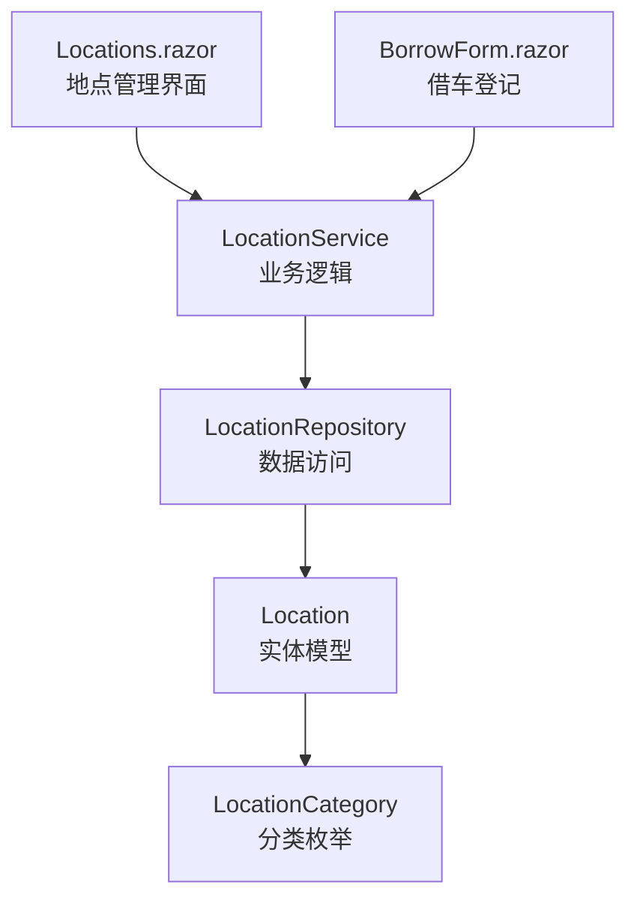
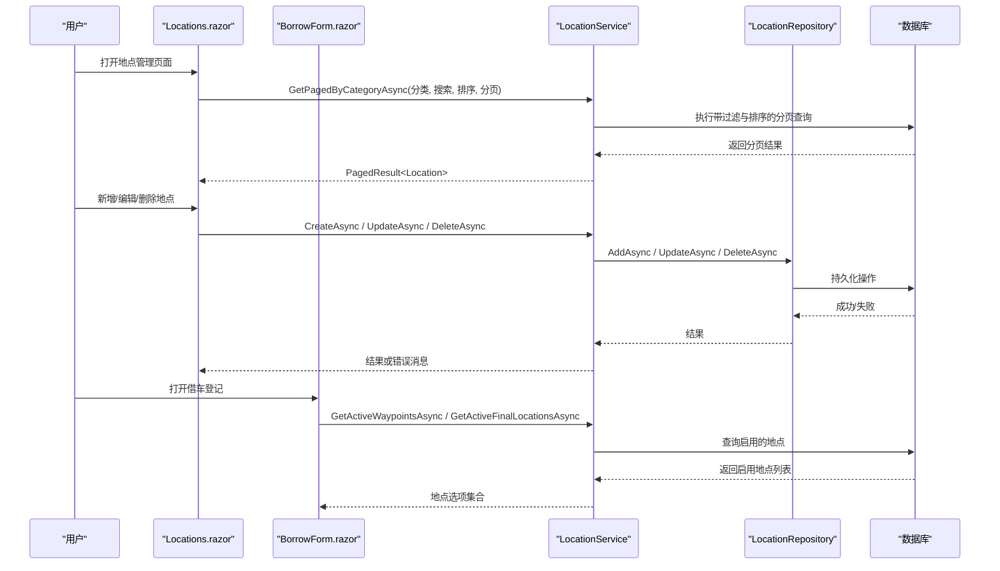
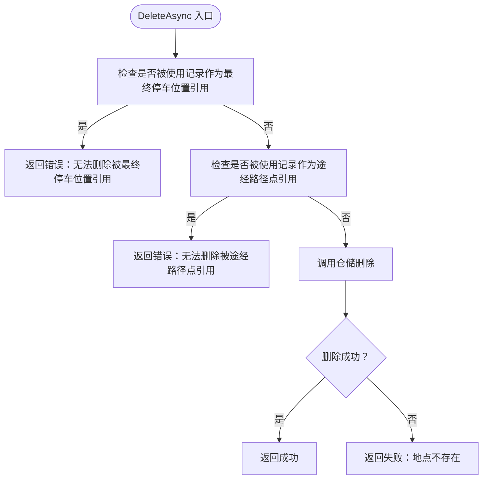
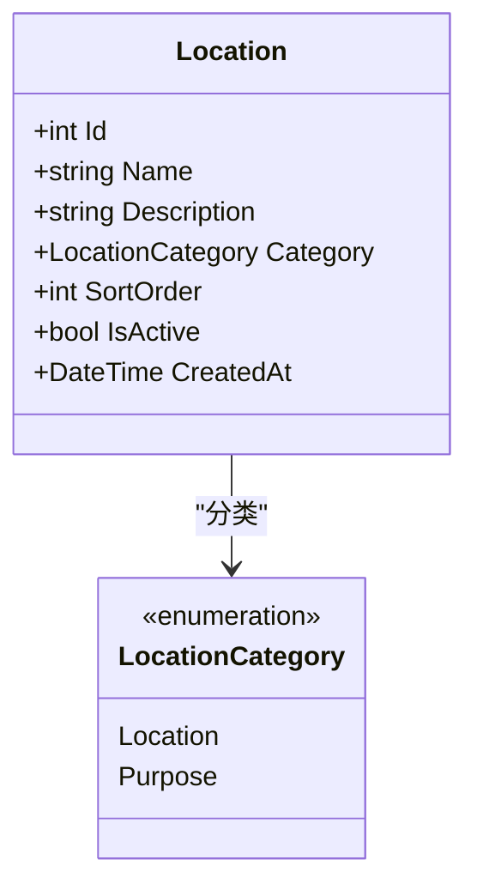
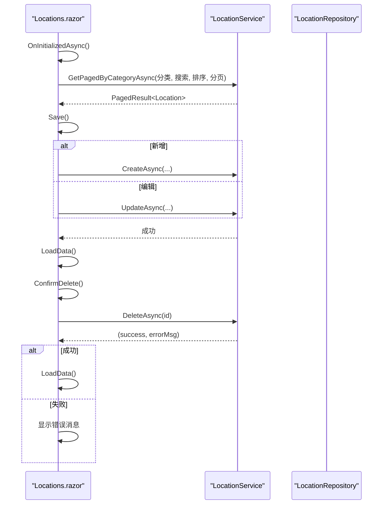
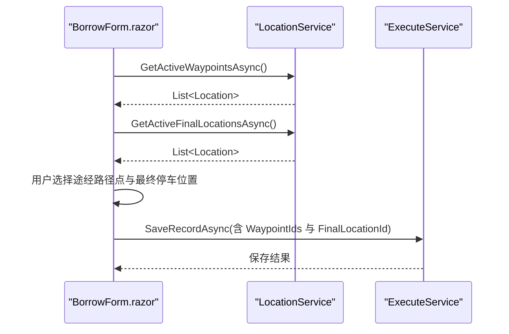
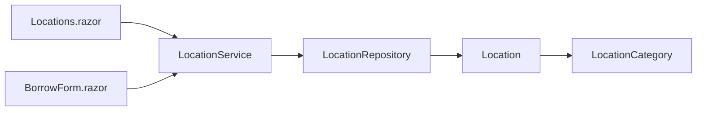

# 位置管理模块

<cite>
**本文引用的文件**   
- [LocationService.cs](file://BLL/Location/LocationService.cs)
- [Location.cs](file://DAL/Model/Location.cs)
- [VehicleEnums.cs](file://DAL/Model/VehicleEnums.cs)
- [LocationRepository.cs](file://DAL/Repository/LocationRepository.cs)
- [Locations.razor](file://Pages/Locations.razor)
- [BorrowForm.razor](file://Pages/BorrowForm.razor)
</cite>

## 目录
1. [简介](#简介)
2. [项目结构](#项目结构)
3. [核心组件](#核心组件)
4. [架构总览](#架构总览)
5. [详细组件分析](#详细组件分析)
6. [依赖关系分析](#依赖关系分析)
7. [性能与扩展建议](#性能与扩展建议)
8. [故障排查指南](#故障排查指南)
9. [结论](#结论)

## 简介
本模块负责车辆借用流程中的“地点”数据管理，包括出发地与目的地的分类管理、常用地点的快速选择、以及借车登记时与使用记录模块的集成。当前实现提供：
- 地点的分类管理：途经路径点（Location）与最终停车位置（Purpose）。
- 地点的增删改查、分页、搜索与排序。
- 删除时的业务校验：防止被使用记录引用导致的数据不一致。
- 借车表单中快速选择常用地点：多选途经路径点 + 单选最终停车位置。

说明：
- 当前模型未包含经纬度坐标等地理信息字段；如需地图显示与距离计算，可在模型与服务层扩展。
- 当前未实现 Excel 导入导出功能；可基于现有服务接口扩展批量导入逻辑。

## 项目结构
位置管理相关代码分布在三层结构中：
- 表现层：Locations.razor 页面用于地点的可视化维护；BorrowForm.razor 在借车登记中选择地点。
- 业务层：LocationService 封装地点的业务规则与查询编排。
- 数据访问层：LocationRepository 提供基础的实体操作；Location 实体定义数据模型；LocationCategory 枚举定义分类。

图表来源
- [Locations.razor:1-348](file://Pages/Locations.razor#L1-L348)
- [BorrowForm.razor:1-277](file://Pages/BorrowForm.razor#L1-L277)
- [LocationService.cs:1-154](file://BLL/Location/LocationService.cs#L1-L154)
- [LocationRepository.cs:1-76](file://DAL/Repository/LocationRepository.cs#L1-L76)
- [Location.cs:1-27](file://DAL/Model/Location.cs#L1-L27)
- [VehicleEnums.cs:10-14](file://DAL/Model/VehicleEnums.cs#L10-L14)

章节来源
- [Locations.razor:1-348](file://Pages/Locations.razor#L1-L348)
- [BorrowForm.razor:1-277](file://Pages/BorrowForm.razor#L1-L277)
- [LocationService.cs:1-154](file://BLL/Location/LocationService.cs#L1-L154)
- [LocationRepository.cs:1-76](file://DAL/Repository/LocationRepository.cs#L1-L76)
- [Location.cs:1-27](file://DAL/Model/Location.cs#L1-L27)
- [VehicleEnums.cs:10-14](file://DAL/Model/VehicleEnums.cs#L10-L14)

## 核心组件
- LocationService：对外暴露地点的分页查询、创建、更新、删除、获取启用列表等业务方法。
- LocationRepository：对数据库进行基础 CRUD 与按分类查询。
- Location 实体：定义地点名称、描述、分类、排序、启用状态、创建时间等字段。
- Locations.razor：地点管理界面，支持新增/编辑/删除、搜索、排序、分页。
- BorrowForm.razor：借车登记界面，集成地点选择（途经路径点多选、最终停车位置单选）。

章节来源
- [LocationService.cs:1-154](file://BLL/Location/LocationService.cs#L1-L154)
- [LocationRepository.cs:1-76](file://DAL/Repository/LocationRepository.cs#L1-L76)
- [Location.cs:1-27](file://DAL/Model/Location.cs#L1-L27)
- [Locations.razor:1-348](file://Pages/Locations.razor#L1-L348)
- [BorrowForm.razor:1-277](file://Pages/BorrowForm.razor#L1-L277)

## 架构总览
下图展示从页面到服务的调用链路与数据流向：

图表来源
- [Locations.razor:226-242](file://Pages/Locations.razor#L226-L242)
- [Locations.razor:287-309](file://Pages/Locations.razor#L287-L309)
- [Locations.razor:333-346](file://Pages/Locations.razor#L333-L346)
- [BorrowForm.razor:180-187](file://Pages/BorrowForm.razor#L180-L187)
- [LocationService.cs:31-66](file://BLL/Location/LocationService.cs#L31-L66)
- [LocationService.cs:79-107](file://BLL/Location/LocationService.cs#L79-L107)
- [LocationService.cs:112-131](file://BLL/Location/LocationService.cs#L112-L131)
- [LocationService.cs:136-151](file://BLL/Location/LocationService.cs#L136-L151)

## 详细组件分析

### LocationService 业务逻辑
职责与能力：
- 按分类分页查询地点，支持关键词搜索与多列排序。
- 创建与更新地点，统一处理名称与描述的修剪。
- 删除前进行业务校验：若该地点被使用记录作为最终停车位置或途经路径点引用，则拒绝删除并返回错误提示。
- 提供获取启用地点的方法，供借车登记界面快速选择。

关键流程要点：
- 分页查询：先按分类过滤，再按关键词过滤（名称或描述），然后按指定列排序，最后分页取数。
- 删除校验：检查 VehicleUsageRecords.FinalLocationId 与 VehicleUsageRecordPurposes.PurposeId 是否引用该地点。

图表来源
- [LocationService.cs:112-131](file://BLL/Location/LocationService.cs#L112-L131)

章节来源
- [LocationService.cs:31-66](file://BLL/Location/LocationService.cs#L31-L66)
- [LocationService.cs:79-107](file://BLL/Location/LocationService.cs#L79-L107)
- [LocationService.cs:112-131](file://BLL/Location/LocationService.cs#L112-L131)
- [LocationService.cs:136-151](file://BLL/Location/LocationService.cs#L136-L151)

### Location 实体模型设计
字段说明：
- Id：主键标识。
- Name：必填，最大长度限制，表示地点名称。
- Description：可选的描述信息。
- Category：必填，分类枚举，区分“途经路径点”和“最终停车位置”。
- SortOrder：排序号，用于控制显示顺序。
- IsActive：启用状态，默认启用。
- CreatedAt：创建时间，默认当前时间。

图表来源
- [Location.cs:6-25](file://DAL/Model/Location.cs#L6-L25)
- [VehicleEnums.cs:10-14](file://DAL/Model/VehicleEnums.cs#L10-L14)

章节来源
- [Location.cs:1-27](file://DAL/Model/Location.cs#L1-L27)
- [VehicleEnums.cs:10-14](file://DAL/Model/VehicleEnums.cs#L10-L14)

### Locations.razor 页面功能
功能概览：
- 顶部工具栏：搜索框、新增途经路径点、新增最终停车位置。
- 两个表格区域：分别展示“途经路径点”和“最终停车位置”，支持列头点击排序、分页。
- 弹窗表单：新增/编辑地点，包含名称、描述、排序号、启用状态。
- 删除确认弹窗：二次确认后调用服务删除，并在失败时显示错误提示。

交互流程：
- 初始化加载：同时加载两个分类的分页数据。
- 搜索输入：重置页码并重新加载数据。
- 保存：根据 editId 判断新增或更新，成功后刷新列表。
- 删除：弹出确认框，确认后调用服务删除并刷新列表。

图表来源
- [Locations.razor:226-242](file://Pages/Locations.razor#L226-L242)
- [Locations.razor:287-309](file://Pages/Locations.razor#L287-L309)
- [Locations.razor:333-346](file://Pages/Locations.razor#L333-L346)

章节来源
- [Locations.razor:1-348](file://Pages/Locations.razor#L1-L348)

### 借车登记与地点选择集成
BorrowForm.razor 在初始化时加载所有启用的地点：
- 途经路径点：多选按钮组，支持添加与移除。
- 最终停车位置：下拉选择。
- 保存前校验：必须选择至少一个途经路径点和一个最终停车位置。

图表来源
- [BorrowForm.razor:180-187](file://Pages/BorrowForm.razor#L180-L187)
- [BorrowForm.razor:231-261](file://Pages/BorrowForm.razor#L231-L261)
- [LocationService.cs:136-151](file://BLL/Location/LocationService.cs#L136-L151)

章节来源
- [BorrowForm.razor:1-277](file://Pages/BorrowForm.razor#L1-L277)
- [LocationService.cs:136-151](file://BLL/Location/LocationService.cs#L136-L151)

## 依赖关系分析
- 页面依赖服务：Locations.razor 与 BorrowForm.razor 通过依赖注入使用 LocationService。
- 服务依赖仓储：LocationService 组合 LocationRepository 与 DbContextFactory 以访问数据库。
- 实体与枚举：Location 实体依赖 LocationCategory 枚举进行分类。

图表来源
- [Locations.razor:1-348](file://Pages/Locations.razor#L1-L348)
- [BorrowForm.razor:1-277](file://Pages/BorrowForm.razor#L1-L277)
- [LocationService.cs:1-154](file://BLL/Location/LocationService.cs#L1-L154)
- [LocationRepository.cs:1-76](file://DAL/Repository/LocationRepository.cs#L1-L76)
- [Location.cs:1-27](file://DAL/Model/Location.cs#L1-L27)
- [VehicleEnums.cs:10-14](file://DAL/Model/VehicleEnums.cs#L10-L14)

章节来源
- [Locations.razor:1-348](file://Pages/Locations.razor#L1-L348)
- [BorrowForm.razor:1-277](file://Pages/BorrowForm.razor#L1-L277)
- [LocationService.cs:1-154](file://BLL/Location/LocationService.cs#L1-L154)
- [LocationRepository.cs:1-76](file://DAL/Repository/LocationRepository.cs#L1-L76)
- [Location.cs:1-27](file://DAL/Model/Location.cs#L1-L27)
- [VehicleEnums.cs:10-14](file://DAL/Model/VehicleEnums.cs#L10-L14)

## 性能与扩展建议

### 数据验证规则
- 名称必填且长度受限：由实体的 Required 与 MaxLength 约束保证。
- 分类必填：由实体的 Required 与枚举默认值保证。
- 启用状态与排序号：建议在服务层增加范围校验（如非负整数）。
- 删除保护：已在服务层实现引用校验，避免破坏使用记录的完整性。

章节来源
- [Location.cs:8-24](file://DAL/Model/Location.cs#L8-L24)
- [LocationService.cs:112-131](file://BLL/Location/LocationService.cs#L112-L131)

### 地理位置精度控制与地图集成方案
当前模型未包含经纬度字段。建议扩展如下：
- 在 Location 实体中添加 Latitude、Longitude 字段，并设置精度校验（例如保留小数点后若干位）。
- 在服务层增加地理有效性校验（如经度范围 -180~180，纬度范围 -90~90）。
- 在 Locations.razor 中增加地图选择器组件，支持点击地图拾取坐标。
- 在 BorrowForm.razor 中可选择显示起点与终点的地图标记，并可计算两点间距离（可使用 Haversine 公式或第三方地理库）。

注意：以上为扩展建议，当前仓库未实现地理字段与地图集成。

### 导入导出（Excel）方案
当前未实现 Excel 导入导出。建议：
- 在服务层新增 ImportFromExcelAsync 与 ExportToExcelAsync 方法。
- 解析 Excel 行数据，映射到 Location 实体，并进行批量插入或更新。
- 导出时按分类生成工作表，包含名称、描述、分类、排序号、启用状态等列。
- 结合现有 GetPagedByCategoryAsync 与 GetByCategoryAsync 方法构建数据源。

注意：以上为扩展建议，当前仓库未实现 Excel 导入导出。

### 重复地点检测
当前未实现同名重复检测。建议：
- 在 CreateAsync 与 UpdateAsync 中增加按分类与名称的唯一性校验。
- 若存在重复，返回明确的错误提示，阻止重复数据入库。

注意：以上为扩展建议，当前仓库未实现重复检测。

### 性能优化最佳实践
- 分页查询：已使用 Skip/Take 实现服务端分页，减少数据传输量。
- 搜索与排序：在服务层构造 IQueryable 后执行，确保 SQL 侧过滤与排序。
- 启用地点缓存：GetActiveWaypointsAsync 与 GetActiveFinalLocationsAsync 可考虑加入内存缓存以减少频繁查询。
- 索引建议：对 Category、IsActive、SortOrder 建立索引以提升查询效率。

章节来源
- [LocationService.cs:31-66](file://BLL/Location/LocationService.cs#L31-L66)
- [LocationService.cs:136-151](file://BLL/Location/LocationService.cs#L136-L151)

## 故障排查指南
常见问题与定位：
- 删除地点失败：检查是否被使用记录引用（最终停车位置或途经路径点），服务层会返回明确错误消息。
- 保存失败：检查前端表单是否为空（名称必填），以及后端异常信息。
- 借车登记保存失败：检查是否选择了至少一个途经路径点与最终停车位置。

定位步骤：
- 查看 Locations.razor 的错误弹窗消息。
- 查看 BorrowForm.razor 的错误提示与保存前的校验逻辑。
- 在服务层 DeleteAsync 中检查引用校验逻辑。

章节来源
- [Locations.razor:80-94](file://Pages/Locations.razor#L80-L94)
- [Locations.razor:287-309](file://Pages/Locations.razor#L287-L309)
- [Locations.razor:333-346](file://Pages/Locations.razor#L333-L346)
- [BorrowForm.razor:231-261](file://Pages/BorrowForm.razor#L231-L261)
- [LocationService.cs:112-131](file://BLL/Location/LocationService.cs#L112-L131)

## 结论
位置管理模块围绕“地点”这一核心概念，提供了分类管理、CRUD 操作、分页搜索与排序，以及与借车登记的无缝集成。当前实现聚焦于业务数据的正确性与一致性，尚未包含地理信息与 Excel 导入导出功能。后续可按建议扩展地理字段、地图集成与批量导入导出能力，以满足更丰富的业务场景。