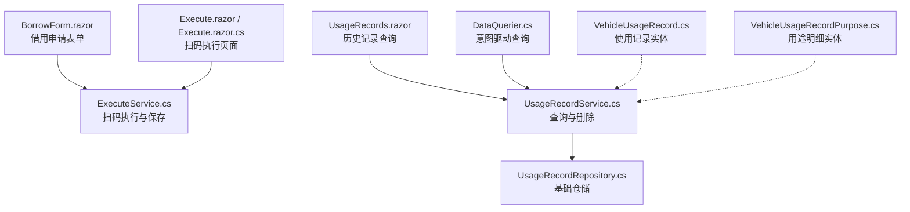
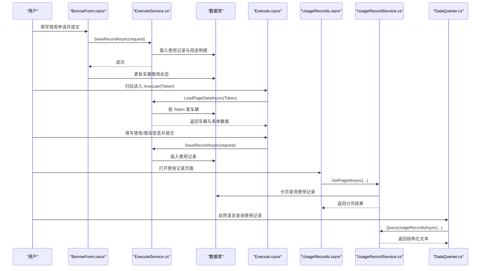
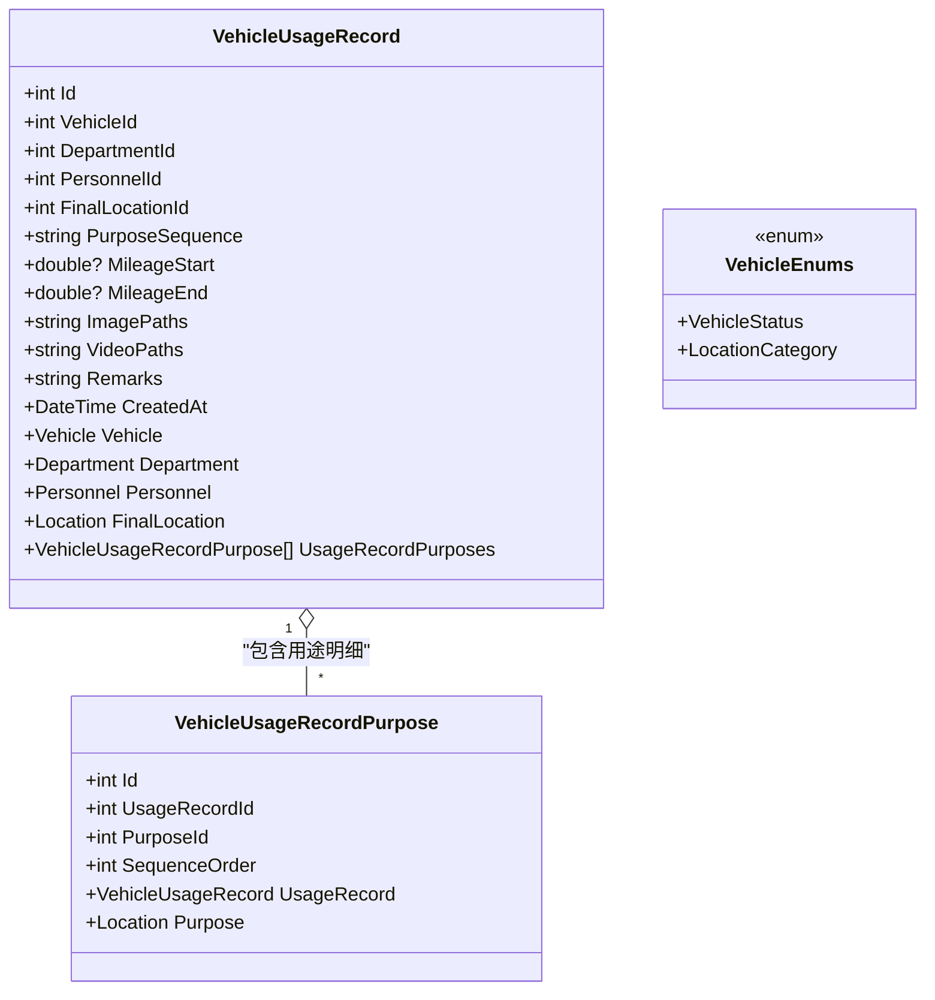
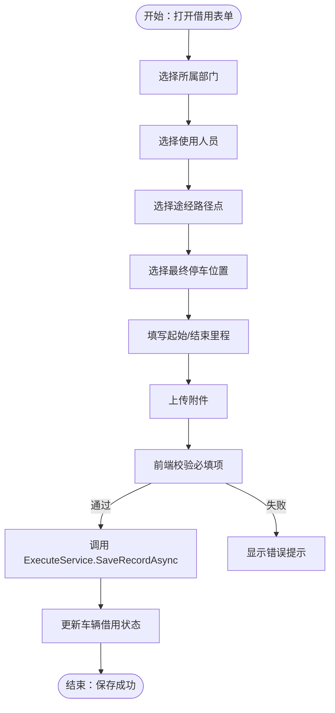
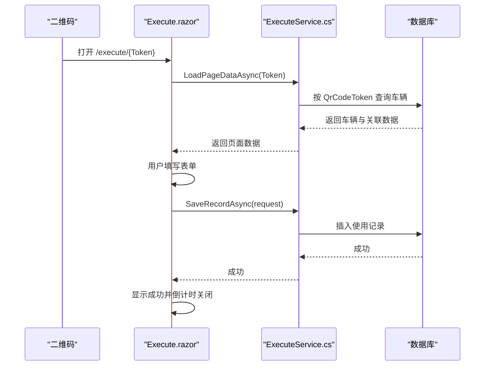
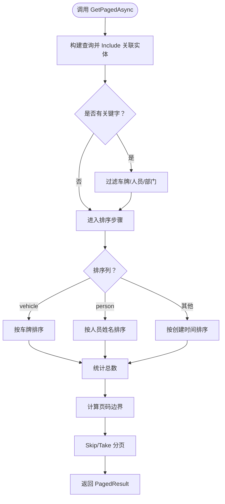
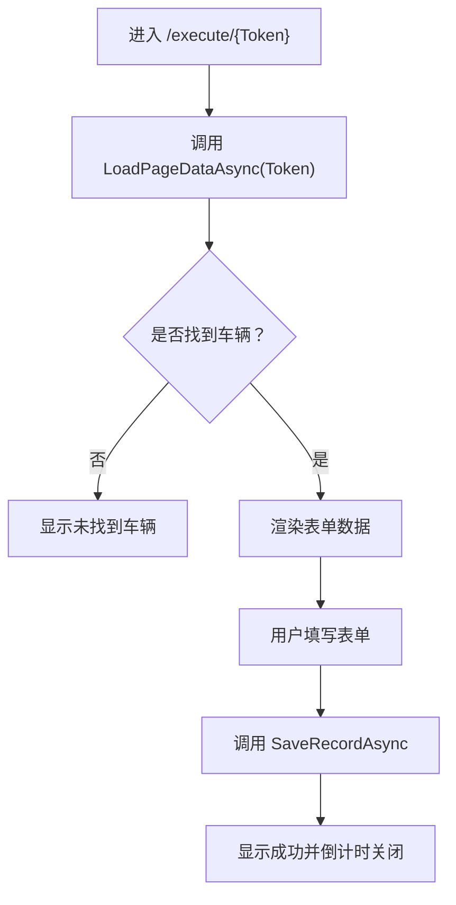
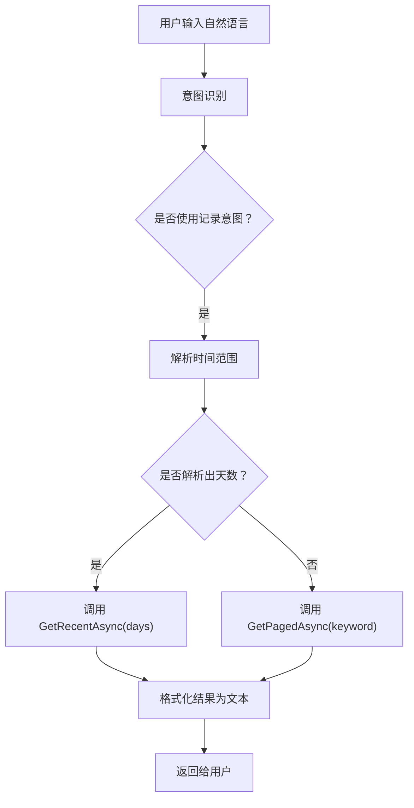
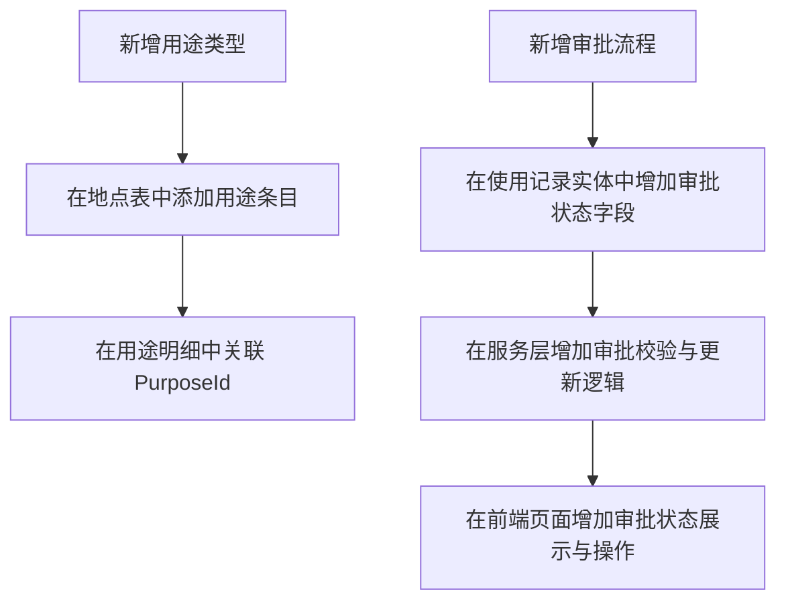

# 使用记录管理模块

<cite>
**本文引用的文件**   
- [UsageRecordService.cs](file://BLL/UsageRecord/UsageRecordService.cs)
- [ExecuteService.cs](file://BLL/Execute/ExecuteService.cs)
- [VehicleUsageRecord.cs](file://DAL/Model/VehicleUsageRecord.cs)
- [VehicleUsageRecordPurpose.cs](file://DAL/Model/VehicleUsageRecordPurpose.cs)
- [VehicleEnums.cs](file://DAL/Model/VehicleEnums.cs)
- [UsageRecordRepository.cs](file://DAL/Repository/UsageRecordRepository.cs)
- [BorrowForm.razor](file://Pages/BorrowForm.razor)
- [Execute.razor](file://Pages/Execute.razor)
- [Execute.razor.cs](file://Pages/Execute.razor.cs)
- [UsageRecords.razor](file://Pages/UsageRecords.razor)
- [DataQuerier.cs](file://aiServer/BLL/DataQuerier.cs)
</cite>

## 目录
1. [引言](#引言)
2. [项目结构定位](#项目结构定位)
3. [核心组件总览](#核心组件总览)
4. [架构与生命周期总览](#架构与生命周期总览)
5. [实体模型设计](#实体模型设计)
6. [业务流程详解：从申请到执行确认](#业务流程详解从申请到执行确认)
7. [UsageRecordService 业务逻辑分析](#usagerecordservice-业务逻辑分析)
8. [BorrowForm.razor 借用表单实现](#borrowformrazor-借用表单实现)
9. [Execute.razor 执行确认页面实现](#executerazor-执行确认页面实现)
10. [UsageRecords.razor 历史记录查询与展示](#usagerecordsrazor-历史记录查询与展示)
11. [意图驱动的数据查询](#意图驱动的数据查询)
12. [扩展指南：新增用途类型与审批流程](#扩展指南新增用途类型与审批流程)
13. [数据完整性、审计日志与性能优化](#数据完整性审计日志与性能优化)
14. [故障排查](#故障排查)
15. [结论](#结论)

## 引言
本技术文档聚焦车辆管理系统中的“使用记录管理模块”，围绕车辆借用申请的全生命周期展开，包括：
- 借用申请提交；
- 执行确认扫码登记；
- 使用记录分页查询、筛选、附件查看；
- 基于自然语言的使用记录查询；
- 实体模型设计、状态流转、时间冲突检测、资源可用性检查；
- 扩展新用途类型和自定义审批流程的最佳实践。

该模块以 Blazor 页面为入口，通过服务层协调仓储与数据库，同时结合 AI 侧的意图识别能力，提供自然语言查询体验。

## 项目结构定位
使用记录相关代码分布在以下层次：
- 表现层：`Pages/BorrowForm.razor`、`Pages/Execute.razor`、`Pages/UsageRecords.razor`；
- 业务层：`BLL/UsageRecord/UsageRecordService.cs`、`BLL/Execute/ExecuteService.cs`；
- 数据访问层：`DAL/Repository/UsageRecordRepository.cs`；
- 领域模型：`DAL/Model/VehicleUsageRecord.cs`、`DAL/Model/VehicleUsageRecordPurpose.cs`、`DAL/Model/VehicleEnums.cs`；
- AI 意图查询：`aiServer/BLL/DataQuerier.cs`。

**图表来源**
- [BorrowForm.razor:1-277](file://Pages/BorrowForm.razor#L1-L277)
- [Execute.razor:1-258](file://Pages/Execute.razor#L1-L258)
- [Execute.razor.cs:1-253](file://Pages/Execute.razor.cs#L1-L253)
- [UsageRecords.razor:1-605](file://Pages/UsageRecords.razor#L1-L605)
- [UsageRecordService.cs:1-179](file://BLL/UsageRecord/UsageRecordService.cs#L1-L179)
- [ExecuteService.cs:1-151](file://BLL/Execute/ExecuteService.cs#L1-L151)
- [UsageRecordRepository.cs:1-82](file://DAL/Repository/UsageRecordRepository.cs#L1-L82)
- [VehicleUsageRecord.cs:1-56](file://DAL/Model/VehicleUsageRecord.cs#L1-L56)
- [VehicleUsageRecordPurpose.cs:1-27](file://DAL/Model/VehicleUsageRecordPurpose.cs#L1-L27)
- [DataQuerier.cs:1-333](file://aiServer/BLL/DataQuerier.cs#L1-L333)

**章节来源**
- [BorrowForm.razor:1-277](file://Pages/BorrowForm.razor#L1-L277)
- [Execute.razor:1-258](file://Pages/Execute.razor#L1-L258)
- [Execute.razor.cs:1-253](file://Pages/Execute.razor.cs#L1-L253)
- [UsageRecords.razor:1-605](file://Pages/UsageRecords.razor#L1-L605)
- [UsageRecordService.cs:1-179](file://BLL/UsageRecord/UsageRecordService.cs#L1-L179)
- [ExecuteService.cs:1-151](file://BLL/Execute/ExecuteService.cs#L1-L151)
- [UsageRecordRepository.cs:1-82](file://DAL/Repository/UsageRecordRepository.cs#L1-L82)
- [VehicleUsageRecord.cs:1-56](file://DAL/Model/VehicleUsageRecord.cs#L1-L56)
- [VehicleUsageRecordPurpose.cs:1-27](file://DAL/Model/VehicleUsageRecordPurpose.cs#L1-L27)
- [DataQuerier.cs:1-333](file://aiServer/BLL/DataQuerier.cs#L1-L333)

## 核心组件总览
- `UsageRecordService`：负责使用记录的分页查询、最近 N 天查询、删除及附件处理。
- `ExecuteService`：负责扫码 Token 校验、页面数据加载、使用记录保存。
- `BorrowForm.razor`：在车辆上下文下完成借用申请表单填写、验证、附件上传、调用执行服务保存并更新车辆借用状态。
- `Execute.razor` 与 `Execute.razor.cs`：移动端扫码执行页面，支持使用、借车、维修三类登记，包含倒计时自动关闭。
- `UsageRecords.razor`：使用记录与维修记录的统一查询页面，支持搜索、排序、分页、附件预览、删除。
- `DataQuerier.cs`：根据用户意图（如“最近一周有哪些使用记录”）调用后端服务返回结构化文本结果。

**章节来源**
- [UsageRecordService.cs:1-179](file://BLL/UsageRecord/UsageRecordService.cs#L1-L179)
- [ExecuteService.cs:1-151](file://BLL/Execute/ExecuteService.cs#L1-L151)
- [BorrowForm.razor:1-277](file://Pages/BorrowForm.razor#L1-L277)
- [Execute.razor:1-258](file://Pages/Execute.razor#L1-L258)
- [Execute.razor.cs:1-253](file://Pages/Execute.razor.cs#L1-L253)
- [UsageRecords.razor:1-605](file://Pages/UsageRecords.razor#L1-L605)
- [DataQuerier.cs:1-333](file://aiServer/BLL/DataQuerier.cs#L1-L333)

## 架构与生命周期总览
使用记录的生命周期可抽象为：
1. 申请阶段：用户在 `BorrowForm.razor` 选择部门、人员、途经路径点、最终停车位置、里程、备注与附件，提交后调用 `ExecuteService.SaveRecordAsync` 保存记录，并标记车辆为已借用。
2. 执行阶段：司机扫描车辆二维码进入 `/execute/{Token}`，页面通过 `ExecuteService.LoadPageDataAsync` 校验 Token 并加载车辆信息、人员列表、路径点等，再填写使用或借车信息并提交。
3. 查询阶段：管理员在 `UsageRecords.razor` 中按关键字、排序、分页查看使用记录，并可删除记录、查看附件。
4. 意图查询阶段：AI 助手通过 `DataQuerier.QueryAsync` 解析自然语言意图，调用 `UsageRecordService` 获取使用记录并以可读文本返回。

**图表来源**
- [BorrowForm.razor:231-260](file://Pages/BorrowForm.razor#L231-L260)
- [ExecuteService.cs:30-125](file://BLL/Execute/ExecuteService.cs#L30-L125)
- [Execute.razor.cs:78-156](file://Pages/Execute.razor.cs#L78-L156)
- [UsageRecords.razor:503-529](file://Pages/UsageRecords.razor#L503-L529)
- [UsageRecordService.cs:43-120](file://BLL/UsageRecord/UsageRecordService.cs#L43-L120)
- [DataQuerier.cs:48-67](file://aiServer/BLL/DataQuerier.cs#L48-L67)

## 实体模型设计
### VehicleUsageRecord
- 主键：Id
- 外键：VehicleId、DepartmentId、PersonnelId、FinalLocationId
- 用途序列：PurposeSequence（字符串，用于快速展示）
- 里程：MileageStart、MileageEnd（可选）
- 附件：ImagePaths、VideoPaths（分号分隔的路径集合）
- 创建时间：CreatedAt（默认中国时区当前时间）
- 导航属性：Vehicle、Department、Personnel、FinalLocation、UsageRecordPurposes

### VehicleUsageRecordPurpose
- 主键：Id
- 外键：UsageRecordId、PurposeId
- 顺序：SequenceOrder（用于多段用途排序）
- 导航属性：UsageRecord、Purpose（Location）

### VehicleEnums
- VehicleStatus：Active、Maintenance、Retired
- LocationCategory：Location、Purpose

**图表来源**
- [VehicleUsageRecord.cs:9-54](file://DAL/Model/VehicleUsageRecord.cs#L9-L54)
- [VehicleUsageRecordPurpose.cs:6-25](file://DAL/Model/VehicleUsageRecordPurpose.cs#L6-L25)
- [VehicleEnums.cs:3-14](file://DAL/Model/VehicleEnums.cs#L3-L14)

**章节来源**
- [VehicleUsageRecord.cs:1-56](file://DAL/Model/VehicleUsageRecord.cs#L1-L56)
- [VehicleUsageRecordPurpose.cs:1-27](file://DAL/Model/VehicleUsageRecordPurpose.cs#L1-L27)
- [VehicleEnums.cs:1-16](file://DAL/Model/VehicleEnums.cs#L1-L16)

## 业务流程详解：从申请到执行确认
### 借用申请流程
- 用户在 `BorrowForm.razor` 中选择所属部门、使用人员、途经路径点、最终停车位置、起始/结束里程、备注与附件。
- 前端进行必填项校验（人员、路径点、最终位置）。
- 调用 `ExecuteService.SaveRecordAsync` 保存使用记录，成功后调用 `VehicleService.ToggleBorrowedAsync` 将车辆标记为已借用。

**图表来源**
- [BorrowForm.razor:231-260](file://Pages/BorrowForm.razor#L231-L260)
- [ExecuteService.cs:75-125](file://BLL/Execute/ExecuteService.cs#L75-L125)

**章节来源**
- [BorrowForm.razor:1-277](file://Pages/BorrowForm.razor#L1-L277)
- [ExecuteService.cs:1-151](file://BLL/Execute/ExecuteService.cs#L1-L151)

### 执行确认流程
- 用户扫描车辆二维码进入 `/execute/{Token}`。
- `ExecuteService.LoadPageDataAsync` 根据 Token 查询车辆信息，并加载部门在职人员、路径点、最终位置，以及上一条记录的结束里程作为预填值。
- 用户填写使用或借车信息并提交，系统保存使用记录并进入成功倒计时页面。

**图表来源**
- [ExecuteService.cs:30-70](file://BLL/Execute/ExecuteService.cs#L30-L70)
- [Execute.razor.cs:78-156](file://Pages/Execute.razor.cs#L78-L156)

**章节来源**
- [Execute.razor:1-258](file://Pages/Execute.razor#L1-L258)
- [Execute.razor.cs:1-253](file://Pages/Execute.razor.cs#L1-L253)
- [ExecuteService.cs:1-151](file://BLL/Execute/ExecuteService.cs#L1-L151)

## UsageRecordService 业务逻辑分析
### 主要职责
- 分页查询使用记录，支持关键字搜索（车牌、人员、部门）与排序（车辆、人员、创建时间）。
- 查询最近 N 天的使用记录，基于中国时区计算时间范围。
- 删除使用记录，并在删除前清理物理附件文件，失败则阻止数据库删除。
- 提供附件路径合并与图片判断工具方法。

### 关键方法
- `GetPagedAsync`：构建 EF Core 查询，Include 关联实体，应用搜索与排序，分页返回。
- `GetRecentAsync`：基于 ChinaTime.Now 计算日期范围，返回最近 N 天记录。
- `DeleteAsync`：先清理附件文件，再删除数据库记录，记录日志。
- `GetAllFiles`、`IsImageFile`：辅助方法，用于附件展示与类型判断。

**图表来源**
- [UsageRecordService.cs:43-92](file://BLL/UsageRecord/UsageRecordService.cs#L43-L92)

**章节来源**
- [UsageRecordService.cs:1-179](file://BLL/UsageRecord/UsageRecordService.cs#L1-L179)

## BorrowForm.razor 借用表单实现
### 功能要点
- 页面路由参数 `VehicleId`，初始化时加载车辆信息、部门列表、路径点、最终位置。
- 部门变化时动态加载部门内人员列表。
- 路径点多选与顺序维护，最终停车位置下拉选择。
- 附件上传支持图片和视频，最多 15 个文件，上传失败显示错误消息。
- 保存前校验必填字段，成功后调用 `ExecuteService.SaveRecordAsync` 并更新车辆借用状态。

### 数据绑定与交互
- 使用 `@bind` 双向绑定人员、最终位置、里程、备注。
- 使用 `@onchange` 监听部门选择变化。
- 使用 `InputFile` 组件处理多文件上传，调用 `FileUploadService.UploadFileAsync`。
- 保存按钮禁用状态由 `saving`、`uploading` 控制。

**章节来源**
- [BorrowForm.razor:1-277](file://Pages/BorrowForm.razor#L1-L277)

## Execute.razor 执行确认页面实现
### 功能要点
- 路由参数 `Token`，通过 `ExecuteService.LoadPageDataAsync` 加载车辆信息与表单数据。
- 支持三个标签页：使用、借车、维修。
- 使用与借车表单均包含人员、路径点、最终位置、里程、备注、附件。
- 维修表单包含维修日期、项目内容、费用、备注、图片附件。
- 提交成功后进入倒计时自动关闭页面，调用 JS 关闭窗口。

### Token 验证机制
- `LoadPageDataAsync` 根据 `QrCodeToken` 查询车辆，若未找到返回 null，页面显示“未找到车辆”。
- 同时加载部门在职人员、路径点、最终位置，并预填上一条记录的结束里程。

**图表来源**
- [ExecuteService.cs:30-70](file://BLL/Execute/ExecuteService.cs#L30-L70)
- [Execute.razor.cs:78-156](file://Pages/Execute.razor.cs#L78-L156)

**章节来源**
- [Execute.razor:1-258](file://Pages/Execute.razor#L1-L258)
- [Execute.razor.cs:1-253](file://Pages/Execute.razor.cs#L1-L253)
- [ExecuteService.cs:1-151](file://BLL/Execute/ExecuteService.cs#L1-L151)

## UsageRecords.razor 历史记录查询与展示
### 功能要点
- 使用记录表格展示车牌、部门、人员、路径点、最终位置、里程、附件、创建时间与操作。
- 支持关键字搜索、列排序、分页。
- 附件查看器支持图片与视频预览，支持上一个/下一个切换。
- 删除确认弹窗与错误弹窗。
- 同时集成维修记录的新增、编辑、删除与分页查询。

### 查询与导出
- 查询委托给 `UsageRecordService.GetPagedAsync`。
- 附件路径合并与图片判断委托给 `UsageRecordService.GetAllFiles` 与 `IsImageFile`。
- 当前页面未直接实现报表导出，但可通过 `VehicleExportService` 导出车辆使用记录（参考仓库结构）。

**章节来源**
- [UsageRecords.razor:1-605](file://Pages/UsageRecords.razor#L1-L605)
- [UsageRecordService.cs:43-179](file://BLL/UsageRecord/UsageRecordService.cs#L43-L179)

## 意图驱动的数据查询
`DataQuerier` 根据用户意图分发查询，其中使用记录查询分支如下：
- 如果关键词包含时间表达（如“最近一周”），解析为天数并调用 `UsageRecordService.GetRecentAsync`。
- 否则调用 `UsageRecordService.GetPagedAsync` 进行文本搜索。
- 返回结构化文本，包含时间、车牌、驾驶员、部门、目的等信息。

**图表来源**
- [DataQuerier.cs:48-67](file://aiServer/BLL/DataQuerier.cs#L48-L67)
- [DataQuerier.cs:230-267](file://aiServer/BLL/DataQuerier.cs#L230-L267)
- [DataQuerier.cs:272-330](file://aiServer/BLL/DataQuerier.cs#L272-L330)

**章节来源**
- [DataQuerier.cs:1-333](file://aiServer/BLL/DataQuerier.cs#L1-L333)

## 扩展指南：新增用途类型与审批流程
### 新增用途类型
- 用途类型由 `Location` 表中的 `Purpose` 分类承载，对应 `LocationCategory.Purpose`。
- 在 `VehicleUsageRecordPurpose` 中通过 `PurposeId` 关联具体用途。
- 如需新增用途，可在地点管理中增加新的地点条目并设置类别为“用途”。

### 自定义审批流程
当前实现未内置审批状态机，建议在以下位置扩展：
- 在 `VehicleUsageRecord` 中增加审批状态字段（如 `ApprovalStatus`）。
- 在 `ExecuteService.SaveRecordAsync` 中增加审批校验逻辑（例如仅允许特定角色提交）。
- 在 `UsageRecordService` 中增加审批相关的查询与更新方法。
- 在前端页面中增加审批状态展示与操作按钮。

**图表来源**
- [VehicleUsageRecordPurpose.cs:6-25](file://DAL/Model/VehicleUsageRecordPurpose.cs#L6-L25)
- [ExecuteService.cs:75-125](file://BLL/Execute/ExecuteService.cs#L75-L125)
- [UsageRecordService.cs:43-179](file://BLL/UsageRecord/UsageRecordService.cs#L43-L179)

**章节来源**
- [VehicleUsageRecordPurpose.cs:1-27](file://DAL/Model/VehicleUsageRecordPurpose.cs#L1-L27)
- [ExecuteService.cs:1-151](file://BLL/Execute/ExecuteService.cs#L1-L151)
- [UsageRecordService.cs:1-179](file://BLL/UsageRecord/UsageRecordService.cs#L1-L179)

## 数据完整性、审计日志与性能优化
### 数据完整性约束
- 使用记录实体对必要字段使用 `[Required]` 注解，确保数据库层面非空约束。
- 外键关系通过 `[ForeignKey]` 定义，保证引用完整性。
- 用途明细通过 `SequenceOrder` 保证多段用途的顺序性。

### 审计日志记录
- `UsageRecordService.DeleteAsync` 在删除附件失败时记录错误日志，在删除成功时记录信息日志。
- 建议在生产环境中启用 Serilog 或其他日志框架，记录关键业务操作（申请、执行、删除）。

### 性能优化最佳实践
- 分页查询：使用 `Skip/Take` 避免一次性加载大量数据。
- 关联查询：使用 `Include` 按需加载关联实体，避免 N+1 问题。
- 时间计算：使用 `ChinaTime.Now` 确保时区一致性。
- 附件处理：删除前先清理物理文件，避免磁盘残留。
- 意图查询：限制最大结果数（`MaxQueryResults = 20`），避免大结果集影响响应速度。

**章节来源**
- [VehicleUsageRecord.cs:14-27](file://DAL/Model/VehicleUsageRecord.cs#L14-L27)
- [UsageRecordService.cs:125-153](file://BLL/UsageRecord/UsageRecordService.cs#L125-L153)
- [DataQuerier.cs:29-29](file://aiServer/BLL/DataQuerier.cs#L29-L29)

## 故障排查
### 常见问题
- **扫码后未找到车辆**：检查二维码 Token 是否正确，确认数据库中是否存在对应车辆的 `QrCodeToken`。
- **保存使用记录失败**：检查必填字段（人员、路径点、最终位置）是否完整，查看服务端返回的错误消息。
- **附件删除失败**：检查文件是否被占用或路径无效，查看日志中的错误信息。
- **意图查询无结果**：检查自然语言关键词是否匹配时间表达式或关键字，确认数据库中存在相应记录。

### 调试建议
- 在 `ExecuteService.SaveRecordAsync` 中捕获异常并返回详细错误消息。
- 在 `UsageRecordService.DeleteAsync` 中记录附件清理失败的异常堆栈。
- 在 `DataQuerier.QueryUsageRecordsAsync` 中打印解析后的天数与查询条件，便于定位意图解析问题。

**章节来源**
- [ExecuteService.cs:75-125](file://BLL/Execute/ExecuteService.cs#L75-L125)
- [UsageRecordService.cs:125-153](file://BLL/UsageRecord/UsageRecordService.cs#L125-L153)
- [DataQuerier.cs:230-267](file://aiServer/BLL/DataQuerier.cs#L230-L267)

## 结论
使用记录管理模块通过清晰的页面与服务分层，实现了从借用申请到执行确认的完整闭环。`UsageRecordService` 提供了稳定的查询与删除能力，`ExecuteService` 负责扫码执行与数据持久化，`BorrowForm.razor` 与 `Execute.razor` 分别承担桌面端申请与移动端执行的职责，`UsageRecords.razor` 提供统一的历史记录查询界面，而 `DataQuerier.cs` 则赋予系统自然语言查询能力。

在实际使用中，建议：
- 严格遵循表单必填校验，确保数据完整性；
- 在生产环境启用日志记录，便于追踪问题；
- 根据需要扩展用途类型与审批流程；
- 关注分页与关联查询的性能，避免大数据量下的性能瓶颈。