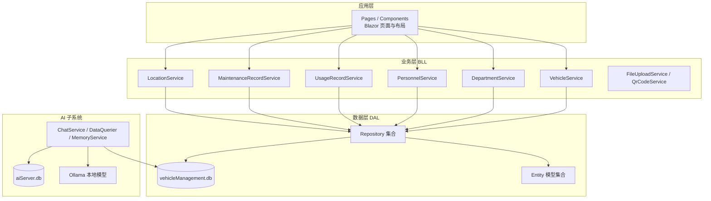
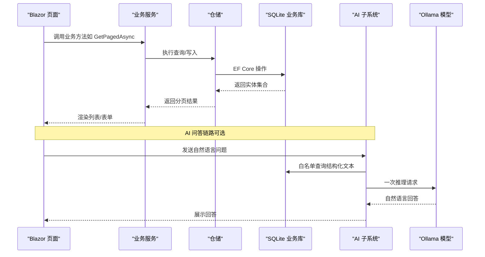
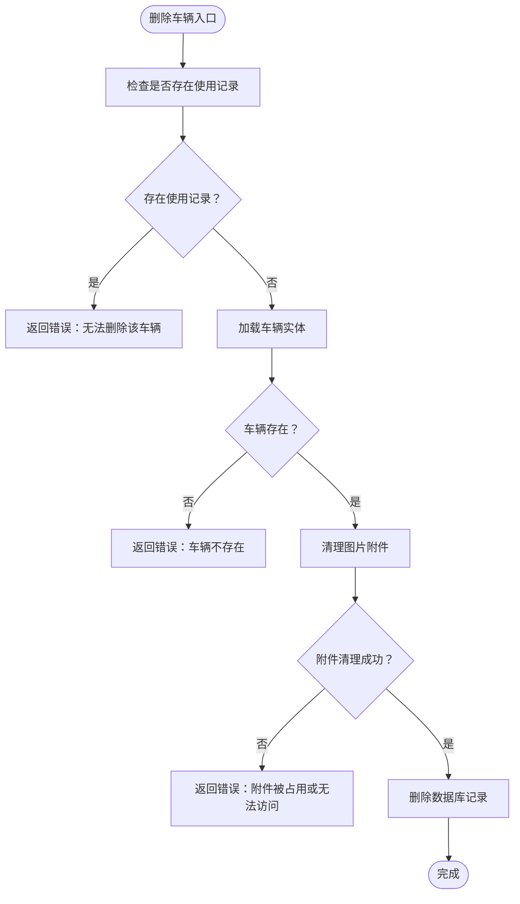
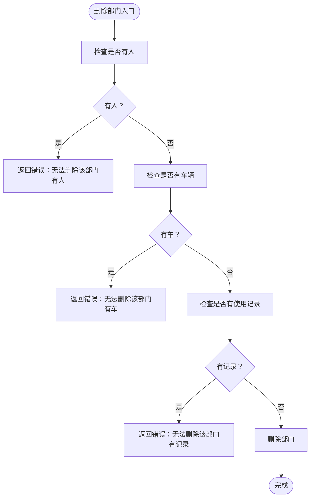
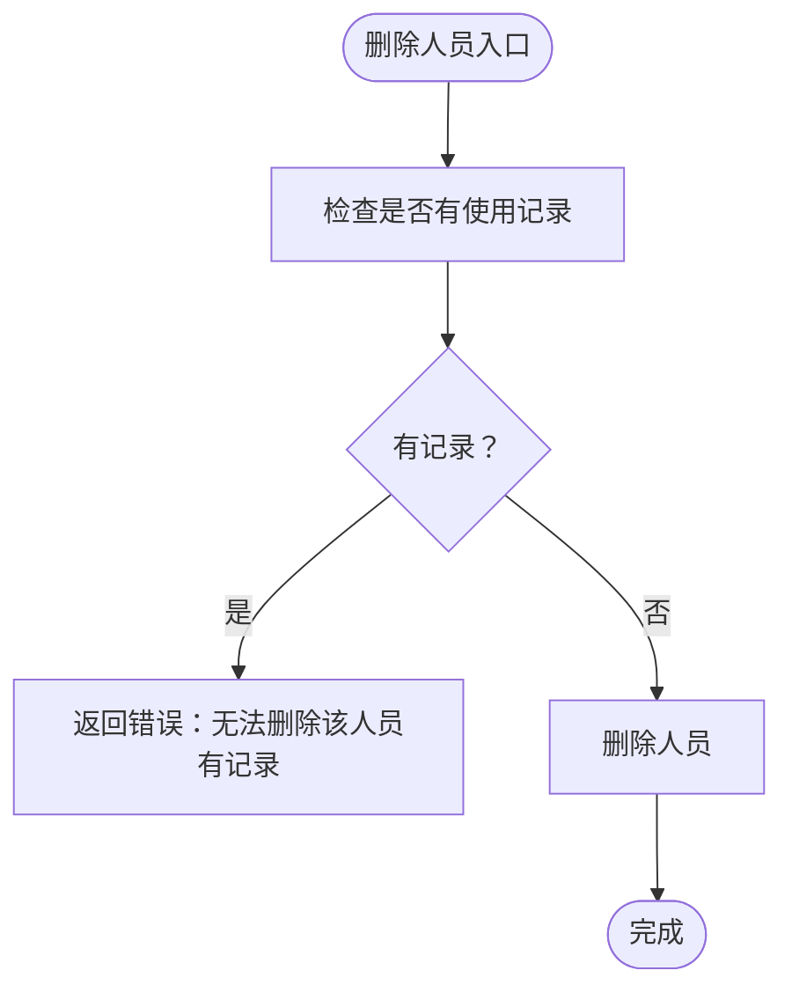
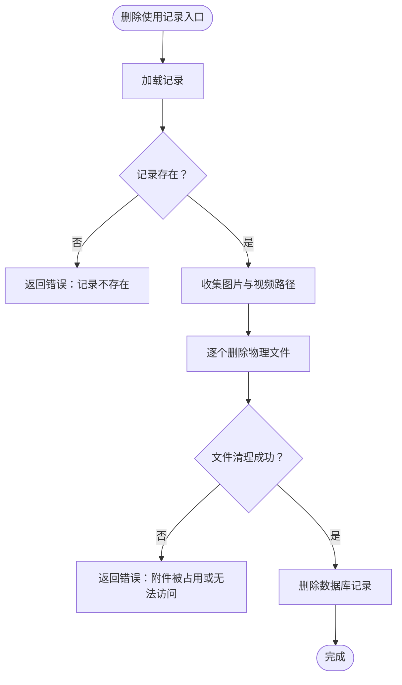
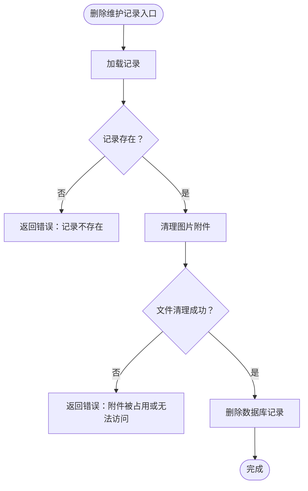
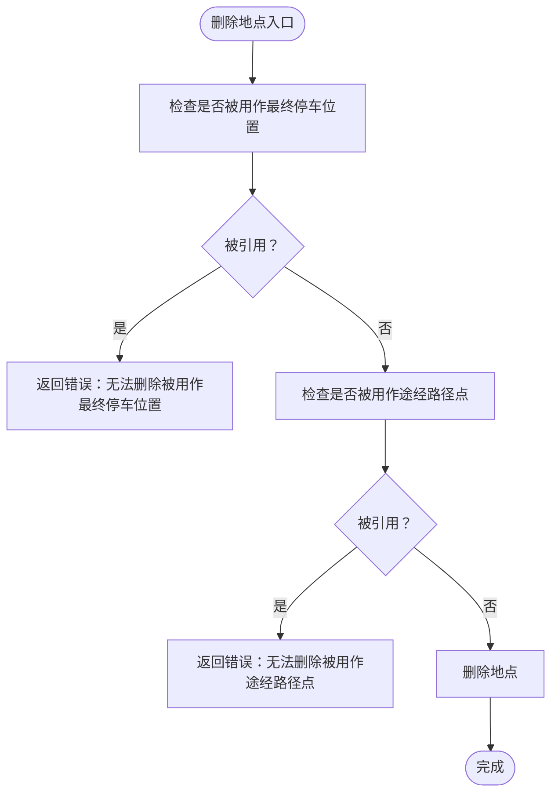
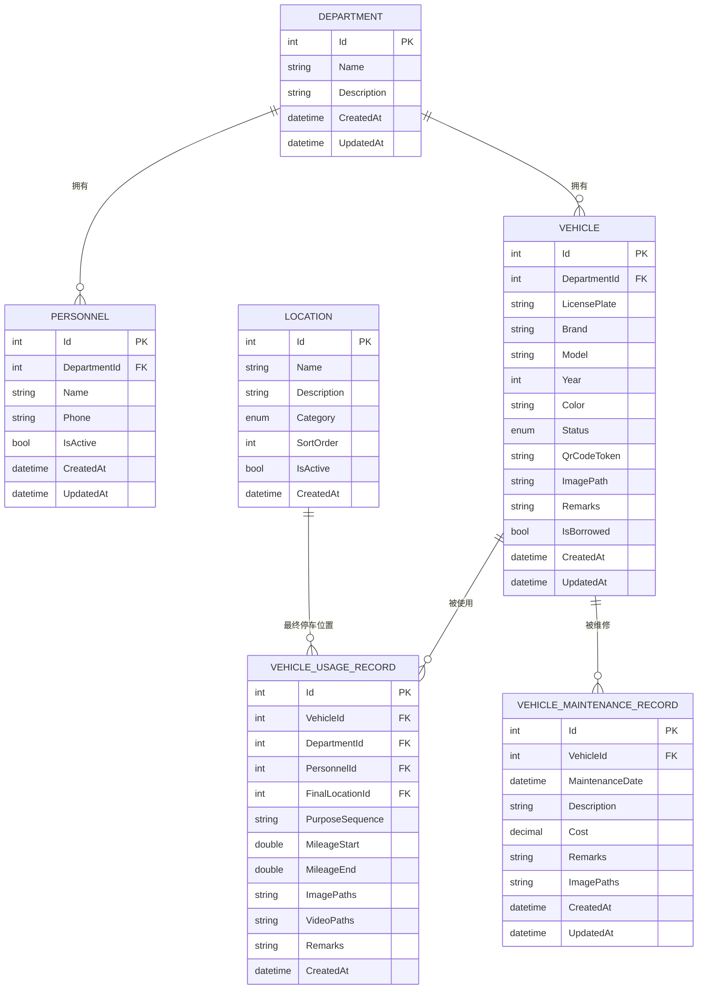

# 核心功能模块

<cite>
**本文引用的文件**   
- [README.md](file://README.md)
- [Program.cs](file://Program.cs)
- [appsettings.json](file://appsettings.json)
- [BLL/Vehicle/VehicleService.cs](file://BLL/Vehicle/VehicleService.cs)
- [BLL/Department/DepartmentService.cs](file://BLL/Department/DepartmentService.cs)
- [BLL/Personnel/PersonnelService.cs](file://BLL/Personnel/PersonnelService.cs)
- [BLL/UsageRecord/UsageRecordService.cs](file://BLL/UsageRecord/UsageRecordService.cs)
- [BLL/Maintenance/MaintenanceRecordService.cs](file://BLL/Maintenance/MaintenanceRecordService.cs)
- [BLL/Location/LocationService.cs](file://BLL/Location/LocationService.cs)
- [DAL/Model/Vehicle.cs](file://DAL/Model/Vehicle.cs)
- [DAL/Model/Department.cs](file://DAL/Model/Department.cs)
- [DAL/Model/Personnel.cs](file://DAL/Model/Personnel.cs)
- [DAL/Model/VehicleUsageRecord.cs](file://DAL/Model/VehicleUsageRecord.cs)
- [DAL/Model/VehicleMaintenanceRecord.cs](file://DAL/Model/VehicleMaintenanceRecord.cs)
- [DAL/Model/Location.cs](file://DAL/Model/Location.cs)
</cite>

## 目录
1. [引言](#引言)
2. [项目结构](#项目结构)
3. [核心模块总览](#核心模块总览)
4. [架构总览](#架构总览)
5. [详细模块分析](#详细模块分析)
6. [依赖关系与数据流转](#依赖关系与数据流转)
7. [性能与扩展实践](#性能与扩展实践)
8. [故障排查指南](#故障排查指南)
9. [结论](#结论)

## 引言
本文件面向 vehicleManagement 系统的六大核心业务模块，提供从业务目标、流程、数据模型、服务接口到 UI 路由的完整说明。系统采用 Blazor Server + EF Core + SQLite 分层架构，主库承载车辆、部门、人员、地点、使用记录与维修记录等业务数据；AI 子系统独立数据库与推理链路，不侵入业务数据。文档同时给出模块间依赖、错误处理、性能优化与扩展示例，帮助不同经验水平的开发者快速上手并安全扩展。

## 项目结构
仓库按 DAL（实体与仓储）→ BLL（业务服务）→ Pages/Components（Blazor UI）组织，AI 子系统位于 aiServer 命名空间下，拥有独立的 DbContext、仓储与服务。启动程序负责配置注入、数据库初始化、静态资源与附件目录挂载。

**图表来源**
- [Program.cs:41-102](file://Program.cs#L41-L102)
- [README.md:122-139](file://README.md#L122-L139)

**章节来源**
- [README.md:122-139](file://README.md#L122-L139)
- [Program.cs:41-102](file://Program.cs#L41-L102)

## 核心模块总览
- 车辆管理：CRUD、状态流转、二维码 Token 生成与下载校验、图片附件关联。
- 部门管理：组织架构维护，删除前校验人员、车辆、使用记录引用。
- 人员管理：员工信息维护、在职状态、所属部门，删除前校验使用记录引用。
- 使用记录：出车申请、归还确认、里程、最终停车位置、多段用途、图片/视频附件。
- 维护记录：维修历史登记、查询、删除时清理附件。
- 位置管理：出发地/目的地分类，启用过滤，删除前校验被使用记录引用。

**章节来源**
- [README.md:122-139](file://README.md#L122-L139)

## 架构总览
系统通过 Program.cs 注册 DbContextFactory、仓储、业务服务与通用能力（文件上传、二维码），并在启动时确保业务库与 AI 库建库成功。UI 层通过 Blazor 页面调用各 Service，Service 通过 Repository 访问 EF Core 实体，SQLite 作为持久化存储。AI 子系统通过 Semantic Kernel 连接本地 Ollama，意图识别后走白名单查询，结果注入模型生成自然语言回答。

**图表来源**
- [Program.cs:52-102](file://Program.cs#L52-L102)
- [README.md:187-219](file://README.md#L187-L219)

**章节来源**
- [Program.cs:52-102](file://Program.cs#L52-L102)
- [README.md:187-219](file://README.md#L187-L219)

## 详细模块分析

### 车辆管理模块
- 功能概述
  - 车辆台账增删改查、分页搜索与排序。
  - 借用状态切换、在用车辆筛选。
  - 二维码 Token 生成与下载校验（绑定部门、部门有在职人员）。
  - 图片附件关联与删除时物理文件清理。
- 业务流程
  - 创建/更新：设置更新时间戳，保存实体。
  - 删除：先检查是否存在使用记录，再尝试删除图片附件，最后删除数据库记录。
  - 二维码：若未生成 Token 则生成新 Token 并持久化。
- 数据模型
  - 车辆实体包含车牌、品牌、型号、颜色、状态、二维码 Token、图片路径、备注、借用状态、时间戳及部门外键。
- API 接口（服务方法）
  - 分页查询：GetPagedAsync(searchKeyword, sortColumn, sortAscending, page, pageSize)
  - 获取部门列表：GetAllDepartmentsAsync()
  - 按 ID 获取：GetVehicleByIdAsync(id)
  - 二维码 Token 查询：GetByQrCodeTokenAsync(token)
  - 在用车辆列表：GetActiveVehiclesAsync()
  - 创建/更新：CreateVehicleAsync(vehicle), UpdateVehicleAsync(vehicle)
  - 删除：DeleteVehicleAsync(id) → (Success, ErrorMessage)
  - 借用状态切换：ToggleBorrowedAsync(vehicleId, isBorrowed)
  - 二维码校验：ValidateQrCodeDownloadAsync(vehicle) → (CanDownload, ErrorMessage)
  - 确保 Token：EnsureQrCodeTokenAsync(vehicle, qrCodeService) → string
- UI 组件
  - 页面路由：/vehicles（车辆台账）、/borrow/{VehicleId}（出车申请）、/execute/{Token}（扫码执行）。
- 配置选项
  - 附件目录：Folder 静态文件映射，用于图片访问。
- 使用示例
  - 在页面中调用 VehicleService.GetPagedAsync 实现带搜索和排序的分页列表。
  - 删除车辆前调用 ValidateQrCodeDownloadAsync 提示用户先绑定部门并添加人员。
- 错误处理
  - 删除失败：存在使用记录或图片附件被占用时返回明确错误消息。
- 性能优化
  - 使用 IDbContextFactory 避免并发上下文冲突。
  - Include 按需加载部门，减少 N+1 查询。

**图表来源**
- [BLL/Vehicle/VehicleService.cs:171-201](file://BLL/Vehicle/VehicleService.cs#L171-L201)

**章节来源**
- [BLL/Vehicle/VehicleService.cs:40-238](file://BLL/Vehicle/VehicleService.cs#L40-L238)
- [DAL/Model/Vehicle.cs:8-48](file://DAL/Model/Vehicle.cs#L8-L48)
- [Program.cs:134-140](file://Program.cs#L134-L140)

### 部门管理模块
- 功能概述
  - 部门名称与描述维护，支持分页搜索与排序。
  - 删除前校验：部门下是否有人员、车辆、使用记录。
- 业务流程
  - 创建/更新：标准化字段 Trim，设置时间戳。
  - 删除：依次校验人员、车辆、使用记录引用，通过后删除。
- 数据模型
  - 部门实体包含名称、描述、时间戳。
- API 接口（服务方法）
  - 分页查询：GetPagedAsync(searchKeyword, sortColumn, sortAscending, page, pageSize)
  - 按 ID 获取：GetByIdAsync(id)
  - 创建：CreateAsync(name, description)
  - 更新：UpdateAsync(id, name, description)
  - 删除：DeleteAsync(id) → (Success, ErrorMessage)
- UI 组件
  - 页面路由：/departments（部门维护）。
- 配置选项
  - 无特殊配置。
- 使用示例
  - 在部门删除前调用 DeleteAsync，根据返回的错误消息引导用户转移或清理引用。
- 错误处理
  - 删除失败：存在人员/车辆/使用记录引用时返回具体原因。
- 性能优化
  - 使用 IDbContextFactory 与 AsQueryable 构建可组合查询。

**图表来源**
- [BLL/Department/DepartmentService.cs:118-143](file://BLL/Department/DepartmentService.cs#L118-L143)

**章节来源**
- [BLL/Department/DepartmentService.cs:38-143](file://BLL/Department/DepartmentService.cs#L38-L143)
- [DAL/Model/Department.cs:7-21](file://DAL/Model/Department.cs#L7-L21)

### 人员管理模块
- 功能概述
  - 员工信息管理（姓名、电话、在职状态、所属部门）。
  - 删除前校验是否存在使用记录。
- 业务流程
  - 创建/更新：Trim 字段，设置时间戳。
  - 删除：若存在使用记录则拒绝删除。
- 数据模型
  - 人员实体包含部门外键、姓名、电话、在职状态、时间戳及部门导航属性。
- API 接口（服务方法）
  - 分页查询：GetPagedAsync(searchKeyword, sortColumn, sortAscending, page, pageSize)
  - 获取部门列表：GetAllDepartmentsAsync()
  - 按 ID 获取：GetByIdAsync(id)
  - 创建：CreateAsync(departmentId, name, phone, isActive)
  - 更新：UpdateAsync(id, departmentId, name, phone, isActive)
  - 删除：DeleteAsync(id) → (Success, ErrorMessage)
- UI 组件
  - 页面路由：/personnel（人员列表）。
- 配置选项
  - 无特殊配置。
- 使用示例
  - 在人员删除前调用 DeleteAsync，根据返回错误提示用户先清理使用记录。
- 错误处理
  - 删除失败：存在使用记录时返回明确错误。
- 性能优化
  - Include Department 提升列表显示效率。

**图表来源**
- [BLL/Personnel/PersonnelService.cs:128-139](file://BLL/Personnel/PersonnelService.cs#L128-L139)

**章节来源**
- [BLL/Personnel/PersonnelService.cs:36-139](file://BLL/Personnel/PersonnelService.cs#L36-L139)
- [DAL/Model/Personnel.cs:7-29](file://DAL/Model/Personnel.cs#L7-L29)

### 使用记录模块
- 功能概述
  - 出车申请、归还确认、里程记录、最终停车位置、多段用途。
  - 支持图片与视频附件，删除时清理物理文件。
- 业务流程
  - 分页查询：支持按车牌、人员、部门搜索，按车辆/人员/创建时间排序。
  - 最近 N 天查询：按中国时区日期计算时间范围。
  - 删除：先清理所有附件（图片/视频），再删除数据库记录。
- 数据模型
  - 使用记录实体包含车辆、部门、人员、最终停车位置、用途序列、起止里程、附件路径、备注、时间戳及用途明细集合。
- API 接口（服务方法）
  - 分页查询：GetPagedAsync(searchKeyword, sortColumn, sortAscending, page, pageSize)
  - 最近 N 天：GetRecentAsync(days, page, pageSize)
  - 删除：DeleteAsync(id) → (Success, ErrorMessage)
  - 附件工具：GetAllFiles(record), IsImageFile(path)
- UI 组件
  - 页面路由：/usage-records（使用记录）、/borrow/{VehicleId}（出车申请）。
- 配置选项
  - 附件目录：Folder 静态文件映射。
- 使用示例
  - 在页面中调用 GetAllFiles 合并图片与视频路径，统一展示附件列表。
- 错误处理
  - 删除失败：附件被占用或无法访问时阻止数据库删除并返回错误。
- 性能优化
  - Include Vehicle/Department/Personnel/FinalLocation/UsageRecordPurposes 预加载关联数据。

**图表来源**
- [BLL/UsageRecord/UsageRecordService.cs:125-153](file://BLL/UsageRecord/UsageRecordService.cs#L125-L153)

**章节来源**
- [BLL/UsageRecord/UsageRecordService.cs:40-176](file://BLL/UsageRecord/UsageRecordService.cs#L40-L176)
- [DAL/Model/VehicleUsageRecord.cs:9-54](file://DAL/Model/VehicleUsageRecord.cs#L9-L54)
- [Program.cs:134-140](file://Program.cs#L134-L140)

### 维护记录模块
- 功能概述
  - 维修历史登记、查询、删除，支持图片附件。
- 业务流程
  - 分页查询：按车牌或描述搜索，按维护日期倒序。
  - 删除：先清理图片附件，再删除数据库记录。
- 数据模型
  - 维护记录实体包含车辆外键、维护日期、描述、费用、备注、图片路径、时间戳及车辆导航属性。
- API 接口（服务方法）
  - 分页查询：GetPagedAsync(searchKeyword, page, pageSize)
  - 按 ID 获取：GetByIdAsync(id)
  - 创建/更新：CreateAsync(record), UpdateAsync(record)
  - 删除：DeleteAsync(id) → (Success, Error)
- UI 组件
  - 页面路由：/maintenance/{VehicleId}（维修登记）、/maintenance-records（维修记录）。
- 配置选项
  - 附件目录：Folder 静态文件映射。
- 使用示例
  - 在页面中调用 CreateAsync 保存维修记录，随后在列表中查看历史记录。
- 错误处理
  - 删除失败：附件被占用或无法访问时阻止数据库删除并返回错误。
- 性能优化
  - Include Vehicle.Department 预加载部门信息。

**图表来源**
- [BLL/Maintenance/MaintenanceRecordService.cs:73-100](file://BLL/Maintenance/MaintenanceRecordService.cs#L73-L100)

**章节来源**
- [BLL/Maintenance/MaintenanceRecordService.cs:30-100](file://BLL/Maintenance/MaintenanceRecordService.cs#L30-L100)
- [DAL/Model/VehicleMaintenanceRecord.cs:8-35](file://DAL/Model/VehicleMaintenanceRecord.cs#L8-L35)
- [Program.cs:134-140](file://Program.cs#L134-L140)

### 位置管理模块
- 功能概述
  - 地点按分类管理（出发地/目的地），支持启用过滤与排序。
  - 删除前校验是否被使用记录引用（最终停车位置或途经路径点）。
- 业务流程
  - 分页查询：按分类过滤，支持名称/描述搜索，默认按 SortOrder 排序。
  - 删除：若被使用记录引用则拒绝删除。
- 数据模型
  - 地点实体包含名称、描述、分类、排序号、启用状态、时间戳。
- API 接口（服务方法）
  - 按分类分页：GetPagedByCategoryAsync(category, searchKeyword, sortColumn, sortAscending, page, pageSize)
  - 按 ID 获取：GetByIdAsync(id)
  - 创建/更新：CreateAsync(category, name, description, sortOrder, isActive), UpdateAsync(id, name, description, sortOrder, isActive)
  - 删除：DeleteAsync(id) → (Success, ErrorMessage)
  - 启用地点查询：GetActiveWaypointsAsync(), GetActiveFinalLocationsAsync()
- UI 组件
  - 页面路由：/locations（地点管理）。
- 配置选项
  - 无特殊配置。
- 使用示例
  - 在出车申请中选择途经路径点与最终停车位置，调用 GetActiveWaypointsAsync 与 GetActiveFinalLocationsAsync 获取可用地点。
- 错误处理
  - 删除失败：被使用记录引用时返回具体原因。
- 性能优化
  - 使用 Where(Category == category) 与 IsActive 过滤减少无效数据。

**图表来源**
- [BLL/Location/LocationService.cs:112-131](file://BLL/Location/LocationService.cs#L112-L131)

**章节来源**
- [BLL/Location/LocationService.cs:28-151](file://BLL/Location/LocationService.cs#L28-L151)
- [DAL/Model/Location.cs:6-25](file://DAL/Model/Location.cs#L6-L25)

## 依赖关系与数据流转
- 模块耦合
  - 车辆管理依赖部门（DepartmentId）与人员（借用人）。
  - 使用记录依赖车辆、部门、人员、最终停车位置与用途地点集合。
  - 维护记录依赖车辆。
  - 地点被使用记录引用（最终停车位置与途经路径点）。
- 数据流
  - UI 页面调用 Service 方法 → Service 通过 Repository 访问 EF Core → SQLite 持久化。
  - 删除操作遵循“先清理附件，再删除数据库”的顺序，保证一致性。
  - 二维码 Token 由车辆服务生成，供扫码执行页面定位单据。

**图表来源**
- [DAL/Model/Department.cs:7-21](file://DAL/Model/Department.cs#L7-L21)
- [DAL/Model/Personnel.cs:7-29](file://DAL/Model/Personnel.cs#L7-L29)
- [DAL/Model/Vehicle.cs:8-48](file://DAL/Model/Vehicle.cs#L8-L48)
- [DAL/Model/Location.cs:6-25](file://DAL/Model/Location.cs#L6-L25)
- [DAL/Model/VehicleUsageRecord.cs:9-54](file://DAL/Model/VehicleUsageRecord.cs#L9-L54)
- [DAL/Model/VehicleMaintenanceRecord.cs:8-35](file://DAL/Model/VehicleMaintenanceRecord.cs#L8-L35)

**章节来源**
- [DAL/Model/Vehicle.cs:8-48](file://DAL/Model/Vehicle.cs#L8-L48)
- [DAL/Model/Department.cs:7-21](file://DAL/Model/Department.cs#L7-L21)
- [DAL/Model/Personnel.cs:7-29](file://DAL/Model/Personnel.cs#L7-L29)
- [DAL/Model/Location.cs:6-25](file://DAL/Model/Location.cs#L6-L25)
- [DAL/Model/VehicleUsageRecord.cs:9-54](file://DAL/Model/VehicleUsageRecord.cs#L9-L54)
- [DAL/Model/VehicleMaintenanceRecord.cs:8-35](file://DAL/Model/VehicleMaintenanceRecord.cs#L8-L35)

## 性能与扩展实践
- 性能优化
  - 使用 IDbContextFactory 避免 Blazor Server 并发上下文冲突。
  - 分页查询统一封装 PagedResult，避免全表扫描。
  - Include 按需预加载关联实体，减少 N+1 查询。
  - 附件删除前先清理物理文件，避免孤儿文件堆积。
- 数据验证
  - 删除前进行业务校验（人员/车辆/记录引用），返回明确错误消息。
  - 字段 Trim 与 Required 注解保证数据质量。
- 扩展建议
  - 新增业务实体：在 DAL/Model 定义实体，在 DAL/Repository 增加仓储，在 BLL 增加 Service，在 Pages 增加页面路由。
  - 扩展二维码：在 VehicleService.EnsureQrCodeTokenAsync 中调整 Token 生成策略。
  - 扩展用途分类：在 LocationService 中增加新的 Category 枚举值与查询分支。
  - 扩展导出：参考 VehicleExportService 的结构，新增其他实体的 Excel 导出。

**章节来源**
- [Program.cs:52-58](file://Program.cs#L52-L58)
- [BLL/Vehicle/VehicleService.cs:67-108](file://BLL/Vehicle/VehicleService.cs#L67-L108)
- [BLL/UsageRecord/UsageRecordService.cs:43-91](file://BLL/UsageRecord/UsageRecordService.cs#L43-L91)
- [BLL/Location/LocationService.cs:31-65](file://BLL/Location/LocationService.cs#L31-L65)

## 故障排查指南
- 常见问题
  - 删除失败：存在引用（人员/车辆/记录）或附件被占用。
  - 二维码下载失败：未绑定部门或部门无在职人员。
  - 附件访问失败：Folder 静态文件映射未正确配置或权限不足。
- 诊断步骤
  - 检查删除逻辑返回的错误消息，定位引用方。
  - 检查 VehicleService.ValidateQrCodeDownloadAsync 的校验条件。
  - 检查 Program.cs 中 Folder 静态文件映射与 appsettings.json 的连接字符串。
- 日志与监控
  - Serilog 输出控制台与滚动文件，便于追踪删除与附件操作。
  - AI 子系统异常不影响业务页面可用性，但可在 AI 日志中排查模型连接问题。

**章节来源**
- [BLL/Department/DepartmentService.cs:118-143](file://BLL/Department/DepartmentService.cs#L118-L143)
- [BLL/Personnel/PersonnelService.cs:128-139](file://BLL/Personnel/PersonnelService.cs#L128-L139)
- [BLL/Vehicle/VehicleService.cs:207-224](file://BLL/Vehicle/VehicleService.cs#L207-L224)
- [Program.cs:28-37](file://Program.cs#L28-L37)
- [Program.cs:134-140](file://Program.cs#L134-L140)
- [appsettings.json:1-8](file://appsettings.json#L1-L8)

## 结论
vehicleManagement 的核心模块围绕车辆、部门、人员、地点、使用记录与维护记录展开，采用清晰的分层架构与严格的删除前校验，确保数据一致性与可追溯性。通过 IDbContextFactory、分页查询与附件清理等机制，系统在易用性与性能之间取得平衡。AI 子系统的引入在不侵入业务数据的前提下，提供了自然语言取数能力，适合内网环境下的数据分析与决策支持。开发者可基于现有 Service 与模型结构快速扩展新功能，同时遵循错误处理与性能优化的最佳实践。