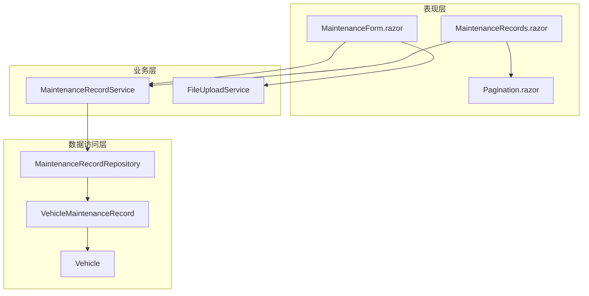
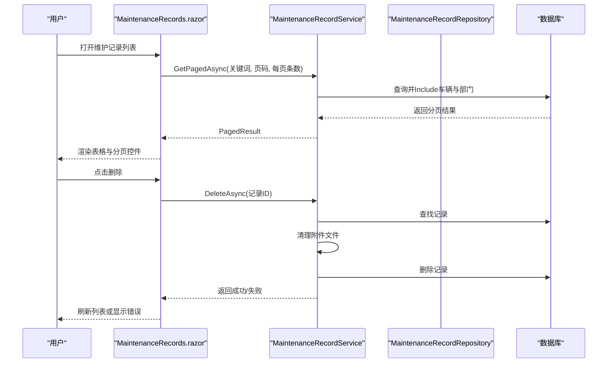
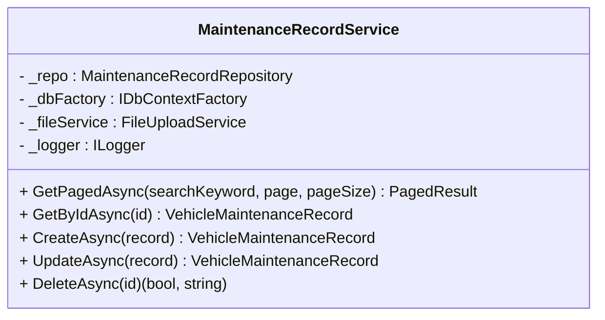
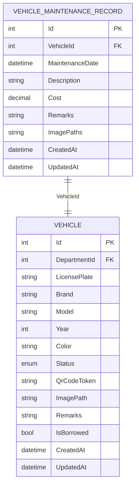
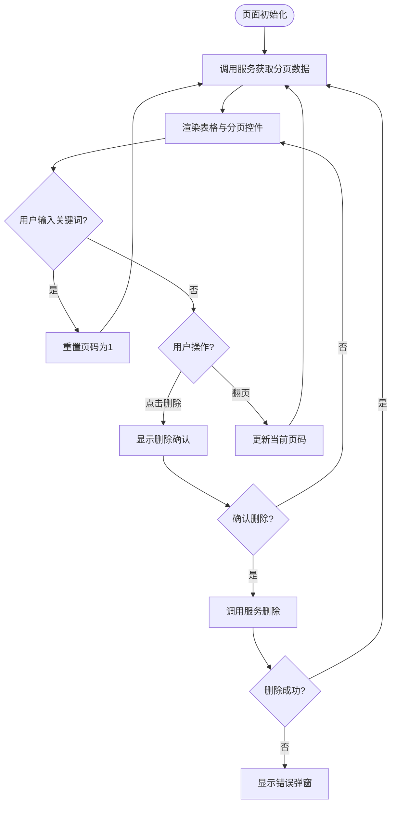
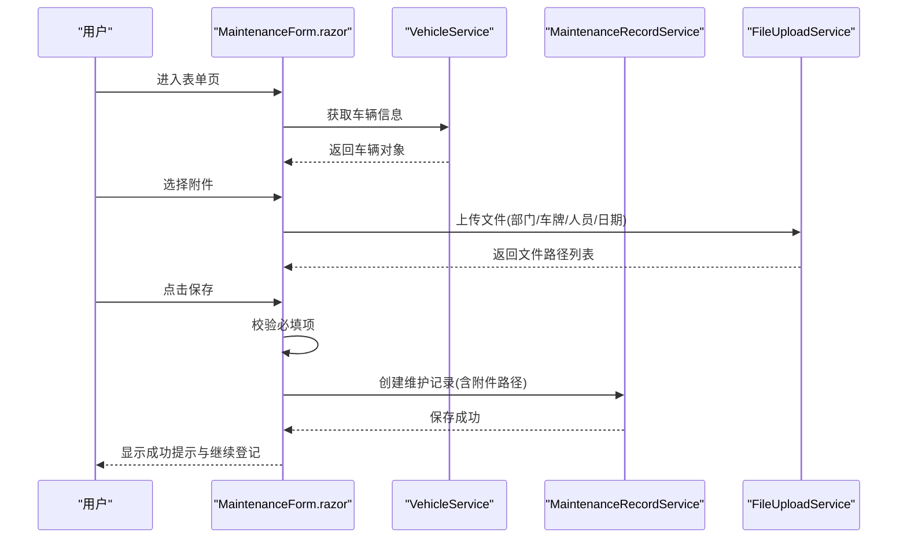
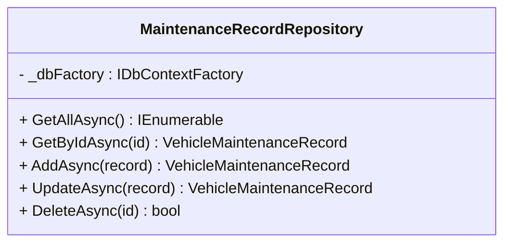
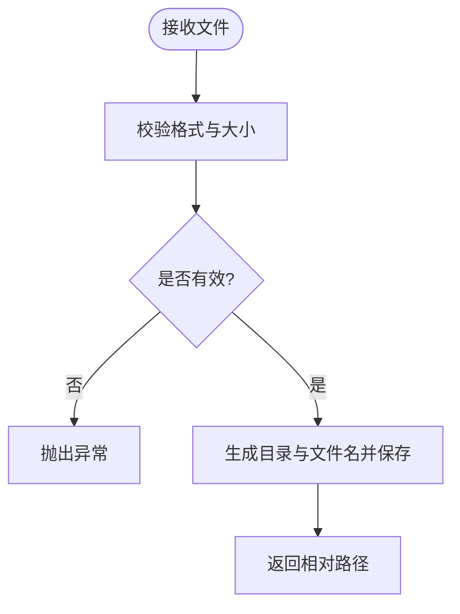
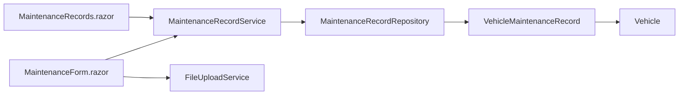

# 维护记录管理模块

<cite>
**本文引用的文件**   
- [MaintenanceRecordService.cs](file://BLL/Maintenance/MaintenanceRecordService.cs)
- [VehicleMaintenanceRecord.cs](file://DAL/Model/VehicleMaintenanceRecord.cs)
- [MaintenanceRecords.razor](file://Pages/MaintenanceRecords.razor)
- [MaintenanceForm.razor](file://Pages/MaintenanceForm.razor)
- [MaintenanceRecordRepository.cs](file://DAL/Repository/MaintenanceRecordRepository.cs)
- [FileUploadService.cs](file://BLL/Common/FileUploadService.cs)
- [Vehicle.cs](file://DAL/Model/Vehicle.cs)
- [Pagination.razor](file://Components/Common/Pagination.razor)
</cite>

## 目录
1. [简介](#简介)
2. [项目结构](#项目结构)
3. [核心组件](#核心组件)
4. [架构总览](#架构总览)
5. [详细组件分析](#详细组件分析)
6. [依赖关系分析](#依赖关系分析)
7. [性能与扩展性](#性能与扩展性)
8. [故障排查指南](#故障排查指南)
9. [结论](#结论)
10. [附录](#附录)

## 简介
本模块负责车辆维修历史的跟踪与管理，提供维修记录的增删改查、费用统计基础能力、以及基于车牌号与描述的关键字检索。页面层包含维护记录列表展示与维护表单录入，业务层封装分页查询、删除时附件清理等逻辑，数据访问层通过仓储模式操作数据库实体。该文档从系统架构、组件职责、数据流、错误处理、性能优化与扩展点等方面进行全面说明，帮助读者快速理解并安全扩展该模块。

## 项目结构
维护记录管理相关代码分布在以下层次：
- 表现层（Blazor 页面）：维护记录列表页与维护表单页
- 业务层（BLL）：维护记录服务，封装分页、删除等业务规则
- 数据访问层（DAL）：仓储与实体模型，负责持久化与关联加载
- 通用能力：文件上传服务、分页组件

**图表来源**
- [MaintenanceRecords.razor:1-161](file://Pages/MaintenanceRecords.razor#L1-L161)
- [MaintenanceForm.razor:1-179](file://Pages/MaintenanceForm.razor#L1-L179)
- [Pagination.razor:1-42](file://Components/Common/Pagination.razor#L1-L42)
- [MaintenanceRecordService.cs:14-101](file://BLL/Maintenance/MaintenanceRecordService.cs#L14-L101)
- [FileUploadService.cs:12-110](file://BLL/Common/FileUploadService.cs#L12-L110)
- [MaintenanceRecordRepository.cs:10-59](file://DAL/Repository/MaintenanceRecordRepository.cs#L10-L59)
- [VehicleMaintenanceRecord.cs:8-35](file://DAL/Model/VehicleMaintenanceRecord.cs#L8-L35)
- [Vehicle.cs:8-47](file://DAL/Model/Vehicle.cs#L8-L47)

**章节来源**
- [MaintenanceRecords.razor:1-161](file://Pages/MaintenanceRecords.razor#L1-L161)
- [MaintenanceForm.razor:1-179](file://Pages/MaintenanceForm.razor#L1-L179)
- [MaintenanceRecordService.cs:14-101](file://BLL/Maintenance/MaintenanceRecordService.cs#L14-L101)
- [MaintenanceRecordRepository.cs:10-59](file://DAL/Repository/MaintenanceRecordRepository.cs#L10-L59)
- [VehicleMaintenanceRecord.cs:8-35](file://DAL/Model/VehicleMaintenanceRecord.cs#L8-L35)
- [Vehicle.cs:8-47](file://DAL/Model/Vehicle.cs#L8-L47)
- [FileUploadService.cs:12-110](file://BLL/Common/FileUploadService.cs#L12-L110)
- [Pagination.razor:1-42](file://Components/Common/Pagination.razor#L1-L42)

## 核心组件
- MaintenanceRecordService：对外暴露维护记录的分页查询、新增、更新、删除接口；在删除时负责先清理物理附件再删除数据库记录，确保数据一致性。
- VehicleMaintenanceRecord：维护记录实体，包含车辆关联、维修日期、描述、费用、备注、附件路径、创建与更新时间等字段。
- MaintenanceRecords.razor：维护记录列表页，支持关键字搜索、分页显示、删除确认与错误提示。
- MaintenanceForm.razor：维护表单页，用于登记新的维修记录，包含表单校验、多图片上传、保存成功反馈。
- MaintenanceRecordRepository：仓储实现，提供基础的增删改查与按时间倒序排序的查询。
- FileUploadService：统一的文件上传与删除服务，支持图片与视频格式校验、大小限制、按部门/车牌/人员/日期组织存储。
- Pagination.razor：通用分页组件，提供页码导航与状态展示。

**章节来源**
- [MaintenanceRecordService.cs:14-101](file://BLL/Maintenance/MaintenanceRecordService.cs#L14-L101)
- [VehicleMaintenanceRecord.cs:8-35](file://DAL/Model/VehicleMaintenanceRecord.cs#L8-L35)
- [MaintenanceRecords.razor:1-161](file://Pages/MaintenanceRecords.razor#L1-L161)
- [MaintenanceForm.razor:1-179](file://Pages/MaintenanceForm.razor#L1-L179)
- [MaintenanceRecordRepository.cs:10-59](file://DAL/Repository/MaintenanceRecordRepository.cs#L10-L59)
- [FileUploadService.cs:12-110](file://BLL/Common/FileUploadService.cs#L12-L110)
- [Pagination.razor:1-42](file://Components/Common/Pagination.razor#L1-L42)

## 架构总览
维护记录管理采用分层架构：
- 表现层通过 Blazor 页面调用业务服务，渲染列表与表单，处理用户交互。
- 业务层对数据访问进行封装，加入业务规则（如删除前清理附件）。
- 数据访问层通过仓储与 EF Core 上下文操作数据库，维护实体关系。
- 通用服务（文件上传、分页）被多处复用。

**图表来源**
- [MaintenanceRecords.razor:117-159](file://Pages/MaintenanceRecords.razor#L117-L159)
- [MaintenanceRecordService.cs:30-99](file://BLL/Maintenance/MaintenanceRecordService.cs#L30-L99)
- [MaintenanceRecordRepository.cs:28-32](file://DAL/Repository/MaintenanceRecordRepository.cs#L28-L32)

## 详细组件分析

### 业务服务：MaintenanceRecordService
职责与关键点：
- 分页查询：根据关键词过滤车牌号与维修项目描述，按维修日期倒序排序，返回分页结果。
- 删除流程：先尝试删除附件物理文件，失败则阻止数据库删除并返回错误信息；成功后删除数据库记录并记录日志。
- 依赖注入：仓储、DbContext工厂、文件上传服务、日志。

**图表来源**
- [MaintenanceRecordService.cs:14-101](file://BLL/Maintenance/MaintenanceRecordService.cs#L14-L101)

**章节来源**
- [MaintenanceRecordService.cs:30-99](file://BLL/Maintenance/MaintenanceRecordService.cs#L30-L99)

### 实体模型：VehicleMaintenanceRecord
字段设计要点：
- 主键 Id
- 车辆关联 VehicleId 与 Vehicle 导航属性
- 维修日期 MaintenanceDate（默认中国时间）
- 描述 Description（最大长度500）
- 费用 Cost（decimal）
- 备注 Remarks
- 附件路径 ImagePaths（分号分隔的多路径）
- 创建与更新时间 CreatedAt、UpdatedAt

**图表来源**
- [VehicleMaintenanceRecord.cs:8-35](file://DAL/Model/VehicleMaintenanceRecord.cs#L8-L35)
- [Vehicle.cs:8-47](file://DAL/Model/Vehicle.cs#L8-L47)

**章节来源**
- [VehicleMaintenanceRecord.cs:8-35](file://DAL/Model/VehicleMaintenanceRecord.cs#L8-L35)
- [Vehicle.cs:8-47](file://DAL/Model/Vehicle.cs#L8-L47)

### 列表页面：MaintenanceRecords.razor
功能特性：
- 关键字搜索：输入框实时触发搜索，重置到第一页后重新加载数据。
- 列表展示：显示车牌号、所属部门、维修日期、维修项目、费用、备注，并提供查看/编辑与删除按钮。
- 分页：使用 Pagination 组件，计算总页数并响应页码变化。
- 删除确认：弹出确认对话框，确认后调用服务删除，失败时显示错误弹窗。

**图表来源**
- [MaintenanceRecords.razor:117-159](file://Pages/MaintenanceRecords.razor#L117-L159)
- [Pagination.razor:20-40](file://Components/Common/Pagination.razor#L20-L40)

**章节来源**
- [MaintenanceRecords.razor:1-161](file://Pages/MaintenanceRecords.razor#L1-L161)
- [Pagination.razor:1-42](file://Components/Common/Pagination.razor#L1-L42)

### 表单页面：MaintenanceForm.razor
功能特性：
- 车辆信息展示：读取车辆详情，展示车牌、部门、品牌型号、颜色、状态。
- 表单字段：维修日期、维修项目/内容、费用、备注、附件上传。
- 表单验证：必填项校验（维修项目），保存中禁用按钮，保存成功反馈与继续登记。
- 文件上传：支持多图上传，调用统一文件上传服务，按部门/车牌/人员/日期组织存储，失败时显示错误信息。

**图表来源**
- [MaintenanceForm.razor:122-167](file://Pages/MaintenanceForm.razor#L122-L167)
- [FileUploadService.cs:29-46](file://BLL/Common/FileUploadService.cs#L29-L46)

**章节来源**
- [MaintenanceForm.razor:1-179](file://Pages/MaintenanceForm.razor#L1-L179)
- [FileUploadService.cs:29-46](file://BLL/Common/FileUploadService.cs#L29-L46)

### 仓储层：MaintenanceRecordRepository
职责与关键点：
- 提供 GetAllAsync（按维修日期倒序）、GetByIdAsync、AddAsync、UpdateAsync、DeleteAsync。
- 使用 DbContextFactory 创建上下文，避免长生命周期上下文带来的问题。
- 更新时自动设置更新时间为当前中国时间。

**图表来源**
- [MaintenanceRecordRepository.cs:10-59](file://DAL/Repository/MaintenanceRecordRepository.cs#L10-L59)

**章节来源**
- [MaintenanceRecordRepository.cs:10-59](file://DAL/Repository/MaintenanceRecordRepository.cs#L10-L59)

### 文件上传服务：FileUploadService
职责与关键点：
- 支持图片与视频格式白名单校验，限制文件大小（图片10MB，视频100MB）。
- 按“部门/车牌/人员/日期”组织文件目录，生成唯一文件名。
- 提供删除方法，兼容不同路径前缀，确保删除与保存路径一致。

**图表来源**
- [FileUploadService.cs:29-110](file://BLL/Common/FileUploadService.cs#L29-L110)

**章节来源**
- [FileUploadService.cs:12-110](file://BLL/Common/FileUploadService.cs#L12-L110)

## 依赖关系分析
- 页面与服务：
  - MaintenanceRecords.razor 依赖 MaintenanceRecordService 与 VehicleService（用于跳转车辆列表）。
  - MaintenanceForm.razor 依赖 VehicleService、MaintenanceRecordService、LocationService、FileUploadService。
- 服务与仓储：
  - MaintenanceRecordService 依赖 MaintenanceRecordRepository 与 FileUploadService。
- 实体关系：
  - VehicleMaintenanceRecord 与 Vehicle 存在外键关系，查询时 Include 车辆及其部门以提升列表展示效率。

**图表来源**
- [MaintenanceRecords.razor:1-5](file://Pages/MaintenanceRecords.razor#L1-L5)
- [MaintenanceForm.razor:1-6](file://Pages/MaintenanceForm.razor#L1-L6)
- [MaintenanceRecordService.cs:14-28](file://BLL/Maintenance/MaintenanceRecordService.cs#L14-L28)
- [MaintenanceRecordRepository.cs:10-17](file://DAL/Repository/MaintenanceRecordRepository.cs#L10-L17)
- [VehicleMaintenanceRecord.cs:33-35](file://DAL/Model/VehicleMaintenanceRecord.cs#L33-L35)
- [Vehicle.cs:46-47](file://DAL/Model/Vehicle.cs#L46-L47)

**章节来源**
- [MaintenanceRecords.razor:1-5](file://Pages/MaintenanceRecords.razor#L1-L5)
- [MaintenanceForm.razor:1-6](file://Pages/MaintenanceForm.razor#L1-L6)
- [MaintenanceRecordService.cs:14-28](file://BLL/Maintenance/MaintenanceRecordService.cs#L14-L28)
- [MaintenanceRecordRepository.cs:10-17](file://DAL/Repository/MaintenanceRecordRepository.cs#L10-L17)
- [VehicleMaintenanceRecord.cs:33-35](file://DAL/Model/VehicleMaintenanceRecord.cs#L33-L35)
- [Vehicle.cs:46-47](file://DAL/Model/Vehicle.cs#L46-L47)

## 性能与扩展性

### 性能考虑
- 分页查询：在服务层使用 Skip/Take 控制数据量，减少内存占用与网络传输。
- 关联加载：在分页查询中使用 Include 预加载车辆与部门，避免 N+1 查询问题。
- 文件上传：统一限制文件大小与格式，避免大文件导致服务器压力。
- 日志记录：删除流程记录关键步骤，便于定位问题。

### 可扩展点
- 新增维修类型：
  - 在实体模型中增加分类字段或在描述中约定分类标识。
  - 在列表页增加筛选条件，在服务层增加对应 Where 过滤。
- 自定义维护计划：
  - 可新增维护计划实体与计划任务，结合提醒通知机制（邮件/站内信）实现到期提醒。
  - 在表单中增加计划关联字段，并在列表页展示计划执行状态。
- 费用统计：
  - 在服务层增加按月聚合查询，返回月度费用趋势数据供前端图表展示。
  - 可增加常见故障类型统计，基于描述关键字或新增分类字段进行分组统计。

[本节为通用指导，不直接分析具体文件]

## 故障排查指南
常见问题与处理策略：
- 删除失败且提示附件被占用：
  - 检查文件是否被其他进程占用或权限不足；服务层在删除附件失败时会阻止数据库删除并返回错误信息。
- 上传失败：
  - 检查文件格式与大小是否符合白名单与限制；服务层会抛出异常并返回错误消息。
- 列表搜索无结果：
  - 确认关键词是否为空或包含特殊字符；服务层会对关键词进行 Trim 处理。
- 分页异常：
  - 检查页码参数是否小于1；服务层会将无效页码修正为1。

**章节来源**
- [MaintenanceRecordService.cs:73-99](file://BLL/Maintenance/MaintenanceRecordService.cs#L73-L99)
- [FileUploadService.cs:69-84](file://BLL/Common/FileUploadService.cs#L69-L84)
- [MaintenanceRecords.razor:131-136](file://Pages/MaintenanceRecords.razor#L131-L136)

## 结论
维护记录管理模块以清晰的分层架构实现了车辆维修历史的基础管理能力，包括分页查询、关键字搜索、表单录入与附件上传、删除时的附件清理等。通过仓储模式与实体关系映射，保证了数据的正确性与一致性。未来可在现有基础上扩展维修类型分类、维护计划与提醒通知、费用统计与可视化等功能，进一步提升运维效率与管理体验。

[本节为总结性内容，不直接分析具体文件]

## 附录

### 数据验证规则
- 必填字段：
  - 维修项目/内容：表单层校验为空时提示错误。
- 可选字段：
  - 维修费用、备注、附件上传。
- 附件约束：
  - 仅允许图片与视频格式，图片不超过10MB，视频不超过100MB。

**章节来源**
- [MaintenanceForm.razor:145-167](file://Pages/MaintenanceForm.razor#L145-L167)
- [FileUploadService.cs:69-84](file://BLL/Common/FileUploadService.cs#L69-L84)

### 错误处理策略
- 表单保存：捕获异常并显示错误信息，保存中禁用按钮防止重复提交。
- 删除流程：先清理附件，失败则返回错误信息；成功后记录日志。
- 文件上传：校验失败抛出异常，页面捕获并提示用户。

**章节来源**
- [MaintenanceForm.razor:145-167](file://Pages/MaintenanceForm.razor#L145-L167)
- [MaintenanceRecordService.cs:73-99](file://BLL/Maintenance/MaintenanceRecordService.cs#L73-L99)
- [FileUploadService.cs:29-46](file://BLL/Common/FileUploadService.cs#L29-L46)