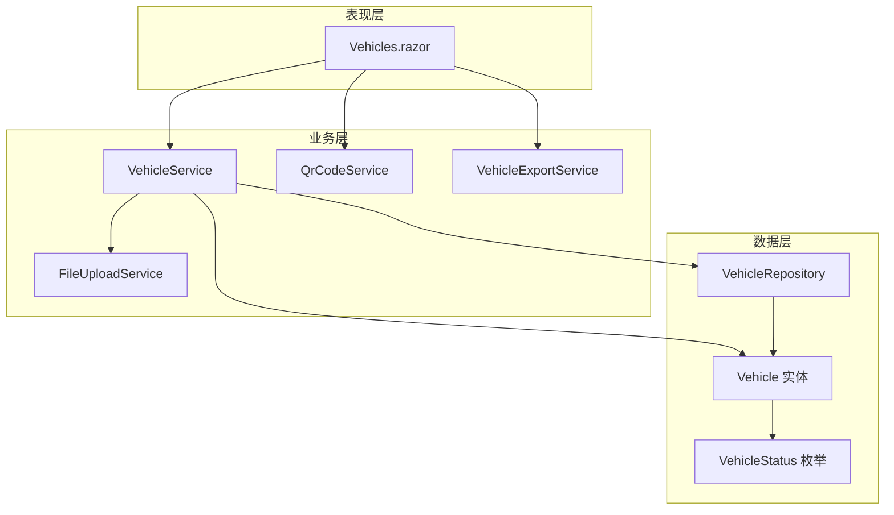
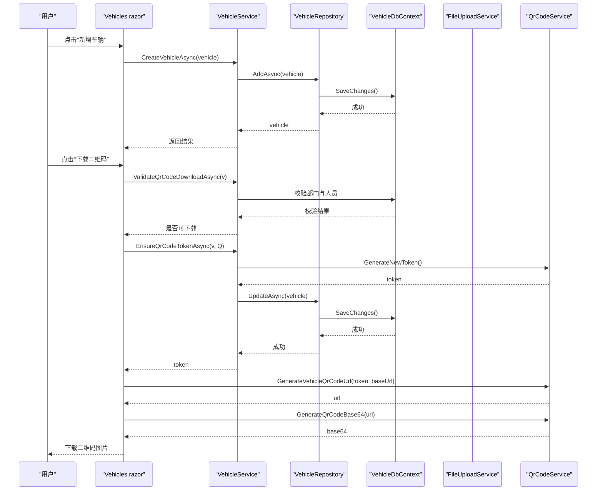
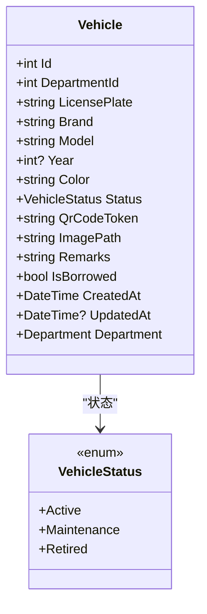
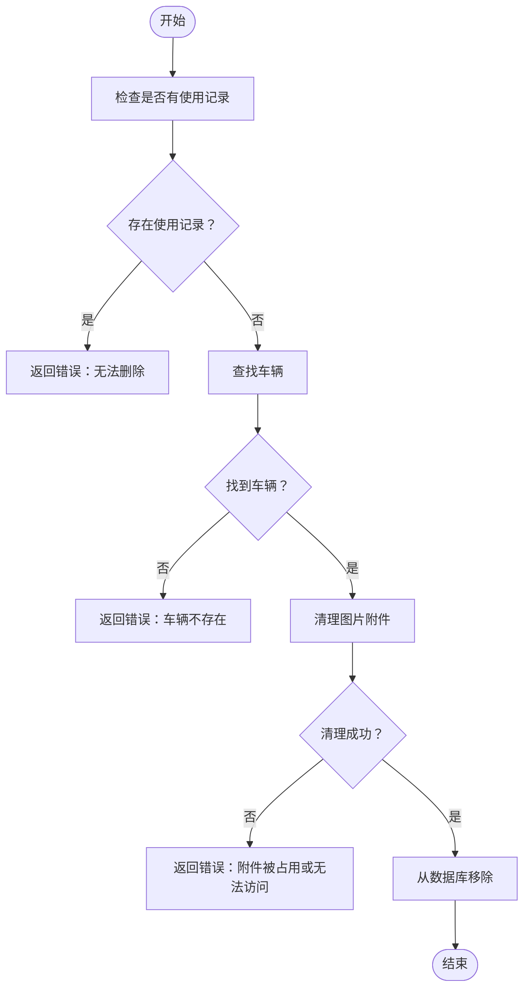
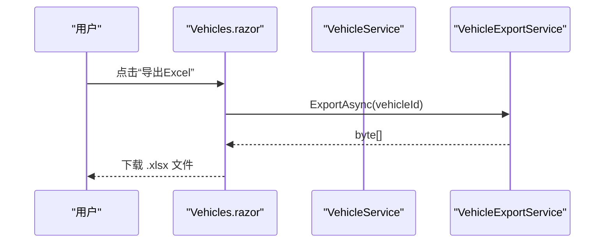

# 车辆管理模块

<cite>
**本文引用的文件**   
- [VehicleService.cs](file://BLL/Vehicle/VehicleService.cs)
- [VehicleRepository.cs](file://DAL/Repository/VehicleRepository.cs)
- [Vehicle.cs](file://DAL/Model/Vehicle.cs)
- [VehicleEnums.cs](file://DAL/Model/VehicleEnums.cs)
- [Vehicles.razor](file://Pages/Vehicles.razor)
- [QrCodeService.cs](file://BLL/Common/QrCodeService.cs)
- [FileUploadService.cs](file://BLL/Common/FileUploadService.cs)
- [VehicleExportService.cs](file://BLL/Export/VehicleExportService.cs)
</cite>

## 目录
1. [简介](#简介)
2. [项目结构](#项目结构)
3. [核心组件](#核心组件)
4. [架构总览](#架构总览)
5. [详细组件分析](#详细组件分析)
6. [依赖关系分析](#依赖关系分析)
7. [性能与扩展性](#性能与扩展性)
8. [故障排查指南](#故障排查指南)
9. [结论](#结论)
10. [附录：扩展示例](#附录扩展示例)

## 简介
本技术文档围绕“车辆管理模块”展开，覆盖车辆信息的完整生命周期管理（新增、编辑、删除、查询），车辆状态流转机制（在用、维修、退役等），二维码生成与下载流程，以及文件附件上传与清理策略。文档同时给出 VehicleService 业务逻辑、VehicleRepository 数据访问模式、Vehicle 实体模型设计、Vehicles.razor 页面结构与交互逻辑，并提供扩展属性与新增状态类型的实践建议。

## 项目结构
车辆管理相关代码主要分布在以下层次：
- 领域服务层（BLL）：VehicleService 负责车辆业务编排；QrCodeService 负责二维码生成；FileUploadService 负责文件上传与删除；VehicleExportService 负责导出 Excel。
- 数据访问层（DAL）：VehicleRepository 提供基础 CRUD；Vehicle 实体与 VehicleStatus 枚举定义数据模型。
- 表现层（Pages）：Vehicles.razor 提供车辆列表、搜索、分页、排序、新增/编辑弹窗、删除确认、二维码下载与 Excel 导出。



图表来源
- [Vehicles.razor:1-410](file://Pages/Vehicles.razor#L1-L410)
- [VehicleService.cs:1-241](file://BLL/Vehicle/VehicleService.cs#L1-L241)
- [QrCodeService.cs:1-42](file://BLL/Common/QrCodeService.cs#L1-L42)
- [FileUploadService.cs:1-113](file://BLL/Common/FileUploadService.cs#L1-L113)
- [VehicleRepository.cs:1-66](file://DAL/Repository/VehicleRepository.cs#L1-L66)
- [Vehicle.cs:1-50](file://DAL/Model/Vehicle.cs#L1-L50)
- [VehicleEnums.cs:1-16](file://DAL/Model/VehicleEnums.cs#L1-L16)

章节来源
- [Vehicles.razor:1-410](file://Pages/Vehicles.razor#L1-L410)
- [VehicleService.cs:1-241](file://BLL/Vehicle/VehicleService.cs#L1-L241)
- [VehicleRepository.cs:1-66](file://DAL/Repository/VehicleRepository.cs#L1-L66)
- [Vehicle.cs:1-50](file://DAL/Model/Vehicle.cs#L1-L50)
- [VehicleEnums.cs:1-16](file://DAL/Model/VehicleEnums.cs#L1-L16)
- [QrCodeService.cs:1-42](file://BLL/Common/QrCodeService.cs#L1-L42)
- [FileUploadService.cs:1-113](file://BLL/Common/FileUploadService.cs#L1-L113)
- [VehicleExportService.cs:1-39](file://BLL/Export/VehicleExportService.cs#L1-L39)

## 核心组件
- VehicleService：封装车辆领域的核心业务，包括分页查询、部门人员校验、借用状态切换、二维码 Token 管理与下载校验、删除前业务校验与附件清理。
- VehicleRepository：对 Vehicle 实体的基础数据访问，提供 GetAll、GetById、Add、Update、Delete、Exists 等方法。
- Vehicle 实体：描述车辆基本信息、状态、二维码 Token、图片路径、借出标记、创建/更新时间及所属部门导航属性。
- Vehicles.razor：前端页面，承载车辆列表展示、搜索、分页、排序、新增/编辑表单、删除确认、二维码下载与 Excel 导出。
- QrCodeService：生成二维码图片 Base64、构建车辆二维码访问 URL、生成唯一 Token。
- FileUploadService：统一处理图片/视频上传、大小与格式校验、按部门/车牌/人员/日期组织存储路径，并支持删除。
- VehicleExportService：根据车辆 ID 导出包含使用记录、部门、人员、地点等信息的 Excel。

章节来源
- [VehicleService.cs:1-241](file://BLL/Vehicle/VehicleService.cs#L1-L241)
- [VehicleRepository.cs:1-66](file://DAL/Repository/VehicleRepository.cs#L1-L66)
- [Vehicle.cs:1-50](file://DAL/Model/Vehicle.cs#L1-L50)
- [Vehicles.razor:1-410](file://Pages/Vehicles.razor#L1-L410)
- [QrCodeService.cs:1-42](file://BLL/Common/QrCodeService.cs#L1-L42)
- [FileUploadService.cs:1-113](file://BLL/Common/FileUploadService.cs#L1-L113)
- [VehicleExportService.cs:1-39](file://BLL/Export/VehicleExportService.cs#L1-L39)

## 架构总览
车辆管理模块采用分层架构：
- 表现层（Razor 页面）通过依赖注入获取服务，调用业务方法完成用户操作。
- 业务层（VehicleService）协调仓储、文件服务、二维码服务，实现跨实体的业务规则与一致性。
- 数据层（VehicleRepository + EF Core）负责持久化与查询，结合 VehicleDbContext 进行数据库访问。



图表来源
- [Vehicles.razor:336-358](file://Pages/Vehicles.razor#L336-L358)
- [VehicleService.cs:207-238](file://BLL/Vehicle/VehicleService.cs#L207-L238)
- [QrCodeService.cs:27-39](file://BLL/Common/QrCodeService.cs#L27-L39)
- [VehicleRepository.cs:31-46](file://DAL/Repository/VehicleRepository.cs#L31-L46)

## 详细组件分析

### Vehicle 实体模型设计
Vehicle 实体定义了车辆的核心字段与关系：
- 主键 Id、必填 DepartmentId、LicensePlate（最大长度 50）、Brand/Model/Color（最大长度限制）、Year（可选）。
- Status 默认 Active，QrCodeToken（最大长度 64）、ImagePath、Remarks、IsBorrowed。
- CreatedAt 默认当前时间，UpdatedAt 可空。
- 外键关联 Department。



图表来源
- [Vehicle.cs:8-48](file://DAL/Model/Vehicle.cs#L8-L48)
- [VehicleEnums.cs:3-8](file://DAL/Model/VehicleEnums.cs#L3-L8)

章节来源
- [Vehicle.cs:1-50](file://DAL/Model/Vehicle.cs#L1-L50)
- [VehicleEnums.cs:1-16](file://DAL/Model/VehicleEnums.cs#L1-L16)

### VehicleRepository 数据访问模式
VehicleRepository 基于 IDbContextFactory 创建 DbContext 实例，提供：
- GetAllAsync：返回所有车辆。
- GetByIdAsync：按 ID 查询。
- AddAsync/UpdateAsync：新增/更新，并在更新时设置 UpdatedAt。
- DeleteAsync/ExistsAsync：删除与存在性检查。

该仓储层保持简单职责，将事务边界交由调用方控制（例如 Service 层在删除前做业务校验）。

章节来源
- [VehicleRepository.cs:1-66](file://DAL/Repository/VehicleRepository.cs#L1-L66)

### VehicleService 业务逻辑实现
VehicleService 承担以下职责：
- 分页查询：支持关键词搜索（车牌号、品牌、型号、颜色）、多列排序、分页参数处理。
- 部门与人员校验：用于二维码下载前的合法性校验。
- 借用状态切换：ToggleBorrowedAsync 修改 IsBorrowed。
- 二维码 Token 管理：EnsureQrCodeTokenAsync 确保每辆车有唯一 Token，必要时生成新 Token。
- 删除保护：DeleteVehicleAsync 先检查是否存在使用记录，再清理图片附件，最后执行数据库删除。



图表来源
- [VehicleService.cs:171-202](file://BLL/Vehicle/VehicleService.cs#L171-L202)

章节来源
- [VehicleService.cs:67-109](file://BLL/Vehicle/VehicleService.cs#L67-L109)
- [VehicleService.cs:171-202](file://BLL/Vehicle/VehicleService.cs#L171-L202)
- [VehicleService.cs:207-238](file://BLL/Vehicle/VehicleService.cs#L207-L238)

### Vehicles.razor 页面结构与交互逻辑
Vehicles.razor 提供完整的车辆管理界面：
- 顶部工具栏：搜索框、新增按钮。
- 新增/编辑弹窗：绑定表单字段（车牌号、部门、品牌、型号、颜色、年份、状态、备注），保存时区分新增与编辑。
- 删除确认弹窗：二次确认，确认后调用服务删除。
- 错误提示弹窗：统一显示失败信息。
- 表格展示：分页、排序、状态标签渲染、操作按钮（编辑、下载二维码、导出 Excel、删除）。
- 二维码下载：调用 VehicleService 校验与生成 Token，再通过 QrCodeService 生成 URL 与 Base64 图片，最终通过 JS 下载。
- Excel 导出：调用 VehicleExportService 导出单车数据。



图表来源
- [Vehicles.razor:397-408](file://Pages/Vehicles.razor#L397-L408)
- [VehicleExportService.cs:25-39](file://BLL/Export/VehicleExportService.cs#L25-L39)

章节来源
- [Vehicles.razor:1-410](file://Pages/Vehicles.razor#L1-L410)

### 二维码生成功能
QrCodeService 提供：
- GenerateQrCodeImage：生成 PNG 字节数组。
- GenerateQrCodeBase64：生成 Base64 字符串，便于前端直接下载。
- GenerateVehicleQrCodeUrl：根据 Token 与站点地址生成可访问的二维码链接。
- GenerateNewToken：生成唯一 GUID 字符串作为 Token。

在 Vehicles.razor 中，下载二维码的流程为：
1. 调用 VehicleService.ValidateQrCodeDownloadAsync 校验车辆已绑定部门且部门下有在职人员。
2. 调用 VehicleService.EnsureQrCodeTokenAsync 确保 Token 存在。
3. 使用 HttpContextAccessor 获取当前请求 Scheme 与 Host，拼接外部访问地址。
4. 调用 QrCodeService.GenerateVehicleQrCodeUrl 与 GenerateQrCodeBase64 生成图片。
5. 通过 JSRuntime 调用浏览器下载接口。

章节来源
- [QrCodeService.cs:1-42](file://BLL/Common/QrCodeService.cs#L1-L42)
- [Vehicles.razor:336-358](file://Pages/Vehicles.razor#L336-L358)
- [VehicleService.cs:207-238](file://BLL/Vehicle/VehicleService.cs#L207-L238)

### 文件附件上传与管理
FileUploadService 提供：
- UploadFileAsync：支持服务器端 IFormFile 与 Blazor 客户端 IBrowserFile，自动判断图片/视频类型与大小限制。
- DeleteFile：根据相对路径删除文件，兼容不同路径前缀。
- 内部 ValidateFile：校验扩展名与文件大小。
- 内部 SaveFileAsync：按“部门/车牌/人员/日期”组织目录，文件名使用 GUID 避免冲突，返回相对路径。

注意：当前 VehicleService.DeleteVehicleAsync 会尝试删除车辆的 ImagePath 对应文件，若删除失败则阻止数据库删除，保证数据与文件的一致性。

章节来源
- [FileUploadService.cs:1-113](file://BLL/Common/FileUploadService.cs#L1-L113)
- [VehicleService.cs:171-202](file://BLL/Vehicle/VehicleService.cs#L171-L202)

## 依赖关系分析
- Vehicles.razor 依赖 VehicleService、QrCodeService、VehicleExportService、IJSRuntime、NavigationManager、HttpContextAccessor。
- VehicleService 依赖 VehicleRepository、DepartmentRepository、IDbContextFactory<VehicleDbContext>、FileUploadService、ILogger。
- VehicleRepository 依赖 IDbContextFactory<VehicleDbContext>。
- QrCodeService 依赖 QRCoder 库。
- FileUploadService 依赖 IWebHostEnvironment、IFormFile/IBrowserFile、ChinaTime。

```mermaid
graph LR
VZ["Vehicles.razor"] --> VS["VehicleService"]
VZ --> QS["QrCodeService"]
VZ --> ES["VehicleExportService"]
VS --> VR["VehicleRepository"]
VS --> FS["FileUploadService"]
VS --> DF["IDbContextFactory<VehicleDbContext>]
VR --> DF
```

图表来源
- [Vehicles.razor:1-10](file://Pages/Vehicles.razor#L1-L10)
- [VehicleService.cs:20-38](file://BLL/Vehicle/VehicleService.cs#L20-L38)
- [VehicleRepository.cs:12-17](file://DAL/Repository/VehicleRepository.cs#L12-L17)

章节来源
- [Vehicles.razor:1-410](file://Pages/Vehicles.razor#L1-L410)
- [VehicleService.cs:1-241](file://BLL/Vehicle/VehicleService.cs#L1-L241)
- [VehicleRepository.cs:1-66](file://DAL/Repository/VehicleRepository.cs#L1-L66)

## 性能与扩展性
- 分页与排序：VehicleService.GetPagedAsync 在服务端进行过滤、排序与分页，减少前端传输量；建议在常用搜索字段上建立索引以提升查询性能。
- 查询优化：分页查询中使用 Include 加载 Department，避免 N+1 问题；如需更多关联数据，按需 Include 以减少负载。
- 文件上传：FileUploadService 对图片与视频分别设置大小上限，避免大文件阻塞；建议在生产环境配置静态文件缓存与 CDN。
- 二维码生成：QrCodeService 使用内存流生成图片，适合小批量下载；高并发场景可考虑异步队列与缓存。
- 可扩展性：VehicleStatus 枚举集中管理状态类型；新增状态只需扩展枚举并在 UI 与业务逻辑处添加分支。

[本节为通用指导，不直接分析具体文件]

## 故障排查指南
- 删除失败：
  - 若存在使用记录，删除会被拒绝；请先删除相关使用记录。
  - 若图片附件被占用或无法访问，删除会被阻止；检查文件系统权限与路径是否正确。
- 二维码下载失败：
  - 未绑定部门或部门下无在职人员，需先完善部门与人员信息。
  - Token 为空时会自动生成；如仍失败，检查站点 Scheme/Host 配置与路由是否可达。
- 文件上传失败：
  - 检查文件格式与大小是否符合允许范围。
  - 检查目标目录是否存在与写入权限。

章节来源
- [VehicleService.cs:171-202](file://BLL/Vehicle/VehicleService.cs#L171-L202)
- [VehicleService.cs:207-225](file://BLL/Vehicle/VehicleService.cs#L207-L225)
- [FileUploadService.cs:69-84](file://BLL/Common/FileUploadService.cs#L69-L84)

## 结论
车辆管理模块以清晰的分层架构实现了车辆全生命周期管理，涵盖数据持久化、业务校验、二维码生成与文件附件管理。VehicleService 作为业务编排中心，协调仓储、文件与二维码服务，确保数据一致性与用户体验。Vehicles.razor 提供直观的前端交互，配合分页、搜索、排序与导出功能，满足日常运维需求。通过扩展 VehicleStatus 与 Vehicle 实体，可灵活扩展新的状态类型与属性。

[本节为总结性内容，不直接分析具体文件]

## 附录：扩展示例

### 扩展车辆属性
- 在 Vehicle 实体中添加新字段（例如 EngineNumber、VIN、FuelType），并相应调整 Vehicles.razor 表单绑定与服务层映射。
- 在 VehicleService.UpdateVehicleAsync 中确保新字段参与更新。
- 在 VehicleExportService.ExportAsync 中将新字段加入导出列。

章节来源
- [Vehicle.cs:8-48](file://DAL/Model/Vehicle.cs#L8-L48)
- [VehicleService.cs:159-166](file://BLL/Vehicle/VehicleService.cs#L159-L166)
- [VehicleExportService.cs:25-39](file://BLL/Export/VehicleExportService.cs#L25-L39)

### 添加新的状态类型
- 在 VehicleEnums.cs 中新增枚举值（例如 Scrapped = 4）。
- 在 Vehicles.razor 的状态下拉选项与状态标签渲染处增加分支。
- 在 DashboardService 或其他统计逻辑中增加对新状态的计数与展示。

章节来源
- [VehicleEnums.cs:3-8](file://DAL/Model/VehicleEnums.cs#L3-L8)
- [Vehicles.razor:68-72](file://Pages/Vehicles.razor#L68-L72)
- [Vehicles.razor:155-166](file://Pages/Vehicles.razor#L155-L166)