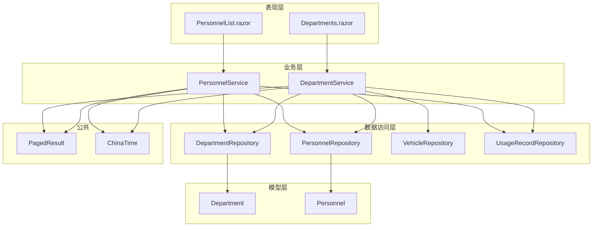
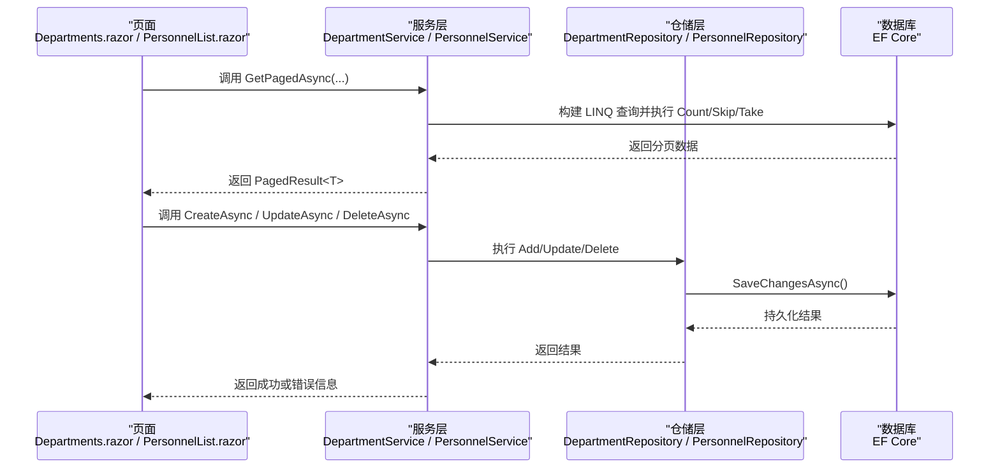
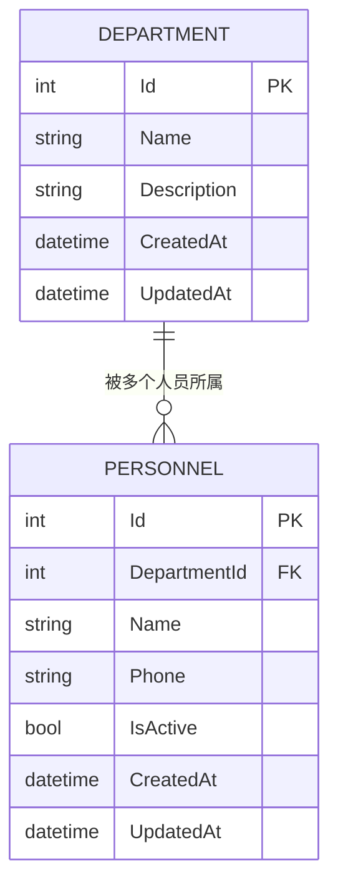
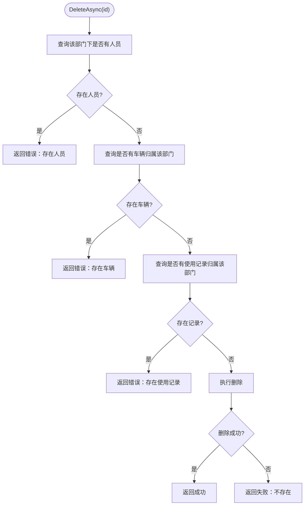
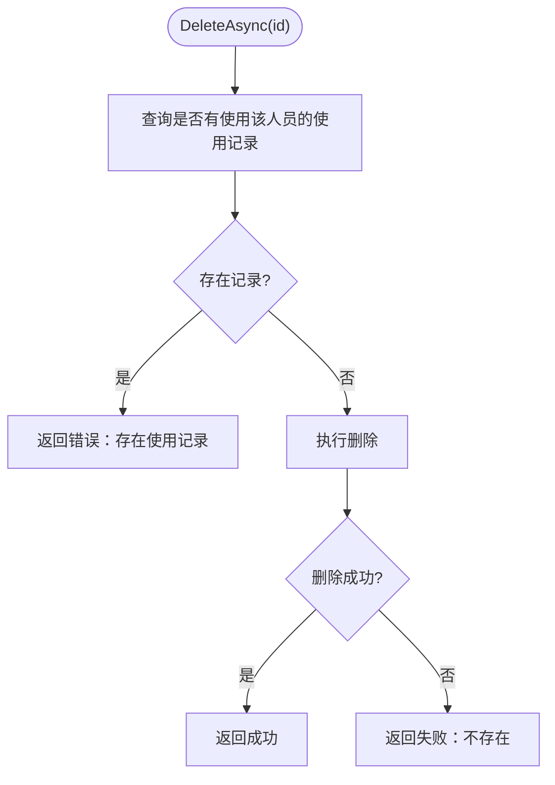
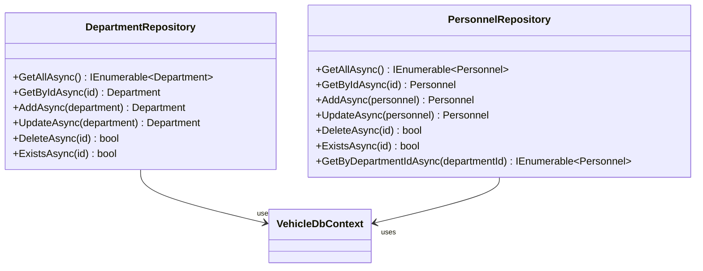
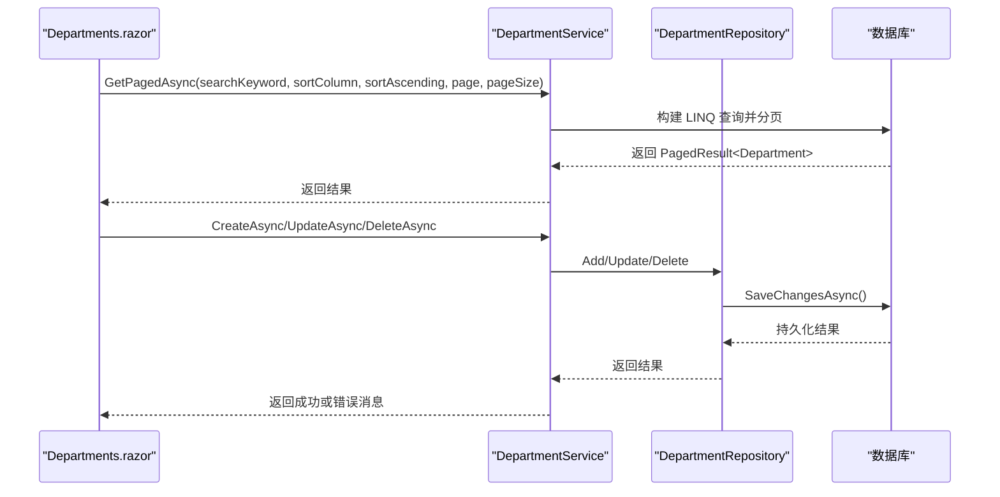
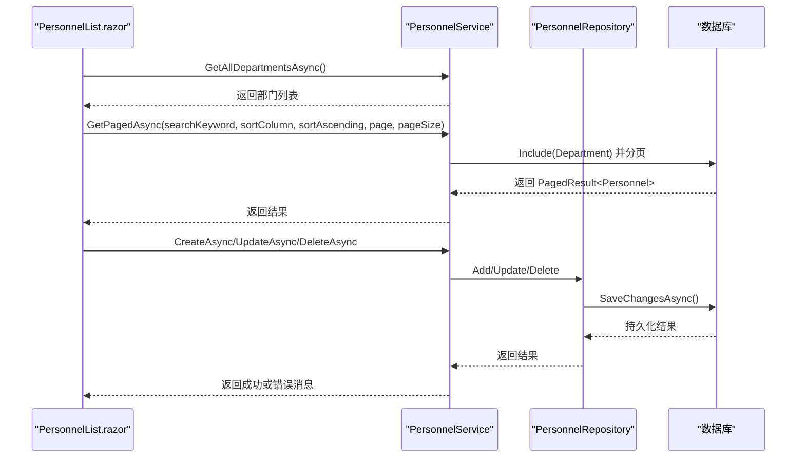
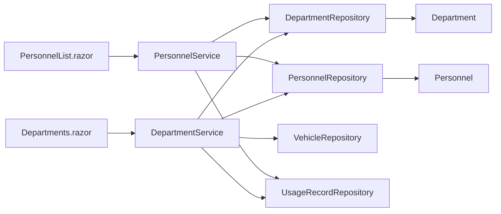

# 部门人员管理模块

<cite>
**本文引用的文件**   
- [DepartmentService.cs](file://BLL/Department/DepartmentService.cs)
- [PersonnelService.cs](file://BLL/Personnel/PersonnelService.cs)
- [DepartmentRepository.cs](file://DAL/Repository/DepartmentRepository.cs)
- [PersonnelRepository.cs](file://DAL/Repository/PersonnelRepository.cs)
- [Department.cs](file://DAL/Model/Department.cs)
- [Personnel.cs](file://DAL/Model/Personnel.cs)
- [Departments.razor](file://Pages/Departments.razor)
- [PersonnelList.razor](file://Pages/PersonnelList.razor)
- [PagedResult.cs](file://BLL/Common/PagedResult.cs)
- [ChinaTime.cs](file://DAL/Common/ChinaTime.cs)
</cite>

## 目录
1. [简介](#简介)
2. [项目结构](#项目结构)
3. [核心组件](#核心组件)
4. [架构总览](#架构总览)
5. [详细组件分析](#详细组件分析)
6. [依赖关系分析](#依赖关系分析)
7. [性能与可扩展性](#性能与可扩展性)
8. [故障排查指南](#故障排查指南)
9. [结论](#结论)
10. [附录：扩展与最佳实践](#附录扩展与最佳实践)

## 简介
本模块聚焦于“部门”和“人员”的组织信息管理，提供以下能力：
- 部门的增删改查、分页查询、搜索与排序。
- 人员的增删改查、分页查询、搜索与排序，以及与部门的关联展示。
- 删除操作前的业务校验（如是否存在关联的人员、车辆或使用记录）。
- 统一的时间处理（北京时间）与通用分页结果封装。

当前仓库未实现基于角色的权限控制；页面与接口均无鉴权逻辑。若需启用权限控制，可在服务层或页面层增加角色检查与授权策略。

## 项目结构
该模块采用分层架构：
- 表现层：Blazor 页面 Departments.razor 与 PersonnelList.razor。
- 业务层：DepartmentService 与 PersonnelService，封装业务规则与跨实体校验。
- 数据访问层：DepartmentRepository 与 PersonnelRepository，封装 EF Core 查询与持久化。
- 模型层：Department 与 Personnel 实体定义。
- 公共组件：PagedResult 分页结果封装、ChinaTime 时间工具。

**图表来源**
- [Departments.razor:1-280](file://Pages/Departments.razor#L1-L280)
- [PersonnelList.razor:1-318](file://Pages/PersonnelList.razor#L1-L318)
- [DepartmentService.cs:1-147](file://BLL/Department/DepartmentService.cs#L1-L147)
- [PersonnelService.cs:1-142](file://BLL/Personnel/PersonnelService.cs#L1-L142)
- [DepartmentRepository.cs:1-69](file://DAL/Repository/DepartmentRepository.cs#L1-L69)
- [PersonnelRepository.cs:1-77](file://DAL/Repository/PersonnelRepository.cs#L1-L77)
- [Department.cs:1-23](file://DAL/Model/Department.cs#L1-L23)
- [Personnel.cs:1-32](file://DAL/Model/Personnel.cs#L1-L32)
- [PagedResult.cs:1-37](file://BLL/Common/PagedResult.cs#L1-L37)
- [ChinaTime.cs:1-18](file://DAL/Common/ChinaTime.cs#L1-L18)

**章节来源**
- [Departments.razor:1-280](file://Pages/Departments.razor#L1-L280)
- [PersonnelList.razor:1-318](file://Pages/PersonnelList.razor#L1-L318)
- [DepartmentService.cs:1-147](file://BLL/Department/DepartmentService.cs#L1-L147)
- [PersonnelService.cs:1-142](file://BLL/Personnel/PersonnelService.cs#L1-L142)
- [DepartmentRepository.cs:1-69](file://DAL/Repository/DepartmentRepository.cs#L1-L69)
- [PersonnelRepository.cs:1-77](file://DAL/Repository/PersonnelRepository.cs#L1-L77)
- [Department.cs:1-23](file://DAL/Model/Department.cs#L1-L23)
- [Personnel.cs:1-32](file://DAL/Model/Personnel.cs#L1-L32)
- [PagedResult.cs:1-37](file://BLL/Common/PagedResult.cs#L1-L37)
- [ChinaTime.cs:1-18](file://DAL/Common/ChinaTime.cs#L1-L18)

## 核心组件
- DepartmentService：负责部门实体的分页查询、创建、更新、删除及删除前业务校验（人员、车辆、使用记录）。
- PersonnelService：负责人员实体的分页查询、创建、更新、删除及删除前业务校验（使用记录），并提供获取所有部门列表的能力。
- DepartmentRepository / PersonnelRepository：封装 EF Core 的 CRUD 操作，统一通过 IDbContextFactory 创建 DbContext，避免长生命周期上下文。
- Department / Personnel 实体：定义主键、字段约束、外键关系与审计字段。
- PagedResult<T>：通用分页结果封装，包含 Items、TotalCount、CurrentPage、PageSize 与 TotalPages。
- ChinaTime：统一返回 UTC+8 的北京时间，避免容器时区差异导致的数据不一致。

**章节来源**
- [DepartmentService.cs:1-147](file://BLL/Department/DepartmentService.cs#L1-L147)
- [PersonnelService.cs:1-142](file://BLL/Personnel/PersonnelService.cs#L1-L142)
- [DepartmentRepository.cs:1-69](file://DAL/Repository/DepartmentRepository.cs#L1-L69)
- [PersonnelRepository.cs:1-77](file://DAL/Repository/PersonnelRepository.cs#L1-L77)
- [Department.cs:1-23](file://DAL/Model/Department.cs#L1-L23)
- [Personnel.cs:1-32](file://DAL/Model/Personnel.cs#L1-L32)
- [PagedResult.cs:1-37](file://BLL/Common/PagedResult.cs#L1-L37)
- [ChinaTime.cs:1-18](file://DAL/Common/ChinaTime.cs#L1-L18)

## 架构总览
下图展示了从页面到仓储的调用链路与数据流向。

**图表来源**
- [Departments.razor:148-175](file://Pages/Departments.razor#L148-L175)
- [PersonnelList.razor:184-212](file://Pages/PersonnelList.razor#L184-L212)
- [DepartmentService.cs:41-76](file://BLL/Department/DepartmentService.cs#L41-L76)
- [PersonnelService.cs:39-74](file://BLL/Personnel/PersonnelService.cs#L39-L74)
- [DepartmentRepository.cs:34-49](file://DAL/Repository/DepartmentRepository.cs#L34-L49)
- [PersonnelRepository.cs:34-49](file://DAL/Repository/PersonnelRepository.cs#L34-L49)

## 详细组件分析

### 实体模型设计：Department 与 Personnel
- Department：包含 Id、Name、Description、CreatedAt、UpdatedAt。Name 必填且最大长度 100。
- Personnel：包含 Id、DepartmentId、Name、Phone、IsActive、CreatedAt、UpdatedAt。Name 必填且最大长度 50，Phone 最大长度 20，DepartmentId 为外键关联 Department。
- 关系：Personnel.DepartmentId -> Department.Id，一对多关系。

**图表来源**
- [Department.cs:7-21](file://DAL/Model/Department.cs#L7-L21)
- [Personnel.cs:7-30](file://DAL/Model/Personnel.cs#L7-L30)

**章节来源**
- [Department.cs:1-23](file://DAL/Model/Department.cs#L1-L23)
- [Personnel.cs:1-32](file://DAL/Model/Personnel.cs#L1-L32)

### 业务服务：DepartmentService
职责与行为：
- 分页查询：支持按名称或描述模糊搜索，支持按 name/desc/createdAt 排序，默认按创建时间倒序。
- 创建/更新：对输入进行 Trim 处理，设置审计时间（CreatedAt/UpdatedAt）。
- 删除：先进行业务校验：
  - 是否仍有人员属于该部门。
  - 是否仍有车辆归属该部门。
  - 是否仍有使用记录归属该部门。
  - 任一条件不满足则拒绝删除并返回错误消息。

**图表来源**
- [DepartmentService.cs:118-144](file://BLL/Department/DepartmentService.cs#L118-L144)

**章节来源**
- [DepartmentService.cs:41-76](file://BLL/Department/DepartmentService.cs#L41-L76)
- [DepartmentService.cs:89-113](file://BLL/Department/DepartmentService.cs#L89-L113)
- [DepartmentService.cs:118-144](file://BLL/Department/DepartmentService.cs#L118-L144)

### 业务服务：PersonnelService
职责与行为：
- 分页查询：支持按姓名或电话模糊搜索，支持按 name/phone/createdAt 排序，默认按创建时间倒序。Include 加载 Department 以便前端显示部门名称。
- 获取所有部门：用于新增/编辑人员时的部门下拉选择。
- 创建/更新：设置 DepartmentId、Name、Phone、IsActive 与审计时间。
- 删除：先校验是否存在使用该人员的使用记录，存在则拒绝删除并返回错误消息。

**图表来源**
- [PersonnelService.cs:128-139](file://BLL/Personnel/PersonnelService.cs#L128-L139)

**章节来源**
- [PersonnelService.cs:39-74](file://BLL/Personnel/PersonnelService.cs#L39-L74)
- [PersonnelService.cs:79-82](file://BLL/Personnel/PersonnelService.cs#L79-L82)
- [PersonnelService.cs:95-123](file://BLL/Personnel/PersonnelService.cs#L95-L123)
- [PersonnelService.cs:128-139](file://BLL/Personnel/PersonnelService.cs#L128-L139)

### 数据访问：DepartmentRepository 与 PersonnelRepository
- 通过 IDbContextFactory<VehicleDbContext> 在每次方法中创建短生命周期的 DbContext，避免并发与内存泄漏问题。
- 提供 GetAllAsync、GetByIdAsync、AddAsync、UpdateAsync、DeleteAsync、ExistsAsync 等基础方法。
- PersonnelRepository 的 GetAllAsync 与 GetByIdAsync Include Department，便于直接展示部门名称。

**图表来源**
- [DepartmentRepository.cs:13-66](file://DAL/Repository/DepartmentRepository.cs#L13-L66)
- [PersonnelRepository.cs:13-74](file://DAL/Repository/PersonnelRepository.cs#L13-L74)

**章节来源**
- [DepartmentRepository.cs:1-69](file://DAL/Repository/DepartmentRepository.cs#L1-L69)
- [PersonnelRepository.cs:1-77](file://DAL/Repository/PersonnelRepository.cs#L1-L77)

### 页面组件：Departments.razor
功能要点：
- 顶部搜索框与新增按钮。
- 表格展示部门列表，支持列头点击排序（name/desc/created）。
- 新增/编辑弹框，保存时调用 DepartmentService.CreateAsync/UpdateAsync。
- 删除确认弹框，确认后调用 DepartmentService.DeleteAsync，根据返回结果提示错误或刷新列表。
- 分页组件 Pagination 绑定 CurrentPage、TotalPages、TotalCount，并在页码变化时重新加载数据。

**图表来源**
- [Departments.razor:148-175](file://Pages/Departments.razor#L148-L175)
- [Departments.razor:219-241](file://Pages/Departments.razor#L219-L241)
- [Departments.razor:265-278](file://Pages/Departments.razor#L265-L278)
- [DepartmentService.cs:41-76](file://BLL/Department/DepartmentService.cs#L41-L76)
- [DepartmentRepository.cs:34-49](file://DAL/Repository/DepartmentRepository.cs#L34-L49)

**章节来源**
- [Departments.razor:1-280](file://Pages/Departments.razor#L1-L280)

### 页面组件：PersonnelList.razor
功能要点：
- 顶部搜索框与新增按钮。
- 表格展示人员列表，包括所属部门、姓名、联系方式、状态（在职/离职）、创建时间，支持列头点击排序（name/phone/created）。
- 新增/编辑弹框，包含部门下拉选择（来自 PersonnelService.GetAllDepartmentsAsync），保存时调用 PersonnelService.CreateAsync/UpdateAsync。
- 删除确认弹框，确认后调用 PersonnelService.DeleteAsync，根据返回结果提示错误或刷新列表。
- 分页组件 Pagination 绑定 CurrentPage、TotalPages、TotalCount，并在页码变化时重新加载数据。

**图表来源**
- [PersonnelList.razor:184-212](file://Pages/PersonnelList.razor#L184-L212)
- [PersonnelList.razor:257-279](file://Pages/PersonnelList.razor#L257-L279)
- [PersonnelList.razor:303-316](file://Pages/PersonnelList.razor#L303-L316)
- [PersonnelService.cs:39-74](file://BLL/Personnel/PersonnelService.cs#L39-L74)
- [PersonnelRepository.cs:34-49](file://DAL/Repository/PersonnelRepository.cs#L34-L49)

**章节来源**
- [PersonnelList.razor:1-318](file://Pages/PersonnelList.razor#L1-L318)

## 依赖关系分析
- 页面与服务：
  - Departments.razor 注入 DepartmentService。
  - PersonnelList.razor 注入 PersonnelService。
- 服务与仓储：
  - DepartmentService 依赖 DepartmentRepository、PersonnelRepository、VehicleRepository、UsageRecordRepository。
  - PersonnelService 依赖 PersonnelRepository、DepartmentRepository、UsageRecordRepository。
- 仓储与数据库：
  - 仓储通过 IDbContextFactory 创建 DbContext，执行 EF Core 查询与持久化。
- 模型与关系：
  - Personnel.DepartmentId 外键指向 Department.Id。

**图表来源**
- [Departments.razor:1-280](file://Pages/Departments.razor#L1-L280)
- [PersonnelList.razor:1-318](file://Pages/PersonnelList.razor#L1-L318)
- [DepartmentService.cs:1-147](file://BLL/Department/DepartmentService.cs#L1-L147)
- [PersonnelService.cs:1-142](file://BLL/Personnel/PersonnelService.cs#L1-L142)
- [DepartmentRepository.cs:1-69](file://DAL/Repository/DepartmentRepository.cs#L1-L69)
- [PersonnelRepository.cs:1-77](file://DAL/Repository/PersonnelRepository.cs#L1-L77)
- [Department.cs:1-23](file://DAL/Model/Department.cs#L1-L23)
- [Personnel.cs:1-32](file://DAL/Model/Personnel.cs#L1-L32)

**章节来源**
- [DepartmentService.cs:1-147](file://BLL/Department/DepartmentService.cs#L1-L147)
- [PersonnelService.cs:1-142](file://BLL/Personnel/PersonnelService.cs#L1-L142)
- [DepartmentRepository.cs:1-69](file://DAL/Repository/DepartmentRepository.cs#L1-L69)
- [PersonnelRepository.cs:1-77](file://DAL/Repository/PersonnelRepository.cs#L1-L77)

## 性能与可扩展性
- 分页查询：
  - 使用 Skip/Take 实现服务端分页，减少数据传输量。
  - 在计数前先应用过滤条件，确保 TotalCount 准确。
- 排序：
  - 支持按关键字段排序，默认排序为创建时间倒序。
- 时间一致性：
  - 使用 ChinaTime.Now 保证北京时间一致，避免容器时区差异。
- 可扩展点：
  - 在 DepartmentService.GetPagedAsync 中添加新的排序字段与搜索条件。
  - 在 PersonnelService.GetPagedAsync 中添加新的排序字段与搜索条件。
  - 在删除流程中增加更多业务校验（例如历史归档、审批流）。
  - 引入缓存（如内存缓存或分布式缓存）以减少高频查询压力。
  - 引入异步批量操作与事务边界优化（见附录）。

[本节为通用指导，不直接分析具体文件]

## 故障排查指南
常见问题与建议：
- 删除部门失败：
  - 检查该部门下是否仍有人员、车辆或使用记录。
  - 参考 DepartmentService.DeleteAsync 的错误消息定位原因。
- 删除人员失败：
  - 检查该人员是否仍有使用记录。
  - 参考 PersonnelService.DeleteAsync 的错误消息定位原因。
- 时间显示异常：
  - 确认是否使用 ChinaTime.Now 设置 CreatedAt/UpdatedAt。
- 分页总数不正确：
  - 检查 GetPagedAsync 中的过滤条件是否在 Count 之前应用。
- 部门名称为空或过长：
  - 检查前端表单验证与后端实体约束（MaxLength）。

**章节来源**
- [DepartmentService.cs:118-144](file://BLL/Department/DepartmentService.cs#L118-L144)
- [PersonnelService.cs:128-139](file://BLL/Personnel/PersonnelService.cs#L128-L139)
- [ChinaTime.cs:1-18](file://DAL/Common/ChinaTime.cs#L1-L18)

## 结论
该模块以清晰的分层架构实现了部门与人员的基础管理能力，具备分页、搜索、排序与删除前业务校验。实体关系明确，仓储层通过工厂模式管理 DbContext 生命周期，保证了基本的并发安全。当前未实现权限控制，如需上线公网环境，应补充鉴权与授权机制。

[本节为总结性内容，不直接分析具体文件]

## 附录：扩展与最佳实践

### 扩展部门属性
- 在 Department 实体中新增字段（例如 Code、ParentId、Level 等），并在 Repository 与 Service 中适配查询与校验逻辑。
- 如需树形结构，可引入 ParentId 自引用关系，并在 DepartmentService 中提供递归构建树的方法。

**章节来源**
- [Department.cs:7-21](file://DAL/Model/Department.cs#L7-L21)
- [DepartmentService.cs:41-76](file://BLL/Department/DepartmentService.cs#L41-L76)

### 添加新的权限级别
- 当前系统无权限模型。建议：
  - 在 DAL.Model 中新增 Role 与 UserRole 实体，建立用户与角色的多对多关系。
  - 在 BLL 层增加权限校验服务，在 Service 方法入口处检查角色或权限。
  - 在 Pages 层根据权限动态渲染按钮与菜单。
- 注意：需在配置中注册认证与授权中间件，并在 Blazor 中使用 Authorize 特性保护页面或服务方法。

[本节为概念性扩展建议，不直接分析具体文件]

### 数据一致性、事务与并发
- 当前仓储方法各自独立调用 SaveChangesAsync，未显式包裹事务。
- 建议在需要跨表写入的业务场景中，使用 IDbContextFactory 创建 DbContext 后，在 Service 层开启事务（如使用 TransactionScope 或 EF Core 的事务 API），确保原子性。
- 并发控制：
  - 可为实体增加版本号字段（如 RowVersion），在更新时进行乐观锁校验。
  - 对于热点数据（如部门统计），考虑引入缓存与失效策略。

[本节为通用指导，不直接分析具体文件]