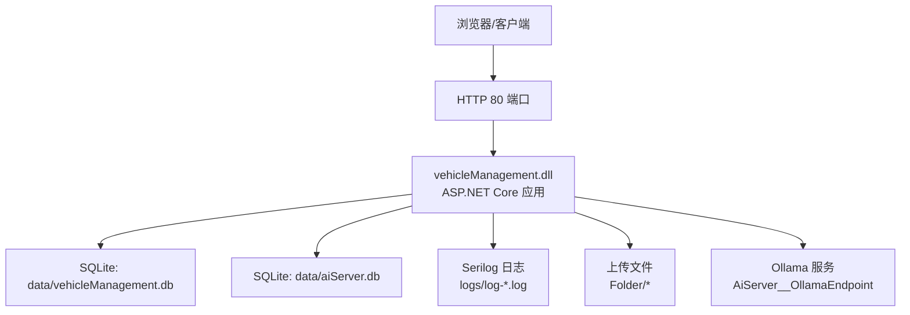
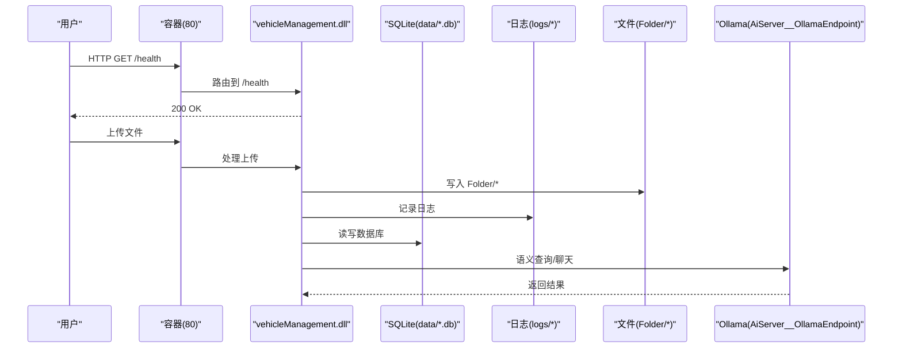
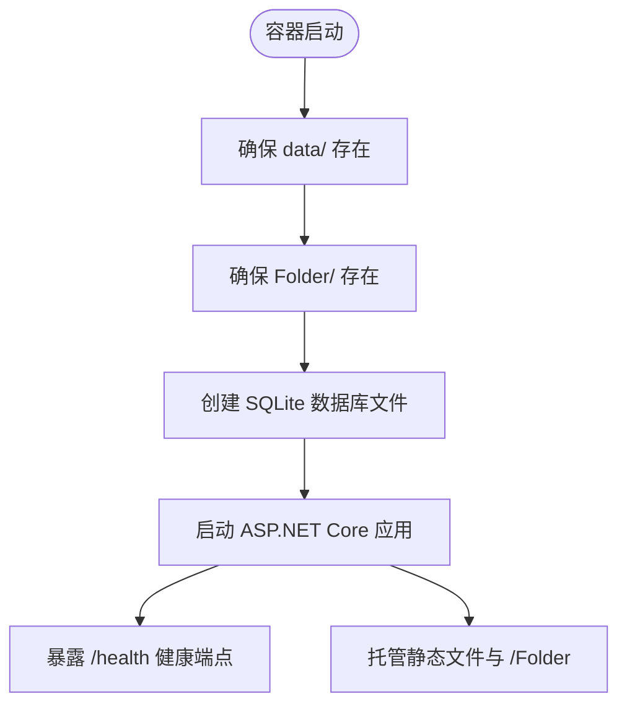
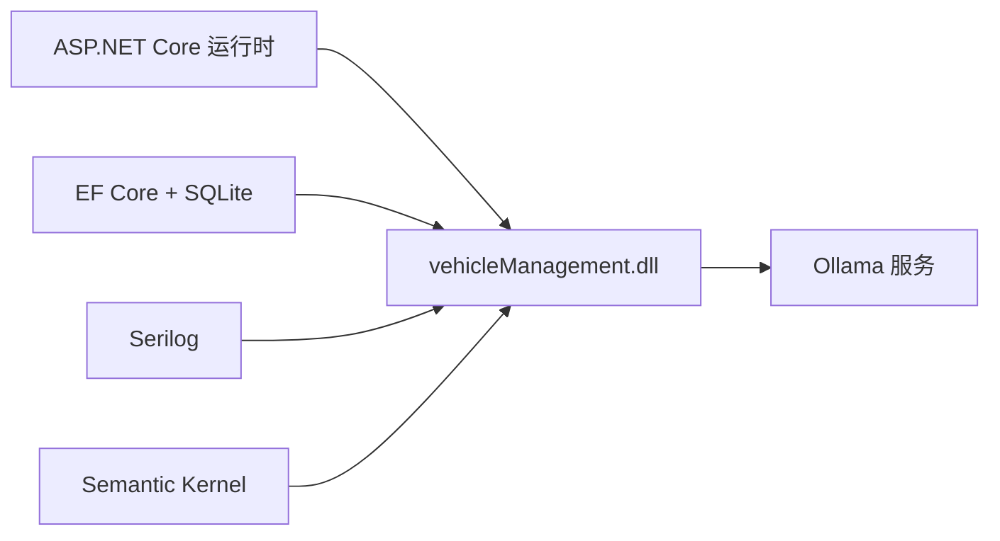

# Docker 容器化

<cite>
**本文引用的文件**   
- [Dockerfile](file://Dockerfile)
- [Program.cs](file://Program.cs)
- [appsettings.json](file://appsettings.json)
- [.dockerignore](file://.dockerignore)
</cite>

## 目录
1. [简介](#简介)
2. [项目结构](#项目结构)
3. [核心组件](#核心组件)
4. [架构总览](#架构总览)
5. [详细组件分析](#详细组件分析)
6. [依赖关系分析](#依赖关系分析)
7. [性能与优化](#性能与优化)
8. [故障排查指南](#故障排查指南)
9. [结论](#结论)
10. [附录：运行示例](#附录运行示例)

## 简介
本文件为 vehicleManagement 系统的 Docker 容器化文档，重点说明多阶段构建、镜像精简、环境变量配置、端口暴露与健康检查、卷挂载策略、构建参数、网络安全与最佳实践，并提供 docker run 与 docker-compose 使用示例。

## 项目结构
- 应用采用 .NET ASP.NET Core + Blazor Server 架构，数据层使用 SQLite，AI 能力通过 Semantic Kernel 连接 Ollama。
- 运行时监听 80 端口，提供 /health 健康端点，静态资源与上传文件通过 /Folder 访问。
- 日志通过 Serilog 输出到控制台与按日滚动的本地文件。

图表来源
- [Dockerfile:1-44](file://Dockerfile#L1-L44)
- [Program.cs:28-148](file://Program.cs#L28-L148)
- [appsettings.json:1-8](file://appsettings.json#L1-L8)

章节来源
- [Dockerfile:1-44](file://Dockerfile#L1-L44)
- [Program.cs:28-148](file://Program.cs#L28-L148)
- [appsettings.json:1-8](file://appsettings.json#L1-L8)

## 核心组件
- 多阶段构建
  - base：基于 mcr.microsoft.com/dotnet/aspnet:10.0 的轻量运行时镜像，暴露 80 端口。
  - build：基于 mcr.microsoft.com/dotnet/sdk:10.0，执行 dotnet restore 与 publish，利用缓存加速。
  - final：从 base 继承，仅复制发布产物，安装 curl 用于健康检查，设置环境变量与 VOLUME。
- 环境变量
  - ASPNETCORE_URLS=http://+:80
  - AiServer__OllamaEndpoint（默认 http://localhost:11434）
  - AiServer__OllamaModel（默认 gemma4:e2b）
- 端口与健康检查
  - EXPOSE 80；HEALTHCHECK 调用 /health 返回 200 表示健康。
- 持久化卷
  - /app/data：数据库文件
  - /app/logs：日志文件
  - /app/Folder：上传文件目录
- 启动入口
  - ENTRYPOINT ["dotnet", "vehicleManagement.dll"]

章节来源
- [Dockerfile:1-44](file://Dockerfile#L1-L44)
- [Program.cs:97-102](file://Program.cs#L97-L102)
- [Program.cs:132-146](file://Program.cs#L132-L146)

## 架构总览
下图展示容器内外的关键交互：外部请求进入 80 端口，应用读取配置并连接 SQLite 与 Ollama，同时写入日志与上传文件。

图表来源
- [Dockerfile:29-41](file://Dockerfile#L29-L41)
- [Program.cs:97-102](file://Program.cs#L97-L102)
- [Program.cs:132-146](file://Program.cs#L132-L146)

## 详细组件分析

### 多阶段构建与镜像精简
- 基础镜像选择
  - 运行时镜像：mcr.microsoft.com/dotnet/aspnet:10.0，体积更小且不含 SDK。
- 编译阶段优化
  - 先复制 *.csproj 并执行 dotnet restore，再复制源码，充分利用 Docker 层缓存。
  - 使用 Release 配置发布，关闭 UseAppHost=false 以减小产物体积。
- 最终镜像精简
  - 仅复制 /app/publish 产物到 /app。
  - 仅在运行镜像中安装 curl，避免在 SDK 镜像中残留构建工具。
  - 明确声明 VOLUME，便于宿主挂载持久化目录。

章节来源
- [Dockerfile:1-44](file://Dockerfile#L1-L44)

### 容器配置与环境变量
- 端口暴露
  - EXPOSE 80；ASPNETCORE_URLS=http://+:80 确保监听所有网卡。
- 健康检查
  - HEALTHCHECK 每 30 秒探测一次，超时 5 秒，启动宽限期 15 秒，重试 3 次。
  - 健康端点由应用 MapGet("/health") 提供。
- AI 配置回退
  - 通过 ARG 定义 OLLAMA_ENDPOINT 与 OLLAMA_MODEL，并在 ENV 中映射为 AiServer__OllamaEndpoint 与 AiServer__OllamaModel。
  - 应用代码在启动时读取配置，若未设置则回退到默认值。

章节来源
- [Dockerfile:29-41](file://Dockerfile#L29-L41)
- [Program.cs:97-102](file://Program.cs#L97-L102)
- [Program.cs:144-146](file://Program.cs#L144-L146)

### 卷挂载策略与数据持久化
- 数据库
  - appsettings.json 中 DefaultConnection 指向 data/vehicleManagement.db，AiServerConnection 指向 data/aiServer.db。
  - 建议将宿主机目录挂载到 /app/data，保证重启后数据不丢失。
- 日志
  - Serilog 写入 logs/log-*.log，按日滚动，保留最近 7 个文件。
  - 建议将宿主机目录挂载到 /app/logs。
- 文件上传
  - 应用创建并托管 Folder 目录，静态文件路径为 /Folder。
  - 建议将宿主机目录挂载到 /app/Folder。

图表来源
- [Program.cs:106-140](file://Program.cs#L106-L140)
- [appsettings.json:3-6](file://appsettings.json#L3-L6)

章节来源
- [Program.cs:28-37](file://Program.cs#L28-L37)
- [Program.cs:106-140](file://Program.cs#L106-L140)
- [appsettings.json:3-6](file://appsettings.json#L3-L6)

### 构建参数与网络安全
- 构建参数
  - BUILD_CONFIGURATION：控制发布配置，默认 Release。
  - OLLAMA_ENDPOINT、OLLAMA_MODEL：通过 ARG 注入，ENV 映射为应用配置键。
- 网络安全
  - 仅暴露 80 端口；生产环境建议通过反向代理或 Service Mesh 管理 TLS 与访问控制。
  - 限制容器网络访问范围，避免直接暴露数据库与 Ollama 端口。
  - 使用只读根文件系统（可选）与最小权限原则运行容器。

章节来源
- [Dockerfile:7-35](file://Dockerfile#L7-L35)

### .dockerignore 对构建的影响
- 排除 bin、obj、data、logs、Folder 等目录，减少镜像体积与构建时间。
- 排除 docker-compose* 与 Dockerfile*，避免将编排文件误入镜像。

章节来源
- [.dockerignore:1-33](file://.dockerignore#L1-L33)

## 依赖关系分析
- 应用依赖
  - ASP.NET Core 运行时（aspnet:10.0）
  - SQLite（EF Core 使用）
  - Serilog（日志）
  - Semantic Kernel（连接 Ollama）
- 外部依赖
  - Ollama 服务：通过 AiServer__OllamaEndpoint 指定地址与模型名称。

图表来源
- [Dockerfile:2-7](file://Dockerfile#L2-L7)
- [Program.cs:97-102](file://Program.cs#L97-L102)

章节来源
- [Dockerfile:2-7](file://Dockerfile#L2-L7)
- [Program.cs:97-102](file://Program.cs#L97-L102)

## 性能与优化
- 构建期优化
  - 分层缓存：先还原依赖再拷贝源码，提升增量构建速度。
  - 使用 Release 配置发布，禁用 UseAppHost 减小产物大小。
- 运行期优化
  - 仅安装 curl 用于健康检查，避免多余包。
  - 合理设置日志滚动与保留数量，避免磁盘膨胀。
  - 将 data、logs、Folder 挂载到宿主高性能存储。
- 可观测性
  - 健康检查与结构化日志结合，便于监控与告警。

[本节为通用指导，不涉及具体文件分析]

## 故障排查指南
- 健康检查失败
  - 确认 /health 路由已注册且返回 200。
  - 检查容器内 curl 是否可用，以及网络连通性。
- 数据库无法写入
  - 检查 /app/data 是否已正确挂载且有写权限。
  - 确认 appsettings.json 中的连接字符串路径与容器内路径一致。
- 日志为空或过大
  - 检查 /app/logs 是否已挂载。
  - 调整 Serilog 滚动策略与保留数量。
- 上传文件不可见
  - 检查 /app/Folder 是否已挂载。
  - 确认静态文件中间件已启用且路径映射正确。
- Ollama 连接失败
  - 校验 AiServer__OllamaEndpoint 与 AiServer__OllamaModel 是否正确。
  - 检查容器网络是否能访问 Ollama 服务地址。

章节来源
- [Dockerfile:40-41](file://Dockerfile#L40-L41)
- [Program.cs:28-37](file://Program.cs#L28-L37)
- [Program.cs:106-140](file://Program.cs#L106-L140)
- [Program.cs:97-102](file://Program.cs#L97-L102)

## 结论
本容器化方案通过多阶段构建与最小化运行镜像，显著降低镜像体积与攻击面；通过环境变量与卷挂载实现配置与数据的解耦；配合健康检查与结构化日志，满足生产环境的可观测性与稳定性要求。建议在生产环境中结合反向代理、网络策略与密钥管理进一步加固安全与运维能力。

[本节为总结性内容，不涉及具体文件分析]

## 附录：运行示例

- docker run 示例
  - 基本运行
    - docker run -d --name vehiclemanagement -p 80:80 vehiclemanagement:latest
  - 挂载持久化目录
    - docker run -d --name vehiclemanagement -p 80:80 -v $(pwd)/data:/app/data -v $(pwd)/logs:/app/logs -v $(pwd)/Folder:/app/Folder vehiclemanagement:latest
  - 覆盖 Ollama 配置
    - docker run -d --name vehiclemanagement -p 80:80 -e AiServer__OllamaEndpoint=http://your-ollama-host:11434 -e AiServer__OllamaModel=gemma4:e2b -v $(pwd)/data:/app/data -v $(pwd)/logs:/app/logs -v $(pwd)/Folder:/app/Folder vehiclemanagement:latest

- docker-compose 示例
  - services:
    - vehiclemanagement
      - image: vehiclemanagement:latest
      - ports:
        - "80:80"
      - environment:
        - AiServer__OllamaEndpoint=http://your-ollama-host:11434
        - AiServer__OllamaModel=gemma4:e2b
      - volumes:
        - ./data:/app/data
        - ./logs:/app/logs
        - ./Folder:/app/Folder
      - healthcheck:
          test: ["CMD", "curl", "-f", "http://localhost/health"]
          interval: 30s
          timeout: 5s
          retries: 3
          start_period: 15s

章节来源
- [Dockerfile:29-41](file://Dockerfile#L29-L41)
- [Program.cs:144-146](file://Program.cs#L144-L146)