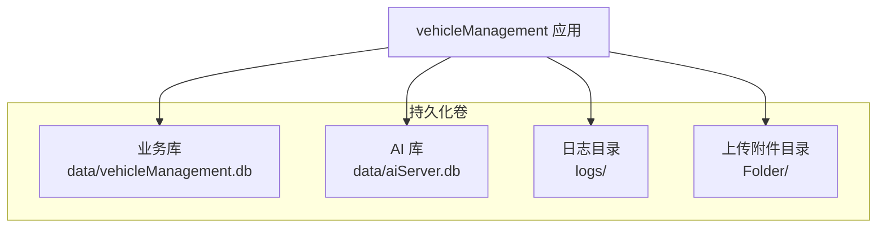
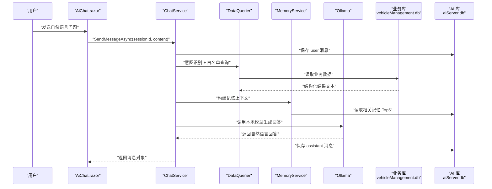

# 备份与恢复

<cite>
**本文引用的文件**   
- [README.md](file://README.md)
- [Program.cs](file://Program.cs)
- [appsettings.json](file://appsettings.json)
- [aiSettings.example.json](file://aiSettings.example.json)
- [Dockerfile](file://Dockerfile)
- [DAL/VehicleDbContext.cs](file://DAL/VehicleDbContext.cs)
- [aiServer/DAL/AiServerDbContext.cs](file://aiServer/DAL/AiServerDbContext.cs)
- [aiServer/DAL/Model/ChatSession.cs](file://aiServer/DAL/Model/ChatSession.cs)
- [aiServer/DAL/Model/ChatMessage.cs](file://aiServer/DAL/Model/ChatMessage.cs)
- [aiServer/DAL/Model/ChatMemory.cs](file://aiServer/DAL/Model/ChatMemory.cs)
- [aiServer/BLL/ChatService.cs](file://aiServer/BLL/ChatService.cs)
- [aiServer/BLL/MemoryService.cs](file://aiServer/BLL/MemoryService.cs)
- [aiServer/Pages/AiChat.razor](file://aiServer/Pages/AiChat.razor)
</cite>

## 目录
1. [引言](#引言)
2. [项目结构与数据边界](#项目结构与数据边界)
3. [核心备份目标](#核心备份目标)
4. [架构总览](#架构总览)
5. [SQLite 数据库备份策略](#sqlite-数据库备份策略)
6. [AI 对话数据备份策略](#ai-对话数据备份策略)
7. [灾难恢复流程](#灾难恢复流程)
8. [备份验证与一致性检查](#备份验证与一致性检查)
9. [自动化备份脚本与恢复操作手册](#自动化备份脚本与恢复操作手册)
10. [性能与存储优化建议](#性能与存储优化建议)
11. [故障排查与常见问题](#故障排查与常见问题)
12. [结论](#结论)

## 引言
本文件为 vehicleManagement 系统的备份与恢复策略文档。系统使用两个 SQLite 数据库：业务库 `data/vehicleManagement.db` 和 AI 子系统库 `data/aiServer.db`，同时还有日志、上传附件等持久化目录。当前仓库未内置自动备份脚本或在线备份接口，因此本文给出基于现有代码结构的备份方案、恢复流程、验证方法与自动化建议，确保业务数据、AI 会话、消息历史与记忆数据可安全保留并在灾难后恢复。

## 项目结构与数据边界
系统采用 Blazor Server + EF Core + SQLite 架构，启动时创建并初始化两个数据库；AI 子系统通过独立上下文访问 AI 库，业务逻辑访问业务库。Docker 部署时将 `/app/data`、`/app/logs`、`/app/Folder` 作为卷挂载，便于外部持久化。



**图表来源**
- [Program.cs:52-58](file://Program.cs#L52-L58)
- [Program.cs:106-125](file://Program.cs#L106-L125)
- [Dockerfile:37-41](file://Dockerfile#L37-L41)

**章节来源**
- [README.md:55-83](file://README.md#L55-L83)
- [README.md:302-306](file://README.md#L302-L306)
- [Program.cs:52-58](file://Program.cs#L52-L58)
- [Program.cs:106-125](file://Program.cs#L106-L125)
- [appsettings.json:3-6](file://appsettings.json#L3-L6)
- [Dockerfile:37-41](file://Dockerfile#L37-L41)

## 核心备份目标
- **业务数据**：车辆、部门、人员、地点、使用记录、维修记录等实体数据。
- **AI 对话数据**：会话标题与时间、用户与助手消息历史、语义记忆条目。
- **辅助数据**：日志文件、上传附件（图片、视频等）。
- **配置数据**：连接字符串、AI 端点与模型配置。
- **一致性保证**：备份期间避免写入冲突，恢复后服务可正常启动并重建表结构。

## 架构总览
下图展示一次 AI 问答的数据流，以及两条数据库路径：业务查询走业务库，会话与记忆落 AI 库。



**图表来源**
- [aiServer/BLL/ChatService.cs:94-139](file://aiServer/BLL/ChatService.cs#L94-L139)
- [aiServer/BLL/ChatService.cs:161-183](file://aiServer/BLL/ChatService.cs#L161-L183)
- [aiServer/BLL/ChatService.cs:188-199](file://aiServer/BLL/ChatService.cs#L188-L199)
- [aiServer/BLL/MemoryService.cs:87-120](file://aiServer/BLL/MemoryService.cs#L87-L120)

**章节来源**
- [README.md:187-219](file://README.md#L187-L219)
- [aiServer/BLL/ChatService.cs:94-139](file://aiServer/BLL/ChatService.cs#L94-L139)
- [aiServer/BLL/MemoryService.cs:87-120](file://aiServer/BLL/MemoryService.cs#L87-L120)

## SQLite 数据库备份策略
### 自动备份脚本
当前仓库未提供自动备份脚本。建议在宿主机或容器编排层实现定时任务，对以下路径进行快照或拷贝：
- `data/vehicleManagement.db`
- `data/aiServer.db`
- `logs/`
- `Folder/`

推荐方式：
- Linux：使用 cron 或 systemd timer 定期执行备份命令。
- Windows：使用计划任务执行 PowerShell 或批处理脚本。
- Docker：在容器外通过编排工具（如 docker-compose）挂载卷并定时备份。

注意：
- 备份前尽量停止写入或使用文件系统快照，避免 SQLite 并发写入导致不一致。
- 若无法停写，可在备份前调用健康检查接口确认服务状态，并结合最小停机窗口执行。

### 增量备份策略
SQLite 是单文件数据库，原生不支持 WAL 级增量复制。可采用以下策略：
- **全量备份**：每日一次完整拷贝两个 `.db` 文件。
- **差异备份**：每小时或每半小时仅拷贝自上次备份以来修改过的文件（按文件时间戳判断）。
- **归档压缩**：将每次备份打包为带时间戳的压缩包，保留最近 N 份全量与最近 M 份差异。

### 备份文件管理
- 命名规范：`backup_YYYYMMDD_HHMMSS_vehicleManagement.db`、`backup_YYYYMMDD_HHMMSS_aiServer.db`。
- 保留策略：至少保留 7 天内的备份，生产环境建议保留 30 天。
- 存储位置：本地磁盘、NAS、对象存储（如阿里云 OSS、AWS S3）均可。
- 校验机制：备份完成后计算 SHA-256 摘要，并与元数据记录比对。

## AI 对话数据备份策略
AI 子系统包含三类关键数据：会话、消息、记忆。它们均存储在 AI 库中。

```mermaid
erDiagram
CHAT_SESSION {
int Id PK
string Title
datetime CreatedAt
datetime UpdatedAt
}
CHAT_MESSAGE {
int Id PK
int SessionId FK
string Role
string Content
string ThinkingContent
datetime CreatedAt
}
CHAT_MEMORY {
int Id PK
string Key
string Content
string Category
int? SessionId FK
datetime CreatedAt
}
CHAT_SESSION ||--o{ CHAT_MESSAGE : "包含"
CHAT_SESSION ||--o{ CHAT_MEMORY : "可选关联"
```

**图表来源**
- [aiServer/DAL/Model/ChatSession.cs:11-37](file://aiServer/DAL/Model/ChatSession.cs#L11-L37)
- [aiServer/DAL/Model/ChatMessage.cs:10-49](file://aiServer/DAL/Model/ChatMessage.cs#L10-L49)
- [aiServer/DAL/Model/ChatMemory.cs:10-50](file://aiServer/DAL/Model/ChatMemory.cs#L10-L50)

### 会话记录备份
- 备份整个 `aiServer.db`，即可覆盖 `ChatSessions` 表。
- 如需只备份会话元数据，可通过 EF Core 导出 JSON 或 CSV，但直接备份数据库更简单可靠。

### 消息历史备份
- `ChatMessages` 表按会话组织，每条消息含角色、内容与时间。
- 备份 AI 库后可恢复完整对话历史。
- 若需清理旧会话，应在备份后再执行删除操作。

### 记忆数据备份
- `ChatMemories` 表存储车牌、品牌、偏好与通用短句记忆。
- 记忆由 `MemoryService` 异步抽取，失败不影响主对话流程。
- 备份 AI 库可保留所有已抽取的记忆条目。

**章节来源**
- [aiServer/DAL/Model/ChatSession.cs:11-37](file://aiServer/DAL/Model/ChatSession.cs#L11-L37)
- [aiServer/DAL/Model/ChatMessage.cs:10-49](file://aiServer/DAL/Model/ChatMessage.cs#L10-L49)
- [aiServer/DAL/Model/ChatMemory.cs:10-50](file://aiServer/DAL/Model/ChatMemory.cs#L10-L50)
- [aiServer/BLL/MemoryService.cs:87-120](file://aiServer/BLL/MemoryService.cs#L87-L120)

## 灾难恢复流程
### 数据恢复步骤
1. **停止服务**：避免恢复过程中写入造成不一致。
2. **备份损坏数据**：将当前损坏的 `data/` 目录重命名为 `data_corrupted_时间戳`，便于后续分析。
3. **恢复数据库文件**：从最新有效备份拷贝 `vehicleManagement.db` 与 `aiServer.db` 到 `data/`。
4. **恢复附件与日志**：如有需要，恢复 `Folder/` 与 `logs/`。
5. **启动服务**：运行应用，观察是否成功建库或加载已有数据。
6. **验证健康检查**：访问 `/health` 确认服务可用。
7. **验证业务功能**：打开车辆台账、使用记录、维修记录等页面。
8. **验证 AI 功能**：打开 `/ai-chat`，发送一条测试消息，确认能返回回答。

### 服务重启策略
- 若仅数据库文件损坏，优先尝试恢复数据库后重启。
- 若配置文件丢失，恢复 `appsettings.json` 与 `aisettings.json`。
- 若 Docker 镜像或依赖异常，重新构建镜像并挂载数据卷。

### 数据一致性保证
- 恢复后首次启动会执行 `EnsureCreatedAsync()`，不会覆盖已有数据，只会确保表存在。
- 若恢复的是旧版本数据库，可能需要迁移或重建表结构。
- 建议在恢复后执行一次完整性检查，例如运行 `PRAGMA integrity_check;`。

**章节来源**
- [Program.cs:109-125](file://Program.cs#L109-L125)
- [README.md:302-306](file://README.md#L302-L306)

## 备份验证与一致性检查
### 完整性检查
- 使用 SQLite 命令行工具执行 `PRAGMA integrity_check;`，返回 `ok` 表示文件完整。
- 对每个备份文件分别检查业务库与 AI 库。
- 对压缩包进行 SHA-256 校验，确保传输未损坏。

### 恢复测试
- 在隔离环境中恢复备份，启动服务并执行关键业务流程。
- 重点验证：
  - 车辆台账能否正常加载。
  - 使用记录与维修记录能否分页查询。
  - AI 聊天能否新建会话、发送消息、查看历史。
  - 记忆面板能否列出记忆条目。

### 备份存储优化
- 压缩备份文件以减少存储空间。
- 将冷备份迁移至低成本对象存储。
- 定期清理过期备份，保留策略由合规要求决定。

**章节来源**
- [aiServer/Pages/AiChat.razor:500-512](file://aiServer/Pages/AiChat.razor#L500-L512)
- [aiServer/BLL/ChatService.cs:94-139](file://aiServer/BLL/ChatService.cs#L94-L139)

## 自动化备份脚本与恢复操作手册
### 自动化备份脚本建议
由于仓库未提供现成脚本，可按以下思路实现：

- **Linux Cron 示例**
  - 每天凌晨执行全量备份。
  - 每小时执行差异备份。
  - 备份完成后计算摘要并记录日志。

- **Windows 计划任务示例**
  - 使用 PowerShell 拷贝数据库文件。
  - 使用 7-Zip 或 Compress-Archive 压缩备份。
  - 输出备份清单与校验值。

- **Docker 场景**
  - 在容器外编写备份脚本，挂载 `/app/data` 卷。
  - 通过编排工具定时触发备份任务。

### 恢复操作手册
- **手动恢复**
  1. 停止服务。
  2. 备份当前数据目录。
  3. 恢复最新备份文件。
  4. 启动服务并验证。

- **自动化恢复**
  1. 定义恢复入口：选择备份时间点。
  2. 执行恢复脚本：拷贝文件、解压、校验。
  3. 重启服务并执行健康检查。
  4. 输出恢复报告，包含恢复时间与数据大小。

**章节来源**
- [Dockerfile:37-41](file://Dockerfile#L37-L41)
- [Program.cs:106-125](file://Program.cs#L106-L125)

## 性能与存储优化建议
- **备份频率**：根据数据变更频率调整，高频写入场景建议每小时差异备份。
- **备份窗口**：选择低峰期执行全量备份，减少业务影响。
- **压缩策略**：对历史备份使用高压缩比算法，近期备份使用快速压缩。
- **存储分层**：热数据保留本地，冷数据迁移至对象存储。
- **监控告警**：备份失败、空间不足、校验失败应触发告警。

[本节为通用建议，不直接分析具体文件]

## 故障排查与常见问题
### 备份失败
- 检查磁盘空间是否充足。
- 检查文件权限，确保可读写。
- 检查是否有进程占用数据库文件。

### 恢复后服务无法启动
- 检查 `appsettings.json` 中的连接字符串是否正确。
- 检查 `aisettings.json` 中的 Ollama 端点与模型配置。
- 查看日志目录下的 Serilog 日志。

### AI 功能异常
- 确认 Ollama 服务可达。
- 检查 `/ai-chat` 页面是否能加载记忆面板。
- 查看 `MemoryService` 是否抛出异常但不影响主流程。

**章节来源**
- [appsettings.json:3-6](file://appsettings.json#L3-L6)
- [aiSettings.example.json:1-7](file://aiSettings.example.json#L1-L7)
- [Program.cs:28-37](file://Program.cs#L28-L37)
- [aiServer/BLL/MemoryService.cs:109-112](file://aiServer/BLL/MemoryService.cs#L109-L112)

## 结论
vehicleManagement 系统当前未内置自动备份与恢复功能，但其清晰的两个 SQLite 数据库结构、Docker 卷挂载与启动时的建库逻辑，为外部备份与恢复提供了良好基础。建议尽快实现自动化备份脚本、增量策略、完整性校验与恢复演练，确保业务数据与 AI 对话数据在灾难场景下可安全恢复。

[本节为总结性内容，不直接分析具体文件]