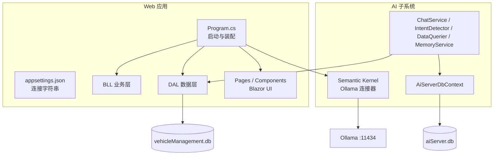
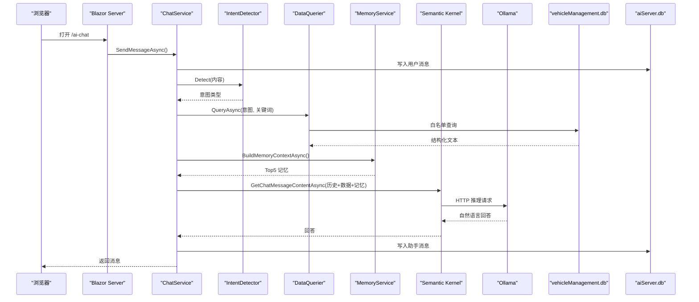
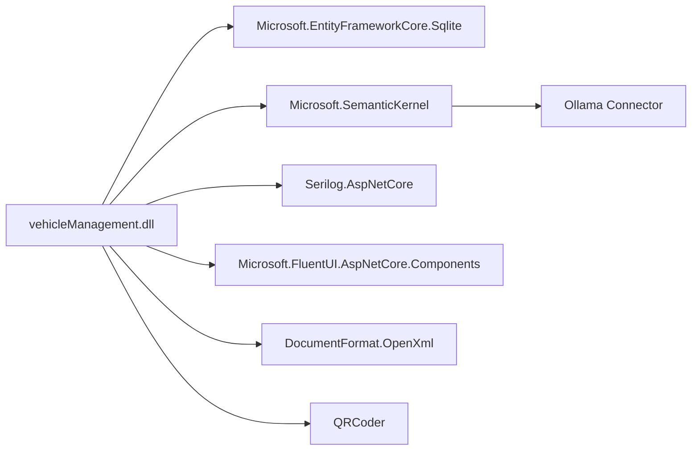

# 生产环境部署

<cite>
**本文引用的文件**   
- [Program.cs](file://Program.cs)
- [appsettings.json](file://appsettings.json)
- [aisettings.example.json](file://aisettings.example.json)
- [Dockerfile](file://Dockerfile)
- [vehicleManagement.csproj](file://vehicleManagement.csproj)
- [README.md](file://README.md)
</cite>

## 目录
1. [引言](#引言)
2. [项目结构](#项目结构)
3. [核心组件](#核心组件)
4. [架构总览](#架构总览)
5. [详细组件分析](#详细组件分析)
6. [依赖关系分析](#依赖关系分析)
7. [性能调优](#性能调优)
8. [安全加固](#安全加固)
9. [Kubernetes 与云平台部署](#kubernetes-与云平台部署)
10. [故障排查指南](#故障排查指南)
11. [结论](#结论)

## 引言
本指南面向车辆管理系统在生产环境的部署与运维，覆盖以下目标：
- 环境配置：数据库连接字符串、AI 服务端点、日志级别。
- 部署拓扑：单实例、多实例负载均衡、反向代理。
- 性能调优：ASP.NET Core 优化、SQLite 优化、内存使用优化。
- 安全加固：HTTPS、访问控制、数据加密。
- Kubernetes 与云平台部署最佳实践。

系统基于 .NET 10 Blazor Server，使用 EF Core + SQLite 存储业务数据与 AI 会话数据，并通过 Semantic Kernel 接入本地 Ollama 推理服务。

## 项目结构
仓库采用分层组织：
- DAL：EF Core 实体、仓储、上下文、种子数据初始化。
- BLL：业务服务（车辆、部门、人员、地点、使用记录、仪表盘、执行、维修、导出等）。
- Pages / Components：Blazor Server 页面与布局组件。
- aiServer：AI 子系统，包含意图识别、数据查询、记忆、对话模型编排。
- wwwroot：静态资源（CSS、JS、字体），全部本地引用。
- Program.cs：应用启动、依赖注入、配置加载、中间件注册、数据库初始化。
- Dockerfile：多阶段构建镜像与健康检查。
- appsettings.json：默认连接字符串。
- aisettings.example.json：AI 端点与模型配置模板。

**图表来源**
- [Program.cs:41-148](file://Program.cs#L41-L148)
- [appsettings.json:1-8](file://appsettings.json#L1-L8)
- [aisettings.example.json:1-7](file://aisettings.example.json#L1-L7)
- [README.md:55-83](file://README.md#L55-L83)

**章节来源**
- [Program.cs:41-148](file://Program.cs#L41-L148)
- [appsettings.json:1-8](file://appsettings.json#L1-L8)
- [aisettings.example.json:1-7](file://aisettings.example.json#L1-L7)
- [README.md:55-83](file://README.md#L55-L83)

## 核心组件
- 应用启动与中间件：Serilog 日志、Razor/Blazor、静态文件、路由、健康检查。
- 数据库上下文：业务库 VehicleDbContext、AI 库 AiServerDbContext，均通过 DbContextFactory 避免并发冲突。
- 依赖注入：仓储、业务服务、AI 服务、通用服务按作用域注册。
- AI 编排：Semantic Kernel 单例注入，Ollama 端点与模型从配置读取，支持热重载。
- 持久化目录：data、logs、Folder 在启动时确保存在，容器内通过卷挂载。

关键实现位置：
- 日志与启动：[Program.cs:28-43](file://Program.cs#L28-L43)
- 配置加载与 DI：[Program.cs:45-102](file://Program.cs#L45-L102)
- 数据库初始化：[Program.cs:106-125](file://Program.cs#L106-L125)
- 中间件与路由：[Program.cs:127-148](file://Program.cs#L127-L148)

**章节来源**
- [Program.cs:28-148](file://Program.cs#L28-L148)

## 架构总览
系统由 Web 应用、AI 子系统、两个 SQLite 数据库与外部 Ollama 推理服务组成。Web 应用负责业务页面与 API；AI 子系统通过规则意图识别与白名单查询将结构化结果交给模型生成自然语言回答。

**图表来源**
- [Program.cs:97-102](file://Program.cs#L97-L102)
- [README.md:187-216](file://README.md#L187-L216)

**章节来源**
- [README.md:187-216](file://README.md#L187-L216)

## 详细组件分析

### 环境配置

#### 数据库连接字符串
- 业务库连接字符串键：DefaultConnection，指向 data/vehicleManagement.db。
- AI 库连接字符串键：AiServerConnection，指向 data/aiServer.db。
- 运行时通过 builder.Configuration.GetConnectionString 读取并注入到 DbContextFactory。

建议生产环境：
- 将连接字符串放入环境变量或密钥管理服务，避免硬编码。
- 为 SQLite 文件提供独立持久卷，确保重启不丢失。
- 若迁移至 SQL Server/PostgreSQL，替换 UseSqlite 为对应提供者并在配置中更新连接字符串。

参考位置：
- [appsettings.json:3-6](file://appsettings.json#L3-L6)
- [Program.cs:52-58](file://Program.cs#L52-L58)

**章节来源**
- [appsettings.json:3-6](file://appsettings.json#L3-L6)
- [Program.cs:52-58](file://Program.cs#L52-L58)

#### AI 服务端点配置
- 三级取值优先级：环境变量 > aisettings.json > 代码默认值。
- 环境变量键：AiServer__OllamaEndpoint、AiServer__OllamaModel。
- aisettings.json 可选且支持热重载，适合容器挂载后动态调整。
- 默认端点 http://localhost:11434，默认模型 gemma4:e2b。

生产建议：
- 容器部署必须显式传入真实 Ollama 地址，避免容器内 localhost。
- 使用环境变量管理敏感信息，不在镜像中固化 aisettings.json。
- 对 Ollama 端点增加超时与重试策略（可在后续扩展）。

参考位置：
- [aisettings.example.json:1-7](file://aisettings.example.json#L1-L7)
- [Program.cs:45-46](file://Program.cs#L45-L46)
- [Program.cs:97-102](file://Program.cs#L97-L102)
- [README.md:165-183](file://README.md#L165-L183)

**章节来源**
- [aisettings.example.json:1-7](file://aisettings.example.json#L1-L7)
- [Program.cs:45-46](file://Program.cs#L45-L46)
- [Program.cs:97-102](file://Program.cs#L97-L102)
- [README.md:165-183](file://README.md#L165-L183)

#### 日志级别设置
- Serilog 默认最低级别 Information。
- 抑制 Microsoft 与 EF Core SQL 日志为 Warning，减少噪声。
- Console 输出模板包含时间戳、级别、消息与异常。
- 文件滚动：按天滚动，保留 7 份。

生产建议：
- 根据运行环境切换 MinimumLevel（Development/Production）。
- 将日志路径映射到持久卷，便于集中采集。
- 可结合结构化日志平台（如 Seq、ELK）进行聚合分析。

参考位置：
- [Program.cs:28-37](file://Program.cs#L28-L37)

**章节来源**
- [Program.cs:28-37](file://Program.cs#L28-L37)

### 部署拓扑

#### 单实例部署
- 直接 dotnet run 或使用容器运行单个进程。
- 暴露端口 80（容器内），对外通过宿主端口映射。
- 数据、日志、附件目录通过卷挂载。

参考位置：
- [Dockerfile:29-43](file://Dockerfile#L29-L43)
- [README.md:323-336](file://README.md#L323-L336)

**章节来源**
- [Dockerfile:29-43](file://Dockerfile#L29-L43)
- [README.md:323-336](file://README.md#L323-L336)

#### 多实例负载均衡
- Blazor Server 使用长连接（SignalR），需要会话亲和（sticky session）或共享状态。
- 推荐方案：
  - 使用带会话亲和的负载均衡器（如 Nginx ip_hash、ALB stickiness）。
  - 或将 Blazor Server 迁移到 Blazor WebAssembly + API 模式以更好水平扩展。
- 当前仓库未内置会话共享机制，需外部协调。

注意：本节为概念性说明，不涉及具体源码。

#### 反向代理配置
- 常见代理：Nginx、Apache、IIS、Cloud ALB/Ingress。
- 要点：
  - 启用 WebSocket 支持（Blazor Server 依赖）。
  - 设置正确的 Host、X-Forwarded-* 头。
  - 开启 HTTPS 终止与 HSTS。
  - 限制上传大小、超时时间。
  - 健康检查指向 /health。

注意：本节为概念性说明，不涉及具体源码。

**章节来源**
- [Program.cs:142-148](file://Program.cs#L142-L148)

### 性能调优

#### ASP.NET Core 优化
- 启用响应压缩（Gzip/Brotli）以减少带宽。
- 启用静态文件缓存与版本化。
- 合理设置线程池与工作进程数。
- 针对 Blazor Server 长连接，调整 SignalR 相关参数（如最大连接数、心跳间隔）。

注意：本节为通用指导，不涉及具体源码。

#### SQLite 数据库优化
- 使用独立持久卷存放 .db 文件，避免网络文件系统。
- 定期 VACUUM 与 PRAGMA 优化（如 journal_mode=WAL）。
- 避免高并发写锁竞争，必要时拆分库或迁移至关系型数据库。
- 监控磁盘 I/O 与文件大小增长。

参考位置：
- [appsettings.json:3-6](file://appsettings.json#L3-L6)
- [Program.cs:52-58](file://Program.cs#L52-L58)

**章节来源**
- [appsettings.json:3-6](file://appsettings.json#L3-L6)
- [Program.cs:52-58](file://Program.cs#L52-L58)

#### 内存使用优化
- 控制聊天窗口大小（已固定最近 20 条消息）。
- 避免在循环中创建大对象，复用序列化器与流。
- 监控 GC 压力，必要时调整托管堆大小。
- 对 AI 推理结果做分页与截断，防止上下文过大。

参考位置：
- [README.md:240-259](file://README.md#L240-L259)

**章节来源**
- [README.md:240-259](file://README.md#L240-L259)

### 安全加固

#### HTTPS 配置
- 在反向代理层启用 TLS 终止，证书由证书管理器自动续期。
- 应用侧启用 HSTS、强制 HTTPS 重定向。
- 容器内仅监听内部端口，不直接暴露明文 HTTP。

注意：本节为概念性说明，不涉及具体源码。

#### 访问控制
- 当前系统无鉴权模型，不适合公网暴露。
- 生产应前置身份认证（OAuth2/OIDC）、授权（RBAC/ABAC）。
- 对 /execute/{Token} 等敏感路由增加签名校验与速率限制。

参考位置：
- [README.md:369-370](file://README.md#L369-L370)

**章节来源**
- [README.md:369-370](file://README.md#L369-L370)

#### 数据加密
- 传输加密：TLS 1.2+，禁用弱密码套件。
- 存储加密：对敏感字段（如人员电话、车牌）进行应用层加密或数据库透明加密。
- 备份加密：对持久卷与离线备份启用磁盘级加密。

注意：本节为概念性说明，不涉及具体源码。

## 依赖关系分析

**图表来源**
- [vehicleManagement.csproj:14-30](file://vehicleManagement.csproj#L14-L30)

**章节来源**
- [vehicleManagement.csproj:14-30](file://vehicleManagement.csproj#L14-L30)

## 性能调优

### ASP.NET Core 优化设置
- 启用响应压缩：在中间件管道中添加压缩处理器。
- 静态资源缓存：为 wwwroot 下的 CSS/JS 添加版本号与长期缓存。
- 线程池调优：根据 CPU 核数与负载调整 MaxConcurrentRequests。
- Blazor Server：
  - 调整 CircuitOptions（如 ReconnectionTimeout、MaxPendingCircuits）。
  - 使用 KeepAliveInterval 降低心跳开销。
  - 对长列表使用虚拟滚动与分页。

注意：本节为通用指导，不涉及具体源码。

### SQLite 数据库优化
- 启用 WAL 模式提升并发读性能。
- 定期 ANALYZE 与 VACUUM 维护统计信息与碎片整理。
- 对高频查询列建立索引（迁移到关系型数据库后可更灵活）。
- 监控锁等待与事务时长，避免长时间持有写锁。

参考位置：
- [appsettings.json:3-6](file://appsettings.json#L3-L6)

**章节来源**
- [appsettings.json:3-6](file://appsettings.json#L3-L6)

### 内存使用优化
- 控制聊天历史长度（已固定最近 20 条）。
- 避免一次性加载大量附件到内存，使用流式处理。
- 对图片/视频上传进行尺寸压缩与格式转换。
- 监控托管堆与非托管内存，必要时调整 GC 模式。

参考位置：
- [README.md:240-259](file://README.md#L240-L259)

**章节来源**
- [README.md:240-259](file://README.md#L240-L259)

## 安全加固

### HTTPS 配置
- 反向代理启用 TLS，证书由 Let’s Encrypt 或云厂商证书服务管理。
- 应用层启用 HSTS、Strict-Transport-Security。
- 禁止明文回退，所有请求强制 HTTPS。

注意：本节为概念性说明，不涉及具体源码。

### 访问控制
- 引入统一身份认证网关（如 Keycloak、Azure AD）。
- 对 API 与页面路由实施角色权限控制。
- 对 /execute/{Token} 增加令牌签名校验与防重放。

参考位置：
- [README.md:369-370](file://README.md#L369-L370)

**章节来源**
- [README.md:369-370](file://README.md#L369-L370)

### 数据加密
- 传输层：TLS 1.2+，禁用 RC4、DES 等弱算法。
- 存储层：对敏感字段进行应用层加密（AES-GCM）或数据库 TDE。
- 备份与日志：启用磁盘加密与脱敏。

注意：本节为概念性说明，不涉及具体源码。

## Kubernetes 与云平台部署

### Kubernetes 部署清单（概念性）
- Deployment：
  - replicas：根据负载与粘性会话需求设定。
  - resources：requests/limits 限制 CPU/内存。
  - env：注入 AiServer__OllamaEndpoint、AiServer__OllamaModel。
  - volumeMounts：挂载 data、logs、Folder。
- Service：ClusterIP 或 NodePort，Ingress 暴露 HTTPS。
- ConfigMap/Secret：
  - ConfigMap：非敏感配置（AllowedHosts、日志级别）。
  - Secret：数据库连接字符串、API Key（如有）。
- PersistentVolumeClaim：
  - data：SQLite 数据库文件。
  - logs：日志滚动文件。
  - Folder：上传附件。
- HealthCheck：
  - livenessProbe：GET /health。
  - readinessProbe：GET /health。

注意：本节为概念性说明，不涉及具体源码。

### 云平台部署最佳实践
- Azure/AWS/GCP：
  - 使用托管应用服务或容器服务（AKS/EKS/GKE）。
  - 使用托管证书与 WAF。
  - 使用密钥管理服务（Key Vault/Secret Manager/KMS）。
  - 启用审计日志与指标监控（Application Insights/Monitoring）。
- 蓝绿/金丝雀发布：
  - 通过 Ingress 权重切换流量。
  - 逐步放量并观察错误率与延迟。
- 弹性伸缩：
  - 基于 CPU/内存/QPS 自动扩缩容。
  - 注意 Blazor Server 会话亲和限制。

注意：本节为概念性说明，不涉及具体源码。

## 故障排查指南

### 常见问题
- Ollama 不可达：
  - 检查环境变量是否覆盖为真实主机 IP。
  - 验证容器内网络可达 Ollama 服务。
  - 确认模型 tag 与 ollama list 一致。
- 数据库未初始化：
  - 检查 data 目录是否存在且可写。
  - 查看启动日志是否有 EnsureCreated 失败。
- 日志过多或过少：
  - 调整 Serilog MinimumLevel 与 Override。
  - 确认日志路径已挂载到持久卷。
- 上传附件无法访问：
  - 检查 Folder 目录是否挂载。
  - 确认静态文件中间件映射正确。

参考位置：
- [Program.cs:28-37](file://Program.cs#L28-L37)
- [Program.cs:106-125](file://Program.cs#L106-L125)
- [Program.cs:132-140](file://Program.cs#L132-L140)
- [README.md:107-118](file://README.md#L107-L118)

**章节来源**
- [Program.cs:28-37](file://Program.cs#L28-L37)
- [Program.cs:106-125](file://Program.cs#L106-L125)
- [Program.cs:132-140](file://Program.cs#L132-L140)
- [README.md:107-118](file://README.md#L107-L118)

## 结论
车辆管理系统在生产环境部署需重点关注：
- 环境配置：数据库连接字符串、AI 端点、日志级别。
- 部署拓扑：单实例简单可靠，多实例需会话亲和或迁移架构。
- 性能调优：ASP.NET Core 与 SQLite 优化、内存控制。
- 安全加固：HTTPS、访问控制、数据加密。
- Kubernetes 与云平台：使用托管服务、密钥管理、灰度发布与弹性伸缩。

建议在上线前完成压测、安全扫描、备份恢复演练与监控告警配置。