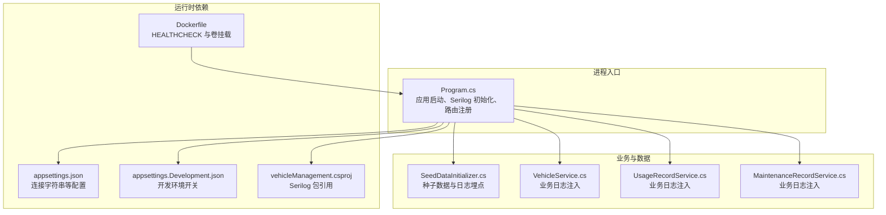
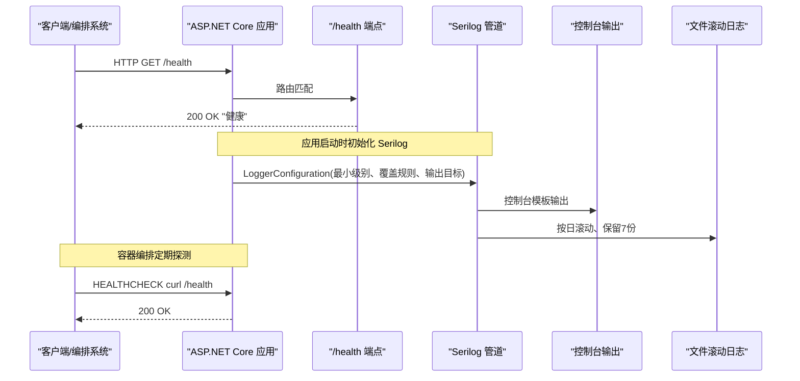
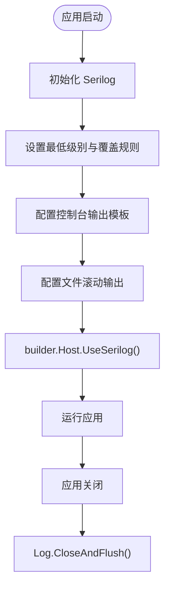
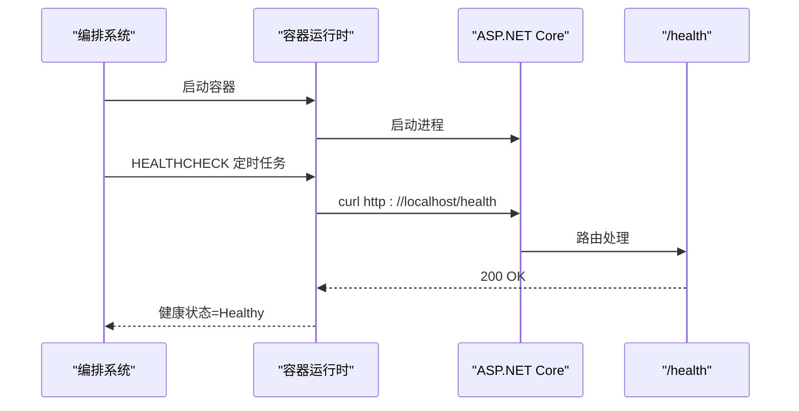
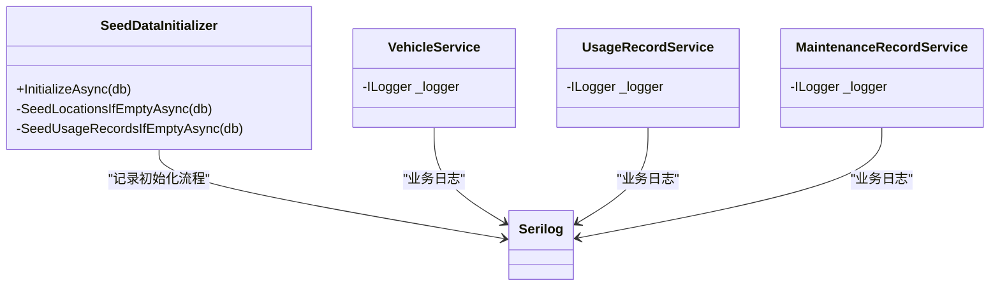
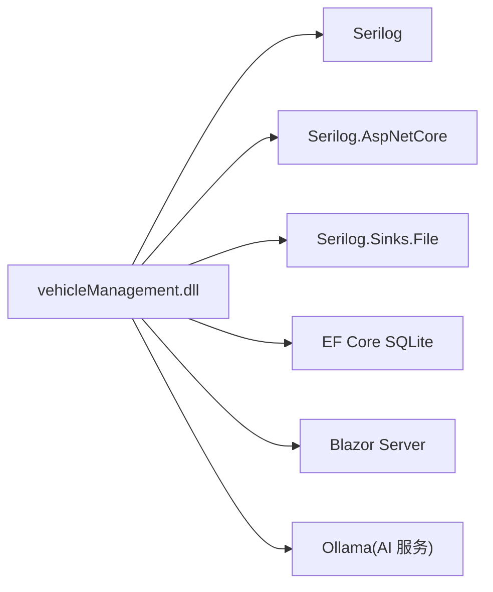

# 监控与日志

<cite>
**本文引用的文件**   
- [Program.cs](file://Program.cs)
- [appsettings.json](file://appsettings.json)
- [appsettings.Development.json](file://appsettings.Development.json)
- [vehicleManagement.csproj](file://vehicleManagement.csproj)
- [Dockerfile](file://Dockerfile)
- [SeedDataInitializer.cs](file://DAL/SeedDataInitializer.cs)
- [VehicleService.cs](file://BLL/Vehicle/VehicleService.cs)
- [UsageRecordService.cs](file://BLL/UsageRecord/UsageRecordService.cs)
- [MaintenanceRecordService.cs](file://BLL/Maintenance/MaintenanceRecordService.cs)
</cite>

## 目录
1. [引言](#引言)
2. [项目结构](#项目结构)
3. [核心组件](#核心组件)
4. [架构总览](#架构总览)
5. [详细组件分析](#详细组件分析)
6. [依赖关系分析](#依赖关系分析)
7. [性能考量](#性能考量)
8. [故障排查指南](#故障排查指南)
9. [结论](#结论)
10. [附录：监控告警与仪表板配置示例](#附录监控告警与仪表板配置示例)

## 引言
本文件面向 vehicleManagement 系统的可观测性建设，聚焦以下目标：
- 结构化日志：基于 Serilog 的日志级别、输出目标与异步写入优化。
- 健康检查：应用状态监控、依赖服务检查与性能指标收集方案。
- 日志分析：错误日志追踪、业务日志审计与性能日志分析方法。
- 监控告警：关键指标阈值、异常通知机制与资源使用监控。
- 日志收集与仪表板：日志采集方案与可视化仪表板配置示例。

## 项目结构
当前仓库采用分层架构（Pages/Blazor UI、BLL 业务层、DAL 数据访问层），并通过 Program.cs 统一启动与依赖注入。Serilog 在应用启动阶段完成全局初始化，健康端点 /health 暴露于路由中，Dockerfile 提供容器健康检查命令。

图表来源
- [Program.cs:28-43](file://Program.cs#L28-L43)
- [appsettings.json:1-8](file://appsettings.json#L1-L8)
- [vehicleManagement.csproj:25-27](file://vehicleManagement.csproj#L25-L27)
- [Dockerfile:37-41](file://Dockerfile#L37-L41)
- [SeedDataInitializer.cs:20-31](file://DAL/SeedDataInitializer.cs#L20-L31)

章节来源
- [Program.cs:28-43](file://Program.cs#L28-L43)
- [appsettings.json:1-8](file://appsettings.json#L1-L8)
- [vehicleManagement.csproj:25-27](file://vehicleManagement.csproj#L25-L27)
- [Dockerfile:37-41](file://Dockerfile#L37-L41)

## 核心组件
- 结构化日志（Serilog）
  - 默认最低级别为 Information。
  - 覆盖 Microsoft 与 EF Core 日志级别为 Warning，抑制框架噪音。
  - 控制台输出模板包含时间戳、级别、消息与异常。
  - 文件输出按天滚动，保留最近 7 个文件。
  - 通过 builder.Host.UseSerilog() 将 Serilog 接入宿主生命周期。
- 健康检查
  - 提供 GET /health 返回“健康”文本，用于容器与外部探针探测。
  - Dockerfile 内置 HEALTHCHECK 每 30s 调用一次 curl /health。
- 业务日志
  - 种子数据初始化器使用 Serilog 记录初始化流程与结果。
  - 业务服务类通过依赖注入 ILogger<T> 进行结构化日志埋点。

章节来源
- [Program.cs:28-43](file://Program.cs#L28-L43)
- [Program.cs:142-146](file://Program.cs#L142-L146)
- [Dockerfile:37-41](file://Dockerfile#L37-L41)
- [SeedDataInitializer.cs:20-31](file://DAL/SeedDataInitializer.cs#L20-L31)
- [VehicleService.cs:24-37](file://BLL/Vehicle/VehicleService.cs#L24-L37)
- [UsageRecordService.cs:24-37](file://BLL/UsageRecord/UsageRecordService.cs#L24-L37)
- [MaintenanceRecordService.cs:19-27](file://BLL/Maintenance/MaintenanceRecordService.cs#L19-L27)

## 架构总览
下图展示从请求进入、健康检查到日志落盘的整体路径，以及容器健康检查如何与 /health 端点协作。

图表来源
- [Program.cs:28-43](file://Program.cs#L28-L43)
- [Program.cs:142-146](file://Program.cs#L142-L146)
- [Dockerfile:37-41](file://Dockerfile#L37-L41)

## 详细组件分析

### Serilog 结构化日志配置
- 日志级别
  - 全局最低级别：Information。
  - 命名空间覆盖：Microsoft、Microsoft.EntityFrameworkCore 降级为 Warning，减少框架噪声。
- 输出目标
  - 控制台：带时间戳、级别、消息与异常的模板化输出。
  - 文件：logs/log-.log，按天滚动，最多保留 7 份。
- 异步写入优化
  - 使用 Serilog.AspNetCore 集成宿主生命周期，自动处理缓冲与刷新。
  - 文件 Sink 默认支持异步批处理；建议结合 RollingInterval 与 retainedFileCountLimit 控制磁盘占用。
  - 在应用退出时调用 Log.CloseAndFlush() 确保日志落盘。

图表来源
- [Program.cs:28-43](file://Program.cs#L28-L43)
- [Program.cs:150-157](file://Program.cs#L150-L157)

章节来源
- [Program.cs:28-43](file://Program.cs#L28-L43)
- [Program.cs:150-157](file://Program.cs#L150-L157)
- [vehicleManagement.csproj:25-27](file://vehicleManagement.csproj#L25-L27)

### 健康检查端点实现
- 端点定义
  - GET /health 返回“健康”，用于快速存活检测。
- 容器健康检查
  - Dockerfile 使用 curl 每 30s 探测 /health，失败重试 3 次，超时 5s，启动宽限期 15s。
- 扩展建议
  - 增加依赖检查：数据库连通性、AI 服务可达性。
  - 增加性能指标：响应耗时、内存/CPU 使用率、队列长度等。
  - 返回结构化 JSON：便于监控系统解析与告警。

图表来源
- [Program.cs:142-146](file://Program.cs#L142-L146)
- [Dockerfile:37-41](file://Dockerfile#L37-L41)

章节来源
- [Program.cs:142-146](file://Program.cs#L142-L146)
- [Dockerfile:37-41](file://Dockerfile#L37-L41)

### 业务日志埋点与审计
- 种子数据初始化
  - 使用 Serilog 记录跳过全量初始化、重建数据库、插入标准数据与增量补充等关键步骤。
- 业务服务
  - VehicleService、UsageRecordService、MaintenanceRecordService 均通过依赖注入 ILogger<T>，可在关键操作处添加结构化日志（如用户操作、权限校验、异常捕获）。
- 审计建议
  - 对敏感操作（增删改）记录操作人、对象ID、变更摘要。
  - 对导入导出、文件上传等 I/O 密集操作记录耗时与结果码。

图表来源
- [SeedDataInitializer.cs:20-31](file://DAL/SeedDataInitializer.cs#L20-L31)
- [VehicleService.cs:24-37](file://BLL/Vehicle/VehicleService.cs#L24-L37)
- [UsageRecordService.cs:24-37](file://BLL/UsageRecord/UsageRecordService.cs#L24-L37)
- [MaintenanceRecordService.cs:19-27](file://BLL/Maintenance/MaintenanceRecordService.cs#L19-L27)

章节来源
- [SeedDataInitializer.cs:20-31](file://DAL/SeedDataInitializer.cs#L20-L31)
- [VehicleService.cs:24-37](file://BLL/Vehicle/VehicleService.cs#L24-L37)
- [UsageRecordService.cs:24-37](file://BLL/UsageRecord/UsageRecordService.cs#L24-L37)
- [MaintenanceRecordService.cs:19-27](file://BLL/Maintenance/MaintenanceRecordService.cs#L19-L27)

## 依赖关系分析
- 包依赖
  - Serilog、Serilog.AspNetCore、Serilog.Sinks.File 已引入，用于结构化日志与控制台/文件输出。
- 运行时依赖
  - ASP.NET Core 主机、EF Core SQLite、Blazor Server。
- 外部依赖
  - AI 服务（Ollama）通过配置注入，健康检查可扩展其可达性。

图表来源
- [vehicleManagement.csproj:25-29](file://vehicleManagement.csproj#L25-L29)
- [Program.cs:97-102](file://Program.cs#L97-L102)

章节来源
- [vehicleManagement.csproj:25-29](file://vehicleManagement.csproj#L25-L29)
- [Program.cs:97-102](file://Program.cs#L97-L102)

## 性能考量
- 日志级别控制
  - 生产环境建议将默认级别提升至 Warning，仅在需要时开启 Information。
- 文件滚动策略
  - 保持合理的保留数量（例如 7 份）与滚动周期（按天），避免磁盘增长。
- 异步写入
  - 使用 Serilog.AspNetCore 集成宿主生命周期，避免手动缓冲管理。
- 数据库查询日志
  - EF Core SQL 日志默认抑制为 Warning，避免高频 SQL 导致日志风暴。
- 健康检查频率
  - 容器 HEALTHCHECK 间隔 30s，适合大多数场景；高负载时可适当延长。

[本节为通用指导，不直接分析具体文件]

## 故障排查指南
- 启动失败
  - 程序入口 catch 块记录致命错误并关闭日志，优先查看 logs/log-*.log 与容器日志。
- 健康检查失败
  - 确认 /health 路由存在且未被中间件拦截；检查容器内 curl 是否可用。
- 日志未落盘
  - 检查 logs 目录是否存在且可写；确认 rollingInterval 与 retainedFileCountLimit 配置。
- 业务异常定位
  - 在服务方法中添加 try/catch 并使用 ILogger.LogCritical/Error 记录上下文信息（请求ID、参数摘要、堆栈）。

章节来源
- [Program.cs:150-157](file://Program.cs#L150-L157)
- [Program.cs:142-146](file://Program.cs#L142-L146)
- [Dockerfile:37-41](file://Dockerfile#L37-L41)

## 结论
vehicleManagement 当前已具备基础的结构化日志与健康检查能力。建议在现有基础上完善依赖健康检查、性能指标采集与告警联动，形成完整的可观测性闭环。

[本节为总结性内容，不直接分析具体文件]

## 附录：监控告警与仪表板配置示例

### 日志级别与输出目标建议
- 开发环境
  - 默认级别：Information；控制台+文件输出；EF Core SQL 日志 Warning。
- 生产环境
  - 默认级别：Warning；仅文件输出；必要时开启 Performance 级别指标日志。
- 输出目标
  - 控制台：调试与本地验证。
  - 文件：滚动日志，保留 7 份，按天滚动。
  - 可选：远程收集（如 ELK/Loki），通过 Serilog.Sinks.* 扩展。

章节来源
- [Program.cs:28-43](file://Program.cs#L28-L43)
- [vehicleManagement.csproj:25-27](file://vehicleManagement.csproj#L25-L27)

### 健康检查与依赖探测
- 应用级
  - GET /health 返回“健康”。
- 依赖级（建议扩展）
  - /health/db：尝试打开 DbContext 连接，返回成功/失败。
  - /health/ai：HTTP 探测 Ollama 端点可达性。
- 容器级
  - Dockerfile HEALTHCHECK 每 30s 探测 /health。

章节来源
- [Program.cs:142-146](file://Program.cs#L142-L146)
- [Dockerfile:37-41](file://Dockerfile#L37-L41)

### 性能指标收集方案
- 应用指标
  - 请求计数、平均/分位延迟、错误率、并发连接数。
- 系统指标
  - CPU、内存、磁盘 I/O、网络 I/O。
- 业务指标
  - 车辆借用次数、维护工单数、AI 对话成功率。
- 采集方式
  - 使用 .NET 内置遥测或第三方库（如 OpenTelemetry）导出指标；日志通过文件收集后由日志平台聚合。

[本节为通用指导，不直接分析具体文件]

### 日志收集与仪表板配置示例
- 日志收集
  - 宿主机安装文件收集器（如 Fluent Bit/Filebeat），监听 /app/logs 目录。
  - 将日志转发至集中式平台（ELK/Loki/Cloud Logging）。
- 仪表板
  - 错误日志：按级别、模块、异常类型统计。
  - 业务审计：按操作类型、用户、实体维度统计。
  - 性能趋势：QPS、P95/P99 延迟、错误率曲线。
- 告警规则（示例）
  - 错误日志占比 > 5% 持续 5 分钟。
  - /health 连续失败 3 次。
  - 磁盘使用率 > 85%。
  - 响应 P99 > 2s 持续 10 分钟。

[本节为通用指导，不直接分析具体文件]