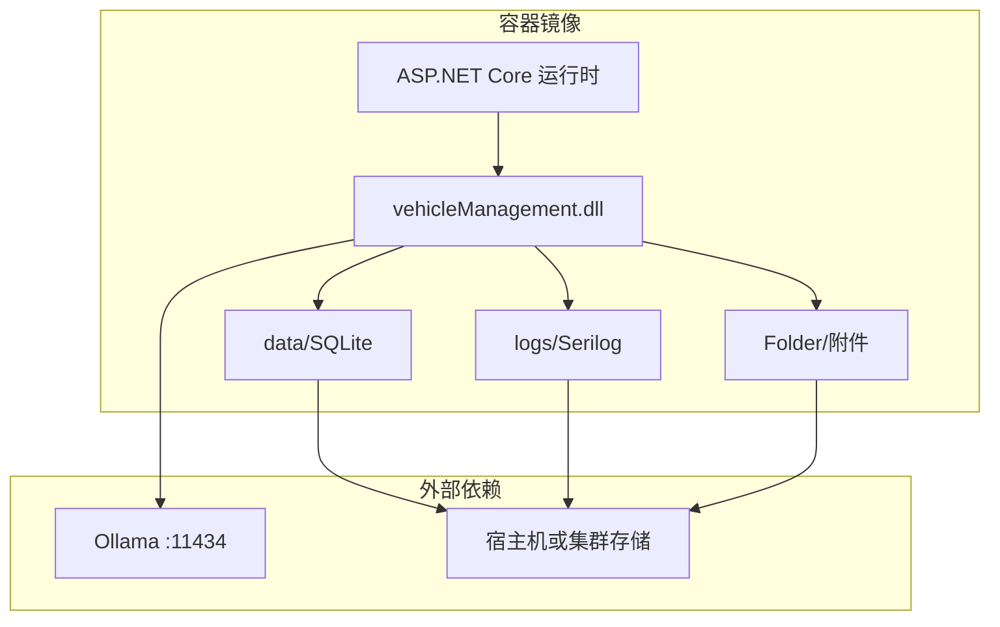
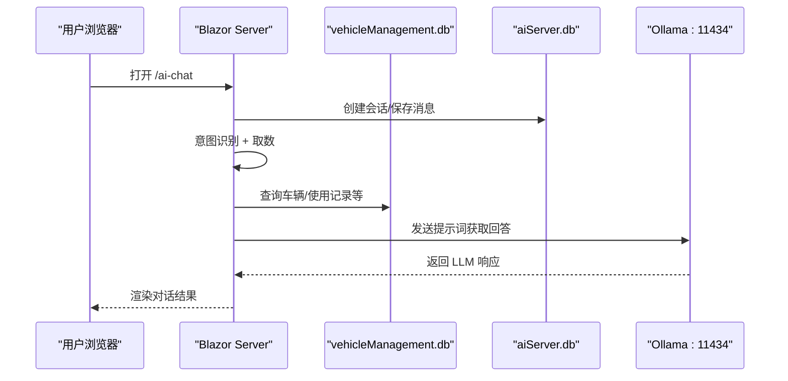
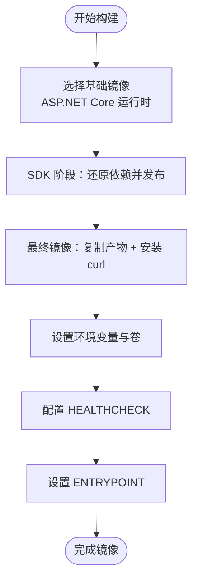
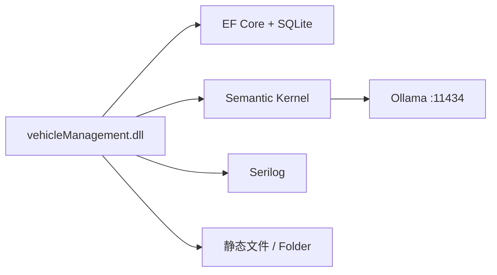

# 部署与运维

<cite>
**本文引用的文件**   
- [Dockerfile](file://Dockerfile)
- [Program.cs](file://Program.cs)
- [appsettings.json](file://appsettings.json)
- [appsettings.Development.json](file://appsettings.Development.json)
- [aisettings.example.json](file://aisettings.example.json)
- [VehicleDbContext.cs](file://DAL/VehicleDbContext.cs)
- [AiServerDbContext.cs](file://aiServer/DAL/AiServerDbContext.cs)
- [README.md](file://README.md)
</cite>

## 目录
1. [引言](#引言)
2. [项目结构](#项目结构)
3. [核心组件](#核心组件)
4. [架构总览](#架构总览)
5. [详细组件分析](#详细组件分析)
6. [依赖关系分析](#依赖关系分析)
7. [性能考虑](#性能考虑)
8. [故障排除指南](#故障排除指南)
9. [结论](#结论)
10. [附录：部署清单](#附录部署清单)

## 引言
本文件面向 vehicleManagement 系统的生产部署与运维，覆盖多阶段 Docker 构建、容器化配置、AI 服务接入、日志与健康检查、监控指标、CI/CD 自动化、备份恢复、扩容与安全加固。文档以仓库现有实现为依据，重点解释如何把当前 Blazor Server + SQLite + Ollama 的架构稳定地运行在容器中，并给出可操作的排错与优化建议。

## 项目结构
vehicleManagement 采用分层架构：
- DAL：EF Core 数据访问层，包含业务库与 AI 库两个 DbContext。
- BLL：业务逻辑层，封装车辆、部门、人员、地点、使用记录、维修、导出等能力。
- Pages / Components：Blazor Server 页面与通用 UI 组件。
- aiServer：AI 子系统，独立命名空间与数据库，负责意图识别、记忆、提示词编排与 Ollama 推理。
- 根目录：应用入口 Program.cs、Dockerfile、配置文件与静态资源。

图表来源
- [Dockerfile:1-44](file://Dockerfile#L1-L44)
- [Program.cs:104-148](file://Program.cs#L104-L148)

章节来源
- [README.md:55-83](file://README.md#L55-L83)
- [README.md:139-153](file://README.md#L139-L153)

## 核心组件
- 应用启动与中间件：Program.cs 中完成 Serilog 初始化、Blazor Server 注册、DbContextFactory 注册、仓储与服务注入、Semantic Kernel 连接 Ollama、静态文件与路由映射、健康端点暴露。
- 数据库：两个 SQLite 数据库文件分别由 VehicleDbContext 和 AiServerDbContext 管理；启动时自动 EnsureCreated，开发环境写入种子数据。
- AI 服务：通过 Semantic Kernel 调用 Ollama Chat Completion；模型与端点支持环境变量、aisettings.json 热重载与代码兜底三级取值。
- 容器镜像：Dockerfile 定义 base/build/final 三阶段，最终镜像仅安装 curl 用于 HEALTHCHECK，并声明 data/logs/Folder 持久卷。

章节来源
- [Program.cs:28-102](file://Program.cs#L28-L102)
- [Program.cs:104-148](file://Program.cs#L104-L148)
- [VehicleDbContext.cs:6-107](file://DAL/VehicleDbContext.cs#L6-L107)
- [AiServerDbContext.cs:9-58](file://aiServer/DAL/AiServerDbContext.cs#L9-L58)
- [Dockerfile:1-44](file://Dockerfile#L1-L44)

## 架构总览
系统对外提供 Blazor Server 页面与 REST 路由，内部通过仓储访问 SQLite，并通过 Semantic Kernel 与 Ollama 进行自然语言问答。AI 会话、消息与记忆存储在独立的 aiServer.db 中，业务数据存储在 vehicleManagement.db 中。

图表来源
- [Program.cs:97-102](file://Program.cs#L97-L102)
- [Program.cs:109-125](file://Program.cs#L109-L125)
- [README.md:55-83](file://README.md#L55-L83)

## 详细组件分析

### 多阶段 Docker 构建过程
- 基础镜像：基于 ASP.NET Core 运行时，暴露 80 端口。
- 构建阶段：使用 SDK 还原依赖并发布到 /app/publish，利用依赖缓存加速后续构建。
- 最终镜像：仅复制发布产物，安装 curl 供 HEALTHCHECK 使用，设置监听地址与环境变量，声明持久卷，定义健康检查探针。

图表来源
- [Dockerfile:1-44](file://Dockerfile#L1-L44)

章节来源
- [Dockerfile:1-44](file://Dockerfile#L1-L44)

### 容器化部署配置
- 环境变量
  - ASPNETCORE_URLS：绑定 http://+:80。
  - AiServer__OllamaEndpoint / AiServer__OllamaModel：覆盖 AI 端点与模型名称。
- 卷挂载
  - /app/data：SQLite 数据文件。
  - /app/logs：Serilog 按天滚动日志。
  - /app/Folder：上传附件静态目录。
- 网络配置
  - 容器内监听 80，宿主映射到 5000 或其他端口。
  - Ollama 必须从容器可达（建议使用宿主机 IP 或专用网络）。
- 资源限制
  - 建议在编排层（如 docker run --memory、--cpus 或 Kubernetes ResourceQuota）限制 CPU 与内存，避免 Ollama 与应用争抢资源。

章节来源
- [Dockerfile:29-41](file://Dockerfile#L29-L41)
- [README.md:321-336](file://README.md#L321-L336)

### 生产环境配置
- 数据库连接
  - DefaultConnection：指向 data/vehicleManagement.db。
  - AiServerConnection：指向 data/aiServer.db。
  - 启动时 EnsureCreated，开发环境写入种子数据。
- AI 服务配置
  - 优先级：环境变量 > aisettings.json（可选 + 热重载）> 代码默认值。
  - 推荐将 aisettings.json 作为只读挂载，或通过环境变量注入。
- 日志配置
  - Serilog 控制台输出 + 文件按天滚动，保留最近 7 份。
  - 抑制框架与 EF Core SQL 日志以降低噪音。
- 性能调优
  - 使用 IDbContextFactory 避免 Blazor Server 并发冲突。
  - Kernel 单例注入，减少重复构造开销。
  - 合理限制日志级别与保留数量，避免磁盘膨胀。

章节来源
- [appsettings.json:3-6](file://appsettings.json#L3-L6)
- [Program.cs:28-37](file://Program.cs#L28-L37)
- [Program.cs:52-58](file://Program.cs#L52-L58)
- [Program.cs:97-102](file://Program.cs#L97-L102)
- [Program.cs:109-125](file://Program.cs#L109-L125)

### 监控方案
- 结构化日志
  - Serilog 已启用 Console 与 File sink，可按天滚动与保留策略控制。
  - 建议在生产中将 File sink 输出到集中式日志平台（例如通过 sidecar 或日志采集器）。
- 健康检查端点
  - /health 返回成功状态，Docker HEALTHCHECK 每 30s 探测一次，超时 5s，重试 3 次。
- 性能指标收集
  - 当前未内置 Prometheus 指标端点；可在 Program.cs 中扩展 Metrics 中间件或使用第三方库（如 OpenTelemetry）采集请求耗时、错误率、数据库连接池等指标。

章节来源
- [Program.cs:28-37](file://Program.cs#L28-L37)
- [Program.cs:144-146](file://Program.cs#L144-L146)
- [Dockerfile:40-41](file://Dockerfile#L40-L41)

### 运维自动化
- CI/CD 流水线
  - 建议步骤：检出代码 → dotnet restore → dotnet build → dotnet test → dotnet publish → docker build → 推送镜像 → 部署到目标环境。
  - 构建参数：BUILD_CONFIGURATION=Release，可选传入 OLLAMA_ENDPOINT 与 OLLAMA_MODEL。
- 配置管理
  - 环境变量优先：AiServer__OllamaEndpoint、AiServer__OllamaModel。
  - aisettings.json 支持热重载，适合灰度调整模型或端点。
- 备份恢复策略
  - 定期备份 /app/data 下的 SQLite 文件（vehicleManagement.db 与 aiServer.db）。
  - 备份前建议停止写入或进入只读模式，确保一致性。
  - 恢复时替换文件并重启容器。

章节来源
- [Dockerfile:31-35](file://Dockerfile#L31-L35)
- [Program.cs:45-46](file://Program.cs#L45-L46)
- [Program.cs:109-125](file://Program.cs#L109-L125)

### 安全加固
- 网络安全
  - 仅暴露必要端口（80），反向代理（Nginx/Traefik/Ingress）统一入口。
  - 限制 Ollama 访问来源为可信网段，避免公网暴露。
- 数据加密
  - SQLite 文件落盘敏感；建议对持久卷启用磁盘加密或云盘加密。
  - 传输层使用 TLS（反向代理终止 TLS）。
- 访问控制
  - 结合身份认证与授权机制（如 JWT/OIDC）保护 /ai-chat 等敏感页面。
  - 最小权限原则：容器进程非 root，只读文件系统（除挂载卷）。
- 审计日志
  - 在应用层增加关键操作审计（登录、数据变更、AI 查询），写入独立审计日志文件并上报至 SIEM。

[本节为通用安全建议，不直接分析具体文件]

## 依赖关系分析
- 运行时依赖
  - .NET 10.0 ASP.NET Core Blazor Server。
  - EF Core + SQLite（双库）。
  - Semantic Kernel + Ollama Connector。
  - Serilog 日志。
- 外部依赖
  - Ollama 推理服务（HTTP :11434）。
  - 宿主机或集群存储（持久卷）。

图表来源
- [Program.cs:97-102](file://Program.cs#L97-L102)
- [Program.cs:132-140](file://Program.cs#L132-L140)
- [README.md:141-153](file://README.md#L141-L153)

章节来源
- [README.md:141-153](file://README.md#L141-L153)

## 性能考虑
- 数据库
  - SQLite 适合轻量场景；高并发写需评估锁竞争。必要时迁移到 PostgreSQL/MySQL 并调整连接池。
  - 索引已在 OnModelCreating 中定义，关注慢查询与热点表。
- 应用
  - Blazor Server 长连接占用内存；根据用户规模调整实例数与负载均衡。
  - 日志滚动与保留策略避免磁盘占满。
- AI
  - Ollama 模型大小与显存/内存需求相关；选择合适的模型 tag。
  - 控制并发请求与超时，避免阻塞主线程。

[本节为通用性能建议，不直接分析具体文件]

## 故障排除指南
- 常见问题
  - /health 返回失败：检查容器内 curl 是否可用、应用是否启动成功、端口映射是否正确。
  - AI 无法推理：确认 Ollama 可达、模型 tag 正确、aisettings.json 或环境变量生效。
  - 数据库异常：检查 data/ 卷挂载、文件权限、EnsureCreated 是否执行。
- 日志分析
  - 查看 logs/log-*.log 中的错误堆栈与警告。
  - 控制台日志可用于实时调试（容器日志）。
- 性能瓶颈定位
  - 观察 Ollama 响应时间与队列长度。
  - 分析 EF Core 慢查询与 SQLite 锁等待。
  - 监控 Blazor Server 连接数与内存增长。

章节来源
- [Program.cs:144-146](file://Program.cs#L144-L146)
- [Program.cs:28-37](file://Program.cs#L28-L37)
- [README.md:106-118](file://README.md#L106-L118)

## 结论
vehicleManagement 系统在当前实现下具备良好的容器化与可观测性基础。通过规范的环境变量与卷挂载、合理的日志与备份策略、以及必要的性能与安全加固，可以在生产环境中稳定运行。建议逐步引入集中式日志、指标采集与身份认证，进一步提升可维护性与安全性。

[本节为总结性内容，不直接分析具体文件]

## 附录：部署清单
- 构建镜像
  - 使用 Release 配置构建。
  - 传入 OLLAMA_ENDPOINT 与 OLLAMA_MODEL 构建参数（可选）。
- 运行容器
  - 映射端口：宿主 5000 → 容器 80。
  - 环境变量：AiServer__OllamaEndpoint、AiServer__OllamaModel。
  - 卷挂载：/data/vm/db:/app/data、/data/vm/logs:/app/logs、/data/vm/attachments:/app/Folder。
- 健康检查
  - 容器 HEALTHCHECK 每 30s 探测 /health。
- 备份
  - 定期备份 /app/data 下的 SQLite 文件。
- 监控
  - 日志：Serilog 文件与控制台。
  - 指标：可扩展 Prometheus/OpenTelemetry。
- 安全
  - 反向代理 TLS、最小权限、访问控制与审计日志。

章节来源
- [Dockerfile:29-41](file://Dockerfile#L29-L41)
- [Program.cs:144-146](file://Program.cs#L144-L146)
- [README.md:321-336](file://README.md#L321-L336)