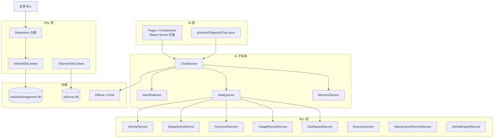
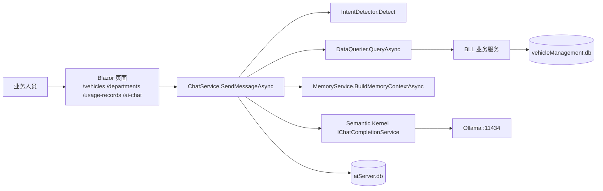
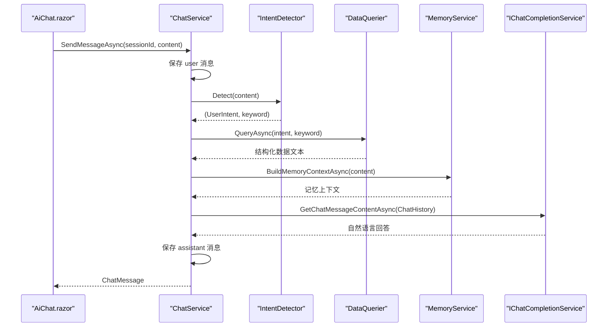
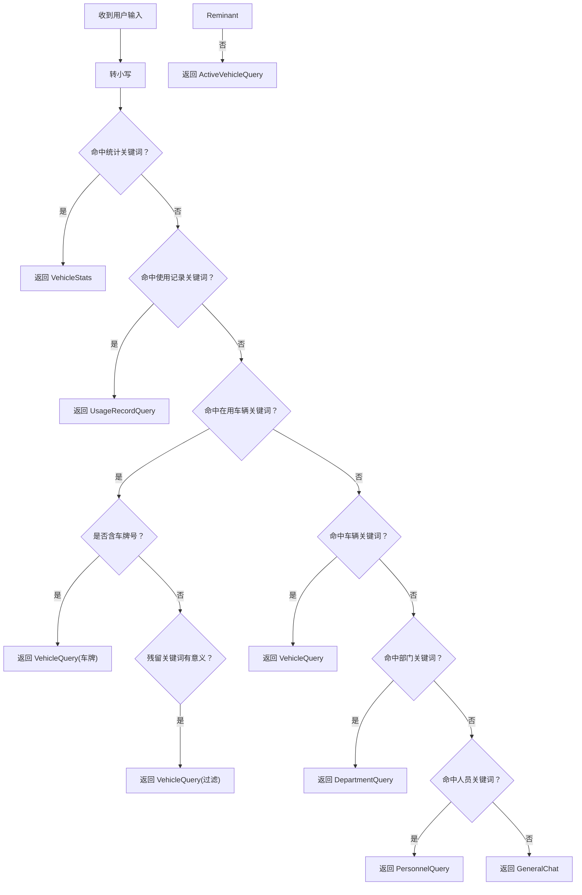
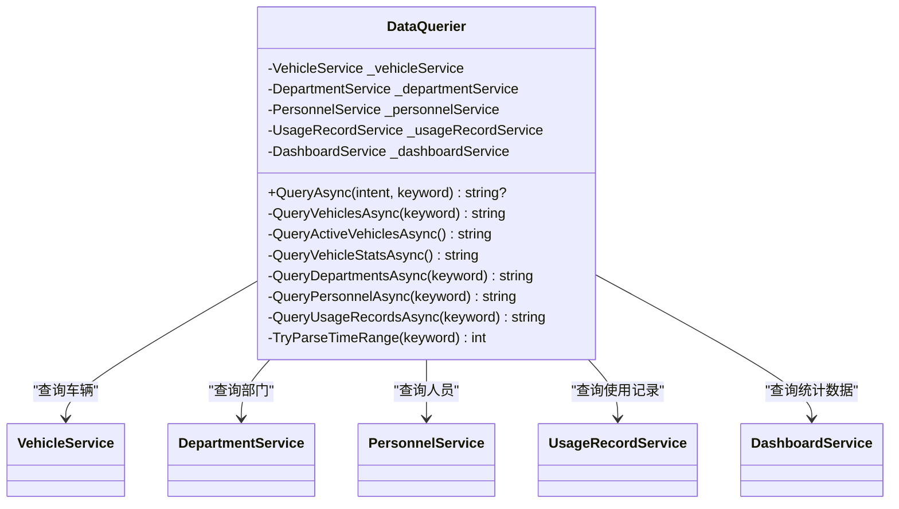
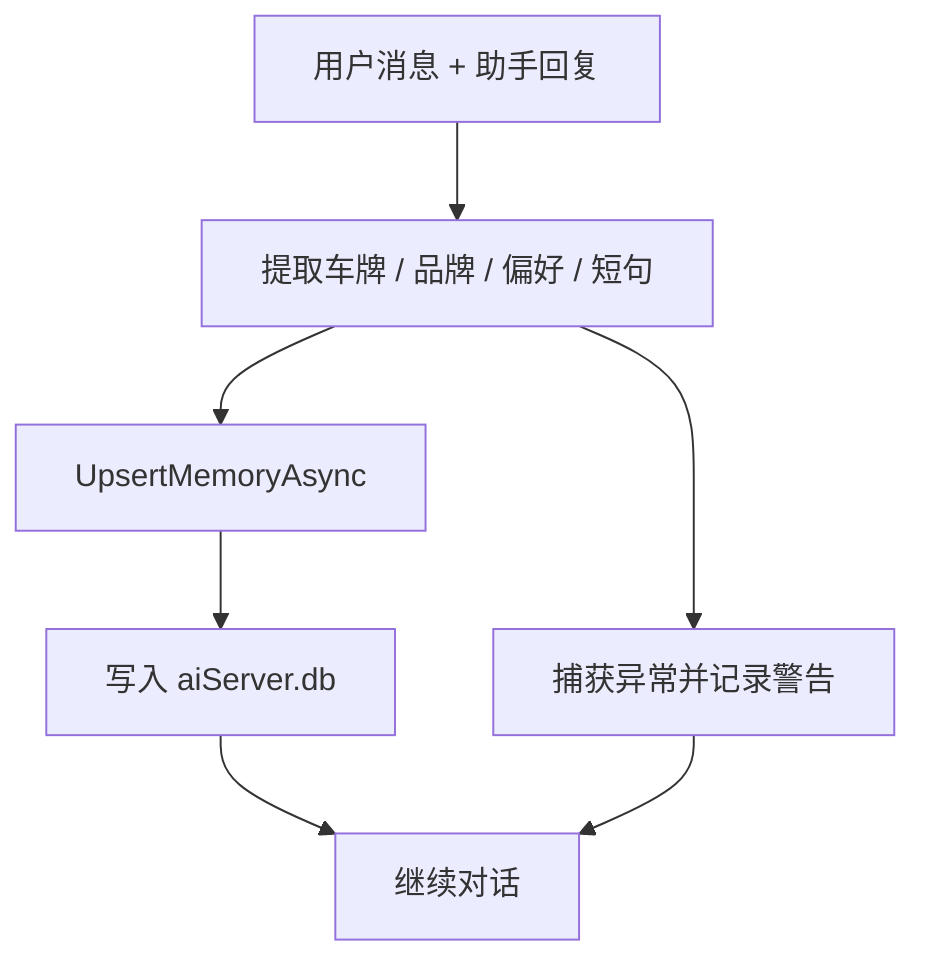
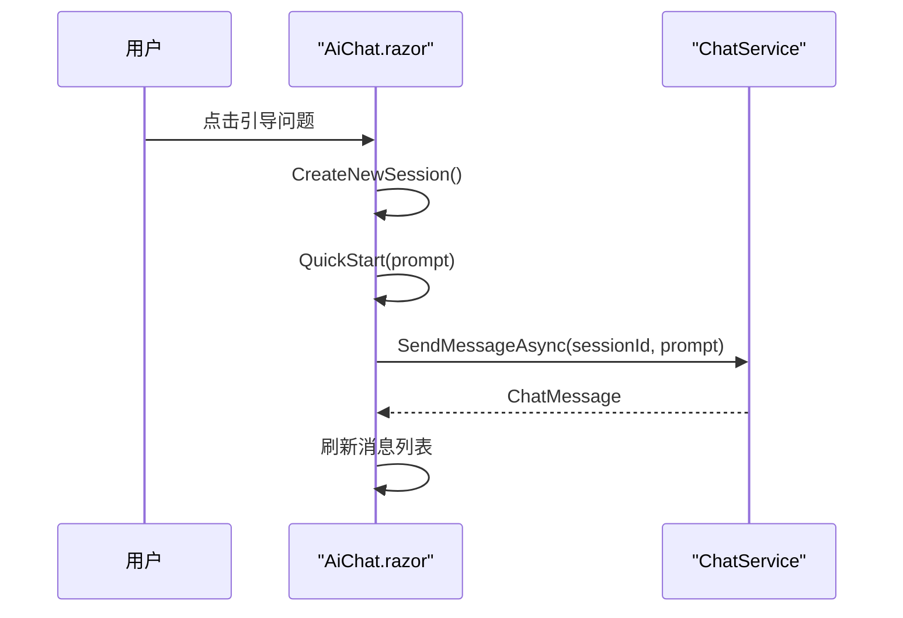
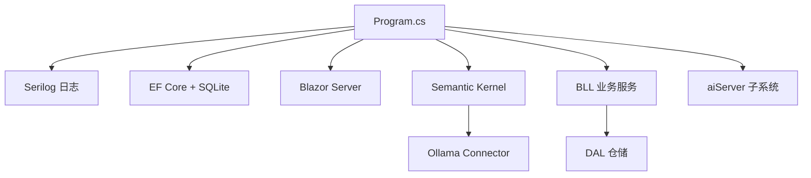

# 项目概述

<cite>
**本文引用的文件**   
- [README.md](file://README.md)
- [Program.cs](file://Program.cs)
- [vehicleManagement.csproj](file://vehicleManagement.csproj)
- [App.razor](file://App.razor)
- [_Imports.razor](file://_Imports.razor)
- [ChatService.cs](file://aiServer/BLL/ChatService.cs)
- [DataQuerier.cs](file://aiServer/BLL/DataQuerier.cs)
- [IntentDetector.cs](file://aiServer/BLL/IntentDetector.cs)
- [MemoryService.cs](file://aiServer/BLL/MemoryService.cs)
- [AiChat.razor](file://aiServer/Pages/AiChat.razor)
</cite>

## 目录
1. [引言](#引言)
2. [项目结构](#项目结构)
3. [核心组件](#核心组件)
4. [架构总览](#架构总览)
5. [详细组件分析](#详细组件分析)
6. [依赖关系分析](#依赖关系分析)
7. [性能与稳定性](#性能与稳定性)
8. [快速开始指南](#快速开始指南)
9. [功能模块概览](#功能模块概览)
10. [技术栈说明](#技术栈说明)
11. [故障排查指南](#故障排查指南)
12. [结论](#结论)

## 引言
vehicleManagement 是一个基于 .NET 10 Blazor Server 的企业级车辆管理台账系统，同时内嵌一个本地 AI 助手。业务人员可以用自然语言提问，例如“目前有哪些车在用”或“最近一周有哪些使用记录”，系统会先查真实 SQLite 数据库，再把结构化结果交给本地 Ollama 小模型组织成中文回答。整个推理过程不依赖云端 API Key，业务数据不出环境。

项目的核心价值可以概括为四点：
- 完整业务闭环：车辆、部门、人员、地点、使用记录、维修记录、扫码执行、Excel 导出。
- 可解释的 AI 取数链路：规则意图识别 → 白名单查询 → 结果注入 → 模型归纳，模型不写 SQL。
- 纯本地推理：Semantic Kernel + Ollama，端点与模型 tag 三级取值可热重载。
- 四类故障独立兜底：模型不可达、查询异常、结果为空、记忆写失败都不影响页面可用性。

## 项目结构
项目采用分层架构，主要划分为四层：
- DAL：EF Core 实体、仓储、种子数据初始化、时间工具。
- BLL：业务服务，封装车辆、部门、人员、地点、使用记录、仪表盘、扫码执行、维护、导出等能力。
- Pages / Components：Blazor Server 页面与布局、导航、分页等 UI 组件。
- aiServer：AI 子系统，包含意图识别、数据查询桥接、记忆、对话会话、聊天页面，并使用独立 SQLite 库。

**图表来源**
- [Program.cs:52-102](file://Program.cs#L52-L102)
- [AiChat.razor:1-10](file://aiServer/Pages/AiChat.razor#L1-L10)
- [ChatService.cs:18-42](file://aiServer/BLL/ChatService.cs#L18-L42)
- [DataQuerier.cs:21-43](file://aiServer/BLL/DataQuerier.cs#L21-L43)

**章节来源**
- [README.md:55-139](file://README.md#L55-L139)
- [Program.cs:41-102](file://Program.cs#L41-L102)
- [App.razor:1-12](file://App.razor#L1-L12)
- [_Imports.razor:10-28](file://_Imports.razor#L10-L28)

## 核心组件
本项目的核心由五个关键组件构成：
- `ChatService`：对话中枢，负责会话管理、消息落库、意图识别、数据查询、上下文构建、调用 Ollama、异步记忆抽取。
- `IntentDetector`：关键词与正则驱动的意图路由，把自然语言映射到七类用户意图。
- `DataQuerier`：根据意图调用现有 BLL 服务，返回给 LLM 的可读文本，不生成 SQL。
- `MemoryService`：基于车牌、品牌、偏好词和短句的记忆抽取与 LIKE 检索，提供 Top5 历史记忆上下文。
- `AiChat.razor`：多会话聊天界面，支持侧边栏、记忆面板、移动端适配、滚动诊断。

这些组件共同实现“问自然语言 → 查真实数据 → 说人话”的闭环。

**章节来源**
- [ChatService.cs:18-42](file://aiServer/BLL/ChatService.cs#L18-L42)
- [IntentDetector.cs:9-17](file://aiServer/BLL/IntentDetector.cs#L9-L17)
- [DataQuerier.cs:18-43](file://aiServer/BLL/DataQuerier.cs#L18-L43)
- [MemoryService.cs:12-40](file://aiServer/BLL/MemoryService.cs#L12-L40)
- [AiChat.razor:1-10](file://aiServer/Pages/AiChat.razor#L1-L10)

## 架构总览
系统整体分为三层：
- 前端：Blazor Server 页面，包括仪表盘、台账、申请、扫码执行、AI 聊天。
- 后端：ASP.NET Core 应用，注册 DI、SQLite、Serilog、静态文件、健康探针、路由。
- AI 子系统：独立命名空间，独立数据库，通过 Semantic Kernel 连接本地 Ollama。

**图表来源**
- [README.md:57-83](file://README.md#L57-L83)
- [Program.cs:97-102](file://Program.cs#L97-L102)
- [ChatService.cs:94-139](file://aiServer/BLL/ChatService.cs#L94-L139)

## 详细组件分析

### 对话中枢 ChatService
`ChatService` 是 AI 子系统的核心编排器。它接收来自 `AiChat.razor` 的消息，完成以下流程：
1. 保存用户消息并自动更新会话标题。
2. 调用 `IntentDetector.Detect` 识别意图。
3. 调用 `DataQuerier.QueryAsync` 获取结构化数据文本。
4. 组装 `ChatHistory`：系统提示词、本轮数据注入、Top5 记忆、最近 20 轮消息。
5. 调用一次 Ollama 推理。
6. 保存助手回复。
7. 异步抽取记忆，失败不影响主流程。

**图表来源**
- [ChatService.cs:94-139](file://aiServer/BLL/ChatService.cs#L94-L139)
- [ChatService.cs:161-183](file://aiServer/BLL/ChatService.cs#L161-L183)
- [ChatService.cs:188-199](file://aiServer/BLL/ChatService.cs#L188-L199)

**章节来源**
- [ChatService.cs:18-42](file://aiServer/BLL/ChatService.cs#L18-L42)
- [ChatService.cs:94-139](file://aiServer/BLL/ChatService.cs#L94-L139)
- [ChatService.cs:161-199](file://aiServer/BLL/ChatService.cs#L161-L199)

### 意图识别 IntentDetector
`IntentDetector` 使用固定优先级的关键词和正则匹配，将用户输入映射到七类意图：
- 车辆统计：统计、汇总、多少辆、占比、分布、趋势、最多、哪个部门。
- 使用记录：使用记录、出车、用车、行程。
- 在用车辆：在用车辆、当前可用、有哪些车、车辆列表。
- 车辆查询：车辆、车牌、品牌、型号、状态、维修、退役、公里、颜色。
- 部门查询：部门、单位、科室。
- 人员查询：人员、员工、司机、姓名、电话。
- 闲聊：你好、谢谢、帮助等。

它还做了两个重要处理：
- 优先级冲突保护：统计类词先判，避免“哪个部门用车最多”被误判为使用记录；在用车辆先于普通车辆，避免“有哪些车在用”被截成模糊搜索。
- 残留关键词清洗：去掉触发词和停用词后，用噪声字表判断是否真搜索词，决定走车辆过滤还是直接列出在用车辆。

**图表来源**
- [IntentDetector.cs:17-111](file://aiServer/BLL/IntentDetector.cs#L17-L111)
- [IntentDetector.cs:116-149](file://aiServer/BLL/IntentDetector.cs#L116-L149)

**章节来源**
- [IntentDetector.cs:9-152](file://aiServer/BLL/IntentDetector.cs#L9-L152)

### 数据查询桥接 DataQuerier
`DataQuerier` 是 AI 子系统与业务 BLL 之间的安全边界。它根据意图分发到具体查询方法，并把 BLL 返回的对象序列化为人类可读文本。关键点：
- 所有查询都复用现有 BLL 服务，如 `VehicleService`、`DepartmentService`、`PersonnelService`、`UsageRecordService`、`DashboardService`。
- 查询结果以固定格式字符串返回，例如“【车辆查询结果】共找到 N 辆匹配的车辆……”。
- 对空结果有显式文案，例如“当前没有匹配的车辆数据”。
- 对使用记录支持中文时间范围解析，例如“最近一周”“两个月”“半年”。

**图表来源**
- [DataQuerier.cs:21-43](file://aiServer/BLL/DataQuerier.cs#L21-L43)
- [DataQuerier.cs:48-67](file://aiServer/BLL/DataQuerier.cs#L48-L67)
- [DataQuerier.cs:69-330](file://aiServer/BLL/DataQuerier.cs#L69-L330)

**章节来源**
- [DataQuerier.cs:18-67](file://aiServer/BLL/DataQuerier.cs#L18-L67)
- [DataQuerier.cs:69-330](file://aiServer/BLL/DataQuerier.cs#L69-L330)

### 记忆子系统 MemoryService
`MemoryService` 不使用向量库，而是用规则方案在 SQLite 中做记忆抽取与 LIKE 检索：
- 抽取四路规则：车牌正则、26 个常见车辆品牌、用户偏好词、短句兜底。
- 写入按 key 幂等：例如 `vehicle_plate_京A12345`，重复提及不产生新行。
- 回检索从当前提问里抽车牌、品牌、连续中文词，最多 5 个关键词做 LIKE 搜索，按时间倒序取 Top5。
- 失败隔离：抽取逻辑包在 try/catch 中，并通过异步任务挂在主流程之外。

**图表来源**
- [MemoryService.cs:45-113](file://aiServer/BLL/MemoryService.cs#L45-L113)
- [MemoryService.cs:118-153](file://aiServer/BLL/MemoryService.cs#L118-L153)

**章节来源**
- [MemoryService.cs:12-40](file://aiServer/BLL/MemoryService.cs#L12-L40)
- [MemoryService.cs:45-113](file://aiServer/BLL/MemoryService.cs#L45-L113)
- [MemoryService.cs:118-153](file://aiServer/BLL/MemoryService.cs#L118-L153)

### 聊天界面 AiChat.razor
`AiChat.razor` 是 `/ai-chat` 页面的实现，提供：
- 多会话列表、新建会话、删除会话。
- 消息气泡、思考过程折叠区（字段已存在但当前未写入）。
- 记忆面板，可查看和删除记忆。
- 移动端侧边栏遮罩、滚动到底部按钮。
- 内置四个引导问题，用于快速体验。

**图表来源**
- [AiChat.razor:257-263](file://aiServer/Pages/AiChat.razor#L257-L263)
- [AiChat.razor:332-427](file://aiServer/Pages/AiChat.razor#L332-L427)

**章节来源**
- [AiChat.razor:1-218](file://aiServer/Pages/AiChat.razor#L1-L218)
- [AiChat.razor:235-555](file://aiServer/Pages/AiChat.razor#L235-L555)

## 依赖关系分析
项目依赖关系可以从启动装配、服务注册、AI 接入三个角度理解：

**图表来源**
- [Program.cs:28-37](file://Program.cs#L28-L37)
- [Program.cs:48-102](file://Program.cs#L48-L102)
- [vehicleManagement.csproj:14-30](file://vehicleManagement.csproj#L14-L30)

**章节来源**
- [Program.cs:28-102](file://Program.cs#L28-L102)
- [vehicleManagement.csproj:1-37](file://vehicleManagement.csproj#L1-L37)

## 性能与稳定性
系统在性能和稳定性上做了多项设计：
- 双 DbContextFactory：避免 Blazor Server 单 Circuit 共享上下文冲突。
- Kernel 单例：无状态推理客户端，减少创建开销。
- 固定消息窗口：只保留最近 20 轮消息，控制 4B 模型上下文长度。
- 非关键路径异步记忆：记忆抽取失败不影响对话。
- 四层错误兜底：模型不可达、查询异常、空结果、记忆异常都有明确处理。
- 日志降噪：抑制框架和 EF Core SQL 日志，突出业务日志。

**章节来源**
- [Program.cs:52-58](file://Program.cs#L52-L58)
- [Program.cs:97-102](file://Program.cs#L97-L102)
- [ChatService.cs:27](file://aiServer/BLL/ChatService.cs#L27)
- [ChatService.cs:131-136](file://aiServer/BLL/ChatService.cs#L131-L136)
- [ChatService.cs:188-199](file://aiServer/BLL/ChatService.cs#L188-L199)
- [DataQuerier.cs:63-66](file://aiServer/BLL/DataQuerier.cs#L63-L66)
- [MemoryService.cs:109-112](file://aiServer/BLL/MemoryService.cs#L109-L112)
- [Program.cs:28-37](file://Program.cs#L28-L37)

## 快速开始指南
如果你刚接触这个项目，可以按以下步骤运行：

1. 安装并启动本地 Ollama，拉取一个小模型，例如 `gemma3:4b`。
2. 复制配置模板 `aisettings.example.json` 为 `aisettings.json`，修改 `OllamaModel` 为你实际拉取的 tag。
3. 执行 `dotnet restore` 和 `dotnet run`。
4. 启动后访问 `http://localhost:5000`，打开 `/ai-chat` 新建会话。
5. 使用内置引导问题测试，例如“目前有哪些车辆在用？”“最近一周有哪些使用记录？”

如果 Ollama 接不通，可以先用 curl 验证 Ollama 接口是否正常，再检查容器网络、环境变量、配置文件中的端点和模型 tag。

**章节来源**
- [README.md:87-118](file://README.md#L87-L118)

## 功能模块概览
系统提供完整的车辆管理业务闭环，主要路由如下：

| 路由 | 页面 | 说明 |
| --- | --- | --- |
| `/` | 仪表盘 | 车辆总览、部门车辆分布、近 6 个月用车趋势 |
| `/vehicles` | 车辆台账 | 增删改查、状态流转、二维码、附件 |
| `/departments` | 部门 | 主数据维护 |
| `/personnel` | 人员 | 在职/离职状态、所属部门 |
| `/locations` | 地点 | 出发地/目的地分类 |
| `/usage-records` | 使用记录 | 出车时间、里程、到达地点、多段用途 |
| `/borrow/{VehicleId}` | 出车申请 | 车辆上下文下的申请表单 |
| `/maintenance/{VehicleId}` | 维修登记 | 单次维修录入 |
| `/maintenance-records` | 维修记录 | 历史维修查询 |
| `/execute/{Token}` | 扫码执行 | 司机扫车辆二维码定位单据并执行 |
| `/ai-chat` | AI 助手 | 多会话、记忆面板、移动端侧边栏适配 |
| `/health` | 探针 | 容器 HEALTHCHECK 使用 |

**章节来源**
- [README.md:122-139](file://README.md#L122-L139)

## 技术栈说明
项目使用的关键技术如下：

| 分类 | 选型 | 版本 |
| --- | --- | --- |
| 运行时 / Web | .NET / ASP.NET Core Blazor Server | net10.0 |
| UI 组件 | Microsoft Fluent UI Blazor Components | 4.14.3 |
| ORM / 存储 | EF Core + SQLite | 10.0.9 |
| LLM 编排 | Semantic Kernel + Ollama Connector | 1.77.0 / 1.77.0-alpha |
| 日志 | Serilog Console + File | 10.0.0 / 7.0.0 |
| 导出 | DocumentFormat.OpenXml | 3.5.1 |
| 二维码 | QRCoder | 1.8.0 |
| 图表 | Chart.js 本地资源 | wwwroot/js/chart.umd.min.js |
| 容器 | 多阶段构建 + HEALTHCHECK | dotnet/{sdk,aspnet}:10.0 |

**章节来源**
- [vehicleManagement.csproj:1-37](file://vehicleManagement.csproj#L1-L37)
- [README.md:141-154](file://README.md#L141-L154)

## 故障排查指南
当 AI 助手无法正常工作或业务页面异常时，可按以下思路排查：

- 模型不可达：`ChatService.CallLlmAsync` 捕获异常后返回“AI 服务暂时不可用”，页面不会崩溃。
- 查询异常：`DataQuerier.QueryAsync` 捕获异常后返回“查询数据库时发生错误”，仍走模型正常作答。
- 查询结果为空：各分支返回显式文案，例如“当前没有匹配的车辆数据”。
- 记忆抽取异常：`MemoryService.ExtractAndStoreAsync` 捕获异常并记录警告，不影响对话。
- 并发写库：两个 DbContext 都使用 `AddDbContextFactory`，避免 Blazor 单 Circuit 共享上下文冲突。
- 日志噪声：Serilog 抑制 Microsoft 和 EF Core SQL 日志，便于定位业务问题。

建议排查顺序：
1. 确认 `/health` 返回正常。
2. 确认 Ollama 进程可响应。
3. 确认 `aisettings.json` 或环境变量中的端点和模型 tag 正确。
4. 查看 logs 目录下按天滚动的日志文件。

**章节来源**
- [ChatService.cs:188-199](file://aiServer/BLL/ChatService.cs#L188-L199)
- [DataQuerier.cs:63-66](file://aiServer/BLL/DataQuerier.cs#L63-L66)
- [MemoryService.cs:109-112](file://aiServer/BLL/MemoryService.cs#L109-L112)
- [Program.cs:52-58](file://Program.cs#L52-L58)
- [Program.cs:28-37](file://Program.cs#L28-L37)

## 结论
vehicleManagement 不是一个简单 Demo，而是一个具备完整业务闭环、可解释 AI 取数链路、纯本地推理、多层兜底的车辆管理系统。它适合在内网环境中部署，让业务人员用自然语言查询真实数据，同时保证数据不出环境、答案可复现、故障可定位。对于初学者，可以从 `/ai-chat` 和 `/vehicles` 入手；对于有经验的开发者，可以关注 `IntentDetector`、`DataQuerier`、`ChatService`、`MemoryService` 以及 `Program.cs` 中的启动装配与配置热重载机制。