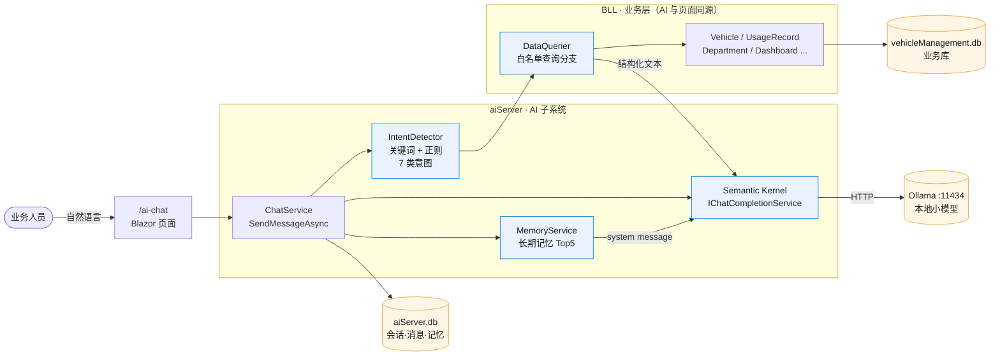
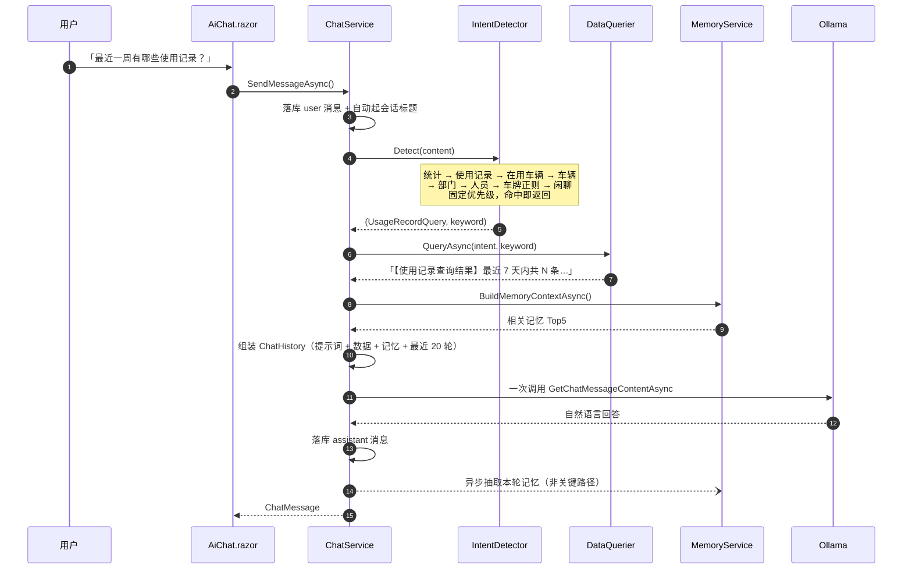

<div align="center">

# 车辆管理系统 · 本地大模型 AI 助手

**C# / .NET 10 Blazor Server 公车管理台账 + 嵌入同一后端的自然语言取数助手**

业务人员问「目前有哪些车在用」「最近一周有哪些使用记录」，系统查真实 SQLite 库，
把结构化结果注入上下文，交给 **本地 Ollama 上的 4B 级小模型** 组织成中文回答。
无云端 API Key，业务数据不出环境。

[](vehicleManagement.csproj)
[](#功能模块)
[](#1-技术栈)
[](#数据隔离)
[](#模型接入)
[](#快速开始)
[](#稳定性与兜底)
[](#配置与部署)
[](https://gitea.tianmaoyi.cn:4443/maoyi/vehicleManagement)

</div>

---

## 亮点速览

- 🚗 **完整业务闭环**：车辆 / 部门 / 人员 / 地点 / 使用记录 / 维修记录 / 扫码执行 / Excel 导出，不是 Demo 壳子。
- 🧠 **可解释的 AI 取数链路**：`规则意图识别 → 白名单查询 → 结果注入 → 模型归纳`，模型一行 SQL 都不写，注入面为零。
- 🔒 **纯本地推理**：Semantic Kernel + Ollama，端点与模型 tag 三级取值可热重载，换模型不改代码。
- 🩹 **四类故障独立兜底**：模型不可达、查询异常、结果为空、记忆写失败都不影响业务操作与页面可用性。

## 目录

- [架构总览](#架构总览)
- [快速开始](#快速开始)
- [功能模块](#功能模块)
- [1. 技术栈](#1-技术栈)
- [本地 AI 接入](#本地-ai-接入)
  - [推理不出环境](#推理不出环境)
  - [模型接入](#模型接入)
  - [一次问答的完整链路](#一次问答的完整链路)
  - [意图路由表](#意图路由表)
  - [上下文工程](#上下文工程)
  - [记忆子系统](#记忆子系统)
  - [中文时间表达解析](#中文时间表达解析)
  - [稳定性与兜底](#稳定性与兜底)
  - [数据隔离](#数据隔离)
- [设计取舍](#设计取舍)
- [配置与部署](#配置与部署)
- [目录结构](#目录结构)
- [已知限制](#已知限制)

---

## 架构总览



---

## 快速开始

```bash
# 1) 起一个本地模型（tag 以你本机 ollama list 的结果为准）
ollama pull gemma3:4b
ollama serve                      # 默认监听 http://localhost:11434

# 2) 配置应用（不配也能跑，默认就是 localhost:11434）
cp aisettings.example.json aisettings.json   # 改 OllamaModel 为你实际拉取的 tag

# 3) 运行
dotnet restore
dotnet run                          # Development 环境自动建库 + 写入种子数据
```

启动后访问 **http://localhost:5000** ，打开 `/ai-chat` 新建会话，页面上内置了四个引导问题（`AiChat.razor:257-263`）：

> 目前有哪些车辆在用？ · 帮我查一下各部门的车辆分布 · 最近一周有哪些使用记录？ · 如何添加新的使用记录？

<details>
<summary><b>接不通？先验 Ollama 再接应用，能省掉一大半排查时间</b></summary>

```bash
curl http://localhost:11434/api/chat -d '{
  "model": "gemma3:4b",
  "messages": [{"role": "user", "content": "你好"}]
}'
```

按这个顺序排查：`/health` 是否返回 200 → 进程/容器能否解析到 Ollama 主机（**Linux 容器里的 `localhost` 指容器自身**，要用宿主机 IP 或 `host.docker.internal`）→ `aisettings.json` 是否被环境变量 `AiServer__OllamaEndpoint` 覆盖 → `OllamaModel` 的 tag 是否与 `ollama list` 完全一致。

</details>

---

## 功能模块

| 路由 | 页面 | 说明 |
| --- | --- | --- |
| `/` | 仪表盘 | 车辆总览、部门车辆分布、近 6 个月用车趋势（Chart.js 本地资源） |
| `/vehicles` | 车辆台账 | 增删改查、状态流转、二维码、图片/视频附件 |
| `/departments` | 部门 | 主数据维护 |
| `/personnel` | 人员 | 在职/离职状态、所属部门 |
| `/locations` | 地点 | 出发地/目的地分类 |
| `/usage-records` | 使用记录 | 出车时间、里程、到达地点、多段用途 |
| `/borrow/{VehicleId}` | 出车申请 | 车辆上下文下的申请表单 |
| `/maintenance/{VehicleId}` | 维修登记 | 单次维修录入 |
| `/maintenance-records` | 维修记录 | 历史维修查询 |
| `/execute/{Token}` | 扫码执行 | 司机扫车辆二维码定位单据并执行 |
| **`/ai-chat`** | **AI 助手** | 多会话、记忆面板、移动端侧边栏适配 |
| `/health` | 探针 | 容器 `HEALTHCHECK` 使用 |

分层：`DAL`（EF Core 实体/仓储）→ `BLL`（业务服务）→ `Pages` + `Components`（Blazor UI）→ `aiServer`（AI 子系统，独立命名空间 + 独立数据库）。

## 1. 技术栈

| 分类 | 选型 | 版本（取自 `vehicleManagement.csproj`） |
| --- | --- | --- |
| 运行时 / Web | .NET / ASP.NET Core Blazor Server | `net10.0` |
| UI 组件 | Microsoft Fluent UI Blazor Components | `4.14.3` |
| ORM / 存储 | EF Core + SQLite（业务库 + AI 库分离） | `Microsoft.EntityFrameworkCore.Sqlite 10.0.9` |
| LLM 编排 | Semantic Kernel + Ollama Chat Completion Connector | `1.77.0` / `1.77.0-alpha` |
| 日志 | Serilog（Console + 按天滚动，保留 7 份） | `Serilog.AspNetCore 10.0.0` |
| 导出 | DocumentFormat.OpenXml（车辆 xlsx 导出） | `3.5.1` |
| 二维码 | QRCoder（一车一码，司机扫码执行） | `1.8.0` |
| 图表 | Chart.js，全部本地静态资源，不引 CDN | `wwwroot/js/chart.umd.min.js` |
| 容器 | 多阶段构建 + `HEALTHCHECK` | `dotnet/{sdk,aspnet}:10.0` |

---

## 本地 AI 接入

### 推理不出环境

模型跑在本地 / 内网的 Ollama 上，应用侧只有一个 HTTP 出口，没有云端 API Key，业务数据不需要脱敏出网。

### 模型接入

配置的三级取值：

| 优先级 | 来源 | 位置 |
| --- | --- | --- |
| 1 | 环境变量 `AiServer__OllamaEndpoint` / `AiServer__OllamaModel` | 容器部署注入 |
| 2 | `aisettings.json`（**可选 + 热重载**，改完不用重启） | `Program.cs:46` |
| 3 | 代码兜底 `http://localhost:11434` | `Program.cs:98` |

```csharp
// Program.cs:46 —— optional 保证缺文件也能起，reloadOnChange 支持挂载后热改
builder.Configuration.AddJsonFile("aisettings.json", optional: true, reloadOnChange: true);

// Program.cs:98-102 —— 全项目唯一的模型接入点，Ollama 走 SK 官方 connector
var ollamaEndpoint = builder.Configuration["AiServer:OllamaEndpoint"] ?? "http://localhost:11434";
var ollamaModel    = builder.Configuration["AiServer:OllamaModel"]    ?? "gemma4:e2b";
var kernelBuilder  = Kernel.CreateBuilder();
kernelBuilder.AddOllamaChatCompletion(ollamaModel, new Uri(ollamaEndpoint));
builder.Services.AddSingleton(kernelBuilder.Build());   // Kernel 无状态，注册为单例
```

`Kernel` 单例注入，`ChatService` 通过 `kernel.GetRequiredService<IChatCompletionService>()` 拿推理接口（`ChatService.cs:41`）。上层的意图识别、取数、提示词全部与具体模型解耦——**换模型只改配置**。

### 一次问答的完整链路



> **关键点：模型只被调用一次。** 取数不靠模型生成 SQL，也不靠模型决定调用哪个工具。
> 源码：`ChatService.SendMessageAsync()`（`ChatService.cs:94-139`）

### 意图路由表

`UserIntent` 共 7 类（`aiServer/BLL/Enums/UserIntent.cs`）。`IntentDetector` 按**固定优先级**做关键词 / 正则匹配（`IntentDetector.cs:17-111`），命中即路由到 `DataQuerier` 的一个白名单分支：

| 意图 | 触发词（节选） | 落到哪 | 取数内容 |
| --- | --- | --- | --- |
| `VehicleStats` | 统计、汇总、多少辆、占比、分布、趋势、哪个部门、最多 | `QueryVehicleStatsAsync` | 总数 / 在用 / 维修 / 退役 + 部门分布 + 近 6 个月趋势 |
| `UsageRecordQuery` | 使用记录、出车、用车、行程 | `QueryUsageRecordsAsync` | 时间·车牌·驾驶员·部门·用途（支持中文时间范围） |
| `ActiveVehicleQuery` | 在用车辆、当前可用、有哪些车、车辆列表 | `QueryActiveVehiclesAsync` | 全部在用车辆明细 |
| `VehicleQuery` | 车辆、车牌、品牌、型号、状态、公里，或裸车牌 `京A12345` | `QueryVehiclesAsync` | 关键词过滤后的车辆台账 |
| `DepartmentQuery` | 部门、单位、科室 | `QueryDepartmentsAsync` | 部门 +（暗示问人时）交叉带出各部门人员 |
| `PersonnelQuery` | 人员、员工、司机、姓名、电话 | `QueryPersonnelAsync` | 人员 +（暗示问车时）交叉带出其用车记录 |
| `GeneralChat` | 你好、谢谢、帮助 | 不查库 | 纯提示词问答 |

两个容易踩的坑，代码里做了显式处理：

- **优先级冲突**：`统计`类词先判，否则「哪个部门用车最多」会被 `用车` 抢去走使用记录查询；`在用车辆` 先于 `车辆`，否则「有哪些车在用」会被截成模糊搜索（`IntentDetector.cs:21-58`）。
- **残留关键词清洗**：去掉触发词和停用词后剩下的片段还要过 `IsMeaningfulKeyword()`，用噪声字表（辆 / 在 / 有 / 哪 / 的 / 了…）判定它是不是真搜索词——是就走 `VehicleQuery` 过滤，不是才落到 `ActiveVehicleQuery`（`IntentDetector.cs:116-127`）。

### 上下文工程

`ChatService.BuildChatHistory()`（`ChatService.cs:161-183`）把上下文分成四层拼接：

```csharp
var chatHistory = new ChatHistory(SystemPrompts.Main);                        // ① 角色 + 库结构 + 8 条硬规则
if (!string.IsNullOrEmpty(dataContext))
    chatHistory.AddSystemMessage(SystemPrompts.BuildDataInjectionPrompt(dataContext)); // ② 本轮真实查询结果
var memoryContext = await _memoryService.BuildMemoryContextAsync(currentContent);
if (!string.IsNullOrEmpty(memoryContext))
    chatHistory.AddSystemMessage(memoryContext);                               // ③ 相关历史记忆 Top5
foreach (var msg in recentMessages) { /* ④ user / assistant 交替，固定 20 条 */ }
```

| 层 | 内容 | 为什么这么做 |
| --- | --- | --- |
| ① 系统提示词 | 内联五张表的字段语义与枚举取值（`Status: 在用Active/维修Maintenance/退役Retired`），加 8 条硬规则（`SystemPrompts.cs:11-28`） | 让模型看得懂 `DataQuerier` 输出的字段名，不用猜 schema；第 2/3/4 条专治小模型幻觉：**无数据须照实说、禁止编造、禁用「可能/大概/估计」**；第 7 条定向纠正「哪个部门用车最多」应按部门车辆分布回答 |
| ② 数据注入 | 结果文本 + 一句前置约束（`SystemPrompts.cs:33-36`）作为 system message 送入 | 输出的是给人看的定长文本而非嵌套 JSON——小模型对这种格式的遵循度明显更高 |
| ③ 记忆注入 | `MemoryService.BuildMemoryContextAsync()`（`MemoryService.cs:144-153`） | 历史解决「刚才说了什么」，记忆解决「用户是谁、习惯什么」，两者正交 |
| ④ 会话窗口 | 固定 `MaxRecentMessages = 20`（`ChatService.cs:27`） | 4B 模型上下文有限，长会话靠窗口滚动而不是无限堆叠 |

### 记忆子系统

没用向量库——单机 SQLite 场景下规则方案足够，且完全可解释。`MemoryService`（`aiServer/BLL/MemoryService.cs`）：

- **抽取**（`MemoryService.cs:45-113`）四路规则：车牌正则（`MemoryService.cs:21`）、26 个车辆品牌词表、用户偏好词（喜欢 / 常用 / 习惯 / 经常 / 倾向于…，命中取前后 100 字片段）、「≤20 字短句且三路都没中」的通用兜底。
- **写入**按 key 幂等：`UpsertMemoryAsync()` 用 `vehicle_plate_京A12345` 这类 key，重复提及不产生新行；偏好与短句走 `DateTime.Now.Ticks` 追加。
- **回检索**（`MemoryService.cs:118-153`）：从当前提问里抽车牌 / 品牌 / 连续中文词，最多 5 个关键词做 `LIKE` 搜索，按 Id 去重、时间倒序取 Top5，注入为 system message。
- **失败隔离**：整段抽取包在 `try/catch` 里，并通过 `_ = Task.Run(...)` 挂在主流程之外（`ChatService.cs:132-136`）——记忆写失败绝不影响用户拿到回答。
- **可观测**：`/ai-chat` 侧边栏「记忆」面板直接列出 `ChatMemories` 表内容并可单条删除，用户看得见模型「记住了我什么」。

### 中文时间表达解析

`DataQuerier.TryParseTimeRange()`（`DataQuerier.cs:272-330`）把中文相对时间压成天数，避免让 4B 模型做日期推理：

<details>
<summary>词表：先正则匹配「N 天 / N 个月」，再走这些固定表达</summary>

| 类别 | 表达 → 天数 |
| --- | --- |
| 日 | 今天/今日 1 · 昨天/昨日 1 · 前天 3 |
| 周 | 一周/7天/本周/这周 7 · 两周/14天/双周 14 · 三周/21天 21 |
| 月 | 上个月/上月 30 · 一个月/30天/本月 30 · 两个月/60天 60 · 三个月/90天 90 |
| 季 | 一季度/上季度/本季度 90 · 二季度/半年 180 · 三个季度 270 |
| 年 | 去年/上一年 365 · 一年/今年/本年 365 · 两年/2 年 730 |
| 模糊 | 最近 / 近期 → 默认 7（排最后，避免误匹配） |

</details>

于是「最近一周有哪些使用记录」直接变成 `GetRecentAsync(7, …)`。

### 稳定性与兜底

| 失败点 | 行为 | 位置 |
| --- | --- | --- |
| Ollama 不可达 / 返回空 | 返回「AI 服务暂时不可用：{原因}」，页面不崩 | `ChatService.cs:188-199` |
| 业务查询抛异常 | 返回「查询数据库时发生错误：{原因}」，仍走模型正常作答 | `DataQuerier.cs:63-66` |
| 查询结果为空 | 每个分支返回显式文案（「当前没有匹配的车辆数据」） | `DataQuerier.cs:69-93` 等 |
| 记忆抽取抛异常 | 只记 `LogWarning`，不影响对话 | `MemoryService.cs:109-112` |
| 并发写库 | 两个 `DbContext` 都注册为 `AddDbContextFactory`，避开 Blazor 单 Circuit 共享上下文冲突 | `Program.cs:53-58` |
| 日志噪声 | Serilog 把 `Microsoft` / `Microsoft.EntityFrameworkCore` 压到 Warning，否则 SK 的 HTTP 与 EF 的 SQL 会淹没业务日志 | `Program.cs:31-32` |

### 数据隔离

业务库 `data/vehicleManagement.db` 与 AI 库 `data/aiServer.db` 物理分离：`ChatSessions` / `ChatMessages` / `ChatMemories` 全在 AI 库——清对话记录不会动业务数据，反向亦然。两个库启动时各自 `EnsureCreatedAsync()`（`Program.cs:110-125`）。

**仓库不提交任何数据库文件、日志与上传附件**（见 `.gitignore`），克隆后首次 `dotnet run` 会自动建库并写入种子数据。

---

## 设计取舍

**为什么是「规则路由 + 结果注入」，而不是 Text-to-SQL，也不是让模型选工具？**

1. **4B 级本地模型写不稳 SQL**。多表 JOIN、`GROUP BY`、时间函数一旦写错就是静默错答，而且 SQL 的错误面直接暴露到业务库。
2. **把取数收敛成 C# 方法白名单**。`DataQuerier` 每个分支都调用已有的 `VehicleService` / `UsageRecordService` / `DashboardService`，参数只有 `keyword` 和分页——**没有任何字符串拼进 SQL**，注入面为零，权限面等于业务层权限。
3. **模型的工作限定为「读结构化文本 + 说人话」**，对这种格式的遵循度远高于嵌套 JSON。
4. **答案可复现、可单测**。同一条业务查询在 UI 和 AI 两条路径上走的是同一个 Service，结果必然一致；意图规则可脱离模型单测。

诚实说明代价：意图识别的召回率由关键词表决定，**模型不参与工具选择**，问法超出词表就退化成 `GeneralChat`（不查库）。这是当前实现的明确边界，不是模型能力问题——也是下面「已知限制」的第一条。

## 配置与部署

### Docker

```bash
docker build -t vehicle-management .
docker run -d -p 5000:80 \
  -e AiServer__OllamaEndpoint=http://192.168.1.10:11434 \
  -e AiServer__OllamaModel=gemma3:4b \
  -v /data/vm/db:/app/data \
  -v /data/vm/logs:/app/logs \
  -v /data/vm/attachments:/app/Folder \
  vehicle-management
```

多阶段构建（`Dockerfile`）只在最终镜像装 `curl` 供 `HEALTHCHECK` 使用；`data / logs / Folder` 均为挂载卷。AI 端点做成 `ARG` 且默认 `localhost`，**部署时必须显式 `--build-arg` 或 `-e` 传入真实 Ollama 地址**——容器内的 `localhost` 不是宿主机。另注意 `.dockerignore` 未排除 `aisettings.json`，若它存在于构建上下文中会被 `COPY . .` 打进镜像，生产建议只走环境变量。

### 换模型 / 换端点

只改 `aisettings.json` 的两个键即可（保存后热重载，无需重启进程）。环境变量优先级更高，容器场景用 `-e` 覆盖。

## 目录结构

```
vehicleManagement/
├── Program.cs              启动装配：配置三级取值、DI、建库、中间件
├── DAL/                    VehicleDbContext · 7 个实体 · 6 个仓储 · SeedDataInitializer · ChinaTime
├── BLL/                    业务服务：Vehicle / Department / Personnel / Location / UsageRecord
│                           / Dashboard / Execute / Maintenance / Export / Common(附件·二维码)
├── Pages/                  Blazor 页面（台账、记录、申请、扫码执行）
├── Components/             MainLayout / MobileLayout / NavMenu / Pagination
├── aiServer/               ★ AI 子系统
│   ├── BLL/                ChatService · IntentDetector · DataQuerier · MemoryService
│   │   ├── Prompts/        SystemPrompts
│   │   └── Enums/          UserIntent
│   ├── DAL/                AiServerDbContext · ChatSession/Message/Memory + 三个仓储
│   └── Pages/AiChat.razor  /ai-chat 会话 UI + 记忆面板
├── wwwroot/                设计令牌 CSS、Chart.js、字体（全部本地，无 CDN）
├── aisettings.example.json AI 配置模板（真实 aisettings.json 不入库）
└── Dockerfile / .dockerignore / .gitignore
```

## 已知限制

- **意图召回受词表约束**：`IntentDetector` 是关键词 + 正则的规则匹配，问法超纲会落到 `GeneralChat` 不查库；扩展靠加词表，不靠模型。
- **无流式输出**：`SendMessageAsync` 一次性返回完整回答，长回答期间只有「思考中」态，`GetStreamingChatMessageContentsAsync` 尚未接入。
- **思考过程面板是空挂的**：`ChatMessage.ThinkingContent`（`aiServer/DAL/Model/ChatMessage.cs:37`）字段与 UI 折叠区已就位，但没有任何代码写入该字段。
- **记忆检索是 `LIKE`，不是语义检索**：换个说法就召回不到相关记忆；embedding + 向量库是可预期的下一步。
- **无鉴权**：系统按内网单工具设计，页面与 `/execute/{Token}` 都没有登录和权限模型，不适合直接公网暴露。
- **模型 tag 未必是官方名**：仓库配置里的 `gemma4` / `gemma4:e2b` 是本地自定义 tag，克隆后请按自己 `ollama list` 的结果修改 `aisettings.json`。

---

<div align="center">

**主仓库（自建 Gitea）**：<https://gitea.tianmaoyi.cn:4443/maoyi/vehicleManagement> ｜ **简历**：<https://gitea.tianmaoyi.cn:4443/maoyi/tianmaoyi-resume>

个人自研项目，代码用于技术展示，未附带开源许可证（All rights reserved）· 数据、日志与上传附件均不入库

</div>
